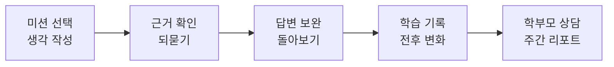
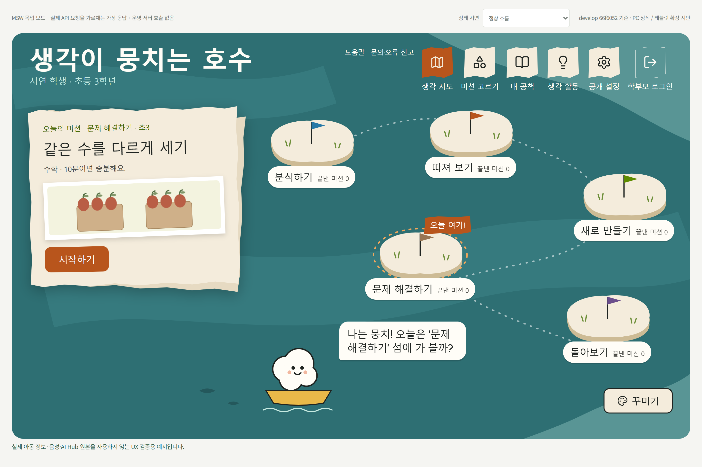
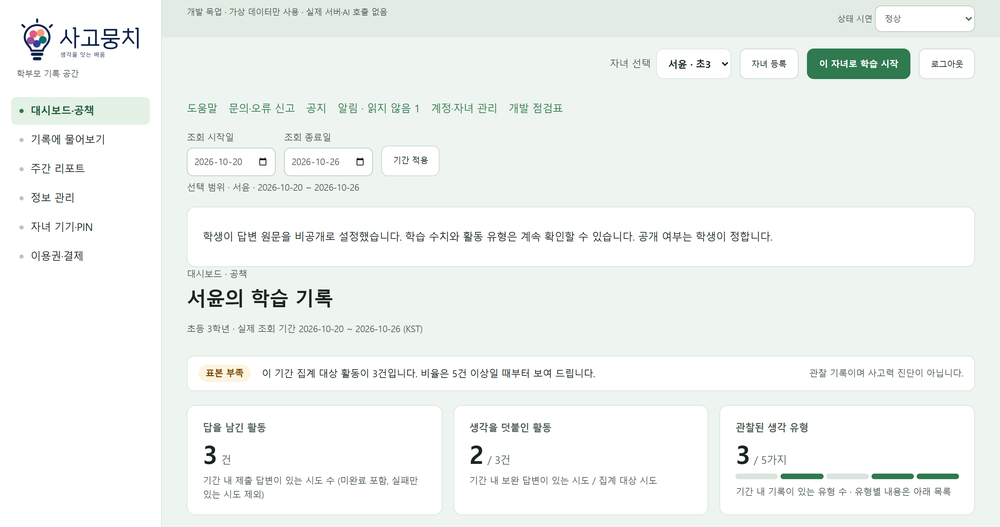
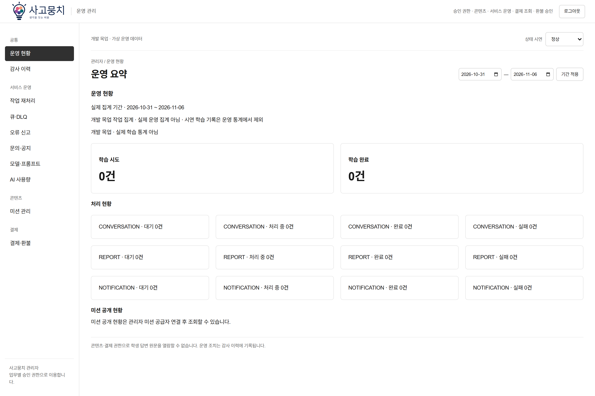
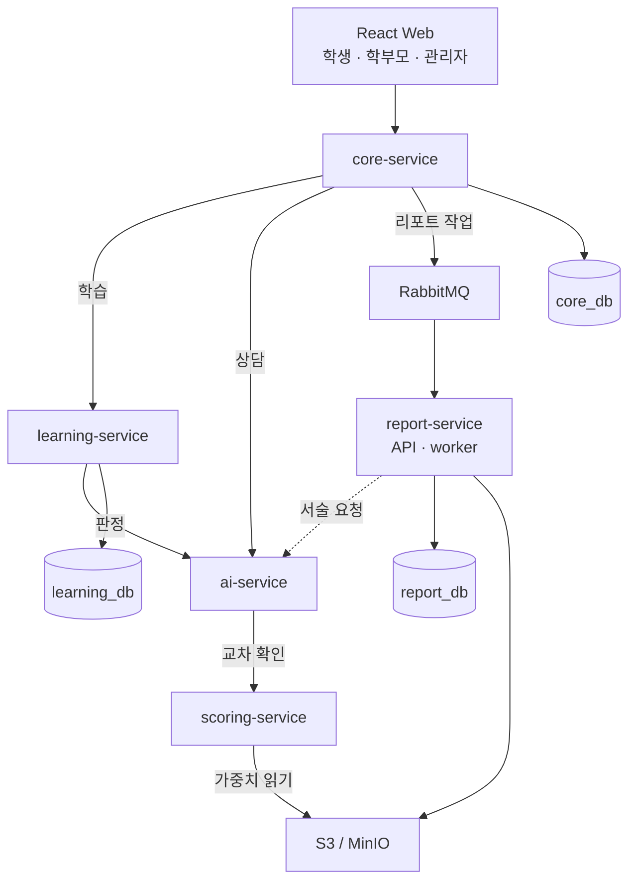
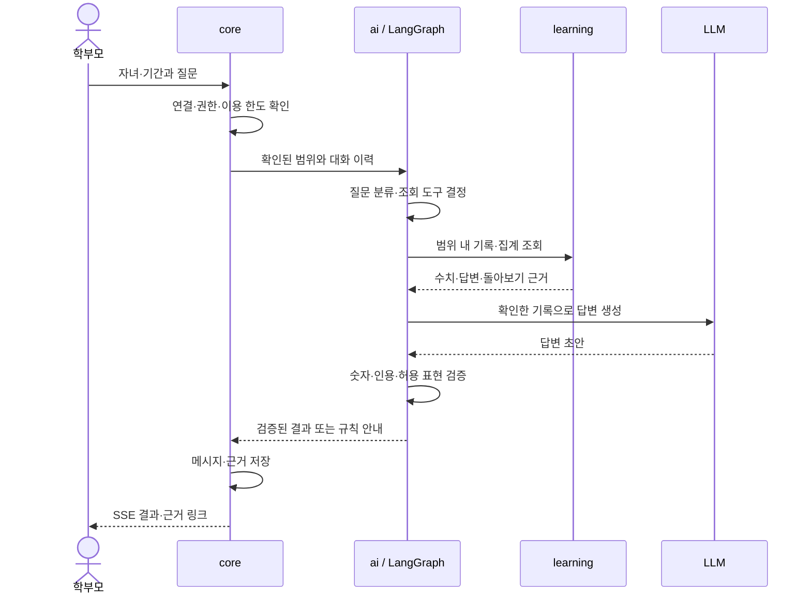
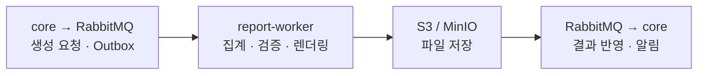

<div align="center">

# 💡 사고뭉치

### 아이의 생각을 기록하고, 그 기록을 학부모가 대화로 분석하는 사고력 학습 플랫폼

**미션을 풀고 → 질문을 받고 → 생각을 보완하고 → 함께 돌아봅니다.**

학생의 답변과 되묻기 전후 변화를 기록하고, 학부모에게 근거가 있는 분석 상담과 주간 리포트를 제공합니다.


**SK Networks Family AI Camp 34기 · 최종 프로젝트 · 3팀**<br/>
김태윤 · 김동섭 · 김재현 · 최인영 · 최성욱 · 황수빈

[서비스 화면](#experience) · [시스템 구조](#architecture) · [AI 평가 결과](#models) · [빠른 실행](#getting-started) · [설계 문서](#team-docs)

</div>

> **작성 기준: 2026-11-06, develop 반영 내용.** 구현 상태와 품질 검증·활성화 상태를 구분합니다. 화면은 현재 코드의 합성 데이터 시연이며, 결제는 토스페이먼츠 테스트 환경입니다.

## 목차

1. [사고뭉치 소개](#overview)
2. [사고뭉치 사용해 보기](#experience)
3. [기술 스택과 선정 이유](#tech-stack)
4. [시스템 아키텍처와 데이터 구조](#architecture)
5. [핵심 기능의 구현 과정](#pipelines)
6. [데이터와 AI 모델 검증](#models)
7. [결과의 근거 확인과 학생 데이터 보호](#trust)
8. [실행 방법과 배포 환경](#getting-started)
9. [개발 성과와 개선 과제](#results)
10. [팀원과 프로젝트 문서](#team-docs)

---

<a id="overview"></a>
## 1. 사고뭉치 소개

### 1.1 해결하려는 문제

정답만으로는 학생이 어떤 이유로 답했는지, 질문을 받은 뒤 무엇을 보완했는지 알기 어렵습니다. 학부모도 결과를 확인하는 데서 나아가 자녀와 어떤 이야기를 나눌지 판단할 자료가 필요합니다.

사고뭉치는 학생이 직접 생각을 쓰고 다시 살펴보는 과정을 기록합니다. 이 기록을 학부모가 질문으로 탐색하고, 주간 리포트로 확인할 수 있도록 **학습 → 기록 → 분석 → 대화**를 연결합니다. 과정 공통 주제인 **대화형 데이터 기반 분석 에이전트 및 자동 리포팅 플랫폼**을 초등학생 사고력 학습에 적용한 프로젝트입니다.

| 사용자에게 필요한 것 | 사고뭉치의 접근 | 남기는 기록 |
|---|---|---|
| 답을 쓰기까지의 생각을 살펴보기 | 미션별 기준표로 답변 근거를 확인하고 되묻기 제공 | 답변 버전, 판정 요소, 근거 구절, 되묻기 |
| 질문 이후의 변화를 확인하기 | 첫 답변·보완 답변과 돌아보기를 연결 | 전후 답변, 학습 시도, 자기 평가, 돌아보기 |
| 자녀 기록을 이해하고 대화 시작하기 | 학습 기록을 조회하는 분석 에이전트와 주간 리포트 | 수치의 분자·분모, 원문 근거, 저녁 대화 질문 |
| 콘텐츠와 AI 결과를 계속 관리하기 | 관리자 검토·게시, 신고·정정, 모델 승인·복귀 | 미션·기준표·모델 버전, 처리 이력, 감사 기록 |

### 1.2 대상과 학습 범위

- **학생:** 초등학교 3–6학년 중심. 국어 서술·논술을 우선하며, 문제 해결하기에는 수학 풀이를 포함합니다.
- **학부모:** 자녀 등록·학습 기록 조회·분석 상담·주간 리포트·이용권을 관리합니다.
- **관리자:** 미션·기준표와 모델 버전, 신고·정정, 실패 작업과 결제를 운영합니다.
- **생각 유형:** 분석하기 · 따져 보기 · 새로 만들기 · 문제 해결하기 · 돌아보기.
- **입력 형식:** 고르기 · 순서 · 분류 · 풀이 과정 · 서술 · 논술. 서비스가 지원하는 입력과 M2가 채점하는 서술·논술 범위는 구분합니다.

학생이 직접 작성하도록 설계했으며, 사고력 진단이나 성적 향상 효과를 검증한 서비스는 아닙니다. 숫자 레벨·등급은 품질 검증 전까지 학생·학부모에게 공개하지 않습니다.

[기능 명세](docs/design/functional-spec.md) · [기획 결정·모델 평가 해석](docs/report/planning-decisions.md)

<a id="experience"></a>
## 2. 사고뭉치 사용해 보기

### 2.1 학생의 학습이 학부모의 대화로 이어지는 과정



| 단계 | 사용자가 하는 일 | 서비스가 제공하는 것 |
|:---:|---|---|
| 1 | 학부모가 가입·동의 후 자녀와 기기를 등록 | 학생별 접근 범위, 기기 연결·PIN, 보호자 복귀 경로 |
| 2 | 학생이 미션을 고르고 답변 작성 | 여섯 입력 형식, 초안 자동 저장, 생각 열기·메모 |
| 3 | 판정과 질문을 확인하고 생각 보완 | 기준표 요소별 근거, 한 걸음 더·더 말해 보기·다시 살펴보기 |
| 4 | 마무리와 돌아보기 기록 | 마무리 조건을 충족한 뒤 정답·예시 답 공개, 자기 평가, 이전 시도 비교 |
| 5 | 학부모가 자녀·기간을 골라 기록에 질문 | 학습 기록 조회·계산, 숫자·인용 확인을 거친 답변과 근거 |
| 6 | 주간 리포트를 확인하고 자녀와 대화 | 유형별 관찰 기록, 되묻기 전후 변화, 돌아보기, 저녁 질문 |

**학생 화면: 미션과 다섯 가지 생각 유형**



**학부모 화면: 자녀별 기록을 확인하는 공책**



<details>
<summary>관리자 운영 화면 보기</summary>



</details>

세 화면은 2026-11-06 기준 개발용 MSW 합성 데이터로 촬영했습니다. 화면 속 이름·학습 건수·운영 지표는 실제 사용자 자료나 성능 측정값이 아닙니다. [화면 구현·시연 안내](docs/report/frontend.md)

### 2.2 기록이 답변의 근거가 되는 예시

> **학부모 질문:** “질문을 받고 뭐가 달라졌어?”

에이전트는 선택한 자녀·기간의 기록을 조회합니다. 되묻기를 받은 활동 수와 답변을 보완한 활동 수를 확인하고, 전후 답변을 근거로 연결합니다. 글자 수나 문장 수의 변화도 관찰한 값으로 설명하며, 이를 사고력 향상 점수로 바꾸지 않습니다.

[분석 대화 구현·응답 예시](docs/report/ai.md) · [학습 기록·비교](docs/report/learning.md)

<a id="tech-stack"></a>
## 3. 기술 스택과 선정 이유

| 영역 | 사용 기술 | 역할·선정 이유 |
|---|---|---|
| **Web** | React 19, TypeScript 6, Vite 8, Tailwind CSS 4, React Router, TanStack Query | 학생·학부모·관리자 화면, 역할별 이동, 서버 상태·자녀별 조회 관리 |
| **업무 API** | Kotlin 2.2, Spring Boot 3.5, JDK 21, MyBatis, Flyway | 계정·권한·학습·결제의 트랜잭션과 SQL, 버전별 DB 변경 |
| **메시징·복구** | Spring AMQP, ShedLock, Resilience4j | 이벤트 처리, 중복 스케줄 방지, 하위 서비스 장애 격리 |
| **AI 에이전트** | Python 3.12, FastAPI, Pydantic, LangGraph, httpx | 구조화된 LLM 출력, 기록 조회 도구, 조건 분기와 스트리밍 |
| **LLM 연동** | OpenAI 호환 API, Anthropic API | 판정 근거 추출·되묻기·분석·리포트 서술. 제공자·모델은 설정으로 선택 |
| **글 점수 모델** | PyTorch, Hugging Face Transformers, KLUE/RoBERTa | M2 학습·평가·추론. 모델 가중치와 메타데이터를 함께 검증 |
| **리포트** | SQLAlchemy, Alembic, Jinja2, Playwright | 집계·작업 상태 저장, HTML 기반 PDF·Markdown 생성 |
| **DB·파일** | PostgreSQL 17, AWS RDS, S3, MinIO | 서비스별 데이터 소유권과 무결성, 파일·모델 가중치 분리 저장 |
| **이벤트·중계** | Redis 8, RabbitMQ 4 | Redis는 기기 페어링·요청 제한·알림 중계, RabbitMQ는 생성 작업·완료·삭제·버전 이벤트 |
| **인증·결제** | Google OAuth/OIDC, JWT, 토스페이먼츠 테스트 SDK·API | 보호자 로그인·재인증, 학생 세션, 테스트 결제·구독·환불 |
| **컨테이너·배포** | Docker Compose, kind, Kubernetes, Helm, AWS EKS | 로컬 통합 환경과 클러스터 배포. AWS는 승인 후 Helm으로 적용 |
| **AWS 기반 구성** | ALB, CloudFront, ECR, Secrets Manager, External Secrets | 진입 경로, 이미지 저장, 환경별 비밀 값 주입 |
| **CI·GitOps** | GitHub Actions, Argo CD | 테스트·계약 검사·이미지 빌드·배포. Argo CD는 로컬 kind GitOps 환경에서 사용 |
| **관측·확장** | Prometheus, Grafana, OpenTelemetry, Langfuse, HPA, Karpenter | 서비스·LLM 관측 구성과 확장. 실제 적용·시험 범위는 [배포 현황](#deployment)에서 구분 |
| **테스트** | JUnit 5, Testcontainers, pytest, Ruff, Playwright, MSW, k6 | 단위·통합·계약·화면·E2E·부하 시험 |

버전은 [Web 의존성](frontend/web/package.json), [Spring 빌드 설정](backend/core-service/build.gradle.kts), [scoring 의존성](backend/scoring-service/pyproject.toml), [Compose](compose.yaml)를 기준으로 정리했습니다. 상세 선정 근거는 [아키텍처](docs/design/architecture.md)에 기록합니다.

<a id="architecture"></a>
## 4. 시스템 아키텍처와 데이터 구조

### 4.1 다섯 서비스의 책임

웹의 업무 API 진입점은 core-service입니다. 내부 서비스는 API와 이벤트로 연결하고, 다른 서비스의 DB를 직접 조회하지 않습니다.



| 서비스 | 담당 업무 | 영속 저장소 |
|---|---|---|
| **core-service** | 계정·동의·자녀 연결, 상담·근거, 대시보드, 결제·이용권, 관리자·감사 | core_db |
| **learning-service** | 미션·기준표·성취기준, 답변 버전, 판정·되묻기, 돌아보기·학습 기록 | learning_db |
| **ai-service** | LLM 근거 추출·되묻기, LangGraph 분석, 리포트 서술·설정 제안 | 업무 DB 없음. 결과는 해당 업무 소유 서비스가 저장 |
| **scoring-service** | 모델 등록 정보 동기화, 가중치 로딩·검증, M2 추론 | 업무 DB 없음. 객체 저장소와 로컬 모델 캐시 사용 |
| **report-service** | 비동기 생성·삭제, 수치·서술 검증, 파일 렌더링·조회 | report_db, S3·MinIO |

그림은 주요 업무 경로와 데이터 소유 관계를 요약합니다. ai·report의 learning 기록 조회, core의 report 조회, Redis 중계와 완료·삭제·모델 버전 이벤트 등 전체 연결은 [아키텍처](docs/design/architecture.md), 호출별 계약은 [API 명세](docs/design/api-spec.md)를 따릅니다.

### 4.2 전체 ERD

[](docs/assets/readme/erd-overview.png)

제출 산출물의 전체 ERD입니다. 이미지를 클릭하면 원본 크기로 볼 수 있습니다. 이후 변경된 스키마·제약 조건은 [ERD 명세](docs/design/erd.md)와 [DB 변경 이력](docs/report/db-dev-guide.md)에서 확인할 수 있습니다.

<a id="pipelines"></a>
## 5. 핵심 기능의 구현 과정

### 5.1 학생 답변 → 판정 → 되묻기

1. core가 학생 세션·접근 범위를 확인하고 learning에 요청을 전달합니다.
2. learning은 시도·답변 버전을 저장합니다. 중복 요청과 동시에 진행되는 제출을 제어합니다.
3. 고르기·순서·분류·수학 최종 답은 규칙으로 확인합니다. 서술·논술과 풀이 단계는 기준표 요소에 대해 LLM이 근거를 찾고 코드가 원문과 대조합니다.
4. 조건이 충족될 때만 M2로 서술·논술을 교차 확인합니다. 근거 부족·보류·처리 실패는 서로 다른 상태로 기록합니다.
5. 판정에 맞는 되묻기를 생성하고 정답·예시 답 유출을 검사합니다. 생성이 유효하지 않으면 질문 은행을 사용합니다.
6. 학생 화면에 SSE로 상태를 전달합니다. 마무리 조건을 충족한 뒤 정답·예시 답을 공개하고, 돌아보기와 자기 평가를 저장합니다.

학생은 생각 열기·메모·초안 자동 저장을 사용할 수 있고, 같은 미션의 이전 답변과 이번 답변을 비교할 수 있습니다. 답변 표현 필터, 지연된 판정 탐지, 실패한 피드백 재요청도 포함합니다.

[판정·되묻기](docs/report/ai.md) · [학습 처리·예외](docs/report/learning.md) · [상태 전이](docs/design/state-diagram.md)

### 5.2 학부모 질문 → 기록 조회 → 근거 있는 답변



LangGraph는 질문 분류·조회·계산·답변·검증 분기를 연결합니다. 자녀·기간은 core가 확인한 범위만 사용합니다. 수치는 학습 서비스의 집계 계약을 따르며, 조회 실패를 “기록 없음”으로 바꾸지 않습니다. 기록이 부족하면 그 사실을 안내하고, LLM 장애·검증 실패에는 규칙 응답을 사용합니다. 규칙 응답을 포함한 최종 검증도 실패하면 오류로 종료합니다.

스트리밍 중의 문장은 임시 표시이며, 최종 `result`로 확정합니다. 사용자가 화면을 떠나면 진행 중인 스트림을 취소합니다. [분석 에이전트](docs/report/ai.md) · [core 저장·권한·재시도](docs/report/core-gateway.md)

### 5.3 주간 리포트 생성과 실패 복구



- 수치에는 분자·분모·계산 기준을 함께 보존합니다. 리포트의 관찰 기록에는 생각 유형·필수 요소, 되묻기 전후 변화, 돌아보기가 포함됩니다.
- 이용권과 학생 공개 설정에 맞는 내용을 제공하며, 원문을 비공개로 둔 학생의 답변을 노출하지 않습니다.
- 학부모가 대화로 표시 설정을 요청하면 AI가 변경안을 만들고, 사용자 확인 후 core가 저장합니다. 수치 계산식이나 학생 공개 권한을 이 경로로 변경하지 않습니다.
- 발행 실패 격리·재시도, 중복 소비 방지, 완료 이벤트 유실 복구, 관리자 재처리로 작업을 추적합니다. 재처리는 원작업과 새 작업의 관계를 남깁니다.

[리포트 생성·설정·복구](docs/report/report.md) · [이벤트 계약](contracts/events)

### 5.4 관리자 콘텐츠·모델·지원 운영

| 운영 대상 | 구현된 흐름 | 현재 구분할 상태 |
|---|---|---|
| **미션·기준표** | 작성·버전 관리 → 미리보기 → 검토 → 게시·중단 | 편집본과 공개본을 분리하고 게시 시 누락 항목 검사 |
| **성취기준 기반 미션 초안** | 기준 선택 → LLM 생성 → 자동 검사·재생성 → 채택 → 검토·게시 | learning·ai·core 구현 반영. 관리자 화면 연결은 후속 작업 |
| **모델·프롬프트** | 평가 근거 등록 → 사람 승인·범위 선택 → 활성화 이벤트 → 서비스 적용·복귀 | 등록과 활성화는 별도. 평가 범위를 벗어난 활성화 차단 |
| **신고·문의·공지** | 접수 → 권한 있는 원문 조회 → 검토·응답·판정 정정 → 처리 결과 확인 | 원판정·원답변 보존, 정정의 파생 결과 반영 상태를 구분 |
| **운영 작업** | 상태·큐·감사 이력 조회 → 실패 리포트·분석 대화 재처리 | 접수·실행·완료를 구분하고 중복 처리·감사 누락 방지 |

성취기준 표는 2022 개정 현행 **765개**를 사용합니다. 기존 데모 미션은 초3–6의 다섯 생각 유형에 대응하는 **20개 시드**이며, 데이터에 있는 시드 수와 환경별 공개 미션 수는 다를 수 있습니다.

[미션 초안·성취기준](docs/report/learning.md) · [모델 레지스트리](docs/report/ai.md) · [관리자·신고·정정](docs/report/support-admin.md)

### 5.5 계정·결제·이용 권한

| 영역 | 처리 흐름 |
|---|---|
| 보호자·학생 인증 | Google 로그인·동의 → 자녀 등록 → 기기 페어링·PIN → 학생 세션 → 보호자 재인증·복귀 |
| 자녀별 이용권 | 테스트 결제·구독 → 상품 권한 확인 → 분석 상담·리포트 제공 범위 적용 → 사용량 기록 |
| 해지·환불 | 요청 → 환불 적격성 재검사 → PG 처리·대조 → 최종 상태 반영. 승인 접수와 환불 완료 구분 |
| 알림 | 업무 변경과 영속 알림 저장 → Redis 중계 → SSE → 사용자 확인 |
| 이관·계정 종료 | 이관 대상 확인·요청 → 상대방 수락·연결 교체, 또는 삭제·탈퇴 절차. 상세 보호 규칙은 [7장](#trust) 참고 |

결제·구독·환불은 **토스페이먼츠 테스트 환경**입니다. 무료 플랜의 미션 일일 한도는 현재 미구현이며 후속 범위로 남깁니다. [결제·권한 공급](docs/report/payment.md) · [계정·기기](docs/report/auth-account.md)

<a id="models"></a>
## 6. 데이터와 AI 모델 검증

### 6.1 데이터와 역할 분담

| 데이터·모델 | 용도 | 처리·검증 기준 |
|---|---|---|
| **AI Hub 71818** | M2 서술형 글 점수 학습·평가 | 가림 표시·중복 정리, 주제 단위 평가, 전문가 점수와 비교 |
| **AI Hub 545 에세이** | M2 논술형 글 점수 학습·평가 | 학습·평가에 걸친 중복 제거, 채점하지 않은 세부 항목(가중치 0)의 0점은 평균·학습 대상에서 제외, 학습한 주제와 처음 보는 주제 분리 보고 |
| **AI Hub 71716** | M1 수학 풀이 점검 연구 | 유사 문항 그룹 단위 분할·규칙 기준선 평가. 본 학습 전 |
| **성취기준·자체 미션·기준표** | 서비스 콘텐츠와 요소별 판정 | 초안 자동 검사와 사람 검토·게시, 버전 기록 |
| **자체 판정 평가 답안** | LLM 판정의 요소·결과 일치도 확인 | 대표 5미션 × 20답안, 평가자 2명의 독립 표시. LLM 초안을 활용한 평가용 예시이며 실제 학생 글은 아님 |

학습용 원본·가공 데이터와 가중치는 Git에 넣지 않습니다. AI Hub 자료를 외부 LLM API로 보내지 않으며, 서비스 미션은 자체 콘텐츠를 사용합니다. [M2 학습 코드](ml/m2) · [M1 연구 코드](ml/m1) · [판정 평가 데이터 안내](evaluation/datasets/judgment/README.md)

### 6.2 M2 서비스 입력·출력

| 구분 | 서술형 | 논술형 |
|---|---|---|
| 모델 | `m2-klue-narrative` **3.0** | `m2-klue-essay` **3.1** |
| 적용 대상 학년, 11/2 결정 | 초5·6 | 초4·5·6 |
| 기반 | KLUE/RoBERTa 회귀 | KLUE/RoBERTa 회귀 |
| 입력 | 학년·핵심어 + 학생 글 | 학년·글 종류 + 학생 글 |
| 출력 | 9항목 | 학습 출력 14개 중 구성·내용·표현 3영역 |
| 서비스 점수 | 소수 원점수와 정수 점수. 총점 1–4, 나머지 1–5 | 소수 원점수와 정수 점수 0–3 |
| 점수 변환 | 담당자 제공 `score_cuts.json` | 담당자 제공 `score_cuts.json` |

11월 2일 결정한 적용 대상은 **서술 초5·6, 논술 초4·5·6**입니다. 지시문은 새 모델 입력에 넣지 않습니다. 실제 추론은 해당 배포 환경의 활성 모델과 학년·입력 조건·승인 범위를 확인한 뒤 수행하며, 미승인·미활성 모델은 비활성 응답으로 처리합니다.

### 6.3 M2 평가 결과와 해석

아래는 **M2 담당자가 전달한 발표용 평가 결과**입니다. 수치는 모델 점수와 전문가 평균의 **Pearson 상관**이며 정확도나 QWK가 아닙니다. 처음 보는 주제 결과는 서비스 후보와 같은 설정으로 일부 주제를 제외해 학습한 평가용 모델에서 측정했습니다.

| 평가 조건 | 서술 3.0 설정 | 논술 3.1 설정 |
|---|---:|---:|
| **처음 보는 주제** | **0.538**: 3개 fold 평균, 범위 0.516–0.551 | **0.452**: 분할 3회 평균, 범위 0.398–0.507 |
| 학습한 주제의 새로운 글 | 0.685: VL 4,000편 | 0.700: VL 5,883편 |
| 사람끼리 상관, 참고 | 1대1 0.694 | 처음 보는 주제 1대1 0.560, 학습한 주제 1대1 0.718 |

처음 보는 주제에서 성능이 낮아지며, 사람끼리 수치와 모델 수치는 비교 대상의 평균 방식도 다릅니다. 과거 모델의 QWK와 위 Pearson 값을 개선 전후 수치로 연결하지 않습니다. [과거 평가 조건·변경 이력](docs/report/planning-decisions.md)

11월 4일 추가 지식증류 학습을 중단하고 논술 서비스 모델 3.1을 유지하기로 결정했습니다. 별도 LLM 판정 평가 자료는 100건·평가자 2명으로 준비됐으며, **사람끼리 QWK 0.809는 AI 성능값이 아닙니다.** 모델 품질 승인과 자체 미션 검증은 별도로 진행합니다.

### 6.4 구현과 활성화 상태

| 기능 | 현재 상태 | 적용 조건 |
|---|---|---|
| M2 3.0·3.1 로딩·추론 | 서비스 호환·등록·추론 검증 반영 | 가중치·메타데이터, 활성 버전·승인 범위 필요 |
| M2 판정 교차 확인 | 구현, **기본 꺼짐** | `M2_CROSS_CHECK_ENABLED=true`와 유효한 입력·활성 모델 |
| 서술 `content_3` 보정 | 구현·회귀 테스트, **기본 꺼짐** | `M2_CONTENT3_RULE_ENABLED=true`, 승인된 서술 3.0·초5–6만 |
| M1 수학 풀이 모델 | 데이터 처리·규칙 기준선 평가, **본 학습 전** | 서비스는 미학습 비활성 계약 유지 |
| 판정 품질 평가 | 평가 러너·자료 v1 반영 | 실제 LLM 평가·허용 기준·서비스 범위별 승인 필요 |

`content_3` 후보 규칙은 모델 원점수와 핵심어 포함 비율을 결합합니다. 나머지 8항목·논술·다른 버전의 채점은 유지하며, 설정을 끄면 기존 점수 경계로 돌아갑니다. 경계값은 임시값이며 파일 업로드나 배포만으로 활성화하지 않습니다.

[모델 호환·보정·교차 확인](docs/report/ai.md) · [모델 로딩·활성 버전 동기화](docs/report/scoring.md)

<a id="trust"></a>
## 7. 결과의 근거 확인과 학생 데이터 보호

### 7.1 어떤 기록으로 설명했는지 확인합니다

| 확인 지점 | 구현 방식 | 해석 범위 |
|---|---|---|
| 판정의 근거 구절 | LLM이 추출한 구절을 학생 답변 원문과 대조 | 원문 일치를 검사하며 내용의 교육적 타당성은 별도 평가 |
| 상담·리포트의 숫자 | 기록에서 계산한 수치·분자·분모와 대조 | 기록이 부족하면 비율 대신 건수·부족 상태 안내 |
| 인용의 출처 | 답변 ID·버전, 시도·돌아보기와 연결 | 삭제·접근 불가 근거는 이용 불가로 처리 |
| 답변 전후 변화 | 제출 답변을 버전별로 보존하고 비교 | 글의 길이 변화 등을 사고력 점수로 단정하지 않음 |
| 검증 실패 | 규칙 응답·보류·오류로 구분 | 자연어 전체의 의미 정확성을 자동으로 보장하지 않음 |

### 7.2 계정과 학생 기록의 생명주기를 관리합니다

- **동의·접근:** 법정대리인 동의, 현재 보호자 연결, 학생 범위를 확인합니다. 학생·학부모·관리자의 접근 경로와 권한을 구분합니다.
- **공개 설정:** 학생 원문 공개 여부를 기록·상담·리포트 조회에 반영합니다. 메모는 학생 본인만 열람합니다.
- **LLM 입력·로그:** 학생 이름·ID를 LLM 요청의 별도 메타데이터로 전달하지 않고, 운영 로그에 학생 원문·비밀 키·결제 정보를 남기지 않는 구조를 사용합니다.
- **학부모 간 이관:** 상대방 조회·요청 → 수락·재인증 → 현재 보호자 연결 교체를 처리합니다. DB에서도 학생당 현재 보호자는 한 명만 허용합니다. 상담 대화는 선택한 범위만 이전합니다.
- **이관 대기:** 탈퇴·삭제·연결 해제를 차단합니다. 기존 요청 조회·취소·거절은 신규 이관 기능을 꺼도 가능하며, 취소만으로 탈퇴가 실행되지는 않습니다.
- **삭제·탈퇴:** 재인증 후 요청을 접수하고 서비스별 삭제·완료 보고를 추적합니다. 접수와 실제 삭제 완료를 구분하며, 삭제 중 새 작업의 생성·조회도 제어합니다.

[동의·기기·이관·공개 설정](docs/report/auth-account.md) · [리포트 삭제](docs/report/report.md) · [데이터 관계·무결성](docs/design/erd.md)

<a id="getting-started"></a>
## 8. 실행 방법과 배포 환경

### 8.1 빠른 실행

**필수 환경:** Git, Docker Engine·Compose v2, Node.js 22·npm. 백엔드를 컨테이너 밖에서 개발할 때는 JDK 21과 Python 3.12·uv를 사용합니다. Node 버전은 [Web CI](.github/workflows/_web.yml)의 설정을 기준으로 맞춥니다.

저장소를 받은 뒤 루트에서 다음 순서로 실행합니다. 이미 `.env`가 있다면 복사 단계를 건너뜁니다.

```sh
git clone https://github.com/SKNETWORKS-FAMILY-AICAMP/SKN34-FINAL-3TEAM.git
cd SKN34-FINAL-3TEAM
git switch develop
cp .env.example .env
```

Windows PowerShell에서는 복사 명령으로 `Copy-Item .env.example .env`를 사용할 수 있습니다. `.env`의 DB·RabbitMQ 비밀번호, 내부 토큰, JWT 서명 키를 먼저 채우고 실제 로그인·AI 기능에 필요한 Google OAuth와 선택한 LLM 제공자 설정을 입력합니다.

```sh
# 저장소 루트: 인프라·마이그레이션·백엔드
docker compose up -d --build

# 별도 터미널: 웹
cd frontend/web
npm ci
npm run dev
```

| 대상 | 기본 주소 | 용도 |
|---|---|---|
| Web | http://localhost:5173 | 학생·학부모·관리자 화면, `/api`를 core로 프록시 |
| core-service | http://localhost:8080 | 공개 업무 API |
| learning-service | http://localhost:8081 | 로컬 내부 API 확인 |
| ai-service | http://localhost:8000 | 로컬 AI API 확인 |
| scoring-service | http://localhost:8001 | 로컬 모델 API 확인 |
| report-api | http://localhost:8002 | 로컬 리포트 API 확인 |
| RabbitMQ 관리 | http://localhost:15672 | 로컬 큐·이벤트 확인 |
| MinIO, 선택 실행 | http://localhost:9000 / http://localhost:9001 | 객체 API / 관리 화면 |

기본 Compose에는 MinIO가 포함되지 않습니다. 로컬 객체 저장소가 필요하면 아래 선택 설정을 적용합니다. 서비스 기동만으로 미션 시드·모델 가중치·평가 승인이 준비되는 것은 아닙니다.

<details>
<summary>MinIO 선택 실행·포트 변경</summary>

루트 `.env`에 `MINIO_ROOT_USER`(3자 이상)와 `MINIO_ROOT_PASSWORD`(8자 이상)를 설정한 뒤 실행합니다.

```sh
docker compose -f compose.yaml -f compose.minio.yaml up -d minio
docker compose -f compose.yaml -f compose.minio.yaml run --rm minio-init
docker compose -f compose.yaml -f compose.minio.yaml up -d --build
```

버킷을 초기화하고 report·scoring에 MinIO 접속 설정을 반영합니다. 이후 설정 적용·종료에도 같은 `-f` 조합을 사용합니다. 데이터를 보존하려면 종료 명령에 `--volumes`를 붙이지 않습니다.

앱 포트 충돌 시 `.env`의 `CORE_HOST_PORT`·`LEARNING_HOST_PORT`·`AI_HOST_PORT`·`SCORING_HOST_PORT`·`REPORT_HOST_PORT`를 변경합니다. core 포트를 바꿨다면 웹 실행 터미널에도 `CORE_HOST_PORT`를 설정해야 합니다. 예를 들어 PowerShell에서는 `$env:CORE_HOST_PORT = '18080'`을 실행한 뒤 `npm run dev`를 사용합니다.

</details>

**화면만 살펴보기:** 실제 백엔드·외부 키 없이 현재 MSW 화면을 확인할 수 있습니다. 아래는 PowerShell 예시입니다.

```powershell
cd frontend/web
npm ci
$env:VITE_API_MOCK = 'true'
$env:VITE_SHARED_DEVICE_MOCK = 'false'
npm run dev
```

실제 연동으로 돌아갈 때는 해당 프로세스를 종료하고 위 두 환경 변수를 제거한 뒤 웹을 다시 실행합니다. 시연 로그인은 개발 전용이며 운영 빌드에는 포함되지 않습니다.

### 8.2 설정과 기본 동작

| 설정 | 용도·기본 동작 |
|---|---|
| `POSTGRES_*`, 서비스별 `*_MIGRATE_PASSWORD`·`*_APP_PASSWORD` | 초기 DB 관리자, DDL 마이그레이션 계정과 DML 앱 계정 분리 |
| `RABBITMQ_*`, `INTERNAL_TOKEN`, `AUTH_JWT_SECRET` | 메시징·내부 호출·JWT 서명. 실제 값은 Git에 저장하지 않음 |
| `GOOGLE_CLIENT_ID`·`GOOGLE_CLIENT_SECRET`, `AUTH_WEB_ORIGIN` | Google 로그인·재인증 콜백과 웹 주소 |
| `LLM_PROVIDER`, 선택한 제공자의 키·모델 | LLM 호출. 기본 모델값은 `.env.example`과 실행 환경 확인 |
| `M2_CROSS_CHECK_ENABLED=false` | M2를 호출하지 않음. 켠 경우에도 scoring 장애는 교차 확인 생략 사유를 기록하고 LLM 판정을 이어감 |
| `M1_CHECK_ENABLED=false` | M1 점검 비활성. 학습·입력 연동·품질 승인은 별도 |
| `M2_CONTENT3_RULE_ENABLED=false` | content_3 보정 비활성, 기존 점수 경계 유지 |
| `APP_GUARDIAN_TRANSFER_ENABLED=false` | 신규 이관 대상 조회·요청·수락 비활성. 기존 요청 정리·보호 규칙 유지 |
| `VITE_GUARDIAN_TRANSFER_ENABLED=false` | 웹의 신규 이관·수락 동작 노출 제어. 기존 요청 관리 경로 유지 |

환경 변수 목록과 Google OAuth 콜백 설정은 [.env.example](.env.example)을 참고합니다. 기능 플래그의 현재 동작은 위 표를 기준으로 합니다. 설정 변경 뒤 `docker compose up -d ai-service core-service scoring-service`로 해당 컨테이너를 재생성하고, 웹 플래그는 웹 실행·빌드에 반영합니다. MinIO를 사용했다면 같은 `-f` 조합을 유지합니다. `restart`만으로는 환경 변수가 갱신되지 않습니다. 복귀할 때는 플래그를 기본값으로 돌리고 같은 절차를 적용합니다.

### 8.3 개발 중 검증

아래 명령은 각 디렉터리에서 실행합니다. Spring 통합 테스트에는 Docker가 필요하며, 브라우저 테스트는 Playwright Chromium 설치가 필요합니다.

| 위치 | 명령 | 확인 범위 |
|---|---|---|
| `frontend/web` | `npm run lint`, `npm run test:types`, `npm test`, `npm run build` | 정적 검사·타입·Web 단위 검사·빌드 |
| `frontend/web` | `npx playwright install chromium`, `npm run test:browser` | MSW 기반 역할별 화면 회귀 |
| `backend/core-service`, `backend/learning-service` | `./gradlew test` / Windows `./gradlew.bat test` | JUnit·Testcontainers |
| `backend/ai-service`, `backend/scoring-service`, `backend/report-service` | `uv sync`, `uv run ruff check .`, `uv run ruff format --check .`, `uv run pytest` | Python 정적 검사·단위·통합 테스트 |
| 저장소 루트 | `python -O -m unittest discover -s scripts/tests -v` | 저장소 계약 검증기의 회귀 검사. 의존성은 [계약 CI](.github/workflows/ci-contracts.yml) 참고 |

실서비스 E2E는 별도 Compose 스택을 사용합니다. [E2E 실행 절차와 외부 스텁 범위](docs/report/testing-ci.md)를 따라 실행하며, 일반 MSW 화면 테스트와 구분합니다.

<a id="deployment"></a>
### 8.4 환경별 배포와 관측

| 환경 | 구성·배포 방식 | 현재 확인 범위 |
|---|---|---|
| **로컬 개발** | Docker Compose + Vite, 선택 MinIO | 서비스 통합·기능별 재현 |
| **로컬 Kubernetes** | kind·Calico·Ingress·Helm·Argo CD | GitOps 동기화·네트워크 정책·관측 구성 |
| **AWS 데모** | CloudFront·ALB·EKS, RDS·S3, ECR·Secrets Manager | GitHub Actions에서 승인 후 Helm 배포, 배포 후 주요 경로 확인 |
| **관측·확장** | 서비스·큐·DB 지표, 감사·이벤트·LLM 사용량, HPA·Karpenter | core·learning·ai HPA 반영. 부하에 따른 Karpenter 확장·축소 실측과 scoring·worker 확장은 후속 검증 |

```text
feature 브랜치 → develop 통합·CI → main 배포 기준
  → 릴리스 계획·이미지 준비 → prod 승인
  → Helm 적용 → 배포 후 경로 확인 → 이력·증빙 저장
```

AWS 데모 배포는 **승인된 Helm 적용**입니다. 실패 시 자동 롤백했다고 간주하지 않으며, 배포 이력과 준비된 복귀 절차를 따릅니다.

[로컬 kind](infrastructure/kind/README.md) · [AWS 구축·운영](docs/report/issue-185-aws.md) · [배포 승인·복귀](docs/report/issue-186-cd-approval-rollback.md) · [릴리스 워크플로](.github/workflows/cd-release.yml)

<a id="results"></a>
## 9. 개발 성과와 개선 과제

### 9.1 대표 문제 해결

| 문제 | 원인·해결 | 확인한 결과 |
|---|---|---|
| 새 M2 모델을 기존 서비스 계약으로 연결 | 서술 9출력·논술 14출력 구조와 입력 메타데이터를 구분하고, 논술 앞 3영역을 서비스 점수로 변환 | 두 모델 등록·활성화·실제 로딩·추론과 점수 경계 일치 확인. [#228 기록](docs/report/ai.md) |
| scoring 장애가 판정·되묻기까지 전파 | 교차 확인을 꺼도 scoring을 호출하고 실패를 ai 503으로 전파하던 경로 수정 | 플래그 off 시 미호출, 장애 시 교차 확인 생략 사유 기록. 이미 확정한 판정의 자동 재평가는 없음. [#305 기록](docs/report/ai.md) |
| 탈퇴·이관과 보호자 연결의 정합성 | 상대방 수락·재인증, 잠금 순서, 학생별 현재 연결 고유 제약 적용 | 이관 대기 중 삭제 차단, 동의 누락·기능 off에서도 취소·거절 가능. [#289·#307 기록](docs/report/auth-account.md) |
| 리포트 생성 결과 유실·재처리 중복 | Outbox·중복 소비 방지·완료 상태 복구·원작업과 재처리 작업 연결 | 재전달·실패 격리·관리자 재처리 경로 검증. [리포트 검증](docs/report/report.md) |
| 배포 후 확인이 진행 중 답변을 다시 제출 | 재사용된 학습 시도의 상태를 확인하고 저장된 답변 경로로 처리 | 진행 중 시도에서 재제출 오류를 피하도록 배포 점검 보완. [PR #377](https://github.com/SKNETWORKS-FAMILY-AICAMP/SKN34-FINAL-3TEAM/pull/377) |

### 9.2 통합·E2E 검증

| 검증 계층 | 확인하는 내용 | 결과 해석 |
|---|---|---|
| 단위·서비스 통합 | 권한·상태 전이·동시성·모델 점수 변환·파일 생성·복구 | 서비스별 테스트·보고서에서 조건과 결과 확인 |
| API·이벤트 계약 CI | 실제 core 응답 산출물과 OpenAPI, 서비스 간 계약 | 스키마뿐 아니라 변경된 응답·계약 연결 검사 |
| MSW 화면 회귀 | 학생·학부모·관리자 기능과 오류·반응형 표시 | 합성 데이터 기준, 실제 외부 API 성공을 뜻하지 않음 |
| 브라우저 E2E | 관리자 현황, 학생 학습, 학부모 기록·리포트, 테스트 결제 | 11/02–03 기록: 4개 시나리오 통과. 내부 서비스는 실제 실행, Google·LLM·Toss는 스텁 |

E2E에서 학생 PIN·재인증 팝업, 실제 결제 위젯·정기결제·환불, 실제 LLM 품질 등은 별도 검증 대상입니다. 전체 상태는 각 [워크플로](.github/workflows)와 [테스트 보고서](docs/report/testing-ci.md)를 확인합니다.

### 9.3 AWS 데모 부하 시험

**2026-11-05 k6 1차 시험:** core 1 replica·CPU limit 1, RDS db.t4g.small, LLM 스텁 지연 2.5–4초, 보호자 계정 1개·자녀 3명 조건입니다. 당시 HPA·KEDA는 꺼진 상태였습니다.

| 지표 | 10 VU | 100 VU | 300 VU |
|---|---:|---:|---:|
| API 오류 / 요청 | 0 / 1,200 | 0 / 12,338 | 0 / 40,312 |
| API p95 | 144 ms | 159 ms | 374 ms |
| core 처리량 | 6.4 req/s | 59.3 req/s | 197.4 req/s |
| RDS CPU 최대 | 7% | 24% | 68% |

중간 25 VU 단계에서는 API 오류 1/2,864건이 있었습니다. API 지표는 스트리밍 지연과 다르며, 예상된 학습 경합 응답은 오류율에서 제외했습니다. 계정 1개의 학습 슬롯이 15개로 제한되어 **실제 사용자 300명의 동시 AI 처리 성능을 증명한 시험은 아닙니다.** 전체 단계·시나리오·병목 해석은 [부하 시험 보고서](docs/report/issue-361-load-test.md)에 있습니다.

### 9.4 남은 과제

| 과제 | 다음 확인·개선 |
|---|---|
| AI 품질 승인 | 자체 미션의 사람-AI 비교, 처음 보는 주제 성능, 범위별 허용 기준과 활성화 판단 |
| 모델 운영 편의 | 범위·승인 상태 표시, JSON 등록, 저장소 파일 사전 검사, Pod별 적용 결과 추적 개선 |
| 콘텐츠 공급 | 성취기준 기반 초안의 관리자 화면 연결, 검수·시범 풀이, 공개 미션 확대 |
| 운영 규모 검증 | 시험 계정 확대·실제 LLM 조건, HPA·Karpenter 적용 이후 부하·복구 재검증 |
| 기능 완성도 | 무료 미션 한도, 이관 만료·수신 알림 등 남은 정책·운영 흐름 구체화 |

모델링·기능 구현·운영 품질 검증을 각각 기록하며, 후속 과제를 완료 기능으로 표시하지 않습니다. [열린 이슈](https://github.com/SKNETWORKS-FAMILY-AICAMP/SKN34-FINAL-3TEAM/issues)

<a id="team-docs"></a>
## 10. 팀원과 프로젝트 문서

### 10.1 팀원

역할은 2026-11-05 기획서 v1.1의 분담을 기준으로 하며, 실제 변경 이력은 각 PR에서 확인할 수 있습니다.

| 팀원 | 주요 역할 | 담당 범위 | GitHub |
|---|---|---|---|
| **김&#8288;태&#8288;윤** | PM · Ops | 일정·범위·산출물, 통합 테스트·모니터링·장애 대응 | [kty2001](https://github.com/kty2001) |
| **김&#8288;동&#8288;섭** | APM · Infra | 미션·성취기준 검수, kind·AWS EKS·CI/CD·운영 경보 | [20220348-kim](https://github.com/20220348-kim) |
| **김&#8288;재&#8288;현** | Frontend · LLM | 학생·학부모·관리자 웹, LangGraph 분석 에이전트 | [kim-4480](https://github.com/kim-4480) |
| **최&#8288;인&#8288;영** | Backend · DB | report·scoring, API·백엔드 검증, PostgreSQL 설계·마이그레이션, 자녀 이관 | [inyoung9629](https://github.com/inyoung9629) |
| **최&#8288;성&#8288;욱** | LLM · Backend | 프롬프트·미션 초안·판정·되묻기, learning·ai, 분석 에이전트 설계·검증 | [Overlay1010](https://github.com/Overlay1010) |
| **황&#8288;수&#8288;빈** | ML/DL | M2 학습·평가, 판정 품질 평가 도구·자료, 데이터 전처리 | [subinss838](https://github.com/subinss838) |

### 10.2 문서 바로가기

| 목적 | 문서 |
|---|---|
| 서비스 범위·개발 규칙 | [프로젝트 문서 안내](docs/README.md) · [기능 명세](docs/design/functional-spec.md) · [유스케이스](docs/design/usecase.md) |
| 사용자 경험 | [사용자 흐름](docs/design/user-flow.md) · [화면 설계 안내](docs/screen-design/README.md) |
| 시스템·데이터 구조 | [아키텍처](docs/design/architecture.md) · [ERD](docs/design/erd.md) · [클래스](docs/design/class-diagram.md) |
| API·이벤트·상태 | [API 명세](docs/design/api-spec.md) · [OpenAPI](contracts/openapi) · [이벤트](contracts/events) · [시퀀스](docs/design/sequence-diagram.md) · [상태](docs/design/state-diagram.md) |
| AI·모델 | [AI 구현·검증](docs/report/ai.md) · [scoring](docs/report/scoring.md) · [M2 학습](ml/m2/README.md) · [평가 도구·자료](evaluation) |
| 실행·운영·검증 | [로컬 실행](#getting-started) · [DB 개발](docs/report/db-dev-guide.md) · [테스트·CI](docs/report/testing-ci.md) · [AWS](docs/report/issue-185-aws.md) |
| 기획·제출 이력 | [기획 결정과 변경 근거](docs/report/planning-decisions.md) · [저장소에 보관된 제출 산출물](docs/outputs) |

제출 산출물에는 이전 제출 시점의 문서도 포함됩니다. 현재 구현 계약은 기능·API·ERD와 주제별 구현 보고서를 함께 확인합니다. 개발은 `feature/* → develop → main` 흐름으로 진행합니다.
