# 클래스 다이어그램

- 근거: [아키텍처 설계](architecture.md) 2장(레이어·의존 규칙·폴더), [API 명세서](api-spec.md), [ERD](erd.md), [기능명세서](functional-spec.md)
- 범위: 5개 서비스의 기능별 Presentation · Application · Domain · Infrastructure 클래스와 의존 관계, 공개 메서드 시그니처
- 상태 전이 규칙은 [상태 다이어그램](state-diagram.md), 호출 순서는 [시퀀스 다이어그램](sequence-diagram.md)
- 클래스명은 구현 기준 이름. 필드는 ERD 컬럼과 같아 생략하고 상태 전이·검증 메서드만 표기
- `(P04)` 형태는 확정 정책 번호, 내용은 [기능명세서 1.4](functional-spec.md#14-확정-정책)

---

## 1. 공통 규칙

| 항목 | 규칙 |
|---|---|
| 레이어 표기 | `<<controller>>` `<<consumer>>` `<<scheduler>>` = Presentation / `<<service>>` `<<facade>>` = Application / `<<entity>>` `<<value>>` = Domain / `<<repository>>` `<<client>>` `<<messaging>>` = Infrastructure |
| 화살표 | `-->` 의존(호출), `..>` 생성·반환, `*--` 소유(같은 집합), `<|..` 구현 |
| 의존 방향 | Presentation → Application → Infrastructure 단방향, Domain은 전 레이어가 참조 (아키텍처 2.2) |
| 기능 간 호출 | 상대 기능의 `service`만 호출. 여러 기능 조합은 `facade` |
| 트랜잭션 | `<<service>>`·`<<facade>>` 메서드에서만 시작, 트랜잭션 안에서 HTTP·AMQP 호출 금지 |
| Spring 루트 패키지 | `com.sagomungchi.<service>`, 다이어그램은 루트 이하 경로 생략 |
| Python | 파일 1개 = 다이어그램 클래스 1개 기준. 함수 모음 모듈은 `<<module>>`로 표기 |
| 기존 코드 | 2장의 `(구현됨)` 표시 클래스는 현재 저장소에 존재, 이름·시그니처 그대로 사용 |

---

## 2. 공통 모듈

### 2.1 Spring 공통 (`_common/`, core·learning 동일)

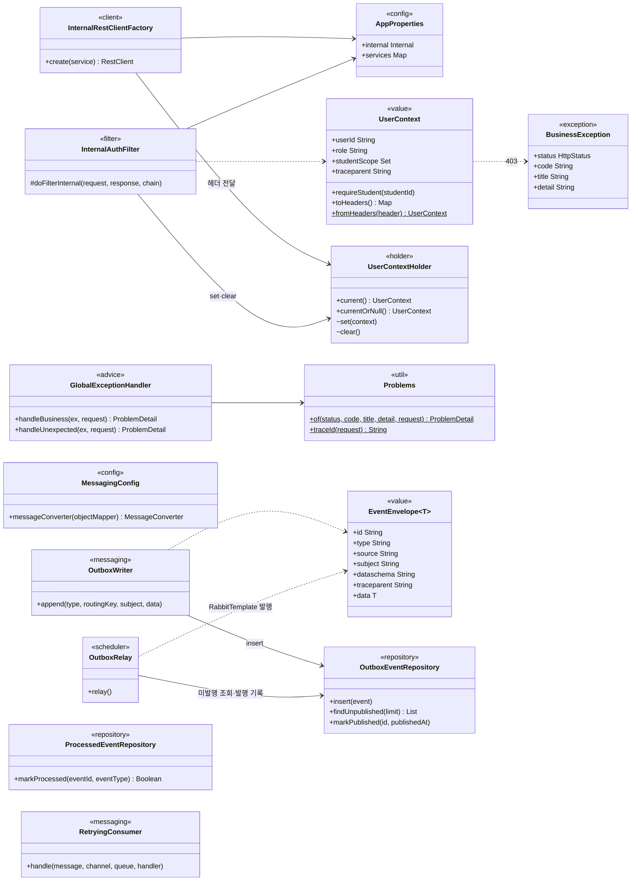

| 클래스 | 위치 | 상태 | 책임 |
|---|---|---|---|
| `AppProperties`, `InternalRestClientFactory` | `_common/config` | 구현됨 | 내부 호출 RestClient(내부 토큰·컨텍스트 헤더·타임아웃, 재시도 없음) |
| `InternalAuthFilter`, `UserContext`, `UserContextHolder` | `_common/security` | 구현됨 | `/internal/**` 토큰 검사, `X-User-*`·`X-Student-Scope` 컨텍스트 |
| `BusinessException`, `GlobalExceptionHandler`, `Problems` | `_common/exception` | 구현됨 | RFC 9457 오류 응답 |
| `EventEnvelope`, `MessagingConfig` | `_common/messaging` | 구현됨 | CloudEvents 봉투, JSON 변환기 |
| `OutboxWriter`, `OutboxRelay`, `OutboxEventRepository` | `_common/messaging` | 구현됨 (core만) | 같은 트랜잭션 `outbox_event` 저장 → 릴레이가 미발행 행 발행(`FOR UPDATE SKIP LOCKED`), publisher confirm 후 `published_at` 기록 |
| `ProcessedEventRepository` | `_common/messaging` | 구현됨 (core) | `processed_event` INSERT 성공 여부로 멱등 소비 |
| `RetryingConsumer` | `_common/messaging` | 구현됨 (core) | 수동 ACK. 처리 실패 시 `x-retry-count` +1 후 `<큐>.retry.<회차>` 재발행, 최대 횟수 초과 시 reject → DLQ (아키텍처 1.6) |
| `PublicAuthFilter` | `_common/security` | 구현됨 (core만) | `/api/v1/**` Bearer 검증(`AuthService.authenticate`), 쿠키 API Origin·`X-Requested-With` 검사, 역할·관리자 권한·필수 동의 확인 → `UserContext(userId, role, studentScope)` 설정. JWT 발급·검증은 `account/service/TokenService` (3.1) |
| `IdempotencyService` | `_common/web` | 신규 (core만) | `idempotency_record` 조회·저장, 같은 키·다른 본문 422 |
| `SseEmitters` | `_common/web` | 신규 (core만) | SSE 생성, 15초 heartbeat `: ping`, 연결 종료 콜백 |

### 2.2 Python 공통 (`app/`, ai·scoring·report 동일)

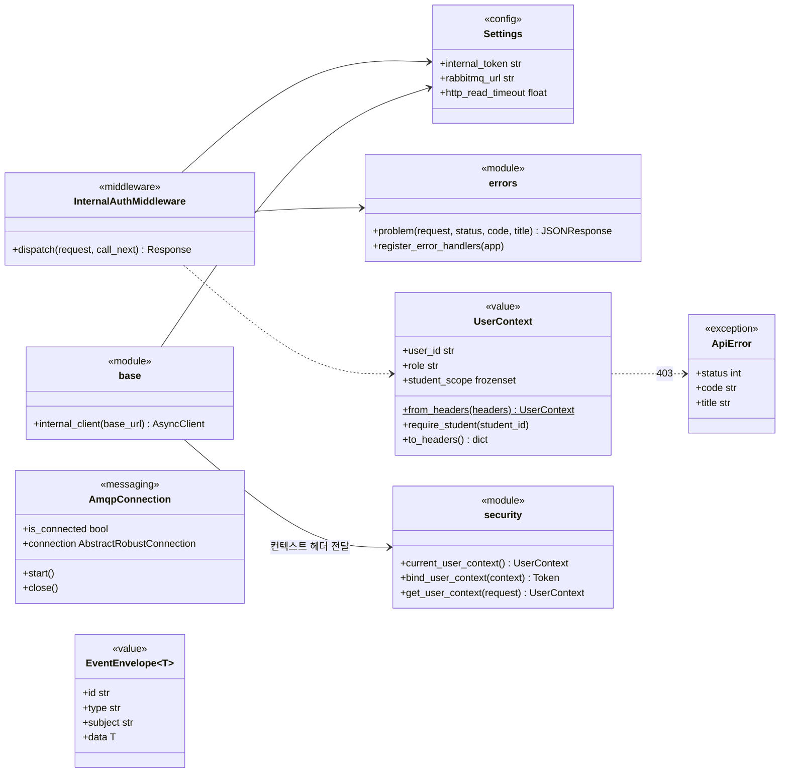

- 위 클래스는 모두 구현됨 (`config.py`·`errors.py`·`security.py`·`clients/base.py`·`messaging/connection.py`·`messaging/envelope.py`)
- 신규 공통: `messaging/publisher.py` `EventPublisher.publish(envelope, routing_key)`(ai 구현됨, best-effort), `messaging/consumer.py` `EventConsumer.consume(queue, handler)`(report 구현됨, 수동 ACK, 처리 실패 시 `<큐>.retry.<회차>` 재발행 → 3회 초과 시 reject → DLQ)
- 이벤트 소비 처리에서는 `bind_user_context(UserContext(role="SYSTEM", student_scope={subject}))` 후 하위 호출 (아키텍처 2.3)

---

## 3. core-service

### 3.1 계정·동의·자녀 연결 (account · consent · guardianship)

```mermaid
classDiagram
  direction TB
  class AuthController {
    <<controller>>
    +authorize() Redirect
    +callback(code, state, error) Redirect
    +refresh(cookie) TokenResponse
    +logout(cookie, bearer)
    +student(request) TokenResponse
    +me() MeResponse
    +registerStudentDevice(request) DeviceResponse
    +studentProfiles(deviceCookie) List
    +studentLogin(deviceCookie, request) TokenResponse
  }
  class AuthCookies {
    <<web>>
    +refresh(value, expires) ResponseCookie
    +clearRefresh() ResponseCookie
    +state(value) ResponseCookie
    +clearState() ResponseCookie
  }
  class AuthService {
    <<service>>
    +startGoogle() StartedGoogleLogin
    +completeGoogle(code, state, error, stateCookie, previousRefresh) IssuedAuth
    +login(profile, previousRefresh) IssuedAuth
    +authenticate(accessToken) AuthenticatedAccount
    +refresh(refreshToken) IssuedAuth
    +enterStudent(refreshToken, studentId, expected) IssuedAuth
    +logout(refreshToken, accessToken)
    +destination(identity) AuthDestination
    +requireConsents(identity)
    +requirePermission(identity, permission)
  }
  class TokenService {
    <<security>>
    +access(session) String
    +oauthState(state, nonce, verifier) String
    +verify(token, use) Jwt
    +randomToken() String
    +hash(value) String
  }
  class GoogleOAuthClient {
    <<client>>
    +authorizationUrl(state, nonce, verifier) String
    +exchange(code, verifier, nonce) GoogleProfile
  }
  class AuthRepository {
    <<repository>>
    +googleAccount(subject) AuthAccount
    +insertAccount(account, now)
    +session(id, lock) AuthSession
    +updateSession(session)
    +refresh(hash) RefreshToken
    +consume(id, now) Int
    +revoke(sessionId, now)
  }
  class AuthSession {
    <<value>>
    +role String
    +studentId UUID
    +version Long
    +expiresAt OffsetDateTime
  }
  class StudentAccessService {
    <<service>>
    +linkedStudents(userId) List
    +requireLinked(userId, studentId) LinkedStudent
  }
  class ConsentAccessService {
    <<service>>
    +hasRequiredConsents(userId) Boolean
    +hasGuardianConsent(userId, studentId) Boolean
  }
  class StudentDeviceController {
    <<controller>>
    +createPairing(request) PairingResponse
    +list() List
    +revoke(deviceId)
  }
  class MeController {
    <<controller>>
    +update(request)
    +reauth() ReauthToken
    +requestWithdrawal(reauthToken)
  }
  class ConsentController {
    <<controller>>
    +documents() List
    +myConsents() List
    +withdraw(consentId)
  }
  class ChildController {
    <<controller>>
    +list() List
    +register(request) ChildResponse
    +update(childId, request)
    +unlink(reauthToken, childId)
    +deletionImpact(childId) Impact
    +requestDeletion(childId, scope) DeletionResponse
    +setPin(reauthToken, childId, request)
  }
  class AccountService {
    <<service>>
    +update(userId, command)
    +reauth(userId) ReauthToken
    +requestWithdrawal(userId, reauthToken)
  }
  class StudentAuthService {
    <<service>>
    +createPairing(parentId, childIds) Pairing
    +registerDevice(pairingCode, label) DeviceToken
    +profiles(deviceToken) List
    +login(deviceToken, childId, pin) TokenResponse
    +setPin(parentId, reauthToken, childId, pin)
    +listDevices(parentId) List
    +revoke(parentId, deviceId)
  }
  class ConsentService {
    <<service>>
    +record(subjectUserId, studentId, consents)
    +withdraw(userId, consentId)
    +requireGuardianConsent(studentId)
  }
  class GuardianshipService {
    <<service>>
    +registerChild(parentId, command) Student
    +unlink(parentId, childId)
    +authorizeChild(childId) UserContext
    +authorizeLinkedChildren() UserContext
    +linkedStudentIds(parentId) Set
    +requestDeletion(parentId, childId, scope) DeletionRequest
    +confirmDeletion(requestId)
  }
  class UserAccount {
    <<entity>>
    +requestWithdrawal()
    +completeWithdrawal()
  }
  class Student {
    <<entity>>
    +changeGrade(grade)
    +requestDeletion()
    +markDeleted()
    +setPin(pinHash)
    +recordPinFailure(maxAttempts)
    +resetPinFailures()
  }
  class StudentDevice {
    <<entity>>
    +isUsable(now) Boolean
    +touch(now)
    +revoke()
  }
  class Consent {
    <<entity>>
    +withdraw()
  }
  class Guardianship {
    <<entity>>
    +unlink()
    +isLinked() Boolean
  }
  class DeletionRequest {
    <<entity>>
    +confirm()
    +complete()
  }
  class UserAccountRepository { <<repository>> }
  class ConsentRepository { <<repository>> }
  class StudentRepository { <<repository>> }
  class GuardianshipRepository {
    <<repository>>
    +existsLinked(parentId, studentId) Boolean
  }
  class DeletionRequestRepository { <<repository>> }
  class StudentDeviceRepository { <<repository>> }
  class OutboxWriter { <<messaging>> }

  AuthController --> AuthService
  AuthController --> AuthCookies
  AuthService --> GoogleOAuthClient : 트랜잭션 밖 코드 교환
  AuthService --> TokenService
  AuthService --> AuthRepository
  AuthService --> StudentAccessService : 연결 자녀
  AuthService --> ConsentAccessService : 필수·법정대리인 동의
  AuthService ..> AuthSession
  MeController --> AccountService
  ConsentController --> ConsentService
  ChildController --> GuardianshipService
  ChildController --> StudentAuthService : PIN
  AuthController --> StudentAuthService
  StudentDeviceController --> StudentAuthService
  StudentAuthService --> GuardianshipService : 연결 확인
  StudentAuthService --> ConsentService : 필수 동의
  StudentAuthService --> AccountService : 재확인
  StudentAuthService --> StudentRepository
  StudentAuthService --> StudentDeviceRepository
  StudentAuthService --> TokenService
  StudentAuthService ..> StudentDevice
  AccountService --> UserAccountRepository
  AccountService --> AuthRepository : 탈퇴 시 세션 폐기
  ConsentService --> ConsentRepository
  GuardianshipService --> ConsentService : 법정대리인 동의
  GuardianshipService --> StudentRepository
  GuardianshipService --> GuardianshipRepository
  GuardianshipService --> DeletionRequestRepository
  GuardianshipService --> OutboxWriter : student.deleted
  AccountService ..> UserAccount
  GuardianshipService ..> Student
  GuardianshipService ..> Guardianship
  GuardianshipService ..> DeletionRequest
  ConsentService ..> Consent
```

- `GuardianshipService.authorizeChild(childId)`: 학부모는 `guardianship LINKED` 확인 후 `studentScope = {childId}`로 컨텍스트 갱신, 학생은 본인 ID만. 미연결 시 `403 CHILD_NOT_LINKED` (FN-AGT-02, NFR-SEC-02)
- 자녀 범위가 필요한 모든 controller는 하위 호출 전에 `authorizeChild` 호출 → `InternalRestClientFactory`가 그 컨텍스트를 헤더로 전달
- `authorizeLinkedChildren()`: 경로에 자녀 ID가 없는 API(`/reports/{reportId}` 등)용. `studentScope = 연결 자녀 전체`로 전달하고 소유 서비스가 리소스의 학생 ID로 검사, 403은 core가 `CHILD_NOT_LINKED`로 변환
- 구현 상태 (#36): `AuthController`의 authorize·callback·refresh·logout·student·me, `AuthCookies`·`AuthService`·`TokenService`·`GoogleOAuthClient`·`AuthRepository`·`StudentAccessService`·`ConsentAccessService`·`UserAccountRepository`는 구현됨. 기기·PIN 3개 메서드와 그 외 controller·service는 미구현 (#37·#45·#58)
- `StudentAccessService`·`ConsentAccessService`는 인증용 읽기 전용 확인. 쓰기(자녀 등록·동의 저장)는 `GuardianshipService`·`ConsentService`(#37) 소유
- 공개 API 컨텍스트는 `PublicAuthFilter`가 설정하고 finally에서 해제 (`InternalAuthFilter`와 같은 방식)
- 이메일·비밀번호 가입·로그인·로그인 수단 변경 없음. Google 계정은 `(oauth_provider, oauth_subject)`로 식별, 최초 콜백에서 `AuthService.login`이 PARENT 계정 생성 (API 명세 5.1)
- 재확인 토큰(`reauthToken`)은 Google 재인증 기반(#45), Redis 저장 (ERD 1장)
- `AuthService.enterStudent` (`POST /auth/student-sessions`): 학부모 Bearer와 같은 세션의 refresh로 연결·활성 자녀·필수·법정대리인 동의 확인 → 부모 refresh 소비, `auth_session` role·studentId·version 변경 → `STUDENT` access만 발급, refresh 쿠키 삭제 (P01, 학부모 동석). 학생 계정·시연 링크 없음
- `StudentAuthService.login`: 기기 쿠키 해시로 `StudentDevice` 조회 → `isUsable`(미해제·미만료)·자녀 등록 확인 → `GuardianshipService.linkedStudentIds(device.parentUserId)`·`ConsentService.requireGuardianConsent` → 잠금·PIN 검사 → 동석 경로와 같은 `STUDENT` 토큰 발급, refresh 미발급 (P01, API 명세 3.11)
- `Student.recordPinFailure`: 실패 횟수 증가, 5회(설정값) 도달 시 `pin_locked_at` 기록. `setPin`은 해시·실패 횟수 0·잠금 해제를 한 번에 처리
- 페어링 코드는 Redis(10분·1회용), 기기 자격증명은 `student_device.token_hash`만 저장. 저장 구조는 ERD 10장 변경 예정
- `GuardianshipService.registerChild`: 학년 3~6·출생연도 검증, `LINKED` 자녀 3명이면 `CHILD_LIMIT_REACHED`, GUARDIAN 동의 필수 (P01·P02·P03). 다른 보호자 연결(`link`) 없음

### 3.2 학습 프록시·분석 대화 (learning · conversation)

```mermaid
classDiagram
  direction TB
  class StudentLearningController {
    <<controller>>
    +missions() List
    +mission(missionId) Mission
    +startAttempt(missionId) Attempt
    +attempt(attemptId) AttemptDetail
    +saveDraft(attemptId, ifMatch, body) Draft
    +openHint(attemptId) Hint
    +submitAnswer(attemptId, idempotencyKey, body) AnswerCreated
    +finish(attemptId) FinishResult
    +reflection(attemptId, body)
    +selfAssessment(attemptId, body)
  }
  class FeedbackController {
    <<controller>>
    +feedback(answerId) SseEmitter
  }
  class DashboardController {
    <<controller>>
    +studentHome() Home
    +childSummary(childId, from, to) Summary
    +childThinkingTypes(childId, from, to) List
    +childAttempts(childId, from, to) List
    +childAttempt(childId, attemptId) AttemptDetail
  }
  class LearningClient {
    <<client>>
    +get(path) Response
    +post(path, body, headers) Response
    +put(path, body, ifMatch) Response
    +feedback(answerId) FeedbackResult
    +evidence(answerIds) List
    +correctJudgment(judgmentId, command, idempotencyKey)
  }
  class ConversationController {
    <<controller>>
    +create(request) Conversation
    +list(childId) List
    +get(conversationId) ConversationDetail
    +ask(conversationId, request) SseEmitter
    +retry(conversationId, messageId) SseEmitter
    +evidence(conversationId, messageId) List
  }
  class ConversationService {
    <<service>>
    +create(parentId, childId, from, to) Conversation
    +startMessage(conversationId, question, scope) ConversationMessage
    +stream(message, sink)
    +complete(messageId, result)
    +fail(messageId, code)
    +retry(messageId) ConversationMessage
    +evidence(messageId) List
  }
  class Conversation {
    <<entity>>
    +resolveScope(requested) Scope
  }
  class ConversationMessage {
    <<entity>>
    +start()
    +complete(answer, metrics, verification, evidence)
    +clarify(clarification)
    +fail(code)
    +retry()
  }
  class ConversationRepository { <<repository>> }
  class ConversationMessageRepository {
    <<repository>>
    +transition(id, from, to) Boolean
  }
  class AiClient {
    <<client>>
    +streamAnalysis(request) Flow~AnalysisEvent~
    +cancel(streamId)
  }
  class GuardianshipService { <<service>> }
  class JobExecutionService { <<service>> }
  class SseEmitters { <<web>> }

  StudentLearningController --> GuardianshipService
  StudentLearningController --> LearningClient
  FeedbackController --> LearningClient
  FeedbackController --> SseEmitters
  DashboardController --> GuardianshipService
  DashboardController --> LearningClient
  ConversationController --> GuardianshipService
  ConversationController --> ConversationService
  ConversationController --> SseEmitters
  ConversationService --> ConversationRepository
  ConversationService --> ConversationMessageRepository
  ConversationService --> AiClient
  ConversationService --> LearningClient : 근거 원문
  ConversationService --> JobExecutionService : 실행 이력
  ConversationService ..> Conversation
  ConversationService ..> ConversationMessage
```

- `learning/`은 프록시 기능이라 service 없이 controller → `LearningClient` (아키텍처 2.6 폴더 구성 그대로)
- `FeedbackController`: learning 동기 응답을 기다리는 동안 heartbeat만 전송, 응답을 `status`·`result`·`error`·`done` 이벤트로 변환. 클라이언트 단절과 무관하게 learning 호출 유지 (아키텍처 1.3)
- `ConversationService.stream`: ai SSE 이벤트를 그대로 중계, `result` 수신 시 `complete`(트랜잭션), 클라이언트 단절 시 `AiClient.cancel` + `fail(CLIENT_DISCONNECTED)` (재시도 가능)
- 근거 원문은 저장하지 않고 `message_evidence` ID로 learning `/internal/records/evidence` 조회 (ERD 3.2)
- SSE 처리를 별도 스레드(executor)에서 실행하면 `UserContextHolder`(ThreadLocal) 값이 전달되지 않음 → 요청 스레드에서 컨텍스트를 캡처해 작업 스레드에서 설정·해제. 기존 `UserContextHolder`에 실행 래퍼(예: `runWith(context, block)`) 추가 필요

### 3.3 리포트 작업·알림 (report · notification)

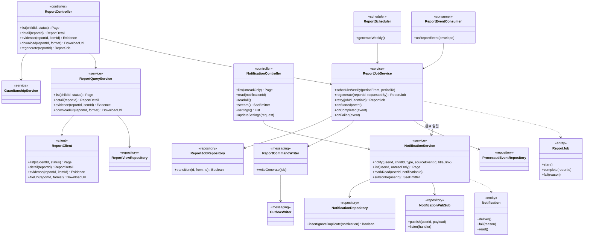

- `ReportScheduler`: `@Scheduled` + `@SchedulerLock`(ShedLock), 매주 월 07:00 KST, 직전 월~일(KST) 대상, 기록 없는 학생 포함 (P06). 학생별 `report_job(SCHEDULE)` + outbox 저장, 부분 UK로 중복 방지
- `ReportEventConsumer`: 큐 `core.report.events`, `processed_event`로 멱등, 상태 전이는 조건부 UPDATE (상태 다이어그램 4.1)
- `NotificationPubSub`: Redis Pub/Sub로 core 레플리카 간 SSE 중계 (아키텍처 1.6), 알림 행 저장 후 발행
- 리포트 조회 API에 `ReportQueryService`를 둬서 controller → client 직접 호출 금지 규칙 준수 (리포트 열람 기록 `report_view` 저장 포함)
- `ReportController`의 `reportId` 경로는 `GuardianshipService.authorizeLinkedChildren()` 사용 (3.1)

### 3.4 결제·구독 (payment)

- `TossClient`는 PG 교체 지점 래퍼 (아키텍처 2.1). 로컬·CI는 `toss-stub`, 키는 환경 변수만
- `PaymentService.confirm`: 금액 대조(트랜잭션) → `TossClient.confirm`(트랜잭션 밖) → 결제 저장·구독 반영(트랜잭션). 반영 실패 시 `requireRecovery()` 후 `recoverEntitlement` 재시도 (FN-PAY-05)
- `BillingScheduler`: ShedLock, 정기 청구·해지 효력·`CONFIRMING` 재조회. 매일 09:00 KST. 갱신 실패 시 유예 3일·매일 1회 최대 3회 재청구 후 해지 (P13), 자동 갱신 해지는 `period_end` 경과 시 `CANCELED` (P14)

### 3.5 신고·지원·사용량·관리자 (support · usage · admin)

```mermaid
classDiagram
  direction TB
  class SupportController {
    <<controller>>
    +submitErrorReport(idempotencyKey, request) ErrorReport
    +myErrorReports() Page
    +errorReport(reportId) ErrorReport
    +submitInquiry(request) Inquiry
    +myInquiries() Page
    +notices() List
    +help(role) Help
  }
  class ErrorReportService {
    <<service>>
    +submit(reporterId, command) ErrorReport
    +review(reportId, adminId, command)
    +correct(reportId, adminId, command) Correction
  }
  class InquiryService {
    <<service>>
    +submit(userId, command) Inquiry
    +answer(inquiryId, adminId, answer)
  }
  class NoticeService {
    <<service>>
    +create(adminId, command) Notice
    +end(noticeId)
  }
  class ErrorReport {
    <<entity>>
    +startReview(adminId)
    +resolve(result, reason)
  }
  class Inquiry {
    <<entity>>
    +startReview()
    +answer(adminId, answer)
  }
  class SupportLearningClient {
    <<client>>
    +correctJudgment(judgmentId, command, idempotencyKey)
  }
  class LlmUsageConsumer {
    <<consumer>>
    +onUsage(envelope)
  }
  class LlmUsageService {
    <<service>>
    +record(envelope)
    +summarize(from, to, callType) List~UsageSummary~
  }
  class AdminController {
    <<controller>>
    +overview(from, to)
    +jobs(type, status)
    +retryJob(jobId, idempotencyKey)
    +queues()
    +auditLogs(targetType, from, to)
    +errorReports(status)
    +payments(status, from, to)
    +approveRefund(requestId, idempotencyKey)
  }
  class AdminMissionController {
    <<controller>>
    +proxy(path, body)
  }
  class ModelVersionController {
    <<controller>>
    +list(kind, page, size) ModelVersionPage
    +register(body, request) ModelVersion
    +activate(versionId, body, request) ModelVersion
    +rollback(versionId, body, request) ModelVersion
  }
  class AiUsageController {
    <<controller>>
    +usage(from, to, callType) AiUsageResponse
  }
  class InternalModelVersionController {
    <<controller>>
    +active() Map
  }
  class AdminJobService {
    <<service>>
    +list(type, status) Page
    +retry(jobId, adminId) JobExecution
  }
  class JobExecutionService {
    <<service>>
    +begin(jobType, jobId, triggeredBy) JobExecution
    +finish(executionId, status, errorCode)
  }
  class ModelVersionService {
    <<service>>
    +list(kind, page, size) ModelVersionPage
    +register(command, actor) ModelVersion
    +activate(id, command, actor) ModelVersion
    +rollback(id, command, actor) ModelVersion
    +active() List~ActiveModelVersion~
    -locked(id) ModelVersion
    -switch(target, scopes, reason, reanalysis, actor, action) ModelVersion
  }
  class AuditLogService {
    <<planned>>
    +record(actorId, action, target, result, detail)
  }
  class ModelVersion {
    <<value>>
    +id UUID
    +kind ModelKind
    +name String
    +version String
    +status VersionStatus
    +evalResult EvaluationRecord
    +approvedBy UUID
    +activatedAt OffsetDateTime
  }
  class ModelVersionRepository {
    <<repository>>
    +insert(version) Boolean
    +find(id) ModelVersion
    +list(kind, page, size) List
    +count(kind) Long
    +active() List
    +current(kind, name) ModelVersion
    +lockGroup(kind, name)
    +nextRevision(kind, name) Long
    +update(version)
    +audit(actor, action, target, detail, now)
  }
  class ModelVersionMapper {
    <<mapper>>
    +insert(row) Int
    +update(row) Int
    +audit(id, actor, action, target, detail, now) Int
  }
  class LlmUsageRepository {
    <<mapper>>
    +insertIfAbsent(usage) Int
    +summarize(from, until, callType) List~UsageSummary~
  }
  class QueueStatsRepository {
    <<repository>>
    +queues() List
  }

  SupportController --> ErrorReportService
  SupportController --> InquiryService
  SupportController --> NoticeService
  ErrorReportService --> SupportLearningClient
  ErrorReportService --> NotificationService
  InquiryService --> NotificationService
  ErrorReportService ..> ErrorReport
  InquiryService ..> Inquiry
  LlmUsageConsumer --> LlmUsageService
  LlmUsageService --> LlmUsageRepository
  ModelVersionController --> ModelVersionService
  AiUsageController --> LlmUsageService
  AdminController --> AdminJobService
  AdminController --> ErrorReportService
  AdminController --> RefundService
  AdminController --> AuditLogService
  AdminController --> QueueStatsRepository
  AdminMissionController --> LearningClient
  AdminMissionController --> AuditLogService
  InternalModelVersionController --> ModelVersionService
  AdminJobService --> ReportJobService : 리포트 재처리
  AdminJobService --> ConversationService : 대화 재처리
  AdminJobService --> NotificationService : 알림 재처리
  AdminJobService --> JobExecutionService
  ModelVersionService --> OutboxWriter : model.version.activated
  ModelVersionService --> ModelVersionRepository : 상태·감사 같은 트랜잭션
  ModelVersionRepository --> ModelVersionMapper
  ModelVersionRepository ..> ModelVersion : JSON·DB 행 변환
  ModelVersionService ..> ModelVersion
  class NotificationService { <<service>> }
  class RefundService { <<service>> }
  class ReportJobService { <<service>> }
  class ConversationService { <<service>> }
  class LearningClient { <<client>> }
  class OutboxWriter { <<messaging>> }
```

- `SupportLearningClient` = `support/client/LearningClient.kt` (아키텍처 2.6). 다이어그램에서만 이름 구분
- 구현된 #43 공개 경로는 #36 `PublicAuthFilter → AuthService.requirePermission(SERVICE_OPS)`를 재사용한다. 내부 조회는 `InternalAuthFilter`의 내부 토큰 검사를 사용한다. 다른 관리자 기능의 권한 범위는 API 1.2를 따른다.
- #43은 실제 구현된 `ModelVersionController`·`AiUsageController`·`InternalModelVersionController`를 구분해 표시했다. 내부 응답은 `{items: List<ActiveModelVersion>}`이며 평가·관리자 정보는 제외한다. `AdminController` 및 나머지 운영 기능은 기존 후속 설계이며 구현 완료 표시가 아니다.
- `ModelVersion`은 불변 data class다. 상태 전이는 `ModelVersionService`의 `activate`·`rollback`과 private `switch`에서 `copy` 후 Repository에 저장하며 Domain의 `activate()`·`deactivate()` 메서드는 없다.
- `AuditLogService`는 아직 구현되지 않은 공용 감사 서비스 설계다. #43은 `ModelVersionService → ModelVersionRepository.audit → ModelVersionMapper.audit → audit_log` 경로로 감사 기록을 저장한다. 상태·감사·Outbox를 같은 트랜잭션으로 유지하며, #47 등에서 공용 감사 기능을 실제 도입할 때 이 경로의 통합을 검토한다. 현재 사용처만을 위해 공용 서비스를 추가하지 않는다 ([#43 보고서](../report/issue-43-model-registry.md)).
- `QueueStatsRepository`: RabbitMQ 관리 API(15672) 조회, 큐 길이·DLQ 적재량 (참고 레포 `QueueOperations*`)

---

## 4. learning-service

### 4.1 미션·시도·답변 (mission · attempt · answer)

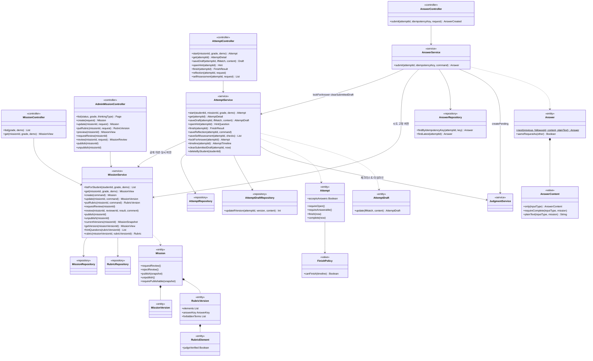

- `AttemptService.start`: 부분 UK `(student_id, mission_id) WHERE IN_PROGRESS` 충돌 시 기존 시도 반환 (FN-LRN-16)
- `AttemptDraft.update`: `UPDATE ... WHERE version = :ifMatch` 영향 0행이면 `ATTEMPT_DRAFT_CONFLICT` + 최신 초안 (FN-LRN-17)
- `AnswerService.submit`: 같은 트랜잭션에 `answer` 버전 추가 + `judgment(PENDING)` 생성. 같은 `idempotency_key`·같은 본문이면 기존 답변 반환, 다른 본문이면 `422 IDEMPOTENCY_KEY_REUSED` (FN-LRN-10, API 1.4). `lockForAnswer`가 시도 행을 잠가(`FOR UPDATE`) 같은 시도의 제출을 한 줄로 세움. 저장하면 `clearSubmittedDraft`로 초안의 `answer`를 비우고 `memo`는 유지, 초안 version +1 (FN-LRN-15·16)
- 보완 답변 연결: 첫 답변은 `followupId` 없이, 버전 2부터는 이 시도의 가장 최근 되묻기 중 아직 답하지 않은 것만 (`JudgmentService.unansweredLatestFollowupId`). 아니면 `422 ANSWER_INCOMPLETE`. 판정 전 추가 제출·되묻기 2회 뒤 제출도 여기서 막힘 (P04)
- `FinishPolicy.canFinish`: 시도 내 판정 `DONE` 1회 이상(결과 무관, `HELD` 포함)이면 true (P04)
- 되묻기 생성 조건: 시도 내 되묻기 2회 미만 + 고르기 `CORRECT` 아님 (P04). `finished_at` 이후 답변 제출은 `Attempt.requireAnswerable`에서 `ATTEMPT_CLOSED`. `requireOpen`은 `COMPLETED`만 막음(마무리 뒤 돌아보기 저장)
- `AttemptDraft.content`: `{answer, memo}`, memo는 학생 본인 조회에만 포함 (P05)
- `Mission.requirePublishable`: 현재 버전·기준표 요소 1개 이상(서술·논술) 또는 `answer_key`(고르기·수학) 검사, 누락 시 `MISSION_PUBLISH_INCOMPLETE` (FN-ADM-11)

### 4.2 판정·되묻기 (judgment)

- `FeedbackFacade.feedback` 순서 (아키텍처 2.5)
  1. `JudgmentService.acquire`: `PENDING|FAILED|리스 만료 RUNNING → RUNNING` 조건부 UPDATE. `DONE`이면 저장 결과 반환, 유효 `RUNNING`이면 `RUNNING` 결과 반환 (API 1.4)
  2. 트랜잭션 밖: 고르기·수학 최종 답은 `RuleJudge`, 서술·논술은 `AiClient.judge`. 풀이 단계는 풀이를 `AiClient.judge`, 최종 답을 `MathEquivalenceJudge`로 보고 합침 (state-diagram 3.3)
  3. 트랜잭션 밖: 시도 내 되묻기 2회 미만이고 고르기 `CORRECT`가 아니면 `AiClient.followup` (정답·금지어 유출 검사는 ai 담당, P04). 마무리·완료한 시도에는 만들지 않음. 유출 검사용 정답은 학생에게 보이는 글자(선택지 이름·정답 순서·최종 답)로 보냄. 재생성까지 검사 실패하면 learning이 `followup_bank_question`에서 같은 `type` 질문 선택(`BANK`, P16), 이 시도에서 아직 쓰지 않은 것부터
  4. `JudgmentService.saveResult`: 판정·요소·되묻기·버전 저장 + `DONE`. 예외 시 `markFailed`
- 전이는 `Judgment` 엔티티가 허용 여부를 판단하고 `JudgmentRepository`가 조건부 UPDATE로 저장 (#23 초안 `AttemptDraft.update` + `updateIfVersion`과 같은 방식). `saveResult`·`markFailed`는 획득한 리스 값을 비교해야 해 `judgmentId` 대신 `acquire`로 얻은 `judgment`를 받음. `markFailed`는 DB에서 다시 읽은 판정으로 기록(저장 중 롤백돼 엔티티만 `DONE`이 된 경우)
- `done`·`hold`의 `by`: 판정 방법(`RULE`·`LLM`)·`trial`·모델·프롬프트 버전 (ERD judgment.method·trial·model_version·prompt_version)
- `AiClient`: 응답 35초, 서비스 간 재시도 없음, 서킷 브레이커 최근 20건 중 실패 50% 이상이면 30초 차단(전송 오류·5xx만 실패로 셈, 아키텍처 1.3)
- `JudgmentElement`: `verified = false`면 `satisfy()` 거부 (ERD CHECK와 동일 규칙을 Domain에서도 검사)
- `judge_verified = false` 요소·미검증 학년 조합의 `HELD(UNVERIFIED_SCOPE)` 결정은 ai `JudgmentService` 담당(`JUDGE_REQUIRE_VERIFIED=true`일 때만, 기본 꺼짐). learning은 `judge_verified`·학년을 포함한 기준표를 `AiClient.judge`에 전달 (FN-JDG-04)
- 정정은 `Judgment`를 바꾸지 않고 `JudgmentCorrection` 추가, `result()` 조회 시 최신 정정 반영 (FN-SUP-03)

### 4.3 기록 조회·삭제 (record · deletion)

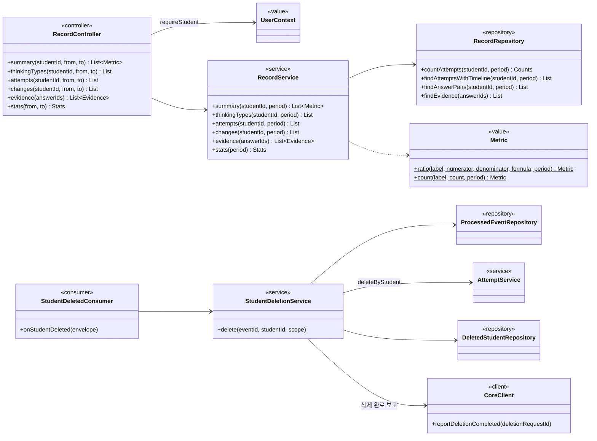

- `RecordController`: 모든 경로에서 `UserContextHolder.current().requireStudent(studentId)` 먼저 실행 (아키텍처 2.3 범위 검사)
- `RecordRepository`는 여러 기능 테이블을 읽는 조회 전용 MyBatis 매퍼 (쓰기 없음). 기능 간 repository 참조 금지 규칙의 예외로, 조회 전용 `record/`에 한정
- `Metric.ratio`: 분모 5 미만이면 `value = null`, `count`만 (P08, API 1.6)
- `StudentDeletionService.delete`: 삭제·`deleted_student` 저장 후 `CoreClient.reportDeletionCompleted`. 보고 실패 시 예외 → 지연 재시도(1·5·15분) 후 재처리, 삭제는 멱등 (P09, 아키텍처 1.6)
- `evidence`: `deleted_student`에 있는 학생 근거는 `available: false` (FN-ACC-13)
- `AttemptService.deleteByStudent`: `attempt` 삭제 시 하위 `answer`·`judgment`·`followup`·`reflection` 등은 FK `ON DELETE CASCADE`로 함께 삭제 가정 (ERD 미기재, 8장)

---

## 5. ai-service

### 5.1 판정·되묻기 (judgment · followup)

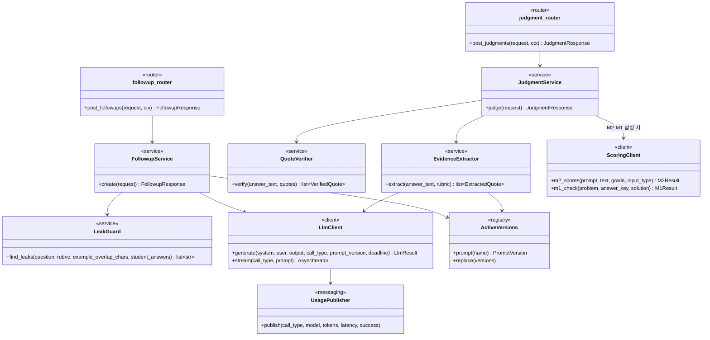

| 클래스 | 파일 | 책임 |
|---|---|---|
| `EvidenceExtractor` | `judgment/extractor.py` | LLM에 기준표 요소별 근거 구절 추출 요청 (학생 이름 미포함) |
| `QuoteVerifier` | `judgment/verifier.py` | 구절의 답변 원문 존재 확인(코드). LLM과 분리 (FN-JDG-03) |
| `JudgmentService` | `judgment/service.py` | 사전 보류(`TOO_SHORT`·`UNVERIFIED_SCOPE`) → 추출 → 대조 → 요소·배점으로 `CORRECT|PARTIAL|RETHINK|HELD` 결정 (업무 판단은 service, 아키텍처 2.1) → M2 교차 확인(불일치 시 `HELD(MODEL_DISAGREEMENT)`) → 풀이 단계는 M1 점검(확신도 미만 `HELD(LOW_CONFIDENCE)`) → 응답 |
| `LeakGuard` | `followup/leak_guard.py` | 정답 키·예시 답·금지어 포함 검사. 실패 시 1회 재생성(`LLM_RETRY`), 재실패 시 `question` 없이 `leakCheck.passed = false` 반환 → learning이 질문 은행 선택 (`BANK`, P16) |
| `LlmClient` | `llm/base.py`, 제공자는 `llm/providers.py` | 제공자 교체 지점(Claude·OpenAI·OpenAI 호환 sLLM, `LLM_PROVIDER`), LLM 호출 재시도는 이 클래스에서만 (아키텍처 1.3), 호출마다 사용량 발행 |
| `ActiveVersions` | `versions.py` (신규) | 활성 프롬프트 버전 보관, `model.version.activated` 수신 시 교체 |

### 5.2 분석 에이전트·리포트 서술 (analysis_agent · report_narrative)

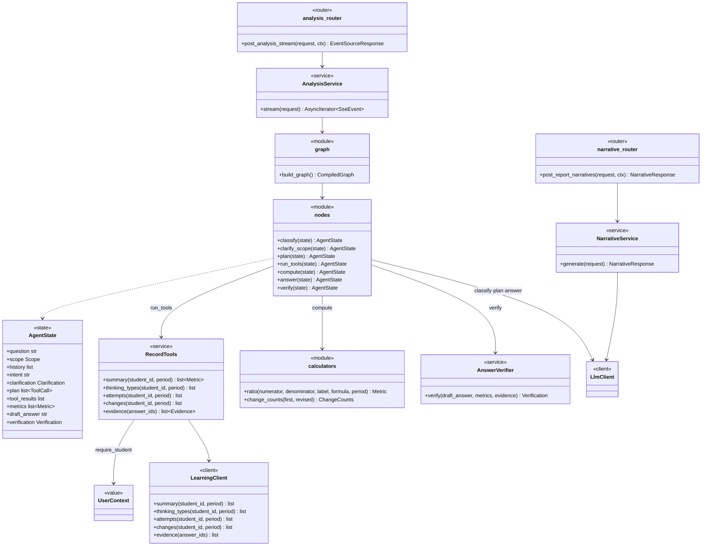

- 그래프 흐름 `classify → clarify_scope → plan → run_tools → compute → answer → verify` (아키텍처 1.5), 분기는 [시퀀스 다이어그램 5](sequence-diagram.md#5-분석-대화-sse)
- `RecordTools`: 도구 실행마다 `require_student` 검사 후 learning 호출, 컨텍스트 헤더 그대로 전달 (FN-AGT-02)
- `calculators`: 건수·비율은 LLM이 아닌 코드 계산 (FN-AGT-05), `Metric` 형식은 learning과 동일
- `AnswerVerifier`(`analysis_agent/verifier.py`, 신규): 답변 속 숫자 ↔ `metrics`, 인용 ↔ `evidence` 원문 대조. 실패 시 규칙 응답으로 전환 (FN-AGT-06)
- 규칙 응답(`analysis_agent/rule_responder.py`, 신규): 대조 실패·LLM 키 부재·호출 실패 시 계산된 `metrics`·`evidence`만 템플릿 문장으로 구성, `source = TEMPLATE`·`fallback` 표시 (FN-AGT-10, P16)
- `NarrativeService`: 서술·저녁 질문만 생성, 숫자 계산·대조는 report-service 담당

### 5.3 메시징·클라이언트

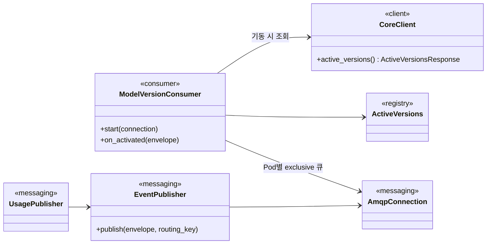

- 기동 순서: exclusive 큐 선언·바인딩 → `CoreClient.active_versions()` → `ActiveVersions.replace`. 조회 실패 시 readiness false 유지·재시도 (아키텍처 1.6)
- `UsagePublisher`: 응답 반환 후 best-effort 발행, 학생 ID·원문 미포함 (NFR-PRF-02)

---

## 6. scoring-service

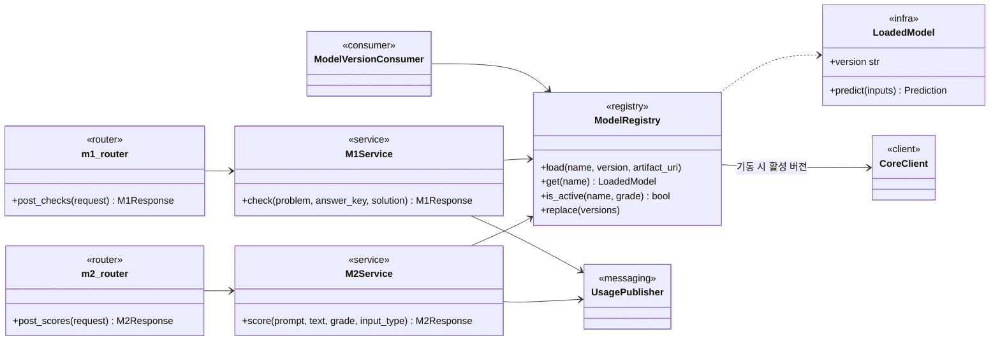

- `LoadedModel.predict`는 CPU 동기 추론 → `run_in_threadpool`로 호출해 이벤트 루프 차단 방지 (아키텍처 2.3)
- 활성 범위 밖 학년·문항이면 `{active: false}` 반환, M1 확신도 0.8 미만은 보류 신호 (P15)
- 가중치는 S3 `artifact_uri`에서 로딩, 승인된 버전만 (아키텍처 5장)

---

## 7. report-service

```mermaid
classDiagram
  direction TB
  class ReportGenerateConsumer {
    <<consumer>>
    +on_generate(envelope)
  }
  class GenerationService {
    <<service>>
    +generate(command)
  }
  class MetricsCalculator {
    <<service>>
    +metrics(records, period) list~Metric~
    +thinking_types(records) list
    +changes(pairs) list~Change~
    +state(records) ReportState
  }
  class ReportVerifier {
    <<service>>
    +verify(narrative, metrics, quotes) Verification
  }
  class ReportRenderer {
    <<service>>
    +render(report, format) bytes
  }
  class WeeklyReport {
    <<entity>>
    +complete(state, items, narrative, verification)
    +fail(reason)
  }
  class ReportItem { <<entity>> }
  class ReportRepository {
    <<repository>>
    +create_running(job_id, student_id, period) WeeklyReport
    +find_by_job(job_id) WeeklyReport
    +save(report)
  }
  class OutboxWriter {
    <<messaging>>
    +append(session, type, routing_key, subject, data)
  }
  class OutboxRelay {
    <<messaging>>
    +run()
  }
  class OutboxRepository {
    <<repository>>
    +find_unpublished(limit) list
    +mark_published(id, published_at)
  }
  class LearningClient {
    <<client>>
    +thinking_types(student_id, period) list
    +attempts(student_id, period) list
    +changes(student_id, period) list
    +evidence(answer_ids) list
  }
  class AiClient {
    <<client>>
    +narrative(request) NarrativeResponse
  }
  class ObjectStorage {
    <<client>>
    +put(key, body, content_type)
    +presigned_url(key, expires) str
  }
  class query_router {
    <<router>>
    +list(student_id, status) Page
    +detail(report_id) ReportDetail
    +evidence(report_id, item_id) Evidence
    +file_url(report_id, format) DownloadUrl
  }
  class QueryService {
    <<service>>
    +list(student_id, status) Page
    +detail(report_id) ReportDetail
    +evidence(report_id, item_id) Evidence
    +file_url(report_id, format) DownloadUrl
  }
  class StudentDeletedConsumer {
    <<consumer>>
    +on_student_deleted(envelope)
  }
  class DeletionService {
    <<service>>
    +delete(event_id, student_id)
  }
  class CoreClient {
    <<client>>
    +report_deletion_completed(deletion_request_id)
  }

  ReportGenerateConsumer --> GenerationService
  GenerationService --> ReportRepository
  GenerationService --> OutboxWriter : report.started·completed·failed
  GenerationService --> LearningClient
  GenerationService --> MetricsCalculator
  GenerationService --> AiClient
  GenerationService --> ReportVerifier
  GenerationService --> ReportRenderer
  GenerationService --> ObjectStorage
  GenerationService ..> WeeklyReport
  WeeklyReport *-- ReportItem
  OutboxWriter --> OutboxRepository
  OutboxRelay --> OutboxRepository : 미발행 조회·발행 기록
  OutboxRelay --> EventPublisher : publisher confirm
  query_router --> QueryService
  QueryService --> ReportRepository
  QueryService --> ObjectStorage
  StudentDeletedConsumer --> DeletionService
  DeletionService --> ReportRepository
  DeletionService --> ObjectStorage
```

| 클래스 | 파일 | 실행 프로세스 |
|---|---|---|
| `ReportGenerateConsumer`, `GenerationService`, `MetricsCalculator`, `ReportVerifier`, `ReportRepository`, `WeeklyReport` | `generation/consumer.py`·`service.py`·`metrics.py`·`verifier.py`·`repository.py`·`models.py` | report-worker |
| `ReportRenderer` | `rendering/renderer.py` (Jinja2 → HTML, Playwright → PDF, Markdown) | report-worker |
| `OutboxWriter`, `OutboxRelay`, `OutboxRepository` | `outbox/` | report-worker |
| `StudentDeletedConsumer`, `DeletionService` | `deletion/` | report-worker |
| `query_router`, `QueryService` | `query/router.py`, `query/service.py` (신규) | report-api |
| `ObjectStorage` | `clients/storage.py` (신규, S3·로컬 MinIO) | 공통 |

- `GenerationService.generate`: `job_id`로 기존 행 조회 → 없으면 `RUNNING` 생성, `COMPLETED·FAILED`면 ACK만, `RUNNING`이면 같은 행으로 재실행. 기록 없음·표본 부족은 `COMPLETED + state`, 실패는 `FAILED` (FN-RPT-11)
- `query_router`·`QueryService`: 모든 조회에서 리포트의 `student_id`가 `X-Student-Scope`에 있는지 검사, 없으면 403 (API 4장)
- 수치·전후 변화는 `MetricsCalculator`(코드)에서만 계산, ai는 서술·저녁 질문만 (FN-RPT-03, 05)
- `ReportVerifier`: 서술 속 숫자·인용을 계산 결과·learning 원문과 대조, 실패 시 서술을 템플릿 요약으로 교체(`narrative.source = TEMPLATE`, P16). `NO_RECORD`·무료 플랜(`narrativeEnabled = false`)은 ai 호출 생략 (P06·P13)

---

## 8. 확인 필요 가정
- 요금제 사용 한도(P13): core가 Redis 일 단위 카운터(학생별 미션 시작·피드백, 학부모별 분석 대화)와 `product.limits`로 확인 후 `USAGE_LIMIT_REACHED`. 담당 클래스는 구현 시 `usage/`에 추가
- core `conversation`(근거 원문 조회)·`admin`(미션 관리 프록시)이 `learning/client/LearningClient`를 직접 사용: learning 기능에 service가 없어서 생긴 예외. 문제가 되면 `learning/service/LearningRecordService`를 추가
- 기존 `UserContextHolder`에 SSE 작업 스레드용 컨텍스트 실행 래퍼 추가 필요 (3.2)
- learning 하위 기록 삭제의 FK `ON DELETE CASCADE` 여부 ERD 반영 필요 (4.3)
- learning `record/RecordRepository`가 여러 기능 테이블을 조회: 조회 전용 기능 한정 예외
- 클래스 분할 단위(관리자 controller 등)는 구현 시 조정 가능, 레이어·의존 방향은 고정
