# 클래스 다이어그램

- 근거: [아키텍처 설계](architecture.md) 2장(레이어·의존 규칙·폴더), [API 명세서](api-spec.md), [ERD](erd.md), [기능명세서](functional-spec.md)
- 범위: 5개 서비스의 기능별 Presentation · Application · Domain · Infrastructure 클래스와 의존 관계, 공개 메서드 시그니처
- 상태 전이 규칙은 [상태 다이어그램](state-diagram.md), 호출 순서는 [시퀀스 다이어그램](sequence-diagram.md)
- 클래스명은 구현 기준 이름. 필드는 ERD 컬럼과 같아 생략하고 상태 전이·검증 메서드만 표기
- `(P04)` 형태는 확정 정책 번호, 내용은 [기능명세서 1.4](functional-spec.md#14-확정-정책)

---

## 1. 공통 규칙

| 항목 | 규칙 |
|---|---|
| 레이어 표기 | `<<controller>>` `<<consumer>>` `<<scheduler>>` = Presentation / `<<service>>` `<<facade>>` = Application / `<<entity>>` `<<value>>` = Domain / `<<repository>>` `<<client>>` `<<messaging>>` = Infrastructure |
| 화살표 | `-->` 의존(호출), `..>` 생성·반환, `*--` 소유(같은 집합), `<|..` 구현 |
| 의존 방향 | Presentation → Application → Infrastructure 단방향, Domain은 전 레이어가 참조 (아키텍처 2.2) |
| 기능 간 호출 | 상대 기능의 `service`만 호출. 여러 기능 조합은 `facade` |
| 트랜잭션 | `<<service>>`·`<<facade>>` 메서드에서만 시작, 트랜잭션 안에서 HTTP·AMQP 호출 금지 |
| Spring 루트 패키지 | `com.sagomungchi.<service>`, 다이어그램은 루트 이하 경로 생략 |
| Python | 파일 1개 = 다이어그램 클래스 1개 기준. 함수 모음 모듈은 `<<module>>`로 표기 |
| 기존 코드 | 2장의 `(구현됨)` 표시 클래스는 현재 저장소에 존재, 이름·시그니처 그대로 사용 |

---

## 2. 공통 모듈

### 2.1 Spring 공통 (`_common/`, core·learning 동일)

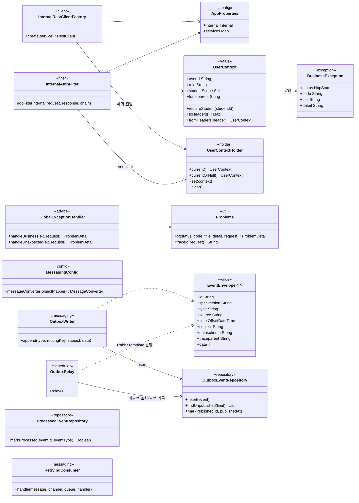

| 클래스 | 위치 | 상태 | 책임 |
|---|---|---|---|
| `AppProperties`, `InternalRestClientFactory` | `_common/config` | 구현됨 | 내부 호출 RestClient(내부 토큰·컨텍스트 헤더·타임아웃, 재시도 없음) |
| `InternalAuthFilter`, `UserContext`, `UserContextHolder` | `_common/security` | 구현됨 | `/internal/**` 토큰 검사, `X-User-*`·`X-Student-Scope` 컨텍스트 |
| `BusinessException`, `GlobalExceptionHandler`, `Problems` | `_common/exception` | 구현됨 | RFC 9457 오류 응답 |
| `EventEnvelope`, `MessagingConfig` | `_common/messaging` | 구현됨 | CloudEvents 봉투, JSON 변환기 |
| `OutboxWriter`, `OutboxRelay`, `OutboxEventRepository` | `_common/messaging` | 구현됨 (core만) | 같은 트랜잭션 `outbox_event` 저장 → 릴레이가 미발행 행 발행(`FOR UPDATE SKIP LOCKED`), publisher confirm 후 `published_at` 기록 |
| `ProcessedEventRepository` | `_common/messaging` | 구현됨 (core) | `processed_event` INSERT 성공 여부로 멱등 소비 |
| `RetryingConsumer` | `_common/messaging` | 구현됨 (core) | 수동 ACK. 처리 실패 시 `x-retry-count` +1 후 `<큐>.retry.<회차>` 재발행, 최대 횟수 초과 시 reject → DLQ (아키텍처 1.6) |
| `PublicAuthFilter` | `_common/security` | 구현됨 (core만) | `/api/v1/**` Bearer 검증(`AuthService.authenticate`), 쿠키 API Origin·`X-Requested-With` 검사, 역할·관리자 권한·필수 동의 확인 → `UserContext(userId, role, studentScope)` 설정. JWT 발급·검증은 `account/service/TokenService` (3.1) |
| `IdempotencyService` | `_common/web` | 구현됨 (core만, #38) | `idempotency_record` 조회·저장, 같은 키·다른 본문 422 |
| `SseEmitters` | `_common/web` | 구현됨 (core만, #39) | SSE 생성, 15초 heartbeat `: ping`, 연결 종료 콜백. 연결 시간은 용도별: 피드백 90초(`open`), 알림 구독 5분(`subscribe`), 분석 대화 120초 + 여유(#41 미구현). `open(context, …)`이 요청 스레드의 `UserContext`를 작업 스레드에 설정·해제 |

### 2.2 Python 공통 (`app/`, ai·scoring·report 동일)

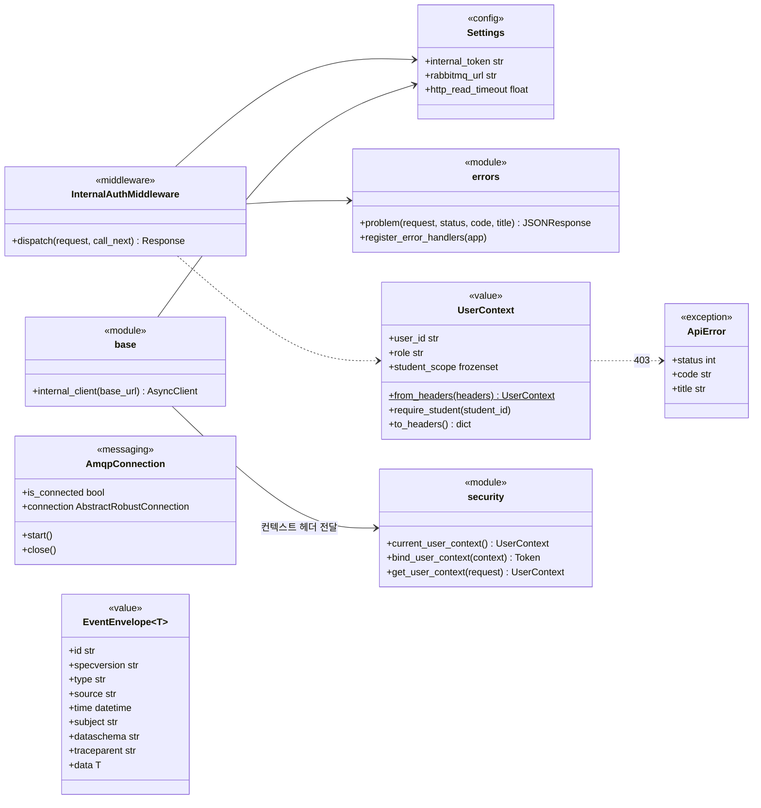

- 위 클래스는 모두 구현됨 (`config.py`·`errors.py`·`security.py`·`clients/base.py`·`messaging/connection.py`·`messaging/envelope.py`)
- 신규 공통: `messaging/publisher.py` `EventPublisher.publish(envelope, routing_key)`(ai 구현됨, best-effort), `messaging/consumer.py` `EventConsumer.consume(queue, handler)`(report 구현됨, 수동 ACK, 처리 실패 시 `<큐>.retry.<회차>` 재발행 → 3회 초과 시 reject → DLQ)
- 이벤트 소비 처리에서는 `bind_user_context(UserContext(role="SYSTEM", student_scope={subject}))` 후 하위 호출 (아키텍처 2.3)

---

## 3. core-service

### 3.1 계정·동의·자녀 연결 (account · consent · guardianship)

```mermaid
classDiagram
  direction TB
  class AuthController {
    <<controller>>
    +authorize() Redirect
    +callback(code, state, error) Redirect
    +refresh(cookie) TokenResponse
    +logout(cookie, bearer)
    +student(request) TokenResponse
    +me() MeResponse
    +registerStudentDevice(request) DeviceResponse
    +studentProfiles(deviceCookie) List
    +studentLogin(deviceCookie, request) TokenResponse
  }
  class AuthCookies {
    <<web>>
    +refresh(value, expires) ResponseCookie
    +clearRefresh() ResponseCookie
    +state(value) ResponseCookie
    +clearState() ResponseCookie
  }
  class AuthService {
    <<service>>
    +startGoogle() StartedGoogleLogin
    +completeGoogle(code, state, error, stateCookie, previousRefresh) IssuedAuth
    +login(profile, previousRefresh) IssuedAuth
    +authenticate(accessToken) AuthenticatedAccount
    +refresh(refreshToken) IssuedAuth
    +enterStudent(refreshToken, studentId, expected) IssuedAuth
    +logout(refreshToken, accessToken)
    +destination(identity) AuthDestination
    +requireConsents(identity)
    +requirePermission(identity, permission)
  }
  class TokenService {
    <<security>>
    +access(session) String
    +oauthState(state, nonce, verifier) String
    +verify(token, use) Jwt
    +randomToken() String
    +hash(value) String
  }
  class GoogleOAuthClient {
    <<client>>
    +authorizationUrl(state, nonce, verifier) String
    +exchange(code, verifier, nonce) GoogleProfile
  }
  class AuthRepository {
    <<repository>>
    +googleAccount(subject) AuthAccount
    +insertAccount(account, now)
    +session(id, lock) AuthSession
    +updateSession(session)
    +refresh(hash) RefreshToken
    +consume(id, now) Int
    +revoke(sessionId, now)
  }
  class AuthSession {
    <<value>>
    +role String
    +studentId UUID
    +version Long
    +expiresAt OffsetDateTime
  }
  class StudentAccessService {
    <<service>>
    +linkedStudents(userId) List
    +requireLinked(userId, studentId) LinkedStudent
  }
  class ConsentAccessService {
    <<service>>
    +hasRequiredConsents(userId) Boolean
    +hasGuardianConsent(userId, studentId) Boolean
  }
  class StudentDeviceController {
    <<controller>>
    +pairing(request) PairingResponse
    +devices() List
    +revoke(deviceId)
    +register(request) DeviceResponse
    +profiles(deviceCookie) List
    +login(request, deviceCookie) StudentToken
    +pin(childId, request, reauthToken)
  }
  class MeController {
    <<controller>>
    +update(request)
    +reauth() ReauthToken
    +requestWithdrawal(reauthToken)
  }
  class ConsentController {
    <<controller>>
    +documents() List
    +history() List
    +save(request) List
    +withdraw(consentId) ConsentEntry
  }
  class ChildrenController {
    <<controller>>
    +children() List
    +register(request) ChildResponse
    +update(childId, request)
    +unlink(reauthToken, childId)
    +deletionImpact(childId) Impact
    +requestDeletion(reauthToken, childId, scope) DeletionResponse
  }
  class AccountService {
    <<service>>
    +update(userId, command)
    +reauth(userId) ReauthToken
    +requestWithdrawal(userId, reauthToken)
  }
  class StudentAuthService {
    <<service>>
    +pairing(identity, childIds) PairingIssued
    +register(pairingCode, label, ip) Registered
    +profiles(deviceToken) List
    +login(deviceToken, childId, pin) TokenResponse
    +list(identity) List
    +revoke(parentId, deviceId)
  }
  class StudentPinService {
    <<service>>
    +set(identity, childId, pin, token)
    +state(childId) PinState
    +attempt(childId, pin) PinAttempt
    +clear(childId)
  }
  class ConsentService {
    <<service>>
    +documents() List
    +history(userId) List
    +save(userId, childId, choices) List
    +withdraw(userId, consentId) ConsentEntry
  }
  class AccountAccessService {
    <<service>>
    +lockParent(userId) UserAccount
  }
  class LearningRecordService {
    <<service>>
    +exists(studentId) Boolean
  }
  class GuardianshipService {
    <<service>>
    +register(userId, nickname, grade, birthYear, choices) LinkedStudent
    +children(userId) List
    +unlink(parentId, childId)
    +authorizeChild(childId) UserContext
    +authorizeLinkedChildren() UserContext
    +linkedStudentIds(parentId) Set
    +requestDeletion(parentId, reauthToken, childId, scope) DeletionRequest
  }
  class UserAccount {
    <<entity>>
    +requestWithdrawal()
    +completeWithdrawal()
  }
  class Student {
    <<entity>>
    +changeGrade(grade)
    +requestDeletion()
    +markDeleted()
    +setPin(pinHash)
    +recordPinFailure(maxAttempts)
    +resetPinFailures()
  }
  class StudentDevice {
    <<entity>>
    +isUsable(now) Boolean
    +touch(now)
    +revoke()
  }
  class Guardianship {
    <<entity>>
    +unlink()
    +isLinked() Boolean
  }
  class DeletionRequest {
    <<entity>>
    +confirm()
    +complete()
  }
  class UserAccountRepository {
    <<repository>>
    +lockById(id) UserAccount
  }
  class ConsentAccessRepository {
    <<repository>>
    +currentDocuments() List
    +history(userId) List
    +insert(entry)
    +withdraw(userId, consentId, now)
  }
  class StudentRepository { <<repository>> }
  class StudentAccessRepository {
    <<repository>>
    +linkedStudents(userId) List
    +linkedCount(userId) Int
    +insert(child, userId, demo, now)
  }
  class DeletionRequestRepository { <<repository>> }
  class StudentDeviceRepository { <<repository>> }
  class OutboxWriter { <<messaging>> }

  AuthController --> AuthService
  AuthController --> AuthCookies
  AuthService --> GoogleOAuthClient : 트랜잭션 밖 코드 교환
  AuthService --> TokenService
  AuthService --> AuthRepository
  AuthService --> StudentAccessService : 연결 자녀
  AuthService --> ConsentAccessService : 필수·법정대리인 동의
  AuthService ..> AuthSession
  MeController --> AccountService
  ConsentController --> ConsentService
  ChildrenController --> GuardianshipService
  StudentDeviceController --> StudentPinService : PIN 변경
  StudentDeviceController --> StudentAuthService
  StudentAuthService --> ChildAuthorizationService : 현재 자녀 권한
  StudentAuthService --> AuthService : 독립 학생 세션
  StudentPinService --> ReauthenticationService : DB grant 소비
  StudentPinService --> StudentPinRepository
  StudentAuthService --> StudentPinService : 자녀 PIN 잠금·검사
  StudentAuthService --> StudentDeviceRepository
  StudentAuthService --> TokenService
  StudentAuthService ..> StudentDevice
  AccountService --> UserAccountRepository
  AccountService --> AuthRepository : 탈퇴 시 세션 폐기
  ConsentService --> ConsentAccessRepository
  ConsentService --> AccountAccessService : 보호자 행 잠금
  ConsentService --> StudentAccessService : 연결 자녀
  ConsentAccessService --> ConsentAccessRepository
  StudentAccessService --> StudentAccessRepository
  AccountAccessService --> UserAccountRepository
  GuardianshipService --> AccountAccessService : 보호자 행 잠금
  GuardianshipService --> ConsentService : 법정대리인 동의 저장
  GuardianshipService --> ConsentAccessService : 현재 동의 확인
  GuardianshipService --> StudentAccessService
  GuardianshipService --> LearningRecordService : 기록 유무
  GuardianshipService --> StudentRepository
  GuardianshipService --> StudentAccessRepository : 연결 자녀·등록
  GuardianshipService --> DeletionRequestRepository
  GuardianshipService --> OutboxWriter : student.deleted
  AccountService ..> UserAccount
  GuardianshipService ..> Student
  GuardianshipService ..> Guardianship
  GuardianshipService ..> DeletionRequest
```

- `GuardianshipService.authorizeChild(childId)`: 학부모는 `guardianship LINKED` 확인 후 `studentScope = {childId}`로 컨텍스트 갱신, 학생은 본인 ID만. 미연결 시 `403 CHILD_NOT_LINKED` (FN-AGT-02, NFR-SEC-02)
- 자녀 범위가 필요한 모든 controller는 하위 호출 전에 `authorizeChild` 호출 → `InternalRestClientFactory`가 그 컨텍스트를 헤더로 전달
- `authorizeLinkedChildren()`: 경로에 자녀 ID가 없는 API(`/reports/{reportId}` 등)용. `studentScope = 연결 자녀 전체`로 전달하고 소유 서비스가 리소스의 학생 ID로 검사, 403은 core가 `CHILD_NOT_LINKED`로 변환
- 구현 상태: 인증(`AuthController`·`AuthService`·`TokenService`·`GoogleOAuthClient`), 동의·자녀(`ConsentController`·`ConsentService`·`ChildrenController`·`GuardianshipService`), 기기·PIN(`StudentDeviceController`·`StudentAuthService`·`StudentPinService`·`StudentDeviceCleanupService`), 계정 관리(`ReauthenticationService`·`AccountManagementService`·`AccountWithdrawalService`·`ChildManagementService`) 구현됨. 그림의 `MeController`·`AccountService`와 Student entity 메서드명은 추상 이름
- 동의는 별도 entity 없이 선택마다 새 `consent` 행(AGREED·WITHDRAWN)을 저장하고 최신 행으로 판정 (상태 다이어그램 2.3, [이슈 #37 보고서](../report/auth-account.md))
- `StudentAccessService`·`ConsentAccessService`는 인증용 읽기 전용 확인. 쓰기(자녀 등록·동의 저장)는 `GuardianshipService`·`ConsentService`(#37) 소유
- 공개 API 컨텍스트는 `PublicAuthFilter`가 설정하고 finally에서 해제 (`InternalAuthFilter`와 같은 방식)
- 이메일·비밀번호 가입·로그인·로그인 수단 변경 없음. Google 계정은 `(oauth_provider, oauth_subject)`로 식별, 최초 콜백에서 `AuthService.login`이 PARENT 계정 생성 (API 명세 5.1)
- 재확인 토큰(`reauthToken`)은 Google 재인증 기반(#45), DB reauth_challenge/reauth_grant 저장
- `AuthService.enterStudent` (`POST /auth/student-sessions`): 학부모 Bearer와 같은 세션의 refresh로 연결·활성 자녀·필수·법정대리인 동의 확인 → 부모 refresh 소비, `auth_session` role·studentId·version 변경 → `STUDENT` access만 발급, refresh 쿠키 삭제 (P01, 학부모 동석). 학생 계정·시연 링크 없음
- `StudentAuthService.login`: 기기 쿠키 해시로 `StudentDevice` 조회 → `isUsable`(미해제·미만료)·자녀 등록 확인 → `ChildAuthorizationService.requireCurrent`·`StudentAccessService.requireLinked` → 잠금·PIN 검사 → 동석 경로와 같은 `STUDENT` 토큰 발급, refresh 미발급 (P01, API 명세 3.11)
- `StudentPinService.attempt`: 학생 행 잠금으로 실패 횟수 증가, 5회 도달 시 `pin_locked_at` 기록. `set`은 DB 재인증 소비와 해시·실패 횟수 0·잠금 해제를 한 번에 처리
- 페어링 코드는 Redis(10분·1회용), 기기 자격증명은 `student_device.token_hash`만 저장. 저장 구조는 ERD 3.1·6장(core V13)
- `GuardianshipService.register`: 학년 3~6·출생연도 검증, 보호자 행 잠금 후 `LINKED` 자녀 3명이면 `CHILD_LIMIT_REACHED`, GUARDIAN 동의 필수 (P01·P02·P03). 다른 보호자 연결(`link`) 없음

### 3.2 학습 프록시·분석 대화 (learning · conversation)

```mermaid
classDiagram
  direction TB
  class LearningController {
    <<controller>>
    +missions(page, size) Response
    +mission(missionId) Response
    +start(missionId) Response
    +attempt(attemptId) Response
    +draft(attemptId, ifMatch, body) Response
    +hints(attemptId) Response
    +answer(attemptId, idempotencyKey, body) Response
    +finish(attemptId) Response
    +reflection(attemptId, body) Response
    +selfAssessment(attemptId, body) Response
  }
  class LearningProxyService {
    <<service>>
    +exchange(method, path, query, body, ifMatch, key) HttpExchangeResult
  }
  class StudentLearningContextService {
    <<service>>
    +requireLinked(userId, studentId) StudentLearningContext
  }
  class IdempotencyService { <<web>> }
  class FeedbackController {
    <<controller>>
    +feedback(answerId) SseEmitter
  }
  class FeedbackService {
    <<service>>
    +feedback(answerId) HttpExchangeResult
  }
  class LearningRecordService {
    <<service>>
    +exists(studentId) Boolean
    +studentDashboard(resource, query) HttpExchangeResult
    +parentDashboard(studentId, resource, query) HttpExchangeResult
  }
  class LearningRecordClient {
    <<client>>
    +exists(studentId) Boolean
    +dashboard(studentId, resource, query, parent, child) HttpExchangeResult
  }
  class DashboardController {
    <<controller>>
    +home(from, to) Response
    +studentAttempts(from, to, page, size, status) Response
    +activities(from, to) Response
    +summary(childId, from, to) Response
    +types(childId, from, to) Response
    +parentAttempts(childId, from, to, page, size, status) Response
    +detail(childId, attemptId, from, to) Response
  }
  class LearningClient {
    <<client>>
    +exchange(method, path, query, body, ifMatch, key) HttpExchangeResult
    +evidence(answerIds) List
    +correctJudgment(judgmentId, command, idempotencyKey)
  }
  class ConversationController {
    <<controller>>
    +create(request) Conversation
    +list(childId) List
    +get(conversationId) ConversationDetail
    +ask(conversationId, request) SseEmitter
    +retry(conversationId, messageId) SseEmitter
    +evidence(conversationId, messageId) List
  }
  class ConversationService {
    <<service>>
    +create(parentId, childId, from, to) Conversation
    +startMessage(conversationId, question, scope) ConversationMessage
    +stream(message, sink)
    +complete(messageId, result)
    +fail(messageId, code)
    +retry(messageId) ConversationMessage
    +evidence(messageId) List
  }
  class Conversation {
    <<entity>>
    +resolveScope(requested) Scope
  }
  class ConversationMessage {
    <<entity>>
    +start()
    +complete(answer, metrics, verification, evidence)
    +clarify(clarification)
    +fail(code)
    +retry()
  }
  class ConversationRepository { <<repository>> }
  class ConversationMessageRepository {
    <<repository>>
    +transition(id, from, to) Boolean
  }
  class AiClient {
    <<client>>
    +streamAnalysis(request) Flow~AnalysisEvent~
    +cancel(streamId)
  }
  class GuardianshipService { <<service>> }
  class JobExecutionService { <<service>> }
  class SseEmitters { <<web>> }

  LearningController --> LearningProxyService
  LearningProxyService --> StudentLearningContextService : 학생 학년·연결 확인
  LearningProxyService --> IdempotencyService : 답변 제출
  LearningProxyService --> LearningClient
  FeedbackController --> FeedbackService
  FeedbackController --> SseEmitters
  FeedbackService --> LearningProxyService
  LearningRecordService --> LearningRecordClient
  LearningRecordClient --> LearningClient
  DashboardController --> LearningRecordService
  LearningRecordService --> StudentAccessService : 현재 연결·ACTIVE·동의
  LearningRecordService --> StudentLearningContextService : home 학년·demo
  ConversationController --> GuardianshipService
  ConversationController --> ConversationService
  ConversationController --> SseEmitters
  ConversationService --> ConversationRepository
  ConversationService --> ConversationMessageRepository
  ConversationService --> AiClient
  ConversationService --> LearningClient : 근거 원문
  ConversationService --> JobExecutionService : 실행 이력
  ConversationService ..> Conversation
  ConversationService ..> ConversationMessage
```

- `learning/`은 controller → service(`LearningProxyService`·`FeedbackService`·`LearningRecordService`) → `LearningClient` 구조 (아키텍처 1.3·2.6). 공통 프록시는 `exchange`로 경로·본문을 그대로 전달하고 학생 컨텍스트·답변 멱등을 service에서 처리 ([이슈 #38 보고서](../report/core-gateway.md))
- 구현 상태: `LearningController`·`LearningProxyService`·`StudentLearningContextService`·`FeedbackController`·`FeedbackService`·`LearningRecordService`·`LearningRecordClient`·`LearningClient.exchange` 구현됨(마무리·돌아보기·자기 평가 포함). `Conversation*`·`AiClient`·`LearningClient.evidence`·`correctJudgment`는 미구현
- `DashboardController`(학생 3개·학부모 4개 조회) → `LearningRecordService` → `LearningRecordClient` → `LearningClient`. 집계·home·상세는 learning 기록 API가 계산하고 core는 수치를 계산하지 않음 ([core 보고서](../report/core-gateway.md))
- `FeedbackController`: learning 동기 응답을 기다리는 동안 heartbeat만 전송, 응답을 `status`·`result`·`error`·`done` 이벤트로 변환. 클라이언트 단절과 무관하게 learning 호출 유지 (아키텍처 1.3)
- `ConversationService.stream`: ai SSE 이벤트를 그대로 중계, `result` 수신 시 `complete`(트랜잭션), 클라이언트 단절 시 `AiClient.cancel` + `fail(CLIENT_DISCONNECTED)` (재시도 가능)
- 근거 원문은 저장하지 않고 `message_evidence` ID로 learning `/internal/records/evidence` 조회 (ERD 3.2)
- SSE 처리를 별도 스레드(executor)에서 실행하면 `UserContextHolder`(ThreadLocal) 값이 전달되지 않음 → `SseEmitters.open(context, …)`이 요청 스레드에서 캡처한 컨텍스트를 작업 스레드에서 설정·해제 (#39)

### 3.3 리포트 작업·알림 (report · notification)

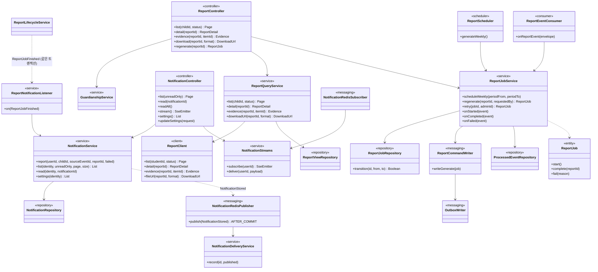

- `ReportScheduler`: `@Scheduled` + `@SchedulerLock`(ShedLock), 매주 월 07:00 KST, 직전 월~일(KST) 대상, 기록 없는 학생 포함 (P06). 학생별 `report_job(SCHEDULE)` + outbox 저장, 부분 UK로 중복 방지
- `ReportEventConsumer`: 큐 `core.report.events`, `processed_event`로 멱등, 상태 전이는 조건부 UPDATE (상태 다이어그램 4.1)
- 알림: 리포트 종료 전이 트랜잭션에서 `QUEUED` 저장 → 커밋 후 `NotificationRedisPublisher`가 `core:notifications:v1` 발행 → `NotificationDeliveryService`가 `COMPLETED`·`FAILED` 기록. 다른 레플리카의 `NotificationRedisSubscriber`가 `NotificationStreams`로 SSE 전달 (아키텍처 1.6)
- 리포트 조회 API에 `ReportQueryService`를 둬서 controller → client 직접 호출 금지 규칙 준수 (리포트 열람 기록 `report_view` 저장 포함)
- `ReportController`의 `reportId` 경로는 `GuardianshipService.authorizeLinkedChildren()` 사용 (3.1)

### 3.4 결제·구독 (payment)

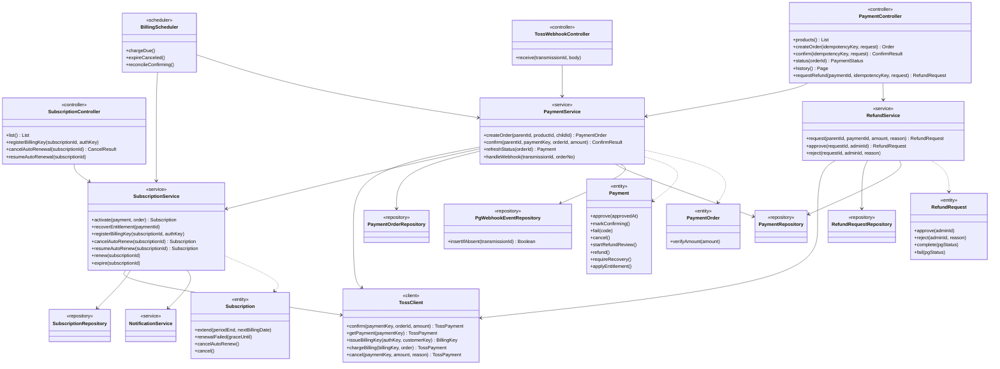

- `TossClient`는 PG 교체 지점 래퍼 (아키텍처 2.1). 로컬·CI는 `toss-stub`, 키는 환경 변수만
- `PaymentService.confirm`: 금액 대조(트랜잭션) → `TossClient.confirm`(트랜잭션 밖) → 결제 저장·구독 반영(트랜잭션). 반영 실패 시 `requireRecovery()` 후 `recoverEntitlement` 재시도 (FN-PAY-05)
- `BillingScheduler`: ShedLock, 정기 청구·해지 효력·`CONFIRMING` 재조회. 매일 09:00 KST. 갱신 실패 시 유예 3일·매일 1회 최대 3회 재청구 후 해지 (P13), 자동 갱신 해지는 `period_end` 경과 시 `CANCELED` (P14)

### 3.5 신고·지원·사용량·관리자 (support · usage · admin)

```mermaid
classDiagram
  direction TB
  class SupportController {
    <<controller>>
    +submitErrorReport(idempotencyKey, request) ErrorReport
    +myErrorReports() Page
    +errorReport(reportId) ErrorReport
    +submitInquiry(request) Inquiry
    +myInquiries() Page
    +notices() List
    +help(role) Help
  }
  class ErrorReportService {
    <<service>>
    +submit(reporterId, command) ErrorReport
    +review(reportId, adminId, command)
    +correct(reportId, adminId, command) Correction
  }
  class InquiryService {
    <<service>>
    +submit(userId, command) Inquiry
    +answer(inquiryId, adminId, answer)
  }
  class NoticeService {
    <<service>>
    +create(adminId, command) Notice
    +end(noticeId)
  }
  class ErrorReport {
    <<entity>>
    +startReview(adminId)
    +resolve(result, reason)
  }
  class Inquiry {
    <<entity>>
    +startReview()
    +answer(adminId, answer)
  }
  class SupportLearningClient {
    <<client>>
    +correctJudgment(judgmentId, command, idempotencyKey)
  }
  class LlmUsageConsumer {
    <<consumer>>
    +onUsage(envelope)
  }
  class LlmUsageService {
    <<service>>
    +record(envelope)
    +summarize(from, to, callType) List~UsageSummary~
  }
  class AdminController {
    <<controller>>
    +overview(from, to)
    +jobs(type, status)
    +retryJob(jobId, idempotencyKey)
    +queues()
    +auditLogs(targetType, from, to)
    +errorReports(status)
    +payments(status, from, to)
    +approveRefund(requestId, idempotencyKey)
  }
  class AdminMissionController {
    <<controller>>
    +proxy(path, body)
  }
  class ModelVersionController {
    <<controller>>
    +list(kind, page, size) ModelVersionPage
    +register(body, request) ModelVersion
    +activate(versionId, body, request) ModelVersion
    +rollback(versionId, body, request) ModelVersion
  }
  class AiUsageController {
    <<controller>>
    +usage(from, to, callType) AiUsageResponse
  }
  class InternalModelVersionController {
    <<controller>>
    +active() Map
  }
  class AdminJobService {
    <<service>>
    +list(type, status) Page
    +retry(jobId, adminId) JobExecution
  }
  class JobExecutionService {
    <<service>>
    +begin(jobType, jobId, triggeredBy) JobExecution
    +finish(executionId, status, errorCode)
  }
  class ModelVersionService {
    <<service>>
    +list(kind, page, size) ModelVersionPage
    +register(command, actor) ModelVersion
    +activate(id, command, actor) ModelVersion
    +rollback(id, command, actor) ModelVersion
    +active() List~ActiveModelVersion~
    -locked(id) ModelVersion
    -switch(target, scopes, reason, reanalysis, actor, action) ModelVersion
  }
  class AuditLogService {
    <<planned>>
    +record(actorId, action, target, result, detail)
  }
  class ModelVersion {
    <<value>>
    +id UUID
    +kind ModelKind
    +name String
    +version String
    +status VersionStatus
    +evalResult EvaluationRecord
    +approvedBy UUID
    +activatedAt OffsetDateTime
  }
  class ModelVersionRepository {
    <<repository>>
    +insert(version) Boolean
    +find(id) ModelVersion
    +list(kind, page, size) List
    +count(kind) Long
    +active() List
    +current(kind, name) ModelVersion
    +lockGroup(kind, name)
    +nextRevision(kind, name) Long
    +update(version)
    +audit(actor, action, target, detail, now)
  }
  class ModelVersionMapper {
    <<mapper>>
    +insert(row) Int
    +update(row) Int
    +audit(id, actor, action, target, detail, now) Int
  }
  class LlmUsageRepository {
    <<mapper>>
    +insertIfAbsent(usage) Int
    +summarize(from, until, callType) List~UsageSummary~
  }
  class QueueStatsRepository {
    <<repository>>
    +queues() List
  }

  SupportController --> ErrorReportService
  SupportController --> InquiryService
  SupportController --> NoticeService
  ErrorReportService --> SupportLearningClient
  ErrorReportService --> NotificationService
  InquiryService --> NotificationService
  ErrorReportService ..> ErrorReport
  InquiryService ..> Inquiry
  LlmUsageConsumer --> LlmUsageService
  LlmUsageService --> LlmUsageRepository
  ModelVersionController --> ModelVersionService
  AiUsageController --> LlmUsageService
  AdminController --> AdminJobService
  AdminController --> ErrorReportService
  AdminController --> RefundService
  AdminController --> AuditLogService
  AdminController --> QueueStatsRepository
  AdminMissionController --> LearningClient
  AdminMissionController --> AuditLogService
  InternalModelVersionController --> ModelVersionService
  AdminJobService --> ReportJobService : 리포트 재처리
  AdminJobService --> ConversationService : 대화 재처리
  AdminJobService --> JobExecutionService
  ModelVersionService --> OutboxWriter : model.version.activated
  ModelVersionService --> ModelVersionRepository : 상태·감사 같은 트랜잭션
  ModelVersionRepository --> ModelVersionMapper
  ModelVersionRepository ..> ModelVersion : JSON·DB 행 변환
  ModelVersionService ..> ModelVersion
  class NotificationService { <<service>> }
  class RefundService { <<service>> }
  class ReportJobService { <<service>> }
  class ConversationService { <<service>> }
  class LearningClient { <<client>> }
  class OutboxWriter { <<messaging>> }
```

- `SupportLearningClient` = `support/client/LearningClient.kt` (아키텍처 2.6). 다이어그램에서만 이름 구분
- 구현된 #43 공개 경로는 #36 `PublicAuthFilter → AuthService.requirePermission(SERVICE_OPS)`를 재사용한다. 내부 조회는 `InternalAuthFilter`의 내부 토큰 검사를 사용한다. 다른 관리자 기능의 권한 범위는 API 1.2를 따른다.
- #43은 실제 구현된 `ModelVersionController`·`AiUsageController`·`InternalModelVersionController`를 구분해 표시했다. 내부 응답은 `{items: List<ActiveModelVersion>}`이며 평가·관리자 정보는 제외한다. `AdminController` 및 나머지 운영 기능은 기존 후속 설계이며 구현 완료 표시가 아니다.
- `ModelVersion`은 불변 data class다. 상태 전이는 `ModelVersionService`의 `activate`·`rollback`과 private `switch`에서 `copy` 후 Repository에 저장하며 Domain의 `activate()`·`deactivate()` 메서드는 없다.
- `AuditLogService`는 아직 구현되지 않은 공용 감사 서비스 설계다. #43은 `ModelVersionService → ModelVersionRepository.audit → ModelVersionMapper.audit → audit_log` 경로로 감사 기록을 저장한다. 상태·감사·Outbox를 같은 트랜잭션으로 유지하며, #47 등에서 공용 감사 기능을 실제 도입할 때 이 경로의 통합을 검토한다. 현재 사용처만을 위해 공용 서비스를 추가하지 않는다 ([#43 보고서](../report/ai.md)).
- `QueueStatsRepository`: RabbitMQ 관리 API(15672) 조회, 큐 길이·DLQ 적재량 (참고 레포 `QueueOperations*`)

---

## 4. learning-service

### 4.1 미션·시도·답변 (mission · attempt · answer)

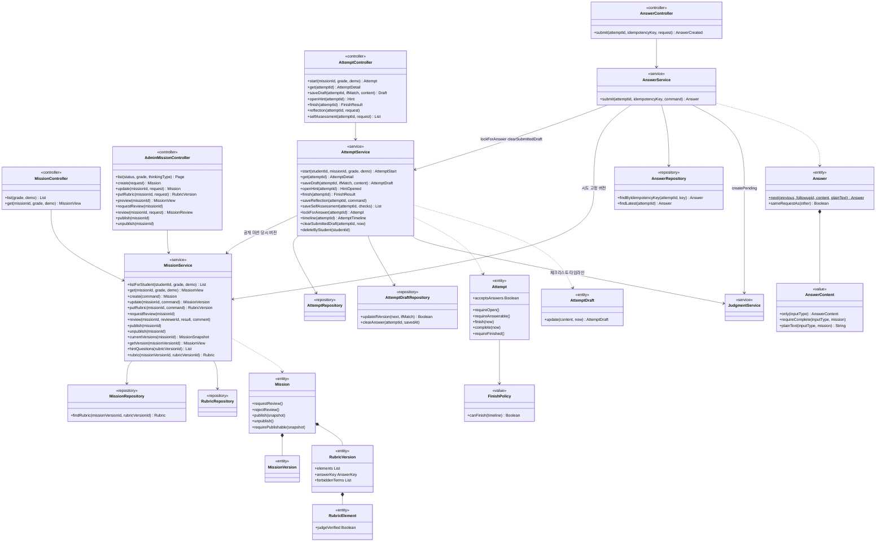

- `AttemptService.start`: 부분 UK `(student_id, mission_id) WHERE IN_PROGRESS` 충돌 시 기존 시도 반환 (FN-LRN-16)
- `AttemptDraft.update(content, now)`가 다음 버전을 만들고 `AttemptDraftRepository.updateIfVersion(next, ifMatch)`가 `UPDATE ... WHERE version = :ifMatch` 실행, 영향 0행이면 `ATTEMPT_DRAFT_CONFLICT` + 최신 초안 (FN-LRN-17)
- `AnswerService.submit`: 같은 트랜잭션에 `answer` 버전 추가 + `judgment(PENDING)` 생성. 같은 `idempotency_key`·같은 본문이면 기존 답변 반환, 다른 본문이면 `422 IDEMPOTENCY_KEY_REUSED` (FN-LRN-10, API 1.4). `lockForAnswer`가 시도 행을 잠가(`FOR UPDATE`) 같은 시도의 제출을 한 줄로 세움. 저장하면 `clearSubmittedDraft`로 초안의 `answer`를 비우고 `memo`는 유지, 초안 version +1 (FN-LRN-15·16)
- 보완 답변 연결: 첫 답변은 `followupId` 없이, 버전 2부터는 이 시도의 가장 최근 되묻기 중 아직 답하지 않은 것만 (`JudgmentService.unansweredLatestFollowupId`). 아니면 `422 ANSWER_INCOMPLETE`. 판정 전 추가 제출·되묻기 2회 뒤 제출도 여기서 막힘 (P04)
- `FinishPolicy.canFinish`: 시도 내 판정 `DONE` 1회 이상(결과 무관, `HELD` 포함)이면 true (P04)
- `AttemptService.finish`: 시도 행을 잠그고(`AttemptRepository.lockById`, 답변 제출·판정 저장과 같은 행) 본인 확인 → 이미 마무리했으면 기록 없이 같은 결과 → 타임라인으로 `FinishPolicy.canFinish`(sequence-diagram 3.3 순서) → `Attempt.finish(now)` → `AttemptRepository.finish`(`WHERE status = 'IN_PROGRESS' AND finished_at IS NULL`) → `FinishResult{finishedAt, reveal, revealKind, checklist}`. `Attempt.finish(now)`는 타임라인을 받지 않아 `canFinish`는 서비스가 먼저 부름
- 공개 내용(FN-LRN-11): `reveal`은 시도 기준표 버전의 예시 답(닫힌 문제는 정답과 해설), `revealKind`는 고르기·순서·분류·풀이 단계 `ANSWER`, 서술·논술 `EXAMPLE`. 체크리스트는 기준표 요소 전체, 이 시도의 처리 완료 판정(`JudgmentService.results`) 중 원문 구절과 함께 충족된 적 있는 요소만 체크하고 가장 최근 구절 표시. 시도 상세도 마무리 뒤에 같은 값
- `AttemptService.saveReflection`: 잠금 → `Attempt.complete(now)`(`requireFinished`: 완료 뒤 `ATTEMPT_CLOSED`, 마무리 전 `REVEAL_CONDITION_UNMET`) → 같은 트랜잭션에 `reflection` 저장 + `IN_PROGRESS → COMPLETED`·`completed_at`
- `AttemptService.saveSelfAssessment`: 잠금 → `requireFinished` → 기준표 요소 확인(비었거나 중복·기준표 밖이면 400) → `self_assessment` UK `(attempt_id, rubric_element_id)`로 저장(다시 보내면 `checked`만) → 기준표 요소마다 `{selfChecked, aiChecked(체크리스트), quote}`. 답변·판정은 건드리지 않음 (FN-LRN-13)
- `AttemptRepository`: `lockById`·`finish`·`complete`·`insertReflection`·`findReflection`·`saveSelfAssessments`·`findSelfAssessments` (돌아보기·자기 평가 Repository를 따로 두지 않음)
- 되묻기 생성 조건: 시도 내 되묻기 2회 미만 + 고르기 `CORRECT` 아님 (P04). `finished_at` 이후 답변 제출은 `Attempt.requireAnswerable`에서 `ATTEMPT_CLOSED`. `requireOpen`은 `COMPLETED`만 막음(마무리 뒤 돌아보기 저장)
- `AttemptDraft.content`: `{answer, memo}`, memo는 학생 본인 조회에만 포함 (P05)
- 구현 상태 (#22~#26): 학생 조회 경로(`MissionService.listForStudent`·`get`·`currentVersions`·`getVersion`·`rubric`·`hintQuestions`), `AttemptService`의 start·get·saveDraft·openHint·finish·saveReflection·saveSelfAssessment·lockForAnswer·clearSubmittedDraft·timeline, `Attempt.finish`·`complete`·`requireFinished`, `FinishPolicy`, `AnswerService.submit` 구현됨. 기준표는 학생·판정 조회용 값 객체 `Rubric`(`elements`·`answerKey`·`forbiddenTerms`)을 `MissionRepository.findRubric`으로 읽음(별도 `RubricRepository` 없음). 관리자 미션·기준표 쓰기(`AdminMissionController`·`RubricVersion`)와 `deleteByStudent`는 미구현
- `Mission.requirePublishable`: 현재 버전·기준표 요소 1개 이상(서술·논술) 또는 `answer_key`(고르기·수학) 검사, 누락 시 `MISSION_PUBLISH_INCOMPLETE` (FN-ADM-11)

### 4.2 판정·되묻기 (judgment)

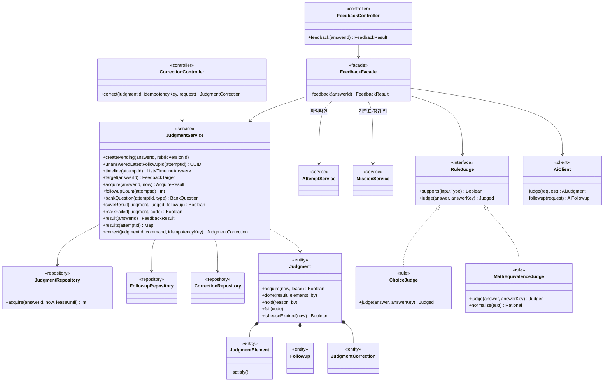

- `FeedbackFacade.feedback` 순서 (아키텍처 2.5)
  1. `JudgmentService.acquire`: `PENDING|FAILED|리스 만료 RUNNING → RUNNING` 조건부 UPDATE. `DONE`이면 저장 결과 반환, 유효 `RUNNING`이면 `RUNNING` 결과 반환 (API 1.4)
  2. 트랜잭션 밖: 고르기·수학 최종 답은 `RuleJudge`, 서술·논술은 `AiClient.judge`. 풀이 단계는 풀이를 `AiClient.judge`, 최종 답을 `MathEquivalenceJudge`로 보고 합침 (state-diagram 3.3). 기준표의 최종 답 요소(`code = 'FINAL_ANSWER'`)는 ai 요청에서 빼고(`Rubric.aiElements`) 정답 키 결과로 기록(`ANSWER_KEY`, FN-JDG-02 #79)
  3. 트랜잭션 밖: 시도 내 되묻기 2회 미만이고 고르기 `CORRECT`가 아니면 `AiClient.followup` (정답·금지어 유출 검사는 ai 담당, P04). 마무리·완료한 시도에는 만들지 않음. 유출 검사용 정답은 학생에게 보이는 글자(선택지 이름·정답 순서·답 단위를 붙인 최종 답·"선택지 이름: 그룹 이름")로 보냄. 재생성까지 검사 실패하면 learning이 `followup_bank_question`에서 같은 `type` 질문 선택(`BANK`, P16), 이 시도에서 아직 쓰지 않은 것부터
  4. `JudgmentService.saveResult`: 판정·요소·되묻기·버전 저장 + `DONE`. 먼저 시도 행을 잠그고(`FOR UPDATE`, 답변 제출·마무리와 같은 "시도 → 판정" 순서) 다시 확인해, 3 이후 마무리·완료된 시도면 되묻기는 저장하지 않음(P04). 예외 시 `markFailed`(실패 기록 자체가 실패해도 원래 오류로 응답)
- 전이는 `Judgment` 엔티티가 허용 여부를 판단하고 `JudgmentRepository`가 조건부 UPDATE로 저장 (#23 초안 `AttemptDraft.update` + `updateIfVersion`과 같은 방식). `saveResult`·`markFailed`는 획득한 리스 값을 비교해야 해 `judgmentId` 대신 `acquire`로 얻은 `judgment`를 받음. `markFailed`는 DB에서 다시 읽은 판정으로 기록(저장 중 롤백돼 엔티티만 `DONE`이 된 경우)
- `done`·`hold`의 `by`: 판정 방법(`RULE`·`LLM`)·`trial`·모델·프롬프트 버전 (ERD judgment.method·trial·model_version·prompt_version)
- `AiClient`: 응답 35초, 서비스 간 재시도 없음, 서킷 브레이커 최근 20건 중 실패 50% 이상이면 30초 차단(전송 오류·5xx만 실패로 셈, 아키텍처 1.3)
- `JudgmentElement`: `verified = false`면 `satisfy()` 거부 (ERD CHECK와 동일 규칙을 Domain에서도 검사)
- `judge_verified = false` 요소·미검증 학년 조합의 `HELD(UNVERIFIED_SCOPE)` 결정은 ai `JudgmentService` 담당(`JUDGE_REQUIRE_VERIFIED=true`일 때만, 기본 꺼짐). learning은 `judge_verified`·학년을 포함한 기준표를 `AiClient.judge`에 전달 (FN-JDG-04)
- 정정은 `Judgment`를 바꾸지 않고 `JudgmentCorrection` 추가, `result()` 조회 시 최신 정정 반영 (FN-SUP-03)
  - `results()`(시도 상세·기록)도 같음. 바꾸는 것은 `judgment.result`뿐이고(정정이 있으면 `heldReason`은 null), 판정 요소·되묻기·`nextActions`는 원판정 그대로 (#80)
  - `correct`: 판정 행을 잠그고(`FOR UPDATE`) 같은 키 → 처리 상태 `DONE` → 같은 신고(`reportId`) 순으로 확인한 뒤 저장. `JudgmentCorrection`은 정정 직전 결과(`previous`)·정정 결과·사유·신고·관리자·키·시각을 담고, 같은 키 재요청은 저장된 행으로 처음 응답을 다시 만듦 (api-spec 4.1, [이슈 #80 보고서](../report/learning.md))

### 4.3 기록 조회·삭제 (record · deletion)

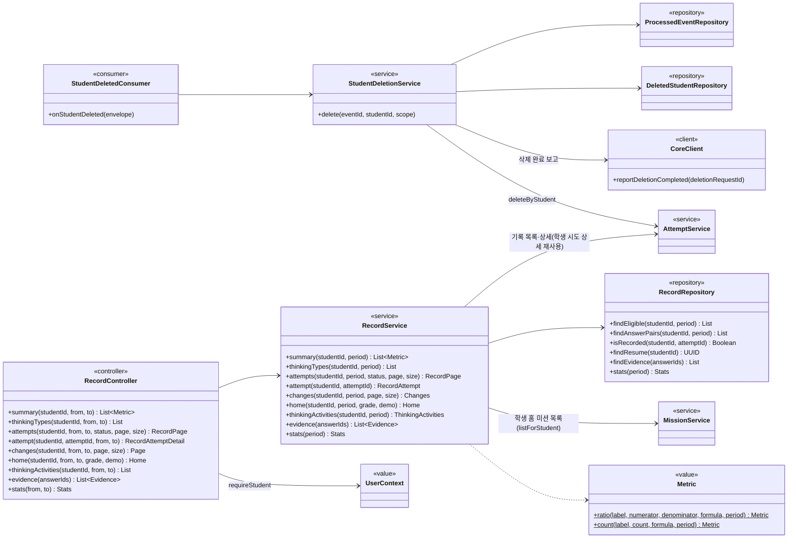

- 구현 상태: `record/`의 `RecordExistsController`·`RecordExistsService`·`RecordExistsRepository`와 `RecordController`·`RecordService`·`RecordRepository`·`Metric` 구현됨. 삭제 소비(`StudentDeletedConsumer`·`StudentDeletionService`)는 미구현 ([learning 보고서](../report/learning.md))
- `RecordController`: 모든 경로에서 `UserContextHolder.current().requireStudent(studentId)` 먼저 실행 (아키텍처 2.3 범위 검사). `home`은 미션 목록과 같은 기준으로 `requireSelfStudent()`가 경로의 학생과 같아야 함
- `RecordRepository`는 여러 기능 테이블을 읽는 조회 전용 MyBatis 매퍼 (쓰기 없음). 기능 간 repository 참조 금지 규칙의 예외로, 조회 전용 `record/`에 한정
- `Metric.ratio`: 분모 5 미만이면 `value = null`, `count`만 (P08, API 1.6). `Metric.count`도 계산식을 받음(기능 명세 1.3 "모든 건수·비율은 계산식과 함께")
- `RecordRepository.findEligible`: 집계 대상 시도(P08: 기간 안 답변 제출, 미완료 포함, 조회 종료일까지 모두 처리 실패인 시도·삭제 학생 제외)와 시도별 사실(완료, 최초 답변 전 생각 열기 열람, 되묻기 받음, 보완 답변, 모두 조회 종료일까지)을 한 번 읽고 summary·thinkingTypes·attempts가 같이 씀. `isRecorded`는 기간과 무관한 상세용, `stats`는 운영 집계
- `RecordService.attempts`·`attempt`: 학생 시도 상세(`AttemptService.get`)를 그대로 쓰고 응답에서 초안(메모 포함)만 뺌(P05). 목록은 답변·생각 열기 열람을 조회 종료일까지로 자르고 돌아보기는 기간 안에 쓴 것만 남김. 시도 항목에 `completedAt`·`hintUsages`·돌아보기 `createdAt`을 붙임(report #51). 상세는 이력을 자르지 않음(core #40) 그래서 `findAttemptsWithTimeline`은 두지 않음
- `RecordService.home`·`thinkingActivities` (core #40 요청): `home`은 이어할 시도(`findResume`: 진행 중 시도 중 시작·답변 제출·초안 저장 중 가장 늦은 시각이 가장 최근, 기간과 무관, 초안은 저장 시각만 읽음)를 기록 상세와 같은 모양으로, 미션은 `MissionService.listForStudent` 그대로. `thinkingActivities`는 `findEligible` 대상의 유형·미션 이름과 기간 안에 쓴 돌아보기. 둘 다 `state`는 기간 안 집계 대상 시도 수
- `RecordService.changes`: 보완 답변이 있는 시도의 최초 vs 조회 종료일 이전 마지막 답변. 원문은 `plain_text`, 글자·문장·까닭을 잇는 말 수는 학생이 쓴 칸 내용으로 셈(칸 이름 제외). 까닭을 잇는 말 목록(`TextCounts.REASON_CONNECTIVES`)은 report와 확정
- `StudentDeletionService.delete`: 삭제·`deleted_student` 저장 후 `CoreClient.reportDeletionCompleted`. 보고 실패 시 예외 → 지연 재시도(1·5·15분) 후 재처리, 삭제는 멱등 (P09, 아키텍처 1.6)
- `evidence`: `deleted_student`에 있는 학생 근거는 `available: false` (FN-ACC-13)
- `AttemptService.deleteByStudent`: `attempt` 삭제 시 하위 `answer`·`judgment`·`followup`·`reflection` 등 삭제 방식(FK `ON DELETE CASCADE` 또는 서비스 내 삭제 순서) 미결. 현재 마이그레이션의 learning FK는 모두 NO ACTION (ERD 1장·7장, 8장)

---

## 5. ai-service

### 5.1 판정·되묻기 (judgment · followup)

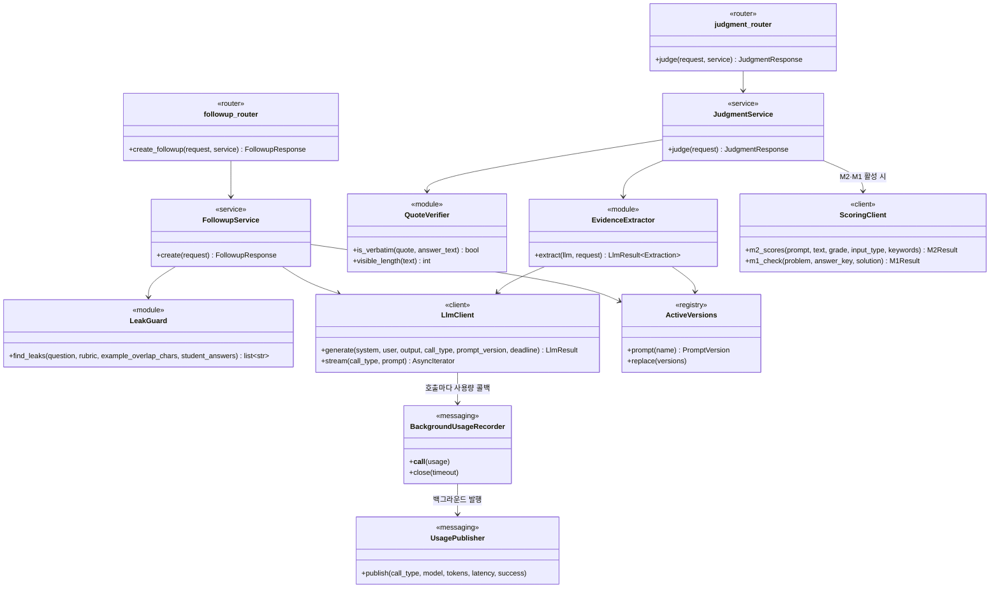

| 클래스 | 파일 | 책임 |
|---|---|---|
| `EvidenceExtractor` | `judgment/extractor.py` | 모듈 함수 `extract()`. LLM에 기준표 요소별 근거 구절 추출 요청 (학생 이름 미포함) |
| `QuoteVerifier` | `judgment/verifier.py` | 모듈 함수 `normalize`·`is_verbatim`·`visible_length`. 구절의 답변 원문 존재 확인(코드). LLM과 분리 (FN-JDG-03) |
| `JudgmentService` | `judgment/service.py` | 사전 보류(`TOO_SHORT`·`UNVERIFIED_SCOPE`) → 추출 → 대조 → 요소·배점으로 `CORRECT|PARTIAL|RETHINK|HELD` 결정 (업무 판단은 service, 아키텍처 2.1) → M2 교차 확인(불일치 시 `HELD(MODEL_DISAGREEMENT)`) → 풀이 단계는 M1 점검(확신도 미만 `HELD(LOW_CONFIDENCE)`) → 응답. M2·M1 교차 확인(`ScoringClient`)은 미구현 |
| `LeakGuard` | `followup/leak_guard.py` | 모듈 함수 `find_leaks()`. 정답 키·예시 답·금지어 포함 검사. 실패 시 1회 재생성(`LLM_RETRY`), 재실패 시 `question` 없이 `leakCheck.passed = false` 반환 → learning이 질문 은행 선택 (`BANK`, P16) |
| `LlmClient` | `llm/base.py`, 제공자는 `llm/providers.py` | 제공자 교체 지점(Claude·OpenAI·OpenAI 호환 sLLM, `LLM_PROVIDER`), LLM 호출 재시도는 이 클래스에서만 (아키텍처 1.3), 호출마다 사용량 콜백(`BackgroundUsageRecorder` → `UsagePublisher`, 발행 실패는 로그만). `stream`은 분석 에이전트와 함께 후속 |
| `ActiveVersions` | `versions.py` | 미구현. 현재 `versions.py`는 `GET /internal/versions`로 코드 상수 프롬프트 버전만 제공. `model.version.activated` 수신 시 교체는 후속 |

### 5.2 분석 에이전트·리포트 서술 (analysis_agent · report_narrative)

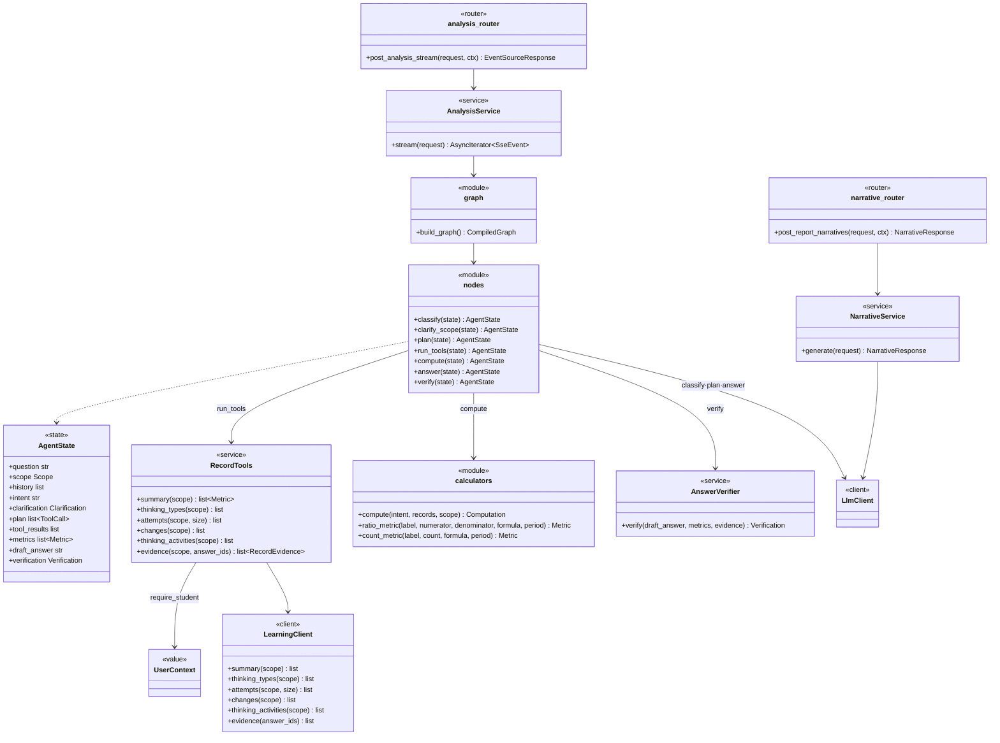

- 그래프 흐름 `classify → clarify_scope → plan → run_tools → compute → answer → verify` (아키텍처 1.5), 분기는 [시퀀스 다이어그램 5](sequence-diagram.md#5-분석-대화-sse)
- `RecordTools`(`analysis_agent/tools.py`): 도구 실행마다 `require_student` 검사 후 `LearningClient` 호출, 범위 밖이면 learning 미호출 (FN-AGT-02). `scope`는 core가 확인한 `{studentId, from, to}`
- `LearningClient`(`clients/learning_client.py`): 받은 컨텍스트 헤더 그대로 전달, 재시도 없음, 응답의 학생·기간·처리 상태 대조. 조회 실패는 빈 기록이 아닌 오류 (FN-AGT-10). `evidence`의 `available: false` 항목은 원문 없이 그대로 반환
- `calculators`: 건수·비율은 LLM이 아닌 코드 계산 (FN-AGT-05), `Metric` 형식은 learning과 동일(분모 0 `NO_RECORD`, 5 미만 `value: null`). 집계 대상·전후 변화 수(글자·문장·까닭을 잇는 말)는 learning `summary`·`changes.counts` 값을 그대로 사용해 대시보드·리포트와 숫자를 맞춤 ([ai 보고서 2장](../report/ai.md#2-분석-대화-에이전트-langgraph))
- `AnswerVerifier`(`analysis_agent/verifier.py`, 신규): 답변 속 숫자 ↔ `metrics`, 인용 ↔ `evidence` 원문 대조. 실패 시 규칙 응답으로 전환 (FN-AGT-06)
- 규칙 응답(`analysis_agent/rule_responder.py`, 신규): 대조 실패·LLM 키 부재·호출 실패 시 계산된 `metrics`·`evidence`만 템플릿 문장으로 구성, `source = TEMPLATE`·`fallback` 표시 (FN-AGT-10, P16)
- `NarrativeService`: 서술·저녁 질문만 생성, 숫자 계산·대조는 report-service 담당

### 5.3 메시징·클라이언트

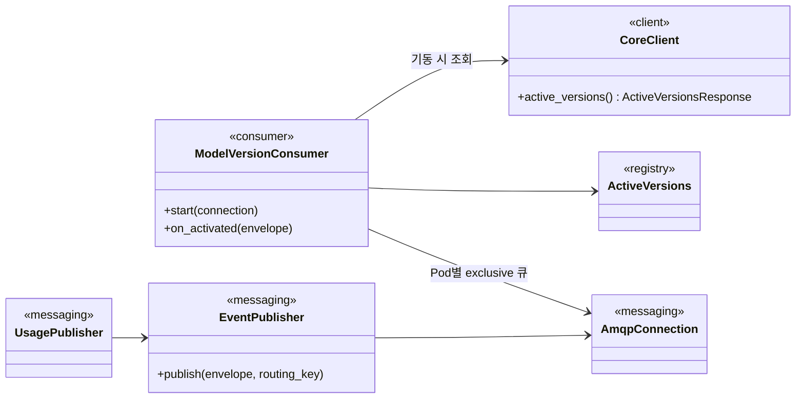

- 기동 순서: exclusive 큐 선언·바인딩 → `CoreClient.active_versions()` → `ActiveVersions.replace`. 조회 실패 시 readiness false 유지·재시도 (아키텍처 1.6)
- `UsagePublisher`: 응답 반환 후 best-effort 발행, 학생 ID·원문 미포함 (NFR-PRF-02)

---

## 6. scoring-service

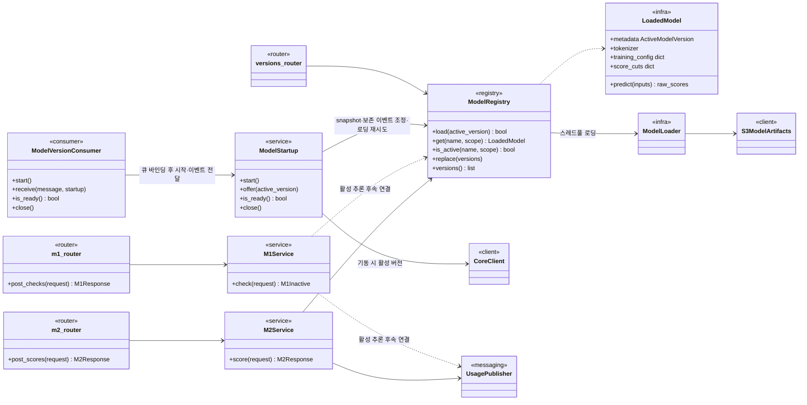

- `LoadedModel.predict`는 CPU 동기 추론 → `run_in_threadpool`로 호출해 이벤트 루프 차단 방지 (아키텍처 2.3)
- 활성 범위 밖 학년·문항이면 `{active: false}` 반환. #88 현재 M1은 미학습으로 항상 비활성이며 추론·사용량 발행을 하지 않는다. 향후 M1 확신도 0.8 미만이면 scoring은 실수 위치를 제외하고 ai가 보류를 결정한다(P15).
- 가중치는 S3 `artifact_uri`에서 로딩, 승인된 버전만 (아키텍처 5장)
- #85 구현: 레지스트리·S3 로더·versions 라우터. `get(name, scope)`는 승인 범위를 검사한 모델만 반환한다. #86은 `ModelVersionConsumer`·`ModelStartup`으로 이벤트 보존·재연결·모델 교체를 연결한다. #87은 m2 라우터·M2Service·사용량 발행, #88은 M1 미학습 비활성 계약을 제공한다.

---

## 7. report-service

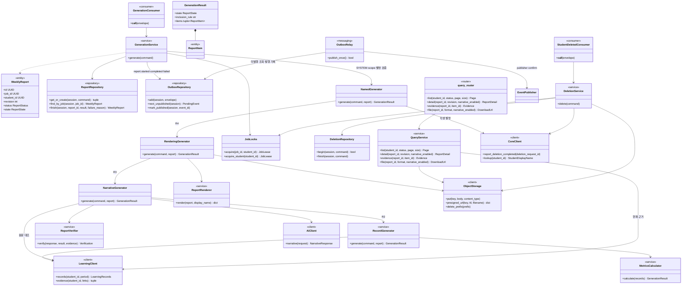

| 클래스 | 파일 | 실행 프로세스 |
|---|---|---|
| `GenerationConsumer`, `GenerationService`, `MetricsCalculator`, `ReportVerifier`, `ReportRepository`, `WeeklyReport` | `generation/consumer.py`·`service.py`·`metrics.py`·`verifier.py`·`repository.py`·`models.py` | report-worker |
| `RecordGenerator`, `GenerationResult`·`ReportItem` | `generation/record_generator.py`·`models.py` | report-worker (R2 계산 결과를 종료 트랜잭션으로 전달) |
| `LearningClient` | `clients/learning_client.py` | worker/API (`records`는 세 조회 정규화, `evidence`는 현재 원문·버전·삭제 대조) |
| `NarrativeGenerator`, `RenderingGenerator`, `JobLocks` | `generation/narrative_generator.py`·`locking.py`, `rendering/generator.py` | report-worker |
| `ReportRenderer` | `rendering/renderer.py` (Jinja2 → HTML, Playwright → PDF, Markdown) | report-worker |
| `OutboxRelay`, `OutboxRepository` | `outbox/` | report-worker (서비스의 종료 트랜잭션이 `OutboxRepository.add` 호출) |
| `StudentDeletedConsumer`, `DeletionService` | `deletion/` | report-worker |
| `DeletionRepository` | `deletion/state.py` | report-worker (삭제 장벽·processed_event·물리 삭제 트랜잭션) |
| `query_router`, `QueryService` | `query/router.py`, `query/service.py` (신규) | report-api |
| `ObjectStorage` | `clients/storage.py` (신규, S3·로컬 MinIO) | 공통 |

- `GenerationService.generate`: `job_id`로 기존 행 조회 → 없으면 `RUNNING` 생성, `COMPLETED·FAILED`면 ACK만, `RUNNING`이면 같은 행으로 재실행. 기록 없음·표본 부족은 `COMPLETED + state`, 실패는 `FAILED` (FN-RPT-11)
- `query_router`·`QueryService`: 모든 조회에서 리포트의 `student_id`가 `X-Student-Scope`에 있는지 검사, 없으면 403 (API 4장)
- 수치·전후 변화는 `MetricsCalculator`(코드)에서만 계산, ai는 서술·저녁 질문만 (FN-RPT-03, 05)
- #51 구현의 `RecordGenerator`는 learning 조회 → `MetricsCalculator.calculate` → 항목·근거가 포함된 `GenerationResult`를 반환한다. `ReportRepository.finish`가 상태·항목·근거를 저장하며 종료 이벤트와 같은 트랜잭션에 참여한다. 입력 계약은 병합된 #27 코드·OpenAPI와 대조한 API 4.1.1이며, #51의 검증 범위는 `docs/report/report.md`에 기록한다.
- #52~#55의 AI 서술·원문 재검증·렌더링·저장·조회·삭제 구현을 포함한다. #56의 `worker.run(generator=None)`은 #42 v1 codec, 생성·삭제 구독과 Outbox 및 `generation/pipeline.py`의 전체 생성기를 조립한다. 기본 실행은 #119 core 별명 조회를 사용하며 조회 실패·잘못된 학생/별명은 생성 실패로 종료한다. Compose 직접 발행 검증과 실제 AI·공개 API 전체 E2E는 구분한다.
- `ReportVerifier`: 서술 속 숫자·인용을 계산 결과·learning 원문과 대조, 실패 시 서술을 템플릿 요약으로 교체(`narrative.source = TEMPLATE`, P16). `NO_RECORD`·무료 플랜(`narrativeEnabled = false`)은 ai 호출 생략 (P06·P13)

---

## 8. 확인 필요 가정
- 요금제 사용 한도(P13): core가 Redis 일 단위 카운터(학생별 미션 시작·피드백, 학부모별 분석 대화)와 `product.limits`로 확인 후 `USAGE_LIMIT_REACHED`. 담당 클래스는 구현 시 `usage/`에 추가
- core `conversation`(근거 원문 조회)·`admin`(미션 관리 프록시)의 learning 호출: core `learning/service`(#37·#38에서 추가)를 거칠지, 기능별 client를 둘지 구현 시 결정
- learning 하위 기록 삭제 방식(FK `ON DELETE CASCADE` 또는 서비스 내 삭제 순서) 결정 후 ERD 반영 필요 (4.3). 현재 FK는 NO ACTION
- learning `record/RecordRepository`가 여러 기능 테이블을 조회: 조회 전용 기능 한정 예외
- 클래스 분할 단위(관리자 controller 등)는 구현 시 조정 가능, 레이어·의존 방향은 고정
