# 클래스 다이어그램

- 근거: [아키텍처 설계](architecture.md) 2장(레이어·의존 규칙·폴더), [API 명세서](api-spec.md), [ERD](erd.md), [기능명세서](functional-spec.md)
- 범위: 5개 서비스의 기능별 Presentation · Application · Domain · Infrastructure 클래스와 의존 관계, 공개 메서드 시그니처
- 상태 전이 규칙은 [상태 다이어그램](state-diagram.md), 호출 순서는 [시퀀스 다이어그램](sequence-diagram.md)
- 클래스명은 구현 기준 이름. 필드는 ERD 컬럼과 같아 생략하고 상태 전이·검증 메서드만 표기
- `(P04)` 형태는 확정 정책 번호, 내용은 [기능명세서 1.4](functional-spec.md#14-확정-정책)

---

## 1. 공통 규칙

| 항목 | 규칙 |
|---|---|
| 레이어 표기 | `<<controller>>` `<<consumer>>` `<<scheduler>>` = Presentation / `<<service>>` `<<facade>>` = Application / `<<entity>>` `<<value>>` = Domain / `<<repository>>` `<<client>>` `<<messaging>>` = Infrastructure |
| 화살표 | `-->` 의존(호출), `..>` 생성·반환, `*--` 소유(같은 집합), `<|..` 구현 |
| 의존 방향 | Presentation → Application → Infrastructure 단방향, Domain은 전 레이어가 참조 (아키텍처 2.2) |
| 기능 간 호출 | 상대 기능의 `service`만 호출. 여러 기능 조합은 주도 기능 `service`가 하고, 조합 대상이 많을 때만 `facade` (아키텍처 2.2, #422) |
| 트랜잭션 | `<<service>>`·`<<facade>>` 메서드에서만 시작, 트랜잭션 안에서 HTTP·AMQP 호출 금지 |
| Spring 루트 패키지 | `com.sagomungchi.<service>`, 다이어그램은 루트 이하 경로 생략 |
| Python | 파일 1개 = 다이어그램 클래스 1개 기준. 함수 모음 모듈은 `<<module>>`로 표기 |
| 기존 코드 | 2장의 `(구현됨)` 표시 클래스는 현재 저장소에 존재, 이름·시그니처 그대로 사용 |

---

## 2. 공통 모듈

### 2.1 Spring 공통 (`_common/`, core·learning 동일)

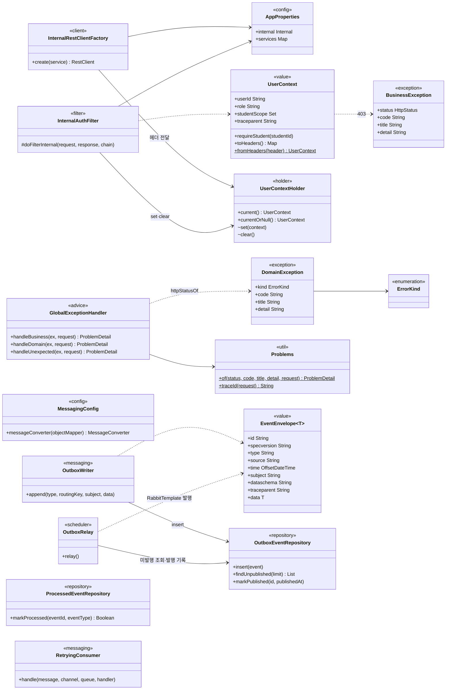

| 클래스 | 위치 | 상태 | 책임 |
|---|---|---|---|
| `AppProperties`, `InternalRestClientFactory` | `_common/config` | 구현됨 | 내부 호출 RestClient(내부 토큰·컨텍스트 헤더·타임아웃, 재시도 없음) |
| `InternalAuthFilter`, `UserContext`, `UserContextHolder` | `_common/security` | 구현됨 | `/internal/**` 토큰 검사, `X-User-*`·`X-Student-Scope` 컨텍스트 |
| `BusinessException`, `DomainException`, `ErrorKind`, `GlobalExceptionHandler`, `Problems` | `_common/exception` | 구현됨 | RFC 9457 오류 응답. domain은 Spring 타입이 없는 `DomainException(kind, code, …)`만 던지고, `ErrorKind` → HTTP 상태는 `_common/exception`의 `statusOf` 하나가 정함(core 400·404·409, learning 400·409·422, #249). 예외에서 상태·code를 읽는 곳은 `httpStatusOf`·`errorCodeOf`(두 예외 모두 처리). `BusinessException`은 application·presentation 전용 |
| `EventEnvelope`, `MessagingConfig` | `_common/messaging` | 구현됨 | CloudEvents 봉투, JSON 변환기 |
| `OutboxWriter`, `OutboxRelay`, `OutboxEventRepository` | `_common/messaging` | 구현됨 (core만) | 같은 트랜잭션 `outbox_event` 저장 → 릴레이(ShedLock 단일 실행)가 DB 트랜잭션 밖에서 subject별 미발행 선두를 1건씩 발행·publisher confirm 대기 후 짧은 트랜잭션으로 `published_at` 기록(#166). 실패는 짧은 트랜잭션으로 `recordFailure`, 4번째 실패 격리(#243) |
| `ProcessedEventRepository` | `_common/messaging` | 구현됨 (core) | `processed_event` INSERT 성공 여부로 멱등 소비 |
| `EventAuditConsumer`, `EventLogRepository`, `EventRetentionCleanup` | `_common/messaging` | 구현됨 (core, #208) | 감사 큐의 모든 업무 메시지 봉투 메타데이터를 `event_log`에 저장, 주기 정리(발행 완료 Outbox·처리 이벤트·이벤트 기록 보존 기간). listener·`@Scheduled`가 같은 패키지 repository를 직접 호출하는 것은 공통 메시징 인프라 예외(아키텍처 2.1, #278)이며 `_common`에 service를 두지 않음. learning은 `record/scheduler/ProcessedEventCleanupScheduler` → `record/service/ProcessedEventCleanupService`, report는 `worker.py` → `deletion/service.py` `prune_event_records` |
| `RetryingConsumer` | `_common/messaging` | 구현됨 (core) | 수동 ACK. 처리 실패 시 `x-retry-count` +1 후 `<큐>.retry.<회차>` 재발행, 최대 횟수 초과 시 reject → DLQ (아키텍처 1.6) |
| `PublicAuthFilter` | `account/controller` (#251, 이전 `_common/security`) | 구현됨 (core만) | `/api/v1/**` Bearer 검증(`AuthService.authenticate`), 쿠키 API Origin·`X-Requested-With` 검사, 역할·관리자 권한·필수 동의 확인 → `UserContext(userId, role, studentScope)` 설정. JWT 발급·검증은 `account/service/TokenService` (3.1) |
| `RequestAttributes` | `_common/security` | 구현됨 (core, #251) | 요청 속성 이름 상수. `IDENTITY`(인증된 계정 `AuthenticatedAccount`, `PublicAuthFilter`가 설정하고 공개 컨트롤러가 읽음). 이전 `AuthController.IDENTITY` |
| `IdempotencyService` | `_common/web` | 구현됨 (core만, #38) | `idempotency_record` 조회·저장, 같은 키·다른 본문 422 |
| `SseEmitters` | `_common/web` | 구현됨 (core만, #39) | SSE 생성, 15초 heartbeat `: ping`, 연결 종료 콜백. 연결 시간은 용도별: 피드백 90초(`open`), 알림 구독 5분(`subscribe`), 분석 대화 125초(`open`, 120초 취소 hook, #41). `open(context, …)`이 요청 스레드의 `UserContext`를 작업 스레드에 설정·해제 |

### 2.2 Python 공통 (`app/`, ai·scoring·report 동일)

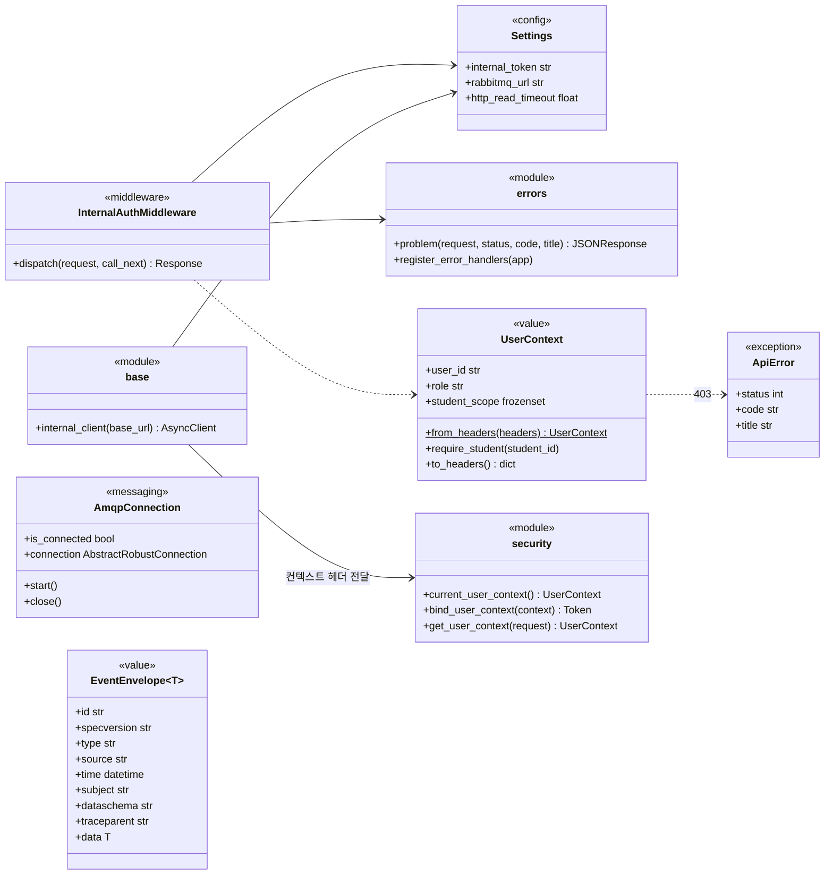

- 위 클래스는 모두 구현됨 (`config.py`·`errors.py`·`security.py`·`clients/base.py`·`messaging/connection.py`·`messaging/envelope.py`)
- 신규 공통: `messaging/publisher.py` `EventPublisher.publish(envelope, routing_key)`(ai 구현됨, best-effort), `messaging/consumer.py` `EventConsumer.consume(queue, handler)`(report 구현됨; ai·scoring은 `model.version.activated` Pod별 exclusive 큐 소비자 별도 구현, 수동 ACK, 처리 실패 시 `<큐>.retry.<회차>` 재발행 → 3회 초과 시 reject → DLQ)
- 이벤트 소비 처리에서는 `bind_user_context(UserContext(role="SYSTEM", student_scope={subject}))` 후 하위 호출 (아키텍처 2.3)

---

## 3. core-service

### 3.1 계정·동의·자녀 연결 (account · consent · guardianship)

```mermaid
classDiagram
  direction TB
  class AuthController {
    <<controller>>
    +authorize() Redirect
    +callback(code, state, error) Redirect
    +refresh(cookie) TokenResponse
    +adminLogin(request) TokenResponse
    +parentSignup(request) TokenResponse
    +parentLogin(request) TokenResponse
    +logout(cookie, bearer)
    +student(request) TokenResponse
    +me() MeResponse
    +registerStudentDevice(request) DeviceResponse
    +studentProfiles(deviceCookie) List
    +studentLogin(deviceCookie, request) TokenResponse
  }
  class AuthCookies {
    <<web>>
    +refresh(value, expires) ResponseCookie
    +clearRefresh() ResponseCookie
    +state(value) ResponseCookie
    +clearState() ResponseCookie
  }
  class AuthService {
    <<service>>
    +startGoogle() StartedGoogleLogin
    +completeGoogle(code, state, error, stateCookie, previousRefresh) IssuedAuth
    +login(profile, previousRefresh) IssuedAuth
    +adminLogin(loginId, password, previousRefresh) IssuedAuth
    +parentLogin(loginId, password, previousRefresh) IssuedAuth
    +parentSignup(loginId, password, name, clientIp, previousRefresh) IssuedAuth
    +authenticate(accessToken) AuthenticatedAccount
    +refresh(refreshToken) IssuedAuth
    +enterStudent(refreshToken, studentId, expected) IssuedAuth
    +logout(refreshToken, accessToken)
    +destination(identity) AuthDestination
    +requireConsents(identity)
    +requirePermission(identity, permission)
  }
  class TokenService {
    <<security>>
    +access(session) String
    +oauthState(state, nonce, verifier) String
    +verify(token, use) Jwt
    +randomToken() String
    +hash(value) String
  }
  class GoogleOAuthClient {
    <<client>>
    +authorizationUrl(state, nonce, verifier) String
    +exchange(code, verifier, nonce) GoogleProfile
  }
  class AuthRepository {
    <<repository>>
    +googleAccount(subject) AuthAccount
    +insertAccount(account, now)
    +session(id, lock) AuthSession
    +updateSession(session)
    +refresh(hash) RefreshToken
    +consume(id, now) Int
    +revoke(sessionId, now)
    +adminCredential(loginId) PasswordCredential
    +parentCredential(loginId) PasswordCredential
    +parentCredentialOf(userId) PasswordCredential
    +loginIdExists(loginId) Boolean
    +insertPasswordParent(id, loginId, name, now, demo) Boolean
    +insertParentCredential(userId, hash, now)
  }
  class PasswordCredentialService {
    <<service>>
    +hash(password) String
    +verify(realm, credential, password, now) Failure
  }
  class PasswordCredential {
    <<value>>
    +userId UUID
    +passwordHash String
    +failedCount Int
    +lockedUntil OffsetDateTime
  }
  class SignupRateLimiter {
    <<repository>>
    +acquire(clientIp)
  }
  class ReauthenticationService {
    <<service>>
    +start(identity, purpose, childId, scope) Started
    +callback(code, state, error, cookie) UUID
    +issue(identity, challengeId) Issued
    +withPassword(identity, purpose, childId, scope, password) Issued
    +consume(identity, token, purpose, childId, scope)
  }
  class AuthSession {
    <<value>>
    +role String
    +studentId UUID
    +version Long
    +expiresAt OffsetDateTime
  }
  class StudentAccessService {
    <<service>>
    +linkedStudents(userId) List
    +requireOwned(userId, studentId) LinkedStudent
    +requireLinked(userId, studentId) LinkedStudent
    +lockActive(studentId)
    +activeParents(studentId) List
  }
  class ConsentAccessService {
    <<service>>
    +hasRequiredConsents(userId) Boolean
    +hasGuardianConsent(userId, studentId) Boolean
  }
  class StudentDeviceController {
    <<controller>>
    +pairing(request) PairingResponse
    +devices() List
    +revoke(deviceId)
    +register(request) DeviceResponse
    +profiles(deviceCookie) List
    +login(request, deviceCookie) StudentToken
  }
  class MeController {
    <<controller>>
    +update(request)
    +reauth() ReauthToken
    +requestWithdrawal(reauthToken)
  }
  class ConsentController {
    <<controller>>
    +documents() List
    +history() List
    +save(request) List
    +withdraw(consentId) ConsentEntry
  }
  class ChildrenController {
    <<controller>>
    +children() List
    +register(request) ChildResponse
    +update(childId, request)
    +unlink(reauthToken, childId)
    +deletionImpact(childId) Impact
    +requestDeletion(reauthToken, childId, scope) DeletionResponse
  }
  class AccountService {
    <<service>>
    +update(userId, command)
    +reauth(userId) ReauthToken
    +requestWithdrawal(userId, reauthToken)
  }
  class StudentAuthService {
    <<service>>
    +pairing(identity, childIds) PairingIssued
    +register(pairingCode, label, ip) Registered
    +profiles(deviceToken) List
    +login(deviceToken, childId, pin) TokenResponse
    +list(identity) List
    +revoke(parentId, deviceId)
  }
  class StudentPinService {
    <<service>>
    +set(identity, childId, pin, token)
    +state(childId) PinState
    +attempt(childId, pin) PinAttempt
    +clear(childId)
  }
  class ConsentService {
    <<service>>
    +documents() List
    +history(userId) List
    +save(userId, childId, choices) List
    +withdraw(userId, consentId) ConsentEntry
  }
  class AccountAccessService {
    <<service>>
    +lockParent(userId) UserAccount
  }
  class LearningRecordService {
    <<service>>
    +exists(studentId) Boolean
  }
  class GuardianshipService {
    <<service>>
    +register(userId, nickname, grade, birthYear, choices) LinkedStudent
    +children(userId) List
  }
  class ChildManagementController {
    <<controller>>
    +update(childId, request) LinkedStudent
    +impact(childId) Map
    +unlink(childId, reauthToken)
    +delete(childId, request, reauthToken) ChildDeletionState
    +status(childId, requestId) ChildDeletionState
    +complete(deletionRequestId, request) ChildDeletionState
    +pin(childId, request)
  }
  class ChildManagementService {
    <<service>>
    +update(identity, id, nickname, grade) LinkedStudent
    +impact(identity, id) Map
    +unlink(identity, id, token)
    +delete(identity, id, scope, token) ChildDeletionState
    +deleteForWithdrawal(user)
    +status(identity, child, id) ChildDeletionState
    +complete(id, service, systemRole, studentScope) ChildDeletionState
    -confirm(user, id, scope) DeletionRequest
  }
  class ChildAuthorizationService {
    <<service>>
    +requireOwned(user, child, linked)
    +requireCurrent(user, child)
  }
  class UserAccount {
    <<entity>>
    +requestWithdrawal()
    +completeWithdrawal()
  }
  class Student {
    <<entity>>
    +changeGrade(grade)
    +requestDeletion()
    +markDeleted()
    +setPin(pinHash)
    +recordPinFailure(maxAttempts)
    +resetPinFailures()
  }
  class StudentDevice {
    <<entity>>
    +isUsable(now) Boolean
    +touch(now)
    +revoke()
  }
  class Guardianship {
    <<entity>>
    +unlink()
    +isLinked() Boolean
  }
  class GuardianTransferController {
    <<controller>>
    +recipient(email) Recipient
    +list() Map
    +create(request, reauthToken) View
    +accept(id, consents, reauthToken) View
    +reject(id) View
    +cancel(id) View
    +cancelOutgoing() Map
  }
  class GuardianTransferService {
    <<service>>
    +request(identity, child, recipient, includeConversations, token) View
    +accept(identity, id, consents, token) View
    +resolve(identity, id, reject) View
    +cancelOutgoing(identity) Map
  }
  class GuardianTransferAccessService {
    <<service>>
    +requireNoPendingStudent(student)
    +requireNoOutgoing(user)
  }
  class GuardianTransfer {
    <<entity>>
    +status PENDING|ACCEPTED|REJECTED|CANCELLED
    +includeConversations Boolean
  }
  class GuardianTransferRepository {
    <<repository>>
    +pending(student) GuardianTransfer
    +outgoing(sender) List
    +move(student, sender, recipient)
    +resolve(id, status)
  }
  class ConversationTransferService {
    <<service>>
    +requireIdle(parent, student)
    +transfer(parent, student, recipient)
    +deleteRemainingForParent(parent)
  }
  class GuardianPasswordService {
    <<service>>
    +state(identity) GuardianPasswordState
    +set(identity, password, token) GuardianPasswordState
    +attempt(user, password) PinAttempt
    +clear(user)
  }
  class DeletionRequest {
    <<entity>>
    +confirm()
    +complete()
  }
  class UserAccountRepository {
    <<repository>>
    +lockById(id) UserAccount
  }
  class ConsentAccessRepository {
    <<repository>>
    +currentDocuments() List
    +history(userId) List
    +insert(entry)
    +withdraw(userId, consentId, now)
  }
  class ChildManagementRepository {
    <<repository>>
    +owned(user, student, linked) Boolean
    +lock(student) UUID
    +unlink(user, student, now)
    +pending(student) DeletionRequest
    +insert(request)
    +block(student, now)
    +completion(id, service, now)
    +complete(id, now)
    +eraseProfile(student, now)
  }
  class StudentAccessRepository {
    <<repository>>
    +linkedStudents(userId) List
    +linkedCount(userId) Int
    +insert(child, userId, demo, now)
  }
  class StudentDeviceRepository { <<repository>> }
  class OutboxWriter { <<messaging>> }

  AuthController --> AuthService
  AuthController --> AuthCookies
  AuthService --> GoogleOAuthClient : 트랜잭션 밖 코드 교환
  AuthService --> TokenService
  AuthService --> AuthRepository
  AuthService --> PasswordCredentialService : 관리자·학부모 비밀번호 검사
  AuthService --> SignupRateLimiter : 학부모 가입 IP 한도(Redis)
  PasswordCredentialService --> AuthRepository : 실패 횟수·잠금
  PasswordCredentialService ..> PasswordCredential
  ReauthenticationService --> PasswordCredentialService : 비밀번호 재확인
  ReauthenticationService --> AuthRepository : parent_credential
  AuthService --> StudentAccessService : 연결 자녀
  AuthService --> ConsentAccessService : 필수·법정대리인 동의
  AuthService ..> AuthSession
  MeController --> AccountService
  ConsentController --> ConsentService
  ChildrenController --> GuardianshipService
  ChildManagementController --> StudentPinService : PIN 변경
  StudentDeviceController --> StudentAuthService
  StudentAuthService --> ChildAuthorizationService : 현재 자녀 권한
  StudentAuthService --> AuthService : 독립 학생 세션
  StudentPinService --> ReauthenticationService : DB grant 소비
  StudentPinService --> StudentPinRepository
  StudentAuthService --> StudentPinService : 자녀 PIN 잠금·검사
  StudentAuthService --> StudentDeviceRepository
  StudentAuthService --> TokenService
  StudentAuthService ..> StudentDevice
  AccountService --> UserAccountRepository
  AccountService --> AuthRepository : 탈퇴 시 세션 폐기
  ConsentService --> ConsentAccessRepository
  ConsentService --> AccountAccessService : 보호자 행 잠금
  ConsentService --> StudentAccessService : 연결 자녀
  ConsentAccessService --> ConsentAccessRepository
  StudentAccessService --> StudentAccessRepository
  AccountAccessService --> UserAccountRepository
  GuardianshipService --> AccountAccessService : 보호자 행 잠금
  GuardianshipService --> ConsentService : 법정대리인 동의 저장
  GuardianshipService --> ConsentAccessService : 현재 동의 확인
  GuardianshipService --> StudentAccessService
  GuardianshipService --> LearningRecordService : 기록 유무
  GuardianshipService --> StudentAccessRepository : 연결 자녀·등록
  ChildManagementController --> ChildManagementService
  ChildManagementService --> ChildAuthorizationService : 보호자 소유 자녀
  ChildManagementService --> ReauthenticationService : 해제·삭제 재확인
  ChildManagementService --> ChildManagementRepository : 학생 행 잠금·삭제 요청
  ChildManagementService --> OutboxWriter : student.deleted
  ChildAuthorizationService --> ChildManagementRepository
  ChildAuthorizationService --> StudentAccessService : requireCurrent
  GuardianTransferController --> GuardianTransferService
  GuardianTransferService --> GuardianTransferRepository : 연결 교체·상태
  GuardianTransferService --> ReauthenticationService : CHILD_TRANSFER·TRANSFER_ACCEPT
  GuardianTransferService --> ConsentService : 받는 학부모 보호자 동의
  GuardianTransferService --> ConversationTransferService : 진행 중 분석 보류·상담 이전
  GuardianTransferService ..> GuardianTransfer
  GuardianTransferAccessService --> GuardianTransferRepository
  AccountService --> GuardianTransferAccessService : 대기 중 탈퇴 차단
  ChildManagementService --> GuardianTransferAccessService : 대기 중 해제·삭제 차단
  AuthService --> GuardianPasswordService : 학부모 복귀
  MeController --> GuardianPasswordService : 보호자 비밀번호 설정
  AccountService ..> UserAccount
  GuardianshipService ..> Student
  GuardianshipService ..> Guardianship
  ChildManagementService ..> DeletionRequest
```

- 자녀 인가는 중앙 메서드 없이 각 기능 service 안에서 한다. controller는 인가 service를 직접 부르지 않는다 (FN-AGT-02, NFR-SEC-02)
  - `StudentAccessService.requireOwned(userId, studentId)`: 현재 연결 자녀인지 확인, 아니면 `403 CHILD_NOT_LINKED`. `requireLinked`는 여기에 필수·법정대리인 동의까지 확인한다
  - `ChildAuthorizationService.requireCurrent`(연결+동의, 분석 대화 `ConversationService`·리포트 설정 `ReportTemplateService`·기기 로그인)·`requireOwned`(해제·삭제 대상 포함 소유 확인, `ChildManagementService`)
  - 리포트는 `ReportAccessService.parent`·`requireGuardian`·`regeneration`(관리자 `SERVICE_OPS` 재생성 허용)이 `StudentAccessService.requireLinked`를 호출한다(3.3). 학습 프록시는 `StudentLearningContextService.requireLinked`(3.2)
- 인가 후 하위 호출 직전에 해당 service·client가 `UserContextHolder`의 `studentScope`를 그 학생 한 명(`{studentId}`)으로 바꾸고 `InternalRestClientFactory`가 헤더로 전달한다. `reportId`처럼 경로에 자녀 ID가 없는 API도 core가 소유 작업에서 학생 ID를 먼저 찾아 같은 방식으로 좁힌다(연결 자녀 전체 범위 전달 없음)
- `student.deleted` 발행은 `ChildManagementService`(삭제 확정 `confirm`)가 `OutboxWriter`로 한다. `GuardianshipService`는 자녀 등록(`register`)·목록(`children`)만 소유한다
- 구현 상태: 인증(`AuthController`·`AuthService`·`TokenService`·`GoogleOAuthClient`), 동의·자녀(`ConsentController`·`ConsentService`·`ChildrenController`·`GuardianshipService`), 기기·PIN(`StudentDeviceController`·`StudentAuthService`·`StudentPinService`·`StudentDeviceCleanupService`, PIN 변경 `PUT /children/{childId}/pin`은 guardianship `ChildManagementController`, #422), 학생 공개 설정(#206 `StudentSharingController` + `StudentLearningContextService.ownSharing`·`requireShared`), 꾸미기 설정(#234 `StudentLookController`·`StudentLookService`·domain `StudentLook`), 계정 관리(`ReauthenticationService`·`AccountManagementService`·`AccountWithdrawalService`·`ChildManagementService`), 보호자 비밀번호(V24 `GuardianPasswordService`, `AccountManagementController`의 `/me/guardian-password`), 탈퇴 전 자녀 이관(#289 `GuardianTransferController`·`GuardianTransferService`·`GuardianTransferAccessService`·domain `GuardianTransfer`·`GuardianTransferRepository`, 상담 이전 `conversation/service/ConversationTransferService`) 구현됨. 그림의 `MeController`·`AccountService`와 Student entity 메서드명은 추상 이름이며, 탈퇴·자녀 해제/삭제의 이관 대기 차단은 실제로 `AccountWithdrawalService`·`ChildManagementService`가 `GuardianTransferAccessService`를 호출한다
- 동의는 별도 entity 없이 선택마다 새 `consent` 행(AGREED·WITHDRAWN)을 저장하고 최신 행으로 판정 (상태 다이어그램 2.3, [이슈 #37 보고서](../report/auth-account.md))
- `StudentAccessService`·`ConsentAccessService`는 인증·인가용 읽기 확인(학생 행 잠금 포함). 쓰기는 자녀 등록 `GuardianshipService`, 정보 수정·해제·삭제 `ChildManagementService`, 동의 저장 `ConsentService`(#37) 소유
- 공개 API 컨텍스트는 `PublicAuthFilter`가 설정하고 finally에서 해제 (`InternalAuthFilter`와 같은 방식)
- ID·비밀번호 로그인은 관리자(#369, 가입 없음, `AuthService.adminLogin`, `admin_credential`)와 학부모(#415, `AuthService.parentSignup`·`parentLogin`, `parent_credential`) 두 가지다. 둘 다 `PasswordCredentialService`(`PinHasher` PBKDF2 해시·5회 실패 15분 잠금·없는 ID 더미 해시 검사)와 값 객체 `PasswordCredential`(옛 `AdminCredential`)을 공유하고, 실패는 커밋 뒤 던진다. 학부모 가입은 `SignupRateLimiter`(Redis 고정 창, IP당 기본 10분 5회)를 거친다. 로그인 수단 변경·연결과 비밀번호 찾기·변경은 없다. Google 계정은 `(oauth_provider, oauth_subject)`로 식별, 최초 콜백에서 `AuthService.login`이 PARENT 계정 생성 (API 명세 5.1)
- 재확인 토큰(`reauthToken`)은 Google 재인증 기반(#45), DB reauth_challenge/reauth_grant 저장. 비밀번호 학부모는 `ReauthenticationService.withPassword`(`POST /me/reauth/password`, #415)가 로그인 비밀번호를 확인하고 검증·발급을 마친 challenge·grant를 한 번에 만들어 `consume`은 그대로다. 실패는 로그인과 같은 `parent_credential` 횟수를 쓴다
- `AuthService.enterStudent` (`POST /auth/student-sessions`): 학부모 Bearer 세션 행을 잠그고 연결·활성 자녀·필수·법정대리인 동의 확인 → 학부모 세션 `locked_at`·version 증가, `parent_session_id`를 가진 학생 세션 생성 → `STUDENT` access만 발급, 학부모 refresh 쿠키는 유지(잠김) (P01, 학부모 동석). 학생 계정·시연 링크 없음
- `AuthService.unlockParent` (`POST /auth/parent-unlock`): 잠긴 학부모 refresh + `GuardianPasswordService.attempt`(PIN과 같은 해시·5회 잠금) → 잠금 해제·학생 세션 폐기·refresh 회전. `GuardianPasswordService.set`은 `GUARDIAN_PASSWORD` 재인증 grant를 1회 소비 (FN-ACC-05, 2026-11-03)
- `StudentAuthService.login`: 기기 쿠키 해시로 `StudentDevice` 조회 → `isUsable`(미해제·미만료)·자녀 등록 확인 → `ChildAuthorizationService.requireCurrent`·`StudentAccessService.requireLinked` → 잠금·PIN 검사 → 동석 경로와 같은 `STUDENT` 토큰 발급, refresh 미발급 (P01, API 명세 3.11)
- `StudentPinService.attempt`: 학생 행 잠금으로 실패 횟수 증가, 5회 도달 시 `pin_locked_at` 기록. `set`은 현재 자녀 권한 확인 뒤 해시·실패 횟수 0·잠금 해제·감사를 한 번에 처리(추가 재인증 없음, 2026-11-10)
- 페어링 코드는 Redis(10분·1회용), 기기 자격증명은 `student_device.token_hash`만 저장. 저장 구조는 ERD 3.1·6장(core V13)
- `GuardianshipService.register`: 학년 3~6·출생연도 검증, 보호자 행 잠금 후 `LINKED` 자녀 3명이면 `CHILD_LIMIT_REACHED`, GUARDIAN 동의 필수 (P01·P02·P03). 다른 보호자 연결(`link`) 없음. 예외는 #289 이관 수락뿐이며 기존 연결을 종료(`transferred_at`)하고 새 연결(`method=TRANSFER`)로 교체하므로 자녀당 현재 보호자는 계속 1명(V26 부분 UK)
- `GradePromotionService.promote`(#432, P26): `GradePromotionScheduler`가 3월 매일 00:05 KST(ShedLock `core-grade-promotion`)에 호출. 3월이 아니면 아무것도 하지 않고, 대상 학생을 한 SQL로 올리며 `student_grade_promotion`에 학년도 이력을 남긴 뒤 같은 트랜잭션에서 `NotificationService.gradePromoted`로 보호자에게 알린다. 학습 요청에는 `StudentLearningContext.learningGrade`(최대 6)를 쓴다
- `GuardianTransferService` (#289): 요청·수락·거절·취소 모두 계정→학생→이관 요청 행 잠금 순서로 직렬화한다. 수락은 한 트랜잭션에서 받는 학부모 필수 동의·3명 한도·보내는 학부모 탈퇴 가능 상태·진행 중 분석 없음을 다시 확인하고, 연결 교체·보호자 동의 저장(실패 시 롤백)·선택 상담 소유 이전·학생 세션과 등록 기기 해제를 수행한다. 상태 전이는 [상태 다이어그램 2.4](state-diagram.md#24-guardian_transferstatus-289-탈퇴-전-자녀-이관), 흐름은 [시퀀스 다이어그램](sequence-diagram.md)의 이관 절. 컨트롤러는 항상 등록하며, 본인 목록·취소·거절은 기능 off·동의 누락에도 허용한다. 신규 대상 조회·요청·수락의 기능·동의 검사는 유지한다(#307)

### 3.2 학습 프록시·분석 대화 (learning · conversation)

```mermaid
classDiagram
  direction TB
  class LearningController {
    <<controller>>
    +missions(page, size) Response
    +mission(missionId) Response
    +start(missionId) Response
    +attempt(attemptId) Response
    +draft(attemptId, ifMatch, body) Response
    +hints(attemptId) Response
    +answer(attemptId, idempotencyKey, body) Response
    +finish(attemptId) Response
    +reflection(attemptId, body) Response
    +selfAssessment(attemptId, body) Response
  }
  class LearningProxyService {
    <<service>>
    +exchange(method, path, query, body, ifMatch, key) HttpExchangeResult
  }
  class StudentLearningContextService {
    <<service>>
    +requireLinked(userId, studentId) StudentLearningContext
  }
  class IdempotencyService { <<web>> }
  class FeedbackController {
    <<controller>>
    +feedback(answerId) SseEmitter
  }
  class FeedbackService {
    <<service>>
    +feedback(answerId) HttpExchangeResult
  }
  class LearningRecordService {
    <<service>>
    +exists(studentId) Boolean
    +studentDashboard(resource, query) HttpExchangeResult
    +parentDashboard(studentId, resource, query) HttpExchangeResult
  }
  class LearningRecordClient {
    <<client>>
    +exists(studentId) Boolean
    +dashboard(studentId, resource, query, parent, child) HttpExchangeResult
  }
  class DashboardController {
    <<controller>>
    +home(from, to) Response
    +studentAttempts(from, to, page, size, status) Response
    +activities(from, to) Response
    +summary(childId, from, to) Response
    +types(childId, from, to) Response
    +parentAttempts(childId, from, to, page, size, status) Response
    +detail(childId, attemptId, from, to) Response
  }
  class LearningClient {
    <<client>>
    +exchange(method, path, query, body, ifMatch, key) HttpExchangeResult
    +evidence(answerIds) List
    +correctJudgment(judgmentId, command, idempotencyKey)
  }
  class ConversationController {
    <<controller>>
    +create(request) Conversation
    +list(childId) List
    +get(conversationId) ConversationDetail
    +ask(conversationId, request) SseEmitter
    +retry(conversationId, messageId) SseEmitter
    +evidence(conversationId, messageId) List
  }
  class ConversationService {
    <<service>>
    +create(parentId, childId, from, to) Conversation
    +startMessage(conversationId, question, scope) ConversationMessage
    +stream(message, sink)
    +complete(messageId, result)
    +fail(messageId, code)
    +retry(messageId) ConversationMessage
    +evidence(messageId) List
  }
  class Conversation {
    <<entity>>
    +resolveScope(requested) Scope
  }
  class ConversationMessage {
    <<entity>>
    +start()
    +complete(answer, metrics, verification, evidence)
    +clarify(clarification)
    +fail(code)
    +retry()
  }
  class ConversationRepository { <<repository>> }
  class ConversationMessageRepository {
    <<repository>>
    +transition(id, from, to) Boolean
  }
  class AiClient {
    <<client>>
    +streamAnalysis(request) Flow~AnalysisEvent~
    +cancel(streamId)
  }
  class ChildAuthorizationService { <<service>> }
  class SseEmitters { <<web>> }

  LearningController --> LearningProxyService
  LearningProxyService --> StudentLearningContextService : 학생 학년·연결 확인
  LearningProxyService --> IdempotencyService : 답변 제출
  LearningProxyService --> LearningClient
  FeedbackController --> FeedbackService
  FeedbackController --> SseEmitters
  FeedbackService --> LearningProxyService
  LearningRecordService --> LearningRecordClient
  LearningRecordClient --> LearningClient
  DashboardController --> LearningRecordService
  LearningRecordService --> StudentAccessService : 현재 연결·ACTIVE·동의
  LearningRecordService --> StudentLearningContextService : home 학년·demo
  ConversationController --> ConversationService
  ConversationController --> SseEmitters
  ConversationService --> ConversationRepository
  ConversationService --> ConversationMessageRepository
  ConversationService --> AiClient
  ConversationService --> LearningClient : 근거 원문
  ConversationService --> ChildAuthorizationService : requireCurrent
  ConversationService ..> Conversation
  ConversationService ..> ConversationMessage
```

- `learning/`은 controller → service(`LearningProxyService`·`FeedbackService`·`LearningRecordService`) → `LearningClient` 구조 (아키텍처 1.3·2.6). 공통 프록시는 `exchange`로 경로·본문을 그대로 전달하고 학생 컨텍스트·답변 멱등을 service에서 처리 ([이슈 #38 보고서](../report/core-gateway.md))
- 구현 상태: `LearningController`·`LearningProxyService`·`StudentLearningContextService`·`FeedbackController`·`FeedbackService`·`LearningRecordService`·`LearningRecordClient`·`LearningClient.exchange` 구현됨(마무리·돌아보기·자기 평가 포함). 분석 대화(#41)는 `ConversationController`·`ConversationService`(`prepare`·`transport`·`complete`·`fail`·`evidence`·`examples`)·`AnalysisStreamService`(SSE 실행)·`ConversationRepository`·`AiClient.stream`으로 구현됨. 그림의 `ConversationMessageRepository`는 `ConversationRepository`에, `Conversation`·`ConversationMessage` 엔티티 메서드는 서비스 검증에 포함되고, `JobExecutionService` 없이 `conversation_message` 상태·`retry_count`로 실행을 기록한다. `LearningClient.evidence`는 `LearningRecordClient.evidence`, `correctJudgment`는 `support/client/LearningSupportClient.correct`(3.5)
- `LearningClient`는 learning 내부 API 공용 전송으로 `_common/client`에 둔다(#422). 기능별 client(`learning/client/LearningRecordClient`, `community/client/CommunityClient`, `support/client/LearningSupportClient`)와 learning service가 같은 서킷·타임아웃을 공유하며, 다른 기능의 client를 직접 참조하지 않는다
- `DashboardController`(학생 3개·학부모 4개 조회) → `LearningRecordService` → `LearningRecordClient` → `LearningClient`. 집계·home·상세는 learning 기록 API가 계산하고 core는 수치를 계산하지 않음 ([core 보고서](../report/core-gateway.md))
- `FeedbackController`: learning 동기 응답을 기다리는 동안 heartbeat만 전송, 응답을 `status`·`result`·`error`·`done` 이벤트로 변환. 클라이언트 단절과 무관하게 learning 호출 유지 (아키텍처 1.3)
- `ConversationService.stream`: ai SSE 이벤트를 그대로 중계, `result` 수신 시 `complete`(트랜잭션), 클라이언트 단절 시 `AiClient.cancel` + `fail(STREAM_INTERRUPTED)` (재시도 가능)
- 근거 원문은 저장하지 않고 `message_evidence` ID로 learning `/internal/records/evidence` 조회 (ERD 3.2)
- SSE 처리를 별도 스레드(executor)에서 실행하면 `UserContextHolder`(ThreadLocal) 값이 전달되지 않음 → `SseEmitters.open(context, …)`이 요청 스레드에서 캡처한 컨텍스트를 작업 스레드에서 설정·해제 (#39)

### 3.3 리포트 작업·알림 (report · notification)

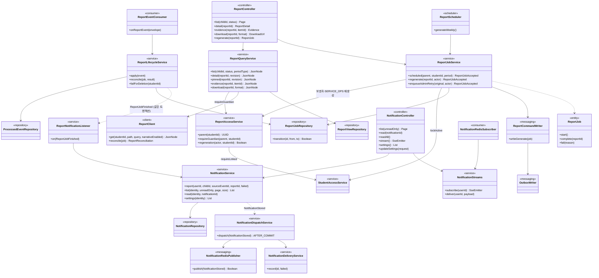

- `ReportScheduler`: `@Scheduled` + `@SchedulerLock`(ShedLock), 매주 월 00:00 KST(일요일 자정, 2026-11-09 결정), 직전 월~일(KST) 대상, 기록 없는 학생 포함 (P06). 학생별 `report_job(SCHEDULE)` + outbox 저장, 부분 UK로 중복 방지
- P24(#390): `DailyReportScheduler`가 매일 00:00 KST(대상일 자정, 2026-11-09 결정. 잠금 `core-daily-reports`) `ReportScheduleService.generate(at, DAILY)`로 전날 작업을 만든다. `period_type`은 7.1
- `ReportEventConsumer`: 큐 `core.report.events`, `processed_event`로 멱등, 상태 전이는 조건부 UPDATE (상태 다이어그램 4.1)
- 알림: 리포트 종료 전이 트랜잭션에서 `QUEUED` 저장 → 커밋 후 `NotificationDispatchService`가 `NotificationRedisPublisher`로 `core:notifications:v1` 발행(발행기는 Redis 발행만) → `NotificationDeliveryService`로 `COMPLETED`·`FAILED` 기록. 관리자 재처리 `NotificationRetryService`도 `dispatch`를 호출(#250). 다른 레플리카의 `NotificationRedisSubscriber`(`notification/consumer`, 구독 연결·채널 이름은 `notification/config/NotificationRedisConfiguration`, #168)가 `NotificationStreams`로 SSE 전달 (아키텍처 1.6)
- 리포트 조회 API에 `ReportQueryService`를 둬서 controller → client 직접 호출 금지 규칙 준수 (리포트 열람 기록 `report_view` 저장 포함)
- 리포트 인가는 controller가 아니라 service 안에서 한다. `ReportQueryService`·`ReportViewService`는 `reportId`로 소유 작업(`ReportJobRepository.byReport`)을 찾은 뒤 `ReportAccessService.parent`(학부모 역할 + `StudentAccessService.requireLinked`)로 확인하고, `ReportClient.get`이 `studentScope`를 그 학생 한 명으로 좁혀 report에 전달한다. 재생성은 `ReportJobService.regenerate` → `ReportAccessService.regeneration`(학부모는 연결 확인, 관리자는 `SERVICE_OPS`) (3.1)
- 구현 이름: `ReportScheduler` = `report/scheduler/WeeklyReportScheduler`·`DailyReportScheduler`(P24, #390) + `ReportScheduleService`, `ReportEventConsumer` = `report/consumer/ReportLifecycleConsumer` + `ReportLifecycleService`, `ReportCommandWriter` = `report/messaging/ReportGenerateWriter`, `ReportViewRepository` = `ReportJobRepository`(`report_view` 포함). 종료 이벤트 유실 복구(#132)는 `ReportRecoveryScheduler` + `ReportRecoveryService`. 학부모 리포트 표시 설정(#209)은 `ReportTemplateController`·`ReportTemplateService`(제안은 `conversation/service/AnalysisTemplateService.reportTemplate` → `AiClient.reportTemplate`, 학생 잠금·활성 학부모 조회는 `guardianship/service/StudentAccessService`, #279)·`ReportTemplateRepository`·domain `ReportTemplateSettings`

#### 3.3.1 리포트 복구 호출 구조 (#132)

- `ReportRecoveryScheduler` → `ReportRecoveryService`(후보 조회·오류 격리) → `ReportClient.reconcile`(SYSTEM/단일 scope, DTO 검증) → report generation router → `ReconciliationService` → `ReportRepository`/`JobLocks`.
- 응답 반영은 별도 `ReportLifecycleService.reconcile` 트랜잭션. 이벤트 apply와 삭제 종료도 기존 lifecycle service에 둔다. HTTP 전후의 트랜잭션을 분리한다.
- `ReportJobService` → `StudentAccessService.lockActive` → 학생 행 잠금, 이후 주 잠금/권한/이용권/Outbox. 관리자도 ACTIVE 검사를 우회하지 않는다.
- `ChildManagementService.confirm` → `ReportLifecycleService.failForDeletion` (기존 삭제 트랜잭션 필수). 알림 이벤트의 non-null reportId 계약은 유지하고 ID 없는 종료는 실행 이력에만 남긴다.

### 3.4 결제·구독 (payment)

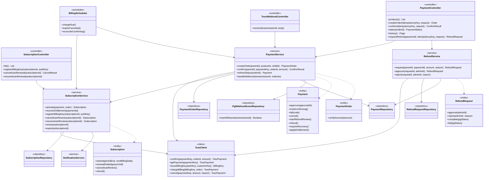

- `TossClient`는 PG 교체 지점 래퍼 (아키텍처 2.1). 로컬·CI는 `toss-stub`, 키는 환경 변수만
- `PaymentService.confirm`: 금액 대조(트랜잭션) → `TossClient.confirm`(트랜잭션 밖) → 결제 저장·구독 반영(트랜잭션). 반영 실패 시 `requireRecovery()` 후 `recoverEntitlement` 재시도 (FN-PAY-05)
- `BillingScheduler`: ShedLock, 정기 청구·해지 효력·`CONFIRMING` 재조회. 매일 09:00 KST. 갱신 실패 시 유예 3일·매일 1회 최대 3회 재청구 후 해지 (P13), 자동 갱신 해지는 `period_end` 경과 시 `CANCELED` (P14)
- 구현 이름(#48): 컨트롤러는 `PaymentController` 하나(구독·관리자 결제/환불·`TossWebhookController`의 웹훅 포함)와 내부 `InternalPaymentUsageController`, `SubscriptionService` 역할은 `PaymentService`(구독 조회·빌링 등록·자동 갱신 해지)·`RenewalService`(정기 청구·재조회)·`ProductEntitlementService`(현재 권한)로 나뉨, 웹훅 = `PaymentWebhookService`, `BillingScheduler` = `payment/scheduler/PaymentScheduler`, Repository는 `PaymentRepository` 하나(`PaymentOrderRepository`·`SubscriptionRepository`·`RefundRequestRepository`·`PgWebhookEventRepository` 역할 포함)
- 응답 경계(#168): `PaymentController`는 domain `PaymentView`·`RefundRequest` 대신 `payment/controller/PaymentResponses`(`PaymentViewResponse`·`RefundRequestResponse`)를 응답·멱등 저장본으로 내보내 PG 키(`paymentKey`·`cancelKey`)를 넣지 않음. 상품 `features`·`limits`·상품 스냅샷은 Jackson `JsonNode` 대신 `_common/json/JsonObject`(이 타입에만 Jackson·MyBatis 변환 등록)

### 3.5 신고·지원·사용량·관리자 (support · usage · admin)

```mermaid
classDiagram
  direction TB
  class SupportController {
    <<controller>>
    +submitErrorReport(idempotencyKey, request) ErrorReport
    +myErrorReports() Page
    +errorReport(reportId) ErrorReport
    +submitInquiry(request) Inquiry
    +myInquiries() Page
    +notices() List
    +help(role) Help
  }
  class ErrorReportService {
    <<service>>
    +submit(reporterId, command) ErrorReport
    +review(reportId, adminId, command)
    +correct(reportId, adminId, command) Correction
  }
  class InquiryService {
    <<service>>
    +submit(userId, command) Inquiry
    +answer(inquiryId, adminId, answer)
  }
  class NoticeService {
    <<service>>
    +create(adminId, command) Notice
    +end(noticeId)
  }
  class ErrorReport {
    <<entity>>
    +startReview(adminId)
    +resolve(result, reason)
  }
  class Inquiry {
    <<entity>>
    +startReview()
    +answer(adminId, answer)
  }
  class SupportLearningClient {
    <<client>>
    +correctJudgment(judgmentId, command, idempotencyKey)
  }
  class LlmUsageConsumer {
    <<consumer>>
    +onUsage(envelope)
  }
  class LlmUsageService {
    <<service>>
    +record(envelope)
    +summarize(from, to, callType) List~UsageSummary~
  }
  class AdminController {
    <<controller>>
    +overview(from, to)
    +jobs(type, status)
    +retryJob(jobId, idempotencyKey)
    +queues()
    +auditLogs(targetType, from, to)
    +errorReports(status)
    +payments(status, from, to)
    +approveRefund(requestId, idempotencyKey)
  }
  class AdminMissionController {
    <<controller>>
    +proxy(path, body)
  }
  class ModelVersionController {
    <<controller>>
    +list(kind, page, size) ModelVersionPage
    +register(body, request) ModelVersion
    +activate(versionId, body, request) ModelVersion
    +rollback(versionId, body, request) ModelVersion
  }
  class AiUsageController {
    <<controller>>
    +usage(from, to, callType) AiUsageResponse
  }
  class InternalModelVersionController {
    <<controller>>
    +active() Map
  }
  class AdminJobService {
    <<service>>
    +list(type, status) Page
    +retry(jobId, adminId) JobExecution
  }
  class ModelPreflightController {
    <<controller>>
    +check(body, request) ModelPreflightResult
  }
  class ModelPreflightService {
    <<service>>
    +check(request, actor) ModelPreflightResult
  }
  class ScoringPreflightClient {
    <<client>>
    +check(request) ModelPreflightResult
  }
  class MissionAuditRepository {
    <<repository>>
    +insert(id, actor, action, targetType, target, result, detail)
  }
  class ModelLoadingRepository {
    <<repository>>
    +save(report, reportedAt)
    +recent(since) List
    +deleteExpired()
  }
  class ModelLoadingCleanupScheduler {
    <<scheduler>>
    +cleanup()
  }
  class ModelLoadingConsumer {
    <<consumer>>
    +receive(event, message, channel)
  }
  class ModelLoadingService {
    <<service>>
    +record(event)
    +list() Map
    +cleanup()
  }
  class ModelLoadingController {
    <<controller>>
    +list() Map
  }
  class ModelVersionService {
    <<service>>
    +list(kind, page, size) ModelVersionPage
    +register(command, actor) ModelVersion
    +activate(id, command, actor) ModelVersion
    +rollback(id, command, actor) ModelVersion
    +active() List~ActiveModelVersion~
    -locked(id) ModelVersion
    -switch(target, scopes, reason, reanalysis, actor, action) ModelVersion
  }
  class AuditLogService {
    <<planned>>
    +record(actorId, action, target, result, detail)
  }
  class ModelVersion {
    <<value>>
    +id UUID
    +kind ModelKind
    +name String
    +version String
    +status VersionStatus
    +evalResult EvaluationRecord
    +approvedBy UUID
    +activatedAt OffsetDateTime
  }
  class ModelVersionRepository {
    <<repository>>
    +insert(version) Boolean
    +find(id) ModelVersion
    +list(kind, page, size) List
    +count(kind) Long
    +active() List
    +current(kind, name) ModelVersion
    +lockGroup(kind, name)
    +nextRevision(kind, name) Long
    +update(version)
    +audit(actor, action, target, detail, now)
  }
  class ModelVersionMapper {
    <<mapper>>
    +insert(row) Int
    +update(row) Int
    +audit(id, actor, action, target, detail, now) Int
  }
  class LlmUsageRepository {
    <<mapper>>
    +insertIfAbsent(usage) Int
    +summarize(from, until, callType) List~UsageSummary~
  }
  class OperationsQueueService {
    <<service>>
    +queues() Map
  }
  class QueueManagementClient {
    <<client>>
    +queues() Map
  }
  class OperationRetryRepository { <<repository>> }

  SupportController --> ErrorReportService
  SupportController --> InquiryService
  SupportController --> NoticeService
  ErrorReportService --> SupportLearningClient
  ErrorReportService --> NotificationService
  InquiryService --> NotificationService
  ErrorReportService ..> ErrorReport
  InquiryService ..> Inquiry
  LlmUsageConsumer --> LlmUsageService
  LlmUsageService --> LlmUsageRepository
  ModelVersionController --> ModelVersionService
  AiUsageController --> LlmUsageService
  AdminController --> AdminJobService
  AdminController --> ErrorReportService
  AdminController --> RefundService
  AdminController --> AuditLogService
  AdminController --> OperationsQueueService
  OperationsQueueService --> QueueManagementClient : RabbitMQ 관리 API
  AdminMissionController --> LearningClient
  AdminMissionController --> AuditLogService
  InternalModelVersionController --> ModelVersionService
  AdminJobService --> ReportJobService : 리포트 재처리(ReportAdminRetryService → enqueueAdminRetry)
  AdminJobService --> ConversationService : 대화 재처리(ConversationAdminRetryService)
  AdminJobService --> OperationRetryRepository : job_execution·감사
  ModelPreflightController --> ModelPreflightService
  ModelPreflightService --> ScoringPreflightClient : POST /internal/models/preflight
  ModelPreflightService --> MissionAuditRepository : 결과 감사
  ModelLoadingConsumer --> ModelLoadingService : model.loading.reported
  ModelLoadingController --> ModelLoadingService
  ModelLoadingCleanupScheduler --> ModelLoadingService : 1시간 주기
  ModelLoadingService --> ModelLoadingRepository
  ModelVersionService --> OutboxWriter : model.version.activated
  ModelVersionService --> ModelVersionRepository : 상태·감사 같은 트랜잭션
  ModelVersionRepository --> ModelVersionMapper
  ModelVersionRepository ..> ModelVersion : JSON·DB 행 변환
  ModelVersionService ..> ModelVersion
  class NotificationService { <<service>> }
  class RefundService { <<service>> }
  class ReportJobService { <<service>> }
  class ConversationService { <<service>> }
  class LearningClient { <<client>> }
  class OutboxWriter { <<messaging>> }
```

- 정정 영향(#244): `SupportService` → `ReportSupportService.affected`·`ConversationSupportService.citing`/`pinned`로 조회해 `correction.impact`에 기록. `ReportQueryService`·`ConversationService`는 `CorrectionNoticeService`로 `correctionNotice` 표시 여부를 읽음
- `SupportLearningClient` = `support/client/LearningSupportClient.kt` (아키텍처 2.6). `ErrorReportService`·`InquiryService`·`NoticeService` = `SupportService` + `SupportCommands` + `SupportAccessService`(#46)
- 운영(#47) 구현 이름: `AdminController` = `admin/controller/OperationsController`, `AdminJobService` = `OperationRetryService`(+ `OperationsService` 조회), 큐 현황 = `OperationsQueueService` + `admin/client/QueueManagementClient`, 감사 이력 조회 = `OperationsService.audits`. 관리자 미션(#145) `AdminMissionController` = `learning/controller/AdminMissionsController` + `AdminLearningService`
- 구현된 #43 공개 경로는 #36 `PublicAuthFilter → AuthService.requirePermission(SERVICE_OPS)`를 재사용한다. 내부 조회는 `InternalAuthFilter`의 내부 토큰 검사를 사용한다. 다른 관리자 기능의 권한 범위는 API 1.2를 따른다.
- #43은 실제 구현된 `ModelVersionController`·`AiUsageController`·`InternalModelVersionController`를 구분해 표시했다. `AiUsageController`는 자기 기능 service만 부르도록 `usage/controller`에 둔다(#422, 경로 `GET /api/v1/admin/ai-usage` 동일). 내부 응답은 `{items: List<ActiveModelVersion>}`이며 평가·관리자 정보는 제외한다. 나머지 운영 기능은 #47에서 구현됨(위 구현 이름).
- `ModelVersion`은 불변 data class다. 상태 전이는 `ModelVersionService`의 `activate`·`rollback`과 private `switch`에서 `copy` 후 Repository에 저장하며 Domain의 `activate()`·`deactivate()` 메서드는 없다.
- `AuditLogService`는 아직 구현되지 않은 공용 감사 서비스 설계다. #43은 `ModelVersionService → ModelVersionRepository.audit → ModelVersionMapper.audit → audit_log` 경로로 감사 기록을 저장한다. 상태·감사·Outbox를 같은 트랜잭션으로 유지하며, #47 등에서 공용 감사 기능을 실제 도입할 때 이 경로의 통합을 검토한다. 현재 사용처만을 위해 공용 서비스를 추가하지 않는다 ([#43 보고서](../report/ai.md)).
- `OperationsQueueService` → `QueueManagementClient`: RabbitMQ 관리 API(15672) 조회, `definitions.json`의 고정 35개 큐(기본 큐 7개 × 기본·재시도 3·DLQ) 길이·DLQ 적재량 (참고 레포 `QueueOperations*`, api-spec 2.8.1)
- 모델 파일 사전 검사(#368): `ModelPreflightController`(`POST /api/v1/admin/models/preflight`, SERVICE_OPS) → `ModelPreflightService` → `admin/client/ScoringPreflightClient`(`InternalRestClientFactory` 20초·재시도 없음) → scoring `POST /internal/models/preflight`. 결과·오류는 `MissionAuditRepository`(MyBatis `audit_log`, `target_type = MODEL_VERSION`, 대상 ID 없음)로 감사 기록. 검사 대상·결과 값 객체는 `admin/domain/ModelPreflight.kt`, 모르는 칸 거부는 controller DTO `ModelPreflightRequest`·`RegistrationArtifactRequest`가 맡고 domain은 Jackson에 의존하지 않는다(#422, api-spec 5.2.1, scoring 6장 `preflight.py`)
- 모델 로딩 상태(#370): scoring `ModelLoadingReporter`가 발행한 `model.loading.reported`를 `admin/consumer/ModelLoadingConsumer`(큐 `core.model.loading.reported`, `RetryingConsumer`)가 받아 `ModelLoadingService.record`로 `model_loading_report`에 Pod·인스턴스별 최신 상태를 저장한다. `ModelLoadingController`(`GET /api/v1/admin/model-loading`)가 `list`로 조회 (아키텍처 1.4). 저장·조회·삭제 SQL은 `ModelLoadingRepository`(MyBatis `ModelLoadingMapper`), 1일 지난 보고 정리는 `admin/scheduler/ModelLoadingCleanupScheduler`가 1시간마다 `ModelLoadingService.cleanup` 호출(#422)
- #336 구현(#355): `learning/controller/AdminMissionDraftsController`가 성취기준 표·미션 초안 경로를 같은 방식으로 learning에 넘기고 초안 요청·채택·버리기를 감사 기록한다(api-spec 2.8). 사용량 호출 종류(`usage/domain/UsageSummary.CallType`)에 `MISSION_DRAFT`

### 3.6 커뮤니티·포인트·꾸미기 (community #388 · reward #389 구현)

2026-11-06 결정([기능명세 1.4](functional-spec.md#14-확정-정책) P20~P25)의 core 클래스. 커뮤니티는 #388, 포인트·꾸미기는 #389로 구현했고 `RewardService.earn` 호출 연결(학습 완료·공유·반응·되돌아보기 열람)도 `ParticipationRewardService`로 구현했다(아래 연결 절). 1장 레이어·의존 규칙을 따른다. 배치는 [아키텍처 1.1.1](architecture.md#111-2026-11-06-결정-추가-책임).

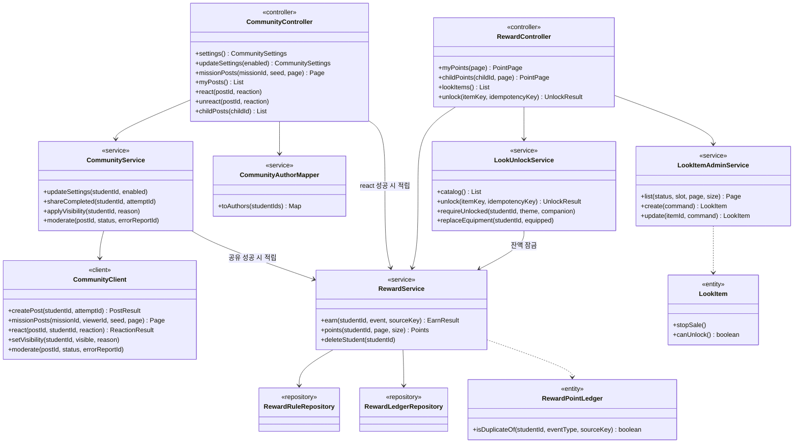

- #389 구현: `RewardService.earn`이 적립 유일 진입점(`REQUIRES_NEW`, 적립하지 않은 이유는 `EarnOutcome`으로 반환, 예외 없음). 저장소는 MyBatis `RewardMapper` 하나이고 위 엔티티·저장소 상자는 설계 단위다. 아래 사건 연결도 #389 후속 PR로 구현했다: `ParticipationRewardService`(사건별 `earn` 호출, 어떤 실패도 던지지 않음)를 `LearningProxyService.reflection·weeklyTheme·reviewViewed`와 `CommunityService.react`가 부른다. 커뮤니티 작성자 `look.equipped`는 `CommunityAuthorMapper`가 `LookUnlockService.equipmentOf`로 채운다
- 학습 완료 적립: 기존 `LearningProxyService`의 돌아보기 저장 성공 후 `RewardService.earn(MISSION_COMPLETED, missionId)` → `CommunityService.shareCompleted`(설정·동의 확인, 학생·미션당 1개라 다시 풀기는 learning이 무시). 적립 저장 실패는 학습 응답을 실패로 바꾸지 않고, 같은 사건 재요청·주간 테마 조회 때 `award`가 사건 키 UK로 멱등 보충. 구현은 `LearningProxyService.reflection`이 learning 저장 뒤 `ParticipationRewardService`(적립)·`CommunityService.shareCompleted`(공유)를 차례로 호출한다. 다른 기능 service 호출이라 의존 규칙(아키텍처 2.2)에 맞고, core의 다른 다기능 흐름과 같이 별도 `facade` 없이 service에서 조합한다(#422). `LearningController`는 `LearningProxyService`만 부른다
- `StudentLookService`(#234, API 3.12)는 저장 전에 `LookUnlockService`로 해금 여부를 확인하고 `equipped` 슬롯을 검증·교체한다. 학생 삭제 확정의 `clear`가 `RewardService.deleteStudent`도 부른다(#389)
- 신고 연결(#388 구현): 기존 `SupportService`(3.5)가 `targetType = COMMUNITY_POST` 접수·처리 결과 저장 뒤 `CommunityModerationService.apply`(같은 공유물 신고 전체로 `HIDDEN_REPORT`·`VISIBLE`·`REMOVED`를 정해 learning `moderation` 호출)
- 동의 철회·이관 수락·공개 설정 변경(#388 구현): 기존 `ConsentService`·`GuardianTransferService`와 `CommunityService.updateSettings`가 `CommunityVisibilityService.sync` 호출(트랜잭션 안에서 설정·현재 보호자 동의로 공개 여부를 정하고 커밋 뒤 learning `community-visibility`). 학생 삭제 확정은 `ChildManagementService`가 `reset`. 공유 요청은 `LearningProxyService.reflection` 돌아보기 저장 성공(또는 `409 ATTEMPT_CLOSED` 재요청) 뒤 `CommunityService.shareCompleted`, 결과 `postId`로 공유 포인트 적립(#389)
- 무료 추가 문제 하루 한도: `MissionUsageService`(`usage/`)가 무료 신규 시도 `201`을 `mission_daily_usage`에 기록·집계, 시도 시작 프록시 전에 확인. #387 때는 무료 `THEME_DAY`·`EXTRA`를 셌고, 2026-11-10 개정(core #485)부터 무료 상품에서 `EXTRA`를 다시 켠 경우의 무료 `EXTRA`만 센다
- 2026-11-10 개정(#483, core #485 구현): `ProductEntitlementService.missionStart`는 `THEME_DAY`·`THEME_REVIEW`를 상품 조회 없이 통과시키고, `EXTRA`는 상품 `features.extraMissions`(값이 없으면 무료 거부·구독 중 허용, #506)로 판정한다. `ProductEntitlementService.sundayTheme(student, date)`가 KST 일요일에만 상품 `features.sundayTheme`을 읽어 learning 쿼리 `sundayTheme`을 정한다(`LearningProxyService`가 시도 시작·주간 테마 조회·열람 기록 2종에 붙임). `ParticipationRewardService.weeklyThemeViewed`가 주간 테마 조회 응답의 `days[].completedOnDay`(당일 풀이 `THEME_ON_TIME`)·`completed`(개근 `THEME_COMPLETED`, #506)·`finished`(주간 완주 `THEME_FINISHED`)로 적립을 보충한다. 사건 종류는 `RewardEvent` 8개(`UNLOCK` 포함)

### 3.7 생활공간·추억 프록시 (P27, 설계·구현 전)

2026-11-12 리텐션 확장 결정([결정 기록](../report/retention-expansion.md))의 core 클래스. 클래스 이름은 설계 단위이며 구현 때 정한다. 가구 스킨은 기존 `LookUnlockService`·`StudentLookService`를 그대로 쓰고 슬롯 값만 늘린다(P22).

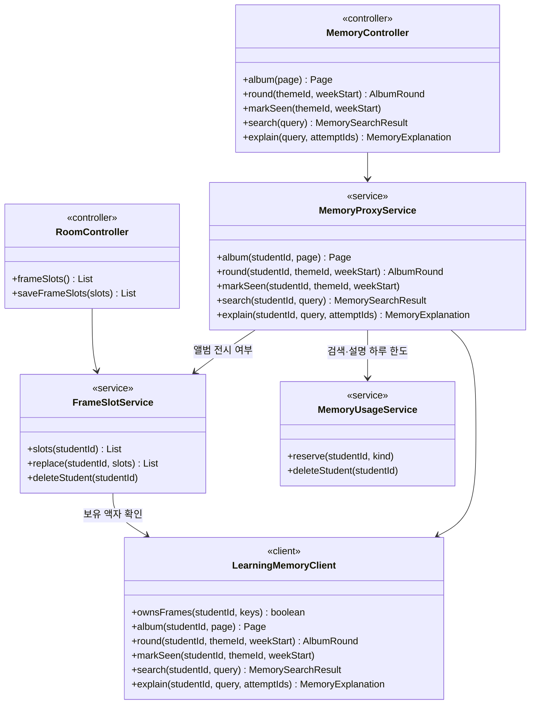

- `MemoryUsageService.reserve`는 `memory_daily_usage`에 1행을 기록하고 KST 하루 건수가 `product.limits`(`dailyMemorySearches`·`dailyMemoryExplanations`)를 넘으면 `429 USAGE_LIMIT_REACHED`(`MissionUsageService`와 같은 방식). learning 5xx·전송 실패면 `release`로 되돌림(#566)
- `LearningMemoryClient`는 `_common/client/LearningClient` 전송을 쓰되 검색·설명 경로가 별도 회로 `learning-memory` 하나를 함께 쓴다(검색 30초·설명 45초, 아키텍처 1.3, #566)
- 학생 삭제 확정의 `clear`가 `FrameSlotService.deleteStudent`·`MemoryUsageService.deleteStudent`도 부름(P09)
- #555 구현(core V47): 위 `RoomController`·`FrameSlotService`는 `room` 패키지의 `RoomController`·`RoomFrameSlotService`(MyBatis `RoomFrameSlotMapper`)다. 보유 확인·제목 조회는 설계의 `LearningMemoryClient` 대신 `room/client/LearningFrameClient`가 맡는다: learning `frames/ownership`·앨범 목록은 ai를 부르지 않는 DB 조회라 일반 `learning-json` 서킷의 `LearningClient`를 쓰고, 추억 검색·설명의 `learning-memory` 서킷과 나눈다. 삭제는 `StudentLookService.clear`(학생 삭제 확정 트랜잭션)가 `RoomFrameSlotService.deleteStudent`를 부른다. 가구 스킨은 `LookCatalog.FURNITURE_SLOTS`를 더했을 뿐 해금·착용 클래스는 그대로이고, `LookUnlockService.replaceEquipment`가 보낸 슬롯만 바꾸도록 바뀌었다
- #560 구현: 앨범 3경로는 `MemoryController`→`MemoryProxyService.album`·`albumDetail`·`albumSeen`→`LearningMemoryClient`. 클라이언트의 앨범 메서드는 검색·설명용 `learning-memory`가 아니라 주입한 일반 `LearningClient`(`learning-json`)로 보낸다. 목록 `displayed`는 `RoomFrameSlotService.displayedFrames`(저장된 슬롯의 회차 키, learning 미호출)로 채운다

---

## 4. learning-service

### 4.1 미션·시도·답변 (mission · attempt · answer)

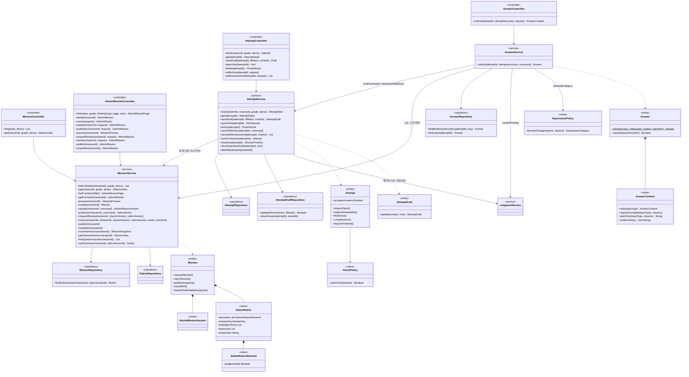

- `AttemptService.start`: 부분 UK `(student_id, mission_id) WHERE IN_PROGRESS` 충돌 시 기존 시도 반환 (FN-LRN-16)
- P23(#385): `start`에 `context`(`THEME_DAY`·`THEME_REVIEW`·`EXTRA`, 생략 `EXTRA`) 추가, 신규 시도만 `WeeklyThemeService.checkStart`로 요일·되돌아보기 검사하고 그 주 테마를 시도에 저장(4.4)
- `AttemptDraft.update(content, now)`가 다음 버전을 만들고 `AttemptDraftRepository.updateIfVersion(next, ifMatch)`가 `UPDATE ... WHERE version = :ifMatch` 실행, 영향 0행이면 `ATTEMPT_DRAFT_CONFLICT` + 최신 초안 (FN-LRN-17)
- `AnswerService.submit`: 같은 트랜잭션에 `answer` 버전 추가 + `judgment(PENDING)` 생성. 같은 `idempotency_key`·같은 본문이면 기존 답변 반환, 다른 본문이면 `422 IDEMPOTENCY_KEY_REUSED` (FN-LRN-10, API 1.4). `lockForAnswer`가 시도 행을 잠가(`FOR UPDATE`) 같은 시도의 제출을 한 줄로 세움. 저장하면 `clearSubmittedDraft`로 초안의 `answer`를 비우고 `memo`는 유지, 초안 version +1 (FN-LRN-15·16)
- 보완 답변 연결: 첫 답변은 `followupId` 없이, 버전 2부터는 이 시도의 가장 최근 되묻기 중 아직 답하지 않은 것만 (`JudgmentService.unansweredLatestFollowupId`). 아니면 `422 ANSWER_INCOMPLETE`. 판정 전 추가 제출·되묻기 2회 뒤 제출도 여기서 막힘 (P04)
- 답변 표현 검사 (#205): `AnswerService.submit`이 누락 검사 다음·되묻기 연결 검사 전에 `ExpressionPolicy.blockedCategory(AnswerContent.writtenTexts(), mission)`를 부름. 학생이 쓴 칸(서술 글·풀이 최종 답과 단계·논술 4칸)을 칸마다 검사하고 고르기·분류·초안·메모는 검사하지 않음. 범주(`ExpressionCategory`: `PROFANITY`·`SEXUAL`·`HATE`·`THREAT`·`PERSONAL_INFO`)가 나오면 저장·판정 없이 `422 ANSWER_INAPPROPRIATE`(`detail`은 범주별 고정 문구), 로그는 `attemptId`·`category`만. 목록은 `resources/answer-filter`(korcen·우리말샘·팀 조정)를 `answer/repository/ExpressionPolicyConfig`가 읽어 빈으로 만들고, domain은 Kotlin 정규식만 씀. `HATE`와 맥락 단어(`새끼`)는 미션 본문(제목·질문·안내·선택지·그룹)에 나오면 허용
- `FinishPolicy.canFinish`: 시도 내 판정 `DONE` 1회 이상(결과 무관, `HELD` 포함)이면 true (P04)
- `AttemptService.finish`: 시도 행을 잠그고(`AttemptRepository.lockById`, 답변 제출·판정 저장과 같은 행) 본인 확인 → 이미 마무리했으면 기록 없이 같은 결과 → 타임라인으로 `FinishPolicy.canFinish`(sequence-diagram 3.3 순서) → `Attempt.finish(now)` → `AttemptRepository.finish`(`WHERE status = 'IN_PROGRESS' AND finished_at IS NULL`) → `FinishResult{finishedAt, reveal, revealKind, checklist}`. `Attempt.finish(now)`는 타임라인을 받지 않아 `canFinish`는 서비스가 먼저 부름
- 공개 내용(FN-LRN-11): `reveal`은 시도 기준표 버전의 예시 답(닫힌 문제는 정답과 해설), `revealKind`는 고르기·순서·분류·풀이 단계 `ANSWER`, 서술·논술 `EXAMPLE`. 체크리스트는 기준표 요소 전체, 이 시도의 처리 완료 판정(`JudgmentService.results`) 중 원문 구절과 함께 충족된 적 있는 요소만 체크하고 가장 최근 구절 표시. 시도 상세도 마무리 뒤에 같은 값
- `AttemptService.saveReflection`: 잠금 → `Attempt.complete(now)`(`requireFinished`: 완료 뒤 `ATTEMPT_CLOSED`, 마무리 전 `REVEAL_CONDITION_UNMET`) → 같은 트랜잭션에 `reflection` 저장 + `IN_PROGRESS → COMPLETED`·`completed_at`
- `AttemptService.saveSelfAssessment`: 잠금 → `requireFinished` → 기준표 요소 확인(비었거나 중복·기준표 밖이면 400) → `self_assessment` UK `(attempt_id, rubric_element_id)`로 저장(다시 보내면 `checked`만) → 기준표 요소마다 `{selfChecked, aiChecked(체크리스트), quote}`. 답변·판정은 건드리지 않음 (FN-LRN-13)
- `AttemptRepository`: `lockById`·`finish`·`complete`·`insertReflection`·`findReflection`·`saveSelfAssessments`·`findSelfAssessments` (돌아보기·자기 평가 Repository를 따로 두지 않음)
- 되묻기 생성 조건: 시도 내 되묻기 2회 미만 + 고르기 `CORRECT` 아님 (P04). `finished_at` 이후 답변 제출은 `Attempt.requireAnswerable`에서 `ATTEMPT_CLOSED`. `requireOpen`은 `COMPLETED`만 막음(마무리 뒤 돌아보기 저장)
- `AttemptDraft.content`: `{answer, memo}`, memo는 학생 본인 조회에만 포함 (P05)
- 구현 상태 (#22~#26): 학생 조회 경로(`MissionService.listForStudent`·`get`·`currentVersions`·`getVersion`·`rubric`·`hintQuestions`), `AttemptService`의 start·get·saveDraft·openHint·finish·saveReflection·saveSelfAssessment·lockForAnswer·clearSubmittedDraft·timeline, `Attempt.finish`·`complete`·`requireFinished`, `FinishPolicy`, `AnswerService.submit`, 답변 표현 검사 `ExpressionPolicy`(#205) 구현됨. 기준표는 학생·판정 조회용 값 객체 `Rubric`(`elements`·`answerKey`·`forbiddenTerms`)을 `MissionRepository.findRubric`으로 읽음(관리자 기준표 버전 조회·추가는 `RubricRepository`, #145). `AttemptService.deleteByStudent`는 #128, 관리자 미션 API(`AdminMissionController`·`MissionService` 관리자 메서드·`Mission` 전이·`RubricRepository`)는 #145에서 구현
- `Mission.requirePublishable(snapshot)` (FN-ADM-11, #145): 현재 미션·기준표 버전으로 검사하고 누락을 모두 모아 `422 MISSION_PUBLISH_INCOMPLETE` + `missingFields`(영문 코드, core 프록시가 영문 경로 모양만 통과시켜 프론트가 한글로 표시)
  - `title`·`question`·`subject`·`achievementStandards`: 비었음 / `grade`: 3~6 밖·`gradeMin > gradeMax`·논술인데 5 미만 / `rubric`: 기준표 버전 없음
  - `rubric.elements`: 요소 0개(**입력 방식 무관**, 고르기도 ai 되묻기가 요소를 요구, 구 #81), 풀이 단계인데 `FINAL_ANSWER` 외 요소 없음, 풀이 단계가 아닌데 `FINAL_ANSWER` 있음 / `rubric.elements.points`: 이름 비었음·배점 1 미만
  - `rubric.elements.code` (FN 1.5 표준 요소, #262): 미션 유형과 다른 유형의 표준 코드, 고르기·순서·분류인데 요소가 `ANSWER_KEY` 하나가 아님, 따져 보기 논술인데 `EVALUATE_CLAIM`·`EVALUATE_EVIDENCE`·`EVALUATE_PERSPECTIVE` 중 빠짐. 기준표 저장(`AdminMissionController` `RubricRequest.toCommand`)은 미션 유형을 모르므로 code 모양(표준 코드·`e`+숫자·예약 코드)만 400
  - `choices`: 고르기·순서·분류인데 선택지 없음 / `categories`: 분류인데 그룹 없음
  - `answerKey`: 서술·논술이 아닌데 없음 또는 입력 방식 모양(`{choiceIds}`·`{assignments}`·`{finalAnswer}`)·선택지·그룹과 맞지 않음 / `exampleAnswer`: 서술·논술인데 없음
  - `review`: 현재 미션·기준표 버전의 최신 검토가 `APPROVED`가 아님
- 관리자 API(#145): core가 `ADMIN` + `X-User-Id`(작성자·검토자 ID) + 빈 학생 범위로 넘김(CONTENT 검사는 core). 성공 응답은 모두 JSON 객체(core 프록시 요구): 목록 `{items, page, size, totalElements, counts}`, 나머지는 미션 전체 `AdminMission`(api-spec 4.1). `counts`는 페이지·`status`·`grade`·`thinkingType` 어느 필터와도 무관한 전체 상태별 건수
- 버전: `update`·`putRubric`은 새 버전을 추가하고 `current_*`만 바꿈. 학생 목록·상세·`currentVersions`(시도 시작)는 공개 버전 `published_*`, `publish`가 `published_*` ← `current_*` (P07, ERD 4.1). 상태 전이는 state-diagram 3.1

### 4.1.1 성취기준·미션 초안 (#336 설계, #353 구현)

FN-ADM-20·21, api-spec 4.1 `/internal/admin/achievement-standards`·`/internal/admin/mission-drafts…`, ERD 4.1.1. 이름은 구현 이슈의 기준이며 기존 `mission` 패키지 안에 둔다.

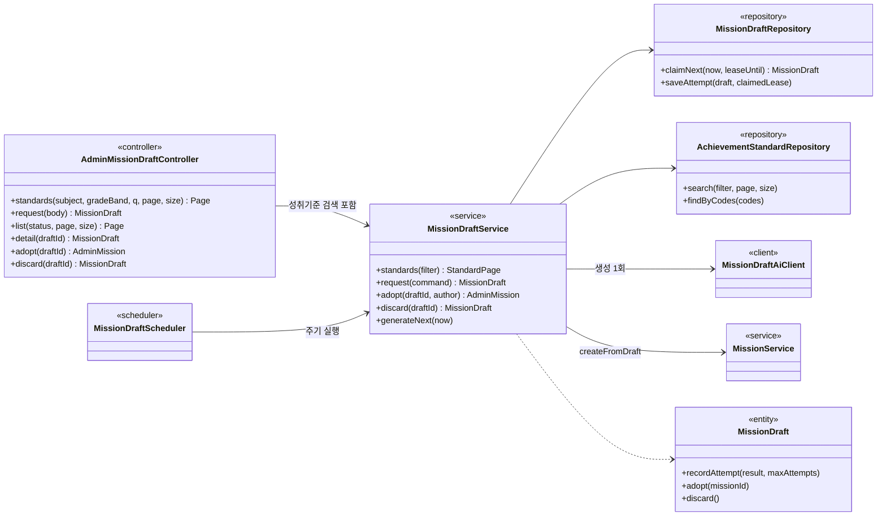

- 요청 `request`: 형식·성취기준 코드 실재·미션 학년이 성취기준 학년군 안·학년·입력 방식 조합·성취수준 단계 확인(400) 뒤 `GENERATING`, `attempts = 0`으로 저장하고 202. 생성은 요청 안에서 하지 않는다(core→learning 일반 대기 30초 안에 LLM 생성·재시도를 끝낼 수 없음)
- 생성 `generateNext`(`MissionDraftScheduler`, 주기 기준안 10초): `claimNext`가 `GENERATING`이고 `lease_until`이 비었거나 지난 초안 하나를 조건부 UPDATE로 점유한다(`lease_until = now + 90초`, 판정 리스와 같은 값·같은 방식이라 레플리카가 동시에 돌아도 한 곳만). 트랜잭션 밖에서 ai를 1번 부르고 learning 검사를 한 뒤 `saveAttempt`가 점유한 리스 값이 그대로일 때만 저장한다
- learning 검사(`DraftRules.learningFailures`): 채택할 미션·기준표(`DraftRules.missionCommand`·`rubricCommand`)를 게시 검사(`PublishSnapshot.missingFields`, 검토는 통과로 봄)에 그대로 넣어 같은 규칙으로 본다. 누락 `rubric.elements`·`rubric.elements.code` → `ELEMENT_CODE`, `rubric.elements.standardCode` → `STANDARD_CODE`, 나머지(선택지·분류 칸·정답 키·예시 답 등) → `SHAPE`(`reason`은 누락 코드). AI 호출이 실패한 시도는 `AI_CALL`(`reason`은 `failure_code`)로 남김
- `MissionDraft.recordAttempt`: `attempts + 1`, `check_results`에 이번 실패 추가. ai·learning 검사를 모두 통과하면 `READY` + `output`. 실패하고 상한 미만이면 `GENERATING` 그대로 리스만 비워 다음 주기에 이전 실패 사유(`previousFailures`)를 넣어 다시 생성. 상한(기준안 3회, P19 김동섭 확인)에 닿으면 마지막 실패가 AI 호출 실패면 `FAILED`(`failure_code`), 아니면 `CHECK_FAILED`
- `MissionDraftAiClient`: `POST /internal/mission-drafts`. 재시도 없음·오류 분류(`judgment/client` `postToAi`)·서킷 값(`aiCircuitBreaker`)은 `AiClient`와 같지만 **서킷은 따로** 둔다(`ai-mission-draft`, 같은 P12 값). 대기는 70초(`app.mission-draft.ai-read-timeout`, P12 예외 #353, `InternalRestClientFactory.create(service, readTimeout)`)로 다른 내부 호출의 35초와 따로다. 판정·되묻기 서킷을 같이 쓰면 초안 실패가 학생 판정을 막음(#305와 같은 문제)
- 채택 `adopt`: 초안 행 `FOR UPDATE` → `READY`가 아니면 409 → `MissionService.createFromDraft`가 기존 `create`·`putRubric`과 같은 규칙으로 `DRAFT` 미션·첫 미션 버전·첫 기준표 버전을 같은 트랜잭션에 만듦(`mission.source = LLM_DRAFT`, 요소 배점 1, M2 입력 `keywords`·`essayType`은 비움, `sceneNote`는 미션에 저장하지 않음) → `ADOPTED` + `mission_id`. 이후 수정·검토·게시는 4.1 그대로라 자동 공개 없음(P19)
- 사람이 쓰는 미션(`create`)은 `source = MANUAL`. `achievementLevels`·요소 `standardCode` 저장과 게시 검사 추가는 4.1 `MissionService`·`Mission.requirePublishable`에서 한다(ERD 4.1.1)
- 새 값(주기 10초·상한 3회)은 기준안이며 `app.mission-draft.*`(`enabled`·`interval`·`max-attempts`) 설정으로 둔다. 리스 90초는 판정과 같은 값(`Judgment.LEASE`)을 쓴다
- 표준 요소 표(FN 1.5 14개 코드·유형·이름·공통 설명)와 code 규칙은 `mission/domain/Standards.kt` `StandardElements` 한 곳에 둔다. 기준표 저장(모양 400)·게시 검사(`rubric.elements.code`)·초안 ai 입력(`DraftRules.elementCodes`)이 같은 표를 쓴다

### 4.2 판정·되묻기 (judgment)

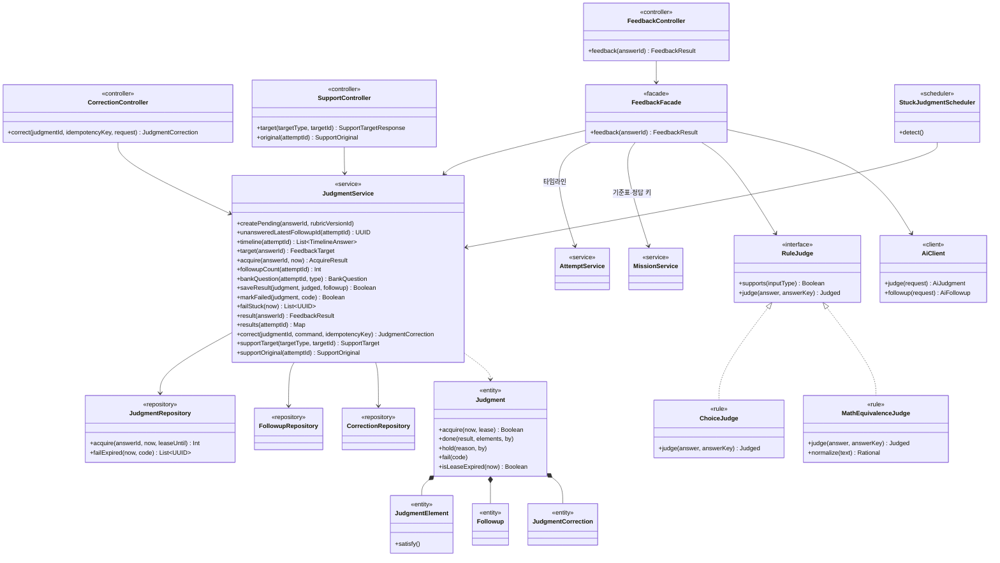

- `FeedbackFacade.feedback` 순서 (아키텍처 2.5)
  1. `JudgmentService.acquire`: `PENDING|FAILED|리스 만료 RUNNING → RUNNING` 조건부 UPDATE. `DONE`이면 저장 결과 반환, 유효 `RUNNING`이면 `RUNNING` 결과 반환 (API 1.4)
  2. 트랜잭션 밖: 고르기·수학 최종 답은 `RuleJudge`, 서술·논술은 `AiClient.judge`. 풀이 단계는 풀이를 `AiClient.judge`, 최종 답을 `MathEquivalenceJudge`로 보고 합침 (state-diagram 3.3). 기준표의 최종 답 요소(`code = 'FINAL_ANSWER'`)는 ai 요청에서 빼고(`Rubric.aiElements`) 정답 키 결과로 기록(`ANSWER_KEY`, FN-JDG-02 #79)
  3. 트랜잭션 밖: 시도 내 되묻기 2회 미만이고 고르기 `CORRECT`가 아니면 `AiClient.followup` (정답·금지어 유출 검사는 ai 담당, P04). 마무리·완료한 시도에는 만들지 않음. 유출 검사용 정답은 학생에게 보이는 글자(선택지 이름·정답 순서·답 단위를 붙인 최종 답·"선택지 이름: 그룹 이름")로 보냄. 재생성까지 검사 실패하면 learning이 `followup_bank_question`에서 같은 `type` 질문 선택(`BANK`, P16), 이 시도에서 아직 쓰지 않은 것부터
  4. `JudgmentService.saveResult`: 판정·요소·되묻기·버전 저장 + `DONE`. 먼저 시도 행을 잠그고(`FOR UPDATE`, 답변 제출·마무리와 같은 "시도 → 판정" 순서) 다시 확인해, 3 이후 마무리·완료된 시도면 되묻기는 저장하지 않음(P04). 예외 시 `markFailed`(실패 기록 자체가 실패해도 원래 오류로 응답)
- 전이는 `Judgment` 엔티티가 허용 여부를 판단하고 `JudgmentRepository`가 조건부 UPDATE로 저장 (#23 초안 `AttemptDraft.update` + `updateIfVersion`과 같은 방식). `saveResult`·`markFailed`는 획득한 리스 값을 비교해야 해 `judgmentId` 대신 `acquire`로 얻은 `judgment`를 받음. `markFailed`는 DB에서 다시 읽은 판정으로 기록(저장 중 롤백돼 엔티티만 `DONE`이 된 경우)
- 고착 탐지 (#241, state-diagram 3.3): `StuckJudgmentScheduler`(Presentation `scheduler`, 아키텍처 2.1)가 1분마다 `JudgmentService.failStuck(now)` 호출 → `JudgmentRepository.failExpired`가 만료 `RUNNING`(리스 없음 포함)을 한 번의 조건부 UPDATE로 `FAILED`(`LEASE_EXPIRED`, `retry_count + 1`)로 바꾸고 바뀐 `answerId` 반환. 만료 조건은 `Judgment.isLeaseExpired`·`acquire` SQL과 같고, 실패 코드는 `Judgment.LEASE_EXPIRED`. 주기 `app.judgment.stuck-detection-interval`(기본 `PT1M`), 끄기 `app.judgment.stuck-detection-enabled`
- `done`·`hold`의 `by`: 판정 방법(`RULE`·`LLM`)·`trial`·모델·프롬프트 버전 (ERD judgment.method·trial·model_version·prompt_version)
- `AiClient`: 응답 35초, 서비스 간 재시도 없음, 서킷 브레이커 최근 20건 중 실패 50% 이상이면 30초 차단(전송 오류·5xx만 실패로 셈, 아키텍처 1.3)
- `JudgmentElement`: `verified = false`면 `satisfy()` 거부 (ERD CHECK와 동일 규칙을 Domain에서도 검사)
- `judge_verified = false` 요소·미검증 학년 조합의 `HELD(UNVERIFIED_SCOPE)` 결정은 ai `JudgmentService` 담당(`JUDGE_REQUIRE_VERIFIED=true`일 때만, 기본 꺼짐). learning은 `judge_verified`·학년을 포함한 기준표를 `AiClient.judge`에 전달 (FN-JDG-04)
- 정정은 `Judgment`를 바꾸지 않고 `JudgmentCorrection` 추가, `result()` 조회 시 최신 정정 반영 (FN-SUP-03)
  - `results()`(시도 상세·기록)도 같음. 바꾸는 것은 `judgment.result`뿐이고(정정이 있으면 `heldReason`은 null), 판정 요소·되묻기·`nextActions`는 원판정 그대로 (#80)
  - `correct`: 판정 행을 잠그고(`FOR UPDATE`, 판정 행만 잠근 뒤 대상·최신 정정 결과를 다시 읽음 #145) 같은 키 → 처리 상태 `DONE` → 같은 신고(`reportId`) 순으로 확인한 뒤 저장. `JudgmentCorrection`은 정정 직전 결과(`previous`)·정정 결과·사유·신고·관리자·키·시각을 담고, 같은 키 재요청은 저장된 행으로 처음 응답을 다시 만듦 (api-spec 4.1, [이슈 #80 보고서](../report/learning.md))
- 신고 지원 조회 (#146, api-spec 4.1·5.7, core #46): `SupportController`는 정정과 같은 판정 내부 API 자리(아키텍처 learning `judgment/controller`)
  - `supportTarget`: 판정·되묻기·시도 ID로 학생·시도(+판정 ID, 판정이면 지금 보이는 결과 = `correct`의 정정 직전 결과와 같은 규칙)를 찾음. 원문 없음. 학생 범위 검사는 컨트롤러가 받은 범위로(학생·보호자 신고, 관리자 정정 전 확인)
  - `supportOriginal`: 관리자 원문. 답변 버전·원문·피드백 결과(`results()`와 같은 모양)만, 초안·메모·이름 없음. 학생 전용 `AttemptService.get`과 별도
  - 피드백 결과의 `judgment`에 `judgmentId`(신고 대상 ID)

### 4.3 기록 조회·삭제 (record)

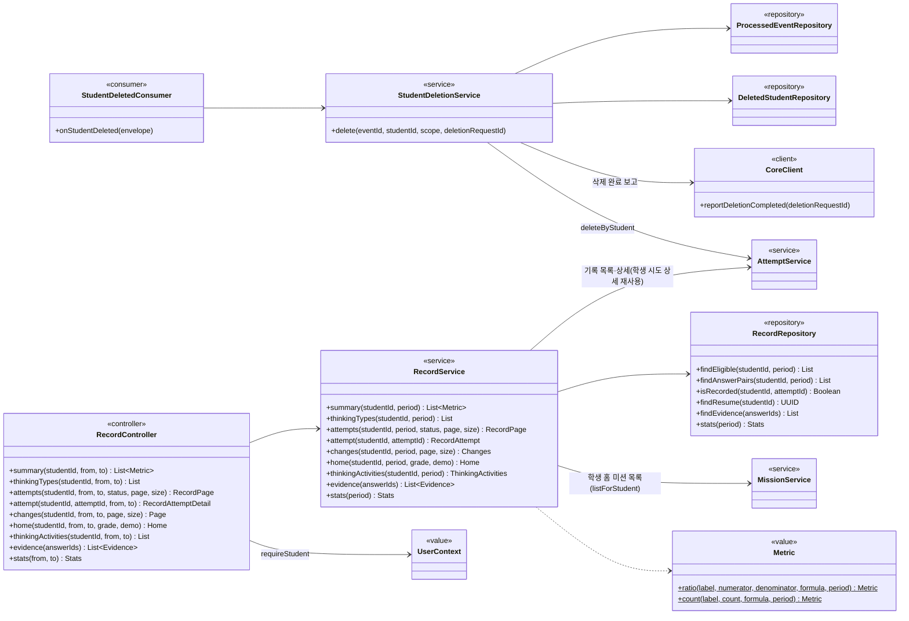

- 구현 상태: `record/`의 `RecordExistsController`·`RecordExistsService`·`RecordExistsRepository`와 `RecordController`·`RecordService`·`RecordRepository`·`Metric` 구현됨. 삭제 소비(`StudentDeletedConsumer`·`StudentDeletionService`·`CoreClient`, #128)도 `record/`에 구현됨. 원래 설계의 별도 `deletion/` 패키지는 두지 않는다(#256) ([learning 보고서](../report/learning.md))
- `RecordController`: 모든 경로에서 `UserContextHolder.current().requireStudent(studentId)` 먼저 실행 (아키텍처 2.3 범위 검사). `home`은 미션 목록과 같은 기준으로 `requireSelfStudent()`가 경로의 학생과 같아야 함
- `RecordRepository`는 여러 기능 테이블을 읽는 조회 전용 MyBatis 매퍼 (쓰기 없음). 기능 간 repository 참조 금지 규칙의 예외로, 조회 전용 `record/`에 한정. 단 `record/` 패키지에는 삭제 소비(쓰기, #128)도 있어 패키지 전체가 조회 전용은 아니며, 이 예외는 `RecordRepository`에만 적용한다(#256)
- `Metric.ratio`: 분모 5 미만이면 `value = null`, `count`만 (P08, API 1.6). `Metric.count`도 계산식을 받음(기능 명세 1.3 "모든 건수·비율은 계산식과 함께")
- `RecordRepository.findEligible`: 집계 대상 시도(P08: 기간 안 답변 제출, 미완료 포함, 조회 종료일까지 모두 처리 실패인 시도·삭제 학생 제외)와 시도별 사실(완료, 최초 답변 전 생각 열기 열람, 되묻기 받음, 보완 답변, 모두 조회 종료일까지)을 한 번 읽고 summary·thinkingTypes·attempts가 같이 씀. `isRecorded`는 기간과 무관한 상세용, `stats`는 운영 집계
- `RecordService.attempts`·`attempt`: 학생 시도 상세(`AttemptService.get`)를 그대로 쓰고 응답에서 초안(메모 포함)만 뺌(P05). 목록은 답변·생각 열기 열람을 조회 종료일까지로 자르고 돌아보기는 기간 안에 쓴 것만 남김. 시도 항목에 `completedAt`·`hintUsages`·돌아보기 `createdAt`을 붙임(report #51). 상세는 이력을 자르지 않음(core #40) 그래서 `findAttemptsWithTimeline`은 두지 않음
- `RecordService.home`·`thinkingActivities` (core #40 요청): `home`은 이어할 시도(`findResume`: 진행 중 시도 중 시작·답변 제출·초안 저장 중 가장 늦은 시각이 가장 최근, 기간과 무관, 초안은 저장 시각만 읽음)를 기록 상세와 같은 모양으로, 미션은 `MissionService.listForStudent` 그대로. `thinkingActivities`는 `findEligible` 대상의 유형·미션 이름과 기간 안에 쓴 돌아보기. 둘 다 `state`는 기간 안 집계 대상 시도 수
- `RecordService.changes`: 보완 답변이 있는 시도의 최초 vs 조회 종료일 이전 마지막 답변. 원문은 `plain_text`, 글자·문장·까닭을 잇는 말 수는 학생이 쓴 칸 내용으로 셈(칸 이름 제외). 까닭을 잇는 말 목록(`TextCounts.REASON_CONNECTIVES`)은 report와 확정
- `StudentDeletedConsumer`: 봉투 검증(`specversion` 1.0, `id` UUID, type `student.deleted`·source `core-service`·dataschema `student.deleted.v1`, `subject` = `data.studentId`, 시간대 있는 `time`, data는 스키마 그대로). 형식 오류는 재시도 없이 DLQ, 나머지 실패는 `RetryingConsumer`로 지연 재시도
- `StudentDeletionService.delete`: `deletionRequestId`는 완료 보고 경로에 필요하고 learning DB에 없어 이벤트에서 받음(#128). 한 트랜잭션에서 `processed_event`에 없으면 삭제·`deleted_student`·`processed_event` 저장, 있으면 건너뜀. 커밋 뒤 트랜잭션 밖에서 `CoreClient.reportDeletionCompleted`(SYSTEM + 대상 학생 범위). 이미 처리한 이벤트도 보고는 다시 보냄(core가 첫 보고를 놓쳤을 수 있음, report와 같음). 보고 실패 시 예외 → 지연 재시도(1·5·15분) 때 삭제 없이 보고만 (P09, 아키텍처 1.6)
- `evidence`: `deleted_student`에 있는 학생 근거는 `available: false` (FN-ACC-13)
- `AttemptService.deleteByStudent`: CASCADE 없이 한 트랜잭션에서 `judgment_correction`·`judgment_element` → `self_assessment`·`reflection`·`hint_usage`·`attempt_draft` → `followup`(`answer.followup_id`는 `SET CONSTRAINTS … DEFERRED`로 커밋 때 검사) → `judgment` → `answer` → `attempt` 순서로 학생의 시도 이하 기록 삭제(#128, ERD 4.3). 호출한 쪽 트랜잭션 안에서 실행

### 4.4 주간 테마·커뮤니티 (theme #385 · community #386 구현)

2026-11-06 결정([기능명세 1.4](functional-spec.md#14-확정-정책) P20~P25)의 클래스. 주간 테마(`theme`)는 #385, 커뮤니티(`community`)는 #386으로 구현한 이름·시그니처. 1장 레이어·의존 규칙을 따른다. 배치는 [아키텍처 1.1.1](architecture.md#111-2026-11-06-결정-추가-책임).

```mermaid
classDiagram
  direction TB
  class WeeklyThemeController {
    <<controller>>
    +current(studentId, grade, date) WeeklyThemeView
    +reviewViewed(studentId, grade, date) ReviewViewResult
    +storyViewed(studentId, grade, date, kind) StoryViewResult
    +summary(studentId, weekStart) WeeklyThemeSummary
  }
  class AdminWeeklyThemeController {
    <<controller>>
    +list(grade, weekStart, status, page, size) AdminWeeklyThemePage
    +create(request) AdminWeeklyTheme
    +update(themeId, request) AdminWeeklyTheme
    +requestReview(themeId) AdminWeeklyTheme
    +publish(themeId) AdminWeeklyTheme
    +unpublish(themeId) AdminWeeklyTheme
  }
  class WeeklyThemeService {
    <<service>>
    +current(studentId, grade, date, sundayTheme) WeeklyThemeView
    +checkStart(studentId, missionId, grade, context, sundayTheme) ThemeAttempt
    +recordReviewView(studentId, grade, date, sundayTheme) ReviewViewResult
    +recordStoryView(studentId, grade, date, kind, sundayTheme) StoryViewResult
    +pickAnswer(studentId, grade, date, pick, sundayTheme) AnswerPickResult
    +ending(studentId, weekStart) ThemeEndingState
    +lockedUntilEnding(studentId, missionId) Boolean
    +scene(attemptId) ThemeScene
    +summary(studentId, weekStart) WeeklyThemeSummary
    +deleteByStudent(studentId) int
  }
  class WeeklyThemeAdminService {
    <<service>>
    +create(author, content) AdminWeeklyTheme
    +update(themeId, author, content) AdminWeeklyTheme
    +requestReview(themeId) AdminWeeklyTheme
    +publish(themeId) AdminWeeklyTheme
    +unpublish(themeId) AdminWeeklyTheme
  }
  class WeeklyTheme {
    <<entity>>
    +requireEditable(grade, weekStart)
    +edited()
    +requestReview()
    +publish(errors)
    +unpublish()
  }
  class ThemePublishCheck {
    <<domain>>
    +errors(grade, days, missions, otherPublished) List
  }
  class ThemeAnswerRules {
    <<domain>>
    +errors(candidates, answer, days) List
    +hintSpotErrors(spots, hintSeqs) List
    +decisiveClue(candidates, answer, days) String
  }
  class ThemeEnding {
    <<domain>>
    +of(pick, reviewFinishedAt) ThemeEndingState
  }
  class AdminThemeDraftController {
    <<controller>>
    +request(body) ThemeDraftView
    +list(status, source, page, size) Page
    +detail(draftId) ThemeDraftView
    +adopt(draftId) AdminWeeklyTheme
    +discard(draftId) ThemeDraftView
    +regenerate(draftId) ThemeDraftView
  }
  class ThemeDraftService {
    <<service>>
    +request(command, author) ThemeDraftView
    +createWeekly(weekStart)
    +regenerate(draftId, author) ThemeDraftView
    +adopt(draftId, author) AdminWeeklyTheme
    +discard(draftId) ThemeDraftView
    +generateNext(now)
  }
  class ThemeDraft {
    <<entity>>
    +recordAttempt(result, maxAttempts, now)
    +adopt(themeId)
    +discard()
    +previousFailures() List
  }
  class ThemeDraftRules {
    <<domain>>
    +learningFailures(output, input, grade, standards) List
    +missionInput(mission, grade) DraftInput
    +candidatePools(tables, semesters, current, soFar) Map
    +autoStandards(grade, requested, recentCodes, pools, random) List
    +adoptedMissions(output, input, grade, standards, author) List
    +themeContent(output, grade, weekStart, missionIds) ThemeContent
  }
  class ThemeDraftScheduler { <<scheduler>> }
  class ThemeDraftAiClient { <<client>> }
  class ThemeDraftRepository {
    <<repository>>
    +insertAutoIfAbsent(draft) Boolean
    +findInputs(grade, from, until) List
    +claimNext(now, leaseUntil) ThemeDraft
    +saveAttempt(draft, claimedLease)
  }
  class AssetUrls {
    <<common>>
    +url(stored) String
  }
  class AttemptService {
    <<service>>
    +start(studentId, missionId, grade, demo, context) AttemptStart
  }
  class CommunityController {
    <<controller>>
    +share(studentId, attemptId) ShareResponse
    +post(postId) PostDetailView
    +missionPosts(missionId, viewerStudentId, seed, page, size) MissionPostPage
    +studentPosts(studentId) StudentPostList
    +react(postId, reaction, studentId) ReactionCreated
    +cancelReaction(postId, reaction, studentId) ReactionDeleted
    +visibility(studentId, visible, reason) VisibilityResult
    +moderate(postId, status, errorReportId) ModerationResponse
  }
  class CommunityService {
    <<service>>
    +share(studentId, attemptId) SharedPost
    +missionPosts(missionId, viewer, seed, page, size) List
    +studentPosts(studentId) List
    +react(postId, studentId, reaction) ReactionResult
    +setVisibility(studentId, visible, reason) VisibilityResult
    +moderate(postId, status, errorReportId) CommunityPostStatus
    +deleteByStudent(studentId) int
  }
  class CommunityRules {
    <<domain>>
    +moderate(current, requested, authorVisible) CommunityPostStatus
    +initialStatus(authorVisible) CommunityPostStatus
    +reactionId(postId, studentId, reaction) UUID
  }

  WeeklyThemeController --> WeeklyThemeService
  AdminWeeklyThemeController --> WeeklyThemeAdminService
  WeeklyThemeAdminService ..> WeeklyTheme
  WeeklyThemeAdminService ..> ThemePublishCheck
  WeeklyThemeAdminService ..> ThemeAnswerRules : 저장 때 정답 논리·생각 열기 위치
  WeeklyThemeAdminService --> MissionService : 게시본 미션
  WeeklyThemeService ..> ThemeEnding : 종료 공개·OUTRO
  WeeklyThemeService --> AssetUrls : 그림·영상 URL
  AttemptService --> WeeklyThemeService : context 검사·themeScene
  AdminThemeDraftController --> ThemeDraftService
  ThemeDraftScheduler --> ThemeDraftService : 생성 주기·주간 자동
  ThemeDraftService --> ThemeDraftRepository
  ThemeDraftService --> ThemeDraftAiClient : 생성 1회
  ThemeDraftService ..> ThemeDraft
  ThemeDraftService ..> ThemeDraftRules
  ThemeDraftService --> MissionService : createFromDraft(LLM_THEME)·성취기준 조회
  ThemeDraftService --> WeeklyThemeAdminService : 테마 DRAFT 생성·게시 여부
  CommunityController --> CommunityService
  CommunityService ..> CommunityRules
  CommunityService --> AttemptService : 학습 완료 여부·첫 완료 시도·마지막 답변
```

- 기존 `AttemptService.start`(4.1)에 `context` 인자를 추가하고 `THEME_DAY`·`THEME_REVIEW`는 `WeeklyThemeService.checkStart`로 요일·되돌아보기 검사. 진행 중 시도 반환은 검사하지 않음(자정 후 이어하기)
- `CommunityService.share`는 학생·미션당 1개(UK `(student_id, mission_id)`), 이미 있으면 기존 공유물을 그대로 반환. 처음 학습 완료한 시도가 아니면(다시 풀기) 공유하지 않고, 공유 때 `ExpressionPolicy`(#205)를 다시 확인
- 학생 삭제 소비(4.3 `record`)의 `StudentDeletionService`가 같은 트랜잭션에서 시도 삭제 전에 `CommunityService.deleteByStudent`(#386), 시도 삭제 뒤 테마 열람 기록 삭제(`WeeklyThemeService.deleteByStudent`, #385)를 호출
- 테마 게시 중 수정은 미션과 같은 버전 방식(`weekly_theme_version`, 현재본·게시본·검토 요청본). 학생 조회·시작 검사는 게시본, 관리자 편집은 현재본

#438 추가(학년별 테마·이야기·테마 초안, 결정과 근거는 [learning 보고서](../report/learning.md) #438 절):
- 학년: `GradeBand`(`G3_4`·`G5_6`)를 `ThemeGrade`(`G3`~`G6`, `of(학년)`은 7~9를 `G6`)로 바꾼다. `ThemePublishCheck`는 미션 학년 범위가 테마 학년을 포함하는지 보고 실패 코드는 `GRADE_MISMATCH`. 학생 경로는 `grade`가 없으면 `gradeBand`(`G3_4` → `G3`, `G5_6` → `G5`)로 읽는다(core 반영 뒤 제거)
- 이야기·정답 구조: 버전·요일 새 칸은 테마 새 버전 때 함께 복사. `ThemeAnswerRules`가 관리자 저장 때 정답 논리(정답·후보·`rulesOut`이 함께 있거나 함께 없음, 정답은 후보 안이고 어느 날에도 빠지지 않음, 틀린 후보는 적어도 한 날 빠짐)와 `hintSpots`(0~100, 그날 미션 현재 기준표의 생각 열기 순번, 중복 없음)를 검사(400). 결정적 단서 `decisiveClue`는 마지막 틀린 후보를 빼는 날의 단서
- 학생 응답: 요일 단서는 그 문제를 그 주에 학습 완료한 뒤에만(#484), 종료 이야기·정답·결정적 단서·종료 장면과 OUTRO 열람은 엔딩(`ThemeEnding.of`가 `ENDED`)일 때만. 엔딩은 저장하지 않고 정답 고르기(`theme_answer_pick`)와 고른 뒤 금요일 문제 `THEME_REVIEW` 마무리 시각으로 계산한다(state-diagram 3.2.2, #484). 요일 상태는 `ThemeWeek.stateOf(day, today, sundayTheme)`(누적 공개, 일요일은 core 허용 값). 커뮤니티 `CommunityService`는 `lockedUntilEnding`으로 정답 고르기 문제를 엔딩 전에 잠근다(`COMMUNITY_LOCKED_UNTIL_ENDING`). INTRO는 월~토 그 주 첫 진입, `intro` 글은 매일. `theme_story_view` 학생·주·kind 멱등, 학생 삭제 때 `deleteByStudent`가 함께 지움
- `AssetUrls`(`_common/storage`): ai 키(`theme-drafts/…`)만 단기 presigned URL(기준안 1시간)로 바꾸고 그 밖의 값은 그대로. 학생 미션·테마 응답과 관리자 테마 미리보기 칸에서 쓰고, 관리자 미션 응답은 저장 값 그대로
- `themeScene`: 시도 시작·이어하기 응답에서 `context`가 `THEME_DAY`·`THEME_REVIEW`면 그 시도 `theme_id` 테마 게시본의 그 미션 요일 `{dialogue, hintSpots, videoUrl}`, `EXTRA`는 null. ai는 요일 문제 전 영상을 만들지 않아(#437 2026-11-11) 테마 초안 채택 테마의 `videoUrl`은 null이고, 요일 `video_uri`는 관리자가 직접 넣을 때만 쓰는 칸으로 남김
- 테마 초안: 미션 초안(4.1.1)과 같은 구조. `ThemeDraftScheduler`는 주기(기준안 10초)마다 `generateNext`, 주간 크론(기준안 수요일 03:00 KST)에 `createWeekly`(다음 주 `G3`~`G6`, 부분 UK + `ON CONFLICT DO NOTHING`). `generateNext`는 리스(기준안 18분) 점유 → 트랜잭션 밖 ai 1회(`ThemeDraftAiClient`, 서킷 `ai-theme-draft`, 대기 기준안 16분) → `ThemeDraftRules.learningFailures`(요일·유형 배치, 미션 5개는 `DraftRules.learningFailures` 재사용, 정답 논리) → 점유 리스 대조 저장. `previousFailures`는 시간순, ai 단계 실패 그대로·learning 실패는 `THEME`/`MISSION`(사유 `<요일> <코드> <자세히>`)·AI 호출 실패 제외(#437 합의)
- 채택: 초안 잠금 → 미션 5개 `MissionService.createFromDraft(command, rubric, LLM_THEME)`(장면 키·`sceneMotion` = ai 움직임 형식 v1을 칸 검사 없이 그대로, 요일 살펴보기 `spots` 포함) → `WeeklyThemeAdminService`로 테마 `DRAFT`(`hint_spots` NULL, `answer_clue` = 결정적 단서) → `ADOPTED` + `theme_id`, 한 트랜잭션. 다시 생성은 같은 입력의 새 초안(`ADMIN`)
- `MissionService.createFromDraft`에 출처 인자(기본 `LLM_DRAFT`). `MissionCommand`에 `sceneMotion`, 관리자 미션 수정 본문에 없으면 `sceneUri`가 같을 때 이전 버전 값을 이어받음
- 다른 기능은 service로만 부른다(architecture 계층 규칙): 성취기준은 `MissionService.standards(codes)`·`standardsOf(교과, 학년군)`, 주간 자동이 건너뛸 학년(그 학년·주 게시 테마 있음)은 `WeeklyThemeAdminService.publishedExists`. 자동 성취기준이 피할 최근 코드는 `ThemeDraftRepository.findInputs`(같은 학년, 적용 주 앞 4주)
- 주제 씨앗(`ThemeTopicSeeds`, 기준안 24개, #437 B안 2026-11-11): 주간 자동과 주제 없이 온 관리자 요청에 `ThemeTopicSeeds.choose`가 `뭉치 역할: … / 장소: … / 찾는 대상: …` 하나를 골라 `input.topic`에 넣는다. 그 주 계절(`Season`, 적용 주 월요일의 달)에 맞는 씨앗 중 같은 학년 최근 씨앗(`findInputs`, 목록 개수만큼의 주, 초안 상태 무관)과 같은 주 다른 초안 씨앗(`findWeekInputs`)을 빼고 무작위, 남는 게 없으면 가장 오래전에 쓴 것. 관리자가 쓴 주제와 다시 생성의 저장된 주제는 그대로
- 자동 성취기준 후보 풀(#536, RAG 안 씀 팀 결정 2026-11-11): learning이 계속 고르고 후보 풀만 바꾼다. `ThemeDraftService.autoInput`이 교과별 학년군 표(`standardsOf`)를 `ThemeDraftRules.candidatePools`로 학기 단계 ① 그 학년·학기(`ThemeSemester.of(grade, weekStart)`, 3월 1일~8월 15일 1학기, 확정 2026-11-12) ② 같은 학년군에서 이번 학기까지 배운 학기(`ThemeSemester.soFar`)와 학년군 표로 나누고(`StandardCandidates`), `autoStandards`가 최근 4주·이미 고른 코드를 빼고 남는 첫 단계에서 고른다. 모든 단계가 최근 코드뿐이면 ① 단계에서 가장 오래전에 쓴 코드(주제 씨앗과 같은 방식). 학년군 표(위 학년 성취기준 포함)는 학기 단계에 고를 코드가 하나도 없을 때만. 아래 학년군은 넣지 않는다(미션 게시 학년군 규칙 #353). 학기 대응표 `StandardSemesters`(<<value>>, 코드 → 학기)는 `StandardSemestersConfig`가 시작 때 resources/knowledge/semester_map.csv(원본 `scripts/knowledge/semester_map.csv` 사본)에서 읽는다(DB·지식 판에 기대지 않음). 최근 코드는 `findInputs`의 오래된 순 목록. ai 요청 `missions[].standards` 계약은 그대로, ai `retrieve`(#470)는 받은 코드의 근거 묶음만 가져온다
- `spring.task.scheduling.pool.size` 5(작업마다 스레드 하나). 주기 작업이 ai를 기다리는 동안에도 Tomcat 요청 스레드가 다른 내부 API(#469 지식 API 포함)를 처리

### 4.5 기념 액자·추억 검색 (P27, 설계·구현 전)

2026-11-12 리텐션 확장 결정([결정 기록](../report/retention-expansion.md))의 learning `memory` 기능 패키지. 클래스 이름은 설계 단위이며 구현 때 정한다. 저장 구조는 [ERD 4.6](erd.md), 상태는 [상태 3.7](state-diagram.md).

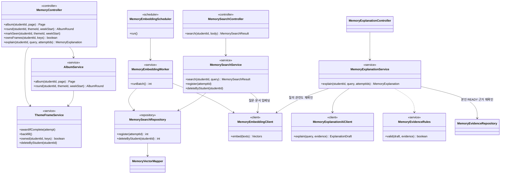

- #559 구현(learning V19): `ThemeFrameService`(지급·소급·보유·확인·삭제)·`AlbumService`·`MemoryController`의 앨범·확인·보유 확인과 기동 소급 `ThemeFrameBackfillRunner`. 회차 상세의 문제·시도·엔딩은 `WeeklyThemeService.pastRound`가 조합. 검색은 #563 구현, 설명은 #564 구현([결정 기록 9.2](../report/retention-expansion.md#92-learning-기념-액자앨범-559-2026-11-12))
- 학습 완료 처리(기존 `AttemptService`의 돌아보기 저장 = 학습 완료)가 같은 트랜잭션에서 `ThemeFrameService.awardIfComplete`(회차 5문제 완료 시 액자)와 `MemorySearchService.register`(`PENDING` 문서, 내부에서 `MemorySearchRepository.register`)를 부름. 다른 기능은 memory repository를 직접 부르지 않음(architecture 2.2). `EXTRA` 시도는 둘 다 건너뜀
- `MemoryEmbeddingScheduler`는 `StuckJudgmentScheduler`처럼 조건부 UPDATE 선점이라 잠금 없음(상태 3.7). `MemoryEmbeddingClient`는 ai `POST /internal/embeddings`(기존 계약, 요청당 8글, 최대 64글 계약 이내), 이전 `KnowledgeEmbedder`는 V17 정리로 없으므로 신규. HTTP 전송·외부 DTO는 `memory/client`(`MemoryEmbeddingClient`·`MemoryExplanationAiClient`·core 닉네임 조회 `StudentProfileClient`), 마스킹 정책(`MemoryTextPrivacy`)·업무 흐름은 `memory/service`. 생성 호출의 장애 판정(서킷 열림·전송 실패·502 밖 5xx → `MemoryAiOutageException`)은 `MemoryExplanationAiClient`가 맡음
- `MemoryExplanationService`는 받은 `attemptIds`가 본인 `READY` 문서인지 다시 확인한 뒤 근거를 `[1]~[3]` 번호로만 보내고(학생·시도·답변 ID 미전송, 닉네임 마스킹), `MemoryEvidenceRules.valid`(번호 범위·인용 원문 포함)를 통과한 설명만 번호를 실제 회차·시도로 바꿔 반환
- 앨범 회차 상세의 문제별 기록은 기존 `record` 기능의 시도 상세를 service로 불러 조합. 엔딩 표시 여부는 `WeeklyThemeService`의 엔딩 상태(#484 `ENDED`)로 판단
- 학생 삭제 소비의 `StudentDeletionService`가 시도 삭제 전에 `MemorySearchService.deleteByStudent`, 같은 트랜잭션에서 `ThemeFrameService.deleteByStudent`를 호출

---

## 5. ai-service

### 5.1 판정·되묻기 (judgment · followup)

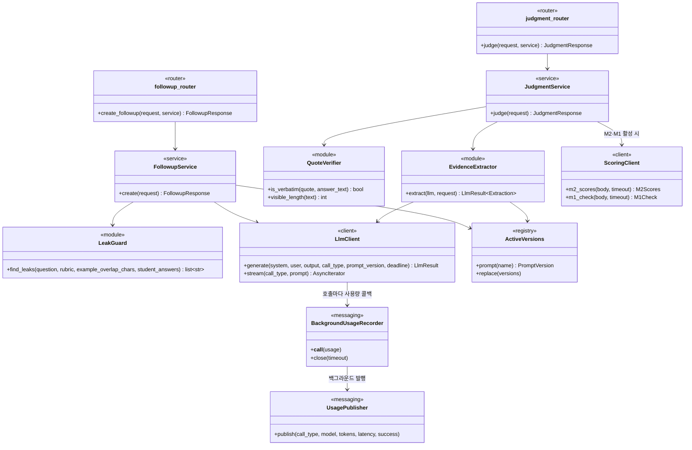

| 클래스 | 파일 | 책임 |
|---|---|---|
| `EvidenceExtractor` | `judgment/extractor.py` | 모듈 함수 `extract()`. LLM에 기준표 요소별 근거 구절 추출 요청 (학생 이름 미포함) |
| `QuoteVerifier` | `judgment/verifier.py` | 모듈 함수 `normalize`·`is_verbatim`·`visible_length`. 구절의 답변 원문 존재 확인(코드). LLM과 분리 (FN-JDG-03) |
| `JudgmentService` | `judgment/service.py` | 사전 보류(`TOO_SHORT`·`UNVERIFIED_SCOPE`) → 추출 → 대조 → 요소·배점으로 `CORRECT|PARTIAL|RETHINK|HELD` 결정 (업무 판단은 service, 아키텍처 2.1) → M2 교차 확인(불일치 시 `HELD(MODEL_DISAGREEMENT)`, `M2_CROSS_CHECK_ENABLED` 기본 꺼짐이면 기록만) → 풀이 단계는 M1 점검(확신도 미만 `HELD(LOW_CONFIDENCE)`, `M1_CHECK_ENABLED` 기본 꺼짐) → 응답. scoring 호출은 `clients/scoring_client.ScoringClient`(`m2_scores(body, timeout)`·`m1_check(body, timeout)`, 요청 본문은 `cross_check.m2_body`·`m1_body`가 만들고 `timeout`은 `SCORING_TIMEOUT`과 남은 판정 시간 중 작은 값, 비활성 응답이면 `None`), 불일치 계산은 `judgment/cross_check.py` (#69, api-spec 4.2.2) |
| `LeakGuard` | `followup/leak_guard.py` | 모듈 함수 `find_leaks()`(글 하나 검사는 `find_text_leaks()`, 미션 초안 검사와 공유). 정답 키·예시 답·금지어 포함 검사. 실패 시 1회 재생성(`LLM_RETRY`), 재실패 시 `question` 없이 `leakCheck.passed = false` 반환 → learning이 질문 은행 선택 (`BANK`, P16) |
| `LlmClient` | `llm/base.py`, 제공자는 `llm/providers.py` | 제공자 교체 지점(Claude·OpenAI·OpenAI 호환 sLLM, `LLM_PROVIDER`), LLM 호출 재시도는 이 클래스에서만 (아키텍처 1.3), 호출마다 사용량 콜백(`BackgroundUsageRecorder` → `UsagePublisher`, 발행 실패는 로그만). `stream`은 분석 대화 답변의 일반 텍스트 조각(첫 조각 전 실패만 재시도) |
| `ActiveVersions` | `prompt_versions/registry.py` (#254, 조정은 `prompt_versions/service.py` `PromptSync`) | #68에서 내장 버전과 core 활성 `PROMPT` 아홉 이름(#280 `reportTemplate`, #354 `missionDraft` 5.4, #477 `reportExplanation`, #437 `themeDraft` 5.5, #565 `memoryExplanation` 5.6 포함)·승인 scope를 조정한다. 선택한 실제 본문·버전을 요청 동안 고정하고 `/internal/versions`에 같은 버전을 제공한다. 미보유 활성 버전은 명시적 503과 readiness DOWN |

### 5.2 분석 에이전트·리포트 서술 (analysis_agent · report_narrative)

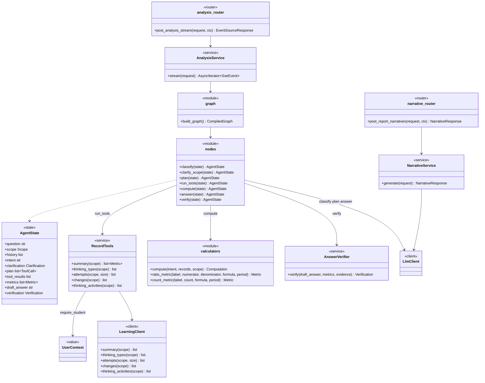

- 그래프 흐름 `classify → clarify_scope → plan → run_tools → compute → answer → verify` (아키텍처 1.5, 구현 노드 이름은 아래 구현 이름), 분기는 [시퀀스 다이어그램 5](sequence-diagram.md#5-분석-대화-sse)
- `RecordTools`(`analysis_agent/tools.py`): 도구 실행마다 `require_student` 검사 후 `LearningClient` 호출, 범위 밖이면 learning 미호출 (FN-AGT-02). `scope`는 core가 확인한 `{studentId, from, to}`
- `LearningClient`(`clients/learning_client.py`): 받은 컨텍스트 헤더 그대로 전달, 재시도 없음, 응답의 학생·기간·처리 상태 대조. 조회 실패는 빈 기록이 아닌 오류 (FN-AGT-10). 근거 재조회·삭제 여부(`available`)는 core가 learning `evidence`로 처리
- `calculators`: 건수·비율은 LLM이 아닌 코드 계산 (FN-AGT-05), `Metric` 형식은 learning과 동일(분모 0 `NO_RECORD`, 5 미만 `value: null`). 집계 대상·전후 변화 수(글자·문장·까닭을 잇는 말)는 learning `summary`·`changes.counts` 값을 그대로 사용해 대시보드·리포트와 숫자를 맞춤 ([ai 보고서 2장](../report/ai.md#2-분석-대화-에이전트-langgraph))
- `AnswerVerifier`(`analysis_agent/verification.py`의 `verify`): 답변 속 숫자 ↔ `metrics`, 인용 ↔ `evidence` 원문 대조. 실패 시 규칙 응답으로 전환 (FN-AGT-06)
- 규칙 응답(`analysis_agent/templates.py`): 대조 실패·LLM 키 부재·호출 실패 시 계산된 `metrics`·`evidence`만 템플릿 문장으로 구성, `source = TEMPLATE`·`fallback` 표시 (FN-AGT-10, P16)
- 구현 이름(#65·#66, #253): `router.py`는 SSE 형식 변환만 하고 `service.py`의 `AnalysisService`가 범위·기한 확인, 프롬프트 선택, 그래프 실행, 최종 상태의 이벤트 변환, 설정 제안(`propose_template`)을 맡는다. `AgentState` = `state.py`의 `AnalysisState`. `nodes`는 `nodes/understand.py`(`classify`, 범위 확인 포함)·`nodes/retrieve.py`(`retrieve` = plan·run_tools, `compute`)·`nodes/respond.py`(`answer`·`check` = verify, `fallback`·`insufficient`·`unsupported`)로 나뉨. 실제 분기는 [ai 보고서 2장](../report/ai.md#2-분석-대화-에이전트-langgraph)
- `NarrativeService`: 서술·저녁 질문만 생성, 숫자 계산·대조는 report-service 담당
- #477 `ExplanationService`(`report_explanation/`): 리포트 설명 1건 생성(FN-RPT-09). `ActiveVersions.model`로 설명 모델 활성 범위를 확인하고, 항목 선택·후처리·검사·인용 고르기는 `checks` 규칙. 설명 전용 `OpenAICompatibleLlm`(`create_explanation_llm`, `app.state.explanation_llm`)의 평문 `stream`만 쓰고 다른 호출의 제공자는 그대로. 미활성이면 `{active:false}`, 검사 실패 422 (api-spec 4.2.3)

### 5.3 메시징·클라이언트

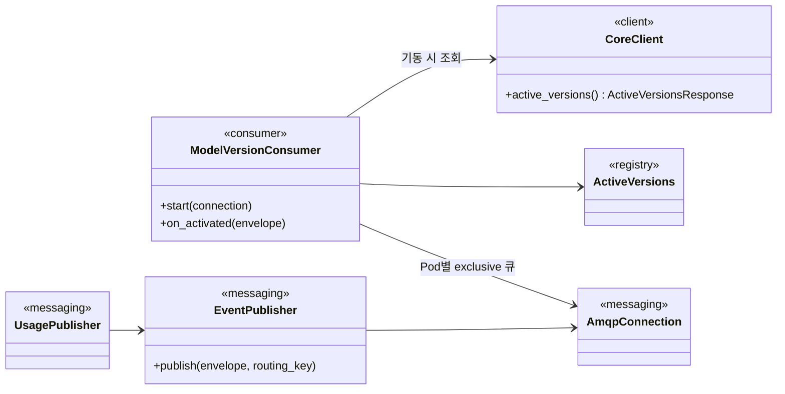

- 기동 순서: exclusive 큐 선언·바인딩·소비 시작 → `CoreClient.active_versions()` → 조회 중 이벤트 revision 조정 → `ActiveVersions.replace`. 조회·조정은 `PromptSync`가 맡고 소비자는 검증한 이벤트를 `PromptSync.offer`로만 넘긴다(#254). 조회 실패·미보유 활성 본문은 readiness false, 프로세스 유지. 재연결도 새 큐 바인딩 후 snapshot으로 조정한다 (아키텍처 1.6).
- `UsagePublisher`: 응답 반환 후 best-effort 발행, 학생 ID·원문 미포함 (NFR-PRF-02)

### 5.4 미션 초안 (mission_draft, #354)

FN-ADM-20, api-spec 4.2 `POST /internal/mission-drafts`. 새 모듈 `app/mission_draft/`는 되묻기(5.1)와 같은 구성이다.

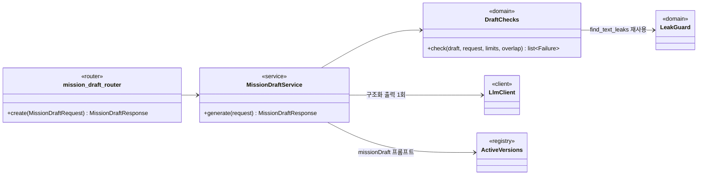

- `MissionDraftService.generate`: 요청 1번에 LLM 생성 1회와 검사만 하고 반복하지 않는다. 반복은 learning `MissionDraftService`(4.1.1)가 이전 실패 사유를 넣어 다시 부른다. LLM은 이 호출만 60초 1회(`LlmClient.generate`의 `timeout`·`max_retries`, 설정 `mission_draft_llm_timeout`·`mission_draft_llm_retries`), 마감 63초(learning→ai 70초 안, P12 예외 #353)
- `DraftChecks`(`checks.py` 모듈 함수 `check`): `REQUIRED`(제목·질문·요소·생각 열기 질문, 입력 방식별 선택지·분류 칸·정답 키·예시 답), `QUESTION_LENGTH`(`gradeMin` 학년 상한, 설정 `mission_draft_question_max_chars` 기본 전 학년 200자, P19 확정 전 기준안), `LEAK`(질문·안내·생각 열기 질문 각각에 `followup/leak_guard.find_text_leaks`, 학생 답 없이 정답 키·금지어·예시 답만. 예시 답은 안내·생각 열기 질문만, 질문에 있는 글을 빼고 비교. 숫자뿐인 최종 답은 숫자 경계로 비교). 성취기준 실재·요소 code 규칙은 표와 규칙을 가진 learning이 검사
- 프롬프트: `prompts.py` 내장 `mission-draft@1`, #68 레지스트리 이름 `missionDraft`·scope `ai/mission-draft`(`ActiveVersions`·`/internal/versions`에 추가). 입력은 성취기준 문장·(있으면) 성취수준 문장·생각 유형·그 유형 표준 요소 공통 설명·학년·입력 방식뿐이고 학생 정보는 없음
- 사용량: `LlmClient` 콜백 → `UsagePublisher`, `callType = MISSION_DRAFT`(이벤트 스키마·core enum·core CHECK와 같이 추가, ERD 3.5)

### 5.5 주간 테마 초안 (theme_draft, #437)

에픽 #436, FN-ADM-22, api-spec 4.2 `POST /internal/theme-drafts`. 새 모듈 `app/theme_draft/`는 분석 에이전트(5.2)처럼 LangGraph 그래프를 서비스가 실행하고, 미션 생성은 미션 초안(5.4)의 생성·검사를 재사용한다.

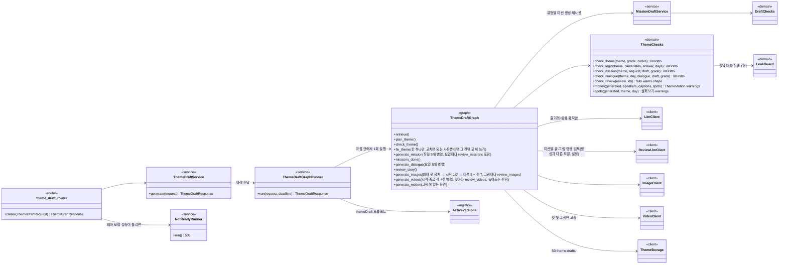

- 구조(구현 #437 글 단계): `router.py`가 실행기(`ThemeDraftRunner`)를 고르고 `service.py`의 `ThemeDraftGraphRunner`가 그래프 실행·응답 조립, `graph.py`가 LangGraph `StateGraph`(요일별 노드는 `Send` 병렬), `nodes/`가 노드, `models.py`가 요청·응답과 LLM 구조화 출력, `checks.py`·`prompts.py`. `review_story`가 `PASS`면 `generate_images → generate_videos → generate_motion`(`nodes/images.py`·`video.py`·`motion.py`). 그림 클라이언트나 저장소가 없으면 세 단계를 건너뛰고 `warnings(IMAGE, ALL, 그림 설정 없음)`만 남김
- 모델 설정: 테마 전용 `theme_generation_model`(기본 `gpt-6-luna`)·`theme_review_model`(기본 `gpt-6.1-terra`), 같은 OpenAI 키. 기본 `OPENAI_MODEL`과 따로 둔다(로컬·운영 `OPENAI_MODEL`이 검토 모델과 같은 `gpt-6.1-terra`라 그대로 쓰면 생성·검토가 같은 모델이 됨). 두 값이 같거나 키가 없으면 기동은 막지 않고 테마 경로만 `503 AI_UNAVAILABLE`(`retryable: false`, `NotReadyRunner`). 다른 경로는 그대로 동작
- 시간·상한 기준안: LLM 호출 타임아웃 300초(2026-11-11 180초에서 변경, 줄거리 1회 실측 130~170초)·재시도 0(재시도 대신 실패 사유 넣은 다시 생성), 단계마다 다시 생성 상한 2(첫 생성 포함 최대 3회), 줄거리 검사 사유가 모두 칸 하나만 고치면 되는 것(글자 수·증거 발견 줄 단서 값·후보·정답 이름, 글 칸만)이면 `fix_theme`이 그 칸만 고쳐 쓰고 다시 검사(상한 2, 넘으면 줄거리 다시 생성), 글 검토 재검토 상한 2, 마감까지 180초 미만 남으면 다음 다시 생성을 시작하지 않음(`DEADLINE` 사유를 붙여 실패), 최대 출력 토큰 줄거리·검토 32000·대화 8000
- `ThemeDraftService.generate`: 요청 1번에 그래프를 한 번 끝까지 실행한다. 그래프 안에서 실패한 부분만 실패 사유를 넣어 상한(기준안 단계마다 2회)까지 다시 만들고(미션은 실패한 유형만, 대화는 실패한 요일만, 영상은 실패한 컷만), 마감까지 남은 시간이 부족하면 다음 재생성을 시작하지 않는다. 그래도 실패하면 `failure{stage, reasons}`를 담아 200으로 돌려준다(`THEME`·`MISSION`·`REVIEW`·`IMAGE`). 대화·영상·움직임은 끝내 실패하면 그 항목만 빼고 `warnings`에 남긴다. learning은 `failure`가 있으면 `CHECK_FAILED`로 두고 다음 시도에 `previousFailures`로 넘긴다. 마감은 기준안 15분(learning→ai 16분 안)
- 요일 배치: 줄거리 단계에서 기준안(월 `ANALYZE`·화 `EVALUATE`·수 `CREATE`·목 `SOLVE`·금 `REFLECT`, 에픽 확인 필요)대로 정하고 응답 `day`로 돌려준다. learning이 다시 검사
- 줄거리 구조화 출력의 내부 칸(응답 `theme`에서는 뺌, 계약 그대로): 후보 특징 표 `features`(특징 이름·고른 성취기준 코드 `standardCode`(장면에서 골랐으면 비움)·후보별 값, 그날 성취기준 내용에서 고르는 것을 기본으로 하고 안 되면 장면에서), 요일별 단서 조건 `condition`(`RULE`·`HINT`, 특징, 허용 값), 단서 증거 `evidence`(`TRACE`·`SIGHTING`·`RECORD`와 그때), 요일별 증거 발견 줄 `discovery`(미션 전 대화 마지막 줄, 40자)와 수사 연결 문장 `missionHook`(증거 발견 줄 다음 대화 맨 끝 줄, 뭉치, 40자), 찾는 대상 `target`, 시작·종료 콘티(`introCuts`·`outroCuts`, 컷마다 장면·동작·문구·뭉치 표정 `mungchiMood`). 후보 기준안 모든 학년 4개. 뭉치는 테마 역할로 사건을 해결하러 가는 주인공이고 찾는 대상의 주인은 등장인물 중 한 명(사용자 결정 2026-11-11)
- `ThemeChecks`(`checks.py` 모듈 함수): 정답 논리는 특징 표로 판정한다. 요일별 `rulesOut`은 LLM이 쓰지 않고 코드가 표와 조건으로 채운다(`fill_rules_out`, `RULE`은 허용 값 밖의 후보 전부(이미 빠진 후보 포함), `HINT`는 빈 배열). `RULE`은 빠지는 후보가 비어 있지 않음, `HINT`는 그때 남은 후보가 모두 허용 값 안(남은 후보를 빼면 `RULE`이어야 함), `RULE`은 그때 남은 후보를 적어도 하나 새로 뺌(learning 결정적 단서 계산과 맞춤, #438), 틀린 후보는 모두 `RULE`로 빠짐, 수요일까지 후보 2개 이상 남음(마지막 틀린 후보는 목요일 이후), 정답은 어떤 단서로도 빠지지 않음, 요일별 단서 5개(기준안 40자), 단서 문장에 허용 값 낱말이 모두 있고 허용 밖 값 낱말이 없음(활용형·숫자 표기 차이 허용), `standardCode`는 이번 주 성취기준만, `evidence` 종류·때 필수, 찾는 대상은 대화 화자가 아님. 단서 규칙 중 코드로 볼 수 있는 것(정답 이름은 종료 이야기에만, 후보 이름의 색 낱말, 단서 종류 중복), 대화 형식·줄 수·길이·유출, 움직임 개수·속도·크기 상한. 단서는 학생이 그날 미션을 마친 뒤 보여 주므로 증거 발견 줄·대화 LLM 줄이 그날 허용 값을 말하면 `CLUE_EARLY`(정확히 일치하거나 명사형 끝을 뗀 2자 이상 줄기 일치, `mentions_value` 하나로 비교, 수사 연결 문장은 배울 개념을 말하는 자리라 보지 않음), 증거 발견 줄·수사 연결 문장에 후보·정답 이름이면 `ANSWER_LEAK`, 시작 콘티 1·2컷(뭉치 없음) 표정이 `none`이 아니거나 3·4컷(뭉치 출동·도착)이 `none`이면 `CUT_MOOD`, 단서 문장의 증거(사진·영상·녹음·기록 등)와 evidence 종류가 다르면 `CLUE_EVIDENCE`, 종료 콘티에 뭉치가 안 나오는 컷(`none`)이 있으면 `CUT_MOOD`. 살펴보기 한마디·이름이 미션 답·금지어·예시 답을 말하면 `checks.spot_leaks`로 그 물건을 뺀다. 검토 LLM은 단서 문장이 조건을 그대로 말하는지, 표 값이 자연스러운지, 없음에만 기대지 않는지, `HINT`가 일찍 답을 정하지 않는지를 본다
- 미션: 유형마다 `MissionDraftService`의 생성·`DraftChecks`를 그대로 쓰고, 테마 이야기 조각과 학년별 생각 열기 질문 개수(기준안 초3 3개·초4 2개·초5 1개·초6 1개)를 더 넣는다. 찾는 대상 이름(아직 못 찾음, 정답은 주지 않음)과 RAG 근거 빈 칸(`knowledge`, 지금은 비움)도 넣는다. 그날 장면과 그날 찾은 증거(장소·인물·물건·목격·기록)는 문제 소재로 쓸 수 있고, 정답 쓰기·정답 추리 문제·새 사건 사실·미션 답이 단서가 되는 것은 막는다. 미션 입력에는 그날 단서도 앞 요일 단서 목록도 넣지 않고(학생이 아직 못 얻었을 수 있음) 그날 `discovery`·`missionHook`을 넣되 둘 다 대화로 이미 나가므로 질문에 다시 쓰지 않게 한다(증거 자체를 살피게 하지 않고 어느 후보가 답인지 묻지 않음). 비교·점검할 글이 필요한 문제(예: 금요일 돌아보기)는 그 글을 문제 글에 직접 넣는다(그날 글만 읽고 풀 수 있게). 재사용은 `MissionDraftService.generate`에 선택 인자 `extra_user`(이야기 조각·테마 실패 사유를 미션 프롬프트 뒤에 덧붙임)·`call_type`(`THEME_DRAFT`)·`deadline`·`timeout`(테마 값)만 더한 최소 확장이고, 주지 않으면 기존 `/internal/mission-drafts` 동작과 같다(재시도·최대 토큰은 미션 초안 설정 그대로). 검사 분담(learning.md 21절): ai 미션 검사는 `DraftChecks`(`REQUIRED`·`QUESTION_LENGTH`·`LEAK`)에 테마 몫(학년별 생각 열기 개수 `HINT_COUNT`, 테마 정답 유출 `THEME_ANSWER_LEAK`, 한국어 밖 글자 `LANGUAGE`)만 더하고, 요소 code·`standardCode`·입력 방식 모양은 learning이 본다. 기존 검사 사유(`REQUIRED`·`QUESTION_LENGTH`·`LEAK`·learning이 돌려준 `STANDARD_CODE`·`ELEMENT_CODE`·`SHAPE`)는 미션 초안 `previousFailures`로, 테마 사유는 `extra_user`로 넣는다. 금요일도 큰 질문·후보·단서 목록을 넣지 않고 안내(`guide`)는 LLM이 만든 그대로 둔다(최종 후보 고르기는 웹·learning 화면, 사용자 결정 2026-11-11)
- `review_missions`(`generate_mission`과 코드 검사·실패 유형 재생성 다음, `generate_dialogue` 앞): 검토 모델이 미션마다 따로 병렬로 본다. 예시 답(또는 정답 키)이 문제가 요구한 것을 모두 채우는지, 성취기준 핵심 행동·생각 유형과 맞는지(혼자 글로 답하는 미션이라 협력·발표는 보지 않음), 그날 글만 읽고 풀 수 있는지(그림에만 있는 정보·비교할 글이 빠진 문제 금지). `FAIL`은 그 미션만 사유를 넣어 다시 만들고(상한 기준안 2회) 끝내 실패하면 `failure.stage = MISSION`, `WARN`은 `warnings`. 최종 `review_story`는 지금처럼 전체를 본다. 구현은 별도 노드가 아니라 요일별 `generate_mission` 노드 안에서 코드 검사 통과 뒤에 돈다(생성 → 검사 → 미션 검토 → 다시 생성 루프가 요일마다 독립이라 다른 요일을 기다리지 않음). 모든 요일이 끝나면 `missions_done`이 실패 요일을 모아 `failure.stage = MISSION`으로 끝낸다. 근거: 텍스트 시험(2026-11-10, lab3-reporter-2·lab3-inventor-2)에서 검토 1·2회차가 단서 논리로 줄거리를 통째로 다시 만들며 미션도 새로 생겨, 예시 답 문제는 검토 상한(3회) 마지막에야 드러나 고칠 기회가 없었음. 비용 기준안 미션당 약 $0.003
- 대화: 그날 증거 발견 줄(`discovery`)과 수사 연결 문장(`missionHook`, 뭉치)을 코드가 대화 끝 두 줄로 그대로 넣고(증거 발견 줄 말하는 사람 `discoverySpeaker`는 LLM이 고르고 기본 뭉치) LLM은 나머지 줄만 만든다. 단서는 학생이 그날 미션을 마친 뒤 learning이 보여 주므로(#484) 대화에 넣지 않고 화~금 앞 요일 요약 줄도 없다(사용자 결정 2026-11-11). 학년별 줄 수(기준안 초3·초4 3~4줄, 초5·초6 2~3줄)는 끝 두 줄 포함. 실패한 요일만 사유를 넣어 다시(상한 2), 끝내 실패하면 그 요일 대화만 빼고 `warnings(DIALOGUE)`
- `review_story`: 검토 모델이 `CLUE_LOGIC`·`ANSWER_HINT`·`GRADE_VOCAB`·`STANDARD_FIT`·`SAFETY` 다섯 항목을 본다. `CLUE_LOGIC`·`ANSWER_HINT`·`SAFETY` `FAIL`은 사유를 넣어 줄거리부터(미션·대화 다섯 요일 모두 새로), `STANDARD_FIT`·`GRADE_VOCAB` `FAIL`은 그 요일(요일이 없으면 다섯 요일) 미션·대화만 다시 만들고 다시 검토한다. 항목 형식이 틀리면 검토만 다시. 재검토 상한(2)을 넘거나 마감이 가까우면 `failure.stage = REVIEW`, 마지막 검토의 `WARN`은 `warnings(REVIEW)`
- `previousFailures` 반영: `THEME`·`REVIEW` 사유는 첫 줄거리 생성부터, `MISSION` 사유(`"<요일> <검사 코드> <자세히>"`)는 그 요일 미션 생성마다(요일이 없으면 다섯 요일) 넣는다. `IMAGE` 사유는 아직 넣지 않는다(넣는 방식 미정)
- 그림: `gpt-image-2.6-sunburst`, 1536×864, medium. 테마 옷 뭉치 → 시작 1컷 첫 그림(인물 기준 그림) → 미션 그림 5장(`MON`~`FRI`)과 나머지 컷 첫 그림 7장을 [테마 옷 뭉치, 인물 기준 그림] 참조로 동시에 만든다(시작 1·2컷은 뭉치 참조 없음, 시작 3컷은 인물 참조 없음). 응답 `INTRO`·`OUTRO` 그림은 4번째 컷 첫 그림. 프롬프트는 고정 스타일 + 뭉치(테마 옷) + 등장인물 모습 + 장면이고, 미션 그림은 그날 장면 메모·증거 발견 줄·미션 질문·생각 열기 질문(한국어 그대로, 가리키는 물건이 보이게)을 넣는다. 찾는 대상은 시작 1컷·종료 3·4컷에서만, 생각 풍선 없음. 그림마다 검토(`MUNGCHI`·`ANSWER_HINT`·`TEXT`·`SAFETY`·`SCENE_FIT`, 미션 그림은 `MISSION_FIT`). 영상: `veo-3.1-fast-generate-001`, 720p·무음, 컷 4·6·8·6초, 컷 첫 그림만 고정(아래 그림체·영상 범위)
- `ThemeStorage`(`storage.py`): 실행마다 ID를 만들어 `theme-drafts/{실행 ID}/{장면}.png`·`.mp4`로 올리고 키만 돌려준다(report-service `clients/storage.py` 패턴, boto3). 영상은 `INTRO`·`OUTRO`만
- 그림체·뭉치·영상 범위(사용자 결정 2026-11-11): 2D 만화풍, 앱 솜뭉치 모양의 기본 뭉치 그림(`assets/`, 기준안)을 고쳐 테마 옷만 입힌 뒤(손에 소품 없음) 모든 그림의 첫 참조로 쓴다. 영상은 시작·종료만이고 장면마다 컷 4개(4·6·8·6초, 컷마다 장소·각도 다름)를 컷 첫 그림만 고정해 동시에 만든 뒤 0.5초 녹아드는 전환으로 이어 붙인다(`imageio-ffmpeg`, 22.5초). 둘 다 고정하면 비슷한 두 그림 사이를 억지로 이어 움직임이 흐물거리고 배경이 같아져(실측 2026-11-11) 첫 그림만 고정한다. 콘티(컷마다 장면·동작·문구)는 `plan_theme`이 내부 칸으로 함께 만든다. 실패한 컷만 다시 만들고, 설정이 꺼져 있거나 마감이 가까우면 영상을 건너뛰고 `warnings(VIDEO)`
- `ImageClient`·`VideoClient`(`app/llm/media.py`, 이슈 작업 위치 `app/llm/`): 그림 생성(참조 그림 여러 장, OpenAI images edits)과 영상 생성(Veo 첫 그림 고정, 끝 그림은 선택, `negativePrompt`, 토큰은 Google 표준 자격 증명에서 만료 전 갱신 `GoogleTokenSource`, #538), 녹아드는 전환 이어 붙이기(`join_xfade`)·문구 시각(`xfade_caption_times`)·장면 뽑기(ffmpeg), 영상 크기(`size`, Veo 1280×720)와 끝내 실패한 컷을 대신하는 움직이는 그림 컷(`still_clip`, 첫 그림을 천천히 확대). 참조 그림이 없으면 `images.generate`. 시험은 가짜 구현
- 움직임(형식 v1, `models.ThemeMotion`): `transition`·`camera`·`speakers{이름: {x, y, zoom}}`·`effects[]`(최대 2층)·`captions[{start, end, text}]`·`spots[{x, y, label, line, evidence}]`(요일 장면 살펴보기 2~3개, 증거 물건 1개, `checks.spots`가 맞춤, 2026-11-11 추가 선택 칸)(시작·종료 영상 문구). 좌표는 그림 %. 화자 위치는 생성 모델이 그림을 보고 정하고, 상한 밖 숫자는 `ThemeChecks.motion`이 맞추고 경고. 그림 입력은 `LlmClient.generate`의 선택 인자 `images`
- 지식 검색(#470): `plan_theme` 앞 `retrieve` 노드와 `check_theme` 범위 확인 자리만 두고 기능 스위치(기본 꺼짐)로 막는다
- 프롬프트: `prompts.py` 내장 `theme-draft@1`(생성·검토 묶음), #68 레지스트리 이름 `themeDraft`·scope `ai/theme-draft`. 입력에 학생 정보 없음
- 사용량: 글 생성·검토 `THEME_DRAFT`, 이미지 `THEME_IMAGE`, 영상 `THEME_VIDEO`. `THEME_VIDEO`는 `VeoVideoClient`가 컷 호출마다 1건(토큰 null), core #543(V45) 반영 뒤 #546부터 보냄

### 5.6 추억 설명 (memory_explanation, #565)

| 클래스 | 위치 | 책임 |
|---|---|---|
| `MemoryExplanationService` | `memory_explanation/service.py` | `memoryExplanation` 프롬프트로 기본 `LlmClient` 1회 구조화 생성(사용량 `MEMORY_EXPLANATION`), `MEMORY_EXPLANATION_PROVIDER=fake`면 `fake.fake_generated`. LLM 실패 503, 형식 502, 검사 실패 422 |
| `checks` | `memory_explanation/checks.py` | 모듈 함수 `check()`(문장 2~3개·빈 문장 → 형식, 근거 번호 없음·범위 밖·근거에 없는 인용 → 거부)와 `compose()`(문장 끝에 `[n]` 붙이고 `citations` 모음). 원문 없이 사유 코드만 로그 |
| `EmbeddingService`·`EmbeddingClient` | `embedding/service.py`, `llm/embeddings.py` | 요청 `purpose`(`KNOWLEDGE`·`MEMORY`)로 사용량 `KNOWLEDGE_EMBEDDING`·`MEMORY_EMBEDDING`을 가름(#565). 벡터·재시도는 같음 |

---

## 6. scoring-service

```mermaid
classDiagram
  direction LR
  class m2_router {
    <<router>>
    +post_scores(request) M2Response
  }
  class m1_router {
    <<router>>
    +post_checks(request) M1Response
  }
  class M2Service {
    <<service>>
    +score(request) M2Response
  }
  class M1Service {
    <<service>>
    +check(request) M1Inactive
  }
  class ModelRegistry {
    <<registry>>
    +load(active_version) bool
    +get(name, scope) LoadedModel
    +is_active(name, scope) bool
    +replace(versions)
    +versions() list
  }
  class LoadedModel {
    <<infra>>
    +metadata ActiveModelVersion
    +tokenizer
    +training_config dict
    +score_cuts dict
    +predict(inputs) raw_scores
  }
  class ModelStartup {
    <<service>>
    +start()
    +offer(active_version)
    +is_ready() bool
    +close()
  }
  class ModelLoader { <<infra>> }
  class S3ModelArtifacts { <<client>> }
  class versions_router { <<router>> }
  class CoreClient { <<client>> }
  class ModelVersionConsumer {
    <<consumer>>
    +start()
    +receive(message, startup)
    +is_ready() bool
    +close()
  }
  class UsagePublisher { <<messaging>> }
  class preflight_router {
    <<router>>
    +preflight(body) PreflightResult
  }
  class PreflightService {
    <<service>>
    +check(request) PreflightResult
  }
  class ModelLoadingReporter {
    <<messaging>>
    +start()
  }

  m2_router --> M2Service
  m1_router --> M1Service
  M2Service --> ModelRegistry
  M1Service ..> ModelRegistry : 활성 추론 후속 연결
  ModelRegistry ..> LoadedModel
  ModelStartup --> CoreClient : 기동 시 활성 버전
  ModelStartup --> ModelRegistry : snapshot·보존 이벤트 조정·로딩 재시도
  ModelRegistry --> ModelLoader : 스레드풀 로딩
  ModelLoader --> S3ModelArtifacts
  versions_router --> ModelRegistry
  ModelVersionConsumer --> ModelStartup : 큐 바인딩 후 시작·이벤트 전달
  M2Service --> UsagePublisher
  M1Service ..> UsagePublisher : 활성 추론 후속 연결
  preflight_router --> PreflightService : core 중계 요청만
  PreflightService --> S3ModelArtifacts : reader(파일 정보·작은 JSON 읽기)
  ModelLoadingReporter --> ModelRegistry : Pod 전체 상태
  ModelLoadingReporter --> UsagePublisher : model.loading.reported
```

- `LoadedModel.predict`는 CPU 동기 추론 → `run_in_threadpool`로 호출해 이벤트 루프 차단 방지 (아키텍처 2.3)
- 활성 범위 밖 학년·문항이면 `{active: false}` 반환. #88 현재 M1은 미학습으로 항상 비활성이며 추론·사용량 발행을 하지 않는다. 향후 M1 확신도 0.8 미만이면 scoring은 실수 위치를 제외하고 ai가 보류를 결정한다(P15).
- 가중치는 S3 `artifact_uri`에서 로딩, 승인된 버전만 (아키텍처 5장)
- #85 구현: 레지스트리·S3 로더·versions 라우터. `get(name, scope)`는 승인 범위를 검사한 모델만 반환한다. #86은 `ModelVersionConsumer`·`ModelStartup`으로 이벤트 보존·재연결·모델 교체를 연결한다. #87은 m2 라우터·M2Service·사용량 발행, #88은 M1 미학습 비활성 계약을 제공한다.
- #368 `preflight.py`: core만 부르는 `POST /internal/models/preflight`(router·`PreflightService`). 설정 버킷의 `models/` 경로 파일 존재·크기·SHA-256과 메타데이터를 검사하고 모델을 로딩하지 않는다 (api-spec 5.2.1). S3 요청·체크섬 해석·저장소 오류 변환(`ArtifactError`)은 `clients/model_artifacts.py`의 `reader`가 맡고, `PreflightService`는 크기·해시·모델 구조 판정만 한다. router·service·요청/응답 모델을 한 파일에 두는 구성은 유지하기로 했다(아키텍처 2.4, #608)
- #370 `model_loading_reporter.py`: `ModelLoadingReporter`가 `ModelRegistry` 상태를 기동·변화 즉시와 30초 주기로 `model.loading.reported`에 담아 별도 `EventPublisher` 인스턴스(`messaging/publisher.py`, 그림은 `UsagePublisher`로 묶음)로 발행한다. 발행 실패는 로딩과 분리된다 (core 소비는 3.5)

---

## 7. report-service

```mermaid
classDiagram
  direction TB
  class GenerationConsumer {
    <<consumer>>
    +__call__(envelope)
  }
  class GenerationService {
    <<service>>
    +generate(command)
  }
  class MetricsCalculator {
    <<service>>
    +calculate(records) GenerationResult
  }
  class RecordGenerator {
    <<service>>
    +generate(command, report) GenerationResult
  }
  class NarrativeGenerator {
    +generate(command, report) GenerationResult
  }
  class ExplanationGenerator {
    +generate(command, report) GenerationResult
  }
  class RenderingGenerator {
    +generate(command, report) GenerationResult
  }
  class JobLocks {
    +acquire(job_id, student_id) JobLease
    +acquire_student(student_id) JobLease
  }
  class DeletionRepository {
    +begin(session, command) bool
    +finish(session, command)
  }
  class GenerationResult {
    +state ReportState
    +inclusion_rule str
    +items tuple~ReportItem~
    +explanation_state str
  }
  class ReportVerifier {
    <<service>>
    +verify(response, result, evidence) Verification
  }
  class ReportRenderer {
    <<service>>
    +render(report, display_name) dict
  }
  class WeeklyReport {
    <<entity>>
    +id UUID
    +job_id UUID
    +student_id UUID
    +revision int
    +status ReportStatus
    +state ReportState
  }
  class ReportItem { <<entity>> }
  class ReportRepository {
    <<repository>>
    +get_or_create(session, command) tuple
    +find_by_job(session, job_id) WeeklyReport
    +finish(session, report_id, result, failure_reason) WeeklyReport
  }
  class OutboxRelay {
    <<messaging>>
    +publish_once() bool
  }
  class OutboxRepository {
    <<repository>>
    +add(session, envelope)
    +claim_next(engine) OutboxClaim
    +mark_published(session, event_id)
    +record_failure(session, event_id, error_code)
    +quarantined(session, limit)
    +requeue(session, event_id) bool
  }
  class LearningClient {
    <<client>>
    +records(student_id, period) LearningRecords
    +explanation_attempts(student_id, period) tuple
    +evidence(student_id, links) tuple
  }
  class AiClient {
    <<client>>
    +narrative(request) NarrativeResponse
    +explanation(payload, timeout) ExplanationResponse
  }
  class ObjectStorage {
    <<client>>
    +put(key, body, content_type)
    +presigned_url(key, ttl, filename) dict
    +delete_prefix(prefix)
  }
  class query_router {
    <<router>>
    +list(student_id, status, page, size) Page
    +detail(report_id, revision, narrative_enabled) ReportDetail
    +evidence(report_id, item_id) Evidence
    +file(report_id, format, narrative_enabled) DownloadUrl
  }
  class QueryService {
    <<service>>
    +list(student_id, status, page, size) Page
    +detail(report_id, revision, narrative_enabled) ReportDetail
    +evidence(report_id, item_id) Evidence
    +file(report_id, format, narrative_enabled) DownloadUrl
  }
  class StudentDeletedConsumer {
    <<consumer>>
    +__call__(envelope)
  }
  class DeletionService {
    <<service>>
    +delete(command)
  }
  class CoreClient {
    <<client>>
    +report_deletion_completed(deletion_request_id)
    +lookup(student_id) StudentDisplayName
  }
  class NamedGenerator {
    +generate(command, report) GenerationResult
  }

  GenerationConsumer --> GenerationService
  GenerationService --> ReportRepository
  GenerationService --> OutboxRepository : report.started·completed·failed
  GenerationService --> NamedGenerator : SYSTEM·scope·별명 검증
  NamedGenerator --> CoreClient : 학생 별명
  NamedGenerator --> RenderingGenerator : R4
  GenerationService --> JobLocks
  RenderingGenerator --> ExplanationGenerator : 설명 (#479)
  ExplanationGenerator --> NarrativeGenerator : R3
  ExplanationGenerator --> LearningClient : M2 점수 기록·원문 대조
  ExplanationGenerator --> AiClient : 대표 답변 설명
  NarrativeGenerator --> RecordGenerator : R2
  RecordGenerator --> LearningClient
  RecordGenerator --> MetricsCalculator
  NarrativeGenerator --> AiClient
  NarrativeGenerator --> LearningClient : 원문 대조
  NarrativeGenerator --> ReportVerifier
  RenderingGenerator --> ReportRenderer
  RenderingGenerator --> ObjectStorage
  GenerationService ..> WeeklyReport
  GenerationResult *-- ReportItem
  OutboxRelay --> OutboxRepository : 미발행 조회·발행 기록
  OutboxRelay --> EventPublisher : publisher confirm
  query_router --> QueryService
  QueryService --> LearningClient : 현재 근거
  QueryService --> ObjectStorage
  StudentDeletedConsumer --> DeletionService
  DeletionService --> DeletionRepository
  DeletionService --> JobLocks
  DeletionService --> CoreClient
  DeletionService --> ObjectStorage
```

| 클래스 | 파일 | 실행 프로세스 |
|---|---|---|
| `GenerationConsumer`, `GenerationService`, `MetricsCalculator`, `ReportVerifier`, `ReportRepository`, `WeeklyReport` | `generation/consumer.py`·`service.py`·`metrics.py`·`verifier.py`·`repository.py`·`models.py` | report-worker |
| `RecordGenerator`, `GenerationResult`·`ReportItem` | `generation/record_generator.py`·`models.py` | report-worker (R2 계산 결과를 종료 트랜잭션으로 전달) |
| `LearningClient` | `clients/learning_client.py` | worker/API (`records`는 세 조회 정규화, `evidence`는 현재 원문·버전·삭제 대조) |
| `NarrativeGenerator`, `RenderingGenerator`, `JobLocks` | `generation/narrative_generator.py`·`locking.py`, `rendering/generator.py` | report-worker |
| `ExplanationGenerator` | `generation/explanation_generator.py` | report-worker (주간 설명, #479·#508) |
| `ReportRenderer` | `rendering/renderer.py` (Jinja2 → HTML, Playwright → PDF, Markdown) | report-worker |
| `OutboxRelay`, `OutboxRepository` | `outbox/` | report-worker (서비스의 종료 트랜잭션이 `OutboxRepository.add` 호출) |
| `StudentDeletedConsumer`, `DeletionService` | `deletion/` | report-worker |
| `DeletionRepository` | `deletion/repository.py` (#252) | report-worker (삭제 장벽·processed_event·물리 삭제 트랜잭션) |
| `query_router`, `QueryService` | `query/router.py`, `query/service.py` (신규) | report-api |
| `ObjectStorage` | `clients/storage.py` (신규, S3·로컬 MinIO) | 공통 |

- `GenerationService.generate`: `job_id`로 기존 행 조회 → 없으면 `RUNNING` 생성, `COMPLETED·FAILED`면 ACK만, `RUNNING`이면 같은 행으로 재실행. 기록 없음·표본 부족은 `COMPLETED + state`, 실패는 `FAILED` (FN-RPT-11)
- `query_router`·`QueryService`: 모든 조회에서 리포트의 `student_id`가 `X-Student-Scope`에 있는지 검사, 없으면 403 (API 4장)
- 수치·전후 변화는 `MetricsCalculator`(코드)에서만 계산, ai는 서술·저녁 질문만 (FN-RPT-03, 05)
- `ReportVerifier`: 서술 속 숫자·인용을 계산 결과·learning 원문과 대조, 실패 시 서술을 템플릿 요약으로 교체(`narrative.source = TEMPLATE`, P16). `NO_RECORD`·무료 플랜(`narrativeEnabled = false`)·일일 리포트(`periodType = DAILY`)는 ai 호출 생략 (P06·P13)
- 설명 단계(#479, #508): `ExplanationGenerator`가 `NarrativeGenerator` 뒤·`RenderingGenerator` 앞에서 실행(파이프라인 Record → Narrative → Explanation → Rendering). `LearningClient.explanation_attempts()`(`includeModelScores=true`)로 M2 점수가 있는 답변을 최신순으로 받고, 생각 유형마다 최신 답변부터 자격(정정·빈 답변·학년·입력 유형·점수 형식)과 원문 대조를 확인하며 실패하면 같은 유형의 다음 답변을 시도한다. 유형당 `AiClient.explanation()`은 결과와 관계없이 최대 1회, 최대 3유형. 검사 통과분만 `ReportItem(EXPLANATION)`이며 `GenerationResult.explanation_state`는 하나라도 통과하면 `INCLUDED`, M2 점수 답변이 없으면 `NO_TARGET`, 그 밖에는 `NOT_INCLUDED`. 실패·시간 초과·미활성은 리포트 실패로 바꾸지 않는다 (FN-RPT-09, P16, api-spec 3.4·4.2.3)

### 7.1 리포트 기간 종류 (report #391 구현 · core #390 연동)

2026-11-06 결정의 report 부분은 #391에서 구현했다. core 스케줄·알림(#390)은 구현했고 대화(#392)도 구현했으며 1장 레이어·의존 규칙을 따른다. 배치는 [아키텍처 1.1.1](architecture.md#111-2026-11-06-결정-추가-책임).

```mermaid
classDiagram
  direction LR
  class ReportScheduler {
    <<scheduler>>
    +generateWeekly()
    +generateDaily()
  }
  class ReportJobService {
    <<service>>
    +scheduleWeekly(periodFrom, periodTo)
    +scheduleDaily(day)
  }
  class ConversationService {
    <<service>>
    +createForReport(childId, reportId) Conversation
  }
  class GenerationService {
    <<service>>
    +generate(command)
  }
  class DailyReportBuilder {
    <<module>>
    +build(records, sharing, learning) GenerationResult
  }
  class ThemeSummaryBuilder {
    <<module>>
    +build(studentId, period) ThemeSummary
  }

  ReportScheduler --> ReportJobService
  GenerationService --> RecordGenerator
  RecordGenerator --> DailyReportBuilder : periodType = DAILY
  RecordGenerator --> ThemeSummaryBuilder : periodType = WEEKLY
```

- core(#390 구현): `WeeklyReportScheduler`·`DailyReportScheduler`가 각자 ShedLock으로 `ReportScheduleService.generate(at, periodType)`을 부르고, `ReportJobService.scheduled(parent, child, ReportPeriod)`가 보호자가 연결된 자녀별 작업 + Outbox를 저장한다(정기 부분 UK `(student_id, period_type, period_from)`). 기간 종류는 domain `ReportPeriodType`(`DAILY`·`WEEKLY`)과 `ReportPeriod(from, to, type)`이며 일일은 서술 없음(`narrative = false`)이라 상품 권한을 조회하지 않는다. 일일 상세 원문 제공 여부는 `ReportEntitlementService.dailyDetailEnabled` 한 곳에서 정한다
- report-service `GenerationService`(7장)는 `periodType`으로 분기. `DailyReportBuilder`는 ai 서술 호출 없이 템플릿만 구성하고 기존 대조·렌더링을 재사용
- core(#392 구현): `ConversationService.createForReport`는 `ReportJobRepository.byReport`로 일일·같은 자녀를 확인하고 `ReportQueryService.pinned`(최신 판)로 완료 여부를 본 뒤 기존 `create`와 같은 대화를 만들고 기간을 그날로 고정, `conversation.report_id`·`report_revision` 저장. 메시지마다 `ConversationService.report`가 `ReportQueryService.pinned(reportId, revision)`(열람 기록 없음)으로 그 판을 읽어 ai 요청 `report`에 개수·판정 요약으로 전달. ai는 `AnalysisRequest.report`(`ReportSummary`)를 답변 프롬프트 `[고정 리포트]`와 숫자 대조 허용값에 넣는다
- report `ReportRepository`의 revision 잠금·UK 단위는 `(student_id, period_type, period_from)`

---


- 테마 소비는 코드(`app/config.py` `report_theme_summary_enabled`)·kind `report-worker` 값 모두 `REPORT_THEME_SUMMARY_ENABLED=true`가 기본이다. 단, Docker Compose(`compose.yaml`)는 `${REPORT_THEME_SUMMARY_ENABLED:-false}`로 꺼 두므로 로컬 Compose에서 주간 테마 요약을 보려면 `.env`에서 켠다(기본값 통일은 별도 정리 이슈). #385/#391 learning을 먼저 배포한다. false는 새 주간 요약만 생략하는 복귀 설정이며 조회 오류를 참여 없음으로 바꾸지 않는다.

## 8. 확인 필요 가정
- 요금제 사용 한도(P13): core가 `product.limits`로 확인 후 `USAGE_LIMIT_REACHED`. 분석 대화는 `ProductEntitlementService.reserve`가 보호자 잠금 안에서 자녀별 `payment_premium_usage` KST 일자 집계로 판정(#225, `AnalysisUsageService`는 Redis 미사용). 학생별 미션 시작 한도는 #387에서 `ProductEntitlementService.missionStart`·`usage/MissionUsageService`·`mission_daily_usage`(#210 PostgreSQL 결정)로 구현했다(당시 무료 `THEME_DAY`·`EXTRA` 합쳐 하루 1개). 2026-11-10 개정(core #485)부터 무료 테마 문제는 한도가 없고 무료 `EXTRA`는 403 `PREMIUM_REQUIRED`라, 이 한도는 무료 상품에서 `EXTRA`를 다시 켠 경우에만 쓰인다. 피드백 한도는 미구현. 생각 유형별 미션 고르기(`EXTRA`)는 무료 상품에서 꺼진 동안 프리미엄 사용(`EXTRA_MISSION`) 기록
- 클래스 분할 단위(관리자 controller 등)는 구현 시 조정 가능, 레이어·의존 방향은 고정
