# ERD

- 근거: [기능명세서](functional-spec.md), [API 명세서](api-spec.md), [유스케이스](usecase.md), [아키텍처 설계](architecture.md), [프로젝트 기획서](<../outputs/프로젝트_기획서_사고뭉치.pdf>) 4.5
- 범위: DB를 소유한 서비스 3개(core_db · learning_db · report_db). ai·scoring은 상태 없음 (아키텍처 1.1)
- AI Hub 원본·가공본은 `ml/` 학습용으로 서비스 DB에 넣지 않음 (NFR-DAT-03)
- `(P04)` 형태는 확정 정책 번호, 내용은 [기능명세서 1.4](functional-spec.md#14-확정-정책)

---

## 1. 공통 규칙

| 항목 | 규칙 |
|---|---|
| DBMS | PostgreSQL. 마이그레이션은 core·learning Flyway, report Alembic (아키텍처 5장) |
| 이름 | 테이블·컬럼 snake_case, 테이블명 단수형 |
| PK | UUID는 앱에서 생성해 전달하며 DB UUID 기본값은 두지 않음. `id uuid`는 API 식별자와 동일. 예외: 복합 PK·이벤트 ID·`shedlock.name` |
| 시각·날짜 | 시각 `timestamptz`, 기간 `date`(KST, 양 끝 포함) |
| 상태값 | [API 명세 1.5](api-spec.md#15-상태-코드값-fn-12-대응) 코드값 그대로 `varchar` + CHECK |
| 서비스 간 참조 | 다른 DB의 ID는 FK 없는 논리 참조 (2장). 같은 DB 안에서만 FK |
| 덮어쓰기 금지 | 제출 답변·콘텐츠 버전·확정 결과는 보존. 처리 중 상태 갱신은 허용하며 판정 정정은 `judgment_correction`, 리포트 재생성은 새 `revision`으로 기록 (NFR-DAT-01, 02) |
| 버전 연결 | 판정·되묻기·분석·리포트 행에 당시 미션·기준표·모델·프롬프트 버전 저장 (NFR-DAT-02) |
| 개인정보 | 학생은 가명 닉네임만 저장, 실명 컬럼 없음. 결제수단 민감 정보 미저장 (NFR-SEC-06) |
| JSONB | 구조가 응답 스키마와 같고 조회 조건에 쓰지 않는 값만 (Metric[], verification, versions 등) |
| NULL·기본값 | `NULL 허용` 표시 컬럼 외에는 NOT NULL. UUID·시각·상태·카운터의 SQL DEFAULT는 두지 않고 앱에서 전달. 정책 값(기능명세서 1.4)을 SQL 기본값으로 고정하지 않고 앱 설정·`product` 데이터로 전달 |
| 문자열·금액 | varchar는 길이 제한 없는 PostgreSQL varchar. ShedLock만 name varchar(64), locked_by varchar(255). 원화는 int, cost_usd는 반올림 정책 없는 numeric |
| FK 삭제·순환 참조 | 기본 ON DELETE/UPDATE NO ACTION. mission.current_*와 answer.followup_id만 DEFERRABLE INITIALLY IMMEDIATE. 삭제는 P09에 따라 `student.deleted` 이벤트로 서비스별 물리 삭제. learning 하위 기록의 CASCADE 여부는 7장 확인 필요 |

- 테이블 없이 Redis에 두는 값: SSE 알림 중계 (아키텍처 1.6), 요금제 사용 한도 일 단위 카운터 (P13)
- 생각 메모는 `attempt_draft.content.memo`에 저장 (P05). 음성 시범 미구현으로 음성 데이터 없음 (P03)
- 학생 별도 계정 없음: 학생 세션은 `student.id`로 발급하는 토큰만. 발급 경로는 학부모 인증(동석) 또는 학부모 등록 기기 + 자녀 PIN(단독). PIN·기기 저장 구조는 3.1 (P01)
- 학생 기기 페어링 코드(10분·1회용)는 테이블 없이 Redis 저장
- 코드 CHECK는 Mermaid 주석의 `A|B` 목록 또는 `CHECK[A]` 명시 표기로 자동 검증한다. 허용값이 하나인 경우에도 `CHECK[A]`로 표시해 일반 설명과 구분한다.

---

## 2. 서비스 간 ID

| ID | 소유 (원본 테이블) | 참조하는 곳 |
|---|---|---|
| `student_id` | core `student.id` | learning `attempt`·`deleted_student`, report `weekly_report` |
| `mission_id` | learning `mission.id` | (core는 프록시만, 저장 없음) |
| `attempt_id`, `answer_id` | learning `attempt`·`answer` | core `message_evidence`, report `report_item_evidence` |
| `judgment_id`, `followup_id` | learning `judgment`·`followup` | core `error_report.target_id` |
| `job_id` | core `report_job.id` | report `weekly_report.job_id` |
| `report_id` | report `weekly_report.id` | core `report_job.report_id`, `report_view.report_id`, `error_report.target_id` |
| `rubric_version_id` | learning `rubric_version.id` | core `model_version.ref_id` (`kind = RUBRIC`) |
| `error_report_id` | core `error_report.id` | learning `judgment_correction` |
| 사용자 ID | core `user_account.id` | learning `mission.created_by`·`mission_review.reviewer_id`·`judgment_correction.corrected_by` |

- 삭제 전파: core가 삭제 확정 시 `student.deleted` 발행 → learning·report가 해당 학생 기록 삭제 (아키텍처 1.4, P09)
- 삭제된 기록을 참조하면 learning 근거 조회가 `available: false` 반환 (FN-ACC-13)

---

## 3. core_db

### 3.1 계정·동의·자녀 연결 (FN-ACC)

```mermaid
erDiagram
  user_account ||--o{ student_device : registers
  student_device ||--o{ student_device_child : allows
  student ||--o{ student_device_child : uses
  user_account ||--o{ admin_permission : has
  user_account ||--o{ refresh_token : issues
  user_account ||--o{ consent : agrees
  consent_document ||--o{ consent : "문서 버전"
  student |o--o{ consent : "법정대리인 동의 대상"
  user_account ||--o{ guardianship : parent
  student ||--o{ guardianship : child
  user_account ||--o{ deletion_request : requests
  student ||--o{ deletion_request : target
  user_account ||--o{ withdrawal_request : requests

  user_account {
    uuid id PK
    varchar role "STUDENT|PARENT|ADMIN"
    varchar login_id UK "로그인 ID(이메일)"
    varchar password_hash "NULL 허용 · 기존 데이터 보존, 로그인 미사용"
    varchar oauth_provider "NULL 허용 · GOOGLE"
    varchar oauth_subject "NULL 허용 · provider와 복합 UK"
    varchar display_name "NULL 허용"
    varchar status "ACTIVE|WITHDRAWAL_REQUESTED|WITHDRAWN"
    boolean is_demo "시연 계정"
    timestamptz created_at
    timestamptz updated_at
    timestamptz withdrawn_at "NULL 허용"
  }
  admin_permission {
    uuid user_id PK,FK
    varchar permission PK "CONTENT|PAYMENT_VIEW|PAYMENT_REFUND|SERVICE_OPS"
    uuid granted_by FK
    timestamptz granted_at
  }
  refresh_token {
    uuid id PK
    uuid session_id FK "NULL 허용 · 기존 토큰, 신규는 필수"
    timestamptz used_at "NULL 허용"
    uuid user_id FK
    varchar token_hash UK
    timestamptz expires_at
    timestamptz revoked_at "NULL 허용"
    timestamptz created_at
  }
  student {
    uuid id PK "전 서비스 공통 학생 ID"
    varchar pin_hash "NULL 허용"
    int pin_failed_count "0 이상"
    timestamptz pin_locked_at "NULL 허용"
    timestamptz pin_updated_at "NULL 허용"
    varchar nickname "가명, DELETED 표식은 NULL 허용"
    int grade "3~6, 이후 제공 문제에만 적용 (P03), DELETED 표식은 NULL 허용"
    int birth_year "출생연도 (P01), DELETED 표식은 NULL 허용"
    boolean is_demo "시연 가상 학생"
    varchar status "ACTIVE|DELETION_REQUESTED|DELETED"
    timestamptz created_at
    timestamptz updated_at
    timestamptz deleted_at "NULL 허용"
  }
  student_device {
    uuid id PK
    uuid parent_user_id FK
    varchar token_hash UK
    varchar label
    timestamptz created_at
    timestamptz expires_at
    timestamptz last_used_at "NULL 허용"
    timestamptz revoked_at "NULL 허용"
  }
  student_device_child {
    uuid device_id PK,FK
    uuid student_id PK,FK
  }
  consent_document {
    uuid id PK
    varchar kind "TERMS|PRIVACY|GUARDIAN"
    varchar version
    varchar title
    text content
    boolean required "필수 동의 여부"
    date effective_from
    timestamptz created_at
  }
  consent {
    uuid id PK
    uuid document_id FK
    uuid subject_user_id FK "동의 주체(학부모)"
    uuid student_id FK "NULL 허용 · 자녀 동의일 때"
    boolean agreed
    varchar status "AGREED|WITHDRAWN"
    timestamptz agreed_at
    timestamptz withdrawn_at "NULL 허용"
  }
  guardianship {
    uuid id PK
    uuid parent_user_id FK
    uuid student_id FK
    varchar method "CHECK[REGISTER] (P02: LINK 미지원)"
    varchar status "LINKED|UNLINKED"
    timestamptz linked_at
    timestamptz unlinked_at "NULL 허용"
  }
  deletion_request {
    uuid id PK
    uuid requested_by FK
    uuid student_id FK
    varchar scope "PROFILE|RECORDS"
    varchar status "REQUESTED|CONFIRMED|COMPLETED"
    timestamptz requested_at
    timestamptz confirmed_at "NULL 허용"
    timestamptz completed_at "NULL 허용"
  }
  withdrawal_request {
    uuid id PK
    uuid user_id FK
    varchar status "REQUESTED|COMPLETED"
    timestamptz requested_at
    timestamptz completed_at "NULL 허용"
    varchar status_token_hash UK "NULL 허용, 조회 전용 토큰 해시"
  }
```

- #37: 동의 권한은 문서·주체·student_id별 agreed_at·id 내림차순 최신 행 기준이다. 같은 보호자의 동의 저장·철회·자녀 등록은 user_account 행 잠금으로 직렬화한다. 기존 스키마를 사용하며 V1~V8을 수정하지 않는다.
- `consent_document` UK `(kind, version)`. 동의는 철회해도 행 유지 → `status`·`withdrawn_at` 갱신 (FN-ACC-02)
- `guardianship` 부분 UK `(parent_user_id, student_id) WHERE status = 'LINKED'`. 권한 확인은 이 테이블의 `LINKED` 행 기준 (아키텍처 1.1)
- 연결 해제는 행 삭제 대신 `UNLINKED` 전환 → 해제 이후 조회 차단, 이력 보존 (FN-DSH-06)
- `deletion_request`가 `CONFIRMED`가 되면 같은 트랜잭션에서 `outbox_event(student.deleted)` 저장
- 로그인 수단·자녀 연결 변경 결과·시점은 `audit_log`에 기록 (FN-ACC-10)
- `user_account.is_demo`·`student.is_demo` 행은 운영 현황·사용량·결제 집계에서 제외 (NFR-OPS-01)

### #45 재인증·삭제 완료 저장

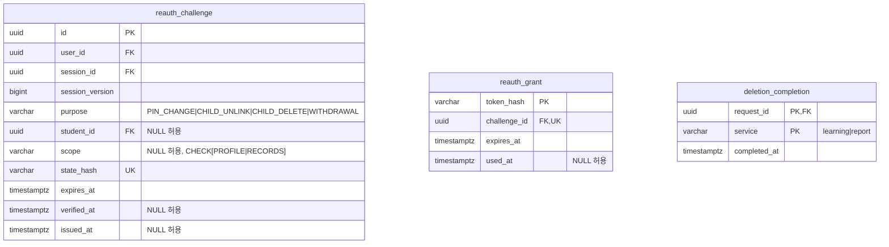

`withdrawal_request.status_token_hash varchar NULL 허용`을 추가한다(신규 요청은 해시 필수). PROFILE 완료 후 student의 nickname/grade/birth_year는 NULL로 지우며, DELETED가 아닌 행의 필수 프로필은 CHECK로 보존한다. 재인증 challenge의 purpose/자녀/scope 조합도 CHECK한다. 기존 V1~V8은 수정하지 않는다. #58 기기 테이블은 만들거나 SQL에서 참조하지 않는다. V9 번호는 착수 시 다른 worktree V1~V8만 존재함을 확인했고 병합 전 다시 확인한다.

### 3.1.1 로그인 세션 (#36)

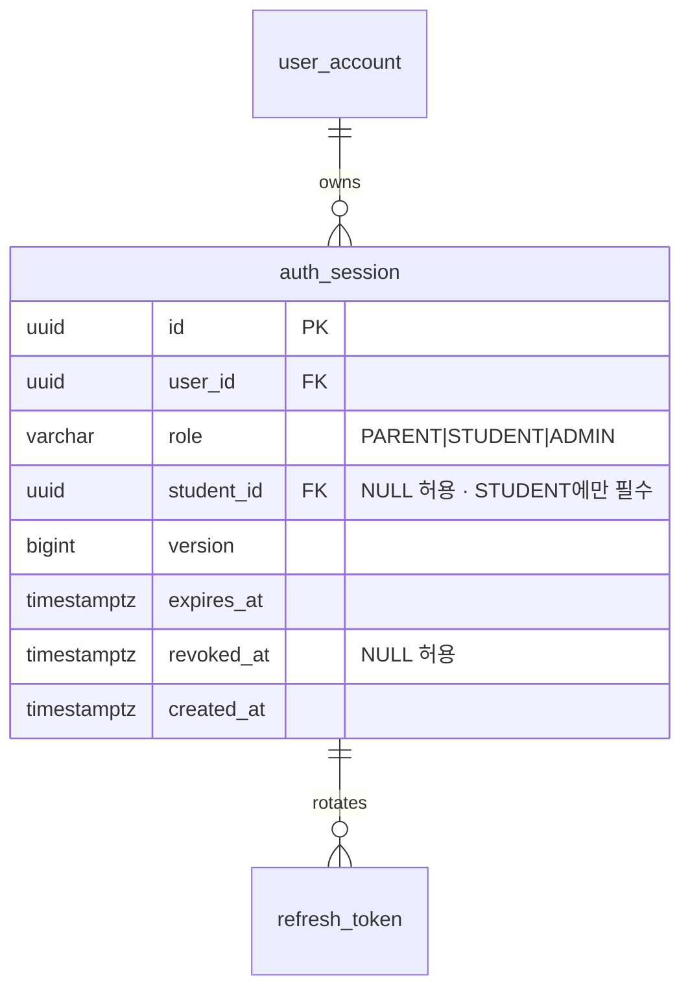

- `auth_session` CHECK: `version > 0`, `ck_auth_session_student`(role이 STUDENT면 `student_id` 필수, 그 외 역할은 NULL) (V8)

### 3.2 분석 대화·리포트 작업 (FN-AGT, FN-RPT)

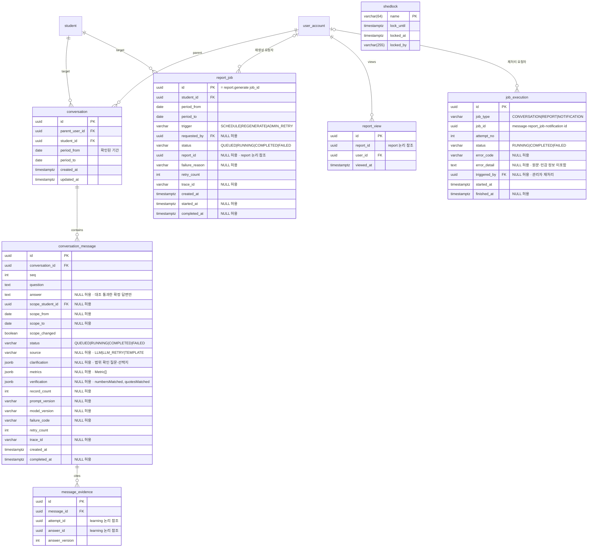

- `conversation_message` UK `(conversation_id, seq)`. 실패 메시지는 `FAILED`로 남기고 재시도 시 같은 행 상태 전이 (FN-AGT-10)
- `message_evidence`는 ID만 저장하고 원문은 learning에서 조회한다. 대화 본문에 포함된 인용·집계와 파일의 삭제 범위는 별도 P09 확인 대상이며, 근거 ID만으로 파생 내용의 삭제까지 보장하지 않는다 (FN-ACC-13)
- 관리자 작업 목록(`/admin/jobs`)은 `conversation_message`·`report_job`·`notification`의 상태 컬럼을 조회 (FN-ADM-03)
- `report_job` 상태 전이: `report.started` 수신 시 `QUEUED→RUNNING`, `report.completed|failed` 수신 시 종료 상태 + `report_id` 저장 (아키텍처 1.6 조건부 전이)
- `report_job` 부분 UK `(student_id, period_from) WHERE trigger = 'SCHEDULE'` → 정기 생성 중복 방지. 재생성·재처리는 새 행 (FN-RPT-01, 12)
- `job_execution`: 작업 실행 1회당 1행, UK `(job_type, job_id, attempt_no)`. 관리자 실패 원인·처리 이력 조회 근거 (FN-ADM-07)
- `report_view`: 학부모 리포트 상세 조회 시 기록, 주간 리포트 열람률 지표 근거 (기획서 3.9)
- `clarification`이 있는 메시지는 범위 확인 후 종료된 질문, 사용자 선택은 다음 메시지의 `scope_*`에 저장 (FN-AGT-03)
- `shedlock`은 name varchar(64) PK, lock_until·locked_at timestamptz, locked_by varchar(255), 모두 NOT NULL (주간 리포트·정기 청구 스케줄).
- `conversation_message.scope_student_id`는 같은 core DB의 `student.id` FK. 미확정 범위·처리 중 출력은 NULL로 두며 임시 결과를 채우지 않는다.

### 3.3 알림·신고·문의·공지 (FN-SUP)

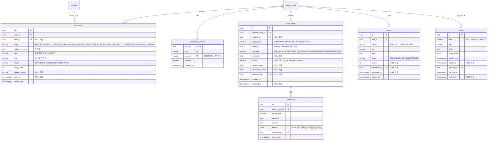

- #44: V12는 notification·notification_setting의 type CHECK에 REPORT_FAILED를 추가한다. V9는 #45, V13은 #58의 student_device_auth. 기존 마이그레이션은 수정하지 않는다. 알림 status는 Redis 발행 상태이며 읽음은 read_at으로 별도 관리한다.
- `notification` UK `(user_id, type, source_event_id)` → 같은 사건 재처리 시 중복 생성 방지 (FN-SUP-08)
- 판정 정정 원본은 learning `judgment_correction`, core `correction`은 신고 단위 정정 사유·영향 범위 기록 (FN-SUP-03)
- 도움말(`/help`)은 정적 콘텐츠로 테이블 없음

### 3.4 결제·구독 (FN-PAY) — 토스페이먼츠 테스트

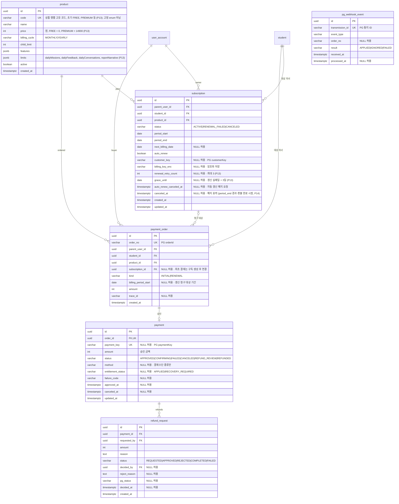

- `subscription` 부분 UK `(student_id) WHERE status IN ('ACTIVE','RENEWAL_FAILED')` → 같은 자녀 중복 구독 409 (FN-PAY-02)
- 활성 구독이 없는 자녀는 무료 플랜, 한도는 `product(code = FREE)` 행의 `limits` (P13)
- 가격·한도 변경은 기존 `product` 행 수정 대신 새 행 추가 후 기존 행 `active = false`. 기존 구독은 `product_id`·`payment_order.amount`로 결제 당시 조건 유지 (P13)
- 승인 처리 순서: `payment_order.amount`·대상 자녀 대조 → PG 승인 → `payment` 저장 → 구독 생성·반영 → `payment_order.subscription_id` 연결. 반영 실패 시 `entitlement_status = RECOVERY_REQUIRED` (FN-PAY-03, 05)
- `payment_order` 부분 UK `(subscription_id, billing_period_start) WHERE kind = 'RENEWAL'` → 정기 청구 중복 실행 시 이중 청구 방지 (FN-PAY-06, NFR-REL-01)
- 자동 갱신 해지는 `auto_renew = false` + `auto_renew_canceled_at` 기록, 남은 기간 이후 `status = CANCELED` + `canceled_at`. `period_end` 전 해지 철회 시 `auto_renew = true`, `auto_renew_canceled_at = NULL` (FN-PAY-09, P14)
- 환불 완료(`payment.status = REFUNDED`) 시 구독 즉시 `CANCELED` + `canceled_at` (P14)
- 갱신 실패 시 `RENEWAL_FAILED` + `grace_until = 실패일 + 3일`, 매일 1회 재청구마다 `renewal_retry_count + 1`, 3회 실패 시 `CANCELED` (FN-PAY-08, P13)
- 재청구 주문: 같은 기간 부분 UK 때문에 기존 `RENEWAL` 주문으로 재청구하는 것으로 가정. 토스 자동결제의 `orderId` 재사용 가능 여부 확인 후 확정 (기술 확인 사항)
- 웹훅은 `transmission_id`로 1회만 반영, 본문 대신 PG 조회 결과로 상태 갱신 (FN-PAY-04)
- 환불 중복·초과 방지: 승인된 `refund_request.amount` 합계 ≤ `payment.amount` 검사 (FN-ADM-16)
- 카드번호 등 결제수단 원본 미저장, 빌링키는 암호화 (NFR-SEC-06)

### 3.5 운영·공통

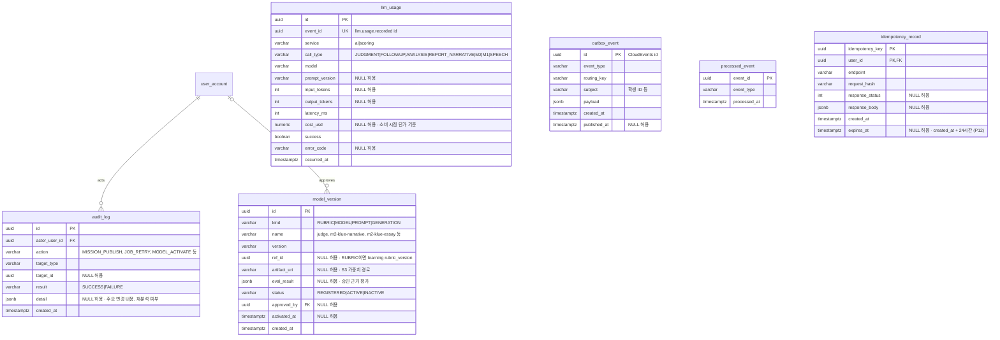

- `model_version` UK `(kind, name, version)`, 부분 UK `(kind, name) WHERE status = 'ACTIVE'`. 롤백은 이전 버전 재활성화 + `audit_log` 기록 (FN-ADM-18)
- #43 `eval_result`는 API 5.2의 불변 평가 근거·최초 승인과 현재 적용 범위·그룹 revision을 저장한다. DDL·기존 ACTIVE 부분 UK는 유지한다. 교체는 동일 그룹 transaction advisory lock 이후 상태·감사·Outbox를 원자적으로 저장한다.
- 기준표 원본은 learning `rubric_version`, core는 `kind = RUBRIC` 행의 `ref_id`로 연결해 승인·활성 상태만 관리
- `llm_usage`에 학생 ID·답변 원문 컬럼 없음 (NFR-PRF-02). 수집 데이터 보고서의 예정 필드 `llm_usage_log(call_type, model, input_tokens, output_tokens, ts)` 대응
- `cost_usd`는 core 설정의 모델별 토큰 단가(기획서 3.9)로 소비 시 계산, 단가 변경 후에도 과거 값 유지 (FN-ADM-19)
- `outbox_event`: 상태 변경과 같은 트랜잭션에 저장, 릴레이가 publisher confirm 후 `published_at` 기록 (아키텍처 1.6)
- `idempotency_record.user_id`는 core `user_account.id` FK. 요청 접수 후 응답 확정 전에는 response_status·response_body를 NULL로 둔다. expires_at은 created_at + 24시간이다 (P12).
- `idempotency_record`: 공개 API의 `Idempotency-Key` 대상(답변 제출·주문·승인·환불·재처리·신고) 공통. 같은 키·다른 본문은 `request_hash` 불일치로 422 (API 1.4)
- #38의 response_body는 원문 보존용 JSON 봉투 `{body: base64, headers: {이름: [값]}}`다. response_status가 NULL이면 미확정이며 봉투도 NULL이다. expires_at은 DB 시계 기준 24시간이며 만료 행은 같은 키 접수 시와 주기 청소에서 제거한다. 세션 advisory lock은 테이블을 추가하지 않으며 사용자·키 해시로 잠근다. endpoint에는 메서드와 실제 공개 경로를 저장한다.

---

## 4. learning_db

### 4.1 미션·기준표 (FN-ADM-08~13, FN-LRN-02~03)

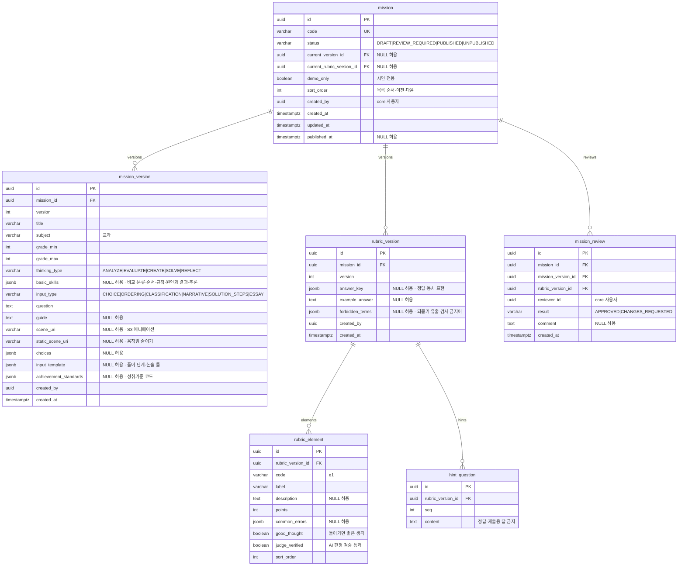

- `mission_version`·`rubric_version` UK `(mission_id, version)`. 수정은 새 버전 추가 후 `mission.current_*` 갱신, 이전 버전 불변 (FN-ADM-10, 12)
- 공개(`PUBLISHED`) 전 필수 항목 검사: 현재 미션·기준표 버전 존재, 기준표 요소 1개 이상(서술·논술) 또는 `answer_key`(고르기·수학) (FN-ADM-11)
- `mission.sort_order`: 학년군 안의 목록 순서, 이전·다음 이동과 진행 위치 계산 (FN-LRN-02)
- `rubric_element.judge_verified = false` 요소는 AI 판정 시 충족 표시 금지 → `HELD (UNVERIFIED_SCOPE)`. 평가 통과 후 관리자가 갱신 (FN-JDG-04, 05, NFR-AIQ-01). 사람 검증(P11) 도입 전에는 ai `JUDGE_REQUIRE_VERIFIED=false`(기본)로 끄고 `trial = true`로 시범 표시
- `forbidden_terms`: 정답 키와 함께 ai `followups` 유출 검사 입력 (FN-JDG-06)
- AI Hub 문항·답안·피드백 원문은 어떤 컬럼에도 저장하지 않음 (FN-ADM-09)

### 4.2 학습 시도·답변·판정 (FN-LRN, FN-JDG)

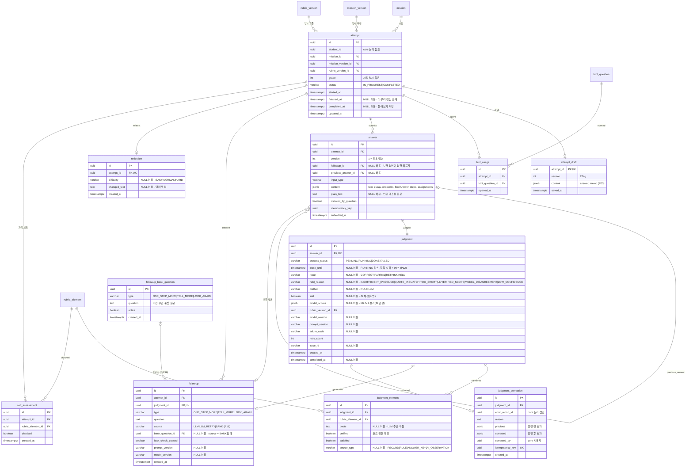

- `attempt` 부분 UK `(student_id, mission_id) WHERE status = 'IN_PROGRESS'` → 시작 요청 시 진행 중 시도 반환 (FN-LRN-16)
- `attempt`는 시작 시점의 미션·기준표 버전을 고정 → 기준 변경 후에도 과거 결과 재현 (NFR-DAT-02)
- `attempt_draft`는 시도당 1행, `UPDATE ... WHERE version = :ifMatch` 실패 시 409 (FN-LRN-17)
- `answer` UK `(attempt_id, version)`, `(attempt_id, idempotency_key)`. 수정·삭제 없이 추가만 (FN-LRN-08~10)
- `followup`은 시도당 최대 2행 (P04). 고르기 `CORRECT`면 생성하지 않음
- `followup_bank_question`은 ai 유출 검사 재실패 시 learning이 `type`이 같은 활성 질문 중 선택, 시드 데이터로 관리 (P16)
- `attempt_draft.content.memo`는 학생 본인 조회에만 사용, 판정·리포트·학부모 조회 대상 아님 (P05)
- `judgment`는 답변 제출 시 `PENDING`으로 함께 생성. 피드백 요청 시 `PENDING|FAILED|리스 만료 RUNNING → RUNNING` 조건부 전이 (API 1.4)
- 판정 보류는 `result = HELD`, 처리 실패는 `process_status = FAILED` → 서로 다른 컬럼 (NFR-REL-04)
- `judgment_element` UK `(judgment_id, rubric_element_id)`. verified·satisfied는 NOT NULL이며 CHECK (verified OR NOT satisfied)로 미검증 충족을 금지한다. 근거가 없으면 quote·source_type은 NULL 가능 (API 3.2, FN-JDG-03).
- `judgment.result`는 process_status = DONE일 때만 NOT NULL (상태 다이어그램 3.3). result = HELD이면 held_reason 필수, 그 외에는 NULL. 규칙 판정의 model_version·prompt_version은 NULL 가능.
- `answer.input_type`은 mission_version.input_type과 같은 코드 집합을 CHECK한다. notification_setting.type은 notification.type, correction.target_type은 error_report.target_type과 같은 집합이다.
- 정정은 `judgment`를 직접 바꾸지 않고 `judgment_correction` 추가, 최신 정정을 조회 시 반영 (FN-SUP-03)
- `self_assessment` UK `(attempt_id, rubric_element_id)`. AI 판정·원본 답변과 별도 저장 (FN-LRN-13)
- 도움 이용 비율 집계 근거 = `hint_usage.opened_at` vs 최초 `answer.submitted_at` (최초 답변 전 열람 없는 시도 / 집계 대상 시도, P08)

### 4.3 삭제·공통

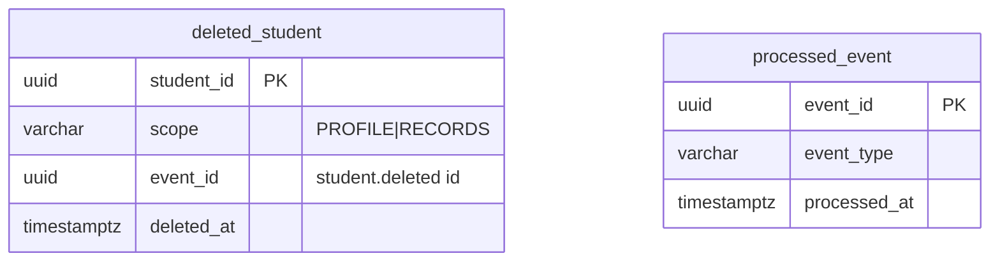

- `student.deleted` 소비: 해당 학생 `attempt` 이하 기록 삭제 + `deleted_student` 저장 → 근거 조회 시 `available: false` (물리 삭제 + 표식, P09). 처리 완료는 core 내부 API `POST /internal/deletion-requests/{id}/completions`로 알림
- learning은 이벤트를 발행하지 않으므로 `outbox_event` 없음 (아키텍처 1.6)
- 멱등은 `answer`·`judgment_correction`의 `idempotency_key` UK로 처리, 별도 `idempotency_record` 없음

---

## 5. report_db

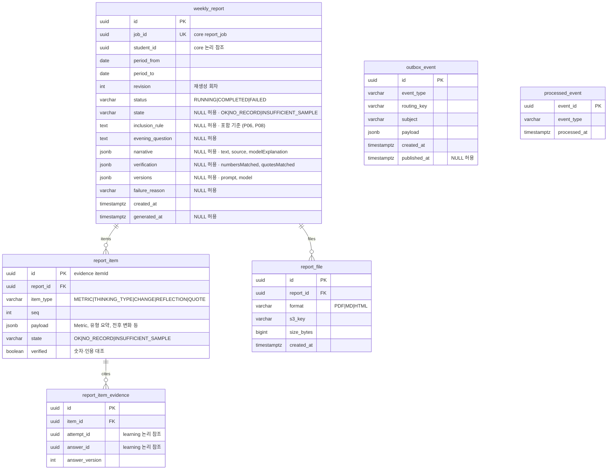

- `weekly_report.job_id` UK → 같은 `report.generate` 재전달 시 1회만 생성. 상태 전이 `RUNNING → COMPLETED|FAILED`와 `outbox_event(report.*)`를 같은 트랜잭션에 저장
- 재생성은 기존 행을 덮지 않고 `revision` 증가 행 추가, UK `(student_id, period_from, revision)` (기존 판 보존·최신판 기본 조회, P06). 학부모 요청 재생성은 리포트당 1회 → core `report_job(REGENERATE)` 건수로 확인
- 기록 없는 주·표본 부족 주는 `status = COMPLETED` + `state`로 구분, 생성 실패(`FAILED`)와 분리 (FN-RPT-11). state는 COMPLETED일 때만 NOT NULL (상태 다이어그램 4.2).
- `report_item` UK `(report_id, item_type, seq)`. 상세 응답(API 3.4)은 `item_type`별로 묶어 조립
- `report_file` UK `(report_id, format)`. 다운로드는 `s3_key`로 presigned URL 발급 (FN-RPT-13)

---

## 6. 인덱스

| DB | 테이블 | 인덱스 | 용도 |
|---|---|---|---|
| core | `student_device` | `(parent_user_id) WHERE revoked_at IS NULL` | 등록 기기 목록 |
| core | `student_device_child` | `(student_id)` | 삭제 시 매핑 정리 |
| core | `guardianship` | `(parent_user_id) WHERE status='LINKED'` | 요청마다 자녀 연결 확인 |
| core | `conversation` | `(parent_user_id, student_id, created_at)` | 대화 목록 |
| core | `report_job` | `(student_id, period_from)`, `(status, created_at)` | 리포트 목록, 관리자 작업 현황 |
| core | `job_execution` | `(job_type, job_id)` | 작업별 처리 이력 |
| core | `report_view` | `(report_id)`, `(user_id, viewed_at)` | 열람률 집계 |
| core | `notification` | `(user_id, read_at, created_at)` | 읽지 않은 알림 |
| core | `payment` | `(status, updated_at)` | `CONFIRMING` 재조회, 결제 운영 조회 |
| core | `subscription` | `(next_billing_date) WHERE auto_renew` | 정기 청구 대상 |
| core | `auth_session` | `(user_id)` | 사용자별 세션 폐기 |
| core | `refresh_token` | `(session_id)` | 세션별 토큰 폐기·재사용 탐지 |
| core | `llm_usage` | `(occurred_at, call_type)` | 사용량·비용 집계 |
| core | `outbox_event` | `(created_at) WHERE published_at IS NULL` | 릴레이 대상 |
| learning | `mission` | `(status, sort_order)`, `mission_version (thinking_type, grade_min, grade_max)` | 학년·유형별 공개 미션 목록 |
| learning | `attempt` | `(student_id, started_at)` | 기간별 기록 조회 (대시보드·에이전트·리포트) |
| learning | `answer` | `(attempt_id, submitted_at)` | 시도 타임라인 |
| learning | `judgment` | `(process_status, lease_until)` | 고착 `RUNNING` 탐지 |
| report | `weekly_report` | `(student_id, status, period_from)` | 자녀별 리포트 목록 |
| report | `outbox_event` | `(created_at) WHERE published_at IS NULL` | 리포트 이벤트 릴레이 대상 |

---

## 7. 확인 필요 가정
- PG 거래 대조(FN-ADM-15): 조회 시 PG API와 계산, 결과 테이블 없음
- learning 학생 삭제 시 `attempt` 하위 기록 삭제 방식: FK `ON DELETE CASCADE` 또는 서비스 내 삭제 순서 (클래스 다이어그램 8장)
- 정기 청구 재청구의 `payment_order` 재사용: 토스 `orderId` 재사용 가능 여부 확인 필요 (3.4)
- 정책 확정에 따른 DDL은 core V6~V7·learning V4~V5로 추가한다(9장). 기존 데이터의 출생연도·상품 한도·폐기 코드/음성 기록은 임의 변환하지 않고 적용 전 정비가 필요하다.
- `product.code`는 상품 행별 UK이며 P13의 요금제 추가·가격/한도별 새 행을 위해 확장 가능한 코드다. 새 상품 행은 새 고유 코드를 사용한다. 무료 상품 교체 시 기존 `code = FREE` 조회의 활성 버전 선택 방식은 상품 기능 구현 시 확정해야 한다.

## 8. 이슈 5 마이그레이션 대응

- 이 절의 테이블 수·버전은 이슈 #5 완료 시점의 기록이다. 확정 정책 반영 후 현재 구조와 추가 버전은 9장을 따른다.
- 기존 정의 58개 테이블(core 34, learning 18, report 6)을 대상으로 한다. 신규 메모·추천·교육과정 관리 등 기능 확장 테이블과 시드 데이터는 포함하지 않는다.
- core는 3.1~3.5별 Flyway V1~V5, learning은 4.1~4.3별 V1~V3, report는 Alembic 20261026_01에 대응한다. report의 target_metadata=None을 유지한다.
- 상태 CHECK는 각 컬럼에 명시된 값 전체에 적용한다. NOT_STARTED는 시도 미생성, SAVED는 초안 조회 응답, PROCESSING·조회 FAILED는 처리 상태의 API 표현이므로 같은 이름의 DB 상태를 추가하지 않는다.
- 모든 NULL 허용 컬럼은 위 Mermaid에 표시했다. 처리 전 결과·완료 시각, 최초 답변의 이전 답변·되묻기, 최초 결제의 구독 연결, 규칙/템플릿의 모델 버전, 미확정 정책 자리 등은 NULL을 허용한다. nullable UNIQUE는 PostgreSQL 기본 NULLS DISTINCT를 사용한다.
- FK는 같은 DB 내부만 연결하고 기존 다중 참조의 소속 일치·공개 조건·환불 합계 검사는 서비스 검증 계약으로 남긴다. 새 복합 FK·보조 컬럼과 정책 기반 삭제 방식은 이번에 임의 추가하지 않는다.
- 순환 참조는 같은 마이그레이션에서 테이블을 모두 만든 뒤 FK를 추가한다. 기본적으로 즉시 검사하며, 명시적으로 제약을 지연시킨 단일 트랜잭션에서만 순환 참조를 일괄 처리할 수 있다. 이는 삭제 정책을 확정하거나 자동 삭제를 수행하는 설정이 아니다.
- 초안·상태 갱신, 정정·리포트 리비전 생성, Outbox 발행·소비와 P01/P02/P05/P09/P12/P13/P16의 동작 정책은 해당 기능/정책 담당과 별도로 처리한다. 데이터 수집본이나 실제 학생 답안을 마이그레이션에 포함하지 않는다.

## 9. 이슈 19 확정 정책 마이그레이션

- core V6는 `student.birth_year`·`product.limits`를 nullable로 준비하고 고정 `product.code` CHECK를 제거한다. V7은 필요한 기존 데이터 정비를 검사한 뒤 NOT NULL·코드 CHECK·학년 3~6 CHECK를 적용하고 `student.user_account_id`를 제거한다. 기존 상품 코드·금액·참조 ID를 자동 변경하지 않는다.
- learning V4는 `followup_bank_question`과 `followup.bank_question_id` FK를 준비한다. V5는 기존 음성·TEMPLATE·미연결 BANK 기록을 검사한 뒤 `answer.speech_transcribed`를 제거하고 source를 LLM/LLM_RETRY/BANK로 제한한다.
- `followup.bank_question_id`는 BANK일 때만 필수이며 다른 출처에서는 NULL인 CHECK를 적용한다. 은행 질문의 type 일치·활성 여부 선택은 서비스가 검사한다. 삭제 FK는 NO ACTION을 유지한다.
- report는 정책 확정에 따른 DDL 변경이 없어 새 revision을 추가하지 않는다. 최종 구조는 59개 테이블·506개 컬럼(core 34/306, learning 19/156, report 6/44)이다. 이후 core V8(#36 `auth_session`, `refresh_token.session_id`·`used_at`) 반영 현재 60개 테이블·518개 컬럼(core 35/318)이다.
- 기존 V1~V5/V1~V3/Alembic 초기 revision은 변경하지 않는다. 초기 DB는 순서대로 전체 적용하고, 기존 데이터가 있는 DB는 준비 버전에서 멈춰 승인된 값으로 보완한 뒤 최종 버전을 적용한다. 상세 절차는 [이슈 19 스키마 변경 보고서](../report/db-policy-schema.md)를 따른다.

## 10. P01 학생 기기·PIN 구현 (#58)

저장 구조는 3.1과 인덱스 6장으로 이동했다. V13은 #45 V9·#44 V12를 보존하며, V12가 먼저 적용된 DB에서도 순서대로 실행한다.
기존 student는 PIN 미설정(NULL), 실패 횟수 0으로 옮긴다. 임의 PIN·기기는 생성하지 않는다. 신규 student의 pin_failed_count는 앱에서 0을 전달하며 SQL DEFAULT는 두지 않는다.
삭제 확정 때 student_device_child를 제거하고 PIN 해시·잠금도 지운다. 탈퇴 시 모든 기기를 폐기한다. 연결·동의 해제는 기존 세션 검사로 즉시 차단한다.
재인증은 V9 reauth_challenge/reauth_grant에 저장한다. 페어링 코드와 시도 제한만 Redis에 둔다.

## 11. #36 OAuth·로그인 세션 (개정 P01 정렬)

> OAuth·로그인 세션 V8은 develop에 적용되었다(3.1.1). 기기·PIN 저장 구조는 #58의 V13이다. 학생에게는 refresh를 발급하지 않는다.
`user_account.oauth_provider/oauth_subject`는 함께 NULL(기존 계정) 또는 GOOGLE/Google sub이며 복합 UNIQUE다. password_hash는 nullable로 보존하고 이메일로 OAuth 계정을 자동 연결하지 않는다.

기존 refresh_token에는 `session_id uuid NULL 허용 FK(auth_session.id)`·`used_at timestamptz NULL 허용`를 추가한다. 기존 토큰은 revoked_at을 채우고 다시 로그인하게 한다. 새 토큰은 반드시 session_id를 저장하며 만료는 세션의 최초 만료를 넘지 않는다. 사용 이력은 재사용 탐지를 위해 세션 만료까지 보존한다. 학생 전환은 version을 증가시키고 세션 만료를 학생 access TTL로 줄이며 기존 부모 refresh를 소비한다. 새 refresh는 발급하지 않는다. 관리자 세부 권한·동의·자녀 연결은 최신 테이블에서 확인한다. 기존 계정/비밀번호를 삭제하거나 OAuth subject를 추정하는 백필은 하지 않는다.
