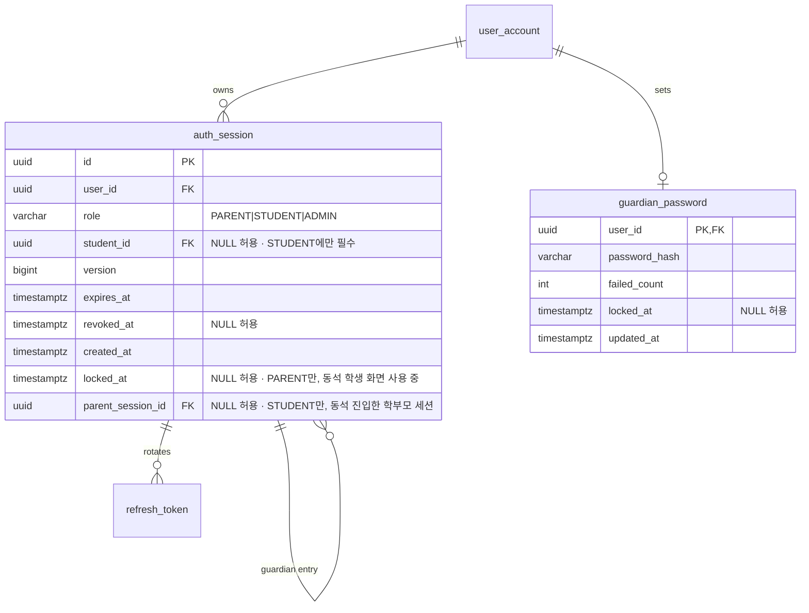
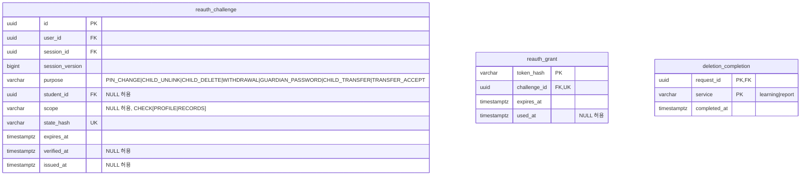
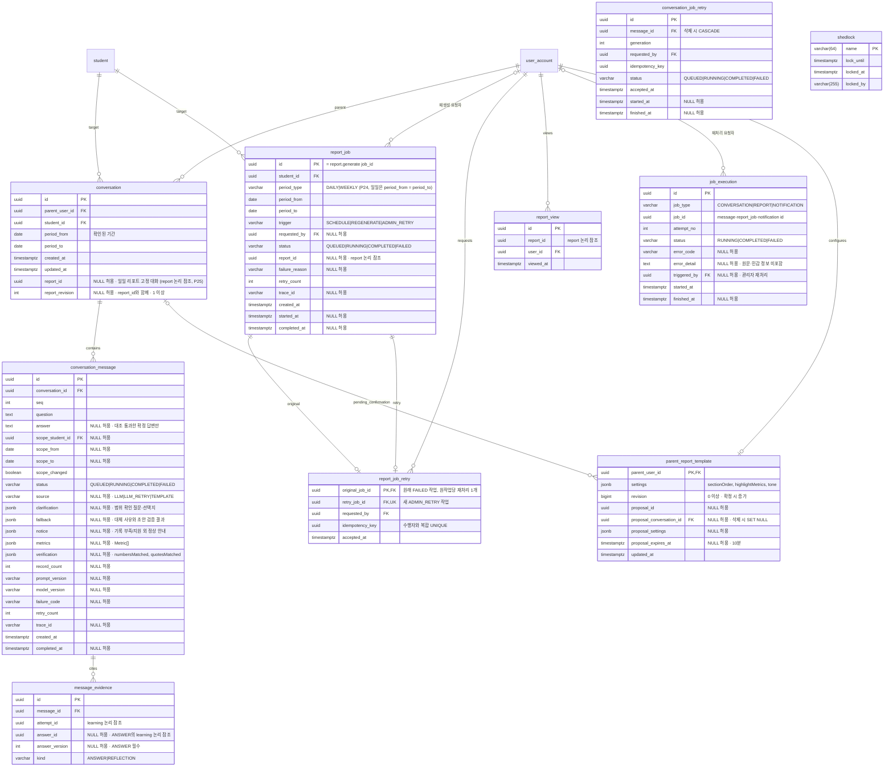
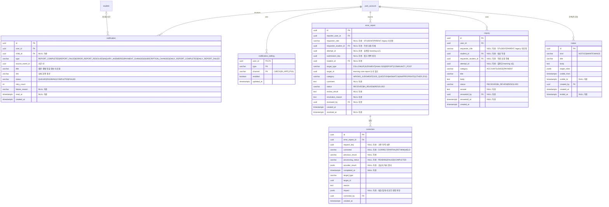
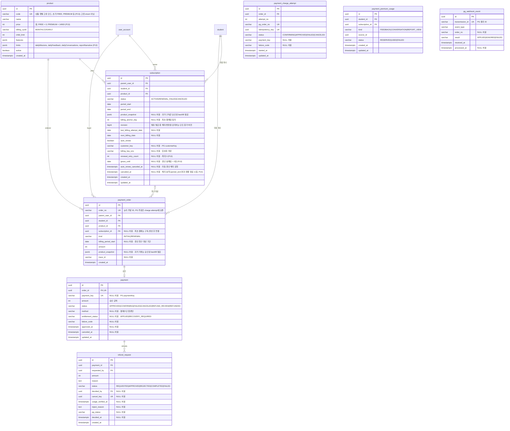
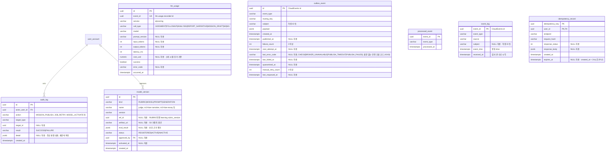
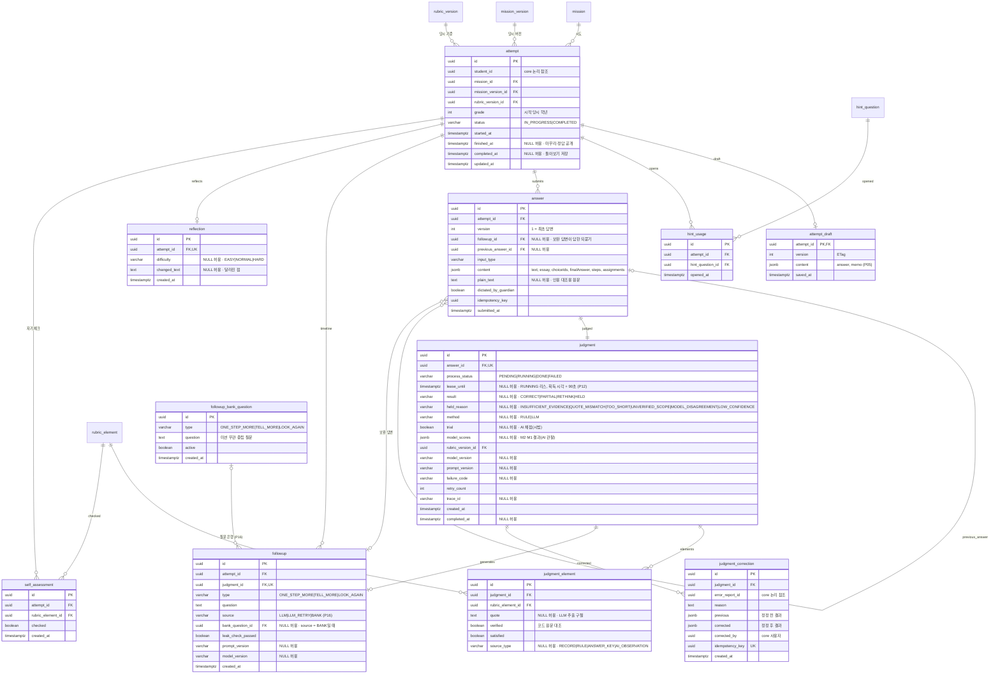
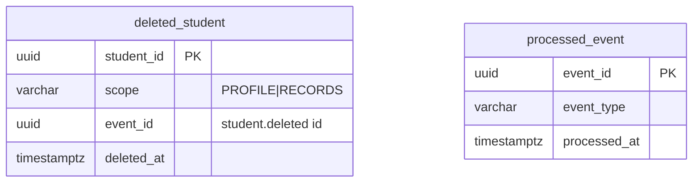
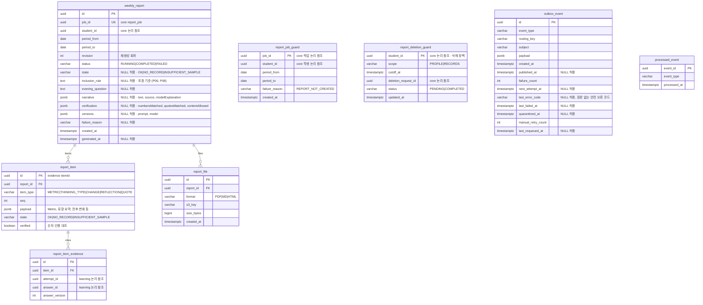

# ERD

- 근거: [기능명세서](functional-spec.md), [API 명세서](api-spec.md), [유스케이스](usecase.md), [아키텍처 설계](architecture.md), [프로젝트 기획서](<../outputs/프로젝트_기획서_사고뭉치.pdf>) 4.5
- 범위: DB를 소유한 서비스 3개(core_db · learning_db · report_db). ai·scoring은 상태 없음 (아키텍처 1.1)
- AI Hub 원본·가공본은 `ml/` 학습용으로 서비스 DB에 넣지 않음 (NFR-DAT-03)
- `(P04)` 형태는 확정 정책 번호, 내용은 [기능명세서 1.4](functional-spec.md#14-확정-정책)

---

## 1. 공통 규칙

| 항목 | 규칙 |
|---|---|
| DBMS | PostgreSQL. 마이그레이션은 core·learning Flyway, report Alembic (아키텍처 5장) |
| 이름 | 테이블·컬럼 snake_case, 테이블명 단수형 |
| PK | UUID는 앱에서 생성해 전달하며 DB UUID 기본값은 두지 않음. `id uuid`는 API 식별자와 동일. 예외: 복합 PK·이벤트 ID·`shedlock.name` |
| 시각·날짜 | 시각 `timestamptz`, 기간 `date`(KST, 양 끝 포함) |
| 상태값 | [API 명세 1.5](api-spec.md#15-상태-코드값-fn-12-대응) 코드값 그대로 `varchar` + CHECK |
| 서비스 간 참조 | 다른 DB의 ID는 FK 없는 논리 참조 (2장). 같은 DB 안에서만 FK |
| 덮어쓰기 금지 | 제출 답변·콘텐츠 버전·확정 결과는 보존. 처리 중 상태 갱신은 허용하며 판정 정정은 `judgment_correction`, 리포트 재생성은 새 `revision`으로 기록 (NFR-DAT-01, 02) |
| 버전 연결 | 판정·되묻기·분석·리포트 행에 당시 미션·기준표·모델·프롬프트 버전 저장 (NFR-DAT-02) |
| 개인정보 | 학생은 가명 닉네임만 저장, 실명 컬럼 없음. 결제수단 민감 정보 미저장 (NFR-SEC-06) |
| JSONB | 구조가 응답 스키마와 같고 조회 조건에 쓰지 않는 값만 (Metric[], verification, versions 등) |
| NULL·기본값 | `NULL 허용` 표시 컬럼 외에는 NOT NULL. UUID·시각·상태·카운터의 SQL DEFAULT는 두지 않고 앱에서 전달. 정책 값(기능명세서 1.4)을 SQL 기본값으로 고정하지 않고 앱 설정·`product` 데이터로 전달 |
| 문자열·금액 | varchar는 길이 제한 없는 PostgreSQL varchar. ShedLock만 name varchar(64), locked_by varchar(255). 원화는 int, cost_usd는 반올림 정책 없는 numeric |
| FK 삭제·순환 참조 | 기본 ON DELETE/UPDATE NO ACTION. mission.current_*·published_*와 answer.followup_id만 DEFERRABLE INITIALLY IMMEDIATE. 삭제는 P09에 따라 `student.deleted` 이벤트로 서비스별 물리 삭제. learning 하위 기록은 CASCADE 없이 서비스가 한 트랜잭션에서 순서대로 삭제(4.3, #128) |

- 테이블 없이 Redis에 두는 값: SSE 알림 중계 (아키텍처 1.6). 분석 대화 일일 사용량은 `payment_premium_usage` KST 일자 집계(#225), 무료 플랜 미션 일일 한도(P13)는 미구현·저장소 미정(#210)
- 생각 메모는 `attempt_draft.content.memo`에 저장 (P05). 음성 시범 미구현으로 음성 데이터 없음 (P03)
- 학생 별도 계정 없음: 학생 세션은 `student.id`로 발급하는 토큰만. 발급 경로는 학부모 인증(동석) 또는 학부모 등록 기기 + 자녀 PIN(단독). PIN·기기 저장 구조는 3.1 (P01)
- 학생 기기 페어링 코드(10분·1회용)는 테이블 없이 Redis 저장
- 코드 CHECK는 Mermaid 주석의 `A|B` 목록 또는 `CHECK[A]` 명시 표기로 자동 검증한다. 허용값이 하나인 경우에도 `CHECK[A]`로 표시해 일반 설명과 구분한다.

---

## 2. 서비스 간 ID

| ID | 소유 (원본 테이블) | 참조하는 곳 |
|---|---|---|
| `student_id` | core `student.id` | learning `attempt`·`deleted_student`, report `weekly_report` |
| `mission_id` | learning `mission.id` | (core는 프록시만, 저장 없음) |
| `attempt_id`, `answer_id` | learning `attempt`·`answer` | core `message_evidence`, report `report_item_evidence` |
| `judgment_id`, `followup_id` | learning `judgment`·`followup` | core `error_report.target_id` |
| `job_id` | core `report_job.id` | report `weekly_report.job_id` |
| `report_id` | report `weekly_report.id` | core `report_job.report_id`, `report_view.report_id`, `error_report.target_id` |
| `rubric_version_id` | learning `rubric_version.id` | core `model_version.ref_id` (`kind = RUBRIC`) |
| `error_report_id` | core `error_report.id` | learning `judgment_correction` |
| 사용자 ID | core `user_account.id` | learning `mission.created_by`·`mission_review.reviewer_id`·`judgment_correction.corrected_by` |

- 삭제 전파: core가 삭제 확정 시 `student.deleted` 발행 → learning·report가 해당 학생 기록 삭제 (아키텍처 1.4, P09)
- 삭제된 기록을 참조하면 learning 근거 조회가 `available: false` 반환 (FN-ACC-13)

---

## 3. core_db

### 3.1 계정·동의·자녀 연결 (FN-ACC)

```mermaid
erDiagram
  user_account ||--o{ student_device : registers
  student_device ||--o{ student_device_child : allows
  student ||--o{ student_device_child : uses
  user_account ||--o{ admin_permission : has
  user_account ||--o{ refresh_token : issues
  user_account ||--o{ consent : agrees
  consent_document ||--o{ consent : "문서 버전"
  student |o--o{ consent : "법정대리인 동의 대상"
  user_account ||--o{ guardianship : parent
  student ||--o{ guardianship : child
  student ||--o{ guardian_transfer : transfer_target
  user_account ||--o{ guardian_transfer : sender
  user_account ||--o{ guardian_transfer : recipient
  user_account ||--o{ deletion_request : requests
  student ||--o{ deletion_request : target
  user_account ||--o{ withdrawal_request : requests

  user_account {
    uuid id PK
    varchar role "STUDENT|PARENT|ADMIN"
    varchar login_id UK "로그인 ID(이메일)"
    varchar password_hash "NULL 허용 · 기존 데이터 보존, 로그인 미사용"
    varchar oauth_provider "NULL 허용 · GOOGLE"
    varchar oauth_subject "NULL 허용 · provider와 복합 UK"
    varchar display_name "NULL 허용"
    varchar status "ACTIVE|WITHDRAWAL_REQUESTED|WITHDRAWN"
    boolean is_demo "시연 계정"
    timestamptz created_at
    timestamptz updated_at
    timestamptz withdrawn_at "NULL 허용"
  }
  admin_permission {
    uuid user_id PK,FK
    varchar permission PK "CONTENT|PAYMENT_VIEW|PAYMENT_REFUND|SERVICE_OPS"
    uuid granted_by FK
    timestamptz granted_at
  }
  refresh_token {
    uuid id PK
    uuid session_id FK "NULL 허용 · 기존 토큰, 신규는 필수"
    timestamptz used_at "NULL 허용"
    uuid user_id FK
    varchar token_hash UK
    timestamptz expires_at
    timestamptz revoked_at "NULL 허용"
    timestamptz created_at
  }
  student {
    uuid id PK "전 서비스 공통 학생 ID"
    varchar pin_hash "NULL 허용"
    int pin_failed_count "0 이상"
    timestamptz pin_locked_at "NULL 허용"
    timestamptz pin_updated_at "NULL 허용"
    varchar nickname "가명, DELETED 표식은 NULL 허용"
    int grade "3~6, 이후 제공 문제에만 적용 (P03), DELETED 표식은 NULL 허용"
    int birth_year "출생연도 (P01), DELETED 표식은 NULL 허용"
    boolean is_demo "시연 가상 학생"
    boolean parent_sharing_enabled "NOT NULL DEFAULT false, 학생 본인만 변경 (#206)"
    boolean community_enabled "NOT NULL DEFAULT false, 커뮤니티 공개 설정 학생 본인만 변경 (P20, #388)"
    timestamptz community_updated_at "NULL 허용, 공개 설정 변경 시각 (#388)"
    varchar look_theme "NULL 허용, CHECK[lake|forest|factory|space|sea], 학생 꾸미기 (#234)"
    varchar look_companion "NULL 허용, CHECK[mungchi|tori|mongdol|kongi|monggeul], 학생 꾸미기 (#234)"
    timestamptz look_updated_at "NULL 허용, 꾸미기 저장 시각 (#234)"
    varchar status "ACTIVE|DELETION_REQUESTED|DELETED"
    timestamptz created_at
    timestamptz updated_at
    timestamptz deleted_at "NULL 허용"
  }
  student_device {
    uuid id PK
    uuid parent_user_id FK
    varchar token_hash UK
    varchar label
    timestamptz created_at
    timestamptz expires_at
    timestamptz last_used_at "NULL 허용"
    timestamptz revoked_at "NULL 허용"
  }
  student_device_child {
    uuid device_id PK,FK
    uuid student_id PK,FK
  }
  consent_document {
    uuid id PK
    varchar kind "TERMS|PRIVACY|GUARDIAN|COMMUNITY"
    varchar version
    varchar title
    text content
    boolean required "필수 동의 여부"
    date effective_from
    timestamptz created_at
  }
  consent {
    uuid id PK
    uuid document_id FK
    uuid subject_user_id FK "동의 주체(학부모)"
    uuid student_id FK "NULL 허용 · 자녀 동의일 때"
    boolean agreed
    varchar status "AGREED|WITHDRAWN"
    timestamptz agreed_at
    timestamptz withdrawn_at "NULL 허용"
  }
  guardianship {
    uuid id PK
    uuid parent_user_id FK
    uuid student_id FK
    varchar method "CHECK[REGISTER|TRANSFER] (#289, 임의 LINK 미지원)"
    varchar status "LINKED|UNLINKED"
    timestamptz linked_at
    timestamptz unlinked_at "NULL 허용"
    timestamptz transferred_at "NULL 허용 · 이관으로 종료된 연결, UNLINKED만"
  }
  guardian_transfer {
    uuid id PK
    uuid student_id FK
    uuid sender_id FK
    uuid recipient_id FK
    boolean include_conversations "앱에서 상담 포함 여부 전달, 기본 미포함"
    varchar status "PENDING|ACCEPTED|REJECTED|CANCELLED"
    timestamptz created_at
    timestamptz resolved_at "NULL 허용 · PENDING이면 NULL, 종료 상태면 필수"
  }
  deletion_request {
    uuid id PK
    uuid requested_by FK
    uuid student_id FK
    varchar scope "PROFILE|RECORDS"
    varchar status "REQUESTED|CONFIRMED|COMPLETED"
    timestamptz requested_at
    timestamptz confirmed_at "NULL 허용"
    timestamptz completed_at "NULL 허용"
  }
  withdrawal_request {
    uuid id PK
    uuid user_id FK
    varchar status "REQUESTED|COMPLETED"
    timestamptz requested_at
    timestamptz completed_at "NULL 허용"
    varchar status_token_hash UK "NULL 허용, 조회 전용 토큰 해시"
  }
```



- #37: 동의 권한은 문서·주체·student_id별 agreed_at·id 내림차순 최신 행 기준이다. 같은 보호자의 동의 저장·철회·자녀 등록은 user_account 행 잠금으로 직렬화한다. 기존 스키마를 사용하며 V1~V8을 수정하지 않는다.
- `consent_document` UK `(kind, version)`. V25가 1.0 문서 3종을 게시(#235), 개정은 행 수정 없이 새 version 행 추가. 동의는 철회해도 행 유지 → `status`·`withdrawn_at` 갱신 (FN-ACC-02)
- `guardianship` 부분 UK `(parent_user_id, student_id) WHERE status = 'LINKED'`. 권한 확인은 이 테이블의 `LINKED` 행 기준 (아키텍처 1.1)
- #289 V26: 추가 부분 UK `(student_id) WHERE status='LINKED'`로 현재 보호자 한 명을 보장한다. `guardian_transfer`는 `(student_id) WHERE status='PENDING'` 고유 인덱스, `(sender_id,created_at)`·`(recipient_id,created_at)` 조회 인덱스를 가진다. 발신자·수신자는 서로 달라야 하며 모두 실제 계정 FK다. `guardianship.transferred_at`은 이관으로 종료된 연결을 일반 해제와 구분한다. 기존 중복 LINKED 데이터는 자동 정리하지 않고 migration을 실패시킨다.
- 연결 해제는 행 삭제 대신 `UNLINKED` 전환 → 해제 이후 조회 차단, 이력 보존 (FN-DSH-06)
- `deletion_request`가 `CONFIRMED`가 되면 같은 트랜잭션에서 `outbox_event(student.deleted)` 저장
- 로그인 수단·자녀 연결 변경 결과·시점은 `audit_log`에 기록 (FN-ACC-10)
- `user_account.is_demo`·`student.is_demo` 행은 운영 현황·사용량·결제 집계에서 제외 (NFR-OPS-01)
- `user_account.oauth_provider`·`oauth_subject`는 함께 NULL(기존 계정) 또는 GOOGLE·Google sub이며 복합 UNIQUE. `password_hash`는 nullable로 보존하고 이메일로 OAuth 계정을 자동 연결하지 않음 (#36)
- 신규 student의 `pin_failed_count`는 앱이 0을 전달(SQL DEFAULT 없음). 학생 삭제 확정 때 `student_device_child` 제거·PIN 해시·잠금 삭제, 탈퇴 시 모든 기기 폐기 (#58)
- `student.parent_sharing_enabled`는 비공개 기본값을 보장하기 위한 SQL DEFAULT false의 명시적 예외. 학생 본인만 바꾸며 원문 제공 경로는 같은 학생 행의 현재 설정을 다시 확인 (#206)
- `student.community_enabled`도 같은 이유의 DEFAULT false 예외(P20, #388). V31에서 nullable로 추가하고 V32에서 기존 행을 false로 채운 뒤 NOT NULL. 학생 본인만 켜고 끄며, 공유물 공개는 이 값과 현재 연결 보호자의 현재 문서 `COMMUNITY` 동의가 모두 있어야 한다. 동의 거부·철회 시 false, 학생 삭제 확정 시 false·`community_updated_at` NULL로 되돌림. `consent_document` `COMMUNITY`는 선택(`required = false`) 자녀 단위 동의(V31 시드 1.0), `error_report`·`correction` `target_type`에 `COMMUNITY_POST`
- `student.look_theme`·`look_companion`·`look_updated_at`은 함께 NULL(저장한 적 없음, API 기본값 `lake`·`mungchi`)이거나 함께 값(`student_look_saved_together`). 값 목록은 코드 상수와 CHECK로 고정, SQL DEFAULT 없음. 학생 삭제 확정 때 PIN 삭제와 같은 트랜잭션에서 NULL로 되돌림 (#234)
- 구현 예정(P22): `lake`·`mungchi` 외 테마·캐릭터는 포인트 해금 후에만 저장 가능(`student_look_unlock`, 3.6). 잠금 적용 전 저장된 값은 해금 행으로 옮김

### 3.1.1 로그인 세션 (#36)



- `auth_session` CHECK: `version > 0`, `ck_auth_session_student`(role이 STUDENT면 `student_id` 필수, 그 외 역할은 NULL) (V8), `ck_auth_session_lock`(`locked_at`은 PARENT만)·`ck_auth_session_parent`(`parent_session_id`는 STUDENT만) (V24)
- 동석 진입(FN-ACC-05, V24): 학부모 세션을 바꾸지 않고 `locked_at`을 기록·version을 올려 잠그고, `parent_session_id`로 연결한 학생 세션을 새로 만든다. 학부모는 보호자 비밀번호(`POST /auth/parent-unlock`)로 잠금을 풀며, 이때 그 세션의 학생 세션을 폐기한다. 새 Google 로그인·로그아웃으로 이전 세션을 폐기할 때도 학생 세션을 함께 폐기한다
- `guardian_password`(V24): 계정당 1행, PBKDF2 해시·`failed_count >= 0`·5회째 `locked_at`. 설정·변경 시 실패 횟수·잠금 초기화(`GUARDIAN_PASSWORD` 재인증), 탈퇴 요청 시 삭제

### 3.1.2 재인증·삭제 완료 저장 (#45)



`withdrawal_request.status_token_hash varchar NULL 허용`을 추가한다(신규 요청은 해시 필수). PROFILE 완료 후 student의 nickname/grade/birth_year는 NULL로 지우며, DELETED가 아닌 행의 필수 프로필은 CHECK로 보존한다. 재인증 challenge의 purpose/자녀/scope 조합도 CHECK한다.

### 3.2 분석 대화·리포트 작업 (FN-AGT, FN-RPT)



- `conversation_message` UK `(conversation_id, seq)`. 실패 메시지는 `FAILED`로 남기고 재시도 시 같은 행 상태 전이 (FN-AGT-10)
- `message_evidence`는 ID만 저장하고 원문은 learning에서 조회한다. 대화 본문에 포함된 인용·집계와 파일의 삭제 범위는 별도 P09 확인 대상이며, 근거 ID만으로 파생 내용의 삭제까지 보장하지 않는다 (FN-ACC-13)
- 관리자 작업 목록(`/admin/jobs`)은 `conversation_message`·`report_job`·`notification`의 상태 컬럼을 조회 (FN-ADM-03)
- `report_job` 상태 전이: `report.started` 수신 시 `QUEUED→RUNNING`, `report.completed|failed` 수신 시 종료 상태 + `report_id` 저장 (아키텍처 1.6 조건부 전이)
- `report_job` 부분 UK `uq_report_job_scheduled_period (student_id, period_type, period_from) WHERE trigger = 'SCHEDULE'` → 정기 생성 중복 방지. 월요일 일일·주간 작업은 `period_from`이 같아 `period_type`을 키에 넣는다. 재생성·재처리는 새 행이며 원작업의 `period_type`·기간을 그대로 쓴다 (FN-RPT-01, 12, 14, P24)
  - V29(#390)가 `period_type`을 NULL 허용으로 추가하고 V30이 기존 행을 `WEEKLY`로 채운 뒤 NOT NULL·`ck_report_job_period_type`·`ck_report_job_daily_period`(일일은 `period_from = period_to`)를 걸고 V2의 `uq_report_job_scheduled_week (student_id, period_from)`를 교체했다. 목록 인덱스도 `(student_id, period_type, period_from)`으로 바꿨다
- `job_execution`: 작업 실행 1회당 1행, UK `(job_type, job_id, attempt_no)`. 관리자 실패 원인·처리 이력 조회 근거 (FN-ADM-07)
- `report_view`: 학부모 리포트 상세 조회 시 기록, 주간 리포트 열람률 지표 근거 (기획서 3.9)
- `clarification`이 있는 메시지는 범위 확인 후 종료된 질문, 사용자 선택은 다음 메시지의 `scope_*`에 저장 (FN-AGT-03)
- `shedlock`은 name varchar(64) PK, lock_until·locked_at timestamptz, locked_by varchar(255), 모두 NOT NULL (주간·일일 리포트·정기 청구 스케줄. 리포트 잠금 이름은 `core-weekly-reports`·`core-daily-reports`로 따로 둔다).
- `conversation.report_id`·`report_revision`(V33, #392): 함께 NULL(일반 대화) 또는 함께 값(일일 리포트 고정 대화, P25). `ck_conversation_report_pair`·`ck_conversation_report_revision`(1 이상)·`ck_conversation_report_day`(고정이면 `period_from = period_to` = 대상일). 고정 대화는 범위를 바꾸지 않는다
- `conversation_message.scope_student_id`는 같은 core DB의 `student.id` FK. 미확정 범위·처리 중 출력은 NULL로 두며 임시 결과를 채우지 않는다.

### 3.2.1 분석 대화 저장 규칙 (#41)

기존 conversation/message/evidence 스키마를 사용하며 마이그레이션을 추가하지 않는다. retry_count를 실행 세대 fencing 값으로 사용하고 실패/취소는 UPDATE만 수행한다. clarification은 COMPLETED(답변 NULL), delta는 미저장이다. 한도는 `payment_premium_usage`의 `CONVERSATION`·`RESERVED/USED` 행 KST 일자 집계다(#225, 마이그레이션 없음, 기존 `ix_payment_usage_refund` 인덱스 사용). [계약](../report/core-gateway.md#5-분석-대화-계약-41167).

### 3.2.2 REPORT 재처리 관계 (#47)

core report_job_retry의 original_job_id는 report_job(id) PK/FK, retry_job_id는 report_job(id) UNIQUE/FK다. requested_by는 user_account(id) FK이며 `(requested_by,idempotency_key)` UNIQUE를 둔다. original_job_id와 retry_job_id는 달라야 한다. 두 작업은 삭제하지 않고 원래 FAILED 상태와 기존 판을 보존한다. 재실패 작업을 다시 처리할 때는 이전 새 작업이 다음 관계의 original_job_id가 된다. 새 작업·관계·접수 감사·Outbox는 원자 저장한다.

### 3.2.3 관리자 대화 재처리 요청 (#47, V19)

conversation_job_retry는 UK(message_id,generation), UK(requested_by,idempotency_key), generation>0, 상태와 시각의 일치 및 시각 순서 CHECK를 둔다. 순서 CHECK가 앱·DB 시계 차이로 깨지지 않도록 accepted_at·started_at·finished_at은 모두 DB `CURRENT_TIMESTAMP`로 기록한다. `ix_conversation_job_retry_pending`은 (status,accepted_at) 조회 인덱스다. message_id는 conversation_message FK ON DELETE CASCADE, requested_by는 user_account FK다. 기존 V17·V18은 수정하지 않는다. 질문·답변 원문을 저장하지 않는다.

학생 삭제 시 진행 요청의 실패 이력·감사를 같은 삭제 트랜잭션에 기록하고 요청 행을 CASCADE로 정리한다. 삭제 후 작업 조회와 새 접수는 404다. 기존 공통 멱등 캐시에 남은 과거 202는 재전달될 수 있으나 재실행하지 않는다. 요청 행 삭제 이후 영구 재접수 응답 복원은 보장하지 않는다. 요청 감사는 접수 시, job_execution은 실제 실행 선점 시 기록한다. 사용량은 요청 ID를 `payment_premium_usage.source_id`로 써서 `UNIQUE(kind,source_id)`로 중복 차감을 막고 실행 선점 트랜잭션과 함께 커밋·롤백된다(#225).

### 3.3 알림·신고·문의·공지 (FN-SUP)



- #44: V12는 notification·notification_setting의 type CHECK에 REPORT_FAILED를 추가한다. #390: V30이 일일 리포트 완료·실패(`DAILY_REPORT_COMPLETED`·`DAILY_REPORT_FAILED`)를 추가해 주간과 독립 수신 설정을 둔다(P24). V9는 #45, V13은 #58의 student_device_auth. 기존 마이그레이션은 수정하지 않는다. 알림 status는 Redis 발행 상태이며 읽음은 read_at으로 별도 관리한다.
- `notification` UK `(user_id, type, source_event_id)` → 같은 사건 재처리 시 중복 생성 방지 (FN-SUP-08)
- 판정 정정 원본은 learning `judgment_correction`, core `correction`은 신고 단위 정정 사유·영향 범위 기록 (FN-SUP-03)
- 도움말(`/help`)은 정적 콘텐츠로 테이블 없음

### 3.4 결제·구독 (FN-PAY) — 토스페이먼츠 테스트

#48: 무료 상품 버전은 PAYMENT_FREE_PRODUCT_ID로 지정한다(2026-10-28 사용자 확정). 상품·주문·구독 조건은 snapshot으로 보존한다. V15의 payment_charge_attempt는 논리 주문당 확정 실패 재청구 이력을 분리하며 `(order_id,attempt_no)`·pg_order_no·멱등키 UK를 갖는다. 기존 정기 주문 기간 UK는 유지한다. subscription.billing_anchor_day는 최초 일자를 보존한다. payment_premium_usage는 환불과 경합하는 사용 예약·완료 증빙을 소유한다. 상세 경계는 [보고서](../report/payment.md)를 따른다.



- `subscription` 부분 UK `(student_id) WHERE status IN ('ACTIVE','RENEWAL_FAILED')` → 같은 자녀 중복 구독 409 (FN-PAY-02)
- 유효 구독이 없는 자녀는 무료 플랜, 한도는 `PAYMENT_FREE_PRODUCT_ID`로 지정한 활성 0원 product의 limits (P13, #48 확정)
- 가격·한도 변경은 기존 `product` 행 수정 대신 새 행 추가 후 기존 행 `active = false`. 기존 구독은 `product_id`·`payment_order.amount`로 결제 당시 조건 유지 (P13)
- 승인 처리 순서: `payment_order.amount`·대상 자녀 대조 → PG 승인 → `payment` 저장 → 구독 생성·반영 → `payment_order.subscription_id` 연결. 반영 실패 시 `entitlement_status = RECOVERY_REQUIRED` (FN-PAY-03, 05)
- `payment_order` 부분 UK `(subscription_id, billing_period_start) WHERE kind = 'RENEWAL'` → 정기 청구 중복 실행 시 이중 청구 방지 (FN-PAY-06, NFR-REL-01)
- 자동 갱신 해지는 `auto_renew = false` + `auto_renew_canceled_at` 기록, 남은 기간 이후 `status = CANCELED` + `canceled_at`. `period_end` 전 해지 철회 시 `auto_renew = true`, `auto_renew_canceled_at = NULL` (FN-PAY-09, P14)
- 환불 완료(`payment.status = REFUNDED`) 시 구독 즉시 `CANCELED` + `canceled_at` (P14)
- 갱신 실패 시 `RENEWAL_FAILED` + `grace_until = 실패일 + 3일`, 매일 1회 재청구마다 `renewal_retry_count + 1`, 3회 실패 시 `CANCELED` (FN-PAY-08, P13)
- 재청구: 월별 `payment_order`는 재사용하고 확정 실패 후의 일별 재청구마다 `payment_charge_attempt`에 새 PG 주문과 멱등키를 보존. 불명확한 거래는 재청구하지 않고 조회 복구 (#48)
- `product.code`는 상품 행별 UK이며 요금제 추가·가격/한도별 새 행을 위한 확장 가능 코드. 새 상품 행은 새 고유 코드, 무료 상품 교체는 `PAYMENT_FREE_PRODUCT_ID`를 명시적으로 변경 (P13, #48)
- 웹훅은 `transmission_id`로 1회만 반영, 본문 대신 PG 조회 결과로 상태 갱신 (FN-PAY-04)
- 환불 중복·초과 방지: 승인된 `refund_request.amount` 합계 ≤ `payment.amount` 검사 (FN-ADM-16)
- 카드번호 등 결제수단 원본 미저장, 빌링키는 암호화 (NFR-SEC-06)

### 3.5 운영·공통



- `model_version` UK `(kind, name, version)`, 부분 UK `(kind, name) WHERE status = 'ACTIVE'`. 롤백은 이전 버전 재활성화 + `audit_log` 기록 (FN-ADM-18)
- #43 `eval_result`는 API 5.2의 불변 평가 근거·최초 승인과 현재 적용 범위·그룹 revision을 저장한다. DDL·기존 ACTIVE 부분 UK는 유지한다. 교체는 동일 그룹 transaction advisory lock 이후 상태·감사·Outbox를 원자적으로 저장한다.
- 기준표 원본은 learning `rubric_version`, core는 `kind = RUBRIC` 행의 `ref_id`로 연결해 승인·활성 상태만 관리
- `llm_usage`에 학생 ID·답변 원문 컬럼 없음 (NFR-PRF-02). 수집 데이터 보고서의 예정 필드 `llm_usage_log(call_type, model, input_tokens, output_tokens, ts)` 대응
- `cost_usd`는 core 설정의 모델별 토큰 단가(기획서 3.9)로 소비 시 계산, 단가 변경 후에도 과거 값 유지 (FN-ADM-19)
- #355: ai 미션 초안 호출(FN-ADM-20)의 `call_type` `MISSION_DRAFT`를 V28에서 CHECK에 더함. 호출 종류 목록은 CHECK·이 Mermaid 주석·`llm.usage.recorded` 스키마·core `CallType`·core OpenAPI `CallType`과 ai·scoring 발행 목록이 같음(Mermaid 주석 값은 CHECK와 자동 대조, 1장)
- `outbox_event`: 상태 변경과 같은 트랜잭션에 저장, 릴레이가 publisher confirm 후 `published_at` 기록 (아키텍처 1.6)
- #243 `outbox_event` 실패·격리: 릴레이는 subject별 선두만 발행. 발행 실패는 `failure_count`·`last_error_code`·`last_failed_at`을 기록하고 1·5·15분 뒤 재시도, 4번째 실패에 `quarantined_at` 기록(report #131과 같은 컬럼·기준). 격리 선두와 같은 subject 뒤 행은 운영 재처리까지 대기, 다른 subject는 계속 발행 ([보고서](../report/core-gateway.md#11-core-outbox-실패-격리-243))
- #208 `event_log`: 감사 큐 `core.event.audit`로 받은 모든 업무 메시지(ai·scoring 발행 포함)의 메타데이터. payload·원문은 저장하지 않음. 같은 id 재발행·재전달은 첫 행 유지. `outbox_event`·`processed_event`·`llm_usage`와 `event_id`로 조인해 발행·전달·소비를 추적 ([보고서](../report/core-gateway.md#9-rabbitmq-발행소비-기록-208))
- #208 보존: 발행 완료 `outbox_event`, `processed_event`, `event_log`는 90일 뒤 1시간 주기로 삭제(`app.messaging.event-retention-days`). 미발행 outbox 행은 삭제하지 않음. `llm_usage`·`job_execution`은 정리 대상이 아님
- `idempotency_record.user_id`는 core `user_account.id` FK. 요청 접수 후 응답 확정 전에는 response_status·response_body를 NULL로 둔다. expires_at은 created_at + 24시간이다 (P12).
- `idempotency_record`: 공개 API의 `Idempotency-Key` 대상(답변 제출·주문·승인·환불·재처리·신고) 공통. 같은 키·다른 본문은 `request_hash` 불일치로 422 (API 1.4)
- #38의 response_body는 원문 보존용 JSON 봉투 `{body: base64, headers: {이름: [값]}}`다. response_status가 NULL이면 미확정이며 봉투도 NULL이다. expires_at은 DB 시계 기준 24시간이며 만료 행은 같은 키 접수 시와 주기 청소에서 제거한다. 세션 advisory lock은 테이블을 추가하지 않으며 사용자·키 해시로 잠근다. endpoint에는 메서드와 실제 공개 경로를 저장한다.

### 3.6 구현 예정 변경 (core_db)

2026-11-06 서비스 기획 방향 결정([기능명세 1.4](functional-spec.md#14-확정-정책) P20~P25)의 저장 구조. 커뮤니티 공개 설정·`COMMUNITY` 동의·신고 대상(#388)은 V31·V32로 구현해 3.1·3.3 Mermaid로, 일일 리포트 고정 대화(#392)의 `conversation.report_id`·`report_revision`은 V33으로 구현해 3.2 Mermaid로 옮겼다. 나머지는 마이그레이션 전이라 위 Mermaid·6장 인덱스 표(실제 DB 계약, `scripts/verify_db_schema.py`가 대조)에는 넣지 않고 표로만 둔다. 구현 시 새 마이그레이션 버전과 함께 Mermaid·6장으로 옮긴다. 컬럼 기본값은 두지 않는다(검증 스크립트 규칙): 기존 행이 있는 테이블의 NOT NULL 컬럼은 준비 버전(nullable 추가)→기존 행 채움→최종 버전(NOT NULL·CHECK)으로 나눈다(8장). API는 [API 명세](api-spec.md)의 구현 예정 행.

| 테이블 | 구분 | 컬럼·제약 | 근거 |
|---|---|---|---|
| `reward_rule` | 신규 | `event_type varchar PK`(`MISSION_COMPLETED`·`REVIEW_VIEWED`·`COMMUNITY_POSTED`·`REACTION_GIVEN`·`THEME_COMPLETED`), `amount int NOT NULL CHECK > 0`, `daily_cap int NULL`, `active boolean NOT NULL`, `updated_at`. 시드는 P21 초기값(10·10·5·1(하루 상한 5)·30) | P21 |
| `reward_point_ledger` | 신규 | `id uuid PK`, `student_id FK`, `event_type`(`reward_rule` 값 + `UNLOCK`), `source_key varchar NOT NULL`, `amount int NOT NULL`(적립 양수, 사용 음수), `created_at`. UK `(student_id, event_type, source_key)` → 사건당 1회. `source_key` 규칙: 학습 완료 `missionId`, 되돌아보기·완주 `weekStart`(ISO date), 공유 `postId`, 반응 `postId:reaction`, 해금 `itemKey` | P21 |
| `reward_point_balance` | 신규 | `student_id PK,FK`, `balance int NOT NULL CHECK >= 0`, `updated_at`. 원장 행과 같은 트랜잭션에서 갱신(해금 동시 요청은 이 행 잠금으로 직렬화) | P21 |
| `look_item` | 신규 | `id uuid PK`, `code varchar UK`, `slot`(`HAT`·`OUTFIT`·`ACCESSORY`·`BACKGROUND`), `name`, `price_points int CHECK > 0`, `asset_key`, `status`(`ON_SALE`·`STOPPED`), `created_by FK user_account`, `created_at`, `updated_at`. 삭제 없음 | P22 |
| `student_look_unlock` | 신규 | `student_id FK`, `item_key varchar`(`THEME:<code>`·`COMPANION:<code>`·`look_item.code`), `ledger_id FK NULL`(잠금 전 선택 이관분은 NULL), `unlocked_at`. PK `(student_id, item_key)`. 테마·캐릭터 해금값(테마 100·캐릭터 150)은 코드 상수 | P22 |
| `student_look_equipment` | 신규 | `student_id FK`, `slot`, `look_item_id FK`, `updated_at`. PK `(student_id, slot)`. 해금된 아이템만(서비스 검증) | P22 |
| `mission_daily_usage` | 신규 | `attempt_id uuid PK`(learning 논리 참조), `student_id FK`, `usage_date date NOT NULL`(KST), `created_at`. 무료 하루 미션 한도 집계(#210 PostgreSQL 결정): `THEME_DAY` 신규 시도 `201`만 기록, `(student_id, usage_date)` 건수로 판정 | P13 |
| `payment_premium_usage` | 값 추가 | `kind`에 `EXTRA_MISSION`(프리미엄 추가 문제 시도, 환불 판정 근거, `source_id` = 시도 ID) | P14 |
| `product` | 데이터 | FREE `limits.dailyMissions` 3 → 1 | P13 |

- 학생 삭제 확정: `reward_point_ledger`·`reward_point_balance`·`student_look_unlock`·`student_look_equipment`·`mission_daily_usage`를 같은 트랜잭션에서 삭제(`community_enabled` false는 #388 구현, 3.1)
- 인덱스 후보: `reward_point_ledger (student_id, created_at)`(내역·반응 하루 상한), `mission_daily_usage (student_id, usage_date)`
- `report_job.period_type`·일일 알림 유형(P24)은 #390 V29·V30으로 구현해 3.2·3.3 Mermaid와 6장으로 옮겼다

---

## 4. learning_db

### 4.1 미션·기준표 (FN-ADM-08~13, FN-LRN-02~03)

```mermaid
erDiagram
  mission ||--o{ mission_version : versions
  mission ||--o{ rubric_version : versions
  rubric_version ||--o{ rubric_element : elements
  rubric_version ||--o{ hint_question : hints
  mission ||--o{ mission_review : reviews
  mission ||--o| mission_draft : adopted

  mission {
    uuid id PK
    varchar code UK
    varchar status "DRAFT|REVIEW_REQUIRED|PUBLISHED|UNPUBLISHED"
    uuid current_version_id FK "NULL 허용 · 편집 중 최신"
    uuid current_rubric_version_id FK "NULL 허용 · 편집 중 최신"
    uuid published_version_id FK "NULL 허용 · 학생에게 제공하는 공개 버전"
    uuid published_rubric_version_id FK "NULL 허용 · 공개 기준표 버전"
    boolean demo_only "시연 전용"
    varchar source "MANUAL|LLM_DRAFT · 처음 만든 방식 (#353)"
    int sort_order "목록 순서·이전·다음"
    uuid created_by "core 사용자"
    timestamptz created_at
    timestamptz updated_at
    timestamptz published_at "NULL 허용"
  }
  mission_version {
    uuid id PK
    uuid mission_id FK
    int version
    varchar title
    varchar subject "교과"
    int grade_min
    int grade_max
    varchar thinking_type "ANALYZE|EVALUATE|CREATE|SOLVE|REFLECT"
    jsonb basic_skills "NULL 허용 · 비교·분류·순서·규칙·원인과 결과·추론"
    varchar input_type "CHOICE|ORDERING|CLASSIFICATION|NARRATIVE|SOLUTION_STEPS|ESSAY"
    text question
    text guide "NULL 허용"
    varchar scene_uri "NULL 허용 · S3 애니메이션"
    varchar static_scene_uri "NULL 허용 · 움직임 줄이기"
    jsonb choices "NULL 허용"
    jsonb categories "NULL 허용 · 분류 그룹 [{id, label}]"
    varchar answer_unit "NULL 허용 · 수학 최종 답 단위, 답 칸 뒤 고정 표시"
    jsonb input_template "NULL 허용 · 풀이 단계·논술 틀"
    jsonb achievement_standards "NULL 허용 · 성취기준 코드"
    jsonb achievement_levels "NULL 허용 · 성취기준별 성취수준 단계 (#353)"
    uuid created_by
    timestamptz created_at
  }
  rubric_version {
    uuid id PK
    uuid mission_id FK
    int version
    jsonb answer_key "NULL 허용 · 정답·동치 표현"
    text example_answer "NULL 허용"
    jsonb forbidden_terms "NULL 허용 · 되묻기 유출 검사 금지어"
    jsonb keywords "NULL 허용 · 서술 M2 핵심어 묶음 (#69)"
    varchar essay_type "NULL 허용 · 논술 M2 글 종류 (#69)"
    uuid created_by
    timestamptz created_at
  }
  rubric_element {
    uuid id PK
    uuid rubric_version_id FK
    varchar code "표준 코드(ANALYZE_RELATION 등) · 고유 e+숫자 · 정답 ANSWER_KEY·FINAL_ANSWER (FN 1.5 #262)"
    varchar label
    text description "NULL 허용"
    int points
    jsonb common_errors "NULL 허용"
    boolean good_thought "들어가면 좋은 생각"
    boolean judge_verified "AI 판정 검증 통과"
    varchar standard_code "NULL 허용 · 요소를 구체화한 성취기준 (#353)"
    int sort_order
  }
  hint_question {
    uuid id PK
    uuid rubric_version_id FK
    int seq
    text content "정답·제출용 답 금지"
  }
  mission_review {
    uuid id PK
    uuid mission_id FK
    uuid mission_version_id FK
    uuid rubric_version_id FK
    uuid reviewer_id "core 사용자"
    varchar result "APPROVED|CHANGES_REQUESTED"
    text comment "NULL 허용"
    timestamptz created_at
  }
  mission_draft {
    uuid id PK
    uuid requested_by "core 사용자"
    jsonb standard_codes "고른 성취기준 코드"
    jsonb achievement_levels "NULL 허용 · 성취기준별 단계"
    varchar thinking_type "ANALYZE|EVALUATE|CREATE|SOLVE|REFLECT"
    int grade_min
    int grade_max
    varchar input_type "CHOICE|ORDERING|CLASSIFICATION|NARRATIVE|SOLUTION_STEPS|ESSAY"
    varchar status "GENERATING|READY|CHECK_FAILED|FAILED|ADOPTED|DISCARDED"
    int attempts "생성 시도 횟수"
    jsonb check_results "NULL 허용 · 시도별 실패 사유"
    jsonb output "NULL 허용 · 마지막 초안"
    varchar failure_code "NULL 허용 · 마지막 AI 호출 실패"
    varchar model_version "NULL 허용"
    varchar prompt_version "NULL 허용"
    timestamptz lease_until "NULL 허용 · 생성 작업 점유"
    uuid mission_id FK "NULL 허용 · UK · 채택한 미션"
    timestamptz created_at
    timestamptz updated_at
  }
  achievement_standard {
    varchar code PK "대괄호 없는 성취기준 코드"
    varchar subject "교과"
    varchar grade_band "초1~2|초3~4|초5~6|중1~3"
    varchar area "영역"
    text statement "성취기준 문장 (고시 원문)"
    int level_scale "3|5"
    jsonb levels "NULL 허용 · 평가원 성취수준 문장"
    varchar curriculum_version
    varchar source "고시 번호"
    varchar note "NULL 허용 · 원문 대조 기록"
  }
```

- `mission_version`·`rubric_version` UK `(mission_id, version)`. 수정은 새 버전 추가 후 `mission.current_*` 갱신, 이전 버전 불변 (FN-ADM-10, 12)
- 공개 버전(#145, P07): 학생 목록·상세·시도 시작은 `published_*`, 관리자 편집은 `current_*`. 게시 때 `published_*` ← `current_*`라 공개 중 수정본은 재검토·재게시 전까지 학생에게 보이지 않음. learning V7이 칸을 추가하고 기존 `PUBLISHED` 미션은 `current_*`로 채움
- 공개(`PUBLISHED`) 전 필수 항목 검사(FN-ADM-11, #145): 현재 미션·기준표 버전 존재, 제목·질문·교과·성취기준, 학년 3~6(논술 5~6), **기준표 요소 1개 이상(입력 방식 무관, 구 #81)**·요소 이름·양의 배점, 풀이 단계는 `FINAL_ANSWER` 외 요소 1개 이상·`FINAL_ANSWER`는 풀이 단계만, 요소 code가 미션 유형·입력 방식에 맞음(같은 유형 표준 코드·`e`+숫자, 고르기·순서·분류는 `ANSWER_KEY` 하나, 따져 보기 논술은 주장·근거·반론 코드, FN 1.5 #262), 고르기·순서·분류는 선택지(분류는 그룹), 서술·논술이 아니면 `answer_key`(입력 방식 모양), 서술·논술은 `example_answer`, 현재 버전 최신 검토 `APPROVED`. 누락은 `422 MISSION_PUBLISH_INCOMPLETE` + `missingFields`(class-diagram 4.1). 성취기준 실재·학년군, 요소 성취기준, 성취수준 단계 검사(#353, 4.1.1)
- `mission.sort_order`: 학년군 안의 목록 순서, 이전·다음 이동과 진행 위치 계산 (FN-LRN-02)
- `rubric_element.judge_verified = false` 요소는 AI 판정 시 충족 표시 금지 → `HELD (UNVERIFIED_SCOPE)`. 평가 통과 후 관리자가 갱신 (FN-JDG-04, 05, NFR-AIQ-01). 사람 검증(P11) 도입 전에는 ai `JUDGE_REQUIRE_VERIFIED=false`(기본)로 끄고 `trial = true`로 시범 표시
- `forbidden_terms`: 정답 키와 함께 ai `followups` 유출 검사 입력 (FN-JDG-06)
- `keywords`·`essay_type`(#69, learning V9): ai 판정의 M2 교차 확인 입력(api-spec 4.2.2). `keywords`는 서술 핵심어 묶음 배열(괄호 안 대체어 포함 문자열), `essay_type`은 `설명글|글짓기|주장|찬성반대|대안제시`(CHECK, 논술 미션에서만 사용). 기준표 버전과 함께 불변. 비어 있으면 서술·논술 M2를 부르지 않음
- `judgment.model_scores`(#69): ai 응답 `modelScores`(`{m2, m1, skipped}`) 그대로. 학생 화면에 보이지 않는 AI 관찰. M2를 부르지 않았거나 비활성이면 NULL. scoring 실패로 교차 확인을 생략하면 `{m2:null, m1:null, skipped:"SCORING_UNAVAILABLE"|"SCORING_REJECTED"}`(#305, 컬럼 변경 없음)
- #262 표준 요소: 새 컬럼 없이 `rubric_element.code` 값 규칙(FN 1.5). DB CHECK는 두지 않음: 이전 기준표 버전은 불변이라 자유 code가 남고, 미션 유형은 `mission_version`에 있어 행 단위 CHECK로 맞춤을 확인할 수 없음. 저장 때 code 모양(400)·게시 때 유형·입력 방식 맞춤(422 `rubric.elements.code`)을 앱이 검사. 시드는 같은 행의 code만 바꿔 지난 판정이 `judgment_element.rubric_element_id`로 이어짐
- #79: V6는 `mission_version`에 `categories`(분류 그룹, `answer_key.assignments`의 `categoryId`가 가리킴)·`answer_unit`(수학 최종 답 단위)을 추가한다. 기존 마이그레이션은 수정하지 않는다. 수학 `answer_key.finalAnswer`는 수만 담고 단위는 비교하지 않는다(FN-JDG-02). 풀이 단계 기준표의 `code = 'FINAL_ANSWER'` 요소는 ai에 보내지 않고 정답 키로 충족을 정한다
- AI Hub 문항·답안·피드백 원문은 어떤 컬럼에도 저장하지 않음 (FN-ADM-09)

### 4.1.1 성취기준·미션 초안 (#336 설계, #353 구현)

FN 1.5 "성취기준·성취수준 연결"과 FN-ADM-20·21의 저장 구조. learning V10이 `achievement_standard`·`mission_draft`와 `mission.source`·`mission_version.achievement_levels`·`rubric_element.standard_code`를 추가한다(위 Mermaid).

- `achievement_standard`: 참조 데이터. 시드 SQL(`backend/learning-service/db/seed/achievement_standards.sql`, 2022 개정 현행 765개)로 넣고 교육과정이 바뀌면 다시 넣는다. 관리자 API로 쓰지 않는다. 원자료(`standards_2022.csv`)의 "생각 유형 후보(자동)"와 2026.1 일부개정 25행은 넣지 않는다. `levels`(평가원 성취수준 문장)는 이용 조건 확인 전까지 NULL, `note`는 원자료 "비고"(원문 대조 기록, FAD-08)
- `mission_draft`: 검사에 실패한 초안은 미션을 만들지 않으므로 `mission`과 따로 둔다. 채택 1회에 미션 1개(`mission_id` UK). `check_results`는 시도마다 `{attempt, failures:[{check, reason}]}`, `output`은 api-spec 4.2 `draft`. `lease_until`은 `judgment.lease_until`과 같은 방식의 생성 작업 점유. 학생 ID·학생 답은 없다
- `mission.source`(`MANUAL`·`LLM_DRAFT`): 미션이 처음 만들어진 방식이라 버전마다 바뀌지 않아 `mission`에 둔다. 초안과의 연결은 `mission_draft.mission_id` 한쪽에만 둔다. 기존 행은 V10이 `MANUAL`로 채운다. SQL DEFAULT는 두지 않고(1장) 앱·데모 시드·검증 스크립트가 값을 넘긴다
- `mission_version.achievement_levels`: 성취기준별 단계 `{"6국01-02": "B"}`. `achievement_standards`는 코드 배열 그대로 둔다(웹 관리자 화면·learning OpenAPI가 문자열 배열로 씀)
- 성취기준 코드는 DB FK·CHECK로 묶지 않는다. `achievement_standards`는 jsonb 배열이라 FK를 걸 수 없고, 교육과정이 바뀌어 표를 다시 넣을 때 지난 버전 행이 막히면 안 된다. 게시 검사(4.1)가 앱에서 확인한다: 코드가 모두 표에 있고 미션 학년 범위가 그 성취기준 학년군 안 → `achievementStandards`, 요소 `standard_code`가 미션 성취기준 안 → `rubric.elements.standardCode`, 단계 키가 미션 성취기준 안이고 단계가 그 성취기준 `level_scale` 안 → `achievementLevels`

### 4.2 학습 시도·답변·판정 (FN-LRN, FN-JDG)



- `attempt` 부분 UK `(student_id, mission_id) WHERE status = 'IN_PROGRESS'` → 시작 요청 시 진행 중 시도 반환 (FN-LRN-16)
- `attempt`는 시작 시점의 미션·기준표 버전을 고정 → 기준 변경 후에도 과거 결과 재현 (NFR-DAT-02)
- `attempt_draft`는 시도당 1행, `UPDATE ... WHERE version = :ifMatch` 실패 시 409 (FN-LRN-17)
- `answer` UK `(attempt_id, version)`, `(attempt_id, idempotency_key)`. 수정·삭제 없이 추가만 (FN-LRN-08~10)
- `followup`은 시도당 최대 2행 (P04). 고르기 `CORRECT`면 생성하지 않음
- `followup_bank_question`은 ai 유출 검사 재실패 시 learning이 `type`이 같은 활성 질문 중 선택, 시드 데이터로 관리 (P16)
- `attempt_draft.content.memo`는 학생 본인 조회에만 사용, 판정·리포트·학부모 조회 대상 아님 (P05)
- `judgment`는 답변 제출 시 `PENDING`으로 함께 생성. 피드백 요청 시 `PENDING|FAILED|리스 만료 RUNNING → RUNNING` 조건부 전이 (API 1.4)
- 판정 보류는 `result = HELD`, 처리 실패는 `process_status = FAILED` → 서로 다른 컬럼 (NFR-REL-04)
- `judgment_element` UK `(judgment_id, rubric_element_id)`. verified·satisfied는 NOT NULL이며 CHECK (verified OR NOT satisfied)로 미검증 충족을 금지한다. 근거가 없으면 quote·source_type은 NULL 가능 (API 3.2, FN-JDG-03).
- `judgment.result`는 process_status = DONE일 때만 NOT NULL (상태 다이어그램 3.3). result = HELD이면 held_reason 필수, 그 외에는 NULL. 규칙 판정의 model_version·prompt_version은 NULL 가능.
- `answer.input_type`은 mission_version.input_type과 같은 코드 집합을 CHECK한다. notification_setting.type은 notification.type, correction.target_type은 error_report.target_type과 같은 집합이다.
- 정정은 `judgment`를 직접 바꾸지 않고 `judgment_correction` 추가, 최신 정정을 조회 시 반영 (FN-SUP-03)
  - `previous`·`corrected`는 `{"result": "PARTIAL"}` 모양. `previous`는 정정 직전에 보이던 결과(앞선 정정이 있으면 그 결과), 최신 정정은 `created_at` 가장 늦은 행 (#80)
- `self_assessment` UK `(attempt_id, rubric_element_id)`. AI 판정·원본 답변과 별도 저장 (FN-LRN-13)
- 도움 이용 비율 집계 근거 = `hint_usage.opened_at` vs 최초 `answer.submitted_at` (최초 답변 전 열람 없는 시도 / 집계 대상 시도, P08)

### 4.3 삭제·공통



- `student.deleted` 소비: 해당 학생 `attempt` 이하 기록 삭제 + `deleted_student` 저장 → 근거 조회 시 `available: false` (물리 삭제 + 표식, P09). 처리 완료는 core 내부 API `POST /internal/deletion-requests/{id}/completions`로 알림
  - 삭제 방식(#128): FK는 NO ACTION 그대로 두고 서비스가 한 트랜잭션에서 `judgment_correction`·`judgment_element` → `self_assessment`·`reflection`·`hint_usage`·`attempt_draft` → `followup`(`answer.followup_id`는 `SET CONSTRAINTS … DEFERRED`로 커밋 때 검사) → `judgment` → `answer` → `attempt` 순서로 삭제. `processed_event`에 이벤트 `id`를 같은 트랜잭션에 기록해 재전달 때 다시 지우지 않음
  - `deleted_student`는 학생당 한 행: 다시 받으면 `event_id`·`deleted_at`을 갱신하고 `scope`는 이미 `PROFILE`이면 유지(report 삭제 장벽과 같은 규칙)
- learning은 이벤트를 발행하지 않으므로 `outbox_event` 없음 (아키텍처 1.6)
- #208 `processed_event`는 90일 뒤 삭제(V8 `processed_at` 인덱스). 재처리 방지 표식 `deleted_student`는 유지되므로 90일 이후 재전달도 삭제를 반복할 뿐 기록을 되살리지 않음
- 멱등은 `answer`·`judgment_correction`의 `idempotency_key` UK로 처리, 별도 `idempotency_record` 없음

### 4.4 구현 예정 변경 (learning_db)

2026-11-06 서비스 기획 방향 결정([기능명세 1.4](functional-spec.md#14-확정-정책) P20~P25)의 저장 구조. 마이그레이션 전이라 위 Mermaid·6장 인덱스 표(실제 DB 계약, `scripts/verify_db_schema.py`가 대조)에는 넣지 않고 표로만 둔다. 구현 시 새 마이그레이션 버전과 함께 Mermaid·6장으로 옮긴다. 컬럼 기본값은 두지 않는다(검증 스크립트 규칙): 기존 행이 있는 테이블의 NOT NULL 컬럼은 준비 버전(nullable 추가)→기존 행 채움→최종 버전(NOT NULL·CHECK)으로 나눈다(8장). API는 [API 명세](api-spec.md)의 구현 예정 행.

| 테이블 | 구분 | 컬럼·제약 | 근거 |
|---|---|---|---|
| `weekly_theme` | 신규 | `id uuid PK`, `grade_band`(`G3_4`·`G5_6`), `week_start date`(KST 월요일), `title`, `intro text`, `status`(`DRAFT`·`REVIEW_REQUIRED`·`PUBLISHED`·`UNPUBLISHED`, `mission.status`와 같은 집합), `created_by uuid`(core 논리 참조), `published_at NULL`, `created_at`, `updated_at`. 부분 UK `(grade_band, week_start) WHERE status = 'PUBLISHED'` | P23 |
| `weekly_theme_day` | 신규 | `theme_id FK`, `day_of_week smallint CHECK 1~5`(월~금), `mission_id FK`. PK `(theme_id, day_of_week)`, UK `(theme_id, mission_id)`. 다섯 생각 유형 1개씩은 게시 검사 | P23 |
| `attempt` | 컬럼 추가 | `context varchar NOT NULL`(`THEME_DAY`·`THEME_REVIEW`·`EXTRA`, 기존 행 `EXTRA`로 채움), `theme_id FK NULL`, `theme_week_start date NULL`(재사용 테마도 그 주로 기록). 테마 컨텍스트면 둘 다 NOT NULL(CHECK) | P23 |
| `theme_review_view` | 신규 | `student_id uuid`, `week_start date`, `theme_id FK`, `viewed_at`. PK `(student_id, week_start)` | P23, P21 |
| `community_post` | 신규 | `id uuid PK`, `student_id uuid`, `mission_id FK`, `attempt_id FK`(처음 마무리한 시도), `answer_id FK`(그 시도의 마지막 답변), `status`(`VISIBLE`·`HIDDEN_SETTING`·`HIDDEN_REPORT`·`REMOVED`), `created_at`, `status_changed_at`, `error_report_id uuid NULL`(core 논리 참조). UK `(student_id, mission_id)` → 학생·미션당 1개, 다시 풀기는 공유하지 않음 | P20 |
| `community_reaction` | 신규 | `post_id FK`, `student_id uuid`, `reaction`(`NEW_IDEA`·`CLEAR_REASON`·`DIFFERENT_VIEW`·`WANT_MORE`), `created_at`. PK `(post_id, student_id, reaction)` | P20 |

- 학생 삭제(`student.deleted`): 그 학생의 `community_post`(달린 반응 포함)·`community_reaction`·`theme_review_view`를 다른 학습 기록과 함께 물리 삭제(P09)
- 인덱스 후보: `community_post (mission_id, status)`, `community_reaction (student_id, created_at)`, `attempt (student_id, theme_week_start)`, `weekly_theme (grade_band, status, week_start)`

---

## 5. report_db



- #208 보존: worker가 1시간 주기로 90일 지난 발행 완료 `outbox_event`·`processed_event` 삭제(`EVENT_RETENTION_DAYS`). 미발행·격리(`published_at IS NULL`) 행과 `report_deletion_guard`는 유지
- `weekly_report.job_id` UK → 같은 `report.generate` 재전달 시 1회만 생성. 상태 전이 `RUNNING → COMPLETED|FAILED`와 `outbox_event(report.*)`를 같은 트랜잭션에 저장
- #152 관리자 재처리는 새 jobId로 다음 revision을 만든다. 원래 실패 행·기존 파일은 보존한다. 원작업↔재처리 연결은 core #47 소유이며 report DB에 교차 서비스 FK·원작업 컬럼을 추가하지 않는다. 연결 저장은 3.2.2.
- 재생성은 기존 행을 덮지 않고 `revision` 증가 행 추가, UK `(student_id, period_from, revision)` (기존 판 보존·최신판 기본 조회, P06). 학부모 요청 재생성은 리포트당 1회 → core `report_job(REGENERATE)` 건수로 확인
  - 구현 예정(P24): 일일 리포트와 함께 UK를 `(student_id, period_type, period_from, revision)`로 교체(5.2)
- 기록 없는 주·표본 부족 주는 `status = COMPLETED` + `state`로 구분, 생성 실패(`FAILED`)와 분리 (FN-RPT-11). state는 COMPLETED일 때만 NOT NULL (상태 다이어그램 4.2).
- `report_item` UK `(report_id, item_type, seq)`. 상세 응답(API 3.4)은 `item_type`별로 묶어 조립
- `report_file` UK `(report_id, format)`. 다운로드는 `s3_key`로 presigned URL 발급 (FN-RPT-13)
- #55의 `20261027_02`는 `report_deletion_guard`를 추가한다. 삭제 중 생성·조회를 막고 완료 후에도 PROFILE·RECORDS 모두 생성을 차단한다. 최신 #45의 자동 학습 재개 금지와 일치시키며 재개는 별도 계약이 필요하다. 학생 UUID·삭제 요청 UUID·범위·시각·처리 상태만 남기며 원문·이름·리포트 내용은 저장하지 않는다.

### 5.1 report_job_guard (#132, 신규 migration 20261029_03)

| 컬럼 | 제약/의미 |
|---|---|
| job_id | uuid PK, core 작업 논리 참조 |
| student_id | uuid NOT NULL, 학생별 삭제 인덱스 |
| period_from / period_to | date NOT NULL, 월~일 7일 |
| failure_reason | varchar(100) NOT NULL, REPORT_NOT_CREATED |
| created_at | timestamptz NOT NULL |

리포트 행 생성 전 실패의 재실행 차단 기록이다. 원문·이름·파일 경로는 저장하지 않는다. DLQ 수동 재전달의 상한이 없으므로 자동 TTL 없이 유지한다. 학생 PROFILE/RECORDS 삭제 완료 트랜잭션에서 이 기록도 제거하며 영구 `report_deletion_guard(COMPLETED)`가 이후 모든 생성을 차단한다. 삭제 표식이 완료된 학생에 복구 요청이 와도 job guard를 새로 만들지 않는다. 삭제 표식 제거/학습 재개는 이번 범위 밖이다. migration downgrade는 재실행 장벽을 없애므로 운영 중 임의 실행하지 않는다.

core report_job.report_id는 복구/삭제 실패에서 null을 허용한다. job_execution은 기존 attempt_no=1 upsert로 종료를 기록하며 동일 복구/늦은 이벤트가 이력을 늘리거나 종료를 되돌리지 않는다.

### 5.2 구현 예정 변경 (report_db)

2026-11-06 서비스 기획 방향 결정([기능명세 1.4](functional-spec.md#14-확정-정책) P20~P25)의 저장 구조. 마이그레이션 전이라 위 Mermaid·6장 인덱스 표(실제 DB 계약, `scripts/verify_db_schema.py`가 대조)에는 넣지 않고 표로만 둔다. 구현 시 새 마이그레이션 버전과 함께 Mermaid·6장으로 옮긴다. 컬럼 기본값은 두지 않는다(검증 스크립트 규칙): 기존 행이 있는 테이블의 NOT NULL 컬럼은 준비 버전(nullable 추가)→기존 행 채움→최종 버전(NOT NULL·CHECK)으로 나눈다(8장). API는 [API 명세](api-spec.md)의 구현 예정 행.

| 테이블 | 구분 | 컬럼·제약 | 근거 |
|---|---|---|---|
| `weekly_report` | 컬럼 추가 | `period_type varchar NOT NULL`(`DAILY`·`WEEKLY`, 기존 행 `WEEKLY`로 채움), `theme_summary jsonb NULL`(주간만). 테이블 이름은 유지. 일일은 `narrative`·`evening_question` 항상 NULL. 재생성 UK를 `(student_id, period_type, period_from, revision)`으로 교체(월요일 일일·주간의 `period_from`이 같음), revision 잠금 단위도 `(자녀, period_type, period_from)` | P24, FN-RPT-17 |
| `report_item` | 값 추가 | 일일 문제별 항목(판정 결과·되묻기·보완 답변·생각 요소·돌아보기·인용) 종류 추가, 기존 근거 연결(`report_item_evidence`) 재사용 | P24 |
| `report_file` | 변경 없음 | 파일 키 규칙 그대로(`reports/{studentId}/{reportId}/r{revision}/...`) | P24 |

- 인덱스: 목록 인덱스 `(student_id, status, period_from)`을 `(student_id, period_type, status, period_from)`으로 교체
- `report.generate` 메시지 `periodType` 추가와 `periodFrom/To` 의미(주 또는 하루)는 구현 시 [이벤트 계약](../../contracts/events/report-messages.md)에 반영

---

## 6. 인덱스

| DB | 테이블 | 인덱스 | 용도 |
|---|---|---|---|
| core | `student_device` | `(parent_user_id) WHERE revoked_at IS NULL` | 등록 기기 목록 |
| core | `student_device_child` | `(student_id)` | 삭제 시 매핑 정리 |
| core | `guardianship` | `(parent_user_id) WHERE status='LINKED'` | 요청마다 자녀 연결 확인 |
| core | `guardianship` | `(student_id) WHERE status='LINKED'` | 자녀당 현재 보호자 한 명 보장 (#289, UNIQUE) |
| core | `guardian_transfer` | `(student_id) WHERE status='PENDING'`, `(sender_id, created_at)`, `(recipient_id, created_at)` | 자녀당 대기 요청 하나(UNIQUE), 보내고 받은 요청 조회 (#289) |
| core | `conversation` | `(parent_user_id, student_id, created_at)` | 대화 목록 |
| core | `report_job` | `(student_id, period_type, period_from)`, `(status, created_at)` | 기간 종류별 리포트 작업 조회(P24), 관리자 작업 현황 |
| core | `job_execution` | `(job_type, job_id)` | 작업별 처리 이력 |
| core | `conversation_job_retry` | `(status, accepted_at)` | 관리자 대화 대기·중단 작업 조회 |
| core | `report_view` | `(report_id)`, `(user_id, viewed_at)` | 열람률 집계 |
| core | `notification` | `(user_id, read_at, created_at)` | 읽지 않은 알림 |
| core | `payment` | `(status, updated_at)` | `CONFIRMING` 재조회, 결제 운영 조회 |
| core | `subscription` | `(next_billing_date) WHERE auto_renew` | 정기 청구 대상 |
| core | `auth_session` | `(user_id)` | 사용자별 세션 폐기 |
| core | `auth_session` | `(parent_session_id) WHERE parent_session_id IS NOT NULL` | 잠금 해제·재로그인 시 동석 학생 세션 폐기 (V24) |
| core | `refresh_token` | `(session_id)` | 세션별 토큰 폐기·재사용 탐지 |
| core | `llm_usage` | `(occurred_at, call_type)` | 사용량·비용 집계 |
| core | `outbox_event` | `(subject, created_at, id) WHERE published_at IS NULL`, `(published_at) WHERE published_at IS NOT NULL` | subject별 선두·발행 순서 및 재시도 대상(#243), 보존 기간 정리 |
| core | `processed_event` | `(processed_at)` | 보존 기간 정리 |
| core | `event_log` | `(received_at)`, `(event_type, event_time)` | 보존 기간 정리, 유형·기간별 추적 |
| learning | `mission` | `(status, sort_order)`, `mission_version (thinking_type, grade_min, grade_max)` | 학년·유형별 공개 미션 목록 |
| learning | `attempt` | `(student_id, started_at)` | 기간별 기록 조회 (대시보드·에이전트·리포트) |
| learning | `answer` | `(attempt_id, submitted_at)` | 시도 타임라인 |
| learning | `judgment` | `(process_status, lease_until)` | 고착 `RUNNING` 탐지 |
| learning | `mission_draft` | `(status, created_at)` | 초안 목록(상태 필터·최근 요청 순)·생성 작업 점유 (#353) |
| learning | `processed_event` | `(processed_at)` | 보존 기간 정리 |
| report | `weekly_report` | `(student_id, status, period_from)` | 자녀별 리포트 목록 |
| report | `outbox_event` | `(created_at) WHERE published_at IS NULL`, `(subject, created_at, id) WHERE published_at IS NULL`, `(published_at) WHERE published_at IS NOT NULL` | 학생별 선두·발행 순서 및 재시도 대상, 보존 기간 정리 |
| report | `processed_event` | `(processed_at)` | 보존 기간 정리 |

---

## 7. 확인 필요 가정
- PG 거래 대조(FN-ADM-15): 조회 시 PG API와 계산, 결과 테이블 없음

## 8. 마이그레이션 원칙

- 버전: core Flyway V1~V9·V12~V32(V10·V11 결번), learning Flyway V1~V10, report Alembic `20261026_01`·`20261027_02`·`20261029_03`·`20261030_04`·`20261102_05`. 현재 77개 테이블·708개 컬럼(core 48/451, learning 21/194, report 8/63, `scripts/check_db_migrations.py` 결과, #388 V32 기준). 결정 경위는 [DB 스키마 보고서](../report/db-dev-guide.md)
- 이미 적용된 버전은 수정하지 않음(주석 포함, 체크섬 보존). V10·V11 결번
- 상태 CHECK는 각 컬럼에 명시한 값 전체에 적용. NOT_STARTED(시도 미생성)·SAVED(초안 조회 응답)·PROCESSING·조회 FAILED는 API 표현이라 DB 상태로 추가하지 않음
- NULL 허용 컬럼은 위 Mermaid에 표시. nullable UNIQUE는 PostgreSQL 기본 NULLS DISTINCT
- FK는 같은 DB 내부만 연결. 다중 참조의 소속 일치·공개 조건·환불 합계 검사는 서비스 검증. 순환 참조는 같은 마이그레이션에서 테이블을 모두 만든 뒤 FK 추가(자동 삭제 설정 아님)
- 정책 변경으로 기존 데이터 정비가 필요하면 준비 버전(nullable 추가·제약 제거)과 최종 버전(정비 검사 후 NOT NULL·CHECK)으로 나누고, 기존 값을 임의 변환하지 않음(core V6~V7, learning V4~V5). 실제 학생 답안·수집본은 마이그레이션에 넣지 않음
