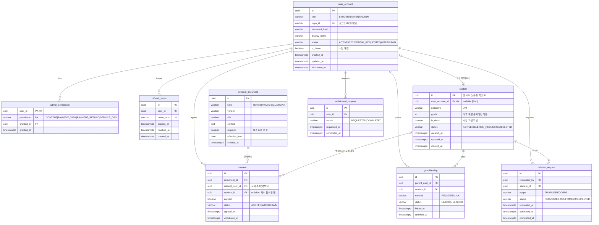
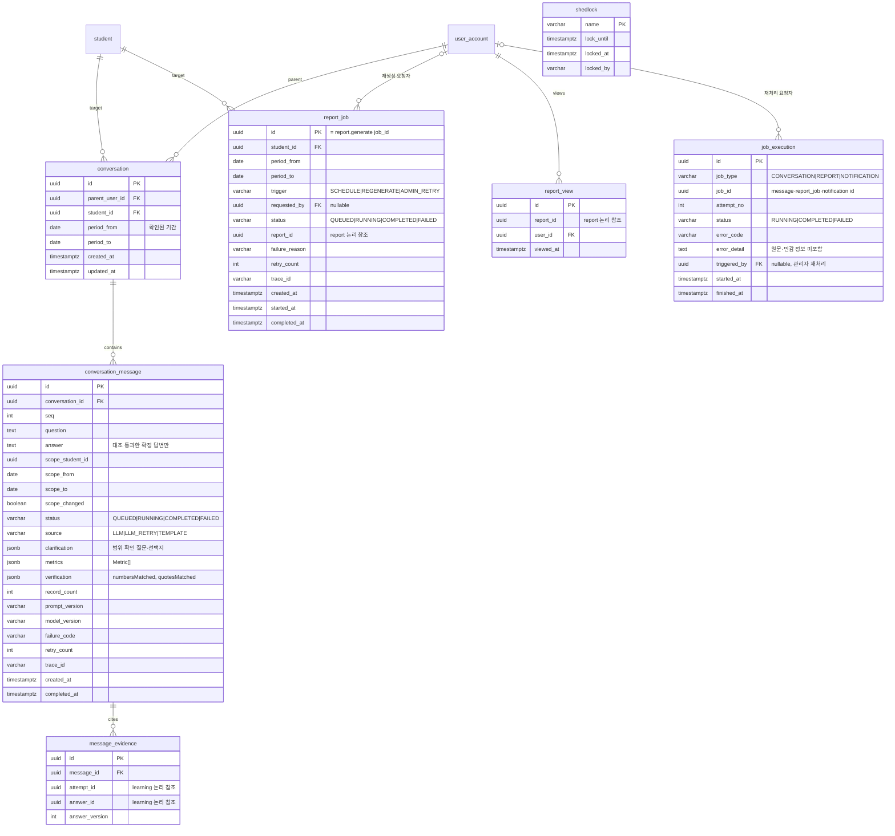
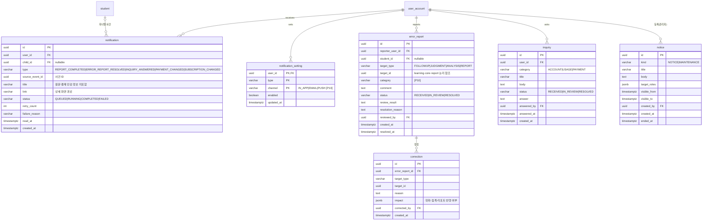
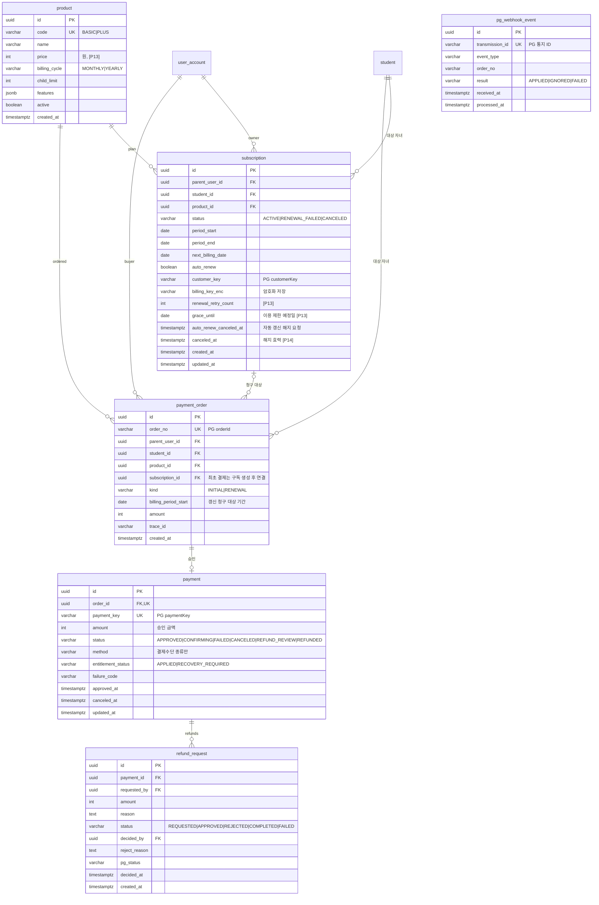
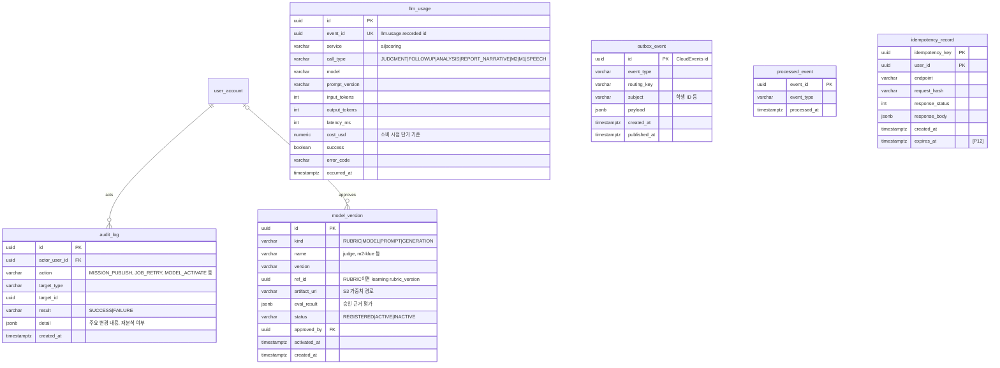
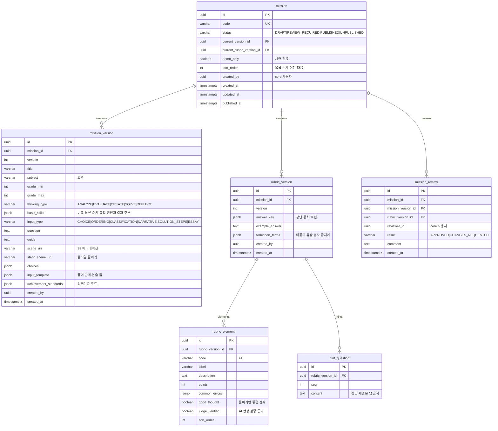
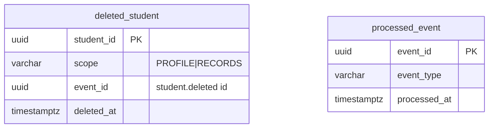
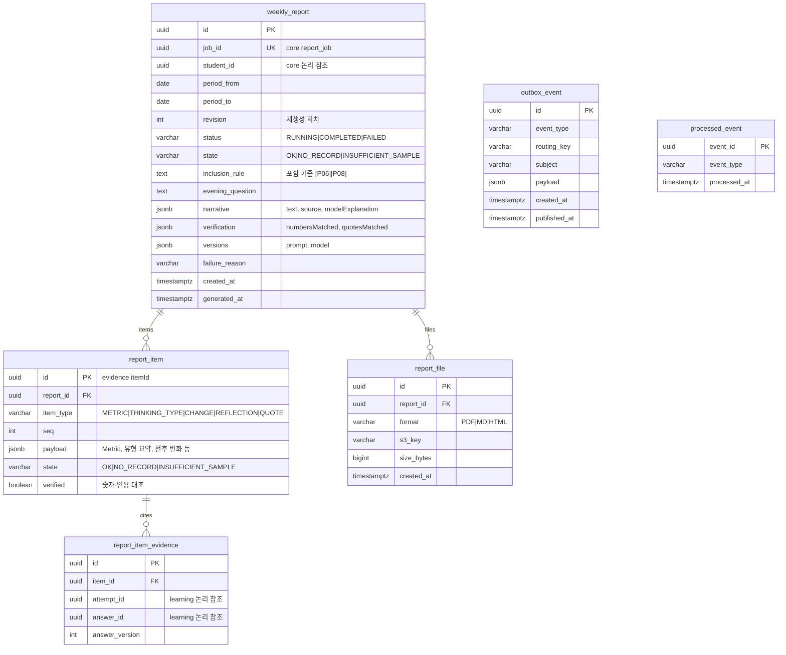

# ERD

- 근거: [기능명세서](functional-spec.md), [API 명세서](api-spec.md), [유스케이스](usecase.md), [아키텍처 설계](architecture.md), [프로젝트 기획서](<../outputs/프로젝트 기획서_사고뭉치_최종.pdf>) 4.5
- 범위: DB를 소유한 서비스 3개(core_db · learning_db · report_db). ai·scoring은 상태 없음 (아키텍처 1.1)
- AI Hub 원본·가공본은 `ml/` 학습용으로 서비스 DB에 넣지 않음 (NFR-DAT-03)
- `[P..]`는 미확정 정책. 확정 전에는 컬럼 자리만 두거나 테이블을 만들지 않음

---

## 1. 공통 규칙

| 항목 | 규칙 |
|---|---|
| DBMS | PostgreSQL. 마이그레이션은 core·learning Flyway, report Alembic (아키텍처 5장) |
| 이름 | 테이블·컬럼 snake_case, 테이블명 단수형 |
| PK | `id uuid` (API 식별자와 동일). 예외: 복합 PK 테이블, `shedlock` |
| 시각·날짜 | 시각 `timestamptz`, 기간 `date`(KST, 양 끝 포함) |
| 상태값 | [API 명세 1.5](api-spec.md#15-상태-코드값-fn-12-대응) 코드값 그대로 `varchar` + CHECK |
| 서비스 간 참조 | 다른 DB의 ID는 FK 없는 논리 참조 (2장). 같은 DB 안에서만 FK |
| 덮어쓰기 금지 | 답변·판정·기준표·미션·리포트는 수정 대신 새 버전 행 추가 (NFR-DAT-01, 02) |
| 버전 연결 | 판정·되묻기·분석·리포트 행에 당시 미션·기준표·모델·프롬프트 버전 저장 (NFR-DAT-02) |
| 개인정보 | 학생은 가명 닉네임만 저장, 실명 컬럼 없음. 결제수단 민감 정보 미저장 (NFR-SEC-06) |
| JSONB | 구조가 응답 스키마와 같고 조회 조건에 쓰지 않는 값만 (Metric[], verification, versions 등) |

- 테이블 없이 Redis에 두는 값: `reauthToken`(단기), 계정 복구 확인 코드, SSE 알림 중계 (아키텍처 1.6)
- 서버에 저장하지 않는 값: 생각 메모 `[P05]`, 음성 원음 (FN-LRN-07, 18)
- 테이블 미생성: 학생 별도 계정·학생 세션 방식 `[P01]` → `student.user_account_id` 자리만 둠

---

## 2. 서비스 간 ID

| ID | 소유 (원본 테이블) | 참조하는 곳 |
|---|---|---|
| `student_id` | core `student.id` | learning `attempt`·`deleted_student`, report `weekly_report` |
| `mission_id` | learning `mission.id` | (core는 프록시만, 저장 없음) |
| `attempt_id`, `answer_id` | learning `attempt`·`answer` | core `message_evidence`, report `report_item_evidence` |
| `judgment_id`, `followup_id` | learning `judgment`·`followup` | core `error_report.target_id` |
| `job_id` | core `report_job.id` | report `weekly_report.job_id` |
| `report_id` | report `weekly_report.id` | core `report_job.report_id`, `report_view.report_id`, `error_report.target_id` |
| `rubric_version_id` | learning `rubric_version.id` | core `model_version.ref_id` (`kind = RUBRIC`) |
| `error_report_id` | core `error_report.id` | learning `judgment_correction` |
| 사용자 ID | core `user_account.id` | learning `mission.created_by`·`mission_review.reviewer_id`·`judgment_correction.corrected_by` |

- 삭제 전파: core가 삭제 확정 시 `student.deleted` 발행 → learning·report가 해당 학생 기록 삭제 (아키텍처 1.4, `[P09]`)
- 삭제된 기록을 참조하면 learning 근거 조회가 `available: false` 반환 (FN-ACC-13)

---

## 3. core_db

### 3.1 계정·동의·자녀 연결 (FN-ACC)

- `consent_document` UK `(kind, version)`. 동의는 철회해도 행 유지 → `status`·`withdrawn_at` 갱신 (FN-ACC-02)
- `guardianship` 부분 UK `(parent_user_id, student_id) WHERE status = 'LINKED'`. 권한 확인은 이 테이블의 `LINKED` 행 기준 (아키텍처 1.1)
- 연결 해제는 행 삭제 대신 `UNLINKED` 전환 → 해제 이후 조회 차단, 이력 보존 (FN-DSH-06)
- `deletion_request`가 `CONFIRMED`가 되면 같은 트랜잭션에서 `outbox_event(student.deleted)` 저장
- 로그인 수단·자녀 연결 변경 결과·시점은 `audit_log`에 기록 (FN-ACC-10)
- `user_account.is_demo`·`student.is_demo` 행은 운영 현황·사용량·결제 집계에서 제외 (NFR-OPS-01)

### 3.2 분석 대화·리포트 작업 (FN-AGT, FN-RPT)

- `conversation_message` UK `(conversation_id, seq)`. 실패 메시지는 `FAILED`로 남기고 재시도 시 같은 행 상태 전이 (FN-AGT-10)
- `message_evidence`는 ID만 저장, 원문은 근거 조회 시 learning에서 읽음 → 삭제된 기록이 core에 남지 않음 (FN-ACC-13)
- 관리자 작업 목록(`/admin/jobs`)은 `conversation_message`·`report_job`·`notification`의 상태 컬럼을 조회 (FN-ADM-03)
- `report_job` 상태 전이: `report.started` 수신 시 `QUEUED→RUNNING`, `report.completed|failed` 수신 시 종료 상태 + `report_id` 저장 (아키텍처 1.6 조건부 전이)
- `report_job` 부분 UK `(student_id, period_from) WHERE trigger = 'SCHEDULE'` → 정기 생성 중복 방지. 재생성·재처리는 새 행 (FN-RPT-01, 12)
- `job_execution`: 작업 실행 1회당 1행, UK `(job_type, job_id, attempt_no)`. 관리자 실패 원인·처리 이력 조회 근거 (FN-ADM-07)
- `report_view`: 학부모 리포트 상세 조회 시 기록, 주간 리포트 열람률 지표 근거 (기획서 3.9)
- `clarification`이 있는 메시지는 범위 확인 후 종료된 질문, 사용자 선택은 다음 메시지의 `scope_*`에 저장 (FN-AGT-03)
- `shedlock`은 ShedLock 기본 스키마 (주간 리포트·정기 청구 스케줄)

### 3.3 알림·신고·문의·공지 (FN-SUP)

- `notification` UK `(user_id, type, source_event_id)` → 같은 사건 재처리 시 중복 생성 방지 (FN-SUP-08)
- 판정 정정 원본은 learning `judgment_correction`, core `correction`은 신고 단위 정정 사유·영향 범위 기록 (FN-SUP-03)
- 도움말(`/help`)은 정적 콘텐츠로 테이블 없음

### 3.4 결제·구독 (FN-PAY) — 토스페이먼츠 테스트

- `subscription` 부분 UK `(student_id) WHERE status IN ('ACTIVE','RENEWAL_FAILED')` → 같은 자녀 중복 구독 409 (FN-PAY-02)
- 승인 처리 순서: `payment_order.amount`·대상 자녀 대조 → PG 승인 → `payment` 저장 → 구독 생성·반영 → `payment_order.subscription_id` 연결. 반영 실패 시 `entitlement_status = RECOVERY_REQUIRED` (FN-PAY-03, 05)
- `payment_order` 부분 UK `(subscription_id, billing_period_start) WHERE kind = 'RENEWAL'` → 정기 청구 중복 실행 시 이중 청구 방지 (FN-PAY-06, NFR-REL-01)
- 자동 갱신 해지는 `auto_renew = false` + `auto_renew_canceled_at` 기록, 남은 기간 이후 `status = CANCELED` + `canceled_at` (FN-PAY-09)
- 갱신 실패 시 `RENEWAL_FAILED` + `renewal_retry_count`·`grace_until` 갱신, 재시도 횟수·유예 기간 값은 `[P13]` (FN-PAY-08)
- 웹훅은 `transmission_id`로 1회만 반영, 본문 대신 PG 조회 결과로 상태 갱신 (FN-PAY-04)
- 환불 중복·초과 방지: 승인된 `refund_request.amount` 합계 ≤ `payment.amount` 검사 (FN-ADM-16)
- 카드번호 등 결제수단 원본 미저장, 빌링키는 암호화 (NFR-SEC-06)

### 3.5 운영·공통

- `model_version` UK `(kind, name, version)`, 부분 UK `(kind, name) WHERE status = 'ACTIVE'`. 롤백은 이전 버전 재활성화 + `audit_log` 기록 (FN-ADM-18)
- 기준표 원본은 learning `rubric_version`, core는 `kind = RUBRIC` 행의 `ref_id`로 연결해 승인·활성 상태만 관리
- `llm_usage`에 학생 ID·답변 원문 컬럼 없음 (NFR-PRF-02). 수집 데이터 보고서의 예정 필드 `llm_usage_log(call_type, model, input_tokens, output_tokens, ts)` 대응
- `cost_usd`는 core 설정의 모델별 토큰 단가(기획서 3.9)로 소비 시 계산, 단가 변경 후에도 과거 값 유지 (FN-ADM-19)
- `outbox_event`: 상태 변경과 같은 트랜잭션에 저장, 릴레이가 publisher confirm 후 `published_at` 기록 (아키텍처 1.6)
- `idempotency_record`: 공개 API의 `Idempotency-Key` 대상(답변 제출·주문·승인·환불·재처리·신고) 공통. 같은 키·다른 본문은 `request_hash` 불일치로 422 (API 1.4)

---

## 4. learning_db

### 4.1 미션·기준표 (FN-ADM-08~13, FN-LRN-02~03)

- `mission_version`·`rubric_version` UK `(mission_id, version)`. 수정은 새 버전 추가 후 `mission.current_*` 갱신, 이전 버전 불변 (FN-ADM-10, 12)
- 공개(`PUBLISHED`) 전 필수 항목 검사: 현재 미션·기준표 버전 존재, 기준표 요소 1개 이상(서술·논술) 또는 `answer_key`(고르기·수학) (FN-ADM-11)
- `mission.sort_order`: 학년군 안의 목록 순서, 이전·다음 이동과 진행 위치 계산 (FN-LRN-02)
- `rubric_element.judge_verified = false` 요소는 AI 판정 시 충족 표시 금지 → `HELD (UNVERIFIED_SCOPE)`. 평가 통과 후 관리자가 갱신 (FN-JDG-04, 05, NFR-AIQ-01)
- `forbidden_terms`: 정답 키와 함께 ai `followups` 유출 검사 입력 (FN-JDG-06)
- AI Hub 문항·답안·피드백 원문은 어떤 컬럼에도 저장하지 않음 (FN-ADM-09)

### 4.2 학습 시도·답변·판정 (FN-LRN, FN-JDG)

```mermaid
erDiagram
  mission ||--o{ attempt : "시도"
  mission_version ||--o{ attempt : "당시 버전"
  rubric_version ||--o{ attempt : "당시 기준"
  attempt ||--o| attempt_draft : draft
  attempt ||--o{ hint_usage : opens
  hint_question ||--o{ hint_usage : opened
  attempt ||--o{ answer : submits
  answer |o--o{ answer : "previous_answer"
  followup |o--o{ answer : "보완 답변"
  answer ||--|| judgment : judged
  judgment ||--o{ judgment_element : elements
  rubric_element ||--o{ judgment_element : "기준 요소"
  judgment ||--o| followup : generates
  attempt ||--o{ followup : timeline
  judgment ||--o{ judgment_correction : corrected
  attempt ||--o| reflection : reflects
  attempt ||--o{ self_assessment : "자기 체크"
  rubric_element ||--o{ self_assessment : checked

  attempt {
    uuid id PK
    uuid student_id "core 논리 참조"
    uuid mission_id FK
    uuid mission_version_id FK
    uuid rubric_version_id FK
    int grade "시작 당시 학년"
    varchar status "IN_PROGRESS|COMPLETED"
    timestamptz started_at
    timestamptz finished_at "마무리·정답 공개"
    timestamptz completed_at "돌아보기 저장"
    timestamptz updated_at
  }
  attempt_draft {
    uuid attempt_id PK,FK
    int version "ETag"
    jsonb content
    timestamptz saved_at
  }
  hint_usage {
    uuid id PK
    uuid attempt_id FK
    uuid hint_question_id FK
    timestamptz opened_at
  }
  answer {
    uuid id PK
    uuid attempt_id FK
    int version "1 = 최초 답변"
    uuid followup_id FK "보완 답변이 답한 되묻기"
    uuid previous_answer_id FK
    varchar input_type
    jsonb content "text, essay, choiceIds"
    text plain_text "인용 대조용 원문"
    boolean dictated_by_guardian
    boolean speech_transcribed "음성 시범, 판정 제외"
    uuid idempotency_key
    timestamptz submitted_at
  }
  judgment {
    uuid id PK
    uuid answer_id FK,UK
    varchar process_status "PENDING|RUNNING|DONE|FAILED"
    timestamptz lease_until "RUNNING 리스 [P12]"
    varchar result "CORRECT|PARTIAL|RETHINK|HELD"
    varchar held_reason "INSUFFICIENT_EVIDENCE|QUOTE_MISMATCH|TOO_SHORT|UNVERIFIED_SCOPE|MODEL_DISAGREEMENT|LOW_CONFIDENCE"
    varchar method "RULE|LLM"
    boolean trial "AI 채점(시범)"
    jsonb model_scores "M2·M1 결과(AI 관찰)"
    uuid rubric_version_id FK
    varchar model_version
    varchar prompt_version
    varchar failure_code
    int retry_count
    varchar trace_id
    timestamptz created_at
    timestamptz completed_at
  }
  judgment_element {
    uuid id PK
    uuid judgment_id FK
    uuid rubric_element_id FK
    text quote "LLM 추출 구절"
    boolean verified "코드 원문 대조"
    boolean satisfied
    varchar source_type "RECORD|RULE|ANSWER_KEY|AI_OBSERVATION"
  }
  followup {
    uuid id PK
    uuid attempt_id FK
    uuid judgment_id FK,UK
    varchar type "ONE_STEP_MORE|TELL_MORE|LOOK_AGAIN"
    text question
    varchar source "LLM|LLM_RETRY|BANK|TEMPLATE"
    boolean leak_check_passed
    varchar prompt_version
    varchar model_version
    timestamptz created_at
  }
  judgment_correction {
    uuid id PK
    uuid judgment_id FK
    uuid error_report_id "core 논리 참조"
    text reason
    jsonb previous "정정 전 결과"
    jsonb corrected "정정 후 결과"
    uuid corrected_by "core 사용자"
    uuid idempotency_key UK
    timestamptz created_at
  }
  reflection {
    uuid id PK
    uuid attempt_id FK,UK
    varchar difficulty "EASY|NORMAL|HARD"
    text changed_text "달라진 점"
    timestamptz created_at
  }
  self_assessment {
    uuid id PK
    uuid attempt_id FK
    uuid rubric_element_id FK
    boolean checked
    timestamptz created_at
  }
```

- `attempt` 부분 UK `(student_id, mission_id) WHERE status = 'IN_PROGRESS'` → 시작 요청 시 진행 중 시도 반환 (FN-LRN-16)
- `attempt`는 시작 시점의 미션·기준표 버전을 고정 → 기준 변경 후에도 과거 결과 재현 (NFR-DAT-02)
- `attempt_draft`는 시도당 1행, `UPDATE ... WHERE version = :ifMatch` 실패 시 409 (FN-LRN-17)
- `answer` UK `(attempt_id, version)`, `(attempt_id, idempotency_key)`. 수정·삭제 없이 추가만 (FN-LRN-08~10)
- `speech_transcribed = true` 답변은 판정하지 않음 (FN-LRN-18, 범위 `[P03]`)
- `judgment`는 답변 제출 시 `PENDING`으로 함께 생성. 피드백 요청 시 `PENDING|FAILED|리스 만료 RUNNING → RUNNING` 조건부 전이 (API 1.4)
- 판정 보류는 `result = HELD`, 처리 실패는 `process_status = FAILED` → 서로 다른 컬럼 (NFR-REL-04)
- `judgment_element` UK `(judgment_id, rubric_element_id)`. `verified = false`면 `satisfied = true` 금지 (CHECK, FN-JDG-03)
- 정정은 `judgment`를 직접 바꾸지 않고 `judgment_correction` 추가, 최신 정정을 조회 시 반영 (FN-SUP-03)
- `self_assessment` UK `(attempt_id, rubric_element_id)`. AI 판정·원본 답변과 별도 저장 (FN-LRN-13)
- 도움 이용 비율 집계 근거 = `hint_usage.opened_at` vs 최초 `answer.submitted_at` (집계 규칙 `[P08]`)

### 4.3 삭제·공통

- `student.deleted` 소비: 해당 학생 `attempt` 이하 기록 삭제 + `deleted_student` 저장 → 근거 조회 시 `available: false` (삭제 방식 `[P09]`)
- learning은 이벤트를 발행하지 않으므로 `outbox_event` 없음 (아키텍처 1.6)
- 멱등은 `answer`·`judgment_correction`의 `idempotency_key` UK로 처리, 별도 `idempotency_record` 없음

---

## 5. report_db

- `weekly_report.job_id` UK → 같은 `report.generate` 재전달 시 1회만 생성. 상태 전이 `RUNNING → COMPLETED|FAILED`와 `outbox_event(report.*)`를 같은 트랜잭션에 저장
- 재생성은 기존 행을 덮지 않고 `revision` 증가 행 추가, UK `(student_id, period_from, revision)` (보존 방식 `[P06]` `[P09]`)
- 기록 없는 주·표본 부족 주는 `status = COMPLETED` + `state`로 구분, 생성 실패(`FAILED`)와 분리 (FN-RPT-11)
- `report_item` UK `(report_id, item_type, seq)`. 상세 응답(API 3.4)은 `item_type`별로 묶어 조립
- `report_file` UK `(report_id, format)`. 다운로드는 `s3_key`로 presigned URL 발급 (FN-RPT-13)

---

## 6. 인덱스

| DB | 테이블 | 인덱스 | 용도 |
|---|---|---|---|
| core | `guardianship` | `(parent_user_id) WHERE status='LINKED'` | 요청마다 자녀 연결 확인 |
| core | `conversation` | `(parent_user_id, student_id, created_at)` | 대화 목록 |
| core | `report_job` | `(student_id, period_from)`, `(status, created_at)` | 리포트 목록, 관리자 작업 현황 |
| core | `job_execution` | `(job_type, job_id)` | 작업별 처리 이력 |
| core | `report_view` | `(report_id)`, `(user_id, viewed_at)` | 열람률 집계 |
| core | `notification` | `(user_id, read_at, created_at)` | 읽지 않은 알림 |
| core | `payment` | `(status, updated_at)` | `CONFIRMING` 재조회, 결제 운영 조회 |
| core | `subscription` | `(next_billing_date) WHERE auto_renew` | 정기 청구 대상 |
| core | `llm_usage` | `(occurred_at, call_type)` | 사용량·비용 집계 |
| core | `outbox_event` | `(created_at) WHERE published_at IS NULL` | 릴레이 대상 |
| learning | `mission` | `(status, sort_order)`, `mission_version (thinking_type, grade_min, grade_max)` | 학년·유형별 공개 미션 목록 |
| learning | `attempt` | `(student_id, started_at)` | 기간별 기록 조회 (대시보드·에이전트·리포트) |
| learning | `answer` | `(attempt_id, submitted_at)` | 시도 타임라인 |
| learning | `judgment` | `(process_status, lease_until)` | 고착 `RUNNING` 탐지 |
| report | `weekly_report` | `(student_id, status, period_from)` | 자녀별 리포트 목록 |

---

## 7. 확인 필요 가정
- `[P01]` 학생 별도 계정: 확정 전 `student.user_account_id` NULL, 학생 진입은 학부모 계정 하위 세션으로 가정. 만 14세 확인 방식 확정 시 `student.birth_year` 추가
- `[P02]` 기존 학생 연결 절차: 연결 코드 방식 확정 시 연결 코드 테이블 추가
- `[P05]` 메모 보관: 확정 시 `attempt_draft.content`에 포함 또는 별도 테이블
- `[P16]` 중립 질문 은행: 사용 합의 시 learning에 질문 은행 테이블 추가 (`followup.source = BANK`)
- PG 거래 대조(FN-ADM-15): 조회 시 PG API와 계산, 결과 테이블 없음
- `[P09]` 삭제 방식: 물리 삭제 + `deleted_student` 표식으로 가정. 보관 기간 확정 시 대화·리포트 삭제 범위 반영
- `[P12]` `idempotency_record.expires_at`·`judgment.lease_until` 값
- `[P13]` 상품·가격: `product` 시드 데이터로만 관리, 스키마 변경 없음
