# 시퀀스 다이어그램

- 근거: [아키텍처 설계](architecture.md) 1장(통신 원칙·메시지·신뢰성 규칙), [API 명세서](api-spec.md), [ERD](erd.md), [클래스 다이어그램](class-diagram.md), [유스케이스](usecase.md) 4장
- 범위: 서비스 간 호출이 있거나 상태 전이·멱등 처리가 필요한 핵심 흐름. 단순 조회(CRUD)는 생략
- 상태값 전이 조건은 [상태 다이어그램](state-diagram.md)
- `(P04)` 형태는 확정 정책 번호, 내용은 [기능명세서 1.4](functional-spec.md#14-확정-정책)

---

## 1. 공통 규칙

| 항목 | 규칙 |
|---|---|
| 참여자 | `Web` · `core` · `learning` · `ai` · `scoring` · `report-api` · `report-worker` · `MQ`(RabbitMQ) · `Redis` · `DB`(해당 서비스 DB) · `LLM` · `Toss` · `S3` |
| 화살표 | `->>` 동기 호출, `-->>` 동기 응답, `-)` 비동기 발행(메시지·이벤트) |
| 내부 호출 | 모든 서비스 간 HTTP에 `X-Internal-Token`·`X-User-*`·`X-Student-Scope`·`traceparent` 자동 첨부 (`InternalRestClientFactory`·`internal_client`), 다이어그램에서는 생략 |
| 트랜잭션 | `rect` 영역 = DB 트랜잭션 1개. 영역 안에 서비스 간 HTTP·AMQP 호출 없음 (아키텍처 2.2) |
| 재시도 | LLM 호출만 ai `LlmClient`에서 재시도, 서비스 간 호출은 재시도 없음 (아키텍처 1.3) |
| SSE | 15초 heartbeat `: ping`은 모든 SSE 공통이라 생략 |

---

## 2. 계정·자녀 연결

### 2.1 로그인·토큰 재발급 (#36 Google OAuth)

학부모·관리자만 해당. 학생은 refresh 없이 2.4 경로로 진입. 세부 계약은 [API 명세 5.1](api-spec.md#51-36-google-oauth토큰-구현-계약-개정-p01-정렬)·[OpenAPI](../../contracts/openapi/core-service.yaml)

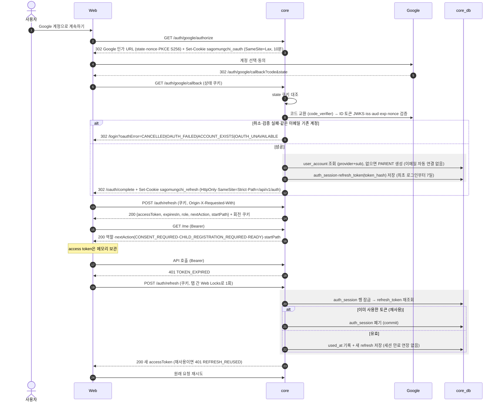

#### 2.1.1 관리자 ID·비밀번호 로그인 (#369)

가입 없이 운영자가 `scripts/admin_account_sql.py`로 `admin_credential` 행을 만든 관리자만 해당. 사용자 화면에는 링크가 없고 `/admin/login`을 직접 입력해 들어온다. 이후 refresh·`/me`는 2.1과 같다 ([API 명세 5.1](api-spec.md#51-36-google-oauth토큰-구현-계약-개정-p01-정렬))

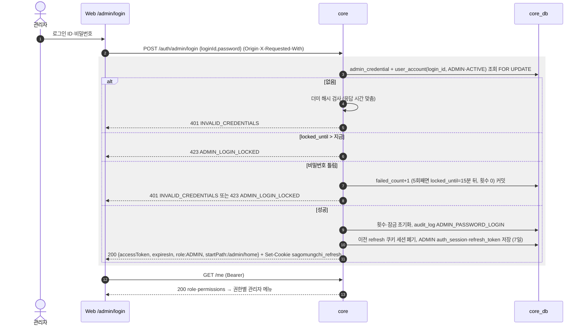

#### 2.1.2 학부모 ID·비밀번호 가입·로그인 (#415)

학부모는 Google(2.1) 대신 아이디·비밀번호로 가입·로그인할 수 있다. 두 방법은 자동 연결하지 않으며 한 계정은 한 가지 로그인 수단만 쓴다. 아이디는 앞뒤 공백 제거 후 소문자로 비교한다. 이후 refresh·`/me`·동의·자녀 등록은 2.1·2.2와 같다 ([API 명세 5.1](api-spec.md#51-36-google-oauth토큰-구현-계약-개정-p01-정렬))

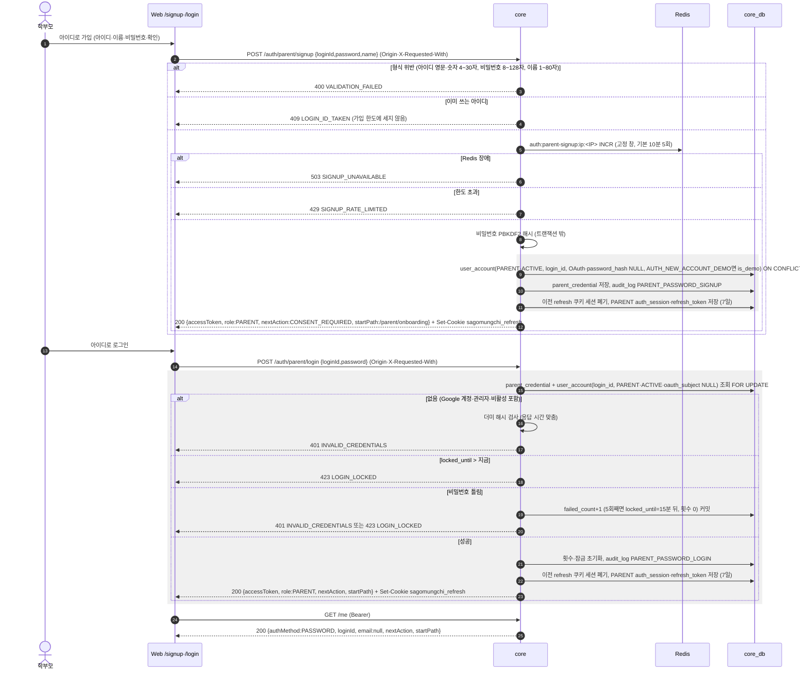

#### 2.1.3 비밀번호 재확인 (#415)

`/me`의 `authMethod`가 `PASSWORD`인 학부모는 중요 작업(탈퇴·보호자 비밀번호·자녀 해제·자녀 삭제·자녀 이관·이관 수락)에서 Google 재인증 대신 로그인 비밀번호를 다시 입력한다. 검증·발급을 마친 challenge·grant를 한 번에 만들어, 각 작업의 grant 소비는 Google 재인증과 같다 ([API 명세 5.6](api-spec.md#56-45-계정-관리google비밀번호-재확인삭제탈퇴-계약))

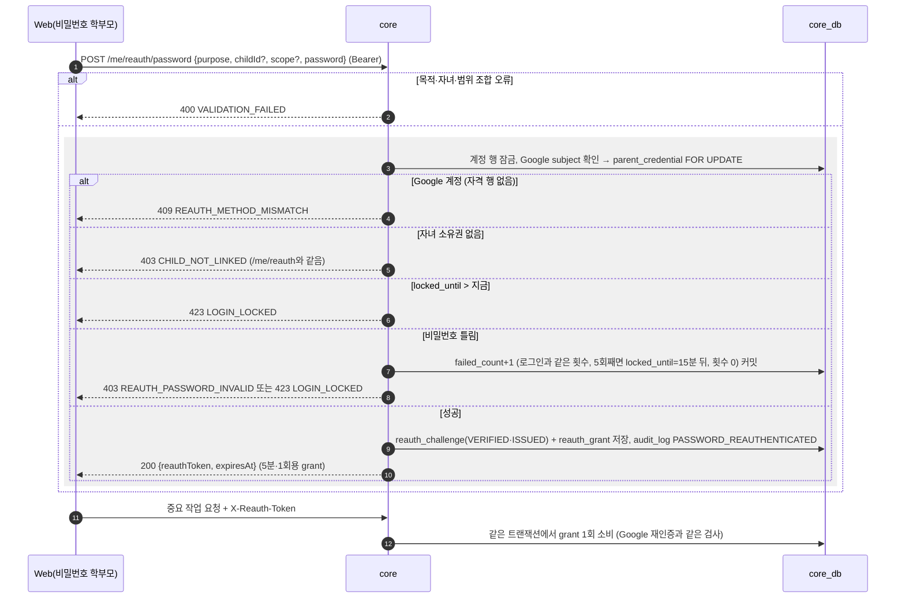

### 2.2 자녀 등록·법정대리인 동의

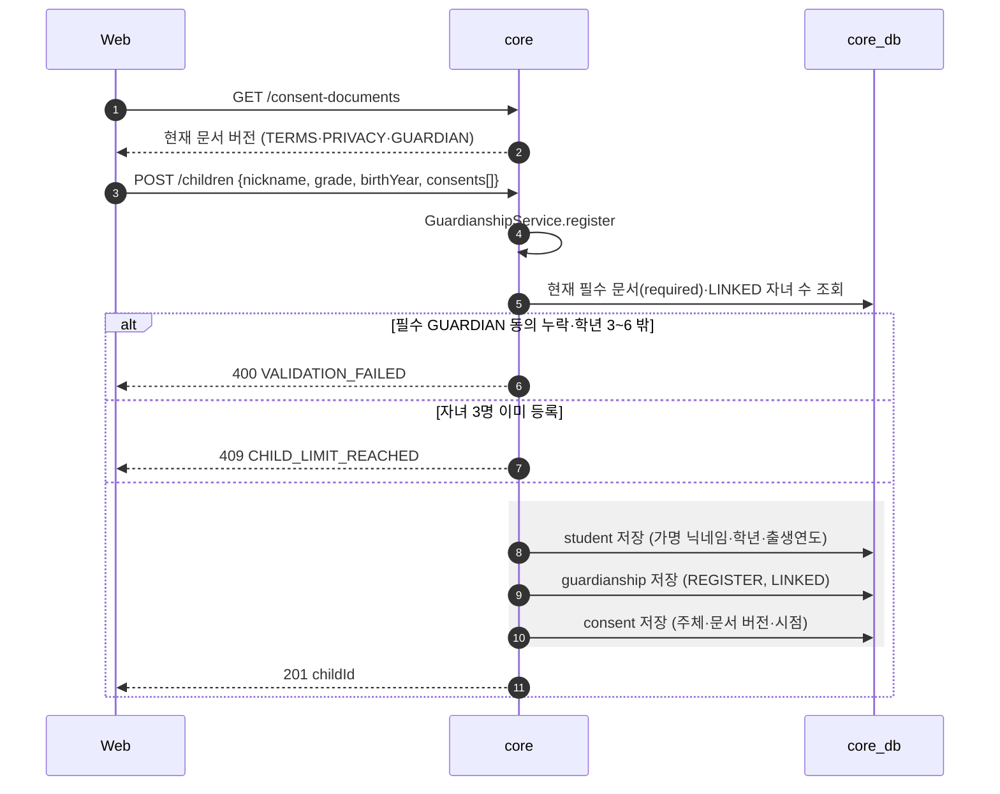

- 자녀는 전원 만 14세 미만으로 간주, GUARDIAN 동의를 항상 필수로 받음 (P01)
- 다른 보호자의 기존 자녀를 임의로 추가 연결하지 않음 (P02). 보호자 교체는 2.5 탈퇴 전 이관(#289) 수락으로만 하며, 기존 연결을 종료하고 새 연결로 바꿔 자녀당 현재 보호자는 1명이다. 연결 해제(`unlink`)는 `X-Reauth-Token` 확인 후 처리, 이관 대기 중이면 `409 TRANSFER_PENDING`, `audit_log` 기록 (FN-ACC-10)

### 2.3 자녀 범위 권한 확인 (모든 자녀 대상 API 공통)

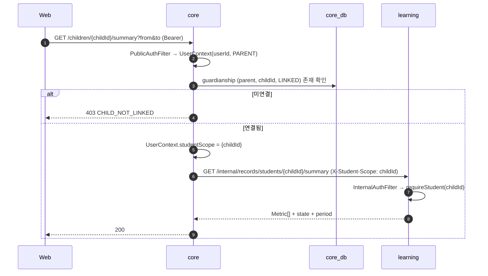

### 2.4 학생 진입 (P01)

진입 경로는 학부모 동석(아래 첫 다이어그램)과 등록 기기 + PIN 단독 진입(기기 등록·PIN 로그인 다이어그램) 두 가지다 (2026-10-27 개정, API 명세 3.11).

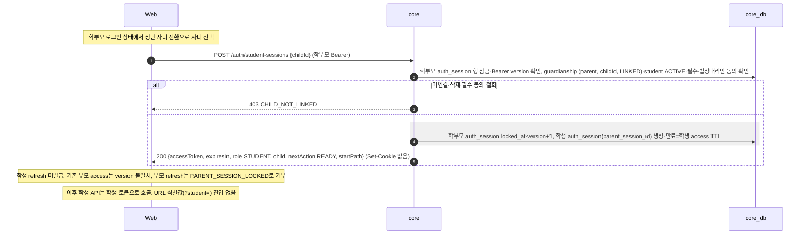

보호자 비밀번호 설정 (학부모 화면 복귀 준비, V24)

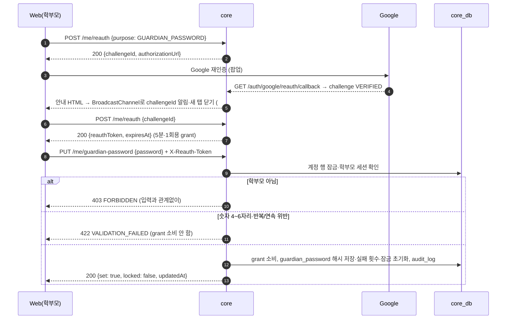

학부모 화면 복귀 (보호자 비밀번호, 2026-11-03)

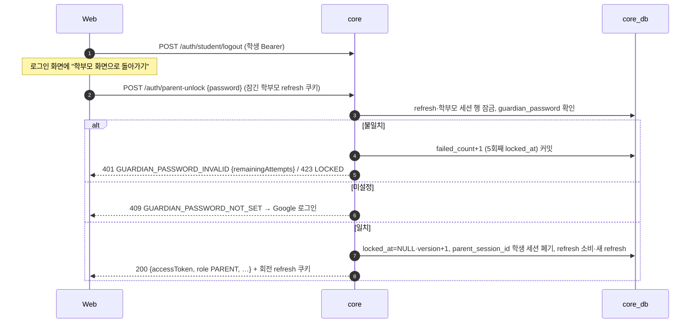

기기 등록 (학부모 1회 승인)

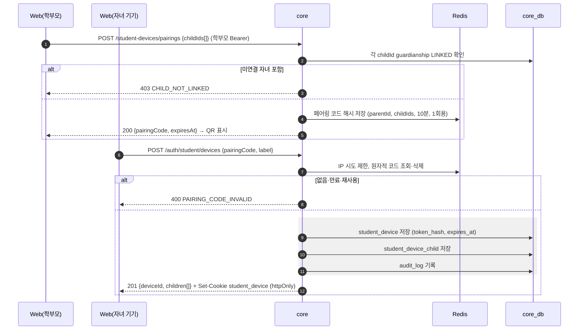

PIN 로그인 (학부모 부재 시 단독 진입)

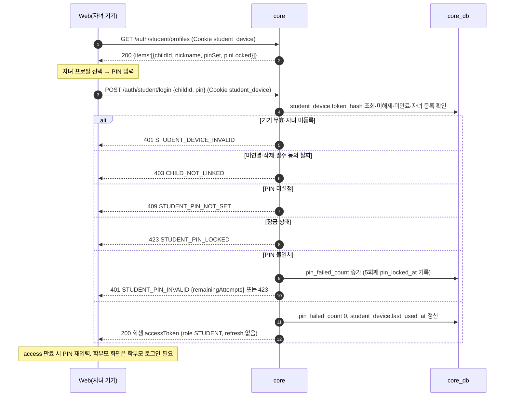

- PIN 잠금 해제는 학부모 `PUT /children/{childId}/pin`(활성 보호자 세션·현재 자녀 권한, 추가 재인증 없음 2026-11-10)으로만 가능
- 학부모가 기기를 해제하면(`DELETE /student-devices/{deviceId}`) 이후 PIN 로그인은 `401 STUDENT_DEVICE_INVALID`
- 단독 로그인은 계정 행 잠금 → 기기 유효/등록 자녀 → 현재 연결·활성·동의 → PIN 설정·잠금·일치 순으로 재검사한다. 실패 횟수 커밋 후 401/423 응답한다. 성공은 별도 STUDENT auth_session을 생성하며 부모 세션을 변경하지 않는다. PIN 변경은 계정 잠금 → 현재 자녀 권한 → 학생 잠금 → PIN 갱신·감사 기록을 한 트랜잭션으로 실행한다.

### 2.5 탈퇴 전 자녀 이관 (#289)

보내는 학부모가 탈퇴하기 전에 자녀를 다른 학부모에게 넘기는 흐름이다. 받는 학부모가 보호자 동의·본인 확인 후 수락해야 연결이 바뀌며, 그 전에는 받는 학부모가 기록에 접근할 수 없다. 상태 전이는 [상태 다이어그램 2.4](state-diagram.md#24-guardian_transferstatus-289-탈퇴-전-자녀-이관)를 따른다.

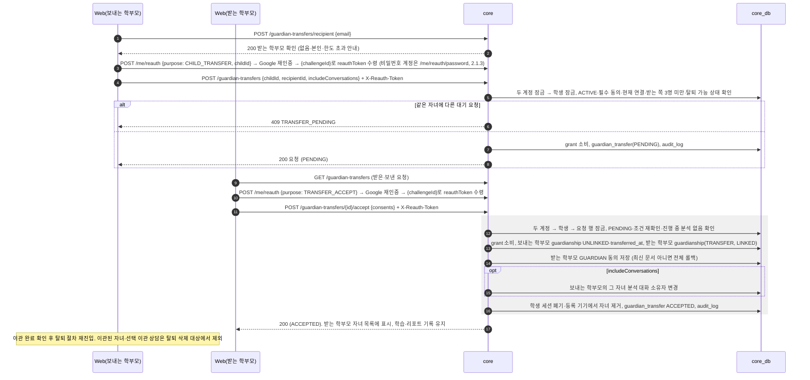

- 거절은 받는 학부모 `POST /guardian-transfers/{id}/reject`, 취소는 보내는 학부모 `POST /guardian-transfers/{id}/cancel`로 `REJECTED`·`CANCELLED`가 된다. 이미 처리된 요청은 `409 TRANSFER_ALREADY_RESOLVED`
- 대기 요청이 있으면 보내는 학부모의 탈퇴 요청과 그 자녀의 연결 해제·삭제는 `409 TRANSFER_PENDING`이다. 탈퇴 화면은 "이관 유지" 또는 "이관 취소 후 탈퇴 절차 진행"(`POST /guardian-transfers/cancel-outgoing`)을 고르게 하며, 취소만으로 탈퇴·삭제를 실행하지 않는다
- 구독·결제·환불의 명의는 바꾸지 않는다. 보내는 학부모의 진행 중 구독·결제·환불이 있으면 요청·수락 모두 막는다. 학부모 전역 리포트 설정은 이전하지 않고, 학생 공개 설정·학습·리포트 기록은 유지한다. 새 학부모는 학생 기기를 다시 등록한다
- 서버 `APP_GUARDIAN_TRANSFER_ENABLED`·웹 `VITE_GUARDIAN_TRANSFER_ENABLED`로 신규 대상 조회·요청·수락을 제어한다(기본 꺼짐). 본인 요청 조회·거절·취소는 기능 off·동의 누락에도 유지하고, 취소 후 탈퇴는 별도 재인증·최종 확인을 거친다(#307). 상세 범위와 검증은 [이관 구현 기록](../report/auth-account.md#6-탈퇴-전-자녀-이관-289)

### 2.6 꾸미기 해금·착용 (P22, #389)

2026-11-06 결정([기능명세 1.4](functional-spec.md#14-확정-정책) P20~P25), #389 구현. 1장 공통 규칙을 따른다. 잠금 순서는 학생 행 `FOR SHARE`(삭제 확정과 직렬화) → 잔액 행 `FOR UPDATE`.

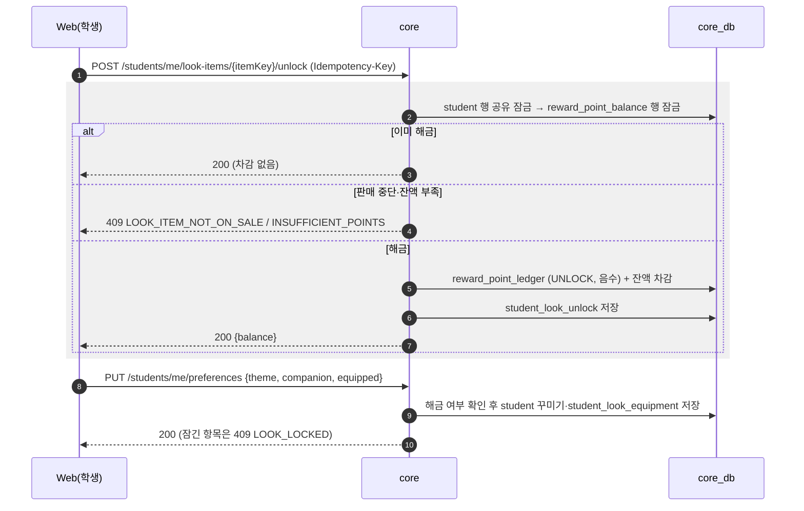

---

## 3. 미션 학습

### 3.1 시작·초안 저장·답변 제출

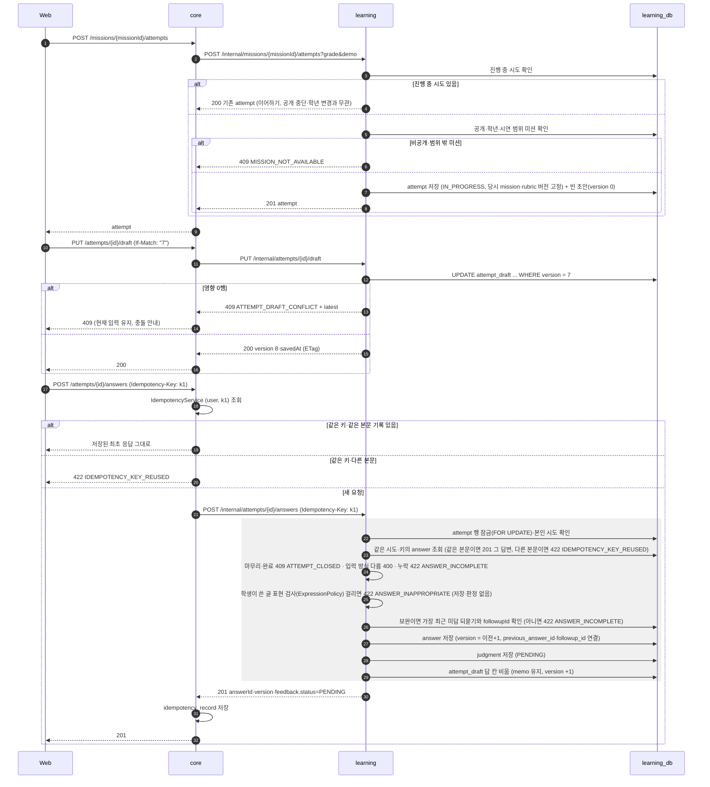

- 저장 성공(201)과 이후 피드백 처리 성공을 분리 (FN-LRN-10). 피드백은 3.2의 별도 요청
- learning도 시도·키(ERD UK)로 같은 키를 처리. core가 learning 응답을 받기 전에 끊겨 다시 보내도 답변은 1건
- 표현 검사(#205)는 learning 안의 단어 목록 대조라 외부 호출이 없음. 막힌 요청은 저장하지 않고, core는 그 422(범주별 안내, 원문 없음)를 같은 키의 응답으로 저장. 웹은 답이 바뀌면 새 키를 만들어 고친 답은 새 요청이 됨. 초안 자동 저장은 검사하지 않음 (learning.md #205)
- 메모는 초안 `content.memo`로 함께 저장, 학생 본인 조회에만 포함 (P05)
- 2026-11-10 개정(#483, core #485 구현): 무료 플랜은 테마 문제(`THEME_DAY`)를 하루 한도 없이 공개된 만큼(주 5개, learning #484 누적 공개) 시작하고, 추가 문제(`EXTRA`)는 프리미엄 전용(403 `PREMIUM_REQUIRED`, 상품 값이 없으면 무료 거부 #506)
- 무료 상품에서 `EXTRA`를 다시 켠 경우에만 무료 `EXTRA` 신규 시도를 하루 `limits.dailyMissions`개까지 허용한다. 신규 생성 `201`만 집계하고 이어하기 `200`은 항상 허용, 한도 초과 신규 생성만 `429 USAGE_LIMIT_REACHED` (API 2.2, #210 결정에 따라 PostgreSQL `mission_daily_usage`). 이전 규칙(무료 `THEME_DAY`·`EXTRA` 합산 하루 1개, #387)은 개정으로 대체

### 3.2 피드백 SSE (판정·되묻기)

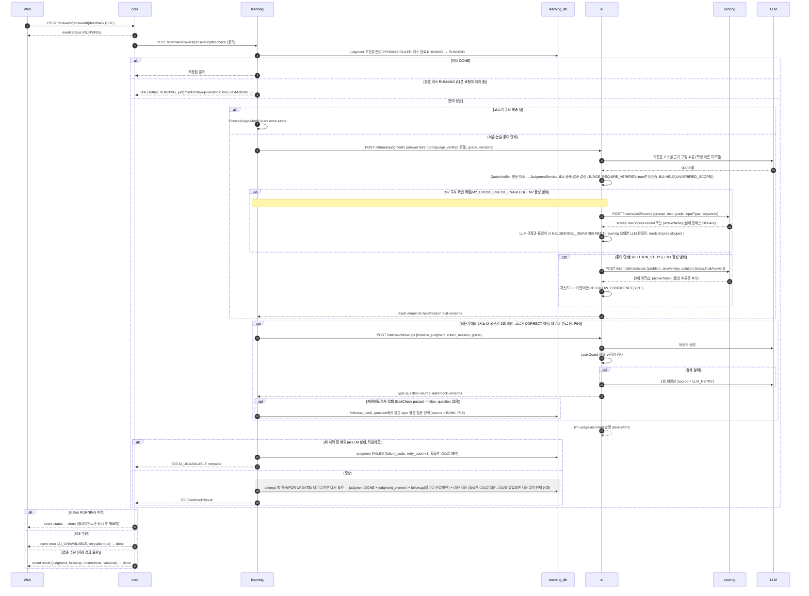

- 클라이언트가 끊겨도 core→learning 호출은 끝까지 진행·저장, 재요청 시 저장 결과 반환 (API 3.2)
- 타임아웃 예산: core→learning 80초 > learning→ai(judgments 35초 + followups 35초), 판정 리스 90초 (P12, 아키텍처 1.3)
- `nextActions`: 되묻기 생성 시 `[ANSWER_FOLLOWUP, FINISH]`(FINISH = "이대로 돌아보기"), 되묻기 2회 소진·고르기 CORRECT면 `[FINISH]` (P04)
- 판정 보류(`result = HELD`)는 정상 처리(`DONE`), 처리 실패(`process_status = FAILED`)와 구분 (NFR-REL-04)
- 보류 사유 결정은 모두 ai 담당, learning은 `judge_verified`·학년을 포함한 기준표 전달 (상태 다이어그램 3.3)

### 3.3 마무리·정답 공개·돌아보기

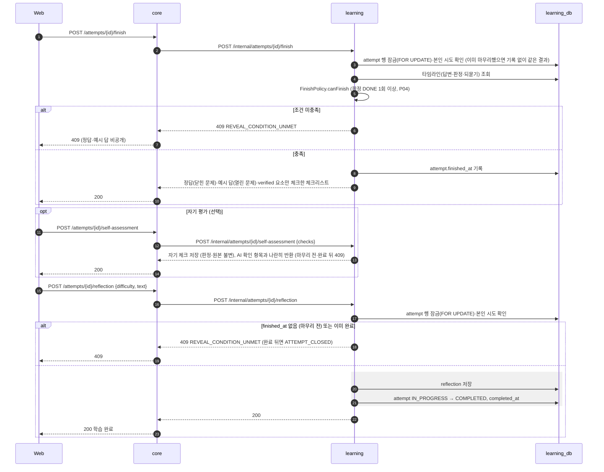

### 3.4 주간 테마 문제 시작 (P23·P13, learning #385·core #387 → 2026-11-10 개정 #483)

2026-11-06 결정([기능명세 1.4](functional-spec.md#14-확정-정책) P20~P25). learning #385·core #387 구현. 포인트 보충(마지막 항목)은 #389 적립 연결로 구현. 1장 공통 규칙을 따른다.

2026-11-10 개정(#483): 아래 그림은 바뀐 규칙(누적 공개·무료 테마 하루 한도 없음·프리미엄 일요일·당일 풀이/개근/주간 완주 보충)이다. core 몫은 #485(PR #498, V43)로 구현했다(무료 테마 문제 한도 집계 없음·`sundayTheme` 전달·적립 사건). learning 몫(누적 공개·`sundayTheme` 읽기·마무리한 문제 409·`days[].completedOnDay`·`finished`·`ending`)은 #484로 구현했다.

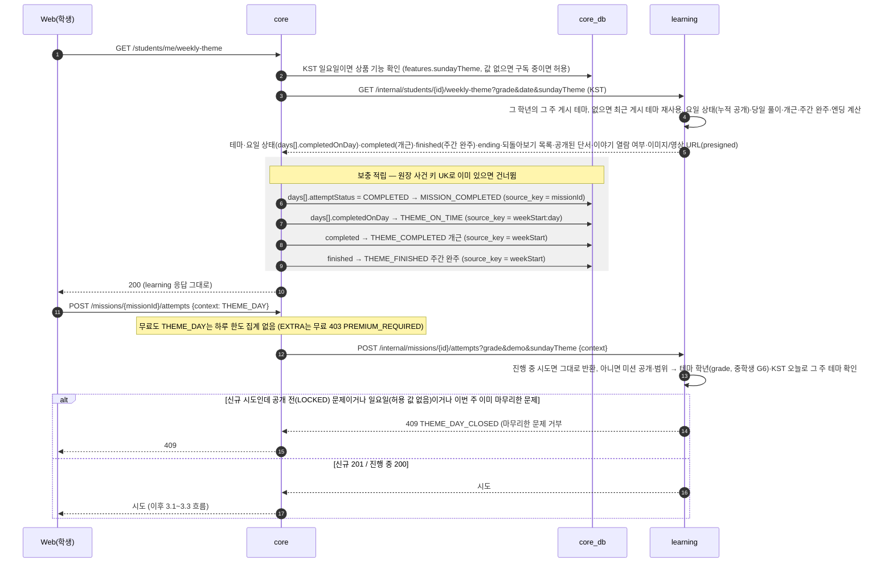

- 공개(`OPEN`)된 문제는 월~토(프리미엄 일요일) 언제든 `THEME_DAY` 신규 시도. 금요일에는 다섯 문제 모두 공개, 토요일에는 안 푼 문제 새로 풀기와 `THEME_REVIEW` 다시 풀기를 함께 허용
- `EXTRA`는 무료 상품(`features.extraMissions = false`)이면 core가 403 `PREMIUM_REQUIRED`, 프리미엄이면 `payment_premium_usage(EXTRA_MISSION)` 기록. `THEME_REVIEW`는 한도 집계 없이 learning이 토요일(프리미엄 일요일)·마무리한 문제인지 검사(아니면 409 `THEME_REVIEW_NOT_ALLOWED`)
- 진행 중 시도 반환(`200`)은 요일 검사 없이 이어하기(자정 후·일요일 포함). 당일 풀이는 학습 완료 시각이 그 요일 KST 안일 때만. 재사용 테마의 이미 푼 문제도 그 주 공개된 문제면 `THEME_DAY` 신규 시도(그 주에 마무리한 문제만 거부, 다시 풀기는 `THEME_REVIEW`)
- 큰 질문 정답 고르기(#484): 금요일 문제를 마무리한 뒤 web이 `POST /students/me/weekly-theme/answer-picks {pick}`(core #550)을 보내고 core가 `POST /internal/students/{id}/weekly-theme/answer-picks?grade&date&sundayTheme`으로 넘긴다. learning은 `theme_answer_pick`에 학생·주당 1행 저장하고 `{correct, ending, answer}`를 돌려준다(맞히면 `ENDED`·정답, 틀리면 `NOT_ENDED`). 틀린 학생은 토요일(프리미엄 일요일) 금요일 문제 `THEME_REVIEW`를 마무리하면 주간 테마 조회의 `ending`이 `ENDED`가 된다(state-diagram 3.2.2)
- 주간 테마 조회 때 core는 응답에서 이번 주 학습 완료한 요일 문제(`attemptStatus = COMPLETED`)마다 `MISSION_COMPLETED`를 다시 부르고, 원장 사건 키 UK로 이미 있는 것은 건너뛰어 누락분만 보충한다(#389). 추가 문제(EXTRA)는 응답에 없어 보충 대상이 아니다. 당일 풀이·개근(learning 칸 `completed`)·주간 완주도 같은 방식으로 보충(core #485, 개근 칸 이름은 #506에서 `completed`로 맞춤). 주간 완주는 learning이 토요일 23:59:59 KST까지의 완료만 세므로 프리미엄 일요일 완료로는 적립되지 않는다
- 학습 완료 직후(3.5)에는 웹이 홈으로 돌아와 주간 테마를 다시 조회할 때 당일 풀이가 적립된다(core #485는 주간 테마 조회 보충으로 정했다, [core 보고서 18절](../report/core-gateway.md#18-무료-테마-주-5문제추가-문제-프리미엄-전용프리미엄-일요일당일-풀이주간-완주-포인트-485-2026-11-10))
- 학년별 테마(#438): core는 학생 학년 그대로 `grade=G3`~`G6`(중학생 `G6`)을 넘긴다. core 반영 전(병합 순서 #438 → core)에는 core가 `gradeBand`를 보내므로 learning은 `grade`가 없으면 `gradeBand`의 `G3_4`를 `G3`, `G5_6`을 `G5`로 읽는다(V15가 학년군 테마를 학년마다 같은 내용으로 복사하므로 이 기간 내용은 같음). core 반영 뒤 이 호환을 지운다
- 테마 시도(#438): 시작·이어하기 응답에 `themeScene{dialogue, hintSpots, videoUrl}`(그 시도 테마 게시본의 그 미션 요일 값, `EXTRA`는 `null`. ai 테마 초안 채택 테마는 요일 문제 전 영상이 없어 `videoUrl`은 null, #437 2026-11-11). 생각 열기(`POST /attempts/{id}/hints`)는 순서대로 하나씩 여는 기존 동작·열람 기록 그대로이고 `hintSpots`는 그림 위 표시 위치만 정한다

### 3.5 학습 완료 → 포인트 적립·자동 공유 (P20·P21, core #388·#389·learning #386 구현)

2026-11-06 결정([기능명세 1.4](functional-spec.md#14-확정-정책) P20~P25). 공유 요청(core #388), learning 공유 저장(#386), 포인트 적립 연결(#389) 구현. 1장 공통 규칙을 따른다.

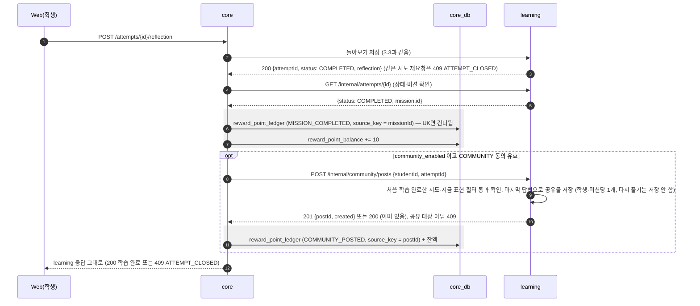

- 공유·적립 저장 실패는 학습 완료 응답을 바꾸지 않는다(적립은 `RewardService.earn` 자체 트랜잭션, 실패는 로그만). 원장은 사건 키 UK로 멱등이라 같은 돌아보기 재요청(`409 ATTEMPT_CLOSED`)·주간 테마 조회(3.4) 때 보충
- 응답에 적립 결과를 넣지 않는다. 웹은 `GET /students/me/points`로 잔액을 본다

### 3.6 되돌아보기 열람·개근·주간 완주 (P21·P23, learning #385·core #389 구현 → 2026-11-10 개정 #483)

2026-11-06 결정([기능명세 1.4](functional-spec.md#14-확정-정책) P20~P25). learning 열람 기록·완주 판정은 #385, core 열람 응답 뒤 적립 연결은 #389 구현. 1장 공통 규칙을 따른다.

2026-11-10 개정(#483): 열람은 토요일(프리미엄은 일요일도)만 허용하고 무료 일요일은 `409 THEME_REVIEW_NOT_ALLOWED`. 이전 "완주 보너스"(`THEME_COMPLETED`, 월~금 각 당일 학습 완료)는 이름만 개근으로 바꿔 그대로 두고 열람 응답 `completed`로 적립한다. 주간 완주(`THEME_FINISHED`)는 열람 응답이 아니라 3.4 주간 테마 조회 응답 `finished`로 적립한다(core #485 `ParticipationRewardService`, #506). 일요일이 닫히므로 토요일에 열람하지 않은 학생도 3.4 주간 테마 조회 보충으로 빠지지 않게 한다(core #485).

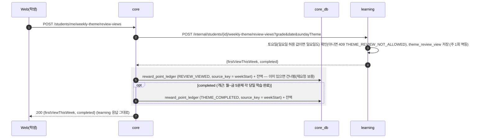

- `weekStart`는 core가 learning에 넘긴 KST 날짜의 월요일. `firstViewThisWeek`와 무관하게 적립을 부르고 사건 키로 1회만 남겨, 앞선 적립 저장이 실패했으면 열람 재요청 때 보충

#### 3.6.1 시작·종료 이야기 열람 (에픽 #436, learning #438·core #439)

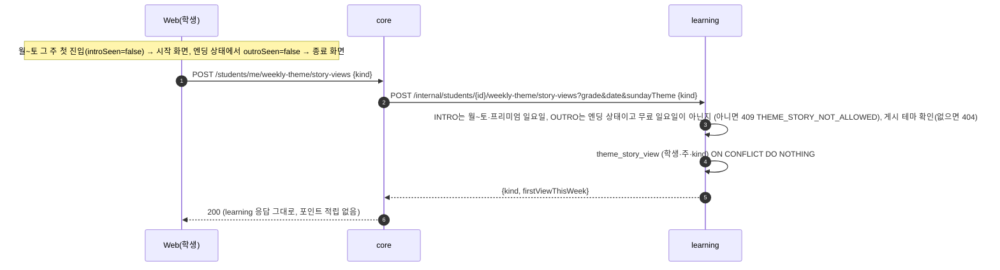

- 시작 이야기는 온보딩 영상처럼 그 주에 처음 들어왔을 때 한 번 보여 준다(요일 무관, 일요일 제외, 2026-11-10 사용자 결정). 그래서 이번 주 테마 응답의 `intro`(글)는 #385의 '월요일만'에서 매일 채움으로 바꾼다
- 날짜·학년은 core가 정한다(되돌아보기 열람과 같음). 기존 되돌아보기 열람(`review-views`, 포인트·완주)은 그대로이고 이야기 열람과 따로 기록한다
- 종료 이야기·정답·결정적 단서·종료 장면은 엔딩 상태일 때만 이번 주 테마 응답에 들어간다. 엔딩 조건(큰 질문 정답 맞힘 즉시, 틀리면 고른 뒤 토요일 금요일 문제 다시 풀기 마무리)과 정답 고르기는 learning #484(state-diagram 3.2.2)

### 3.7 커뮤니티 열람·반응·신고 (P20, core #388·learning #386 구현)

2026-11-06 결정([기능명세 1.4](functional-spec.md#14-확정-정책) P20~P25). 반응 포인트 적립·작성자 착용 아이템 표시는 #389 구현. 1장 공통 규칙을 따른다.

```mermaid
sequenceDiagram
  autonumber
  participant W as Web(학생)
  participant C as core
  participant CDB as core_db
  participant L as learning
  participant A as 관리자 Web

  W->>C: GET /missions/{missionId}/community-posts?seed
  C->>L: GET /internal/community/missions/{missionId}/posts?viewerStudentId&seed
  alt viewer가 이 미션을 학습 완료하지 않음, 또는 큰 질문 정답 고르기 문제인데 viewer의 그 주 엔딩 전(2026-11-10 개정 #483, learning #484)
    L-->>C: 403 COMMUNITY_LOCKED (엔딩 전은 COMMUNITY_LOCKED_UNTIL_ENDING, core 공개 문구 #550)
    C-->>W: 403
  else 마무리함
    L-->>C: VISIBLE 공유물 무작위 목록 (studentId 포함, 반응 수 없음)
    C->>CDB: 작성자 별명·꾸미기·착용 아이템 조회
    C-->>W: 200 (studentId 제거, author = 별명·look{theme, companion, equipped})
  end
  W->>C: PUT /community-posts/{postId}/reactions/NEW_IDEA
  C->>L: PUT /internal/community/posts/{postId}/reactions/NEW_IDEA?studentId
  L-->>C: {postId, reaction, reactionId, created: true}
  opt 반응 남기기 성공, 같은 키 없음, 오늘 반응 적립 상한 미만
    C->>CDB: reward_point_ledger (REACTION_GIVEN, source_key = postId:reaction, reactionId와 1:1) + 잔액
  end
  C-->>W: 204
  W->>C: POST /error-reports {targetType: COMMUNITY_POST, targetId}
  C->>CDB: error_report 저장 (RECEIVED)
  C->>L: PUT /internal/community/posts/{postId}/moderation {HIDDEN_REPORT}
  A->>C: 신고 처리 결과 (다시 공개 또는 계속 숨김)
  C->>L: moderation {VISIBLE 또는 REMOVED}
```

### 3.8 테마 문제 학습 완료 → 기념 액자·검색 문서 등록 (P27, 설계·구현 전)

2026-11-12 리텐션 확장 결정([결정 기록](../report/retention-expansion.md)). 3.5 돌아보기 저장(학습 완료) 안에서 처리한다. 포인트 적립(3.5)과 별개다.

```mermaid
sequenceDiagram
  autonumber
  participant C as core
  participant L as learning
  participant LDB as learning_db

  C->>L: 돌아보기 저장 (3.3·3.5와 같음)
  rect rgba(128,128,128,0.12)
    L->>LDB: reflection 저장, attempt COMPLETED
    opt context = THEME_DAY·THEME_REVIEW (EXTRA 제외)
      L->>LDB: memory_search_doc (attempt_id, content_text, PENDING) ON CONFLICT DO NOTHING
      L->>LDB: 같은 회차(student, theme_id, theme_week_start) 5문제 completed_at 확인
      opt 5문제 모두 완료
        L->>LDB: theme_frame (awarded_at = 마지막 completed_at) ON CONFLICT DO NOTHING
      end
    end
  end
  L-->>C: 200 {attemptId, status: COMPLETED, reflection}
```

- 임베딩은 이 트랜잭션에서 부르지 않는다(완료 응답 지연 없음, 3.10이 처리)
- 프리미엄 일요일·자정 넘긴 이어하기 완료도 같은 경로라 액자 조건에 포함. 같은 회차 다시 풀기 완료는 UK로 새 액자 없음
- 도입 전 기록은 배포 때 1회 소급 명령이 같은 조건으로 `theme_frame`(`seen_at` 채움)·`memory_search_doc`(`PENDING`)을 만든다

### 3.9 추억 검색·설명 (P27, 설계·구현 전)

```mermaid
sequenceDiagram
  autonumber
  participant W as Web(학생)
  participant C as core
  participant CDB as core_db
  participant L as learning
  participant LDB as learning_db
  participant A as ai
  participant LLM as LLM

  W->>C: POST /students/me/memories/search {query}
  rect rgba(128,128,128,0.12)
    C->>CDB: memory_daily_usage (SEARCH) 기록, 오늘 건수 > 한도면 롤백 후 429 USAGE_LIMIT_REACHED
  end
  C->>L: POST /internal/students/{id}/memories/search {query}
  L->>A: POST /internal/embeddings {texts:[query]}
  A->>LLM: 임베딩 (callType MEMORY_EMBEDDING)
  A-->>L: {vectors}
  L->>LDB: READY 문서 중 본인·보유 액자 회차·진행 주 제외 필터 + 코사인 거리 정렬
  L-->>C: {state: RESULTS|NO_RESULTS|NO_RECORDS, cards[≤3]}
  C-->>W: 200 (learning 응답 그대로)

  opt 학생이 "설명 보기"
    W->>C: POST /students/me/memories/explanations {query, attemptIds}
    C->>CDB: memory_daily_usage (EXPLANATION) — 한도 초과 429
    C->>L: POST /internal/students/{id}/memories/explanations (회로 learning-memory)
    L->>LDB: attemptIds가 본인 READY 문서인지 확인, 근거 [1]~[3] 구성
    alt 근거 부족
      L-->>C: {state: INSUFFICIENT}
    else
      L->>A: POST /internal/memory-explanations {query, evidence[번호·테마·미션·답변 일부]}
      A->>LLM: 설명 생성 (callType MEMORY_EXPLANATION)
      A-->>L: {text, citations}
      L->>L: 번호 범위·인용 원문 대조, 번호 → 회차·시도
      L-->>C: {state: GENERATED|FAILED, text, citations}
    end
    C-->>W: 200
  end
```

- 임베딩 장애는 `503 AI_UNAVAILABLE`로 검색 실패. 설명 생성·검사 실패는 `200 {state: FAILED}`로 돌려 화면이 검색 결과를 유지
- ai 요청에 학생·시도·답변 ID·이름을 넣지 않고 닉네임은 마스킹(NFR-SEC-03). 질문·설명은 저장하지 않음

### 3.10 검색 문서 임베딩 주기 작업 (P27, 설계·구현 전)

```mermaid
sequenceDiagram
  autonumber
  participant S as learning 주기 작업
  participant LDB as learning_db
  participant A as ai

  loop 기준안 1분
    rect rgba(128,128,128,0.12)
      S->>LDB: 리스 만료 PROCESSING → PENDING
      S->>LDB: PENDING·재시도 가능 FAILED 최대 64행 → PROCESSING (조건부 UPDATE, lease_until)
    end
    S->>A: POST /internal/embeddings {texts[content_text]}
    alt 성공
      S->>LDB: 리스 일치 행만 READY + embedding·embedding_model·embedded_at
    else 실패
      S->>LDB: 리스 일치 행만 FAILED, retry_count + 1
    end
  end
```

- 상태 전이·조건은 [상태 3.7](state-diagram.md). 여러 레플리카가 같은 주기에 돌아도 선점한 행만 처리

---

## 4. 대시보드 조회
- 2.3 권한 확인 후 core가 learning `/internal/records/...`를 그대로 프록시 (서비스 간 추가 호출 없음)
- 응답의 `state`(`OK`·`NO_RECORD`·`INSUFFICIENT_SAMPLE`)와 조회 실패(5xx → `FAILED`)를 화면에서 구분 (FN-DSH-11)

---

## 5. 분석 대화 SSE

```mermaid
sequenceDiagram
  autonumber
  participant W as Web
  participant C as core
  participant CDB as core_db
  participant A as ai
  participant LLM as LLM
  participant L as learning

  W->>C: POST /conversations/{id}/messages {question, scope?} (SSE)
  C->>CDB: guardianship LINKED 확인 (scope 자녀)
  C->>C: Conversation.resolveScope (생략 시 확인된 자녀·기간 유지)
  C->>CDB: conversation_message 저장 (QUEUED → RUNNING)
  C->>A: POST /internal/analysis/stream {question, scope, history[]} (X-Student-Scope: childId)
  A->>A: classify
  A->>LLM: 질문 의도·대상·기간 분류
  A->>A: clarify_scope
  alt LLM 키 부재·호출 실패 (P16)
    A->>L: 확인된 범위의 기본 기록 조회 (summary·attempts)
    A->>A: compute + RuleResponder 템플릿 구성
    A-->>C: event result {answer, metrics, evidence, source: TEMPLATE, fallback: AI_UNAVAILABLE}
    C->>CDB: message COMPLETED (source = TEMPLATE) + message_evidence
    C-->>W: event result → done (실패 사실 표시)
  else 대상·기간 불명확 또는 현재 선택과 충돌
    A-->>C: event clarification {question, options[]}
    C->>CDB: message COMPLETED + clarification 저장
    C-->>W: event clarification → done
  else 범위 확정
    A->>A: plan (조회 도구 선택)
    loop 도구 호출마다
      A->>A: require_student(scope.studentId)
      A->>L: GET /internal/records/students/{id}/... (헤더 그대로 전달)
      L-->>A: 기록·Metric[]·state
    end
    A->>A: compute (calculators, 코드 계산)
    A-->>C: event status {기록 조회 완료}
    C-->>W: event status
    A->>LLM: answer (조회·계산 결과 기반 답변, 스트리밍)
    loop 답변 조각
      A-->>C: event delta {text}
      C-->>W: event delta (대조 전 임시 표시)
    end
    A->>A: verify (AnswerVerifier 숫자·인용 대조)
    alt 대조 실패 (P16)
      A->>A: RuleResponder: 계산된 metrics·evidence만 템플릿 문장으로 구성
      A-->>C: event result {answer, metrics, evidence, source: TEMPLATE, fallback: VERIFICATION_FAILED}
      C->>CDB: message COMPLETED (source = TEMPLATE) + message_evidence
      C-->>W: event result → done (delta 임시 텍스트 폐기, 실패 사실 표시)
    else 대조 통과
      A-->>C: event result {answer, metrics, evidence, verification, recordCount}
      rect rgba(128,128,128,0.12)
        C->>CDB: message COMPLETED + answer·metrics·verification·버전
        C->>CDB: message_evidence (attemptId·answerId·version만)
      end
      C-->>W: event result → done
    end
  end
  A--)A: llm.usage.recorded 발행
  opt 기록 조회 실패·ai 서비스 장애
    C->>CDB: message FAILED (AI_UNAVAILABLE, 재시도 가능)
    C-->>W: event error → done
  end
  opt 클라이언트 단절
    C->>A: 스트림 취소
    C->>CDB: message FAILED (STREAM_INTERRUPTED, 재시도 가능)
  end
```

- 재시도(`/messages/{id}/retry`): 같은 행 `FAILED → RUNNING` 조건부 전이 후 같은 흐름 (ERD 3.2)
- 대조 실패·LLM 키 부재·호출 실패 시 규칙 응답 모드(`source = TEMPLATE`), 기록 조회 자체 실패는 `error` (FN-AGT-06·10, P16)
- 무료 플랜은 대화 생성 시 `429 USAGE_LIMIT_REACHED`, 프리미엄은 하루 30회 (P13). 일일 리포트 고정 대화도 같은 30회 (5.1)
- 근거 확인(`/evidence`): core가 `message_evidence` ID로 learning `/internal/records/evidence` 조회, 삭제된 기록은 `available: false`

### 5.1 일일 리포트 대화 (P25)

2026-11-06 결정([기능명세 1.4](functional-spec.md#14-확정-정책) P20~P25). core·ai 몫은 #392로 구현했다(report 일일 상세 생성은 #391). 1장 공통 규칙을 따른다.

```mermaid
sequenceDiagram
  autonumber
  participant W as Web(학부모)
  participant C as core
  participant CDB as core_db
  participant R as report-api
  participant A as ai

  W->>C: POST /conversations {childId, reportId}
  C->>CDB: 자녀 연결·이용권 확인 (무료면 USAGE_LIMIT_REACHED)
  C->>CDB: report_job 조회 (일일·같은 자녀)
  C->>R: GET /internal/reports/{reportId} (최신 판)
  alt 일일 아님·다른 자녀·없음·미완료
    C-->>W: 422 CONVERSATION_REPORT_INVALID
  else 완료된 일일 리포트
    C->>CDB: conversation 저장 (from = to = 대상일, report_id·report_revision)
    C-->>W: 201
  end
  W->>C: POST /conversations/{id}/messages (SSE)
  C->>R: GET /internal/reports/{reportId}?revision (고정 판)
  C->>A: 5장 흐름 + 고정 범위(그날)·리포트 요약
  A-->>C: 대조 완료 답변 또는 규칙 응답 (P16)
  C-->>W: SSE 결과 (분석 대화 하루 30회 공유 차감)
```
- 고정 대화는 범위 변경 없이 다른 날 질문을 새 대화로 안내(다른 기간 `scope`는 400, 질문 속 다른 날은 ai `DIFFERENT_PERIOD` 안내). ai는 report를 직접 호출하지 않음
- report HTTP는 트랜잭션 밖에서 호출하고 대화 저장 트랜잭션에서 연결·이용권을 다시 확인한다. 메시지의 판 조회는 열람 기록(`report_view`)을 남기지 않는다

---

## 6. 리포트

### 6.1 자동 생성

#152 관리자 실패 재처리도 아래 report 소비 흐름을 재사용한다. core #47이 원작업 연결을 보관하고 새 jobId·ADMIN_RETRY로 요청한다. report는 새 행·다음 revision을 생성하며 기존 실패 jobId의 단순 재전달은 ACK 후 종료한다. started/completed/failed의 jobId는 새 작업 ID이며 원작업으로 바꾸지 않는다. 관리자 요청 접수·감사 기록은 core #47 `ReportAdminRetryService`가 담당한다(sequence 하단 #47 REPORT 관리자 재처리 접수).

```mermaid
sequenceDiagram
  autonumber
  participant SCH as core 스케줄러
  participant C as core
  participant CDB as core_db
  participant MQ as RabbitMQ
  participant RW as report-worker
  participant RDB as report_db
  participant L as learning
  participant A as ai
  participant X as 설명 sLLM 서버
  participant S3 as S3

  SCH->>SCH: 매주 월 00:00 KST(일요일 자정), @SchedulerLock 획득 (ShedLock, 1개 레플리카만) (P06)
  loop ACTIVE 학생마다 (기록 없어도 포함, 대상 주 = 직전 월~일 KST, P06)
    rect rgba(128,128,128,0.12)
      SCH->>CDB: report_job 저장 (SCHEDULE, QUEUED) — 부분 UK로 중복 방지
      SCH->>CDB: outbox_event (report.generate, narrativeEnabled = 프리미엄 여부 P13) 저장
    end
  end
  C->>CDB: OutboxRelay 미발행 행 조회
  C-)MQ: cmd.direct / report.generate (publisher confirm)
  C->>CDB: published_at 기록
  MQ-)RW: report.report.generate 소비 (수동 ACK)
  RW->>RW: bind_user_context(SYSTEM, scope = subject 학생)
  RW->>RDB: job_id로 weekly_report 조회
  alt 없음 (최초 소비)
    rect rgba(128,128,128,0.12)
      RW->>RDB: weekly_report 저장 (job_id UK, RUNNING)
      RW->>RDB: outbox_event (report.started)
    end
  else 기존 COMPLETED·FAILED (재전달)
    RW->>MQ: ACK 후 종료 (종료 이벤트는 같은 트랜잭션 outbox에 이미 저장)
  else 기존 RUNNING (이전 Pod 중단 후 재전달)
    Note over RW: 같은 행으로 아래 처리 처음부터 재실행
  end
  Note over RW,C: #119 core API를 기본 worker의 CoreClient.lookup에서 호출 (#56)
  RW->>C: GET /internal/students/{id}/profile (내부 토큰, SYSTEM, 학생 scope)
  C-->>RW: 200 {studentId, nickname, parentSharingEnabled, grade} (ACTIVE만, no-store)
  RW->>RW: nickname을 렌더링용 display_name으로 보관 (메시지에는 추가하지 않음)
  Note over RW,C: 403·404·통신 장애는 GENERATION_FAILED로 종료. HTTP 재시도·가짜 별명 없음
  RW->>L: GET /internal/records/students/{id}/thinking-types·attempts·changes
  L-->>RW: 기간 내 기록
  RW->>RW: MetricsCalculator (기간 확정·수치·전후 변화·state)
  alt 기록 없음·표본 부족
    RW->>RW: state = NO_RECORD·INSUFFICIENT_SAMPLE (가능한 요약만)
  end
  alt NO_RECORD 또는 narrativeEnabled = false
    RW->>RW: 서술 생략 (NO_RECORD는 기록 없음 안내 문구, 무료는 narrative null) (P06, P13)
  else
    RW->>RW: NarrativeGenerator에서 별명·이름 필드 제거 및 본문 별명 가림
    RW->>A: POST /internal/report-narratives {metrics, thinkingTypes, changes, reflections, quotes}
    A-->>RW: narrative·eveningQuestion·citedQuotes·versions
    RW->>L: GET /internal/records/evidence?answerIds=
    RW->>RW: ReportVerifier 숫자·인용 대조
    opt 대조 실패 (P16)
      RW->>RW: 템플릿 요약으로 교체 (narrative.source = TEMPLATE)
    end
  end
  opt 주간, narrativeEnabled, 원문 공개 (FN-RPT-09, #479·#508, 단계 전체 400초 예산)
    RW->>L: GET /internal/records/students/{id}/attempts?includeModelScores=true (SYSTEM)
    L-->>RW: 기간 내 기록 + modelScores.m2
    alt M2 점수가 있는 답변 없음
      RW->>RW: explanations.state = NO_TARGET
    else
      RW->>RW: 최신순 정렬, 생각 유형마다 최신 답변부터 시도 (최대 3유형)
      loop 유형별 후보 (ai 호출 전 제외 시 같은 유형 다음 답변)
        RW->>RW: 자격 확인 (정정·빈 답변·학년·입력 유형·M2 점수 형식)
        RW->>L: GET /internal/records/evidence?answerIds= (원문·버전 대조)
        RW->>A: POST /internal/report-explanations {grade, inputType, text, scores} (호출당 130초, 유형당 1회)
        A->>X: OpenAI 호환 생성 요청 (일 23:50~월 02:00 KEDA cron으로 1대 기동, #476)
        X-->>A: 설명 초안
        A->>A: 규칙 후처리, 금지어·점수·등급 표현 검사, 인용 선택
        A-->>RW: {active, explanation, versions} 또는 실패
        RW->>RW: report 재검사 (숫자·금지어·수량·별명·인용 원문 부분 문자열)
      end
      alt 하나라도 통과
        RW->>RW: 통과분만 EXPLANATION 항목, explanations.state = INCLUDED
      else 모두 실패·시간 초과·설명 모델 미활성·sLLM 가동 창 밖 (P16)
        RW->>RW: explanations.state = NOT_INCLUDED (리포트 status·state 유지)
      end
    end
  end
  RW->>RW: ReportRenderer HTML·PDF·MD
  RW->>S3: 파일 업로드
  alt 처리 성공
    rect rgba(128,128,128,0.12)
      RW->>RDB: weekly_report COMPLETED + report_item·evidence·report_file
      RW->>RDB: outbox_event (report.completed)
    end
  else 처리 실패
    rect rgba(128,128,128,0.12)
      RW->>RDB: weekly_report FAILED (failure_reason)
      RW->>RDB: outbox_event (report.failed)
    end
  end
  RW->>MQ: ACK
  RW-)MQ: events.topic / report.started·completed·failed (OutboxRelay)
  MQ-)C: core.report.events 소비
  C->>CDB: processed_event 저장 (중복이면 무시)
  C->>CDB: report_job 조건부 전이 (started: QUEUED → RUNNING / completed·failed: QUEUED·RUNNING → COMPLETED·FAILED + report_id)
  opt 종료 전이 (completed·failed)
    C->>C: ReportJobFinished → ReportNotificationListener → NotificationService.report (REPORT_COMPLETED·REPORT_FAILED, 같은 트랜잭션)
  end
```

- 소비 실패(예외)는 `report.report.generate.retry.1~3` 경유 지연 재시도 3회(1·5·15분, P12) → `report.report.generate.dlq` (아키텍처 1.6, `definitions.json`)
- `report.started`보다 `report.completed`가 먼저 도착해도 `QUEUED → COMPLETED` 허용 (상태 다이어그램 4.1)
- KEDA가 `report.report.generate` 큐 길이로 report-worker 0~N 확장

#### 6.1.1 종료 이벤트 누락 복구 (#132)

```mermaid
sequenceDiagram
  participant S as core recovery scheduler
  participant C as core DB
  participant R as report API
  participant D as report DB
  S->>C: 생성 4시간 이상 미종료 후보 조회 (#508)
  S->>R: POST reconcile (트랜잭션 밖)
  R->>D: 학생 shared/job exclusive session 잠금 시도
  alt 실행/삭제 잠금 사용 중
    R-->>S: BUSY
  else 잠금 획득
    R->>D: 학생·기간 대조, 종료 결과 조회/고아 RUNNING 종료/없는 행 guard 저장
    R-->>S: 저장된 종료 결과
    S->>C: 새 트랜잭션: 학생 → job 잠금, 식별·종료 재검사
    S->>C: 조건부 종료 + 실행 이력 (삭제·ID 없음은 알림 생략)
  end
```

삭제 확정은 기존 parent → student 잠금 아래 학생 차단과 미종료 작업 종료를 함께 커밋한다. 복구 HTTP 도중 삭제가 확정되면 최종 반영은 이미 FAILED인 작업을 유지한다. 생성도 student → 주 잠금을 사용하므로 삭제 뒤 새 QUEUED 작업을 남기지 않는다.

### 6.2 알림 전달 (SSE 다중 레플리카)

```mermaid
sequenceDiagram
  autonumber
  participant C1 as core (소비 레플리카)
  participant CDB as core_db
  participant R as Redis
  participant C2 as core (SSE 연결 레플리카)
  participant W as Web

  W->>C2: GET /notifications/stream (SSE, 5분)
  C2->>R: SUBSCRIBE core:notifications:v1
  C2-->>W: event ready {reconcile: /api/v1/notifications}
  C1->>CDB: notification INSERT QUEUED (UK user_id·type·source_event_id, 중복·수신 거부 시 생성 안 함)
  Note over C1,CDB: 리포트 전이 트랜잭션 커밋
  C1->>R: PUBLISH (AFTER_COMMIT)
  alt 발행 성공
    C1->>CDB: QUEUED → COMPLETED (별도 트랜잭션)
    R-->>C2: 메시지
    C2-->>W: event notification (제목·링크만, 원문·결제 정보 없음)
  else Redis 오류
    C1->>CDB: QUEUED → FAILED (REDIS_PUBLISH_FAILED)
  end
  Note over W,C2: ready 수신(재연결 포함) 후 GET /notifications 첫 페이지부터 재조회해 id로 병합
```

### 6.3 조회·다운로드

```mermaid
sequenceDiagram
  autonumber
  participant W as Web
  participant C as core
  participant RA as report-api
  participant S3 as S3

  W->>C: GET /reports/{reportId}/download?format=pdf
  C->>C: GuardianshipService.authorizeLinkedChildren → X-Student-Scope = 연결 자녀 전체
  C->>RA: GET /internal/reports/{reportId}/files/pdf
  RA->>RA: weekly_report.student_id ∈ X-Student-Scope 검사
  alt 범위 밖
    RA-->>C: 403 FORBIDDEN
    C-->>W: 403 CHILD_NOT_LINKED
  else
    RA->>S3: presigned URL 발급 (단기)
    RA-->>C: {url, expiresAt}
    C-->>W: 200 {url, expiresAt}
    W->>S3: GET url
  end
```

- `reportId`처럼 경로에 자녀 ID가 없는 API는 core가 연결 자녀 전체를 범위로 전달하고, 소유 서비스(report-api)가 리소스의 학생 ID로 검사
- 상세 조회 시 core가 `report_view` 저장 (열람률 지표)
- 재생성(`/regenerate`): 새 `report_job(REGENERATE)` + outbox → 6.1과 같은 흐름, `weekly_report.revision` 증가 (기존 판 보존·최신판 기본 조회. 학부모는 리포트당 1회, 초과 시 409 REPORT_REGENERATION_LIMIT, 관리자 무제한, P06)

### 6.4 #47 REPORT 관리자 재처리 접수

ADMIN/SERVICE_OPS → OperationsController → 공통 IdempotencyService → ReportAdminRetryService → 학생 상태 잠금 service·report 학생/주/원작업 잠금 → 새 report_job + report_job_retry + report.generate Outbox + JOB_RETRY_REQUESTED 감사 커밋 → 202/Location. 이후 기존 Outbox relay → report(#152) → 새 jobId의 report.* → 기존 ReportLifecycleService → processed_event + report_job + job_execution + 결과 감사가 같은 트랜잭션으로 커밋된다. DB 트랜잭션 안에서 report HTTP·브로커 네트워크 호출을 하지 않는다.

### 6.5 일일 리포트 생성·알림 (P24)

core 일정·작업·알림은 #390, report 생성·저장·조회는 #391에서 구현했다. learning daily-attempts는 완료일로 조회한다.

```mermaid
sequenceDiagram
  autonumber
  participant SCH as core 스케줄러
  participant C as core
  participant CDB as core_db
  participant MQ as RabbitMQ
  participant RW as report-worker
  participant RDB as report_db
  participant L as learning
  participant S3 as S3

  SCH->>SCH: 매일 00:00 KST(대상일 자정), @SchedulerLock 획득
  loop 보호자 LINKED인 ACTIVE 학생마다 (기록 없어도 포함, 대상일 = 전날 KST)
    rect rgba(128,128,128,0.12)
      SCH->>CDB: report_job (SCHEDULE, period_type = DAILY, period_from = period_to)
      SCH->>CDB: outbox_event (report.generate, periodType = DAILY)
    end
  end
  C-)MQ: report.generate (6.1과 같은 발행)
  MQ-)RW: 소비 → weekly_report (period_type = DAILY, RUNNING) + report.started
  RW->>L: 대상일 기록 조회 (학생 범위)
  alt 기록 없음
    RW->>RW: state = NO_RECORD
  else 기록 있음
    RW->>RW: 문제별 판정·되묻기·보완 답변·생각 요소·돌아보기·인용 템플릿 구성 (ai 호출 없음)
    RW->>RW: 숫자·인용 원본 대조, #206 비공개면 원문 제외
  end
  RW->>S3: PDF·Markdown·HTML 저장
  rect rgba(128,128,128,0.12)
    RW->>RDB: COMPLETED + outbox_event (report.completed)
  end
  RW-)MQ: report.completed
  MQ-)C: report_job COMPLETED, 알림 DAILY_REPORT_COMPLETED (수신 설정 확인)
```

- 실패·재시도·DLQ·관리자 재처리는 6.1·6.4와 같고 실패 알림 유형만 `DAILY_REPORT_FAILED`

---

## 7. 결제·구독 (토스페이먼츠 테스트)

#48 확정: 아래 개념 시퀀스의 정기 주문은 논리 주문이며 실제 PG 요청은 payment_charge_attempt로 분리한다. 확정 실패 이후에만 일별 새 PG 주문을 생성하고 불명확한 거래는 조회만 한다. 준비/결과/권한 트랜잭션과 parent 계정 잠금은 PG 호출 양쪽으로 분리한다. 무료 상품 선택·사용 예약/환불 동결·서명/PG 교차 검증은 [#48 보고서](../report/core-gateway.md#24-결제구독과-상품-권한-48184419)가 우선한다.

### 7.1 주문·승인

```mermaid
sequenceDiagram
  autonumber
  participant W as Web (결제위젯)
  participant C as core
  participant DB as core_db
  participant T as Toss

  W->>C: POST /orders {productId, childId} (Idempotency-Key)
  C->>DB: 연결 자녀 확인, 활성 구독(ACTIVE·RENEWAL_FAILED) 확인
  alt 중복 구독
    C-->>W: 409 SUBSCRIPTION_DUPLICATE
  else
    C->>DB: payment_order 저장 (INITIAL, amount)
    C-->>W: orderId·amount·위젯 파라미터
  end
  W->>T: 결제위젯 결제 요청
  T-->>W: successUrl (paymentKey, orderId, amount)
  W->>C: POST /payments/confirm (Idempotency-Key)
  C->>DB: order.amount·대상 자녀 대조
  alt 금액 불일치
    C-->>W: 422 PAYMENT_AMOUNT_MISMATCH
  else
    C->>T: POST 결제 승인 API (트랜잭션 밖)
    alt 승인 성공
      C->>DB: payment APPROVED 저장 (order_id UK)
      alt 구독 반영 성공
        rect rgba(128,128,128,0.12)
          C->>DB: subscription ACTIVE 생성·기간 설정
          C->>DB: payment_order.subscription_id 연결, entitlement APPLIED
        end
        C-->>W: 200 APPROVED + subscription
      else 구독 반영 실패
        C->>DB: payment APPROVED 유지, entitlement RECOVERY_REQUIRED
        C-->>W: 200 APPROVED (권한 반영 처리 중)
        Note over C: 추가 청구 없이 SubscriptionService.recoverEntitlement 재시도
      end
    else 응답 지연·불명확 (타임아웃)
      C->>DB: payment CONFIRMING
      C-->>W: 202 CONFIRMING (재결제 안내 금지)
    else 승인 실패
      C->>DB: payment FAILED (failure_code)
      C-->>W: 실패 안내
    end
  end
```

### 7.2 상태 확인·웹훅

```mermaid
sequenceDiagram
  autonumber
  participant T as Toss
  participant C as core
  participant DB as core_db
  participant SCH as core 스케줄러

  T->>C: POST /webhooks/tosspayments (transmission_id)
  C->>DB: pg_webhook_event INSERT (transmission_id UK, 충돌 시 기존 행 조회)
  alt 기존 행 result = APPLIED·IGNORED (처리 완료 통지)
    C-->>T: 200
  else 새 통지 또는 기존 FAILED·미처리
    C->>T: 결제 조회 API (본문 미신뢰)
    T-->>C: 실제 상태
    alt 상태 반영 대상
      C->>DB: payment 상태 갱신 (CONFIRMING → APPROVED·FAILED 등) + 구독 반영
      C->>DB: pg_webhook_event APPLIED·processed_at
    else 변경 없음
      C->>DB: pg_webhook_event IGNORED·processed_at
    end
    C-->>T: 200
  end
  opt 처리 중 오류
    C->>DB: pg_webhook_event FAILED
    C-->>T: 5xx (PG 재전송 시 위 분기로 재처리)
  end
  SCH->>DB: payment CONFIRMING 조회 (status, updated_at)
  SCH->>T: 결제 조회 API
  SCH->>DB: 상태 확정
```

### 7.3 정기 청구·해지

```mermaid
sequenceDiagram
  autonumber
  participant SCH as core 스케줄러
  participant DB as core_db
  participant T as Toss
  participant N as NotificationService

  SCH->>SCH: @SchedulerLock 획득
  Note over SCH: 매일 09:00 KST (P13)
  SCH->>DB: subscription 조회 (auto_renew, next_billing_date ≤ 오늘 / RENEWAL_FAILED 재청구 대상)
  loop 대상 구독마다
    SCH->>DB: payment_order 저장 (RENEWAL, billing_period_start) — 부분 UK로 이중 청구 방지
    alt UK 충돌 + 기존 결제 APPROVED·CONFIRMING
      SCH->>SCH: 건너뜀
    else 신규 주문 또는 UK 충돌 + 기존 결제 FAILED (재청구 매일 1회 최대 3회 P13, 12장 가정)
      SCH->>T: 빌링키 자동결제 API
      alt 성공
        SCH->>DB: payment APPROVED, subscription 기간 연장·next_billing_date 갱신
      else 실패
        SCH->>DB: payment FAILED, subscription RENEWAL_FAILED (retry_count + 1, grace_until = 최초 실패일 + 3일, P13)
        SCH->>N: SUBSCRIPTION_CHANGED 알림
      end
    end
  end
  SCH->>DB: auto_renew = false 이고 period_end 지난 구독 → CANCELED (P14)
  SCH->>DB: RENEWAL_FAILED 이고 재청구 3회 실패 또는 grace_until 지난 구독 → CANCELED (P13)
```

### 7.4 환불

```mermaid
sequenceDiagram
  autonumber
  participant W as Web (학부모)
  participant AW as Web (관리자)
  participant C as core
  participant DB as core_db
  participant T as Toss
  participant L as learning

  W->>C: POST /payments/{id}/refund-requests (Idempotency-Key)
  C->>DB: 대기 환불 있으면 그 행 반환. 결제 7일 이내·결제 상태 + 결제 후 core 프리미엄 사용(payment_premium_usage) 없음 확인 (P14)
  alt 사전 조건 불충족 (행 생성 없음)
    C-->>W: 409 REFUND_NOT_ALLOWED / 409 REFUND_PREMIUM_USAGE_PRESENT
  end
  C->>DB: refund_request REQUESTED (전액), payment REFUND_REVIEW
  C->>L: GET /internal/payment-usage/students/{id}?since (트랜잭션 밖, 실패 시 503 REFUND_USAGE_UNAVAILABLE)
  alt 결제 후 프리미엄 사용 확인
    C->>DB: refund_request REJECTED (시스템, "결제 후 프리미엄 기능 사용"), payment APPROVED 복귀
    C-->>W: 409 REFUND_NOT_ALLOWED
  else 미사용
    C->>DB: usage_verified_at 기록
  end
  alt 관리자 반려
    AW->>C: POST /admin/refund-requests/{id}/reject {reason}
    C->>DB: refund_request REJECTED (decided_by, reject_reason), payment REFUND_REVIEW → APPROVED
    C->>DB: audit_log 기록
    C-->>AW: 결과
  else 관리자 승인
    AW->>C: POST /admin/refund-requests/{id}/approve (PAYMENT_REFUND, Idempotency-Key)
    C->>DB: 승인 합계 + 요청 금액 ≤ payment.amount 확인
    alt 초과·중복
      C-->>AW: 409 REFUND_NOT_ALLOWED
    else
      C->>DB: refund_request APPROVED (decided_by)
      C->>T: 결제 취소 API (amount)
      alt PG 성공
        C->>DB: refund_request COMPLETED, payment REFUNDED, subscription 즉시 CANCELED (P14)
      else PG 실패
        C->>DB: refund_request FAILED (pg_status), payment REFUND_REVIEW → APPROVED
      end
      C->>DB: audit_log 기록
      C-->>AW: 결과
    end
  end
```

- PG 취소 응답이 불명확하면 PG 조회로 확정 후 반영 (재취소 요청 금지, FN-ADM-16)

---

## 8. 오류 신고·정정

```mermaid
sequenceDiagram
  autonumber
  participant W as Web (학생·학부모)
  participant AW as Web (관리자)
  participant C as core
  participant DB as core_db
  participant L as learning
  participant R as report

  W->>C: POST /error-reports {targetType: JUDGMENT, targetId, comment} (Idempotency-Key)
  C->>DB: error_report RECEIVED
  AW->>C: PATCH /admin/error-reports/{id} {status: IN_REVIEW}
  C->>DB: RECEIVED → IN_REVIEW
  AW->>C: POST /admin/error-reports/{id}/corrections {reason, corrected}
  C->>L: POST /internal/judgments/{judgmentId}/corrections (Idempotency-Key)
  L->>L: judgment_correction 추가 (기존 판정·원본 답변 불변)
  L-->>C: 200 {correctionId, previousResult, corrected, createdAt, impact}
  C->>R: GET /internal/reports/correction-impact?studentId&attemptId (#244, 실패 시 UNKNOWN)
  R-->>C: 그 시도로 만든 완료 판
  C->>L: GET /internal/support/attempts/{attemptId} (판정의 답변 ID 확인, #244)
  L-->>C: 답변·판정 ID
  C->>DB: 그 답변을 인용한 대화 답변, 영향받은 일일 판의 고정 대화 조회
  rect rgba(128,128,128,0.12)
    C->>DB: correction 저장 (impact: 대화·집계·리포트 영향·대상 ID)
    C->>DB: error_report RESOLVED + audit_log
  end
  C->>C: NotificationService.notify (ERROR_REPORT_RESOLVED)
```

- `targetType: COMMUNITY_POST` 신고는 접수 즉시 공유물 숨김(3.7, #388). learning 숨김 호출이 실패해도 core 목록·반응이 신고 행으로 먼저 숨긴다
- 접수만으로 판정을 바꾸지 않음 (FN-SUP-02). 정정 없이 종료하는 경우 `IN_REVIEW → RESOLVED`만 수행

---

## 9. 모델·프롬프트 버전 활성화

```mermaid
sequenceDiagram
  autonumber
  participant AW as Web (관리자)
  participant C as core
  participant DB as core_db
  participant MQ as RabbitMQ
  participant A1 as ai Pod 1
  participant A2 as ai Pod 2
  participant S as scoring Pod

  Note over A1,S: 기동 시
  A1->>MQ: exclusive·auto-delete 큐 선언 → events.topic model.version.* 바인딩
  A1->>C: GET /internal/model-versions/active
  alt core 조회 실패
    A1->>A1: readiness false 유지, 재시도 (프로세스 종료 안 함)
  else
    C-->>A1: 활성 버전 → 조회 중 이벤트 revision 조정 → ActiveVersions.replace
    A1->>A1: 보유한 프롬프트 본문 확인 후 readiness true
  end

  AW->>C: POST /admin/model-versions/{id}/activate
  C->>C: 승인 조건 확인 (eval_result, NFR-AIQ-05)
  rect rgba(128,128,128,0.12)
    C->>DB: 기존 ACTIVE → INACTIVE, 대상 → ACTIVE (부분 UK)
    C->>DB: audit_log (MODEL_ACTIVATE)
    C->>DB: outbox_event (model.version.activated)
  end
  C-)MQ: events.topic / model.version.activated
  par 모든 레플리카 수신
    MQ-)A1: Pod별 큐
    A1->>A1: ActiveVersions 교체
  and
    MQ-)A2: Pod별 큐
    A2->>A2: ActiveVersions 교체
  and
    MQ-)S: Pod별 큐
    S->>S: ModelRegistry 가중치 로딩 (S3) → 교체
  end
```

- 롤백(`/rollback`): 이전 승인 버전 재활성화로 같은 흐름, 재분석 여부는 `audit_log.detail` 기록 (FN-ADM-18)
- scoring #86은 큐 바인딩·소비 시작 → core snapshot → 조회·로딩 중 보존 이벤트의 revision 조정 → readiness true 순서다. 브로커 재연결도 같은 순서로 수행한다. 이벤트는 전체 snapshot이 아니므로 다른 모델을 제거하지 않고 해당 이름의 모델만 교체한다.
- ai #68도 Pod별 큐 바인딩·소비 시작 → core snapshot → 조회 중 받은 이벤트의 kind·name별 revision 조정 → readiness 순서다. 재연결 시 snapshot으로 유실 구간을 복구한다. `PROMPT` 일곱 기능(#336 미션 초안, #477 리포트 설명 포함)과 승인 scope만 반영하며, 미보유 버전 본문을 받으면 해당 기능 새 요청은 503, readiness는 false다. 요청이 시작할 때 잡은 본문·버전은 진행 중 교체하지 않는다.
- scoring 교체·롤백 시 artifact를 다시 내려받아 로딩한 뒤 임시 파일을 정리한다. 로딩 중에는 기존 모델을 사용하며 실패 시 기존 모델을 유지하고 재시도한다. 새 승인 scopes에서 제외된 범위에는 기존 모델도 사용하지 않는다. 최초 준비·재연결 복구가 끝나기 전에는 readiness false다.
- 기준표(`kind = RUBRIC`) 행은 core 레지스트리의 승인·활성 기록만 담당. learning은 이 이벤트를 소비하지 않으며, `judge_verified`·현재 기준표 버전 반영은 관리자 미션 API(`/admin/missions/...`)로 별도 수행

---

## 10. 학생 삭제 전파·LLM 사용량

### 10.1 `student.deleted`

```mermaid
sequenceDiagram
  autonumber
  participant W as Web (학부모)
  participant C as core
  participant CDB as core_db
  participant MQ as RabbitMQ
  participant L as learning
  participant RW as report-worker

  Note over W: 사전 안내 GET /children/{childId}/deletion-impact
  W->>C: POST /children/{childId}/deletion-requests {scope} (X-Reauth-Token)
  Note over C: 재확인 토큰 검사, 무효면 403 REAUTH_REQUIRED (P09)
  rect rgba(128,128,128,0.12)
    C->>CDB: deletion_request CONFIRMED 생성, 두 scope 모두 student DELETION_REQUESTED
    C->>CDB: core 소유 대화·메시지 근거 삭제
    C->>CDB: outbox_event (student.deleted, subject = studentId)
  end
  C-)MQ: events.topic / student.deleted
  par
    MQ-)L: learning.student.deleted
    L->>L: processed_event 확인 → attempt 이하 삭제 + deleted_student 저장
    L->>C: POST /internal/deletion-requests/{id}/completions {service: learning}
  and
    MQ-)RW: report.student.deleted
    RW->>RW: processed_event 확인 → weekly_report·S3 파일 삭제
    RW->>C: POST /internal/deletion-requests/{id}/completions {service: report}
  end
  Note over C: learning·report 보고가 모두 오면 deletion_request COMPLETED (P09)
  Note over C: PROFILE은 프로필 제거, RECORDS는 프로필·DELETION_REQUESTED 유지 (학습 재개는 후속 계약)
```

- P27(설계·구현 전): core는 삭제 확정 트랜잭션에서 `room_frame_slot`·`memory_daily_usage`도 지우고, learning은 같은 삭제 트랜잭션에서 `memory_search_doc`(시도보다 먼저)·`theme_frame`을 지운다([ERD 3.5.2·4.6](erd.md))

### 10.2 `llm.usage.recorded`

```mermaid
sequenceDiagram
  autonumber
  participant A as ai·scoring
  participant MQ as RabbitMQ
  participant C as core
  participant DB as core_db

  A->>A: LLM 호출(ai LlmClient)·모델 추론(scoring) 완료 (토큰·지연·성공 여부)
  A-)MQ: events.topic / llm.usage.recorded (학생 ID·원문 없음, best-effort)
  MQ-)C: core.llm.usage.recorded
  C->>DB: llm_usage INSERT (event_id UK, 중복 무시), cost_usd = 설정 단가로 계산
```

---

## 11. 미션 초안 생성 (#336 설계, learning #353·ai #354·core 프록시 #355 구현)

```mermaid
sequenceDiagram
  autonumber
  participant AW as Web (관리자)
  participant C as core
  participant L as learning
  participant LDB as learning_db
  participant A as ai
  participant LLM as LLM

  AW->>C: GET /admin/achievement-standards?subject&gradeBand&q
  C->>L: GET /internal/admin/achievement-standards
  L-->>AW: 성취기준 목록 (core 경유)
  AW->>C: POST /admin/mission-drafts {standardCodes, achievementLevels, thinkingType, gradeMin, gradeMax, inputType}
  C->>C: CONTENT 권한, 요청 감사
  C->>L: POST /internal/admin/mission-drafts
  L->>LDB: 성취기준 실재·학년군 확인 → mission_draft GENERATING (attempts 0)
  L-->>AW: 202 MissionDraft (core 경유, 결과 감사)

  loop MissionDraftScheduler 주기 (기준안 10초)
    L->>LDB: GENERATING·리스 없음/만료 초안 하나 조건부 UPDATE로 점유 (lease 90초)
    L->>A: POST /internal/mission-drafts {성취기준·성취수준 문장, 유형 표준 요소, 학년 범위(gradeMin·gradeMax), 입력 방식, previousFailures}
    A->>LLM: 구조화 출력 1회 (60초, 재시도 없음, P12 예외 #353)
    A->>A: 필수 항목·질문 길이·정답·금지어 노출 검사
    A-->>L: {draft, checks, versions}
    L->>L: 요소 code 규칙·요소 standardCode·입력 방식 모양 검사
    alt 모두 통과
      L->>LDB: READY + output (점유한 리스일 때만)
    else 실패, 상한 미만
      L->>LDB: attempts+1, 실패 사유 추가, 리스 비움 → 다음 주기 다시 생성
    else 실패, 상한 도달
      L->>LDB: CHECK_FAILED 또는 FAILED
    end
  end

  AW->>C: GET /admin/mission-drafts/{id} (상태·검사 결과 확인)
  AW->>C: POST /admin/mission-drafts/{id}/adopt
  C->>L: POST /internal/admin/mission-drafts/{id}/adopt
  rect rgba(128,128,128,0.12)
    L->>LDB: 초안 잠금 → mission DRAFT(source LLM_DRAFT)·첫 버전·기준표 → 초안 ADOPTED
  end
  L-->>C: 201 AdminMission
  C->>C: 결과 감사 (missionId)
  Note over AW,L: 이후 수정·검토 요청·검토·게시는 4.1 관리자 미션 경로 그대로 (자동 공개 없음, P19)
```

- ai는 호출마다 생성 1회만 하고 반복은 learning이 맡는다. 반복을 ai 안에서 하면 learning→ai 35초를 넘는다(class-diagram 4.1.1·5.4)
- 상한·주기는 기준안(state-diagram 3.4). learning의 초안용 ai 호출은 판정·되묻기와 서킷을 따로 쓴다

### 11.1 주간 테마 초안 생성 (에픽 #436, learning #438·ai #437·core 프록시 #439)

```mermaid
sequenceDiagram
  autonumber
  participant AW as Web (관리자)
  participant C as core
  participant L as learning
  participant LDB as learning_db
  participant A as ai
  participant S3 as S3

  alt 관리자 요청
    AW->>C: POST /admin/theme-drafts {grade, weekStart, topic?, missions?}
    C->>L: POST /internal/admin/theme-drafts (요청 감사)
    L->>LDB: 학년·주·성취기준·입력 방식 확인, 비운 유형은 자동 규칙·비운 주제는 주제 씨앗으로 채움 → theme_draft GENERATING (ADMIN)
    L-->>AW: 202 ThemeDraft {draftId, status} (core 경유, 결과 감사)
  else 주간 자동 (기준안 수요일 03:00 KST)
    L->>LDB: 다음 주 G3·G4·G5·G6 theme_draft GENERATING (AUTO, 학년마다 겹치지 않는 주제 씨앗) ON CONFLICT DO NOTHING (그 학년·주 게시 테마가 있으면 건너뜀)
  end

  loop ThemeDraftScheduler 주기 (기준안 10초)
    L->>LDB: GENERATING·리스 없음/만료 초안 하나 조건부 UPDATE로 점유 (lease 기준안 18분)
    L->>A: POST /internal/theme-drafts {gradeMin=gradeMax, weekStart, topic, missions[유형별 성취기준·요소 code·입력 방식], previousFailures}
    A->>A: 그래프 1회 (실패한 부분만 다시 생성, ai 마감 기준안 15분)
    A->>S3: 장면 7개 그림·영상 저장 (theme-drafts/{실행 ID}/{장면})
    A-->>L: {theme, missions, dialogues, images, videos, motions, warnings, failure, versions} (대기 기준안 16분)
    L->>L: failure 없음 → 요일·유형 배치, 미션 5개 게시 규칙(DraftRules), 정답 논리, 성취기준 학년 검사
    alt 모두 통과
      L->>LDB: READY + output (점유한 리스일 때만)
    else 실패, 상한 미만
      L->>LDB: attempts+1, 실패 사유 추가, output 갱신(ai 결과를 받았으면, failure여도), 리스 비움 → 다음 주기 다시 생성
    else 실패, 상한 도달 (기준안 3회)
      L->>LDB: CHECK_FAILED(output 갱신) 또는 FAILED(AI 호출 실패, 이전 output 유지)
    end
  end

  AW->>C: GET /admin/theme-drafts/{id} (이야기·미션·장면 미리보기 URL·검사 결과)
  AW->>C: POST /admin/theme-drafts/{id}/adopt
  C->>L: POST /internal/admin/theme-drafts/{id}/adopt
  rect rgba(128,128,128,0.12)
    L->>LDB: 초안 잠금 → 미션 5개 DRAFT(source LLM_THEME, 장면 키·움직임) → 테마 DRAFT(요일 배치·이야기·장면·대화·정답 구조, hint_spots 비움) → 초안 ADOPTED + theme_id
  end
  L-->>C: 201 AdminWeeklyTheme {themeId, …}
  C->>C: 결과 감사 (themeId, detail.draftId)
  Note over AW,L: 이후 미션 검토·게시(4.1)와 테마 생각 열기 위치 입력·검토 요청·게시(2.8)는 기존 경로 (자동 공개 없음, P19)
```

- ai는 호출 한 번에 그래프 1회만 돌고, 초안 단위 재시도(상한)는 learning이 맡는다. learning의 테마용 ai 호출은 미션 초안·판정과 서킷을 따로 쓴다(`ai-theme-draft`)
- 테마 생성 중 ai가 learning 지식 내부 API(#469)를 부를 수 있다. 주기 작업은 스케줄러 스레드에서 ai를 기다리고 웹 요청은 Tomcat 스레드에서 처리하므로 서로 막지 않는다(`spring.task.scheduling.pool.size` 5, 작업마다 스레드 하나)
- 다시 생성은 같은 입력으로 새 초안을 만든다(state-diagram 3.5.1). 주간 자동은 학년·주당 1개라, 자동 초안이 실패하면 관리자가 다시 생성으로 새 초안을 만든다

---

## 12. 확인 필요 가정
- 웹훅 처리 실패 시 5xx 응답으로 PG 재전송 유도(7.2): 토스페이먼츠 재전송 정책 확인 필요
