# 시퀀스 다이어그램

- 근거: [아키텍처 설계](architecture.md) 1장(통신 원칙·메시지·신뢰성 규칙), [API 명세서](api-spec.md), [ERD](erd.md), [클래스 다이어그램](class-diagram.md), [유스케이스](usecase.md) 4장
- 범위: 서비스 간 호출이 있거나 상태 전이·멱등 처리가 필요한 핵심 흐름. 단순 조회(CRUD)는 생략
- 상태값 전이 조건은 [상태 다이어그램](state-diagram.md)
- `(P04)` 형태는 확정 정책 번호, 내용은 [기능명세서 1.4](functional-spec.md#14-확정-정책)

---

## 1. 공통 규칙

| 항목 | 규칙 |
|---|---|
| 참여자 | `Web` · `core` · `learning` · `ai` · `scoring` · `report-api` · `report-worker` · `MQ`(RabbitMQ) · `Redis` · `DB`(해당 서비스 DB) · `LLM` · `Toss` · `S3` |
| 화살표 | `->>` 동기 호출, `-->>` 동기 응답, `-)` 비동기 발행(메시지·이벤트) |
| 내부 호출 | 모든 서비스 간 HTTP에 `X-Internal-Token`·`X-User-*`·`X-Student-Scope`·`traceparent` 자동 첨부 (`InternalRestClientFactory`·`internal_client`), 다이어그램에서는 생략 |
| 트랜잭션 | `rect` 영역 = DB 트랜잭션 1개. 영역 안에 서비스 간 HTTP·AMQP 호출 없음 (아키텍처 2.2) |
| 재시도 | LLM 호출만 ai `LlmClient`에서 재시도, 서비스 간 호출은 재시도 없음 (아키텍처 1.3) |
| SSE | 15초 heartbeat `: ping`은 모든 SSE 공통이라 생략 |

---

## 2. 계정·자녀 연결

### 2.1 로그인·토큰 재발급 (#36 Google OAuth)

학부모·관리자만 해당. 학생은 refresh 없이 2.4 경로로 진입. 세부 계약은 [API 명세 5.1](api-spec.md#51-36-google-oauth토큰-구현-계약-개정-p01-정렬)·[OpenAPI](../../contracts/openapi/core-service.yaml)

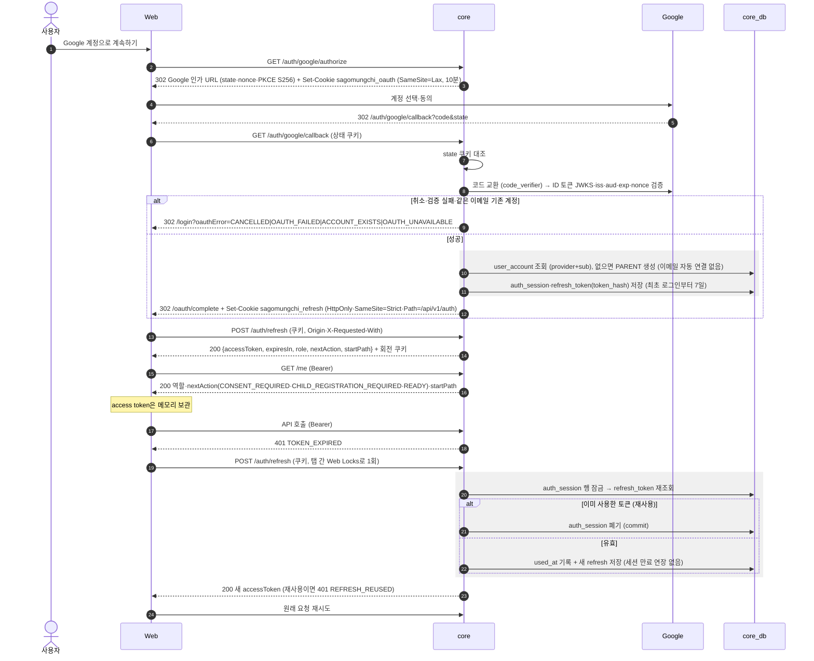

### 2.2 자녀 등록·법정대리인 동의

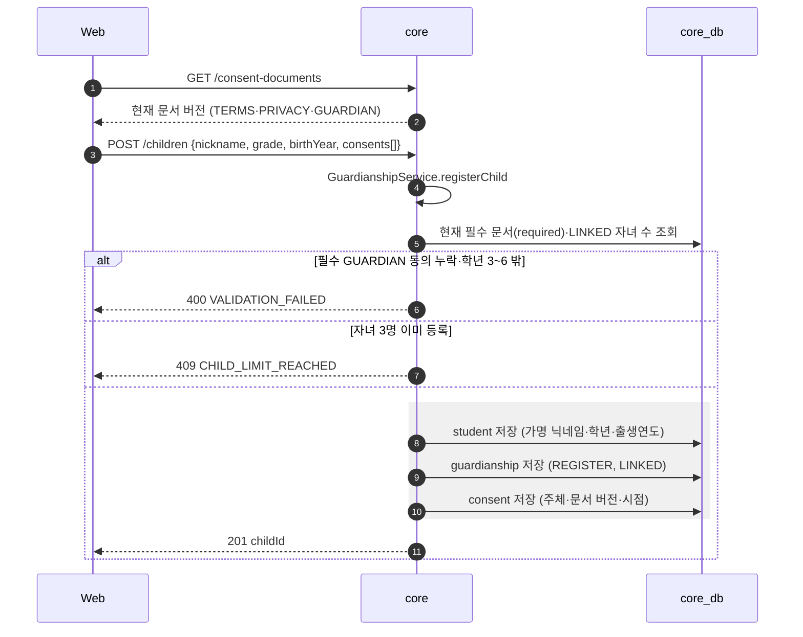

- 자녀는 전원 만 14세 미만으로 간주, GUARDIAN 동의를 항상 필수로 받음 (P01)
- 다른 보호자의 기존 자녀 연결 없음 (P02). 연결 해제(`unlink`)는 `X-Reauth-Token` 확인 후 처리, `audit_log` 기록 (FN-ACC-10)

### 2.4 학생 진입 (P01)

진입 경로는 학부모 동석(아래 첫 다이어그램)과 등록 기기 + PIN 단독 진입(기기 등록·PIN 로그인 다이어그램) 두 가지다 (2026-10-27 개정, API 명세 3.11).

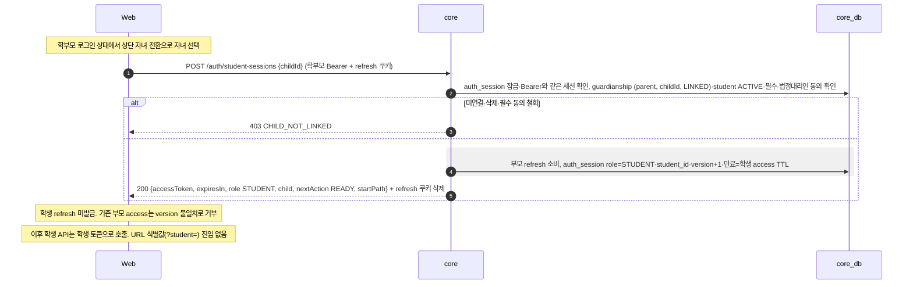

기기 등록 (학부모 1회 승인)

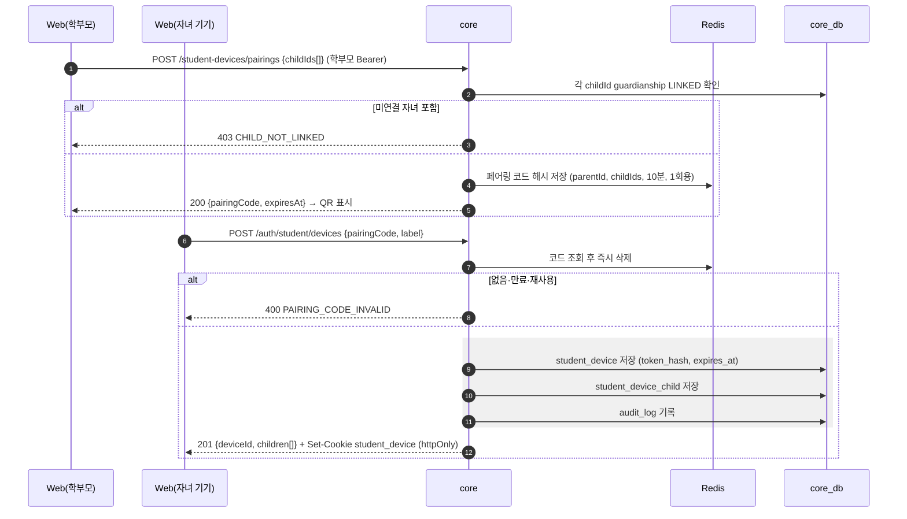

PIN 로그인 (학부모 부재 시 단독 진입)

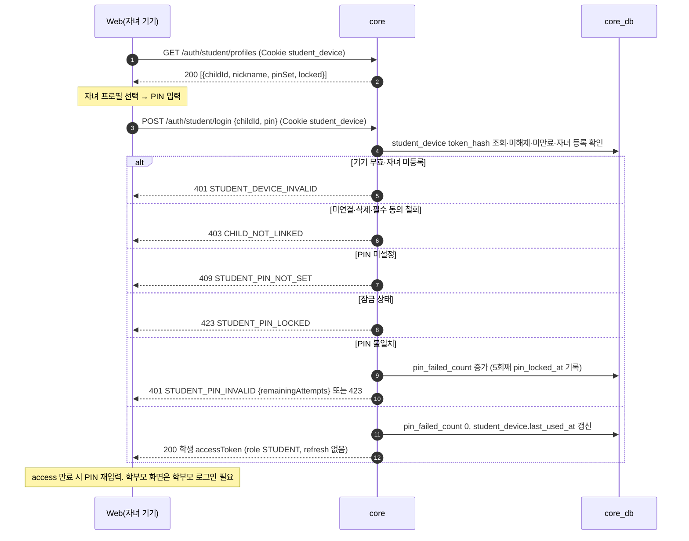

- PIN 잠금 해제는 학부모 `PUT /children/{childId}/pin`(재확인 필요)으로만 가능
- 학부모가 기기를 해제하면(`DELETE /student-devices/{deviceId}`) 이후 PIN 로그인은 `401 STUDENT_DEVICE_INVALID`

### 2.3 자녀 범위 권한 확인 (모든 자녀 대상 API 공통)

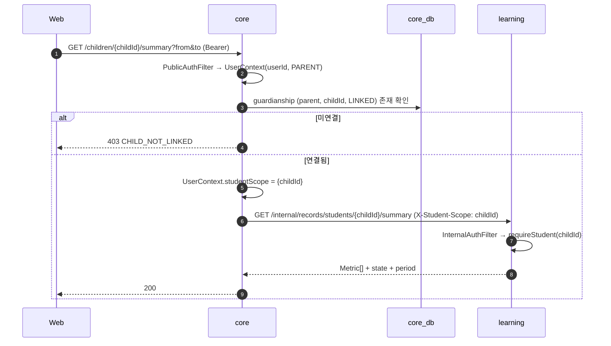

---

## 3. 미션 학습

### 3.1 시작·초안 저장·답변 제출

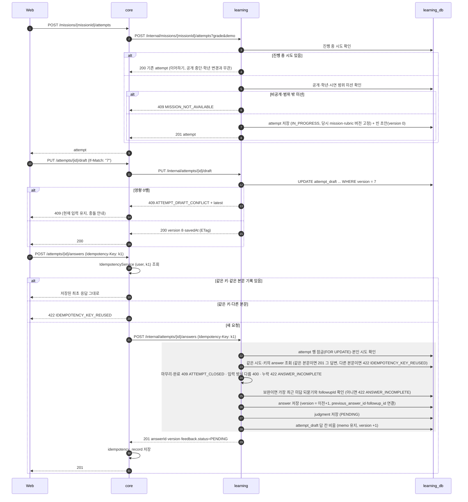

- 저장 성공(201)과 이후 피드백 처리 성공을 분리 (FN-LRN-10). 피드백은 3.2의 별도 요청
- learning도 시도·키(ERD UK)로 같은 키를 처리. core가 learning 응답을 받기 전에 끊겨 다시 보내도 답변은 1건
- 메모는 초안 `content.memo`로 함께 저장, 학생 본인 조회에만 포함 (P05)
- 무료 플랜은 시도 시작 시 하루 3개 미션 한도 확인, 초과 시 `429 USAGE_LIMIT_REACHED` (P13)

### 3.2 피드백 SSE (판정·되묻기)

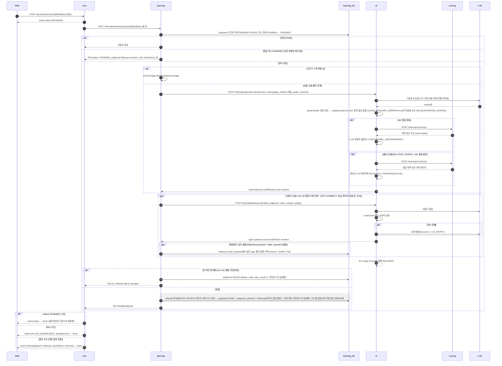

- 클라이언트가 끊겨도 core→learning 호출은 끝까지 진행·저장, 재요청 시 저장 결과 반환 (API 3.2)
- 타임아웃 예산: core→learning 80초 > learning→ai(judgments 35초 + followups 35초), 판정 리스 90초 (P12, 아키텍처 1.3)
- `nextActions`: 되묻기 생성 시 `[ANSWER_FOLLOWUP, FINISH]`(FINISH = "이대로 돌아보기"), 되묻기 2회 소진·고르기 CORRECT면 `[FINISH]` (P04)
- 판정 보류(`result = HELD`)는 정상 처리(`DONE`), 처리 실패(`process_status = FAILED`)와 구분 (NFR-REL-04)
- 보류 사유 결정은 모두 ai 담당, learning은 `judge_verified`·학년을 포함한 기준표 전달 (상태 다이어그램 3.3)

### 3.3 마무리·정답 공개·돌아보기

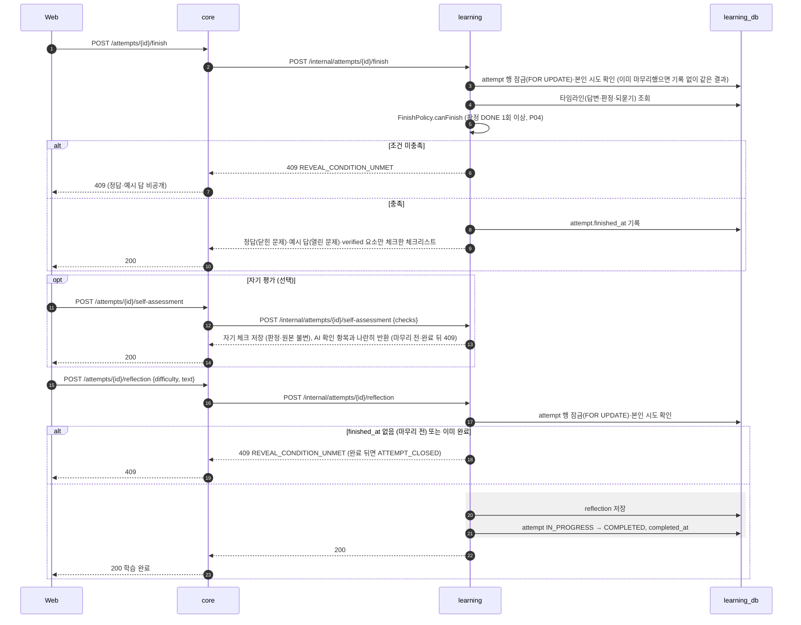

---

## 4. 대시보드 조회
- 2.3 권한 확인 후 core가 learning `/internal/records/...`를 그대로 프록시 (서비스 간 추가 호출 없음)
- 응답의 `state`(`OK`·`NO_RECORD`·`INSUFFICIENT_SAMPLE`)와 조회 실패(5xx → `FAILED`)를 화면에서 구분 (FN-DSH-11)

---

## 5. 분석 대화 SSE

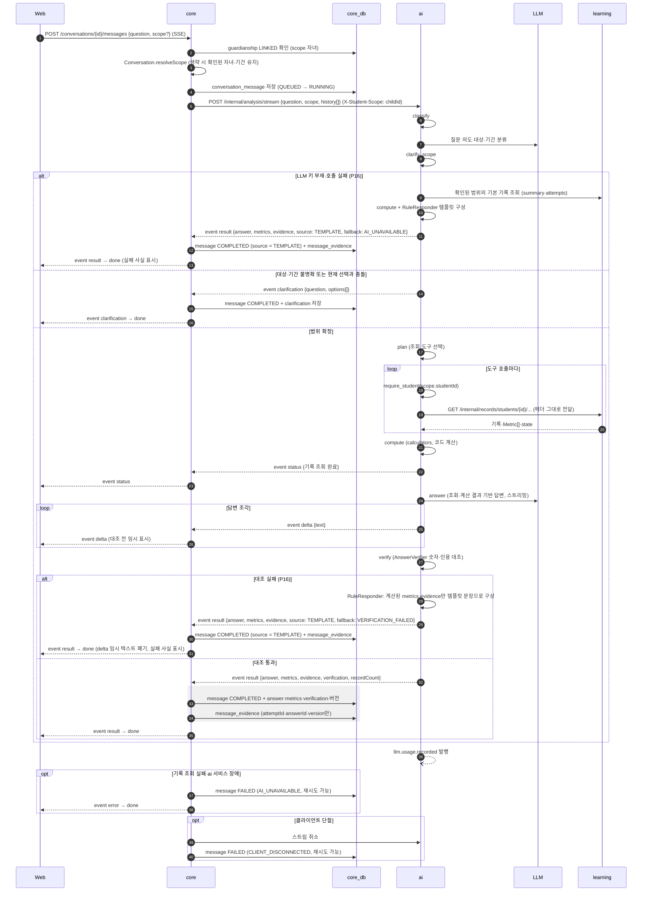

- 재시도(`/messages/{id}/retry`): 같은 행 `FAILED → RUNNING` 조건부 전이 후 같은 흐름 (ERD 3.2)
- 대조 실패·LLM 키 부재·호출 실패 시 규칙 응답 모드(`source = TEMPLATE`), 기록 조회 자체 실패는 `error` (FN-AGT-06·10, P16)
- 무료 플랜은 대화 생성 시 `429 USAGE_LIMIT_REACHED`, 프리미엄은 하루 30회 (P13)
- 근거 확인(`/evidence`): core가 `message_evidence` ID로 learning `/internal/records/evidence` 조회, 삭제된 기록은 `available: false`

---

## 6. 주간 리포트

### 6.1 자동 생성

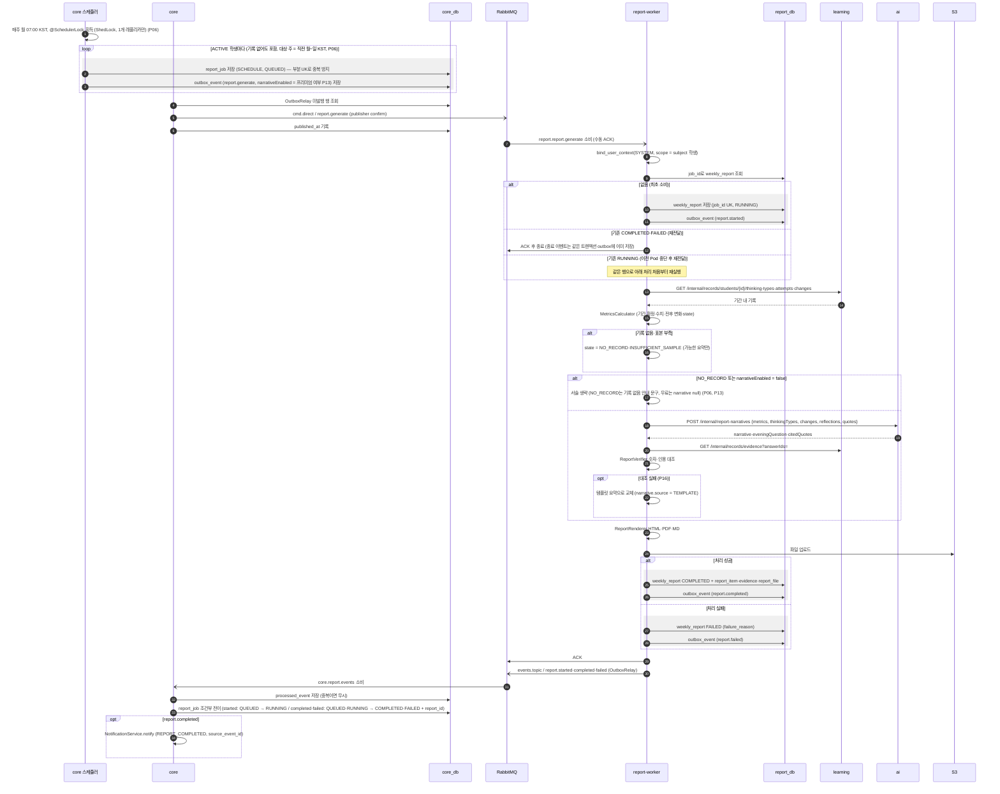

- 소비 실패(예외)는 `report.report.generate.retry.1~3` 경유 지연 재시도 3회(1·5·15분, P12) → `report.report.generate.dlq` (아키텍처 1.6, `definitions.json`)
- `report.started`보다 `report.completed`가 먼저 도착해도 `QUEUED → COMPLETED` 허용 (상태 다이어그램 4.1)
- KEDA가 `report.report.generate` 큐 길이로 report-worker 0~N 확장

### 6.2 알림 전달 (SSE 다중 레플리카)

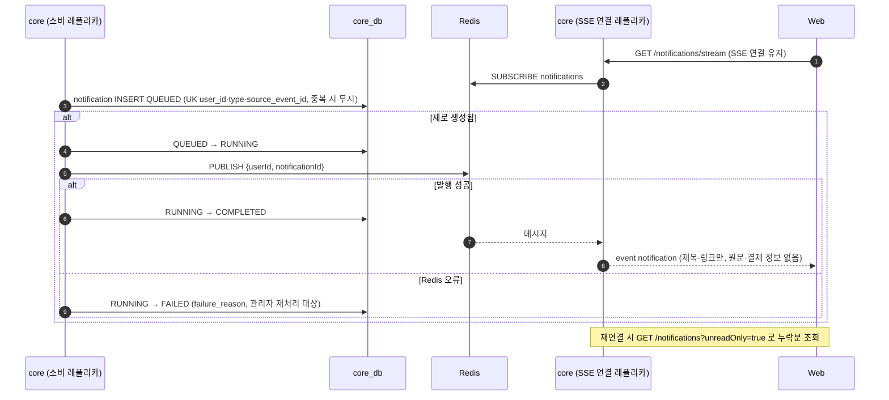

### 6.3 조회·다운로드

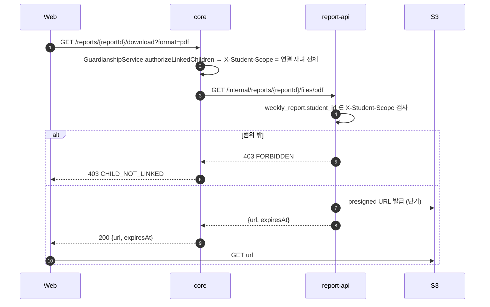

- `reportId`처럼 경로에 자녀 ID가 없는 API는 core가 연결 자녀 전체를 범위로 전달하고, 소유 서비스(report-api)가 리소스의 학생 ID로 검사
- 상세 조회 시 core가 `report_view` 저장 (열람률 지표)
- 재생성(`/regenerate`): 새 `report_job(REGENERATE)` + outbox → 6.1과 같은 흐름, `weekly_report.revision` 증가 (기존 판 보존·최신판 기본 조회. 학부모는 리포트당 1회, 초과 시 409 REGENERATE_NOT_ALLOWED, 관리자 무제한, P06)

---

## 7. 결제·구독 (토스페이먼츠 테스트)

### 7.1 주문·승인

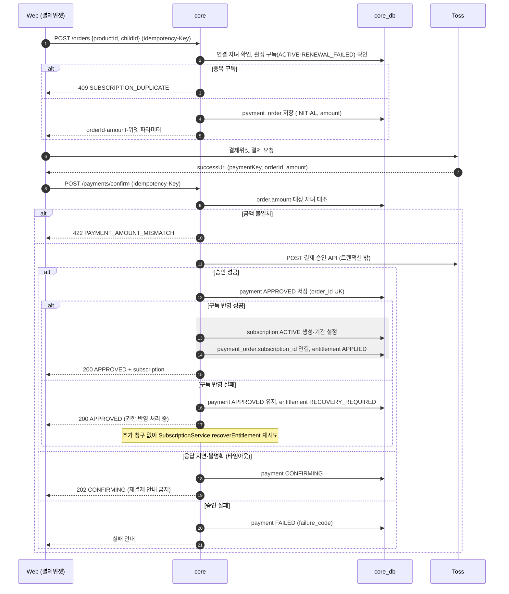

### 7.2 상태 확인·웹훅

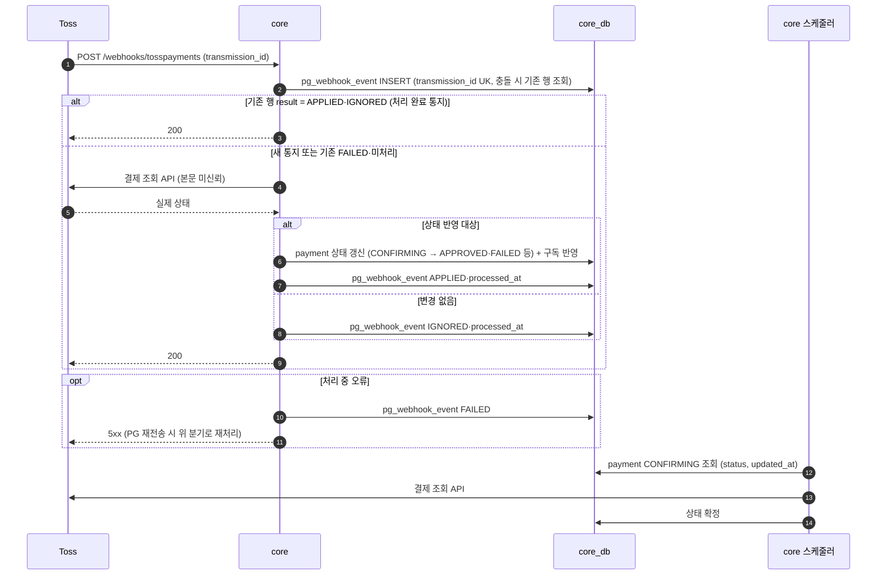

### 7.3 정기 청구·해지

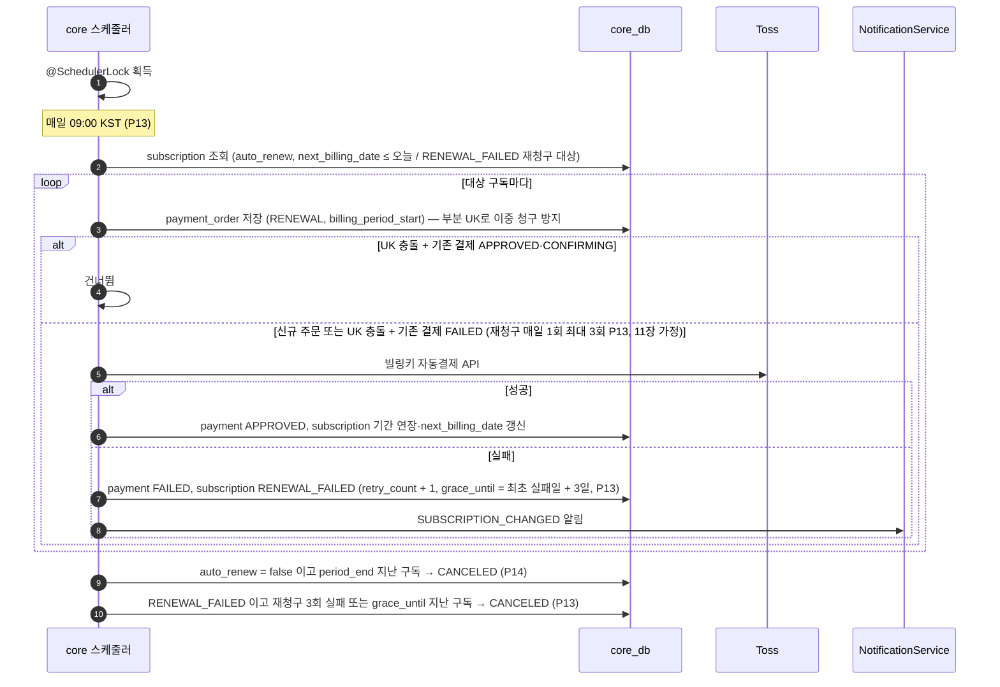

### 7.4 환불

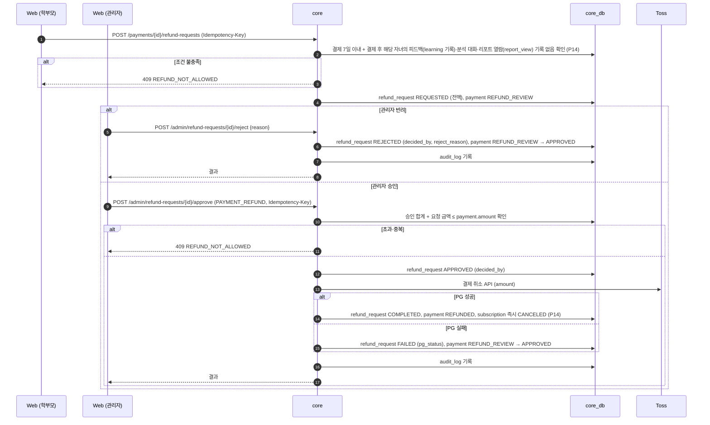

- PG 취소 응답이 불명확하면 PG 조회로 확정 후 반영 (재취소 요청 금지, FN-ADM-16)

---

## 8. 오류 신고·정정

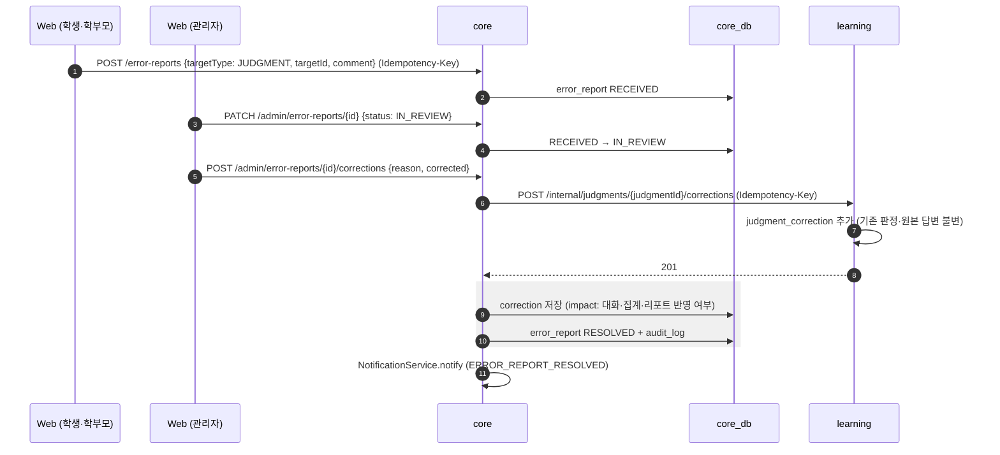

- 접수만으로 판정을 바꾸지 않음 (FN-SUP-02). 정정 없이 종료하는 경우 `IN_REVIEW → RESOLVED`만 수행

---

## 9. 모델·프롬프트 버전 활성화

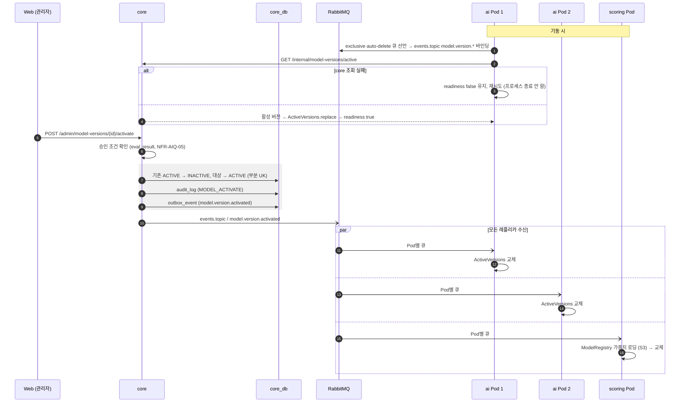

- 롤백(`/rollback`): 이전 승인 버전 재활성화로 같은 흐름, 재분석 여부는 `audit_log.detail` 기록 (FN-ADM-18)
- 기준표(`kind = RUBRIC`) 행은 core 레지스트리의 승인·활성 기록만 담당. learning은 이 이벤트를 소비하지 않으며, `judge_verified`·현재 기준표 버전 반영은 관리자 미션 API(`/admin/missions/...`)로 별도 수행

---

## 10. 학생 삭제 전파·LLM 사용량

### 10.1 `student.deleted`

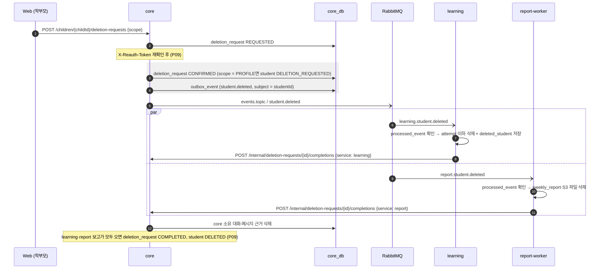

### 10.2 `llm.usage.recorded`

```mermaid
sequenceDiagram
  autonumber
  participant A as ai·scoring
  participant MQ as RabbitMQ
  participant C as core
  participant DB as core_db

  A->>A: LLM 호출(ai LlmClient)·모델 추론(scoring) 완료 (토큰·지연·성공 여부)
  A-)MQ: events.topic / llm.usage.recorded (학생 ID·원문 없음, best-effort)
  MQ-)C: core.llm.usage.recorded
  C->>DB: llm_usage INSERT (event_id UK, 중복 무시), cost_usd = 설정 단가로 계산
```

---

## 11. 확인 필요 가정
- `student.deleted` 완료 확인: learning 이벤트 발행 없음 원칙에 따라 이벤트 대신 core 내부 API로 완료 보고(10.1). 보고 호출 실패 시 지연 재시도(1·5·15분)로 재전달 → 삭제는 멱등이라 다시 보고 (P09)
- `report.started`·`report.completed` 순서 역전 허용 (상태 다이어그램 4.1)
- 정기 청구 재시도(7.3): ERD 부분 UK `(subscription_id, billing_period_start) WHERE kind = 'RENEWAL'` 때문에 같은 기간 새 주문 불가. 가정은 "기존 주문의 결제가 `FAILED`면 같은 주문으로 재청구". PG 주문번호 재사용 가능 여부 확인 후 ERD 반영 필요
- 웹훅 처리 실패 시 5xx 응답으로 PG 재전송 유도(7.2): 토스페이먼츠 재전송 정책 확인 필요
