# 상태 다이어그램

- 근거: [ERD](erd.md) 상태 컬럼, [API 명세서](api-spec.md) 1.4·1.5, [기능명세서](functional-spec.md) 1.2, [아키텍처 설계](architecture.md) 1.6·2.1, [클래스 다이어그램](class-diagram.md), [시퀀스 다이어그램](sequence-diagram.md)
- 범위: DB 상태 컬럼별 허용 전이, 전이 트리거, 담당 클래스, 동시성 보호 조건
- 표에 없는 전이는 금지. Domain 엔티티 메서드가 허용 여부를 검사하고, Repository는 조건부 UPDATE로 동시 갱신을 막음 (아키텍처 2.1)
- `(P04)` 형태는 확정 정책 번호, 내용은 [기능명세서 1.4](functional-spec.md#14-확정-정책)

---

## 1. 공통 규칙

| 항목 | 규칙 |
|---|---|
| 상태값 | API 1.5·ERD CHECK 코드값 그대로 |
| 전이 검사 | 엔티티 메서드(`Judgment.acquire()` 등)가 현재 상태로 허용 여부 판단, 불허 시 `BusinessException(409)` |
| 동시성 | 상태 변경 SQL은 `UPDATE ... SET status = :to WHERE id = :id AND status IN (:from)` 형태. 영향 행 0이면 다른 요청이 먼저 처리한 것으로 보고 현재 상태 재조회 |
| 이벤트 소비 | `processed_event` 저장 + 조건부 UPDATE 같은 트랜잭션. 중복·역순 이벤트는 영향 행 0으로 무시 (아키텍처 1.6) |
| 이력 | 상태 덮어쓰기와 별도로 결과 행은 보존: 답변·판정·정정·리포트 revision은 새 행 (ERD 1장) |
| 종료 상태 | 다이어그램의 `[*]`로 나가는 상태. 이후 재처리는 새 행 또는 표에 명시한 전이만 |

---

## 2. 계정·동의·자녀

### 2.1 `user_account.status` · `withdrawal_request.status`

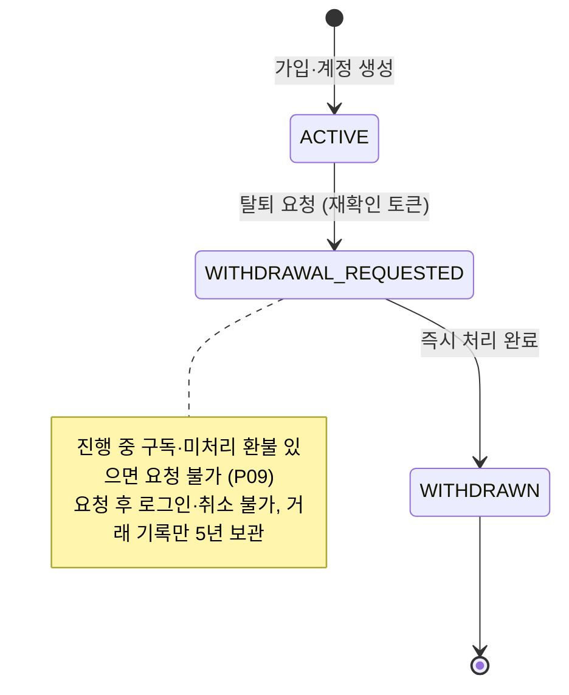

| 전이 | 트리거 | 담당 | 조건 |
|---|---|---|---|
| → `ACTIVE` | `POST /auth/signup` | `AccountService.signup` | `login_id` UK |
| `ACTIVE → WITHDRAWAL_REQUESTED` | `POST /me/withdrawal` + `X-Reauth-Token` | `AccountService.requestWithdrawal` → `UserAccount.requestWithdrawal()` | 진행 중 구독·미처리 환불 없음(있으면 `409 WITHDRAWAL_BLOCKED`) + `WHERE status = 'ACTIVE'`, 같은 트랜잭션에 `withdrawal_request(REQUESTED)`·refresh token 폐기·자녀 전원 삭제 요청 (P09) |
| `WITHDRAWAL_REQUESTED → WITHDRAWN` | 자녀 삭제 요청 전부 `COMPLETED` (P09) | `UserAccount.completeWithdrawal()` | 진행 중 구독 없음·미처리 환불 없음, `withdrawal_request REQUESTED → COMPLETED` 동시 전이 |

### 2.2 `student.status` · `deletion_request.status`

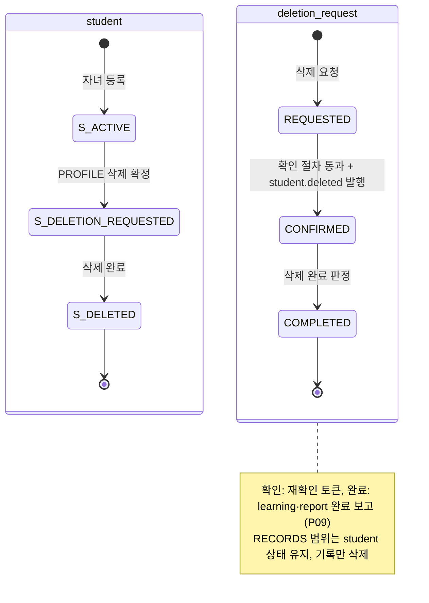

- 다이어그램 상태명 `S_*` = `student.status` 값 (`ACTIVE`·`DELETION_REQUESTED`·`DELETED`), 이름 충돌 방지용 접두어

| 전이 | 트리거 | 담당 | 조건 |
|---|---|---|---|
| `deletion_request → REQUESTED` | `POST /children/{id}/deletion-requests` | `GuardianshipService.requestDeletion` | 연결 자녀(`LINKED`)만 |
| `REQUESTED → CONFIRMED` | `X-Reauth-Token` 재확인 (P09) | `GuardianshipService.confirmDeletion` → `DeletionRequest.confirm()` | 같은 트랜잭션에 `outbox_event(student.deleted)`, `scope = PROFILE`이면 `student ACTIVE → DELETION_REQUESTED` |
| `CONFIRMED → COMPLETED`, `student → DELETED` | learning·report 모두 `POST /internal/deletion-requests/{id}/completions` 보고 (P09) | `DeletionRequest.complete()`, `Student.markDeleted()` | `deleted_at` 기록. 이후 모든 조회에서 제외, 근거는 `available: false` |

### 2.3 `guardianship.status` · `consent.status`

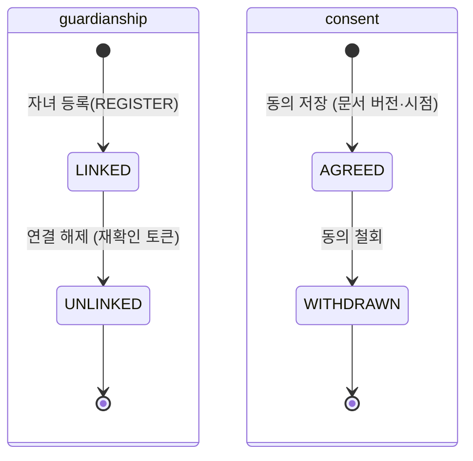

| 전이 | 트리거 | 담당 | 조건 |
|---|---|---|---|
| → `LINKED` | `POST /children` | `GuardianshipService.registerChild` | 부분 UK `(parent_user_id, student_id) WHERE LINKED`, 학부모당 `LINKED` 3명 이하 (P02). 다른 보호자 연결 없음 |
| `LINKED → UNLINKED` | `DELETE /children/{id}/link` | `Guardianship.unlink()` | `WHERE status = 'LINKED'`. 재연결은 새 행 (이력 보존) |
| → `AGREED` | 가입·자녀 등록 | `ConsentService.record` | 필수 문서(`required`) 모두 동의해야 저장 진행 |
| `AGREED → WITHDRAWN` | `POST /me/consents/{id}/withdrawal` | `Consent.withdraw()` | 행 유지 + `withdrawn_at`. 필수 동의 철회 시 대상 자녀(자녀 동의) 또는 계정 이용 차단, 삭제·탈퇴는 별도 요청. 선택 동의는 해당 기능만 중단 (P09) |

---

## 3. 학습

### 3.1 `mission.status`

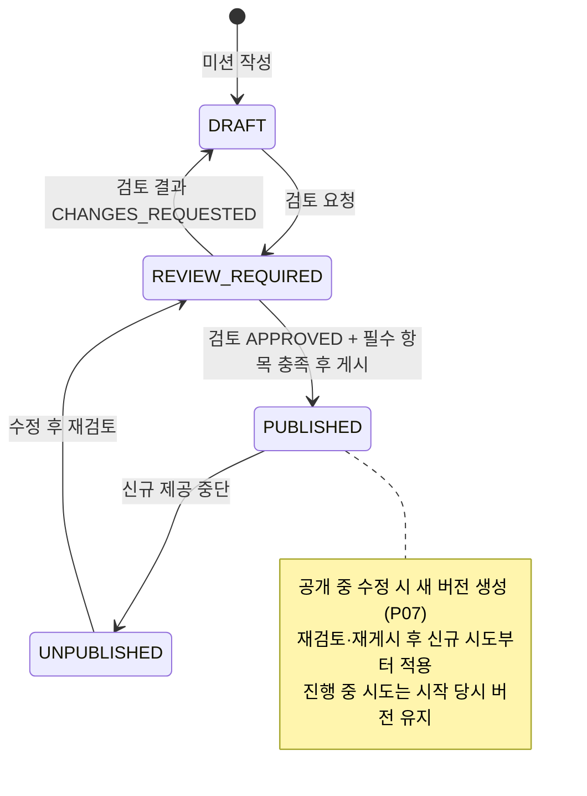

| 전이 | 트리거 | 담당 | 조건 |
|---|---|---|---|
| → `DRAFT` | `POST /admin/missions` (CONTENT) | `MissionService.create` | `mission_version` v1 생성 |
| `DRAFT → REVIEW_REQUIRED` | `POST /admin/missions/{id}/review-request` (P07) | `Mission.requestReview()` | 현재 미션·기준표 버전 존재 |
| `REVIEW_REQUIRED → DRAFT` | `POST /admin/missions/{id}/review` `CHANGES_REQUESTED` | `Mission.rejectReview()` | `mission_review` 행 추가 |
| `REVIEW_REQUIRED → PUBLISHED` | `POST /admin/missions/{id}/publish` | `Mission.publish(snapshot)` | 현재 버전 대상 최신 리뷰 `APPROVED` + `requirePublishable` 통과, 아니면 `422 MISSION_PUBLISH_INCOMPLETE`. `published_at` 기록, `audit_log` |
| `PUBLISHED → UNPUBLISHED` | `POST /admin/missions/{id}/unpublish` | `Mission.unpublish()` | 신규 시도 차단(`MISSION_NOT_AVAILABLE`), 기존 시도는 당시 버전 유지 |
| `UNPUBLISHED → REVIEW_REQUIRED` | 수정 후 검토 요청 | `Mission.requestReview()` | 재공개는 다시 `REVIEW_REQUIRED → PUBLISHED` 경로만 |

- 학생 목록 노출 조건: `status = PUBLISHED` + 학년·입력 방식 범위 + `demo_only`는 시연 계정만 (FN-LRN-02)

### 3.2 `attempt.status` (미션 수행)

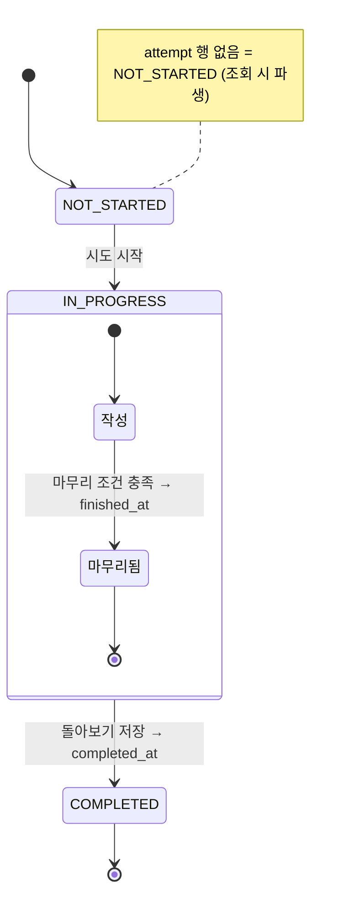

| 전이 | 트리거 | 담당 | 조건 |
|---|---|---|---|
| `NOT_STARTED → IN_PROGRESS` | `POST /missions/{id}/attempts` | `AttemptService.start` | 부분 UK `(student_id, mission_id) WHERE IN_PROGRESS` 충돌 시 기존 시도 반환 |
| `작성 → 마무리됨` (상태값 유지) | `POST /attempts/{id}/finish` | `Attempt.finish(now)` | `FinishPolicy.canFinish`: 판정 `DONE` 1회 이상 (P04), 미충족 `409 REVEAL_CONDITION_UNMET`. `finished_at` 이후 정답·예시 답 공개 |
| `IN_PROGRESS → COMPLETED` | `POST /attempts/{id}/reflection` | `Attempt.complete(now)` | `finished_at` 있음(없으면 `409 REVEAL_CONDITION_UNMET`) + `WHERE status = 'IN_PROGRESS'`. 난이도 필수·달라진 점 선택 (P04) |

- `COMPLETED` 시도에 답변·초안·도움·돌아보기 쓰기 → `409 ATTEMPT_CLOSED` (`Attempt.requireOpen()`)
- `finished_at` 이후 답변 제출은 `409 ATTEMPT_CLOSED` (P04)
- 되묻기는 시도당 최대 2회, 2회째 보완 답변 판정 후 되묻기 생성 없이 마무리 안내. 고르기 `CORRECT`도 되묻기 없이 마무리 안내 (P04)
- 초안 `attempt_draft.version`: 저장마다 +1, `WHERE version = :ifMatch` (상태값 없음)

### 3.3 `judgment.process_status` (판정 처리)

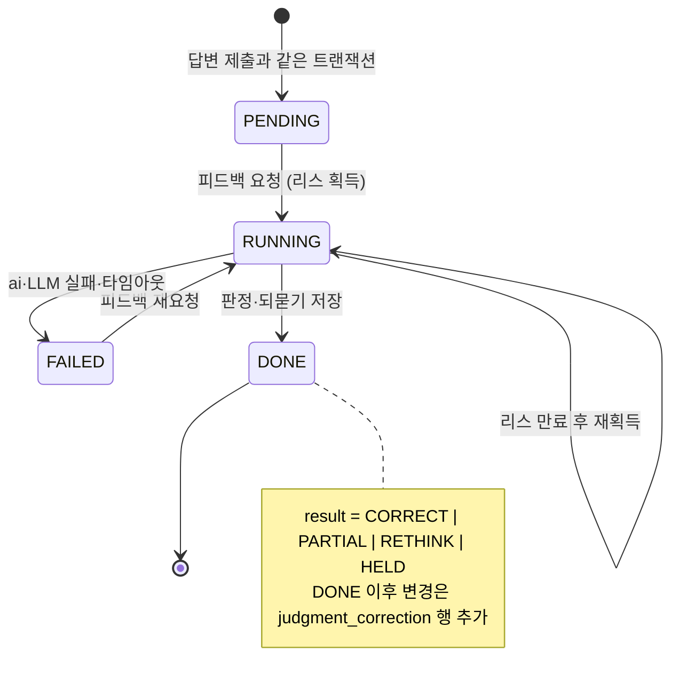

| 전이 | 트리거 | 담당 | 조건부 UPDATE |
|---|---|---|---|
| → `PENDING` | `POST /attempts/{id}/answers` | `JudgmentService.createPending` | `answer_id` UK |
| `PENDING·FAILED → RUNNING`, 만료 `RUNNING → RUNNING` | `POST /answers/{id}/feedback` | `Judgment.acquire(now, lease)` | `SET process_status='RUNNING', lease_until=:until WHERE answer_id=:id AND (process_status IN ('PENDING','FAILED') OR (process_status='RUNNING' AND lease_until < now()))` |
| `RUNNING → DONE` | 처리 완료 | `Judgment.done(...)`·`hold(reason)` | `WHERE id=:id AND process_status='RUNNING' AND lease_until=:until` (획득한 리스 값으로 늦게 끝난 이전 처리의 덮어쓰기 방지) |
| `RUNNING → FAILED` | 예외·타임아웃 | `Judgment.fail(code)` | 위와 같은 리스 조건, `retry_count + 1` |

- 전이 실패(영향 0행) 시 현재 상태로 응답: `DONE` → 저장 결과, 유효 `RUNNING` → `status` 이벤트 후 종료 (API 1.4)
- 고착 `RUNNING` 탐지 인덱스 `(process_status, lease_until)`, 리스 90초·탐지 주기 1분 (P12)
- 리스 시간은 core→learning 피드백 호출 타임아웃보다 길게 설정. 짧으면 처리 중인 판정을 다른 요청이 재획득해 LLM 호출이 중복됨

#### `judgment.result` 결정 (`DONE`일 때만 값 존재)

| 결과 | 조건 | 결정 위치 |
|---|---|---|
| `CORRECT` | 규칙: 정답 키 일치·수학 동치 / LLM: 모든 필수 요소 `verified && satisfied` | learning `RuleJudge` / ai `QuoteVerifier.decide` |
| `PARTIAL` | LLM: 일부 요소만 충족 (배점 기준) | ai `QuoteVerifier.decide` |
| `RETHINK` | 규칙: 불일치 / LLM: 충족 요소 없음 | learning `RuleJudge` / ai `QuoteVerifier.decide` |
| `HELD` | `INSUFFICIENT_EVIDENCE`·`QUOTE_MISMATCH`·`TOO_SHORT`·`UNVERIFIED_SCOPE`(`judge_verified = false`)·`MODEL_DISAGREEMENT`(M2 불일치)·`LOW_CONFIDENCE`(M1 0.8 미만, P15) | ai `QuoteVerifier.decide`·`JudgmentService` (learning은 `judge_verified`·학년 포함 기준표 전달만) |

- `HELD`는 정상 처리 결과(`DONE`), API 실패는 `FAILED` → 서로 다른 컬럼 (NFR-REL-04)

---

## 4. 작업 (대화·리포트·알림)

### 4.1 `report_job.status` (core)

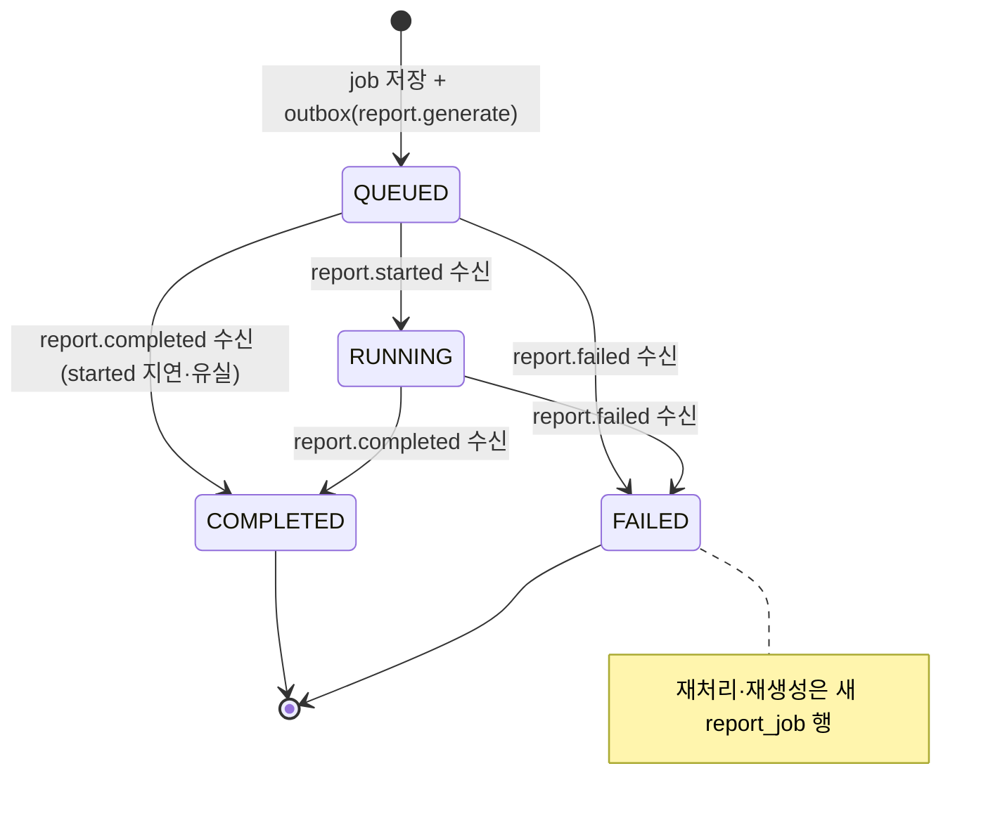

| 전이 | 트리거 | 담당 | 조건부 UPDATE |
|---|---|---|---|
| → `QUEUED` | 스케줄(`SCHEDULE`)·`/regenerate`(`REGENERATE`)·`/admin/jobs/{id}/retry`(`ADMIN_RETRY`) | `ReportJobService` | 부분 UK `(student_id, period_from) WHERE trigger='SCHEDULE'` |
| `QUEUED → RUNNING` | `report.started` | `ReportJob.start()` | `WHERE id=:jobId AND status='QUEUED'`, `started_at` |
| `QUEUED·RUNNING → COMPLETED` | `report.completed` | `ReportJob.complete(reportId)` | `WHERE id=:jobId AND status IN ('QUEUED','RUNNING')`, `report_id`·`completed_at` + 알림 |
| `QUEUED·RUNNING → FAILED` | `report.failed` | `ReportJob.fail(reason)` | 위와 같음, `failure_reason` |

- 종료 후 늦게 온 `report.started`는 영향 0행 → 무시 (역순 도착 허용)
- `QUEUED` 고착(메시지 DLQ 이동)은 관리자 `/admin/queues`·`/admin/jobs`에서 확인 후 재처리 (FN-ADM-07). 재처리는 새 행이라 기존 `QUEUED` 행의 정리 방식은 9장 가정

### 4.2 `weekly_report.status` · `state` (report)

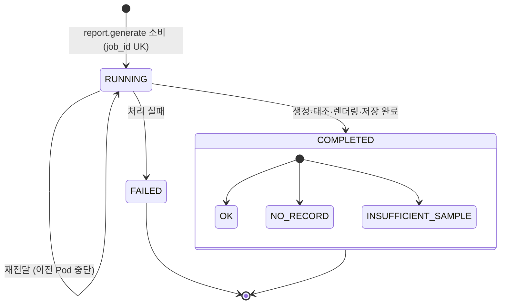

| 전이 | 트리거 | 담당 | 조건 |
|---|---|---|---|
| → `RUNNING` | `report.generate` | `ReportRepository.create_running` | `job_id` UK. 같은 트랜잭션에 `outbox(report.started)` |
| `RUNNING → RUNNING` | 같은 메시지 재전달 | `GenerationService.generate` | 기존 행이 `RUNNING`이면 같은 행으로 처음부터 재실행. 항목·파일은 완료 트랜잭션에서만 저장하므로 덮어쓸 중간 결과 없음 (`report.started` 재발행 없음) |
| `RUNNING → COMPLETED` | 처리 성공 | `WeeklyReport.complete(state, ...)` | `WHERE id=:id AND status='RUNNING'` + `outbox(report.completed)` 같은 트랜잭션 |
| `RUNNING → FAILED` | 예외 | `WeeklyReport.fail(reason)` | 위와 같음 + `outbox(report.failed)` |

- 기록 없는 주·표본 부족 주는 `COMPLETED` + `state`, 처리 실패(`FAILED`)와 구분 (FN-RPT-11)
- 재생성은 새 행(`revision + 1`), 기존 결과 보존·최신판 기본 조회 (P06)

### 4.3 `conversation_message.status`

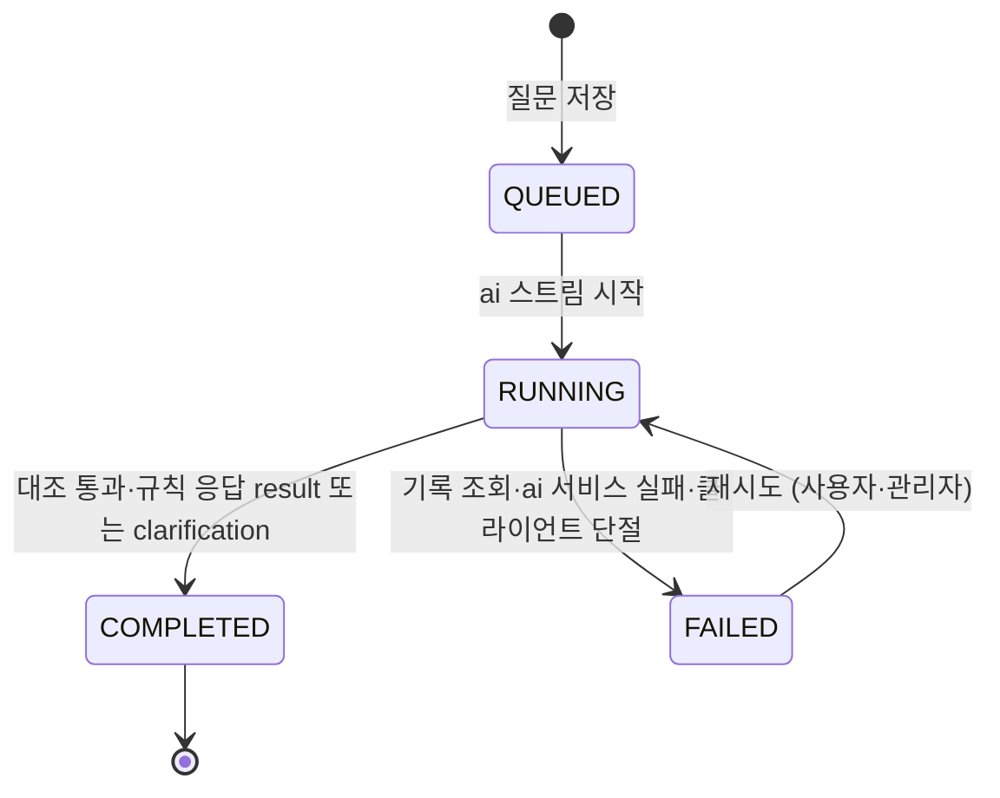

| 전이 | 트리거 | 담당 | 조건부 UPDATE |
|---|---|---|---|
| → `QUEUED` | `POST /conversations/{id}/messages` | `ConversationService.startMessage` | UK `(conversation_id, seq)` |
| `QUEUED → RUNNING` | ai 호출 직전 | `ConversationMessage.start()` | `WHERE status='QUEUED'` + `job_execution(RUNNING)` |
| `RUNNING → COMPLETED` | `result`·`clarification` 이벤트 | `complete(...)`·`clarify(...)` | `WHERE status='RUNNING'`, 확정 답변·`message_evidence` 같은 트랜잭션 |
| `RUNNING → FAILED` | `error` 이벤트·예외·단절 | `fail(code)` | `failure_code` (`AI_UNAVAILABLE`·`CLIENT_DISCONNECTED`). 대조 실패·LLM 장애는 규칙 응답으로 `COMPLETED` (P16) |
| `FAILED → RUNNING` | `/messages/{id}/retry`, `/admin/jobs/{id}/retry` | `retry()` | `WHERE status='FAILED'`, `retry_count + 1` |

- `answer` 컬럼에는 대조 통과한 확정 답변 또는 규칙 응답 템플릿(`source = TEMPLATE`)만 저장 (`delta` 임시 텍스트 미저장)

### 4.4 `notification.status` · `job_execution.status`

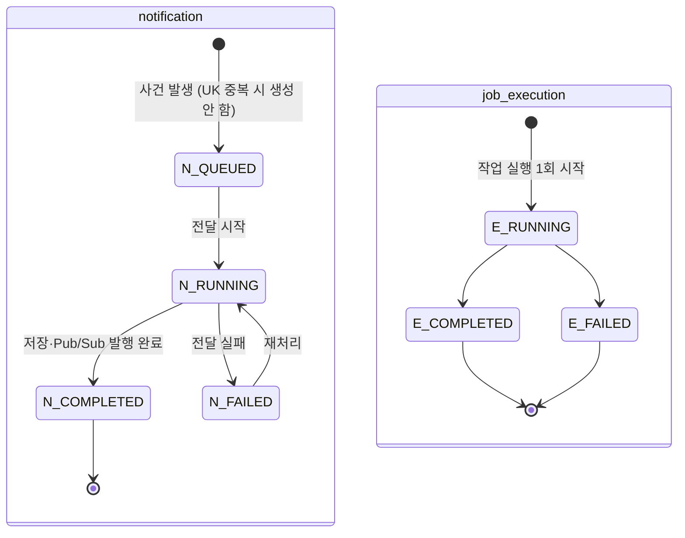

- `N_*` = `notification.status`, `E_*` = `job_execution.status` 값 (접두어는 이름 충돌 방지용)
- `notification` UK `(user_id, type, source_event_id)` → 같은 사건 재처리 시 중복 생성 없음 (FN-SUP-08). 읽음(`read_at`)은 상태와 독립
- `job_execution`: 대화·리포트·알림 실행 1회당 1행, UK `(job_type, job_id, attempt_no)`. 재처리는 `attempt_no + 1` 새 행 (FN-ADM-07)
- 알림 채널은 인앱만, 이메일·푸시 없음 (P10)

---

## 5. 신고·문의

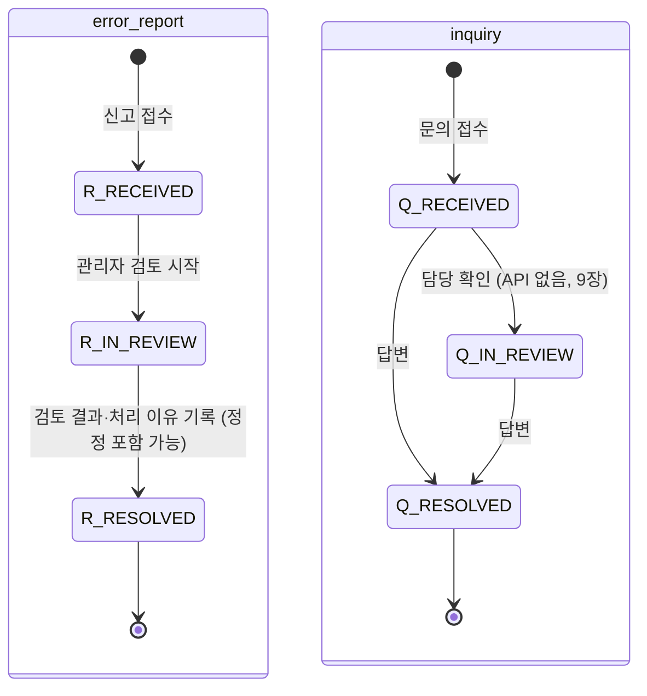

| 대상 | 전이 | 담당 | 조건 |
|---|---|---|---|
| `error_report` | `RECEIVED → IN_REVIEW` | `ErrorReport.startReview(adminId)` | `SERVICE_OPS`, `WHERE status='RECEIVED'` |
| `error_report` | `IN_REVIEW → RESOLVED` | `ErrorReport.resolve(result, reason)` | `review_result`·`resolution_reason` 필수. 정정은 learning `judgment_correction` 성공 후 같은 요청에서 전이 + 알림 |
| `inquiry` | `RECEIVED·IN_REVIEW → RESOLVED` | `POST /admin/inquiries/{id}/answer` → `Inquiry.answer(adminId, answer)` | `answer`·`answered_at` + `INQUIRY_ANSWERED` 알림. `IN_REVIEW` 전환 API가 없어 확정 전에는 `RECEIVED → RESOLVED`만 구현 |

- `R_*`·`Q_*` 접두어 = 각 테이블 `status` 값
- 접수만으로 판정 변경 금지, `RECEIVED → RESOLVED` 직행 금지 (검토 기록 필수, FN-SUP-02)

---

## 6. 결제·구독

### 6.1 `payment.status` · `entitlement_status`

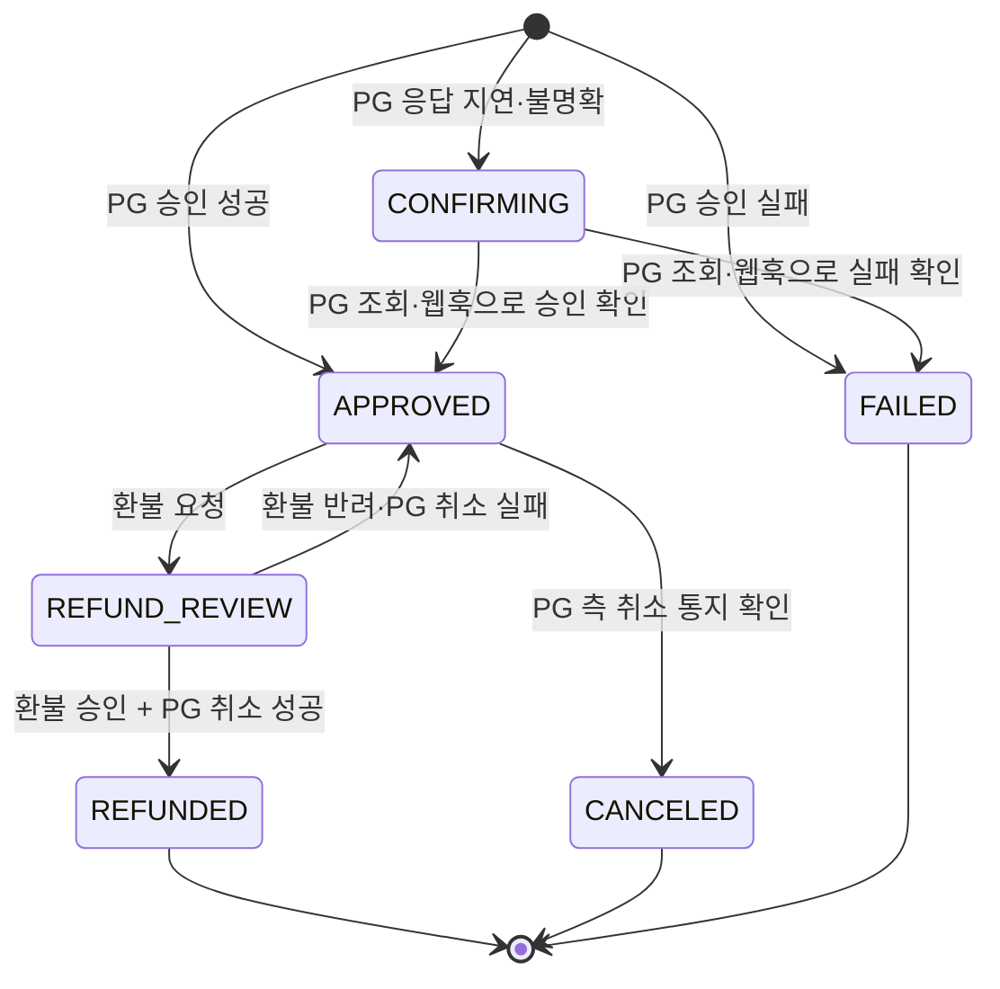

| 전이 | 트리거 | 담당 | 조건 |
|---|---|---|---|
| → `APPROVED·CONFIRMING·FAILED` | `POST /payments/confirm` | `PaymentService.confirm` | `order_id` UK (같은 주문 1회), 금액 대조 통과 후에만 PG 호출 |
| → `APPROVED·CONFIRMING·FAILED` | 정기 청구 | `BillingScheduler.chargeDue` → `SubscriptionService.renew` | `RENEWAL` 주문 1건당 1회, 실패 시 매일 1회 최대 3회 재청구 (P13), 주문 재사용은 9장 가정 |
| `CONFIRMING → APPROVED·FAILED` | 웹훅·`GET /payments/{orderId}`·스케줄러 재조회 | `PaymentService.refreshStatus`·`handleWebhook` | `WHERE status='CONFIRMING'`, 본문 대신 PG 조회 결과 사용 |
| `APPROVED → REFUND_REVIEW` | `POST /payments/{id}/refund-requests` | `RefundService.request` → `Payment.startRefundReview()` | `WHERE status='APPROVED'`, 결제 7일 이내 + 프리미엄 기능 미사용 아니면 `409 REFUND_NOT_ALLOWED` (P14) |
| `REFUND_REVIEW → REFUNDED·APPROVED` | 환불 승인 결과·반려 | `Payment.refund()` / 복귀 | `refund_request` 결과와 같은 트랜잭션 |
| `APPROVED → CANCELED` | 웹훅 취소 통지 | `Payment.cancel()` | PG 조회로 확인된 경우만 |

| `entitlement_status` | 전이 | 담당 |
|---|---|---|
| → `APPLIED` | 승인 후 구독 반영 성공 | `Payment.applyEntitlement()` |
| → `RECOVERY_REQUIRED` | 승인 후 구독 반영 실패 | `Payment.requireRecovery()` |
| `RECOVERY_REQUIRED → APPLIED` | 복구 재시도 (추가 청구 없음) | `SubscriptionService.recoverEntitlement` |

- 부분 환불 없음, 전액 환불만 `REFUNDED` (P14). `REFUNDED` 시 대상 구독 즉시 `CANCELED`

### 6.2 `subscription.status`

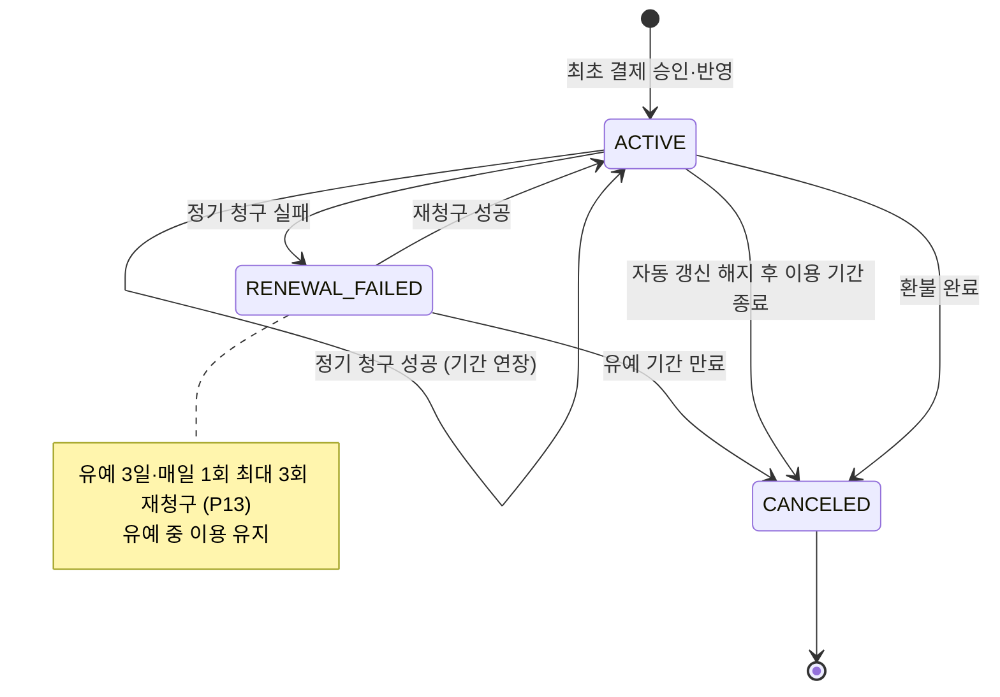

| 전이 | 트리거 | 담당 | 조건 |
|---|---|---|---|
| → `ACTIVE` | 결제 승인 | `SubscriptionService.activate` | 부분 UK `(student_id) WHERE status IN ('ACTIVE','RENEWAL_FAILED')` → 중복 `409 SUBSCRIPTION_DUPLICATE` |
| `ACTIVE → ACTIVE` | `BillingScheduler.chargeDue` 성공 | `Subscription.extend(...)` | `payment_order` 부분 UK `(subscription_id, billing_period_start) WHERE RENEWAL` |
| `ACTIVE → RENEWAL_FAILED` | 청구 실패 | `Subscription.renewalFailed(graceUntil)` | `renewal_retry_count + 1`, 알림 `SUBSCRIPTION_CHANGED` |
| `RENEWAL_FAILED → ACTIVE·CANCELED` | 재청구 성공 / `grace_until` 경과 | `extend` / `cancel()` | 3회 재청구 모두 실패하거나 `grace_until`(실패일 + 3일) 경과 시 `CANCELED` (P13). 같은 기간 재청구는 ERD 부분 UK와 충돌 → 9장 가정 |
| `ACTIVE → CANCELED` | `auto_renew = false` + `period_end` 경과 | `BillingScheduler.expireCanceled` → `cancel()` | `auto_renew_canceled_at` 기록 후에만, `canceled_at` = `period_end` 경과 시점 (P14) |
| `ACTIVE → CANCELED` | 환불 완료(`payment REFUNDED`) | `RefundService` → `cancel()` | 같은 트랜잭션, `canceled_at` = 환불 완료 시점 (P14) |

- 자동 갱신 해지(`DELETE /subscriptions/{id}/auto-renewal`)는 상태 전이 없이 `auto_renew = false`만 변경, `period_end` 전 해지 철회(`PUT`)는 `auto_renew = true` (P14)
- `CANCELED` 이후 해당 자녀는 무료 플랜 한도 적용 (P13)

### 6.3 `refund_request.status`

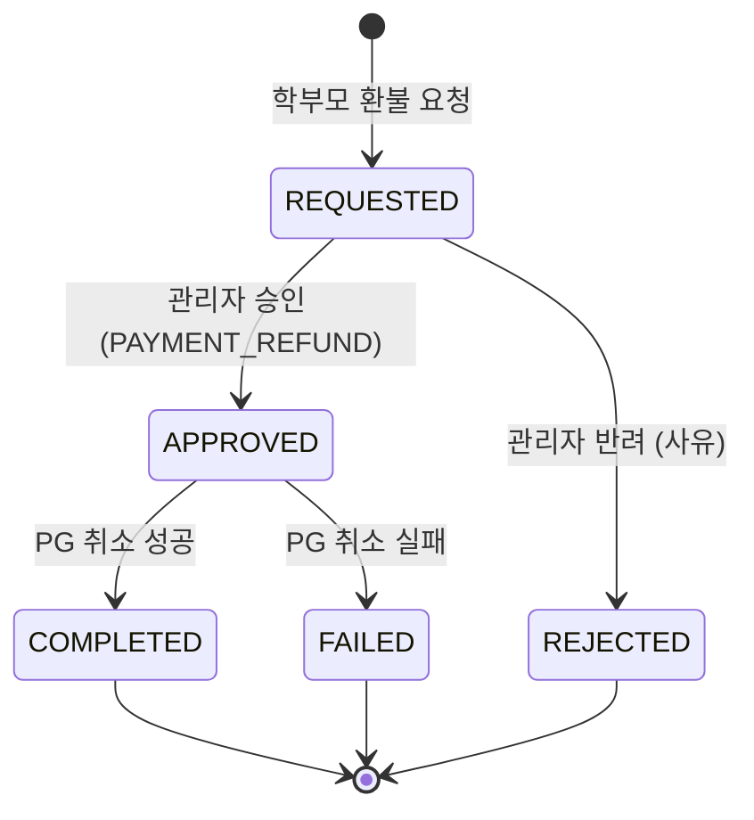

- `REQUESTED → APPROVED`: 승인된 환불 합계 + 요청 금액 ≤ `payment.amount`, 아니면 `409 REFUND_NOT_ALLOWED` (FN-ADM-16)
- `FAILED`는 종료, 재시도는 새 요청 행 (중복 취소 방지). 모든 전이에 `decided_by`·`audit_log`

---

## 7. 운영

### 7.1 `model_version.status`

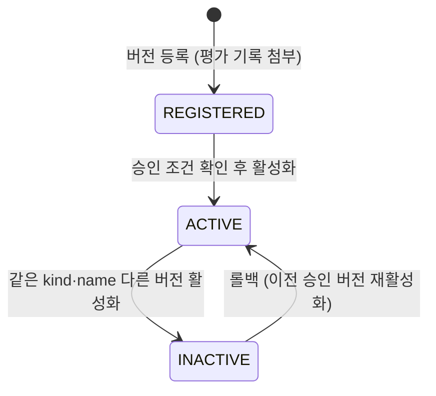

| 전이 | 트리거 | 담당 | 조건 |
|---|---|---|---|
| `REGISTERED → ACTIVE` | `/admin/model-versions/{id}/activate` | `ModelVersionService.activate` → `ModelVersion.activate()` | `eval_result` 승인 기준(NFR-AIQ-05) 충족, 같은 트랜잭션에서 기존 `ACTIVE → INACTIVE` 먼저 (부분 UK `(kind, name) WHERE ACTIVE`) + `outbox(model.version.activated)` + `audit_log` |
| `INACTIVE → ACTIVE` | `/admin/model-versions/{id}/rollback` | `ModelVersionService.rollback` | 한 번 `ACTIVE`였던(승인된) 버전만, 재분석 여부 `audit_log.detail` |

- 기존 판정·분석·리포트 결과는 당시 버전을 유지 (덮어쓰기 금지, FN-ADM-18)

### 7.2 `outbox_event` 발행 상태 (core·report)

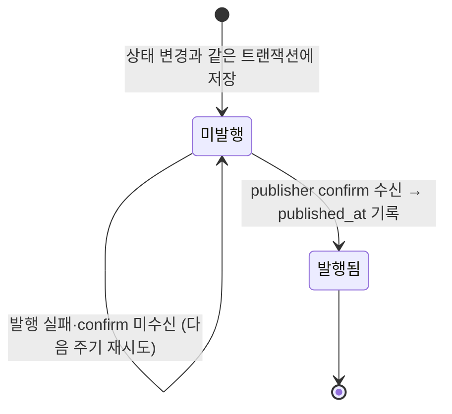

- 상태 컬럼 없이 `published_at IS NULL` = 미발행 (인덱스 `(created_at) WHERE published_at IS NULL`)
- confirm 후 `published_at` 기록 전 중단되면 같은 이벤트가 다시 발행됨 → 소비자는 `processed_event`로 멱등 처리 (at-least-once)

---

## 8. 클라이언트 상태 (DB 미저장)

### 8.1 초안 저장 표시 (FN-LRN-16, 17)

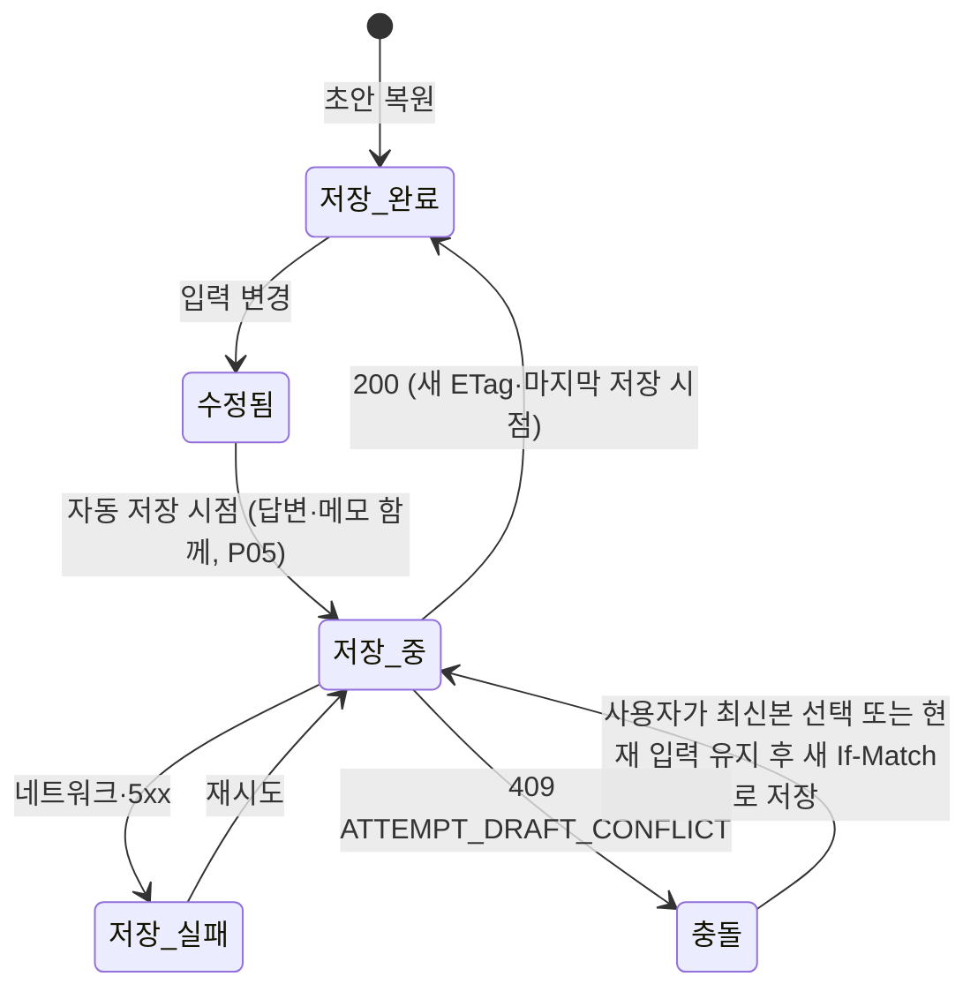

- API 1.5의 초안 상태 중 서버 값은 `SAVED`만, 저장 중·저장 실패·충돌은 화면 상태
- 저장 실패·충돌 중에도 현재 입력 유지, 조용히 덮어쓰기 금지 (FN-LRN-17)

---

## 9. 확인 필요 가정
- 문의 `RECEIVED → IN_REVIEW`: API 2.8에 상태 변경 엔드포인트 없음 → 필요 시 API 명세에 추가
- 돌아보기를 마무리 전에 저장하면 `409 REVEAL_CONDITION_UNMET`으로 거부 (기존 오류 코드 재사용)
- 정기 청구 재청구: ERD 부분 UK `(subscription_id, billing_period_start) WHERE kind = 'RENEWAL'`로 같은 기간 새 주문 불가. 가정은 "기존 주문의 결제가 `FAILED`면 같은 주문으로 재청구", PG 주문번호 재사용 가능 여부 확인 후 ERD 반영 필요
- `QUEUED` 고착 `report_job` 재처리: 새 행 생성 시 기존 행을 `FAILED`(`failure_reason = SUPERSEDED`)로 종료하는 방안 가정. 늦게 도착한 기존 job 이벤트는 조건부 UPDATE로 무시
