# 상태 다이어그램

- 근거: [ERD](erd.md) 상태 컬럼, [API 명세서](api-spec.md) 1.4·1.5, [기능명세서](functional-spec.md) 1.2, [아키텍처 설계](architecture.md) 1.6·2.1, [클래스 다이어그램](class-diagram.md), [시퀀스 다이어그램](sequence-diagram.md)
- 범위: DB 상태 컬럼별 허용 전이, 전이 트리거, 담당 클래스, 동시성 보호 조건
- 표에 없는 전이는 금지. Domain 엔티티 메서드가 허용 여부를 검사하고, Repository는 조건부 UPDATE로 동시 갱신을 막음 (아키텍처 2.1)
- `(P04)` 형태는 확정 정책 번호, 내용은 [기능명세서 1.4](functional-spec.md#14-확정-정책)

---

## 1. 공통 규칙

| 항목 | 규칙 |
|---|---|
| 상태값 | API 1.5·ERD CHECK 코드값 그대로 |
| 전이 검사 | 엔티티 메서드(`Judgment.acquire()` 등)가 현재 상태로 허용 여부 판단, 불허 시 `BusinessException(409)` |
| 동시성 | 상태 변경 SQL은 `UPDATE ... SET status = :to WHERE id = :id AND status IN (:from)` 형태. 영향 행 0이면 다른 요청이 먼저 처리한 것으로 보고 현재 상태 재조회. 예외: `model_version`은 같은 kind·name advisory lock 안에서 재조회 후 `WHERE id`로 갱신(7.1), 동의 철회는 보호자 행 잠금 후 갱신(2.3) |
| 이벤트 소비 | `processed_event` 저장 + 조건부 UPDATE 같은 트랜잭션. 중복·역순 이벤트는 영향 행 0으로 무시 (아키텍처 1.6) |
| 이력 | 상태 덮어쓰기와 별도로 결과 행은 보존: 답변·판정·정정·리포트 revision은 새 행 (ERD 1장) |
| 종료 상태 | 다이어그램의 `[*]`로 나가는 상태. 이후 재처리는 새 행 또는 표에 명시한 전이만 |

---

## 2. 계정·동의·자녀

### 2.1 `user_account.status` · `withdrawal_request.status`

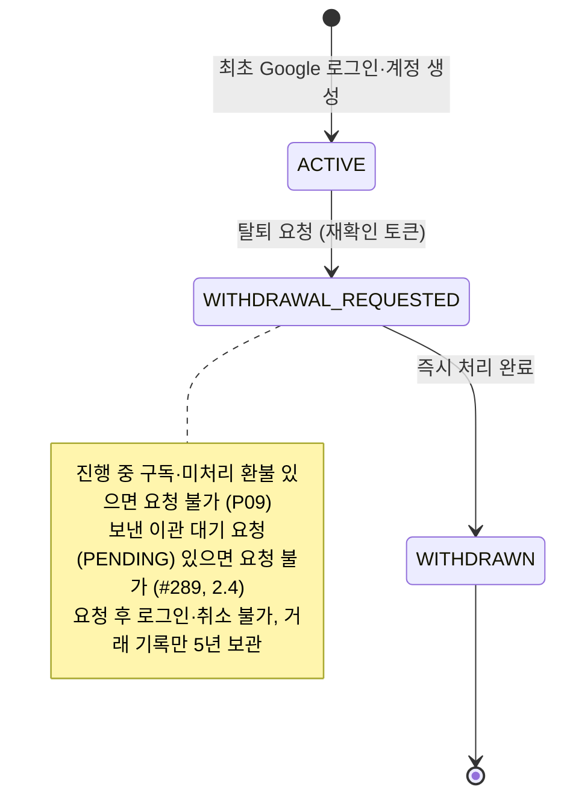

| 전이 | 트리거 | 담당 | 조건 |
|---|---|---|---|
| → `ACTIVE` | 최초 `GET /auth/google/callback` (#36) | `AuthService.login` | `(oauth_provider, oauth_subject)` UK로 PARENT 생성, 같은 `login_id`(이메일) 기존 계정은 자동 연결 없이 `ACCOUNT_EXISTS` |
| `ACTIVE → WITHDRAWAL_REQUESTED` | `POST /me/withdrawal` + `X-Reauth-Token` | `AccountWithdrawalService.request` | 보낸 이관 대기 요청 없음(있으면 `409 TRANSFER_PENDING`, #289. 탈퇴 화면에서 이관 유지 또는 `POST /guardian-transfers/cancel-outgoing` 후 재진입) + 진행 중 구독·미처리 환불 없음(있으면 `409 WITHDRAWAL_BLOCKED`) + `WHERE status = 'ACTIVE'`, 같은 트랜잭션에 `withdrawal_request(REQUESTED)`·계정의 `auth_session` 전체 폐기(refresh 포함)·자녀 전원 삭제 요청 (P09). 이관 수락으로 종료된 연결(`transferred_at`)의 자녀와 선택 이관 상담은 삭제 대상에서 제외 |
| `WITHDRAWAL_REQUESTED → WITHDRAWN` | 자녀 삭제 요청 전부 `COMPLETED` (P09) | `AccountManagementService.completeWithdrawal` | 진행 중 구독 없음·미처리 환불 없음, `withdrawal_request REQUESTED → COMPLETED` 동시 전이 |

### 2.2 `student.status` · `deletion_request.status`

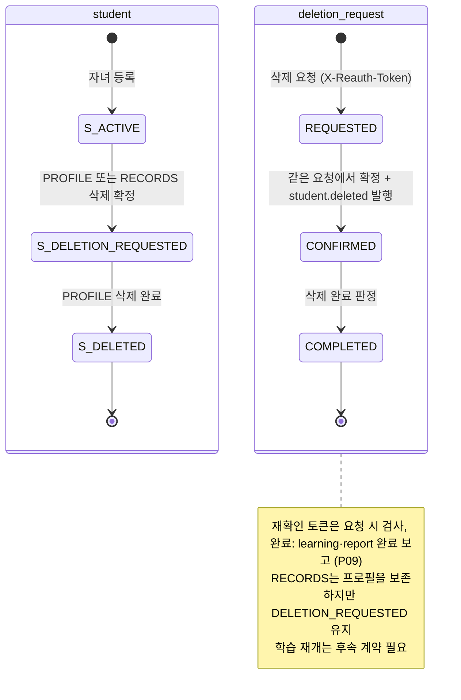

- 다이어그램 상태명 `S_*` = `student.status` 값 (`ACTIVE`·`DELETION_REQUESTED`·`DELETED`), 이름 충돌 방지용 접두어

| 전이 | 트리거 | 담당 | 조건 |
|---|---|---|---|
| `deletion_request → REQUESTED` | `POST /children/{id}/deletion-requests` + `X-Reauth-Token` (P09) | `ChildManagementService.delete` | 연결 자녀(`LINKED`)만. 이관 대기 중인 자녀는 `409 TRANSFER_PENDING`(#289). 재확인 토큰이 없거나 무효면 `403 REAUTH_REQUIRED`로 행을 만들지 않음 |
| `REQUESTED → CONFIRMED` | 같은 요청 안에서 바로 확정 (별도 확인 API 없음, 연결 해제·탈퇴와 같은 1단계) | `ChildManagementService.confirm` | 현재 구현은 CONFIRMED 행을 바로 생성한다. 같은 트랜잭션에 `outbox_event(student.deleted)`를 저장하며 두 scope 모두 `student ACTIVE → DELETION_REQUESTED`로 차단한다 |
| `CONFIRMED → COMPLETED` | learning·report 모두 `POST /internal/deletion-requests/{id}/completions` 보고 (P09) | `ChildManagementService.complete` | PROFILE만 프로필을 제거한다. RECORDS는 프로필과 DELETION_REQUESTED를 유지하며 자동 학습 재개는 구현되지 않았다. 탈퇴 대기 중이면 후속 PROFILE 삭제를 요청한다 |

2026-10-29 통합 검증: 위 상태 설명은 현재 core 구현을 반영한다. RECORDS 이후 학습 재개 정책을 새로 확정한 것이 아니며, 재개 기능은 core·learning·report가 함께 계약을 정해야 한다.

### 2.3 `guardianship.status` · `consent.status`

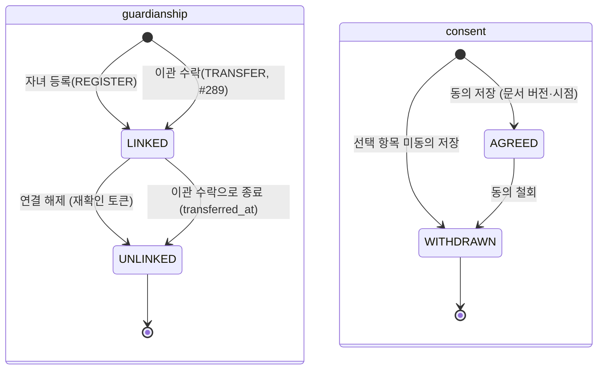

| 전이 | 트리거 | 담당 | 조건 |
|---|---|---|---|
| → `LINKED` (`REGISTER`) | `POST /children` | `GuardianshipService.register` | 부분 UK `(parent_user_id, student_id) WHERE LINKED`와 V26 부분 UK `(student_id) WHERE LINKED`(자녀당 현재 보호자 1명), 보호자 행 잠금 후 학부모당 `LINKED` 3명 이하 (P02). 임의로 다른 보호자를 추가 연결하지 않으며, 보호자 교체는 아래 이관 수락으로만 |
| → `LINKED` (`TRANSFER`) | `POST /guardian-transfers/{id}/accept` (#289) | `GuardianTransferService.accept` | 받는 학부모의 필수 동의·보호자 동의·`TRANSFER_ACCEPT` 재인증, 받는 학부모 `LINKED` 3명 이하. 같은 트랜잭션에서 보내는 학부모 행을 먼저 종료한 뒤 새 행 삽입(V26 부분 UK 유지) |
| `LINKED → UNLINKED` | `DELETE /children/{id}/link` | `Guardianship.unlink()` | `WHERE status = 'LINKED'`. 이관 대기 중인 자녀는 `409 TRANSFER_PENDING`. 재연결은 새 행 (이력 보존) |
| `LINKED → UNLINKED` (이관 종료) | 이관 수락 (#289) | `GuardianTransferRepository.move` | `transferred_at` 기록(CHECK: `transferred_at`은 `UNLINKED`에만). 이 행은 이전 학부모의 기록 접근·삭제 권한과 탈퇴 삭제 대상에서 제외하며, 기존 학생 세션·등록 기기를 해제 |
| → `AGREED`·`WITHDRAWN` | 가입·자녀 등록·동의 변경 (`POST /me/consents`, `POST /children`) | `ConsentService.save` | 현재 문서 전체 항목과 필수 문서(`required`) 동의가 있어야 저장. 항목마다 최신 행과 선택이 다를 때만 새 행 저장(동의 AGREED, 선택 항목 미동의 WITHDRAWN). 재동의도 새 AGREED 행. 권한은 같은 문서·주체·자녀의 최신 행으로 판정 |
| `AGREED → WITHDRAWN` | `POST /me/consents/{id}/withdrawal` | `ConsentService.withdraw` | 보호자 행 잠금 후 본인 행 확인, 이미 WITHDRAWN이면 그대로 반환. 행 유지 + `withdrawn_at`. 필수 동의 철회 시 대상 자녀(자녀 동의) 또는 계정 이용 차단, 삭제·탈퇴는 별도 요청. 선택 동의는 해당 기능만 중단 (P09) |

- 선택 동의 문서 `COMMUNITY`(자녀 단위, P20, #388): 자녀 동의 요청에 `GUARDIAN`·`COMMUNITY` 중 보낼 문서만 담을 수 있고 `COMMUNITY`만 보낼 때는 현재 법정대리인 동의가 필요. 거부(`WITHDRAWN` 행)·철회 시 커뮤니티 공개 설정을 끄고 공유물을 `HIDDEN_SETTING`으로 바꿈(3.6). 이관 전 보호자의 옛 동의 철회는 영향 없음

### 2.4 `guardian_transfer.status` (#289 탈퇴 전 자녀 이관)

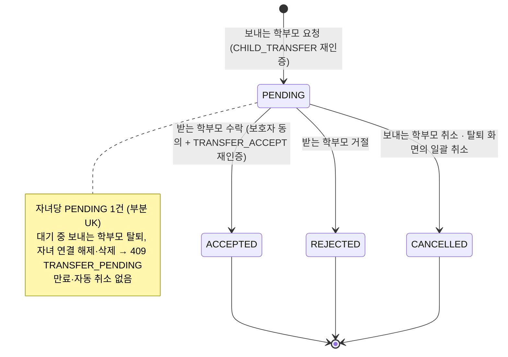

| 전이 | 트리거 | 담당 | 조건 |
|---|---|---|---|
| → `PENDING` | `POST /guardian-transfers` + `X-Reauth-Token` | `GuardianTransferService.request` | 보내는·받는 계정 잠금 후 둘 다 `ACTIVE`, 본인에게 이관 불가, 보내는 학부모의 필수 동의·현재 연결 자녀, 받는 학부모 `LINKED` 3명 미만, 보내는 학부모 탈퇴 가능(진행 중 구독·결제·환불 없음)·자녀 이관 가능 상태. 같은 자녀의 대기 요청이 같은 당사자·상담 포함 여부면 기존 요청 반환, 다르면 `409 TRANSFER_PENDING`. `CHILD_TRANSFER` 재인증은 마지막에 1회 소비 |
| `PENDING → ACCEPTED` | `POST /guardian-transfers/{id}/accept` + `X-Reauth-Token` | `GuardianTransferService.accept` | 받는 학부모 본인만. 계정→학생→요청 행 잠금 순서로 직렬화, 이미 `ACCEPTED`면 그대로 반환. 위 조건을 다시 검사하고 진행 중 분석 대화가 있으면 보류(`ConversationTransferService.requireIdle`). 같은 트랜잭션에서 2.3 연결 교체·보호자 동의 저장(실패 시 전체 롤백)·선택 시 상담 소유 이전·학생 세션과 등록 기기 해제 |
| `PENDING → REJECTED` | `POST /guardian-transfers/{id}/reject` | `GuardianTransferService.resolve` | 받는 학부모 본인만. 이미 처리된 요청은 `409 TRANSFER_ALREADY_RESOLVED` |
| `PENDING → CANCELLED` | `POST /guardian-transfers/{id}/cancel`, `POST /guardian-transfers/cancel-outgoing` | `GuardianTransferService.resolve`·`cancelOutgoing` | 보내는 학부모 본인만. 상대 계정이 이미 탈퇴해도 취소 가능. 일괄 취소는 탈퇴 화면의 "이관 취소 후 탈퇴 절차 진행"이며 취소만으로 탈퇴·삭제를 실행하지 않음 |

- 기능 플래그(`APP_GUARDIAN_TRANSFER_ENABLED`, 웹 `VITE_GUARDIAN_TRANSFER_ENABLED`, 기본 false)는 신규 대상 조회·요청·수락을 제어한다. 서버 기능 off에서 해당 API는 404이며, 본인의 기존 요청 조회·거절·취소는 기능 off·동의 누락에도 가능하다(#307). 완료된 이관 기록의 삭제 보호와 PENDING의 탈퇴·해제·삭제 차단은 유지하며, 대기를 명시적으로 취소·거절해야 차단이 해제된다. 취소는 자동 탈퇴·삭제를 실행하지 않는다. 근거: [이관 구현 기록](../report/auth-account.md#6-탈퇴-전-자녀-이관-289)

### 2.5 `auth_session` 잠금 (V24 동석 학생 진입·학부모 복귀)

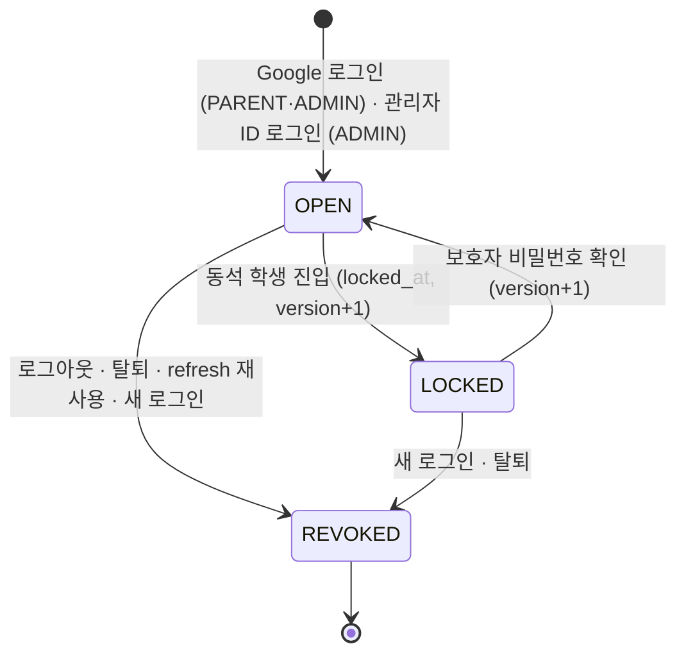

- 다이어그램 상태명은 설명용이며 DB 값이 아니다. `OPEN` = `revoked_at IS NULL AND locked_at IS NULL`, `LOCKED` = `locked_at IS NOT NULL`, `REVOKED` = `revoked_at IS NOT NULL`

| 전이 | 트리거 | 담당 | 조건 |
|---|---|---|---|
| `→ OPEN` | `GET /auth/google/callback` · `POST /auth/admin/login {loginId,password}` | `AuthService.login` · `AuthService.adminLogin` → `startSession` | Google은 PARENT·ADMIN, ID 로그인은 `admin_credential` 행이 있는 ACTIVE ADMIN만(#369, [API 명세서](api-spec.md) 5.1). 둘 다 같은 브라우저의 이전 refresh 쿠키 세션과 그 세션에서 들어간 학생 세션을 폐기한 뒤 새 세션 발급 |
| `OPEN → LOCKED` | `POST /auth/student-sessions` | `AuthService.enterStudent` | 부모 세션 행 잠금·version 일치·PARENT. 학생 auth_session을 `parent_session_id`=부모 세션으로 새로 만들고 학생 access만 발급. 부모 refresh 쿠키는 지우지 않음. 기존 부모 access는 `401 SESSION_CHANGED`, 잠긴 세션의 `/auth/refresh`는 refresh 토큰을 소비하지 않고 `401 PARENT_SESSION_LOCKED` |
| `LOCKED → OPEN` | `POST /auth/parent-unlock {password}` | `AuthService.unlockParent`·`GuardianPasswordService.attempt` | refresh 쿠키의 잠긴 세션과 보호자 비밀번호 확인. 성공 시 `locked_at` 해제·version+1·그 세션에서 들어간 학생 세션 폐기·refresh 회전. 실패 횟수는 오류 응답 전에 커밋, 5회째부터 `423 GUARDIAN_PASSWORD_LOCKED`, 미설정은 `409 GUARDIAN_PASSWORD_NOT_SET`. 잠기지 않은 세션은 refresh와 같이 처리 |
| `LOCKED → REVOKED` | 새 Google 로그인 · 관리자 ID 로그인 | `AuthService.login` · `AuthService.adminLogin` | 보호자 비밀번호 미설정·잠김일 때의 복귀 경로. 같은 브라우저의 이전 refresh 쿠키로 찾은 이전(잠긴) 세션과 그 세션에서 들어간 학생 세션을 폐기 |

- 단독 PIN 학생 로그인은 별도 학생 세션을 만들며 부모 세션을 잠그지 않는다. 보호자 비밀번호(`guardian_password`)는 계정당 1행이며 설정·변경은 `PUT /me/guardian-password`(학부모 확인 → 규칙 검사 → `GUARDIAN_PASSWORD` 재인증 소비, 성공 시 실패 횟수·잠금 초기화). 근거: [API 명세서](api-spec.md) 5.1, [ERD](erd.md) V24

---

## 3. 학습

### 3.1 `mission.status`

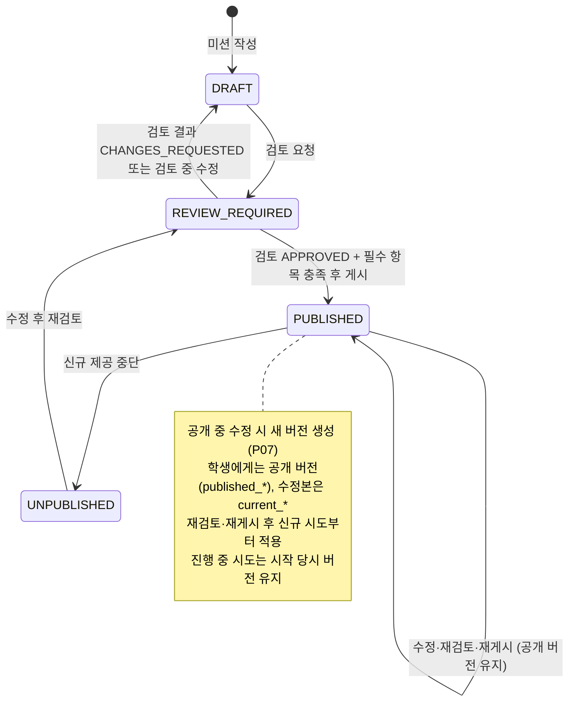

| 전이 | 트리거 | 담당 | 조건 |
|---|---|---|---|
| → `DRAFT` | `POST /admin/missions` (CONTENT) | `MissionService.create` | `mission_version` v1 생성, 기준표 버전 없음 |
| 수정 | `PATCH /admin/missions/{id}`·`PUT …/rubric` | `MissionService.update`·`putRubric` | 새 `mission_version`·`rubric_version` 추가 후 `current_*` 갱신(이전 버전 불변). `REVIEW_REQUIRED`는 검토 대상이 바뀌어 `DRAFT`, `DRAFT`·`PUBLISHED`·`UNPUBLISHED`는 상태 유지(공개 버전 `published_*` 그대로, #145) |
| `DRAFT·UNPUBLISHED → REVIEW_REQUIRED` | `POST /admin/missions/{id}/review-request` (P07) | `Mission.requestReview()` | 본문의 미션·기준표 버전이 현재 버전과 같음(아니면 `409 MISSION_VERSION_CONFLICT`), 기준표 버전 존재 |
| `PUBLISHED` 재검토 요청 | 같은 경로 | `Mission.requestReview()` | 현재 버전이 공개 버전과 다를 때만, 상태는 `PUBLISHED` 유지(학생 제공 계속, #145) |
| `REVIEW_REQUIRED → DRAFT` | `POST /admin/missions/{id}/review` `CHANGES_REQUESTED` | `Mission.rejectReview()` | `mission_review` 행 추가. `PUBLISHED` 재검토 반려는 상태 유지 |
| `REVIEW_REQUIRED → PUBLISHED`, `PUBLISHED` 재게시 | `POST /admin/missions/{id}/publish` | `Mission.publish(snapshot)` | 현재 미션·기준표 버전 대상 최신 리뷰 `APPROVED` + `requirePublishable` 통과, 아니면 `422 MISSION_PUBLISH_INCOMPLETE`. `published_*` ← `current_*`, `published_at` 기록. 감사 기록은 core 프록시(learning에 감사 테이블 없음) |
| `PUBLISHED → UNPUBLISHED` | `POST /admin/missions/{id}/unpublish` | `Mission.unpublish()` | 신규 시도 차단(`MISSION_NOT_AVAILABLE`), 기존 시도는 당시 버전 유지 |
| `UNPUBLISHED → REVIEW_REQUIRED` | 수정 후 검토 요청 | `Mission.requestReview()` | 재공개는 다시 `REVIEW_REQUIRED → PUBLISHED` 경로만 |

- 위에 없는 전이(예: `DRAFT`에서 게시, `UNPUBLISHED`에서 검토)는 `409 CONFLICT` (#145)
- 학생 목록 노출 조건: `status = PUBLISHED` + 공개 버전(`published_*`) 기준 학년·입력 방식 범위 + `demo_only`는 시연 계정만 (FN-LRN-02). 시연 학생 여부는 core가 learning 조회에 `demo`(`student.is_demo`)로 넘김 (api-spec 4.1, [#22 보고서](../report/learning.md))
- 개발·시연용 데모 미션 시드(`backend/learning-service/db/seed/`)는 위 관리자 흐름 없이 `PUBLISHED`·`DRAFT` 상태를 직접 넣으며 `mission_review`를 만들지 않음. 운영 미션은 위 전이만 사용 ([#22 보고서](../report/learning.md))

### 3.2 `attempt.status` (미션 수행)

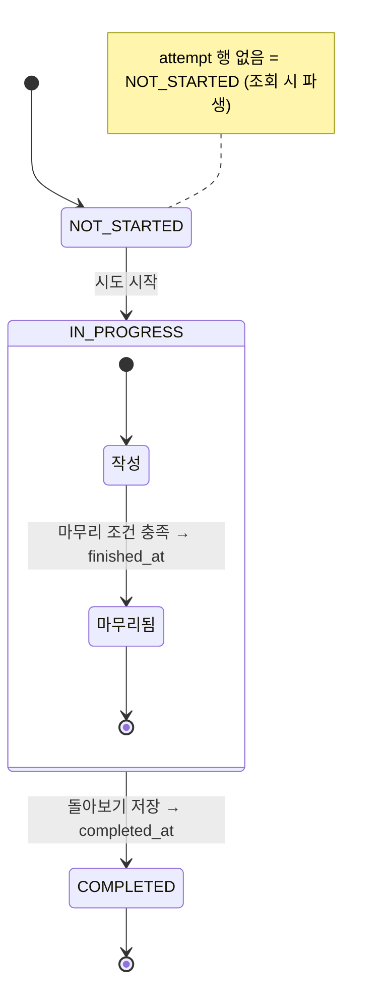

| 전이 | 트리거 | 담당 | 조건 |
|---|---|---|---|
| `NOT_STARTED → IN_PROGRESS` | `POST /missions/{id}/attempts` | `AttemptService.start` | 부분 UK `(student_id, mission_id) WHERE IN_PROGRESS` 충돌 시 기존 시도 반환 |
| `작성 → 마무리됨` (상태값 유지) | `POST /attempts/{id}/finish` | `Attempt.finish(now)` | `FinishPolicy.canFinish`: 판정 `DONE` 1회 이상 (P04), 미충족 `409 REVEAL_CONDITION_UNMET`. `finished_at` 이후 정답·예시 답 공개. 이미 마무리했으면 기록 없이 같은 결과 |
| `IN_PROGRESS → COMPLETED` | `POST /attempts/{id}/reflection` | `Attempt.complete(now)` | `finished_at` 있음(없으면 `409 REVEAL_CONDITION_UNMET`) + `WHERE status = 'IN_PROGRESS'`. 난이도 필수·달라진 점 선택 (P04) |

- `COMPLETED` 시도에 답변·초안·도움·돌아보기 쓰기 → `409 ATTEMPT_CLOSED` (`Attempt.requireOpen()`)
- `finished_at` 이후 답변 제출은 `409 ATTEMPT_CLOSED` (P04)
- 자기 평가는 마무리 뒤·완료 전에만(`Attempt.requireFinished()`: 마무리 전 `409 REVEAL_CONDITION_UNMET`, 완료 뒤 `409 ATTEMPT_CLOSED`)
- 되묻기는 시도당 최대 2회, 2회째 보완 답변 판정 후 되묻기 생성 없이 마무리 안내. 고르기 `CORRECT`도 되묻기 없이 마무리 안내 (P04)
- 초안 `attempt_draft.version`: 저장마다 +1, `WHERE version = :ifMatch` (상태값 없음)

#### 3.2.1 테마 요일 문제 열림 (파생, DB 미저장, P23, #385)

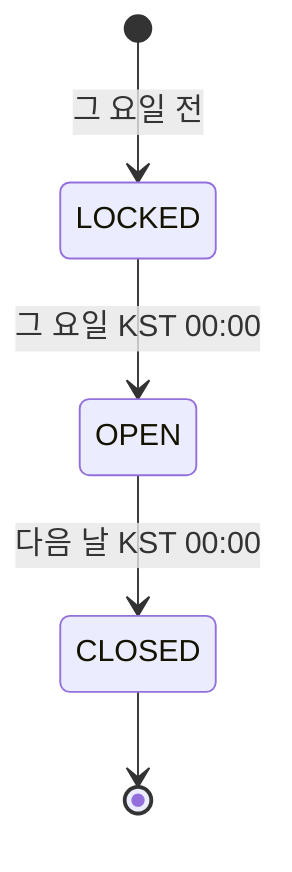

- `OPEN`일 때만 `THEME_DAY` 신규 시도. 토·일 되돌아보기는 `CLOSED` 문제 중 그 주에 마무리한 것만 `THEME_REVIEW`로 다시 풀기, 놓친 문제는 표시만
- 시작 요청 `context`(`THEME_DAY`·`THEME_REVIEW`·`EXTRA`)는 신규 시도에만 검사. 진행 중 시도 반환(부분 UK 충돌)은 요일과 무관하게 이어하기 허용, 완주 판정은 당일 KST 학습 완료만 인정
- 재사용 테마의 이미 푼 문제도 그 주 `OPEN` 요일에는 `THEME_DAY` 신규 시도 가능
- 구현(#385): `ThemeWeek.stateOf`가 KST 날짜로 계산하고 토·일에는 다섯 요일 모두 `CLOSED`. 시작 검사는 learning 시계(KST), 조회·열람은 core가 넘긴 날짜 기준

### 3.3 `judgment.process_status` (판정 처리)

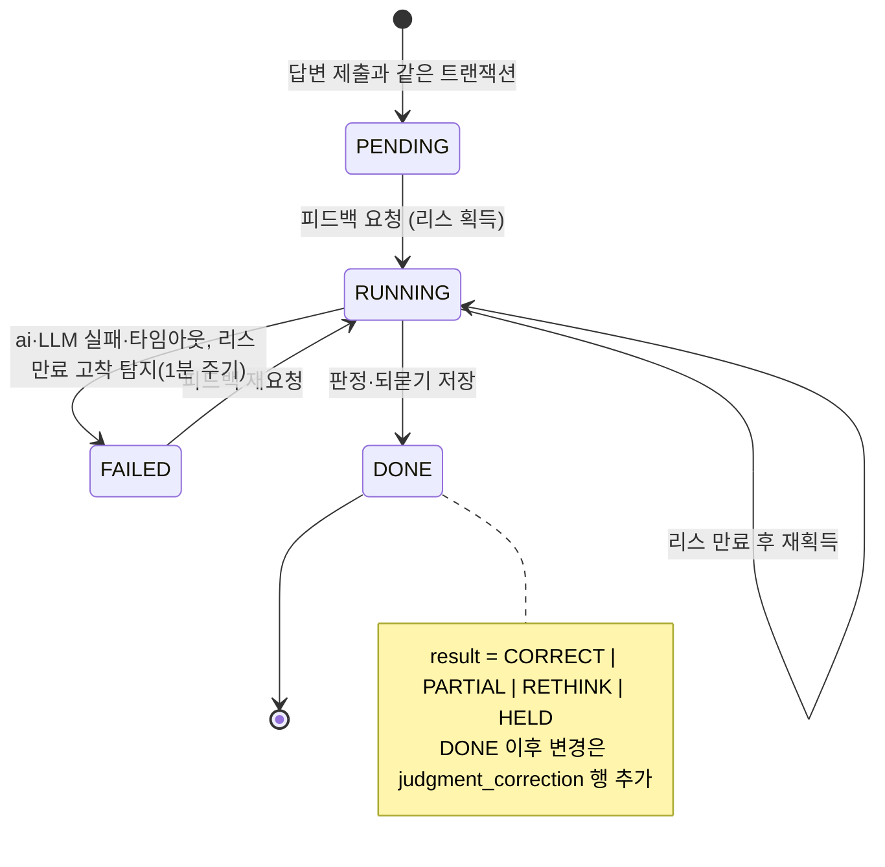

| 전이 | 트리거 | 담당 | 조건부 UPDATE |
|---|---|---|---|
| → `PENDING` | `POST /attempts/{id}/answers` | `JudgmentService.createPending` | `answer_id` UK |
| `PENDING·FAILED → RUNNING`, 만료 `RUNNING → RUNNING` | `POST /answers/{id}/feedback` | `Judgment.acquire(now, lease)` | `SET process_status='RUNNING', lease_until=:until WHERE answer_id=:id AND (process_status IN ('PENDING','FAILED') OR (process_status='RUNNING' AND (lease_until IS NULL OR lease_until < now())))`. 리스 없는 `RUNNING`도 만료로 봄(엔티티 판단과 같게) |
| `RUNNING → DONE` | 처리 완료 | `Judgment.done(...)`·`hold(reason)` | `WHERE id=:id AND process_status='RUNNING' AND lease_until=:until` (획득한 리스 값으로 늦게 끝난 이전 처리의 덮어쓰기 방지) |
| `RUNNING → FAILED` | 예외·타임아웃 | `Judgment.fail(code)` | 위와 같은 리스 조건, `retry_count + 1` |
| 만료 `RUNNING → FAILED` | 1분 주기 고착 탐지 (#241) | `StuckJudgmentScheduler` → `JudgmentService.failStuck(now)` | `SET process_status='FAILED', failure_code='LEASE_EXPIRED', retry_count=retry_count+1 WHERE process_status='RUNNING' AND (lease_until IS NULL OR lease_until < now)`. 만료 조건은 재획득과 같음(리스 없는 `RUNNING` 포함) |

- 전이 실패(영향 0행) 시 현재 상태로 응답: `DONE` → 저장 결과, 유효 `RUNNING` → `status` 이벤트 후 종료 (API 1.4)
- 고착 `RUNNING` 탐지 인덱스 `(process_status, lease_until)`, 리스 90초·탐지 주기 1분 (P12). 탐지 전에 피드백 재요청이 오면 지금처럼 만료 리스를 재획득하고, 탐지가 먼저면 `FAILED`가 돼 재요청이 `FAILED → RUNNING`으로 처음부터 실행 (#241, [learning 보고서](../report/learning.md))
  - 자동 재실행은 하지 않음(core 분석 대화도 130초 넘은 `RUNNING`을 실패 `STREAM_INTERRUPTED`로 바꾸고 자동 재실행하지 않음, api-spec #47 절). 처리 Pod 종료·결과 기록 실패 뒤 학생이 떠난 판정이 시도 상세·학습 기록 집계·결제 사용 증빙에서 처리 중으로 남지 않게 함(마무리 조건 P04는 `RUNNING`·`FAILED` 모두 `DONE`이 아니라 같음)
  - 조건부 UPDATE라 여러 Pod가 같은 주기에 실행해도 한 번만 바뀜. 재획득과 겹치면 행 잠금 뒤 조건을 다시 봐 새 리스가 잡힌 행은 바꾸지 않음. 탐지 뒤 늦게 끝난 이전 처리는 리스 조건 때문에 저장·실패 기록 0행
- 리스 시간은 core→learning 피드백 호출 타임아웃보다 길게 설정. 짧으면 처리 중인 판정을 다른 요청이 재획득해 LLM 호출이 중복됨
- 정정(`POST /internal/judgments/{id}/corrections`, #80)은 `DONE` 판정만 받고 그 전이면 `409 JUDGMENT_STATE_CONFLICT`. `process_status`·`result`는 바꾸지 않고 `judgment_correction` 행을 추가하며, 조회 때 최신 정정 결과를 `result`로 보여 줌 (FN-SUP-03)

#### `judgment.result` 결정 (`DONE`일 때만 값 존재)

| 결과 | 조건 | 결정 위치 |
|---|---|---|
| `CORRECT` | 규칙: 정답 키 일치·수학 동치 / LLM: 모든 필수 요소 `verified && satisfied` / 풀이 단계: 최종 답 동치 + 풀이 LLM `CORRECT` | learning `RuleJudge` / ai `JudgmentService` / learning `FeedbackFacade` |
| `PARTIAL` | LLM: 일부 요소만 충족 (배점 기준) / 풀이 단계: 최종 답과 풀이 중 한쪽만 맞음 | ai `JudgmentService` / learning `FeedbackFacade` |
| `RETHINK` | 규칙: 불일치 / LLM: 충족 요소 없음 / 풀이 단계: 최종 답 불일치 + 풀이 LLM `RETHINK` | learning `RuleJudge` / ai `JudgmentService` / learning `FeedbackFacade` |
| `HELD` | `INSUFFICIENT_EVIDENCE`·`QUOTE_MISMATCH`·`TOO_SHORT`·`UNVERIFIED_SCOPE`(`judge_verified = false`, `JUDGE_REQUIRE_VERIFIED=true`일 때만)·`MODEL_DISAGREEMENT`(M2 불일치)·`LOW_CONFIDENCE`(M1 0.8 미만, P15) | ai `JudgmentService` (learning은 `judge_verified`·학년 포함 기준표 전달만) |

- `HELD`는 정상 처리 결과(`DONE`), API 실패는 `FAILED` → 서로 다른 컬럼 (NFR-REL-04)
- 풀이 단계(`SOLUTION_STEPS`)는 풀이를 ai 요소 판정, 최종 답을 `MathEquivalenceJudge`로 보고 위처럼 합침. ai가 보류하면 보류(최종 답 결과는 쓰지 않음). 최종 답 결과는 기준표의 `FINAL_ANSWER` 요소(ai에 보내지 않음)에 정답 키 근거(`ANSWER_KEY`, 근거 글자는 학생이 쓴 최종 답)로 기록해, 답이 틀려 `PARTIAL`이면 마무리 체크리스트에도 "최종 답"이 빠진 것으로 보임 (FN-JDG-02, [이슈 #79 보고서](../report/learning.md))
- `FAILED`의 `failure_code`: `AI_TIMEOUT`·`AI_UNAVAILABLE`(연결 실패·ai 5xx)·`AI_BAD_RESPONSE`(ai 4xx·계약 밖 응답)·`AI_CIRCUIT_OPEN`·`INTERNAL_ERROR`·`LEASE_EXPIRED`(고착 탐지, #241)

### 3.4 `mission_draft.status` (#336 설계, #353 구현)

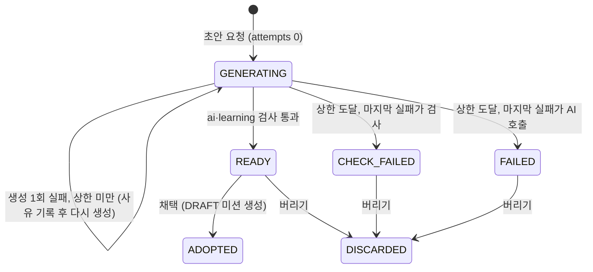

| 전이 | 트리거 | 담당 | 조건 |
|---|---|---|---|
| → `GENERATING` | `POST /admin/mission-drafts` (CONTENT) | `MissionDraftService.request` | 형식·성취기준 코드 실재·학년군·학년·입력 방식·성취수준 단계 확인(400) |
| 생성 1회 | `MissionDraftScheduler` 주기(기준안 10초) | `MissionDraftService.generateNext` → `MissionDraft.recordAttempt` | 리스 점유(90초, 판정과 같은 방식) 뒤 ai 1회 + learning 검사. 점유한 리스가 그대로일 때만 저장해 늦은 작업이 덮어쓰지 않음. 작업이 중간에 죽으면 리스가 지나 다른 레플리카가 다시 맡고 그 시도는 세지 않음 |
| `GENERATING → READY·CHECK_FAILED·FAILED` | 같음 | `MissionDraft.recordAttempt` | 상한 기준안 3회(P19 김동섭 확인). `FAILED`의 `failure_code`는 판정과 같은 `AI_TIMEOUT`·`AI_UNAVAILABLE`·`AI_BAD_RESPONSE`·`AI_CIRCUIT_OPEN` |
| `READY → ADOPTED` | `POST /admin/mission-drafts/{id}/adopt` | `MissionDraftService.adopt` | 초안 행 잠금, `mission`(`DRAFT`, `source = LLM_DRAFT`)·첫 버전 생성과 같은 트랜잭션. 그 뒤는 3.1 |
| → `DISCARDED` | `POST /admin/mission-drafts/{id}/discard` | `MissionDraft.discard` | `READY`·`CHECK_FAILED`·`FAILED`만. `GENERATING`·`ADOPTED`·`DISCARDED`는 `409 CONFLICT` |

- 다시 만들려면 새 초안을 요청한다(검사에 실패한 초안을 되살리지 않음). 검사 통과(`READY`)는 공개 승인이 아니며 채택 뒤 3.1 검토·게시를 거친다(P19, FAC-18)

### 3.5 `weekly_theme.status` (P23, #385)

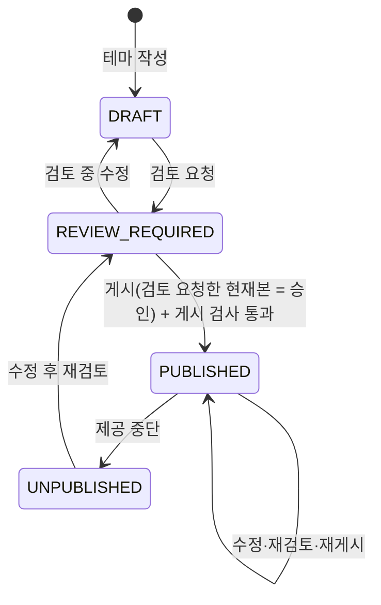

| 전이 | 트리거 | 조건 |
|---|---|---|
| `REVIEW_REQUIRED → PUBLISHED` | `POST /admin/weekly-themes/{id}/publish` (CONTENT) | 검토 요청한 버전이 현재본(아니면 `409 CONFLICT`). 월~금 5개 요일 모두 게시 미션(시연 전용 제외), 다섯 생각 유형 1개씩, 미션 학년 범위가 학년군 전체를 덮음(초3~4 논술 불가), 같은 학년군·주 `PUBLISHED` 없음. 아니면 `422 WEEKLY_THEME_PUBLISH_INCOMPLETE` + `errors` |
| `PUBLISHED → UNPUBLISHED` | `/unpublish` | 그 주 학생에게는 최근 게시 테마 재사용(P23). 이미 시작한 시도는 유지 |

- 미션 상태(3.1)와 같은 전이 규칙. 별도 검토(승인·수정 요청) 경로는 없다(core #387이 7경로만 프록시): 검토 요청한 버전(`review_version_id`)이 현재본일 때의 게시가 승인이고, 검토 중 수정은 `DRAFT`로 돌아간다. 게시 중 수정은 새 버전을 현재본으로 두고 `PUBLISHED`를 유지하며 학생에게는 재게시 전까지 게시본이 보인다. 코드값은 [ERD 4.2.1](erd.md#421-주간-테마-p23-385-v11v12). 위에 없는 전이는 `409 CONFLICT`

### 3.6 `community_post.status` (P20, learning #386 구현)

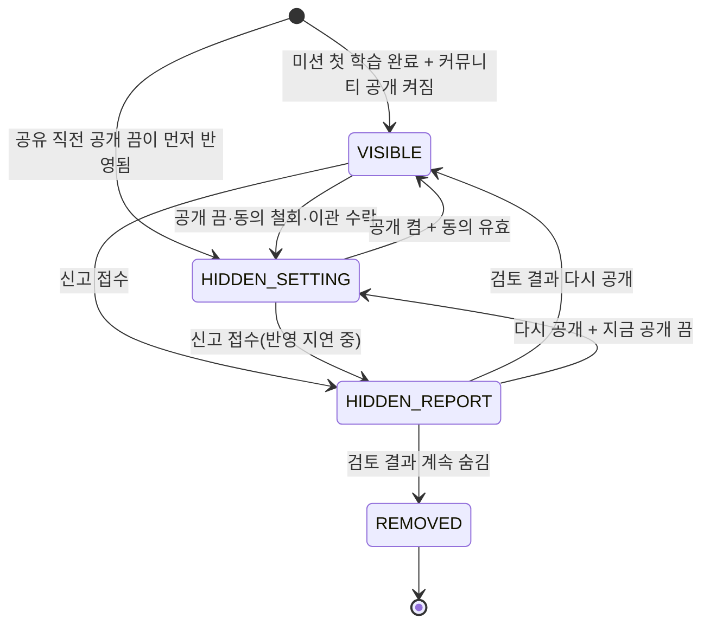

| 전이 | 트리거 | 담당 |
|---|---|---|
| `VISIBLE ↔ HIDDEN_SETTING` | core `community-visibility` 호출(설정·동의·이관) | learning `CommunityService.setVisibility` |
| `VISIBLE·HIDDEN_SETTING → HIDDEN_REPORT` | `error_report(targetType = COMMUNITY_POST)` 접수 | core `CommunityModerationService` → learning `moderation`(`CommunityRules.moderate`) |
| `HIDDEN_REPORT → VISIBLE·HIDDEN_SETTING·REMOVED` | 신고 처리 완료(SERVICE_OPS). 다시 공개는 learning `community_visibility`가 끔이면 `HIDDEN_SETTING` | 같은 경로 |

- `HIDDEN_REPORT`·`REMOVED`는 공개 설정을 다시 켜도 `VISIBLE`이 되지 않음. `REMOVED`는 끝 상태라 검토 요청을 다시 받아도 그대로(멱등)
- 학생·미션당 1행(UK `(student_id, mission_id)`). 다시 풀기 시도는 공유하지 않아 새 행·전이 없음
- 공개 설정을 다시 켜면 `HIDDEN_SETTING`만 `VISIBLE`로 복원(이관 수락 후 새 보호자 동의 때도 같음)
- 학생 삭제 시 상태와 관계없이 물리 삭제(P09)

---

## 4. 작업 (대화·리포트·알림)

### 4.1 `report_job.status` (core)

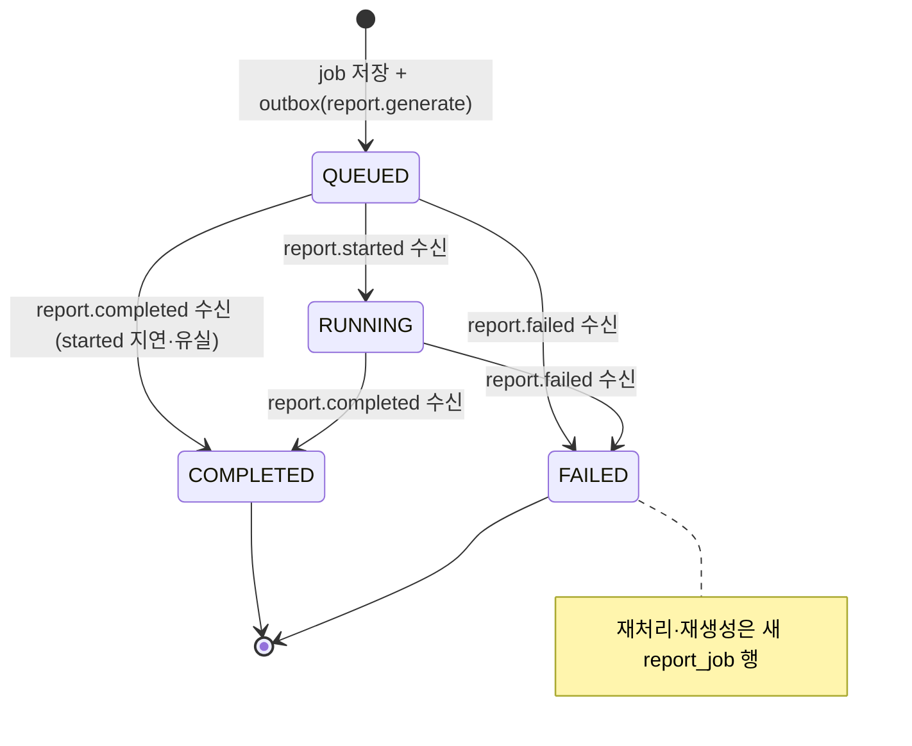

| 전이 | 트리거 | 담당 | 조건부 UPDATE |
|---|---|---|---|
| → `QUEUED` | 스케줄(`SCHEDULE`)·`/regenerate`(`REGENERATE`)·`/admin/jobs/{id}/retry`(`ADMIN_RETRY`) | `ReportJobService` | 부분 UK `(student_id, period_type, period_from) WHERE trigger='SCHEDULE'` (V30) |
| `QUEUED → RUNNING` | `report.started` | `ReportJob.start()` | `WHERE id=:jobId AND status='QUEUED'`, `started_at` |
| `QUEUED·RUNNING → COMPLETED` | `report.completed` | `ReportJob.complete(reportId)` | `WHERE id=:jobId AND status IN ('QUEUED','RUNNING')`, `report_id`·`completed_at` + 알림 |
| `QUEUED·RUNNING → FAILED` | `report.failed` | `ReportJob.fail(reason)` | 위와 같음, `failure_reason` |

- 종료 후 늦게 온 `report.started`는 영향 0행 → 무시 (역순 도착 허용)
- P24(#390, V29·V30): `report_job.period_type`(`DAILY`·`WEEKLY`), 정기 생성 부분 UK `(student_id, period_type, period_from) WHERE trigger='SCHEDULE'`(월요일 일일·주간 작업의 `period_from`이 같음). 일일 작업도 같은 전이
- `QUEUED` 고착(메시지 DLQ 이동)은 #132 복구 점검으로 실제 report 상태와 대조한 뒤 종료한다. 관리자는 `/admin/queues`·`/admin/jobs`에서 확인하며 자동 재생성은 하지 않는다.

#### 4.1.1 종료 유실·삭제 (#132)

QUEUED/RUNNING → COMPLETED|FAILED: 복구 API의 저장된 종료 결과를 조건부 반영한다. BUSY/DB·HTTP 오류/식별 불일치는 상태를 보존한다. 학생 삭제 확정은 `STUDENT_DELETED`로 FAILED 및 실행 이력을 원자 기록한다. 종료 상태는 늦은 started/completed/failed와 복구 응답으로 바뀌지 않는다.

report에서 잠금 소유자가 없는 RUNNING만 `REPORT_EXECUTION_ABANDONED`로 FAILED 전이한다. 행이 없으면 `REPORT_NOT_CREATED` 차단 기록을 저장해 같은 job의 지연 메시지는 ACK 종료한다. 차단 기록의 학생·기간이 다르면 오류다. 실행 중인 생성은 BUSY로 유지한다. 자동 재생성은 하지 않는다.

#### 4.1.2 REPORT 관리자 재처리 (#47)

원래 FAILED report_job은 종료 상태를 유지한다. 명시적인 재처리는 별도 ADMIN_RETRY job을 QUEUED로 만들고 core report_job_retry로 연결한다. 새 job에 기존 QUEUED→RUNNING→COMPLETED/FAILED 전이를 적용하며 실행 번호는 새 job 기준이다. 기존 job의 attempt_no를 증가시키거나 오래된 종료 이벤트를 새 job에 재적용하지 않는다. 이미 재처리한 원작업은 재사용하지 않고 재실패한 자식 job에서 다음 관계를 만든다. 202는 접수이며 완료가 아니다.

### 4.2 `weekly_report.status` · `state` (report)

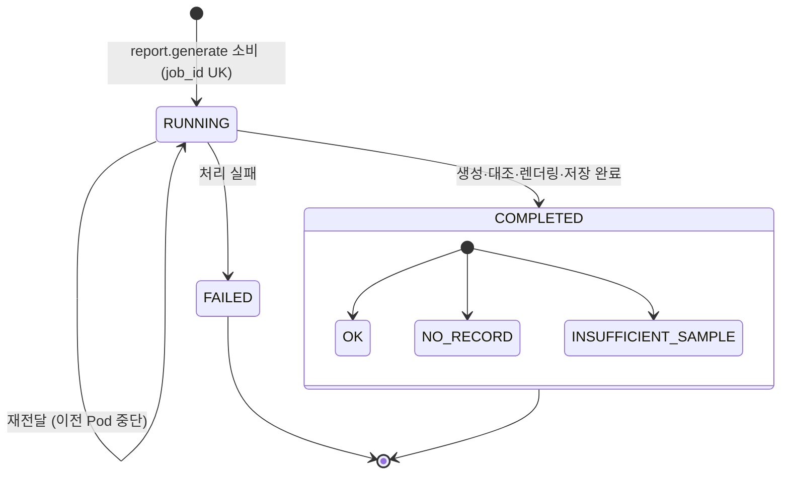

| 전이 | 트리거 | 담당 | 조건 |
|---|---|---|---|
| → `RUNNING` | `report.generate` | `ReportRepository.get_or_create` | `job_id` UK. 새로 만든 경우 `GenerationService`가 같은 트랜잭션에 `outbox(report.started)` |
| `RUNNING → RUNNING` | 같은 메시지 재전달 | `GenerationService.generate` | 기존 행이 `RUNNING`이면 같은 행으로 처음부터 재실행. 항목·파일은 완료 트랜잭션에서만 저장하므로 덮어쓸 중간 결과 없음 (`report.started` 재발행 없음) |
| `RUNNING → COMPLETED` | 처리 성공 | `ReportRepository.finish` | `WHERE id=:id AND status='RUNNING'` + `outbox(report.completed)` 같은 트랜잭션 |
| `RUNNING → FAILED` | 예외 | `ReportRepository.finish`(실패 사유) | 위와 같음 + `outbox(report.failed)` |

- 기록 없는 주·표본 부족 주는 `COMPLETED` + `state`, 처리 실패(`FAILED`)와 구분 (FN-RPT-11)
- 리포트 설명(FN-RPT-09, #479)의 생성 실패·검사 실패·시간 초과·모델 미활성은 `FAILED`로 바꾸지 않는다. `COMPLETED`로 끝내고 설명 상태만 `NOT_INCLUDED`로 남긴다(api-spec 3.4, P16)
- #391 구현(P24): 일일 리포트도 같은 행·전이를 쓰고 `period_type = DAILY`로 구분. 기록 없는 날은 `COMPLETED` + `NO_RECORD`. 재생성 판 UK는 `(student_id, period_type, period_from, revision)`
- 재생성은 새 행(`revision + 1`), 기존 결과 보존·최신판 기본 조회 (P06)
- #152 관리자 실패 재처리도 **새 jobId·새 행**으로 위 전이를 시작한다. 원래 FAILED 행은 유지하며 같은 jobId의 COMPLETED·FAILED 메시지는 ACK 후 종료한다. 원작업 연결은 core #47이 관리하고, report는 요청한 새 jobId별 이벤트만 발행한다.

### 4.3 `conversation_message.status`

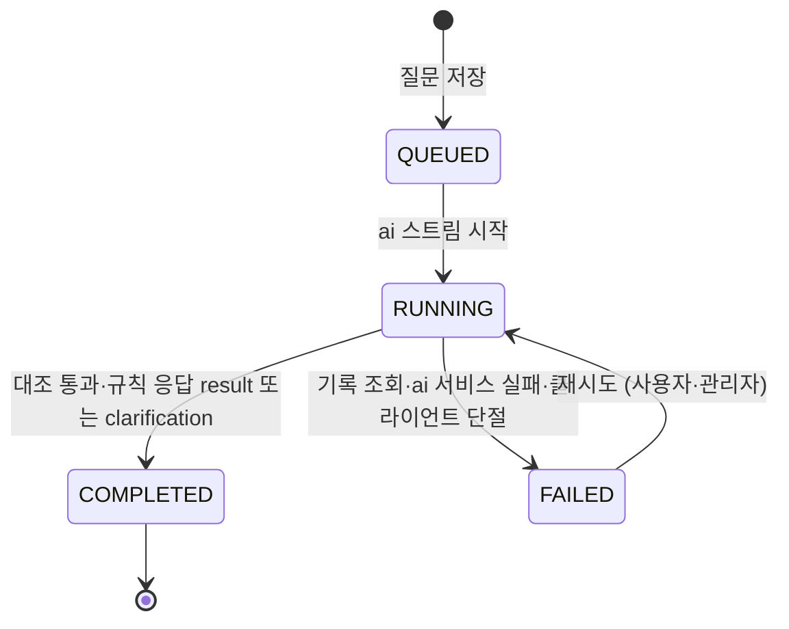

| 전이 | 트리거 | 담당 | 조건부 UPDATE |
|---|---|---|---|
| → `QUEUED` | `POST /conversations/{id}/messages` | `ConversationService.startMessage` | UK `(conversation_id, seq)` |
| `QUEUED → RUNNING` | ai 호출 직전 | `ConversationMessage.start()` | `WHERE status='QUEUED'` + `job_execution(RUNNING)` |
| `RUNNING → COMPLETED` | `result`·`clarification` 이벤트 | `complete(...)`·`clarify(...)` | `WHERE status='RUNNING'`, 확정 답변·`message_evidence` 같은 트랜잭션 |
| `RUNNING → FAILED` | `error` 이벤트·예외·단절 | `fail(code)` | `failure_code` (`AI_UNAVAILABLE`·`STREAM_INTERRUPTED` 등). 대조 실패·LLM 장애는 규칙 응답으로 `COMPLETED` (P16) |
| `FAILED → RUNNING` | `/messages/{id}/retry` | `retry()` | `WHERE status='FAILED'`, `retry_count + 1` |
| `FAILED → RUNNING` (관리자, #47) | `/admin/jobs/{id}/retry` | `ConversationService.prepareAdminRetry` | 접수 트랜잭션에서 새 세대(`retry_count + 1`)로 선점하고 `conversation_job_retry`에 `QUEUED` 요청 저장. 실행은 `ConversationRetryWorker`가 같은 세대만 이어받고, 늦은 세대 결과는 현재 실행을 덮어쓰지 않음 |

#### `conversation_job_retry.status` (관리자 대화 재처리 요청, V19)

| 전이 | 트리거 | 담당 | 조건 |
|---|---|---|---|
| → `QUEUED` | 관리자 재처리 접수 | `ConversationAdminRetryService.request` | UK `(message_id, generation)`·`(requested_by, idempotency_key)` |
| `QUEUED → RUNNING` | 작업자 선점 | `ConversationAdminRetryService.claim` | `WHERE status='QUEUED'` + 접수 130초 이내(DB 시계 기준, #286), `job_execution(RUNNING)` |
| `QUEUED·RUNNING → COMPLETED·FAILED` | 실행 결과·실행 전 거절 | `finish`(결과와 같은 트랜잭션) | `WHERE status IN ('QUEUED','RUNNING')` |
| `QUEUED·RUNNING → FAILED` | 130초 만료·학생 삭제 | `ConversationRetryWorker`(`STREAM_INTERRUPTED`)·`beforeStudentDeletion`(`STUDENT_DELETED`) | 자동 AI 재실행 없음 |

- `answer` 컬럼에는 대조 통과한 확정 답변 또는 규칙 응답 템플릿(`source = TEMPLATE`)만 저장 (`delta` 임시 텍스트 미저장)

### 4.4 `notification.status` · `job_execution.status`

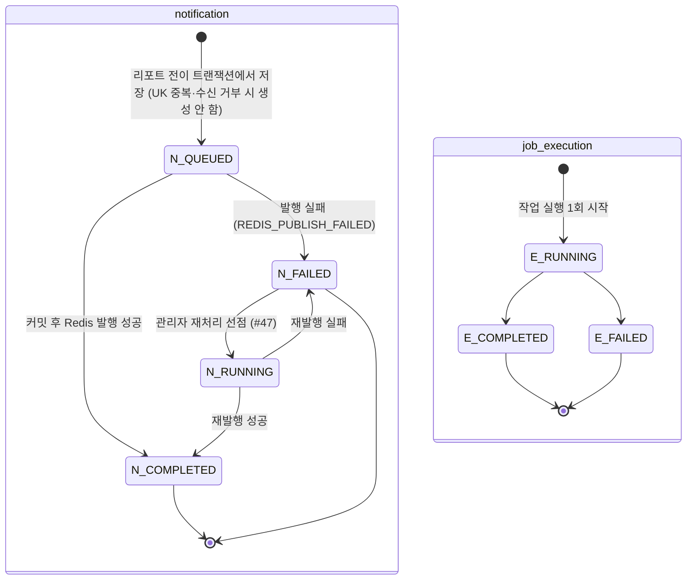

- `N_*` = `notification.status`, `E_*` = `job_execution.status` 값 (접두어는 이름 충돌 방지용)
- `notification` UK `(user_id, type, source_event_id)` → 같은 사건 재처리 시 중복 생성 없음 (FN-SUP-08). 읽음(`read_at`)은 상태와 독립
- `job_execution`: 대화·리포트·알림 실행 1회당 1행, UK `(job_type, job_id, attempt_no)`. 재처리는 `attempt_no + 1` 새 행 (FN-ADM-07)
- 알림 채널은 인앱만, 이메일·푸시 없음 (P10)
- `notification.status`의 `RUNNING`은 관리자 실패 알림 재처리(#47) 선점 때만 사용한다. 재처리는 `FAILED`만 `RUNNING`으로 원자 선점 후 새 `job_execution`을 남기고 결과로 종료(api-spec 2.8 retry 규칙), 자동 재처리는 없으며 클라이언트는 목록 재조회로 보완 (api-spec 2.7)

---

## 5. 신고·문의

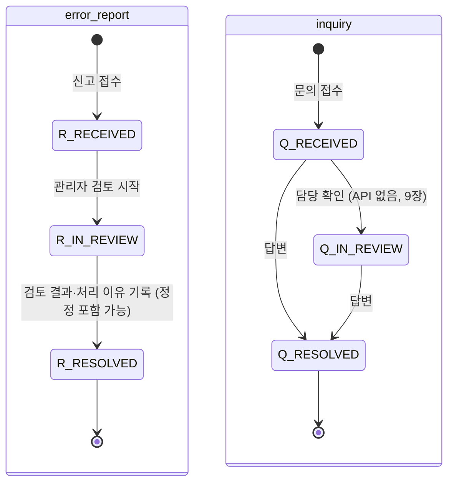

| 대상 | 전이 | 담당 | 조건 |
|---|---|---|---|
| `error_report` | `RECEIVED → IN_REVIEW` | `ErrorReport.startReview(adminId)` | `SERVICE_OPS`, `WHERE status='RECEIVED'` |
| `error_report` | `IN_REVIEW → RESOLVED` | `ErrorReport.resolve(result, reason)` | `review_result`·`resolution_reason` 필수. 정정은 learning `judgment_correction` 성공 후 같은 요청에서 전이 + 알림 |
| `inquiry` | `RECEIVED·IN_REVIEW → RESOLVED` | `POST /admin/inquiries/{id}/answer` → `Inquiry.answer(adminId, answer)` | `answer`·`answered_at` + `INQUIRY_ANSWERED` 알림. `IN_REVIEW` 전환 API가 없어 확정 전에는 `RECEIVED → RESOLVED`만 구현 |

- `R_*`·`Q_*` 접두어 = 각 테이블 `status` 값
- 접수만으로 판정 변경 금지, `RECEIVED → RESOLVED` 직행 금지 (검토 기록 필수, FN-SUP-02)
- 대상 `COMMUNITY_POST` 신고(P20·P10, #388): 접수 시 공유물 `HIDDEN_REPORT`, `RESOLVED` + `review_result` `VISIBLE`(다시 공개)·`REMOVED`(계속 숨김, 생략 시 기본)로 공유물 상태를 정함(3.6). 같은 공유물에 신고가 여럿이면 `REMOVED` 우선, 처리 중이 있으면 `HIDDEN_REPORT`

### 5.1 core 정정 실행 기록 (#46)

신고 상태는 기존 RECEIVED → IN_REVIEW → RESOLVED를 유지한다. core `SupportService.correct`는 신고 검토 중 correction.processing_status=PENDING 의도를 먼저 저장하고 HTTP를 트랜잭션 밖에서 실행한다. HTTP 실패 시 FAILED이며 신고는 IN_REVIEW다. 동일 correction UUID로 공급자가 성공을 확인하고 core 완료 트랜잭션까지 커밋될 때만 correction=COMPLETED·신고=RESOLVED·알림을 함께 기록한다. 응답 유실이나 core 저장 실패는 완료가 아니며 같은 의도로 재개한다. 원본 답변·판정은 변경하지 않는다.

---

## 6. 결제·구독

### 6.1 `payment.status` · `entitlement_status`

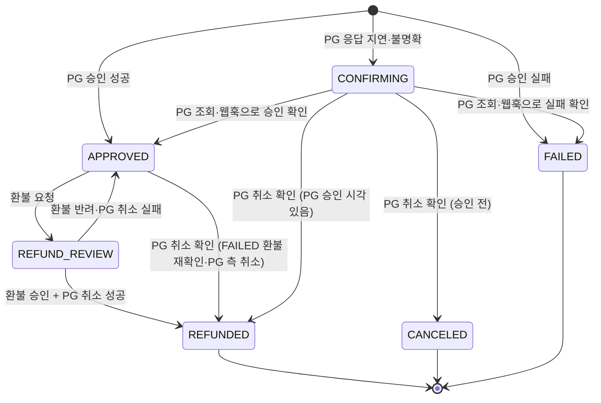

| 전이 | 트리거 | 담당 | 조건 |
|---|---|---|---|
| → `APPROVED·CONFIRMING·FAILED` | `POST /payments/confirm` | `PaymentService.confirm` | `order_id` UK (같은 주문 1회), 금액 대조 통과 후에만 PG 호출 |
| → `APPROVED·CONFIRMING·FAILED` | 정기 청구 | `BillingScheduler.chargeDue` → `SubscriptionService.renew` | `RENEWAL` 주문 1건당 1회, 실패 시 매일 1회 최대 3회 재청구 (P13), 재청구마다 `payment_charge_attempt` 새 PG 주문 (#48) |
| `CONFIRMING → APPROVED·FAILED` | 웹훅·`GET /payments/{orderId}`·스케줄러 재조회 | `PaymentService.refreshStatus`·`handleWebhook` | `WHERE status='CONFIRMING'`, 본문 대신 PG 조회 결과 사용 |
| `APPROVED → REFUND_REVIEW` | `POST /payments/{id}/refund-requests` | `RefundService.request` → `Payment.startRefundReview()` | `WHERE status='APPROVED'`, 결제 7일 이내 + 프리미엄 기능 미사용 아니면 `409 REFUND_NOT_ALLOWED` (P14) |
| `REFUND_REVIEW → REFUNDED·APPROVED` | 환불 승인 결과·반려 | `Payment.refund()` / 복귀 | `refund_request` 결과와 같은 트랜잭션 |
| `APPROVED·REFUND_REVIEW → REFUNDED` | 웹훅·조회로 PG `CANCELED`(잔액 0) 확인, 대기 환불(`REQUESTED`·`APPROVED`·`FAILED`)이 있을 때 | `PaymentWebhookService` → `RefundService.applyVerified` | 환불 행 `COMPLETED`와 같은 트랜잭션, 대상 구독 `CANCELED` (6.3) |
| `APPROVED → REFUNDED` | 웹훅으로 PG `CANCELED`(잔액 0) 확인, 대기 환불 없음 | `PaymentWebhookService` → `PaymentService.accept` | 로컬 `approved_at`이 있으면 `CANCELED`가 아니라 `REFUNDED`. `REFUND_REVIEW` 단계를 거치지 않으며 대상 구독 `CANCELED`, `entitlement_status` 비움 |
| `CONFIRMING → REFUNDED·CANCELED` | 승인 응답·웹훅·`GET /payments/{orderId}`·스케줄러 재조회에서 PG `CANCELED`(잔액 0) | `PaymentService.accept` | 로컬 또는 PG 응답에 승인 시각이 있으면 `REFUNDED`, 없으면(승인 전 취소) `CANCELED`. 대상 구독 `CANCELED` |

| `entitlement_status` | 전이 | 담당 |
|---|---|---|
| → `APPLIED` | 승인 후 구독 반영 성공 | `Payment.applyEntitlement()` |
| → `RECOVERY_REQUIRED` | 승인 후 구독 반영 실패 | `Payment.requireRecovery()` |
| `RECOVERY_REQUIRED → APPLIED` | 복구 재시도 (추가 청구 없음) | `SubscriptionService.recoverEntitlement` |

- 부분 환불 없음, 전액 환불만 `REFUNDED` (P14). `REFUNDED` 시 대상 구독 즉시 `CANCELED`

### 6.2 `subscription.status`

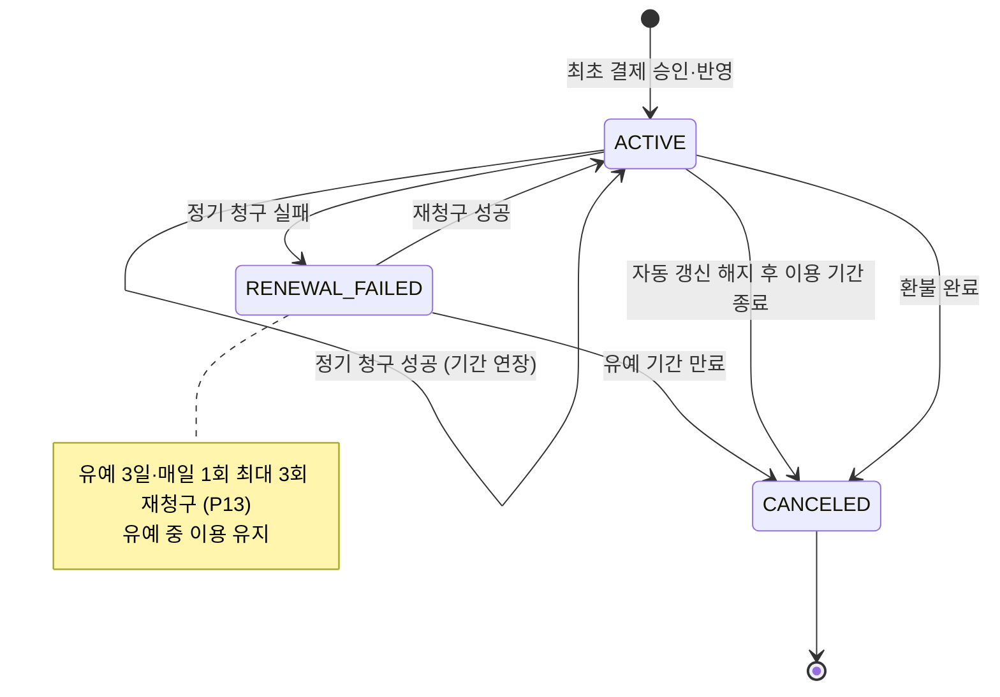

| 전이 | 트리거 | 담당 | 조건 |
|---|---|---|---|
| → `ACTIVE` | 결제 승인 | `SubscriptionService.activate` | 부분 UK `(student_id) WHERE status IN ('ACTIVE','RENEWAL_FAILED')` → 중복 `409 SUBSCRIPTION_DUPLICATE` |
| `ACTIVE → ACTIVE` | `BillingScheduler.chargeDue` 성공 | `Subscription.extend(...)` | `payment_order` 부분 UK `(subscription_id, billing_period_start) WHERE RENEWAL` |
| `ACTIVE → RENEWAL_FAILED` | 청구 실패 | `Subscription.renewalFailed(graceUntil)` | `renewal_retry_count + 1`, 알림 `SUBSCRIPTION_CHANGED` |
| `RENEWAL_FAILED → ACTIVE·CANCELED` | 재청구 성공 / `grace_until` 경과 | `extend` / `cancel()` | 3회 재청구 모두 실패하거나 `grace_until`(실패일 + 3일) 경과 시 `CANCELED` (P13). 같은 기간 재청구는 월별 주문을 유지하고 `payment_charge_attempt`로 시도마다 새 PG 주문 (#48) |
| `ACTIVE → CANCELED` | `auto_renew = false` + `period_end` 경과 | `BillingScheduler.expireCanceled` → `cancel()` | `auto_renew_canceled_at` 기록 후에만, `canceled_at` = `period_end` 경과 시점 (P14) |
| `ACTIVE → CANCELED` | 환불 완료·PG 측 취소 확인(`payment REFUNDED·CANCELED`) | `RefundService.applyVerified`·`PaymentService.accept` → `cancelSubscription` | 같은 트랜잭션, `canceled_at` = 환불 완료 시점 (P14) |

- 자동 갱신 해지(`DELETE /subscriptions/{id}/auto-renewal`)는 상태 전이 없이 `auto_renew = false`만 변경, `period_end` 전 해지 철회(`PUT`)는 `auto_renew = true` (P14)
- `CANCELED` 이후 해당 자녀는 무료 플랜 한도 적용 (P13)

### 6.3 `refund_request.status`

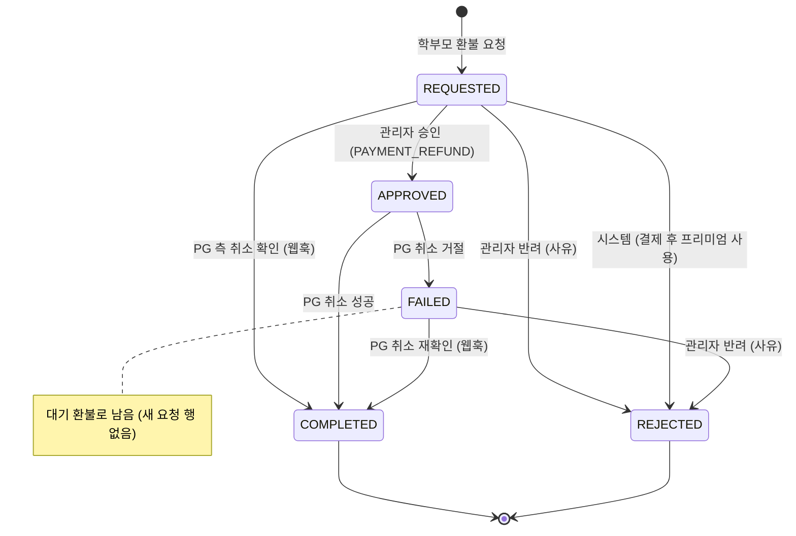

| 전이 | 트리거 | 담당 | 조건 |
|---|---|---|---|
| → `REQUESTED` | `POST /payments/{id}/refund-requests` | `RefundService.request` | 같은 주문에 대기 환불(`REQUESTED`·`APPROVED`·`FAILED`)이 있으면 새 행 없이 그 행을 반환(`PaymentMapper.pendingRefund`) |
| `REQUESTED → REJECTED` (시스템) | 요청 직후 learning 사용 증빙 조회에서 결제 후 프리미엄 사용 확인 | `RefundService.request` | `decided_by` 없음, `reject_reason`="결제 후 프리미엄 기능 사용", 결제 `APPROVED` 복귀, 응답 `409 REFUND_NOT_ALLOWED` (P14) |
| `REQUESTED → APPROVED` | `POST /admin/refund-requests/{id}/approve` (`PAYMENT_REFUND`) | `RefundService.approve` | 사용 증빙 확인(`usage_verified_at`) 뒤에만, 아니면 `409 REFUND_NOT_READY`. 7일·금액·미사용 재확인 실패는 `409 REFUND_NOT_ALLOWED` (FN-ADM-16) |
| `REQUESTED·FAILED → REJECTED` (관리자) | `POST /admin/refund-requests/{id}/reject` (`PAYMENT_REFUND`) | `RefundService.reject` | 그 밖의 상태는 `409 REFUND_STATE_CHANGED`. 결제 `APPROVED` 복귀 |
| `APPROVED → COMPLETED·FAILED` | 승인 직후 PG 취소 결과·`APPROVED` 복구 조회(스케줄러·`GET /payments/{orderId}`) | `RefundService.applyVerified` | PG `CANCELED`(잔액 0)면 `COMPLETED`, PG가 취소를 거절하면 `FAILED`(결제 `APPROVED` 복귀). 결과 불명확은 `APPROVED`로 남겨 조회 복구 (6.4) |
| `REQUESTED·FAILED → COMPLETED` | 웹훅 뒤 PG 조회로 `CANCELED`(잔액 0) 확인 | `PaymentWebhookService` → `RefundService.applyVerified` | 결제 `REFUNDED`·구독 `CANCELED`와 같은 트랜잭션 |

- `FAILED`는 종료가 아니다. 대기 환불로 남아 학부모 재요청은 같은 행을 돌려받고, 관리자 반려나 PG 취소 재확인으로만 끝난다. 관리자 승인(`approve`)은 `REQUESTED`만 받으므로 `FAILED`를 다시 PG 취소하지 않는다(중복 취소 방지)
- `FAILED`도 대기 환불이므로 탈퇴(`WITHDRAWAL_BLOCKED`)·구독 변경·상품 권한 판단(`refundPending`)을 막는다([API 명세서](api-spec.md) 탈퇴 precheck)
- 관리자 전이에는 `decided_by`·`audit_log`, 시스템 반려에는 `decided_by` 없음

### 6.4 결제 상태 적용 보완 (#48)

CONFIRMING은 PG 조회로만 확정하며, APPROVED/RECOVERY_REQUIRED는 추가 청구 없이 구독 반영을 재시도한다. REQUESTED 환불은 프리미엄 사용 동결 상태이며 증빙 미확인은 503이다. APPROVED 환불의 PG 결과 불명확은 FAILED로 바꾸지 않고 조회 복구한다. REFUNDED/CANCELED는 지연 DONE 통지로 되돌리지 않는다. PG 호출 중 parent 잠금은 유지하지 않으며 준비된 거래/환불이 탈퇴를 차단한다. 상세 계약은 [#48 보고서](../report/payment.md)를 따른다.

---

## 7. 운영

### 7.1 `model_version.status`

```mermaid
stateDiagram-v2
  [*] --> REGISTERED: 평가 근거 첨부 후 등록
  REGISTERED --> ACTIVE: 평가 범위 내 명시적 사람 승인
  ACTIVE --> INACTIVE: 같은 kind·name의 다른 버전 활성화 또는 복귀
  INACTIVE --> ACTIVE: 원 승인 범위 내 rollback
```

| 전이 | 트리거 | 담당 | 조건 |
|---|---|---|---|
| → `REGISTERED` | `POST /admin/model-versions` | `ModelVersionService.register(command, actor)` | 고정 자료·기존 결과 비교·학습/평가 분리·인용/계산·사람 검토 근거·평가 범위 필수, `MODEL_REGISTER` 감사 기록 |
| `REGISTERED → ACTIVE` | `POST /admin/model-versions/{id}/activate` | `ModelVersionService.activate(id, command, actor)` → private `switch` | `approved=true`, 사유·평가 범위 내 scopes 필수. 최초 승인자·범위를 보존한다. 품질 합격 수치는 서버가 임의 판정하지 않는다 |
| `ACTIVE → INACTIVE` | 같은 kind·name의 다른 대상 `activate` 또는 `rollback` | `ModelVersionService.switch` | 기존 ACTIVE를 먼저 비활성화해 부분 UK를 유지한다. 평가 근거·원 승인·마지막 revision은 보존하고 activeScopes만 비운다 |
| `INACTIVE → ACTIVE` | `POST /admin/model-versions/{id}/rollback` | `ModelVersionService.rollback(id, command, actor)` → private `switch` | 현재 ACTIVE 및 대상의 과거 승인·활성화 이력 필수, scopes는 원 승인 범위의 부분 집합. 원 승인자는 유지하고 복귀 수행자·사유·재분석 여부를 별도 감사 기록 |

- `ModelVersion`은 불변 data class이며 도메인 `activate()`·`deactivate()` 메서드는 없다. 서비스가 검증한 뒤 `copy`로 상태를 만들고 Repository가 저장한다.
- 같은 kind·name의 transaction advisory lock → 대상 재조회 → 기존 ACTIVE 비활성화 → 대상 ACTIVE·scopes·revision 저장 → 감사 → Outbox를 하나의 트랜잭션으로 처리한다. revision은 그룹별 저장 최대값 + 1이며 실패 시 모든 변경을 롤백한다.
- 감사 경로는 `ModelVersionRepository.audit → ModelVersionMapper.audit`다. 공용 `AuditLogService`는 미구현 후속 설계이며 #43의 호출 경로가 아니다. 성공 교체는 `MODEL_ACTIVATE`·`MODEL_ROLLBACK` 감사와 `model.version.activated` Outbox를 함께 저장한다.
- 승인 근거·평가/승인 외 범위·null scope 항목은 422, 허용되지 않는 전이·과거 활성화 이력 없는 복귀는 409다. 불완전한 기존 ACTIVE의 내부 조회는 503으로 명시적으로 실패한다. 상세 요청·응답은 API 5.2를 따른다.
- 기존 판정·분석·리포트 결과는 당시 버전을 유지한다. 재분석 여부는 감사 기록일 뿐 기존 결과를 덮어쓰거나 재분석 작업을 실행하지 않는다 (FN-ADM-18).

### 7.2 `outbox_event` 발행 상태 (core·report)

```mermaid
stateDiagram-v2
  [*] --> 미발행: 상태 변경과 같은 트랜잭션에 저장
  미발행 --> 미발행: 발행 실패·confirm 미수신 (다음 주기 재시도)
  미발행 --> 발행됨: publisher confirm 수신 → published_at 기록
  발행됨 --> [*]
```

- 상태 컬럼 없이 `published_at IS NULL` = 미발행 (인덱스 `(created_at) WHERE published_at IS NULL`)
- confirm 후 `published_at` 기록 전 중단되면 같은 이벤트가 다시 발행됨 → 소비자는 `processed_event`로 멱등 처리 (at-least-once)

report #131은 위 미발행 상태를 `next_attempt_at`·`quarantined_at`으로 세분한다. 별도 status 컬럼은 추가하지 않는다. 최초 실패 후 1·5·15분으로 재시도하고 총 4회 실패 시 격리한다. 해당 학생의 후속 이벤트는 선두를 추월하지 않으며 다른 학생의 발행은 계속된다. 운영 CLI의 수동 재처리는 같은 id·payload·순서 위치를 유지하면서 실패 횟수·대기·격리를 초기화하고 수동 처리 횟수와 시각을 남긴다. [상세 정책](../report/report.md#11-outbox-실패-격리와-학생별-발행-순서-131)

### 7.3 `look_item.status` (P22, core #389 V35)

```mermaid
stateDiagram-v2
  [*] --> ON_SALE: 등록 (CONTENT)
  ON_SALE --> STOPPED: 판매 중단
  STOPPED --> ON_SALE: 판매 재개
```

- `STOPPED`는 새 해금만 막고 이미 해금한 학생의 착용은 유지. 삭제 상태 없음(P22)

---

## 8. 클라이언트 상태 (DB 미저장)

### 8.1 초안 저장 표시 (FN-LRN-16, 17)

```mermaid
stateDiagram-v2
  [*] --> 저장_완료: 초안 복원
  저장_완료 --> 수정됨: 입력 변경
  수정됨 --> 저장_중: 자동 저장 시점 (답변·메모 함께, P05)
  저장_중 --> 저장_완료: 200 (새 ETag·마지막 저장 시점)
  저장_중 --> 저장_실패: 네트워크·5xx
  저장_중 --> 충돌: 409 ATTEMPT_DRAFT_CONFLICT
  저장_실패 --> 저장_중: 재시도
  충돌 --> 저장_중: 사용자가 최신본 선택 또는 현재 입력 유지 후 새 If-Match로 저장
```

- API 1.5의 초안 상태 중 서버 값은 `SAVED`만, 저장 중·저장 실패·충돌은 화면 상태
- 저장 실패·충돌 중에도 현재 입력 유지, 조용히 덮어쓰기 금지 (FN-LRN-17)

---

## 9. 확인 필요 가정
- 문의 `RECEIVED → IN_REVIEW`: API 2.8에 상태 변경 엔드포인트 없음 → 필요 시 API 명세에 추가
