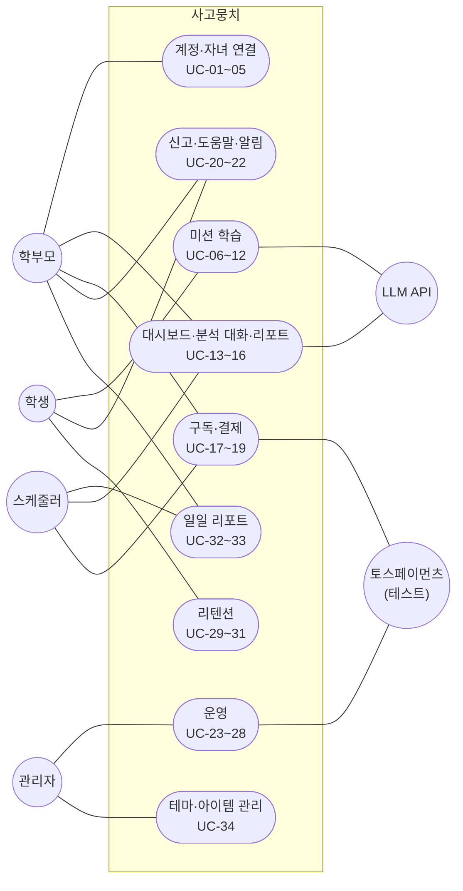
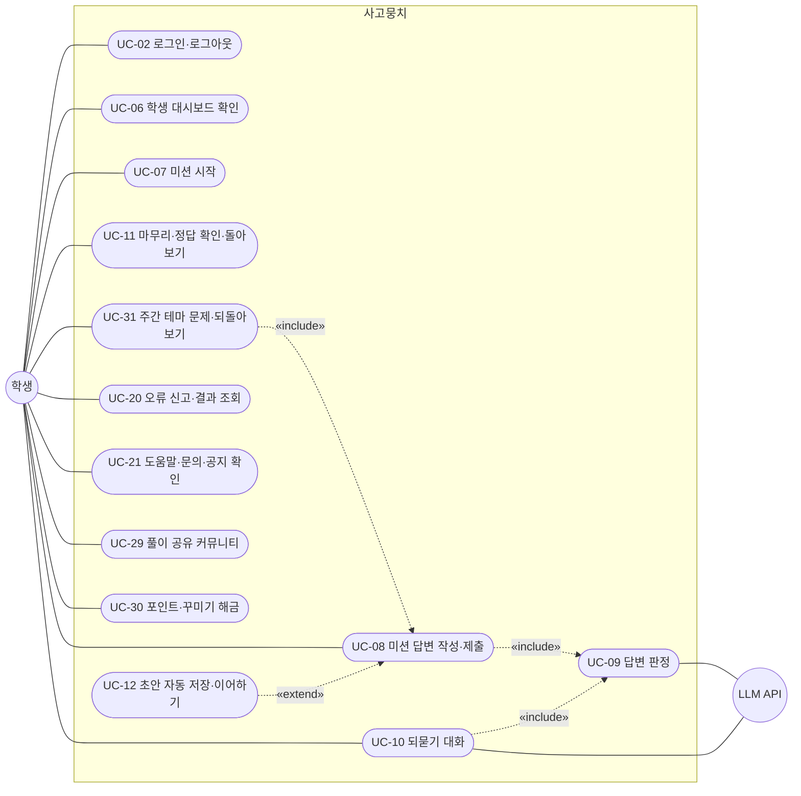
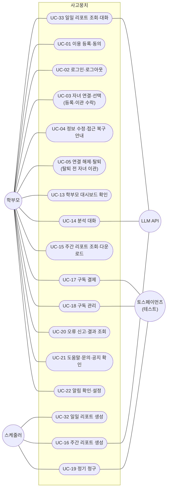
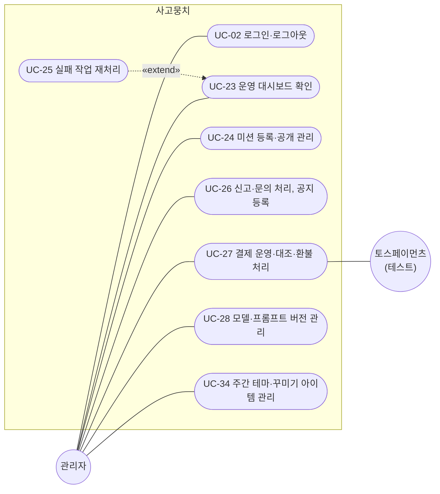
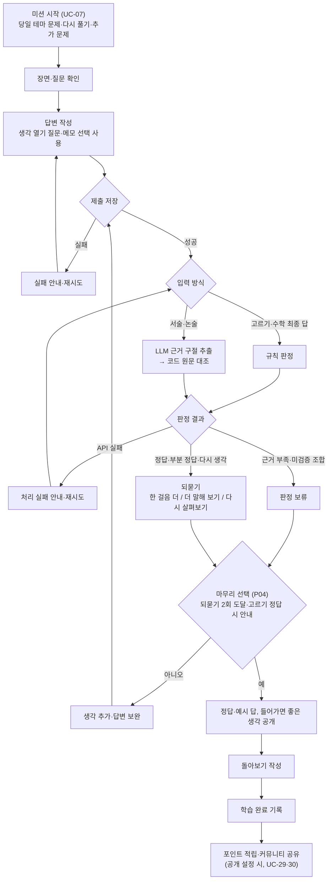

# 유스케이스

- 근거: [프로젝트 기획서](<../outputs/프로젝트_기획서_사고뭉치.pdf>), [요구사항 정의서 v0.3](<../outputs/[기획]요구사항 정의서_사고뭉치.xlsx>), [WBS](<../outputs/[기획] WBS_사고뭉치.xlsx>)
- 요구사항 ID는 요구사항 정의서의 기능 ID(FFH·FFJ·FBF·FBN·FAC·FAD·FAR)
- `(P04)` 형태는 확정 정책 번호, 내용은 [기능명세서 1.4](functional-spec.md#14-확정-정책)
- 용어: 문제 = 미션, 학생 대화 = 미션 안의 되묻기, 학부모 대화 = 자녀 기록에 대한 분석 질의
- 화면 단위 사용자 흐름·역할 간 시나리오는 [사용자 흐름도](user-flow.md)

---

## 1. 액터

| 액터 | 구분 | 설명 |
|---|---|---|
| 학생 | 사용자 | 제공된 미션을 풀고 되묻기에 답하며, 본인의 학습 과정과 돌아보기를 확인 |
| 학부모 | 사용자 | 연결된 자녀의 기록을 조회하고 분석 대화·일일·주간 리포트로 변화를 확인, 구독 결제 |
| 관리자 | 사용자 | 승인된 범위에서 미션·처리 상태·신고·결제·모델 버전 운영. 콘텐츠·결제·서비스 운영 권한을 구분하며 학생 원문 무제한 열람 불가 |
| 스케줄러 | 시스템 | 주간·일일 리포트 생성, 정기 청구 실행 |
| LLM API | 외부 시스템 | 근거 구절 추출, 되묻기 생성, 분석 대화, 리포트 요약 |
| 토스페이먼츠 (테스트) | 외부 시스템 | 테스트 키로 결제 승인·자동결제·취소/환불·상태 통지, 실결제 미연동 |

---

## 2. 유스케이스 다이어그램

### 2.1 전체

### 2.2 학생

### 2.3 학부모

### 2.4 관리자

---

## 3. 유스케이스 목록

| ID | 유스케이스 | 주 액터 | 보조 액터 | 우선순위 | 요구사항 ID |
|---|---|---|---|---|---|
| UC-01 | 이용 등록·동의 (Google 로그인 또는 아이디·비밀번호 가입, #415) | 학부모 | - | 제안 | FFJ-01, FBF-04 |
| UC-02 | 로그인·로그아웃 (학부모는 Google 또는 아이디·비밀번호 #415. 동석 학생 화면 → 학부모 화면 복귀는 보호자 비밀번호, 미설정·잠김이면 Google 로그인. FN-ACC-05) | 학생·학부모·관리자 | - | 제안 | FBF-01, FBF-02, FFJ-03 |
| UC-03 | 자녀 연결·선택 (자녀 등록 또는 다른 학부모의 이관 요청 수락. 수락 전 기록 접근 불가, 자녀 없는 학부모도 수락 가능. #289) | 학부모 | 보내는 학부모 | 제안 | FBF-03, FFJ-02, FFJ-06, FBN-01 |
| UC-04 | 정보 수정·접근 복구 안내 (계정 복구는 Google에 위임, FN-ACC-08) | 학부모 | - | 우선1 | FFJ-25, FBF-21, FBN-12 |
| UC-05 | 연결 해제·탈퇴 (탈퇴 전 자녀를 다른 학부모에게 이관 요청·취소. 대기 중 탈퇴·해제·삭제 차단, 수락된 자녀는 탈퇴 삭제 대상 제외. #289) | 학부모 | 받는 학부모 | 우선2 | FFJ-29, FBF-26, FBF-27, FBF-20 |
| UC-06 | 학생 대시보드 확인 | 학생 | - | 제안 | FFH-05, FFH-06, FFH-07, FFJ-21, FBN-07 |
| UC-07 | 미션 시작 (당일 주간 테마 문제가 기본, 생각 유형별 미션 고르기는 프리미엄 추가 문제. UC-31) | 학생 | - | 핵심 | FFH-01, FAD-01 |
| UC-08 | 미션 답변 작성·제출 | 학생 | - | 핵심 (질문 읽어주기·목록 접기·움직임 줄이기는 선택 보완, 음성 시범 미구현 P03) | FFJ-04, FFJ-12, FFJ-13, FFJ-14, FFJ-15, FBF-05, FBF-08, FFJ-35, FFJ-36, FFJ-37, FFJ-39 |
| UC-09 | 답변 판정 | (시스템) | LLM API | 핵심 | FBF-09, FAC-01, FAC-02, FAC-11 |
| UC-10 | 되묻기 대화 | 학생 | LLM API | 핵심 | FFH-02, FAC-03, FAC-04, FBF-06, FBF-10, FBN-04 |
| UC-11 | 마무리·정답 확인·돌아보기 | 학생 | - | 핵심 (자기 평가는 선택 보완) | FBN-03, FFJ-16, FFJ-38, FBF-07 |
| UC-12 | 초안 자동 저장·이어하기 | 학생 | - | 우선1 | FFJ-05, FFJ-17, FFJ-27, FBF-24, FBF-25 |
| UC-13 | 학부모 대시보드 확인 | 학부모 | - | 제안 | FFH-08, FFH-09, FFH-10, FFJ-07, FFJ-08, FFJ-22, FFJ-23, FBN-08 |
| UC-14 | 분석 대화 | 학부모 | LLM API | 핵심 (예시 질문은 선택 보완) | FFH-03, FBN-05, FFJ-18, FFJ-19, FFJ-20, FFJ-40, FAC-05, FAC-06, FAC-07, FBF-11, FBF-12, FBF-13 |
| UC-15 | 주간 리포트 조회·다운로드 | 학부모 | - | 핵심 | FFH-04, FBF-17, FBF-37, FBN-06 |
| UC-16 | 주간 리포트 생성 | 스케줄러 | LLM API, 설명 sLLM 서버 | 핵심 (M2 점수 기반 설명 포함, 12/7 데모 #473) | FBF-14, FBF-15, FBF-16, FAC-08, FAC-09, FAC-10, FAC-16, FAD-02 |
| UC-17 | 구독 결제 | 학부모 | 토스페이먼츠 | 우선2 | FFH-19, FFJ-32, FBF-30, FBF-31, FBF-32 |
| UC-18 | 구독 관리 (내역·결제수단·해지·환불 요청) | 학부모 | 토스페이먼츠 | 우선2 | FFH-20, FFJ-33, FFJ-34, FBF-34, FBN-25 |
| UC-19 | 정기 청구 | 스케줄러 | 토스페이먼츠 | 우선2 | FBF-33 |
| UC-20 | 오류 신고·결과 조회 | 학생·학부모 | - | 우선1 | FFJ-26, FFH-15 |
| UC-21 | 도움말·문의·공지 확인 | 학생·학부모 | - | 우선2 | FFH-17, FFH-18, FBF-28 |
| UC-22 | 알림 확인·설정 | 학부모 | - | 우선2 | FBF-29, FFJ-30, FFJ-31, FBN-24 |
| UC-23 | 운영 대시보드 확인 | 관리자 | - | 제안 | FFJ-09, FFH-11, FFH-12, FFH-13, FFJ-24, FBF-18 |
| UC-24 | 미션 등록·공개 관리 | 관리자 | - | 제안 | FFJ-10, FFH-14, FAD-03, FAD-04, FBN-09, FBN-10, FBF-19 |
| UC-25 | 실패 작업 재처리 | 관리자 | - | 제안 | FFJ-11 |
| UC-26 | 신고·문의 처리, 공지 등록 | 관리자 | - | 우선1 (문의·공지는 우선2) | FBF-22, FBF-23, FBF-28, FFH-18 |
| UC-27 | 결제 운영·대조·환불 처리 | 관리자 | 토스페이먼츠 | 우선2 | FFH-21, FBF-35, FBF-36 |
| UC-28 | 모델·프롬프트 버전 관리 (M2·설명 sLLM 포함) | 관리자 | - | 우선1 | FAC-12, FAR-05, FBN-21, FBN-22 |
| UC-29 | 풀이 공유 커뮤니티 (공개 설정·동의, 공유·열람, 반응, 신고. FN-RET-01~04) | 학생 | - | 구현 (#386·#388·#393, 2026-11-06 결정) | 공유안 2.1 |
| UC-30 | 포인트·꾸미기 해금 (적립·조회, 테마·캐릭터·아이템 해금·착용. FN-RET-05·06) | 학생 | - | 구현 (#389·#393, 2026-11-06 결정) | 공유안 2.2 |
| UC-31 | 주간 테마 문제·되돌아보기 (월~금 누적 공개·토요일 풀기·되돌아보기·다시 풀기, 일요일 닫힘·프리미엄 일요일, 2026-11-10 개정 #483. FN-RET-07·08) | 학생 | - | 구현 (#385·#387·#393, 2026-11-06 결정) | 공유안 2.3 |
| UC-32 | 일일 리포트 생성 (매일 자정, 템플릿. FN-RPT-14) | 스케줄러 | - | 구현 (#390·#391·#400, 2026-11-06 결정) | 공유안 3.1 |
| UC-33 | 일일 리포트 조회·대화 (FN-RPT-15·16) | 학부모 | LLM API | 구현 (#390·#392·#394, 2026-11-06 결정) | 공유안 3.1, 3.2 |
| UC-34 | 주간 테마·꾸미기 아이템 관리 (FN-ADM-22·23) | 관리자 | - | 구현 (#385·#387·#389·#395, 2026-11-06 결정) | 공유안 2.2, 2.3 |

- UC-29~34는 2026-11-06 서비스 기획 방향 결정([기능명세 1.4](functional-spec.md#14-확정-정책) P20~P25, 2.10 FN-RET·2.6 FN-RPT-14~17·2.9 FN-ADM-22·23)으로 추가, 구현 이슈는 우선순위 열. 우선순위 열의 "제안"은 요구사항 정의서 우선순위 등급

---

## 4. 핵심 유스케이스 명세

### 4.1 미션 한 번의 흐름

### 4.2 UC-08 미션 답변 작성·제출
- 사전조건: 학생 식별 완료(미식별 시 제출 불가), 학생 학년·입력 방식 범위의 공개 미션 시작(당일 테마 문제·되돌아보기 다시 풀기·프리미엄 추가 문제, UC-31)
- 기본 흐름
  1. 미션 장면·질문·안내 확인 (장면이 정답이나 정답 과정을 미리 드러내지 않음)
  2. (선택) 도움 버튼으로 생각 열기 질문 열람, 열람 여부·시점 기록
  3. (선택) 메모 작성 후 답변 칸으로 이동, 메모와 제출 답변 구분 (메모는 초안과 함께 저장, 학생 본인만 열람 P05)
  4. 입력 방식별 작성: 고르기(선택지·순서·분류), 서술(글·풀이 단계 틀), 논술(주장·까닭 2개·반대 의견에 답하기)
  5. 제출 → 최초 답변을 학생·미션·학습 시도에 연결해 제출 시점·순서와 함께 저장
  6. UC-09 답변 판정 수행
- 대안 흐름
  - 필요한 선택 누락: 보완할 내용 안내
  - 보호자 받아쓰기(저학년): 아이의 말을 그대로 입력, 지원 이용 여부 별도 기록
  - 질문 읽어주기(선택): 브라우저 TTS, 중지·다시 재생, 정답 추가 제공 금지 (P03)
  - 화면 이탈: UC-12로 초안 복원
- 예외 흐름
  - 저장 실패: 실패 사실·재시도 안내, 완료처럼 표시하지 않음
  - 같은 제출 반복: 중복 집계하지 않음
  - 저장 성공 후 AI 처리 실패: 저장 성공과 처리 실패를 구분해 표시
- 사후조건: 최초 답변은 이후 보완에도 덮어쓰지 않음

### 4.3 UC-09 답변 판정
- 사전조건: 답변 저장 완료
- 기본 흐름
  1. 고르기: 정답 키로 확인, 다른 답에는 까닭을 묻도록 되묻기로 연결. 저학년 이유 설명 자체는 판정하지 않음
  2. 수학 최종 답: 분수·소수·한글 분수 등 동치 표현을 같은 답으로 확인. 풀이 과정은 이 규칙으로 판정하지 않음
  3. 서술·논술: LLM이 기준표 요소별 근거 구절 추출 → 코드가 구절의 답변 원문 존재 여부 확인 → 요소·배점 기준으로 정답·부분 정답·다시 생각 판정
  4. 판정 결과·근거 구절·기준표 버전 저장, 검증 전에는 "AI 채점(시범)"으로 구분 표시
- 대안 흐름 (판정 보류, 낮은 수준으로 기록하지 않음)
  - 근거 부족·인용 불일치·짧은 답변·미검증 학년/문항 조합
  - 미검증 M1 수학 과정
  - M2 항목 점수와 LLM 관찰 불일치, M1 확신도 0.8 미만 (P15)
- 예외 흐름: LLM API 실패는 처리 실패로 기록 (보류와 구분)
- 사후조건: 근거 없는 요소는 충족으로 표시하지 않음, 숫자 레벨 비노출

### 4.4 UC-10 되묻기 대화
- 사전조건: UC-09 완료(판정 또는 보류)
- 기본 흐름
  1. 실제 답변과 기준표 근거로 "한 걸음 더" / "더 말해 보기" / "다시 살펴보기" 질문 생성
  2. 정답·금지어 유출 검사, 질문 출처 기록
  3. 현재 학습 시도의 제출 답변·질문·추가 답변을 순서대로 표시 (다른 시도와 분리)
  4. 학생이 생각 추가·답변 보완 제출 → 이전 답변·해당 질문에 연결해 별도 기록 → UC-09
  5. 다음 질문 또는 마무리 안내 (되묻기 최대 2회, 고르기 정답 시 즉시 마무리 안내, "이대로 돌아보기"로 건너뛰기 가능 P04)
- 대안 흐름
  - 학생이 답을 요청하거나 표현에 어려움: 스스로 표현하도록 돕는 질문 제공, 대필·맞춤법 첨삭 금지
  - 유출 검사 실패: 1회 재생성, 재실패 시 중립 질문 은행 사용·출처 기록 (P16)
- 예외 흐름: 질문 생성 실패 시 처리 실패·재시도 가능 여부 안내, 기존 답변·대화 기록 보존

### 4.5 UC-11 마무리·정답 확인·돌아보기
- 사전조건: 판정 처리 완료 1회 이상 + 학생의 마무리 선택 (P04)
- 기본 흐름
  1. 닫힌 문제는 정답, 열린 문제는 예시 답 공개
  2. 들어가면 좋은 생각 체크리스트: 근거 구절이 실제 확인된 요소만 체크하고 해당 구절 표시
  3. (선택) 학생 자기 체크 → AI 확인 항목과 나란히 비교, 자기 체크가 원본 답변·AI 판정을 덮어쓰지 않음
  4. 돌아보기 작성: 느낀 난이도(쉬웠어·보통·어려웠어)·달라진 점 (난이도 필수, 달라진 점 선택 P04)
  5. 완료 상태·시점 기록, 답변·질문·돌아보기를 같은 학습으로 연결
- 예외 흐름: 마무리 조건 미충족 시 정답·예시 답 비공개, 마무리 후 답변 제출 불가, 미완료 시도는 완료 학습과 구분

### 4.6 UC-14 분석 대화
- 사전조건: 학부모 로그인, 연결된 자녀 1명 이상, 대상 자녀 프리미엄 구독(하루 30회, P13)
- 기본 흐름
  1. 분석 대상 자녀·조회 기간 표시, 질문 입력 또는 예시 질문 버튼 선택
  2. 질문마다, 에이전트의 기록 조회 도구 실행마다 학부모-자녀 연결 권한 확인
  3. 권한 범위의 기록 조회: 숫자·유형별 활동·아이가 쓴 생각·전후 변화·돌아보기 (수학 점검은 M1 활성 범위만)
  4. 수치는 코드로 계산해 기간·분자·분모·계산 기준과 함께 제공
  5. 답변 속 숫자·인용을 조회·계산 결과와 대조한 뒤 제시
  6. 근거 선택 시 관련 미션·답변 시점·원문 표시, 전후 변화는 같은 시도의 최초·추가 답변 연결
  7. 질문·답변을 대상 자녀·조회 기간·참조 기록과 연결해 저장
  8. 후속 질문은 확인된 자녀·기간 유지
- 대안 흐름
  - 대상·기간 불명확 또는 현재 선택과 충돌: 추가 확인, 임의 지정 금지
  - 대상·기간 변경: 변경 조건 표시, 이전 범위 기록과 혼합 금지
  - 기록 부족: 조회된 기록 수·분석 가능 범위 안내, 점수 저하·사고력 부족으로 해석 금지
- 예외 흐름
  - 연결되지 않은 자녀 요청: 조회·분석 거부
  - 숫자·인용 대조 실패: 확정 답변 제공 중단, 규칙 응답 모드(계산 수치·원문 목록 템플릿)로 대체·실패 사실 표시 (P16)
  - 처리 중·실패·재시도 상태 표시, 실패를 기록 없음이나 정상 결과로 대체 금지 (LLM 키 부재·호출 실패 시 규칙 응답 모드 P16)

### 4.7 UC-16 주간 리포트 생성
- 트리거: 주가 끝난 일요일 자정(월요일 00:00 KST) 스케줄러, 대상 주는 직전 월 00:00~일 23:59:59 (P06)
- 기본 흐름
  1. 자녀별 대상 기간 경계와 포함 기록 확정 (기간 내 답변 제출이 있는 시도, 미완료 포함 P06·P08). 무료 플랜 자녀는 수치만 제공, 서술 요약 생략 (P13)
  2. 수치를 코드로 계산, 기간·분자·분모·계산식·출처 유형(기록·규칙·정답 키·AI 관찰) 연결
  3. 다섯 생각 유형별 활동을 실제 미션·답변 근거로 요약, 기록 없는 유형은 "확인된 기록 없음" 표시
  4. 되묻기 전후 변화: 받은 질문과 최초·추가 답변, 글자 수·문장 수·까닭을 잇는 말 개수 변화 (시도당 최초 vs 마지막 답변, 계산 규칙 P08)
  5. 학생 돌아보기 포함, 미작성은 구분 표시 (대신 작성 금지)
  6. 아이 원문 인용, 이번 주 저녁 질문, 이번 주 테마 요약(요일별 완료·개근(이전 이름 완주)·주간 완주·되돌아보기 다시 풀기 비교, P06·P23, 2026-11-10 개정 #483: 개근·주간 완주·당일 풀이·엔딩 칸은 learning #484·report #486 구현) 포함
  7. (프리미엄·원문 공개 자녀, P15·FN-RPT-09 #473) 그 주 M2 점수가 있는 답변 중 대표 답변 최대 3개(생각 유형이 겹치지 않게, 같으면 최근 답변)를 골라 설명 sLLM으로 답변별 학부모용 설명 생성. 금지어·점수·등급 표현 검사와 인용 원문 대조 통과분만 "AI 관찰" 설명 항목으로 포함
  8. 숫자·인용을 원본·계산 결과와 대조 후 저장, 완료 알림 생성 (UC-22)
- 대안 흐름
  - 기록 없는 주: "기록 없음" 리포트 생성(LLM 미호출), 표본 부족 주: 분모 5 미만은 개수만 표시. 처리 실패와 구분 (P06·P08)
- 예외 흐름
  - 생성 실패: 실패 상태 기록·표시
  - 근거 없는 요약: 템플릿 요약으로 전환해 발행, 출처 표시 (P16)
  - 설명 생성 실패·검사 실패·시간 초과·설명 모델 미활성: 해당 설명 없이 발행하고 "설명 미포함" 표시, 리포트 상태는 바꾸지 않음 (P16)
  - 같은 주 재생성: 새 판 추가, 최신본 기본 표시·이전본 열람 가능. 학부모 리포트당 1회, 관리자 무제한 (P06)
- 사후조건: 검증 전 숫자 레벨·등급 비표시, 전후 변화를 사고력 향상으로 단정하지 않음

### 4.8 UC-31 주간 테마 문제·되돌아보기
2026-11-10 개정(#483, 구현 learning #484·core #485·web #487): 누적 공개·즉시 엔딩·토요일 풀기·일요일 닫힘과 프리미엄 일요일.
- 사전조건: 학생 세션, 학년군(초3~4·초5~6)의 이번 주 게시 테마(없으면 최근 게시 테마 재사용, P23)
- 기본 흐름
  1. 생각 지도 홈에 이번 주 테마 표시, 그 주 첫 진입 때 시작 이야기 표시(기준안)
  2. 공개된 문제(월~금 KST 00:00에 하나씩 공개, 토요일까지 쌓임) 시작 → UC-08~11 미션 흐름 그대로. 진행 중 시도는 자정이 지나도 이어하기
  3. 학습 완료 시 포인트 적립(미션당 최초 1회), 그 요일 안에 마치면 당일 풀이 포인트 (P21)
  4. 금요일 문제 끝 큰 질문 정답 고르기(기준안)에서 정답이면 바로 엔딩(종료 이야기·정답)
  5. 토요일 되돌아보기 열기 → 그 주 마무리한 문제 목록과 안 푼 문제. 열람 기록(주 1회 포인트), 안 푼 문제 새로 풀기
  6. 다시 풀기 선택 → 새 시도(#207 직전 마무리 시도와 비교). 큰 질문을 틀렸던 학생은 그 문제 다시 풀기를 마무리하면 엔딩(틀리면 정답 공개)
  7. 월~금 5문제를 각 당일 학습 완료하면 개근, 5문제를 토요일까지 학습 완료하면 주간 완주 포인트
- 대안 흐름
  - 프리미엄: 생각 유형별 미션 고르기로 추가 문제, 일요일도 토요일과 같이 이용(일요일 완료는 주간 완주에 넣지 않음) (P13)
  - 재사용 테마: 이미 푼 문제도 그 주 공개된 문제로 다시 시도, 학습 완료 포인트는 미션당 최초 1회라 재적립 없음
- 예외 흐름
  - 공개 전(앞 요일) 문제 시작: 거부
  - 일요일(무료): 풀기·다시 풀기 거부, 이번 주 기록·본 엔딩 다시 보기만(결제 유도 문구 없음)
  - 무료 추가 문제: 프리미엄 안내(보호자 화면)
  - 큰 질문 정답 고르기 문제 커뮤니티: 엔딩 전 열람 거부

### 4.9 UC-32 일일 리포트 생성
- 트리거: 대상일이 끝난 자정(다음 날 00:00 KST) 스케줄러, 대상일은 전날 00:00~23:59:59 (P24)
- 기본 흐름
  1. 보호자가 연결된 자녀별 대상일 포함 기록 확정(그날 KST 안에 완료한 시도, 전날 제출·그날 완료 포함). 토·일은 되돌아보기 다시 풀기·추가 문제 시도 포함
  2. 문제별 판정 결과·받은 되묻기·보완 답변·확인된 생각 요소·돌아보기·원문 인용을 템플릿으로 구성(LLM 미호출)
  3. 숫자·인용을 원본과 대조 후 저장, 일일 리포트 완료 알림 (UC-22)
- 대안 흐름
  - 기록 없는 날: "기록 없음" 리포트 생성·알림
  - 학생 공개 설정(#206) 비공개: 원문 인용 제외, 수치 유지
- 예외 흐름
  - 생성 실패: 실패 상태·실패 알림, 관리자 재처리 시 새 판 (UC-25)

### 4.10 UC-33 일일 리포트 조회·대화
- 사전조건: 학부모 로그인, 연결된 자녀. 대화는 대상 자녀 프리미엄(분석 대화 하루 30회 공유)
- 기본 흐름
  1. 리포트 목록에서 일일 리포트 선택 → 상세·근거·다운로드(주간과 같음)
  2. "이 리포트로 물어보기" → 자녀·그날·리포트 판을 고정한 분석 대화 생성 (P25)
  3. 질문마다 권한 확인, 그날 리포트와 학습 기록을 근거로 계산·대조 후 답변 (UC-14 3~7)
- 예외 흐름
  - 무료 자녀: 프리미엄 안내, 대화 생성 불가
  - 다른 날 질문: 새 대화로 안내
  - 대조 실패·LLM 장애: 규칙 응답 모드 (P16)

### 4.11 UC-29 풀이 공유 커뮤니티
- 사전조건: 학생 세션. 공유는 커뮤니티 공개 설정 켜짐 + 보호자 선택 동의(`COMMUNITY`), 열람·반응은 그 미션을 마무리한 학생 (P20)
- 기본 흐름
  1. 학생이 커뮤니티 공개 설정을 켬(기본 끔, FN-RET-01)
  2. 미션을 처음 마무리(학습 완료)하면 그 시도의 마지막 답변이 자동 공유됨(학생·미션당 1개, 메모·판정·되묻기 미포함, FN-RET-02)
  3. 마무리한 미션에서 "같은 미션 풀이 보기" → 공유물 무작위 목록, 작성자는 별명·동행 캐릭터로 표시
  4. 정해진 반응 4종을 남기거나 취소(FN-RET-03)
  5. 학부모는 자녀 공유물·받은 반응만 조회
- 대안 흐름
  - 공개 설정을 끄거나 동의 철회·이관 수락: 기존 공유물 비공개, 다시 켜면 설정 비공개분만 복원
  - 다시 풀기: 새로 공유하지 않음
- 예외 흐름
  - 동의 없이 켜기: 거부·보호자 동의 안내 (API 2.9 `COMMUNITY_CONSENT_REQUIRED`)
  - 미션 미마무리 학생의 열람·반응, 본인 글 반응: 거부
  - 신고(UC-20, 대상 `COMMUNITY_POST`): 즉시 숨김 → 관리자 검토 후 다시 공개 또는 계속 숨김 (FN-RET-04)
- 사후조건: 반응 수는 작성자·학부모만, 순위·인기순 비표시

### 4.12 UC-30 포인트·꾸미기 해금
- 사전조건: 학생 세션 (P21·P22)
- 기본 흐름
  1. 학습 완료·되돌아보기 열람·공유·반응·주간 테마 당일 풀이·개근·주간 완주(#483) 때 규칙 값만큼 포인트 적립(FN-RET-05)
  2. 학생·학부모가 잔액·최근 내역 확인
  3. 꾸미기 화면에서 테마·캐릭터·아이템(모자·옷·소품·배경)의 해금 여부·필요 포인트 확인 → 해금(즉시 차감·영구)
  4. 해금한 항목만 선택·착용(FN-RET-06)
- 대안 흐름
  - `lake`·`mungchi`와 잠금 적용 전 고른 항목: 해금된 것으로 표시
  - 이미 해금한 항목 재요청: 차감 없이 성공
- 예외 흐름
  - 잔액 부족·판매 중단 항목 해금, 잠긴 항목 선택: 거부 (API 2.10·3.12)
  - 적립 저장 실패: 학습 응답은 유지, 같은 사건 재요청·주간 테마 조회 때 보충
- 사후조건: 판정 결과와 무관, 회수·소멸·순위 없음

### 4.13 UC-34 주간 테마·꾸미기 아이템 관리
- 사전조건: 관리자 콘텐츠 운영 권한(CONTENT) (P07·P22·P23)
- 기본 흐름
  1. 주간 테마 작성: 학년군·적용 주(월요일)·제목·도입 이야기·요일별 게시 미션(FN-ADM-22)
  2. 검토 요청 → 검토 → 게시(미션과 같은 흐름, UC-24)
  3. 꾸미기 아이템 등록·수정(슬롯·이름·필요 포인트·그림)·판매 중단(FN-ADM-23)
  4. 변경마다 감사 기록
- 예외 흐름
  - 게시 미션이 아니거나 다섯 생각 유형이 빠지거나 겹침, 같은 학년군·주에 이미 게시: 게시 불가 (API 2.8 `WEEKLY_THEME_PUBLISH_INCOMPLETE`)
  - 게시 중 수정: 재검토, 진행 중 시도 영향 없음
- 사후조건: 아이템 삭제 없음, 판매 중단해도 해금한 학생은 계속 사용. 테마·캐릭터 해금값은 코드 상수라 화면에서 바꾸지 않음

---

## 5. 공통 규칙
- 권한: 학생은 본인 기록, 학부모는 연결된 자녀 기록만 조회·변경. 다른 식별값 요청은 거부 (FBN-01, FBN-05)
- 관리자 권한: 승인된 계정에만 부여, 일반 가입에서 선택 불가 (FBN-02)
- 외부 AI 전달: 작업에 필요한 최소 기록만, 학생 이름·불필요한 식별정보 제외 (FBN-11, FBN-23)
- 시연 데이터: 가상 학생·자체 미션만 사용, AI Hub 원문·가공본은 저장소·화면에 미포함 (FBN-11)
- 생각 유형: 분석하기·따져 보기·새로 만들기·문제 해결하기·돌아보기 5개를 전 화면 동일 사용, 비교·분류·순서·규칙·원인과 결과·추론은 기초 사고력으로 구분 (FAD-05)
- 상태 구분: 기록 없음·표본 부족·판정 보류·처리 중·처리 실패를 구분, 확인되지 않은 값을 임의로 채우지 않음
- 효과 표현: 관찰된 답변 변화와 사고력 향상을 구분, 검증 전 숫자 레벨·등급 비표시
- 대체 응답: P16에 정한 지점(되묻기 질문 은행·분석 대화 규칙 응답·리포트 템플릿 요약)만 허용, 실패 사실·출처·조회 근거 표시
- 결제: 토스페이먼츠 테스트 환경만 사용, 테스트 거래는 실제 운영 기록·매출·학습 통계와 분리 (P13, FBN-13)
- 보관·삭제: 확정 정책을 전 기능에 동일 적용, 삭제된 근거는 이용 불가로 표시 (FBF-20, P09)
- 리텐션: 포인트는 판정 결과와 무관하게 참여로만 적립, 커뮤니티·포인트 모두 순위·인기순 비표시 (P20·P21)

---

## 6. 제외 범위
- QAS01(품질과 완료 기준), UXS01(사용 환경과 접근성): 검증·비기능 요구
- OPS01(배포와 서비스 운영): 배포·복구·백업·경보 등 운영 작업
- MDL01(모델 학습) 중 FAC-13~15: 개발 작업(FAC-14 설명 sLLM 학습·평가 #475 포함). FAC-16 설명 생성은 UC-16에 포함
- 실결제 전환과 운영 전환 확인(FAR-06): 테스트 결제까지만 연동하므로 제외
