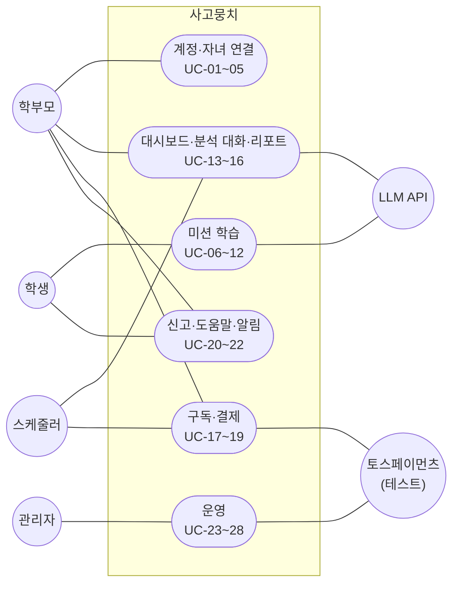
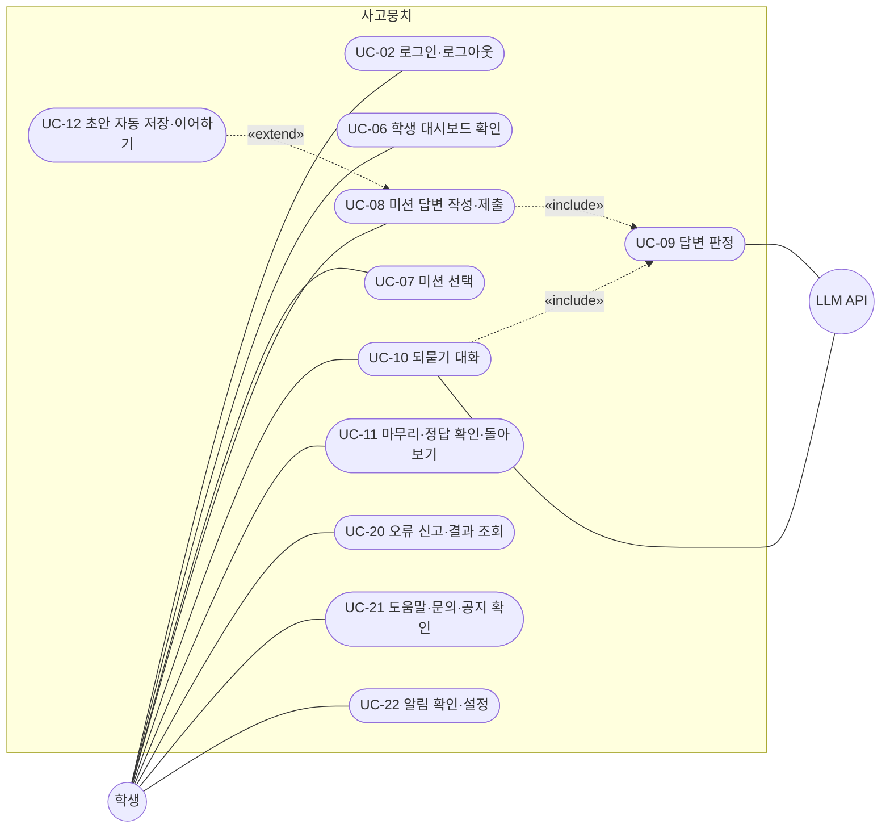
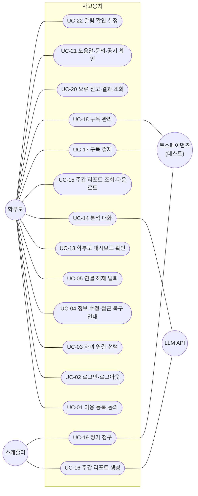
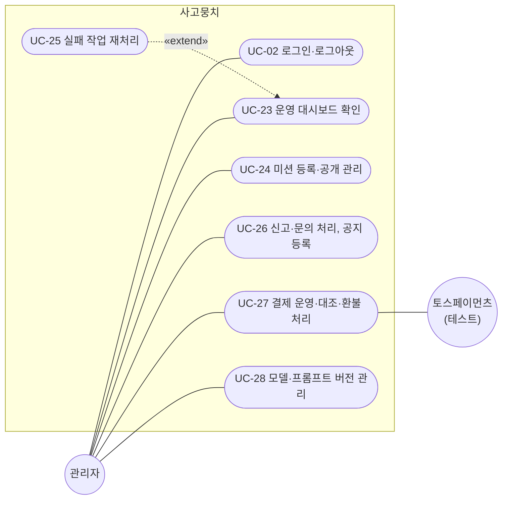
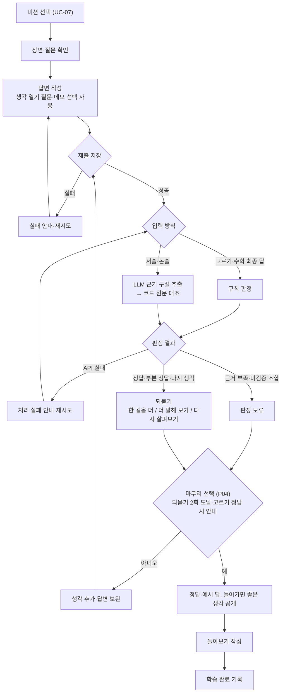

# 유스케이스

- 근거: [프로젝트 기획서](<../outputs/프로젝트_기획서_사고뭉치.pdf>), [요구사항 정의서 v0.3](<../outputs/[기획]요구사항 정의서_사고뭉치.xlsx>), [WBS](<../outputs/[기획] WBS_사고뭉치.xlsx>)
- 요구사항 ID는 요구사항 정의서의 기능 ID(FFH·FFJ·FBF·FBN·FAC·FAD·FAR)
- `(P04)` 형태는 확정 정책 번호, 내용은 [기능명세서 1.4](functional-spec.md#14-확정-정책)
- 용어: 문제 = 미션, 학생 대화 = 미션 안의 되묻기, 학부모 대화 = 자녀 기록에 대한 분석 질의
- 화면 단위 사용자 흐름·역할 간 시나리오는 [사용자 흐름도](user-flow.md)

---

## 1. 액터

| 액터 | 구분 | 설명 |
|---|---|---|
| 학생 | 사용자 | 제공된 미션을 풀고 되묻기에 답하며, 본인의 학습 과정과 돌아보기를 확인 |
| 학부모 | 사용자 | 연결된 자녀의 기록을 조회하고 분석 대화·주간 리포트로 변화를 확인, 구독 결제 |
| 관리자 | 사용자 | 승인된 범위에서 미션·처리 상태·신고·결제·모델 버전 운영. 콘텐츠·결제·서비스 운영 권한을 구분하며 학생 원문 무제한 열람 불가 |
| 스케줄러 | 시스템 | 주간 리포트 생성, 정기 청구 실행 |
| LLM API | 외부 시스템 | 근거 구절 추출, 되묻기 생성, 분석 대화, 리포트 요약 |
| 토스페이먼츠 (테스트) | 외부 시스템 | 테스트 키로 결제 승인·자동결제·취소/환불·상태 통지, 실결제 미연동 |

---

## 2. 유스케이스 다이어그램

### 2.1 전체

### 2.2 학생

### 2.3 학부모

### 2.4 관리자

---

## 3. 유스케이스 목록

| ID | 유스케이스 | 주 액터 | 보조 액터 | 우선순위 | 요구사항 ID |
|---|---|---|---|---|---|
| UC-01 | 이용 등록·동의 | 학부모 | - | 제안 | FFJ-01, FBF-04 |
| UC-02 | 로그인·로그아웃 | 학생·학부모·관리자 | - | 제안 | FBF-01, FBF-02, FFJ-03 |
| UC-03 | 자녀 연결·선택 | 학부모 | - | 제안 | FBF-03, FFJ-02, FFJ-06, FBN-01 |
| UC-04 | 정보 수정·접근 복구 안내 (계정 복구는 Google에 위임, FN-ACC-08) | 학부모 | - | 우선1 | FFJ-25, FBF-21, FBN-12 |
| UC-05 | 연결 해제·탈퇴 | 학부모 | - | 우선2 | FFJ-29, FBF-26, FBF-27, FBF-20 |
| UC-06 | 학생 대시보드 확인 | 학생 | - | 제안 | FFH-05, FFH-06, FFH-07, FFJ-21, FBN-07 |
| UC-07 | 미션 선택 | 학생 | - | 핵심 | FFH-01, FAD-01 |
| UC-08 | 미션 답변 작성·제출 | 학생 | - | 핵심 (질문 읽어주기·목록 접기·움직임 줄이기는 선택 보완, 음성 시범 미구현 P03) | FFJ-04, FFJ-12, FFJ-13, FFJ-14, FFJ-15, FBF-05, FBF-08, FFJ-35, FFJ-36, FFJ-37, FFJ-39 |
| UC-09 | 답변 판정 | (시스템) | LLM API | 핵심 | FBF-09, FAC-01, FAC-02, FAC-11 |
| UC-10 | 되묻기 대화 | 학생 | LLM API | 핵심 | FFH-02, FAC-03, FAC-04, FBF-06, FBF-10, FBN-04 |
| UC-11 | 마무리·정답 확인·돌아보기 | 학생 | - | 핵심 (자기 평가는 선택 보완) | FBN-03, FFJ-16, FFJ-38, FBF-07 |
| UC-12 | 초안 자동 저장·이어하기 | 학생 | - | 우선1 | FFJ-05, FFJ-17, FFJ-27, FBF-24, FBF-25 |
| UC-13 | 학부모 대시보드 확인 | 학부모 | - | 제안 | FFH-08, FFH-09, FFH-10, FFJ-07, FFJ-08, FFJ-22, FFJ-23, FBN-08 |
| UC-14 | 분석 대화 | 학부모 | LLM API | 핵심 (예시 질문은 선택 보완) | FFH-03, FBN-05, FFJ-18, FFJ-19, FFJ-20, FFJ-40, FAC-05, FAC-06, FAC-07, FBF-11, FBF-12, FBF-13 |
| UC-15 | 주간 리포트 조회·다운로드 | 학부모 | - | 핵심 | FFH-04, FBF-17, FBF-37, FBN-06 |
| UC-16 | 주간 리포트 생성 | 스케줄러 | LLM API | 핵심 (M2 설명은 선택 보완) | FBF-14, FBF-15, FBF-16, FAC-08, FAC-09, FAC-10, FAC-16, FAD-02 |
| UC-17 | 구독 결제 | 학부모 | 토스페이먼츠 | 우선2 | FFH-19, FFJ-32, FBF-30, FBF-31, FBF-32 |
| UC-18 | 구독 관리 (내역·결제수단·해지·환불 요청) | 학부모 | 토스페이먼츠 | 우선2 | FFH-20, FFJ-33, FFJ-34, FBF-34, FBN-25 |
| UC-19 | 정기 청구 | 스케줄러 | 토스페이먼츠 | 우선2 | FBF-33 |
| UC-20 | 오류 신고·결과 조회 | 학생·학부모 | - | 우선1 | FFJ-26, FFH-15 |
| UC-21 | 도움말·문의·공지 확인 | 학생·학부모 | - | 우선2 | FFH-17, FFH-18, FBF-28 |
| UC-22 | 알림 확인·설정 | 학생·학부모 | - | 우선2 | FBF-29, FFJ-30, FFJ-31, FBN-24 |
| UC-23 | 운영 대시보드 확인 | 관리자 | - | 제안 | FFJ-09, FFH-11, FFH-12, FFH-13, FFJ-24, FBF-18 |
| UC-24 | 미션 등록·공개 관리 | 관리자 | - | 제안 | FFJ-10, FFH-14, FAD-03, FAD-04, FBN-09, FBN-10, FBF-19 |
| UC-25 | 실패 작업 재처리 | 관리자 | - | 제안 | FFJ-11 |
| UC-26 | 신고·문의 처리, 공지 등록 | 관리자 | - | 우선1 (문의·공지는 우선2) | FBF-22, FBF-23, FBF-28, FFH-18 |
| UC-27 | 결제 운영·대조·환불 처리 | 관리자 | 토스페이먼츠 | 우선2 | FFH-21, FBF-35, FBF-36 |
| UC-28 | 모델·프롬프트 버전 관리 | 관리자 | - | 우선1 | FAC-12, FAR-05, FBN-21, FBN-22 |

---

## 4. 핵심 유스케이스 명세

### 4.1 미션 한 번의 흐름

### 4.2 UC-08 미션 답변 작성·제출
- 사전조건: 학생 식별 완료(미식별 시 제출 불가), 학생 학년·입력 방식 범위의 공개 미션 선택
- 기본 흐름
  1. 미션 장면·질문·안내 확인 (장면이 정답이나 정답 과정을 미리 드러내지 않음)
  2. (선택) 도움 버튼으로 생각 열기 질문 열람, 열람 여부·시점 기록
  3. (선택) 메모 작성 후 답변 칸으로 이동, 메모와 제출 답변 구분 (메모는 초안과 함께 저장, 학생 본인만 열람 P05)
  4. 입력 방식별 작성: 고르기(선택지·순서·분류), 서술(글·풀이 단계 틀), 논술(주장·까닭 2개·반대 의견에 답하기)
  5. 제출 → 최초 답변을 학생·미션·학습 시도에 연결해 제출 시점·순서와 함께 저장
  6. UC-09 답변 판정 수행
- 대안 흐름
  - 필요한 선택 누락: 보완할 내용 안내
  - 보호자 받아쓰기(저학년): 아이의 말을 그대로 입력, 지원 이용 여부 별도 기록
  - 질문 읽어주기(선택): 브라우저 TTS, 중지·다시 재생, 정답 추가 제공 금지 (P03)
  - 화면 이탈: UC-12로 초안 복원
- 예외 흐름
  - 저장 실패: 실패 사실·재시도 안내, 완료처럼 표시하지 않음
  - 같은 제출 반복: 중복 집계하지 않음
  - 저장 성공 후 AI 처리 실패: 저장 성공과 처리 실패를 구분해 표시
- 사후조건: 최초 답변은 이후 보완에도 덮어쓰지 않음

### 4.3 UC-09 답변 판정
- 사전조건: 답변 저장 완료
- 기본 흐름
  1. 고르기: 정답 키로 확인, 다른 답에는 까닭을 묻도록 되묻기로 연결. 저학년 이유 설명 자체는 판정하지 않음
  2. 수학 최종 답: 분수·소수·한글 분수 등 동치 표현을 같은 답으로 확인. 풀이 과정은 이 규칙으로 판정하지 않음
  3. 서술·논술: LLM이 기준표 요소별 근거 구절 추출 → 코드가 구절의 답변 원문 존재 여부 확인 → 요소·배점 기준으로 정답·부분 정답·다시 생각 판정
  4. 판정 결과·근거 구절·기준표 버전 저장, 검증 전에는 "AI 채점(시범)"으로 구분 표시
- 대안 흐름 (판정 보류, 낮은 수준으로 기록하지 않음)
  - 근거 부족·인용 불일치·짧은 답변·미검증 학년/문항 조합
  - 미검증 M1 수학 과정
  - M2 항목 점수와 LLM 관찰 불일치, M1 확신도 0.8 미만 (P15)
- 예외 흐름: LLM API 실패는 처리 실패로 기록 (보류와 구분)
- 사후조건: 근거 없는 요소는 충족으로 표시하지 않음, 숫자 레벨 비노출

### 4.4 UC-10 되묻기 대화
- 사전조건: UC-09 완료(판정 또는 보류)
- 기본 흐름
  1. 실제 답변과 기준표 근거로 "한 걸음 더" / "더 말해 보기" / "다시 살펴보기" 질문 생성
  2. 정답·금지어 유출 검사, 질문 출처 기록
  3. 현재 학습 시도의 제출 답변·질문·추가 답변을 순서대로 표시 (다른 시도와 분리)
  4. 학생이 생각 추가·답변 보완 제출 → 이전 답변·해당 질문에 연결해 별도 기록 → UC-09
  5. 다음 질문 또는 마무리 안내 (되묻기 최대 2회, 고르기 정답 시 즉시 마무리 안내, "이대로 돌아보기"로 건너뛰기 가능 P04)
- 대안 흐름
  - 학생이 답을 요청하거나 표현에 어려움: 스스로 표현하도록 돕는 질문 제공, 대필·맞춤법 첨삭 금지
  - 유출 검사 실패: 1회 재생성, 재실패 시 중립 질문 은행 사용·출처 기록 (P16)
- 예외 흐름: 질문 생성 실패 시 처리 실패·재시도 가능 여부 안내, 기존 답변·대화 기록 보존

### 4.5 UC-11 마무리·정답 확인·돌아보기
- 사전조건: 판정 처리 완료 1회 이상 + 학생의 마무리 선택 (P04)
- 기본 흐름
  1. 닫힌 문제는 정답, 열린 문제는 예시 답 공개
  2. 들어가면 좋은 생각 체크리스트: 근거 구절이 실제 확인된 요소만 체크하고 해당 구절 표시
  3. (선택) 학생 자기 체크 → AI 확인 항목과 나란히 비교, 자기 체크가 원본 답변·AI 판정을 덮어쓰지 않음
  4. 돌아보기 작성: 느낀 난이도(쉬웠어·보통·어려웠어)·달라진 점 (난이도 필수, 달라진 점 선택 P04)
  5. 완료 상태·시점 기록, 답변·질문·돌아보기를 같은 학습으로 연결
- 예외 흐름: 마무리 조건 미충족 시 정답·예시 답 비공개, 마무리 후 답변 제출 불가, 미완료 시도는 완료 학습과 구분

### 4.6 UC-14 분석 대화
- 사전조건: 학부모 로그인, 연결된 자녀 1명 이상, 대상 자녀 프리미엄 구독(하루 30회, P13)
- 기본 흐름
  1. 분석 대상 자녀·조회 기간 표시, 질문 입력 또는 예시 질문 버튼 선택
  2. 질문마다, 에이전트의 기록 조회 도구 실행마다 학부모-자녀 연결 권한 확인
  3. 권한 범위의 기록 조회: 숫자·유형별 활동·아이가 쓴 생각·전후 변화·돌아보기 (수학 점검은 M1 활성 범위만)
  4. 수치는 코드로 계산해 기간·분자·분모·계산 기준과 함께 제공
  5. 답변 속 숫자·인용을 조회·계산 결과와 대조한 뒤 제시
  6. 근거 선택 시 관련 미션·답변 시점·원문 표시, 전후 변화는 같은 시도의 최초·추가 답변 연결
  7. 질문·답변을 대상 자녀·조회 기간·참조 기록과 연결해 저장
  8. 후속 질문은 확인된 자녀·기간 유지
- 대안 흐름
  - 대상·기간 불명확 또는 현재 선택과 충돌: 추가 확인, 임의 지정 금지
  - 대상·기간 변경: 변경 조건 표시, 이전 범위 기록과 혼합 금지
  - 기록 부족: 조회된 기록 수·분석 가능 범위 안내, 점수 저하·사고력 부족으로 해석 금지
- 예외 흐름
  - 연결되지 않은 자녀 요청: 조회·분석 거부
  - 숫자·인용 대조 실패: 확정 답변 제공 중단, 규칙 응답 모드(계산 수치·원문 목록 템플릿)로 대체·실패 사실 표시 (P16)
  - 처리 중·실패·재시도 상태 표시, 실패를 기록 없음이나 정상 결과로 대체 금지 (LLM 키 부재·호출 실패 시 규칙 응답 모드 P16)

### 4.7 UC-16 주간 리포트 생성
- 트리거: 매주 월요일 07:00 KST 스케줄러, 대상 주는 직전 월 00:00~일 23:59:59 (P06)
- 기본 흐름
  1. 자녀별 대상 기간 경계와 포함 기록 확정 (기간 내 답변 제출이 있는 시도, 미완료 포함 P06·P08). 무료 플랜 자녀는 수치만 제공, 서술 요약 생략 (P13)
  2. 수치를 코드로 계산, 기간·분자·분모·계산식·출처 유형(기록·규칙·정답 키·AI 관찰) 연결
  3. 다섯 생각 유형별 활동을 실제 미션·답변 근거로 요약, 기록 없는 유형은 "확인된 기록 없음" 표시
  4. 되묻기 전후 변화: 받은 질문과 최초·추가 답변, 글자 수·문장 수·까닭을 잇는 말 개수 변화 (시도당 최초 vs 마지막 답변, 계산 규칙 P08)
  5. 학생 돌아보기 포함, 미작성은 구분 표시 (대신 작성 금지)
  6. 아이 원문 인용, 이번 주 저녁 질문 포함
  7. (설명 sLLM, 이번 범위 제외 P15) 점수 기반 학부모용 설명 일괄 생성, 인용 대조·금지어 검사 통과분만 사용
  8. 숫자·인용을 원본·계산 결과와 대조 후 저장, 완료 알림 생성 (UC-22)
- 대안 흐름
  - 기록 없는 주: "기록 없음" 리포트 생성(LLM 미호출), 표본 부족 주: 분모 5 미만은 개수만 표시. 처리 실패와 구분 (P06·P08)
- 예외 흐름
  - 생성 실패: 실패 상태 기록·표시
  - 근거 없는 요약: 템플릿 요약으로 전환해 발행, 출처 표시 (P16)
  - 같은 주 재생성: 새 판 추가, 최신본 기본 표시·이전본 열람 가능. 학부모 리포트당 1회, 관리자 무제한 (P06)
- 사후조건: 검증 전 숫자 레벨·등급 비표시, 전후 변화를 사고력 향상으로 단정하지 않음

---

## 5. 공통 규칙
- 권한: 학생은 본인 기록, 학부모는 연결된 자녀 기록만 조회·변경. 다른 식별값 요청은 거부 (FBN-01, FBN-05)
- 관리자 권한: 승인된 계정에만 부여, 일반 가입에서 선택 불가 (FBN-02)
- 외부 AI 전달: 작업에 필요한 최소 기록만, 학생 이름·불필요한 식별정보 제외 (FBN-11, FBN-23)
- 시연 데이터: 가상 학생·자체 미션만 사용, AI Hub 원문·가공본은 저장소·화면에 미포함 (FBN-11)
- 생각 유형: 분석하기·따져 보기·새로 만들기·문제 해결하기·돌아보기 5개를 전 화면 동일 사용, 비교·분류·순서·규칙·원인과 결과·추론은 기초 사고력으로 구분 (FAD-05)
- 상태 구분: 기록 없음·표본 부족·판정 보류·처리 중·처리 실패를 구분, 확인되지 않은 값을 임의로 채우지 않음
- 효과 표현: 관찰된 답변 변화와 사고력 향상을 구분, 검증 전 숫자 레벨·등급 비표시
- 대체 응답: P16에 정한 지점(되묻기 질문 은행·분석 대화 규칙 응답·리포트 템플릿 요약)만 허용, 실패 사실·출처·조회 근거 표시
- 결제: 토스페이먼츠 테스트 환경만 사용, 테스트 거래는 실제 운영 기록·매출·학습 통계와 분리 (P13, FBN-13)
- 보관·삭제: 확정 정책을 전 기능에 동일 적용, 삭제된 근거는 이용 불가로 표시 (FBF-20, P09)

---

## 6. 제외 범위
- QAS01(품질과 완료 기준), UXS01(사용 환경과 접근성): 검증·비기능 요구
- OPS01(배포와 서비스 운영): 배포·복구·백업·경보 등 운영 작업
- MDL01(모델 학습) 중 FAC-13~15: 개발 작업 (FAC-16 설명 생성은 UC-16에 포함)
- 실결제 전환과 운영 전환 확인(FAR-06): 테스트 결제까지만 연동하므로 제외
