# 사용자 흐름도

- 근거: [유스케이스](usecase.md), [기능명세서 1.4 확정 정책](functional-spec.md#14-확정-정책), [시퀀스 다이어그램](sequence-diagram.md), [상태 다이어그램](state-diagram.md), [화면설계서 v2.1](../screen-design/README.md)(`docs/screen-design/2026-10-29-v2.0/screens.json`), 웹 라우트(`frontend/web/src/presentation/router.tsx`·각 Workspace 메뉴)
- 범위: 학생·학부모·관리자가 화면에서 겪는 이동 순서와 분기. 서비스 간 호출은 시퀀스 다이어그램, 상태값 전이 조건은 상태 다이어그램
- 미션 한 번 안의 판정·되묻기 분기는 [유스케이스 4.1](usecase.md#41-미션-한-번의-흐름)을 따르고 여기서는 화면 단위로만 표시
- `(P04)` 형태는 확정 정책 번호

---

## 1. 공통 규칙

| 항목 | 규칙 |
|---|---|
| 화면 노드 | `["SC-xx-xxx 화면명 URL"]`, 화면 ID는 화면설계서 v2.1 기준 |
| 판단 노드 | `{"..."}` 사용자 선택 또는 서버 응답에 따른 분기 |
| 시스템 처리 | `("...")` 사용자 화면 밖에서 일어나는 처리 (OAuth·판정·리포트 생성 등) |
| 역할 부여 | URL 입력만으로 역할을 주지 않음. 로그인 응답의 `role`·`startPath`·`nextAction`, 학생 세션으로만 진입 |
| 메뉴 노출 | 학부모·학생은 역할 고정 메뉴, 관리자는 승인 권한(`CONTENT`·`SERVICE_OPS`·`PAYMENT_VIEW`·`PAYMENT_REFUND`)별 메뉴 |
| 목업 화면 | SC-01-001·SC-01-002의 이메일·비밀번호 폼은 개발 목업. 운영 모드는 Google 인증으로 시작하고 이용 동의는 `/parent/onboarding`에서 진행 |

---

## 2. 전체 지도

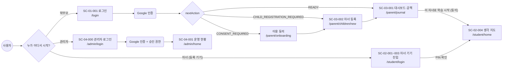

---

## 3. 역할별 화면 이동 흐름

### 3.1 학부모

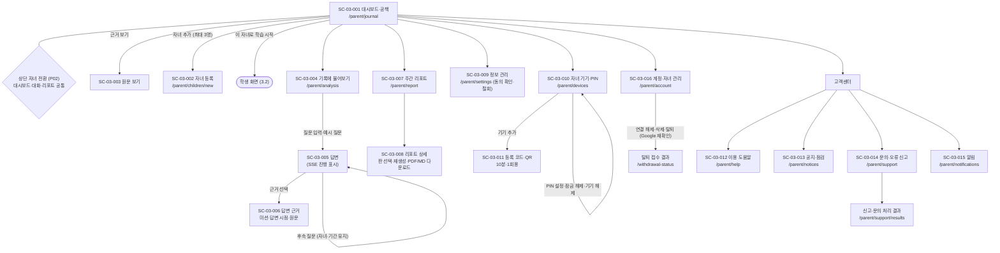

- 분석 대화·리포트 답변 화면에서 바로 오류 신고 가능 (`targetType` ANALYSIS·REPORT)
- 무료 자녀는 분석 대화 진입 시 프리미엄 안내만 표시, 리포트는 수치만 표시 (P13)

### 3.2 학생

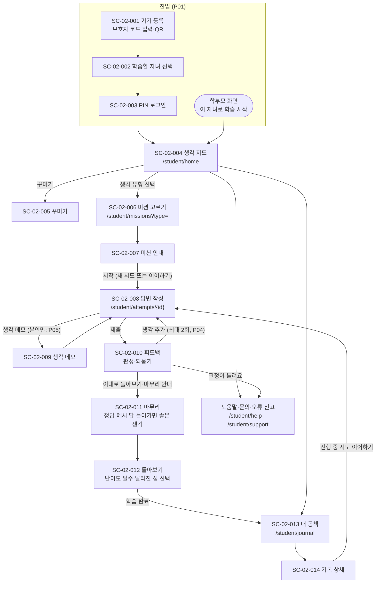

- 화면 이탈·새로고침 시 초안 자동 저장본으로 복원 (UC-12)
- 피드백 화면은 판정·판정 보류·처리 실패를 구분하고, 실패 시 저장된 답은 유지한 채 피드백만 재시도
- 마무리 후 답변 제출 불가, 내 공책에서는 조회만 가능 (P04)
- 학생은 알림 메뉴 없음 (고객센터 메뉴에 미포함)

### 3.3 관리자

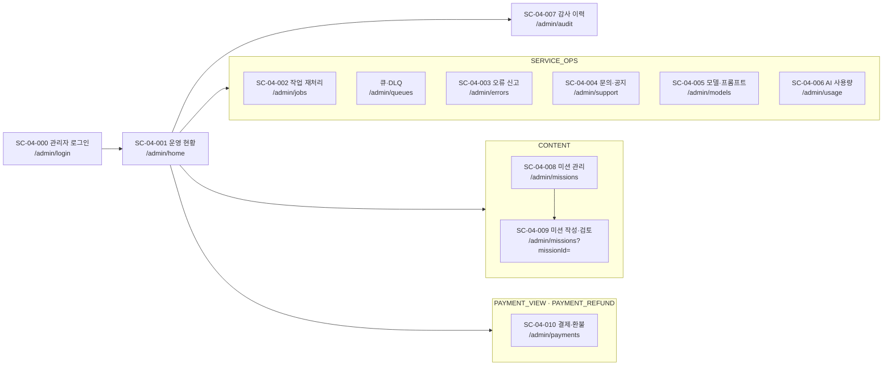

- 승인 권한이 없는 메뉴는 표시하지 않음. 공통(운영 현황·감사 이력)만 모든 관리자에게 노출

---

## 4. 역할 간 통합 시나리오 (한 주)

학부모 가입부터 다음 주 리포트·분석 대화까지 한 자녀 기준 흐름.

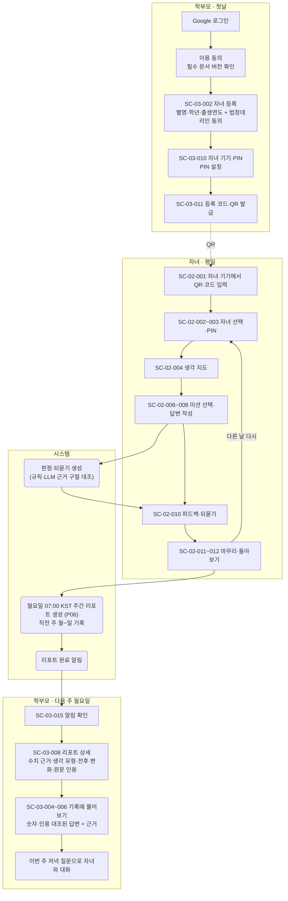

- 학부모가 옆에 있을 때는 B1~B2 대신 학부모 화면의 "이 자녀로 학습 시작"으로 바로 B3 진입 (P01)
- 학부모 대시보드(SC-03-001)는 주중에도 자녀 활동 수치를 바로 확인 가능, 리포트는 주 단위 정리본

---

## 5. 예외 시나리오

사용자에게 보이는 결과 중심. 상태 이름은 [기능명세서 1.2](functional-spec.md#12-상태-정의)와 동일하게 표시.

### 5.1 로그인·진입

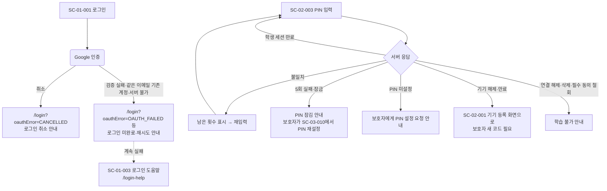

### 5.2 미션 수행

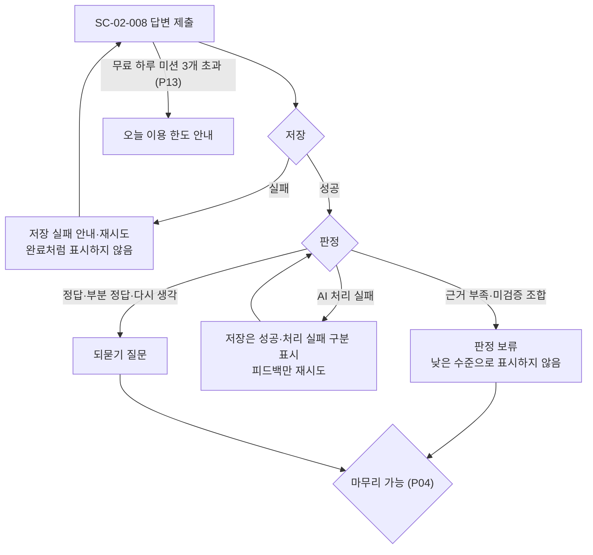

### 5.3 분석 대화·리포트 (학부모)

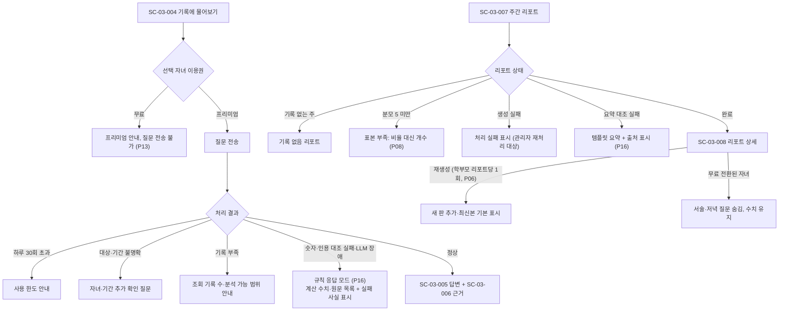

---

## 6. 관리자 운영 흐름

### 6.1 오류 신고 → 정정 → 신고자 결과 확인

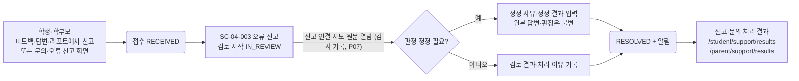

- 접수만으로 판정을 바꾸지 않고, 검토 없이 바로 처리 완료 불가 (FN-SUP-02)
- 문의는 SC-04-004에서 답변 → 문의자 알림, 공지는 같은 화면에서 등록 → SC-03-013 공지·점검에 노출

### 6.2 실패 작업 재처리

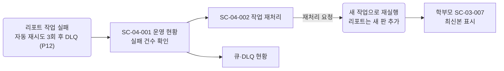

### 6.3 미션 등록·공개

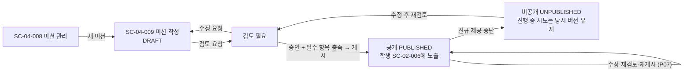

### 6.4 결제·환불

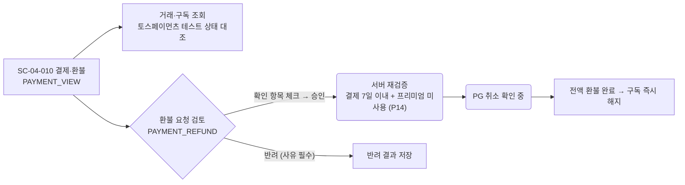

---

## 7. 확인 필요 가정

- 학부모 구독 결제·구독 관리 화면(UC-17·UC-18)은 웹에 화면·라우트가 없음. 구독 상태는 상단 자녀 표시(무료·프리미엄)와 탈퇴 전 확인(진행 중 구독·미처리 환불 건수)으로만 노출. 결제 주문·승인·해지·환불 요청의 사용자 흐름은 화면 추가 후 이 문서에 반영
- 이용 동의 화면(`/parent/onboarding`)과 관리자 메뉴 큐·DLQ(`/admin/queues`)는 화면설계서 v2.1에 별도 화면 ID 없음
- 학생 알림(UC-22)은 학생 고객센터 메뉴에 없음. 학생 알림 노출 여부는 요구사항 확인 필요
