# 사용자 흐름도

- 근거: [유스케이스](usecase.md), [기능명세서 1.4 확정 정책](functional-spec.md#14-확정-정책), [시퀀스 다이어그램](sequence-diagram.md), [상태 다이어그램](state-diagram.md), [화면설계서 v2.1](../screen-design/README.md)(`docs/screen-design/2026-10-29-v2.0/screens.json`), 웹 라우트(`frontend/web/src/presentation/router.tsx`·각 Workspace 메뉴)
- 범위: 학생·학부모·관리자가 화면에서 겪는 이동 순서와 분기. 서비스 간 호출은 시퀀스 다이어그램, 상태값 전이 조건은 상태 다이어그램
- 미션 한 번 안의 판정·되묻기 분기는 [유스케이스 4.1](usecase.md#41-미션-한-번의-흐름)을 따르고 여기서는 화면 단위로만 표시
- `(P04)` 형태는 확정 정책 번호

---

## 1. 공통 규칙

| 항목 | 규칙 |
|---|---|
| 화면 노드 | `["SC-xx-xxx 화면명 URL"]`, 화면 ID는 화면설계서 v2.1 기준 |
| 판단 노드 | `{"..."}` 사용자 선택 또는 서버 응답에 따른 분기 |
| 시스템 처리 | `("...")` 사용자 화면 밖에서 일어나는 처리 (OAuth·판정·리포트 생성 등) |
| 역할 부여 | URL 입력만으로 역할을 주지 않음. 로그인 응답의 `role`·`startPath`·`nextAction`, 학생 세션으로만 진입 |
| 메뉴 노출 | 학부모·학생은 역할 고정 메뉴, 관리자는 승인 권한(`CONTENT`·`SERVICE_OPS`·`PAYMENT_VIEW`·`PAYMENT_REFUND`)별 메뉴 |
| 목업 화면 | SC-01-001·SC-01-002의 이메일·비밀번호 폼은 개발 목업. 운영 모드는 Google 인증 또는 아이디·비밀번호(#415, `/login`의 "또는 아이디로 로그인", `/signup`의 아이디 가입 폼)로 시작하고 이용 동의는 `/parent/onboarding`에서 진행 |
| 학부모 로그인 수단 | Google과 아이디·비밀번호는 서로 연결되지 않음(한 계정은 한 가지 수단). 중요 작업의 본인 재확인은 Google 계정은 Google 새 탭, 아이디 계정은 로그인 비밀번호 입력 (#415) |
| 관리자 주소 | 사용자 화면(`/login`·도움말 등)에 `/admin/login` 링크·관리자 문구 없음. 관리자는 주소를 직접 입력하고, 등록된 ID·비밀번호 또는 Google로 로그인 (#369) |

---

## 2. 전체 지도

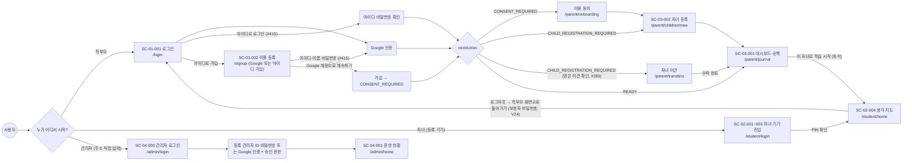

---

## 3. 역할별 화면 이동 흐름

### 3.1 학부모

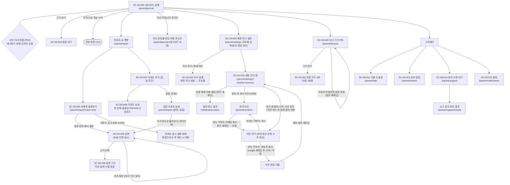

- 분석 대화·리포트 답변 화면에서 바로 오류 신고 가능 (`targetType` ANALYSIS·REPORT). 학생은 커뮤니티 공유물도 신고 (`COMMUNITY_POST`)
- 학생이 공개 설정을 끈 동안 원문·근거·원문 인용은 보이지 않고 수치만 표시 (#206)
- 자녀 이관(#289)은 탈퇴 전 보호자를 바꾸는 정식 절차다. 받는 학부모가 수락하기 전에는 연결·기록 접근이 바뀌지 않으며, 수락 후 학생 기기는 새 학부모가 다시 등록한다. 서버·웹 기능 플래그로 신규 대상 조회·요청·수락을 켠다(기본 꺼짐). `/parent/transfers`의 본인 목록·취소·거절은 기능 off·동의 누락에도 유지한다(#307). 동의 화면에서도 이관·계정 관리로 이동할 수 있으며 취소 후 탈퇴는 별도 재인증·최종 확인을 거친다
- 동석 진입으로 학생 화면을 쓰는 동안 학부모 세션은 잠긴다. 학생 로그아웃 후 로그인 화면의 "학부모 화면으로 돌아가기"(`ParentUnlock`)에서 보호자 비밀번호로 복귀한다. 보호자 비밀번호는 자녀 기기·PIN 화면에서 본인 재확인 후 설정한다
- 본인 재확인(#45·#415): Google 계정은 Google 새 탭에서 재인증하고, 아이디·비밀번호 계정은 같은 화면에서 로그인 비밀번호를 다시 입력한다(5회 실패 시 로그인과 함께 15분 잠금). 이관을 받는 학부모는 Google 이메일로 조회하므로 아이디 계정은 받는 쪽이 될 수 없다
- 무료 자녀는 분석 대화 진입 시 프리미엄 안내만 표시, 주간 리포트는 수치만 표시 (P13). 일일 리포트는 무료·프리미엄 동일, 리포트 대화는 프리미엄 전용 (P24·P25)
- 커뮤니티 보호자 선택 동의는 정보 관리(SC-03-009)에서 자녀별 저장·철회. 학부모는 자녀 공유물·받은 반응·포인트만 보고 다른 학생 풀이는 볼 수 없음

### 3.2 학생

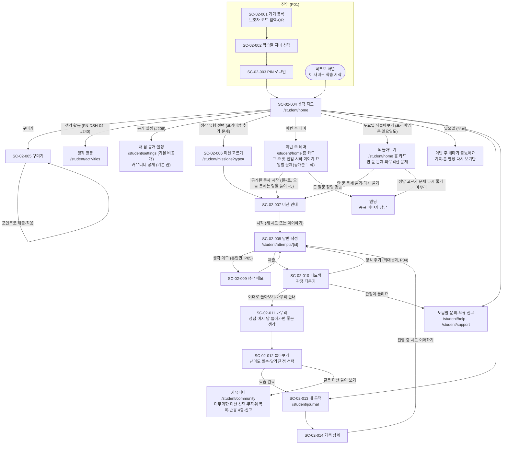

- 화면 이탈·새로고침 시 초안 자동 저장본으로 복원 (UC-12)
- 피드백 화면은 판정·판정 보류·처리 실패를 구분하고, 실패 시 저장된 답은 유지한 채 피드백만 재시도
- 마무리 후 답변 제출 불가, 내 공책에서는 조회만 가능 (P04)
- 학생은 알림 메뉴 없음 (고객센터 메뉴에 미포함)
- 학습 완료 시 포인트 적립, 커뮤니티 공개를 켠 학생은 미션을 처음 마무리한 시도의 마지막 답변이 자동 공유됨(다시 풀기는 공유 안 함) (P20~P23). 커뮤니티는 같은 미션을 마무리해야 열림(큰 질문 정답 고르기 문제는 엔딩을 본 뒤). 2026-11-10 개정(#483): 테마 문제는 월~금 KST 00:00에 하나씩 공개되어 쌓이고 그 주 토요일까지 언제든 시작(진행 중 시도는 자정 후에도 이어하기), 일요일은 닫힘(프리미엄은 토요일과 같이 이용). 무료는 테마 문제 주 5개(하루 상한 없음), 생각 유형별 미션 고르기는 프리미엄 추가 문제. 아이 화면에는 결제 유도 문구를 넣지 않음(구매 안내는 보호자 화면). 꾸미기는 `lake`·`mungchi` 외 포인트 해금, 캐릭터 아이템 4슬롯

### 3.3 관리자

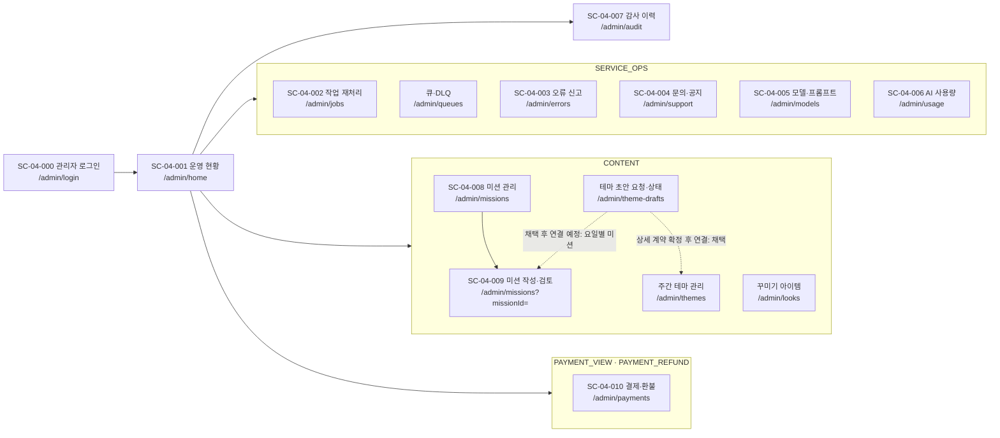

- 승인 권한이 없는 메뉴는 표시하지 않음. 공통(운영 현황·감사 이력)만 모든 관리자에게 노출
- 커뮤니티 공유물 신고는 SC-04-003 오류 신고에서 대상 `COMMUNITY_POST`로 검토(신고 시 숨김 → 다시 공개·계속 숨김). 주간 테마는 미션과 같은 작성→검토→게시
- #441 목표 흐름: CONTENT 운영자는 학년(`G3`·`G4`·`G5`·`G6`)·적용 주·선택 주제/유형별 성취기준·입력 방식으로 초안을 요청한다. 출처·상태로 목록을 고르고, 이야기·그림·요일별 문제·실패 사유를 확인한다. 채택은 게시가 아니며 미션 5개와 테마의 검토·게시를 각각 진행한다. 버리기·다시 생성은 서버가 확정한 상태와 식별자를 따른다. 503·연결 장애 후 쓰기를 자동 재요청하지 않는다.
- 2026-11-10 학년별 테마 결정: 초안 요청·테마 저장 본문과 테마 목록 필터는 `grade` 문자 값을 사용한다. 초3·초4는 논술을 지정할 수 없다. 성취기준 표의 고시 학년군(`gradeBand`, `초3~4`·`초5~6`)은 유지하며 선택한 학년을 포함하는지 확인한다. 서버 반영은 #438 → core 순서 이후에 맞추며, 정답 구조·영상 URL 편집은 확정된 응답 문서가 공유된 뒤 연결한다.
- develop `f6db19da` 기준 #438의 상세 DTO·#440 움직임 재생기는 미구현이다. core #439가 보장하는 `draftId`·`status`·채택 `themeId`와 공개 경로를 먼저 소비한다. 요청·목록·상태 확인을 먼저 연결하며 상세 미리보기·생성 상태 전이·움직임 목업은 추가하지 않는다. 움직임 JSON을 임의 규칙으로 실행하지 않는다.
- #460 관리자 홈: CONTENT 권한이면 기존 관리자 미션 목록의 전체 상태별 집계(`counts`)로 작성 중·검토 필요·공개·비공개를 표시하고 각 상태의 미션 관리 필터로 이동한다. 현재 전체 미션 기준임을 안내하고 조회 중·실패·실제 0개를 구분한다. 미션 현황 조회는 운영 집계 조회와 독립하며 CONTENT 권한 없이는 호출하지 않는다. 작업 종류는 한글로 표시하고 API 필터 값은 기존 코드를 유지한다.

---

## 4. 역할 간 통합 시나리오 (한 주)

학부모 가입부터 일일·주간 리포트·분석 대화까지 한 자녀 기준 흐름.

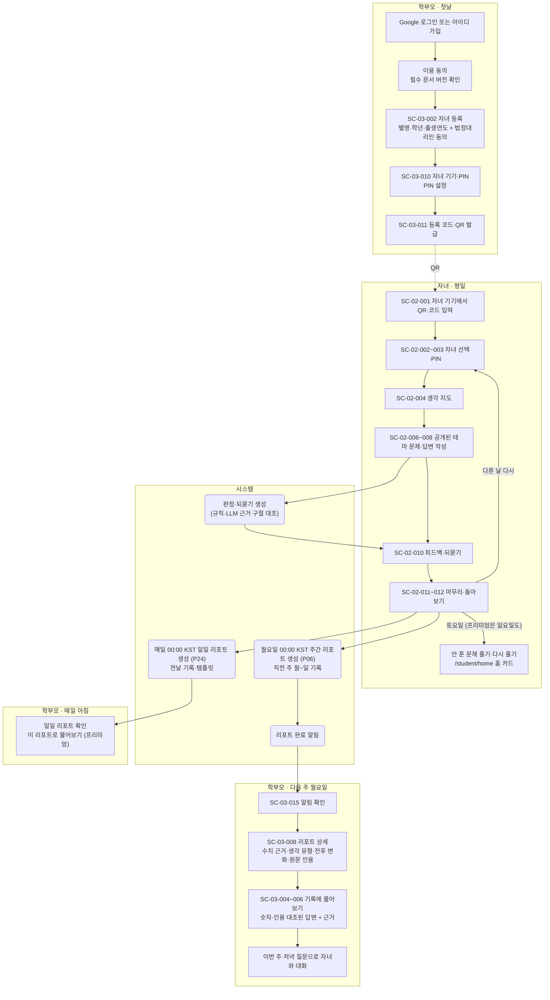

- 학부모가 옆에 있을 때는 B1~B2 대신 학부모 화면의 "이 자녀로 학습 시작"으로 바로 B3 진입 (P01)
- 학부모 대시보드(SC-03-001)는 주중에도 자녀 활동 수치를 바로 확인 가능, 일일 리포트는 전날 문제별 정리, 주간 리포트는 주 단위 정리본
- 그 주 첫 진입 때 테마 시작 이야기로 한 주 시작(기준안), 월~금 하루 1문제씩 공개(다섯 생각 유형)되어 토요일까지 쌓임, 토요일 풀기·되돌아보기, 일요일 닫힘(프리미엄은 토요일과 같이 이용). 학부모는 매일 자정 그날 일일 리포트(푼 날 기준), 일요일 자정(월요일 00:00)에는 테마 요약(그날 풀었는지·개근·주간 완주·엔딩)이 들어간 주간 리포트도 받음

### 4.1 주간 테마 한 주 시나리오 (2026-11-10 개정 #483)

바뀐 규칙([기능명세 P23·P21·P13](functional-spec.md#14-확정-정책))으로 본 학생 네 유형의 한 주. 큰 질문 정답 고르기는 기준안대로 금요일 문제 끝에 있다고 본다. 포인트는 테마 관련만 셈(문제 완료 10·당일 풀이 5·개근 30·주간 완주 10, 되돌아보기 열람 10은 별도). 구현은 learning #484·core #485·report #486·web #487.

| 학생 | 월~금 | 토요일 | 일요일 | 엔딩 | 테마 포인트 |
|---|---|---|---|---|---|
| 매일 푸는 학생 | 그날 공개된 문제를 그날 풀고 금요일 큰 질문 정답 | 다시 풀기(선택) | 무료: 닫힘(기록·엔딩 다시 보기) | 금요일 정답 즉시 | 50+25+30+10 = 115 |
| 몰아 푸는 학생 | 월~목은 오지 않음, 금요일에 공개된 5개 중 일부 풀기 | 남은 문제 새로 풀기 | 무료: 닫힘 | 정답이면 그 순간, 틀리면 토요일 다시 풀기 마무리 뒤 | 금요일 1개 당일 풀이 포함 시 50+5+10 = 65, 금·토에 모두 나중에 풀면 50+10 = 60 |
| 큰 질문을 틀린 학생 | 매일 풀었지만 금요일 정답 고르기 오답 → "토요일에 다시 풀면 결말을 볼 수 있어요" | 금요일 문제 다시 풀기 마무리 → 맞든 틀리든 엔딩(틀리면 정답 공개) | 무료: 닫힘 | 토요일 | 115(엔딩과 무관) |
| 프리미엄 일요일 학생 | 바빠서 3개만 풀기 | 오지 않음 | 토요일과 같이 남은 2개 풀기·다시 풀기 | 일요일에 금요일 문제 정답이면 즉시, 틀리면 그 문제 다시 풀기 마무리 뒤 | 일요일 완료는 주간 완주 아님: 50+15(당일 3개) = 65 |

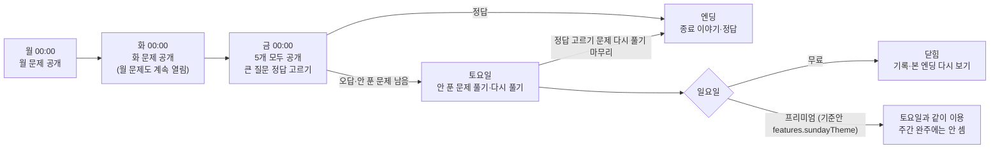

- 커뮤니티: 큰 질문 정답 고르기 문제는 엔딩을 본 학생만 열람. 틀린 학생은 토요일 다시 풀기 전에 다른 학생 풀이로 정답을 보지 않음(`COMMUNITY_LOCKED`)
- 시작 이야기는 그 주 첫 진입(화요일에 처음 와도 봄), 종료 이야기는 엔딩 조건을 채웠을 때만. 무료 일요일에는 엔딩을 새로 보여 주지 않음
- 일요일 하루 이용권 단건 결제는 #430 PG 결정 뒤 후속

---

## 5. 예외 시나리오

사용자에게 보이는 결과 중심. 상태 이름은 [기능명세서 1.2](functional-spec.md#12-상태-정의)와 동일하게 표시.

### 5.1 로그인·진입

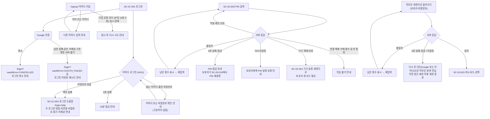

### 5.2 미션 수행

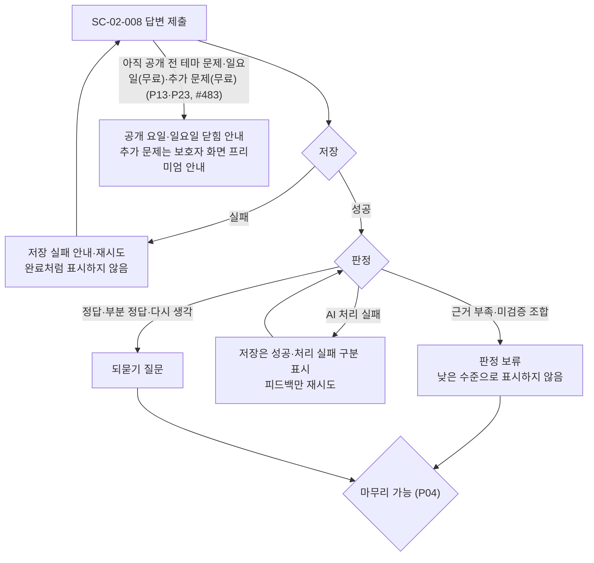

### 5.3 분석 대화·리포트 (학부모)

- #481: 완료된 주간 리포트에 대표 답변 설명을 최대 3개 표시한다. 각 카드에는 미션 제목·생각 유형·인용 구절·설명과 ‘AI 관찰’을 표시한다. 설명 생성 실패/미활성·대상 없음·이전 API의 정보 미제공을 구분하며 수치 리포트는 유지한다. 무료·원문 비공개에서는 카드 원문을 표시하지 않는다. 일일 리포트에는 설명 영역을 두지 않고 화면 ID는 화면설계서 담당 확정 전까지 새로 부여하지 않는다.

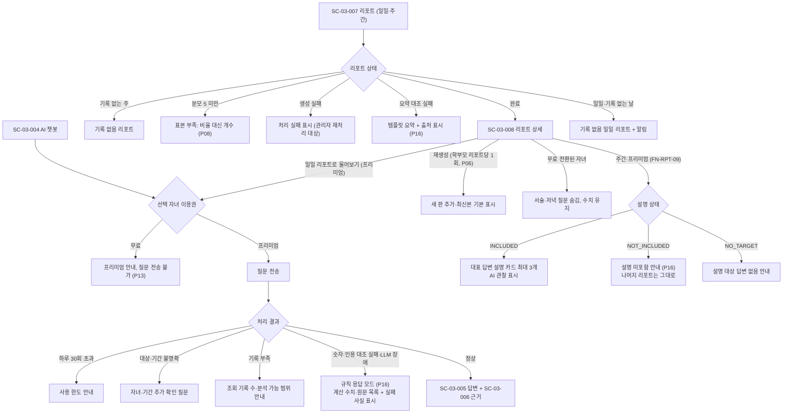

---

## 6. 관리자 운영 흐름

### 6.1 오류 신고 → 정정 → 신고자 결과 확인

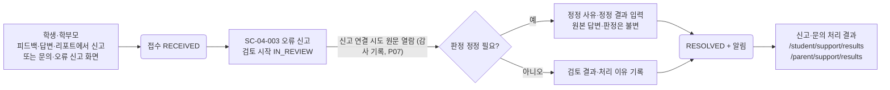

- 접수만으로 판정을 바꾸지 않고, 검토 없이 바로 처리 완료 불가 (FN-SUP-02)
- 문의는 SC-04-004에서 답변 → 문의자 알림, 공지는 같은 화면에서 등록 → SC-03-013 공지·점검에 노출

### 6.2 실패 작업 재처리

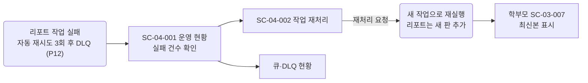

### 6.3 미션 등록·공개

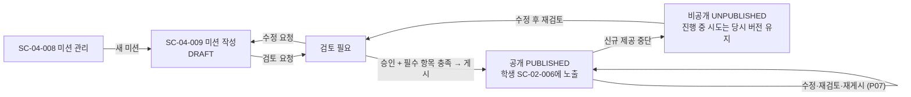

### 6.4 결제·환불

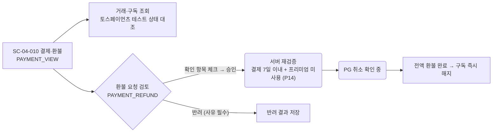

---

## 7. 확인 필요 가정

- 학부모 구독 결제·구독 관리(UC-17·UC-18, #184): `/parent/billing`(이용권·결제)에서 상품 선택 → 토스 결제위젯 결제 → `/payment/success`·`/payment/fail` 결과 확인, 같은 화면의 구독 관리에서 자동결제 수단 등록(`/payment/billing/success`·`/payment/billing/fail`)·자동 갱신 해지·철회·환불 요청. 테스트 키 환경만 사용(P14). 단계별 화면 흐름도는 미반영
- 이용 동의 화면(`/parent/onboarding`)과 관리자 메뉴 큐·DLQ(`/admin/queues`)는 화면설계서 v2.1에 별도 화면 ID 없음
- 2026-11-06 결정 화면(UC-29~34, #393~#395 구현): 이번 주 테마·되돌아보기·커뮤니티·자녀 커뮤니티·일일 리포트 상세·관리자 주간 테마·꾸미기 아이템은 화면설계서 v2.1에 없어 화면 ID 없이 이름·URL로 표시. URL은 웹 구현 기준(주간 테마·되돌아보기는 별도 페이지 없이 학생 홈 카드, 자녀 공유물·포인트는 학부모 대시보드 아래), 화면 ID는 화면설계서 개정 때 부여

- #427 기존 `/parent/account` 주소는 자녀·기간 조건을 보존해 계정 관리 탭으로 연결한다. 이용 동의 전에도 이 탭의 탈퇴 절차는 접근할 수 있다. #426~#429 웹 기준은 [학부모 화면 사용성 기준](frontend-usability.md)을 따른다.

### 2026-11-10 학부모 동선 통합

- `/parent/report`: 리포트 보기와 AI 질문을 한 메뉴로 통합. 리포트 상세에서 질문하기를 누르면 같은 챗봇에 자녀·기간을 연결한다. 일일은 기존 reportId 고정 대화, 주간은 기존 기간 범위 대화를 사용한다. `/parent/analysis` 주소는 자녀·기간을 보존해 질문 화면으로 연결한다.
- 자녀 추가 등록은 계정·자녀 설정 → 프로필, PIN은 기기·PIN → 자녀 알약 선택 → PIN 입력·저장. PIN 저장은 로그인된 보호자의 현재 자녀 권한으로 처리하고 추가 Google/비밀번호 재인증은 제거한다. 보호자 비밀번호·삭제·탈퇴는 기존 재인증을 유지한다.
- 사고뭉치 로고는 역할별 홈으로, 상단 맨 오른쪽 종은 알림 목록·수신 설정 창으로 연결한다. 학생에게 보호자 알림을 노출하지 않는다.
- 리포트에서 질문한 검증 완료 답변은 해당 판의 실제 지표·문제·원문 인용 위치를 초록 테두리와 문구로 표시한다. 답변별 ‘리포트 근거 위치 보기’로 이동하며 새 질문·자녀/기간·공개 설정 변경 시 이전 강조를 지운다. 현재 원문 접근 권한은 기존 메시지 근거 API로 다시 확인한다.
