# 사용자 흐름도

- 근거: [유스케이스](usecase.md), [기능명세서 1.4 확정 정책](functional-spec.md#14-확정-정책), [시퀀스 다이어그램](sequence-diagram.md), [상태 다이어그램](state-diagram.md), [화면설계서 v2.1](../screen-design/README.md)(`docs/screen-design/2026-10-29-v2.0/screens.json`), 웹 라우트(`frontend/web/src/presentation/router.tsx`·각 Workspace 메뉴)
- 범위: 학생·학부모·관리자가 화면에서 겪는 이동 순서와 분기. 서비스 간 호출은 시퀀스 다이어그램, 상태값 전이 조건은 상태 다이어그램
- 미션 한 번 안의 판정·되묻기 분기는 [유스케이스 4.1](usecase.md#41-미션-한-번의-흐름)을 따르고 여기서는 화면 단위로만 표시
- `(P04)` 형태는 확정 정책 번호

---

## 1. 공통 규칙

| 항목 | 규칙 |
|---|---|
| 화면 노드 | `["SC-xx-xxx 화면명 URL"]`, 화면 ID는 화면설계서 v2.1 기준 |
| 판단 노드 | `{"..."}` 사용자 선택 또는 서버 응답에 따른 분기 |
| 시스템 처리 | `("...")` 사용자 화면 밖에서 일어나는 처리 (OAuth·판정·리포트 생성 등) |
| 역할 부여 | URL 입력만으로 역할을 주지 않음. 로그인 응답의 `role`·`startPath`·`nextAction`, 학생 세션으로만 진입 |
| 메뉴 노출 | 학부모·학생은 역할 고정 메뉴, 관리자는 승인 권한(`CONTENT`·`SERVICE_OPS`·`PAYMENT_VIEW`·`PAYMENT_REFUND`)별 메뉴 |
| 목업 화면 | SC-01-001·SC-01-002의 이메일·비밀번호 폼은 개발 목업. 운영 모드는 Google 인증 또는 아이디·비밀번호(#415, `/login`의 "또는 아이디로 로그인", `/signup`의 아이디 가입 폼)로 시작하고 이용 동의는 `/parent/onboarding`에서 진행 |
| 학부모 로그인 수단 | Google과 아이디·비밀번호는 서로 연결되지 않음(한 계정은 한 가지 수단). 중요 작업의 본인 재확인은 Google 계정은 Google 새 탭, 아이디 계정은 로그인 비밀번호 입력 (#415) |
| 공개 루트·로그인 진입 | `/`는 로그인 없이 서비스 소개와 학생·학부모·관리자 로그인, 학부모 가입 진입을 제공한다(#724). 선택 시 해당 탭의 이전 인증·조회 캐시를 비우고 선택한 로그인 화면을 연다. 기존 기기 등록·쿠키·다른 탭의 세션은 유지하며, URL 선택만으로 역할을 부여하지 않는다. |
| 관리자 주소 | 공개 루트의 관리자 로그인 링크 또는 `/admin/login` 직접 입력으로 진입한다(#724). 등록된 ID·비밀번호 또는 Google 인증과 기존 관리자 권한 검사를 유지한다(#369). 일반 `/login`·도움말에는 관리자 링크를 추가하지 않는다. |

---

## 2. 전체 지도

```mermaid
flowchart LR
  U(("사용자")) --> Q{"누가 어디서 시작?"}
  Q -->|"학부모"| L["SC-01-001 로그인<br/>/login"]
  Q -->|"자녀 (등록 기기)"| SL["SC-02-001~003 자녀 기기 진입<br/>/student/login"]
  Q -->|"관리자 (루트 링크·주소 직접 입력)"| AL["SC-04-000 관리자 로그인<br/>/admin/login"]

  L --> G("Google 인증") --> NA{"nextAction"}
  L -->|"아이디로 로그인 (#415)"| IDL("아이디·비밀번호 확인") --> NA
  L -->|"아이디로 가입"| SU["SC-01-002 이용 등록<br/>/signup (Google 또는 아이디 가입)"]
  SU -->|"아이디·이름·비밀번호 (#415)"| IDS("가입 → CONSENT_REQUIRED") --> NA
  SU -->|"Google 계정으로 계속하기"| G
  NA -->|"CONSENT_REQUIRED"| ON["이용 동의<br/>/parent/onboarding"]
  NA -->|"CHILD_REGISTRATION_REQUIRED"| CN["SC-03-002 자녀 등록<br/>/parent/children/new"]
  NA -->|"CHILD_REGISTRATION_REQUIRED (받은 이관 확인, #289)"| TRI["자녀 이관<br/>/parent/transfers"]
  TRI -->|"수락 완료"| PJ
  NA -->|"READY"| PJ["SC-03-001 대시보드·공책<br/>/parent/journal"]
  ON --> CN --> PJ

  SH["SC-02-004 홈 (우리 집)<br/>/student/home"]
  SL -->|"PIN 확인"| SH
  SH -->|"로그아웃 → 학부모 화면으로 돌아가기 (보호자 비밀번호, V24)"| L

  AL --> AG("등록 관리자 ID·비밀번호 또는 Google 인증 + 승인 권한") --> AH["SC-04-001 운영 현황<br/>/admin/home"]
```

---

## 3. 역할별 화면 이동 흐름

### 3.1 학부모

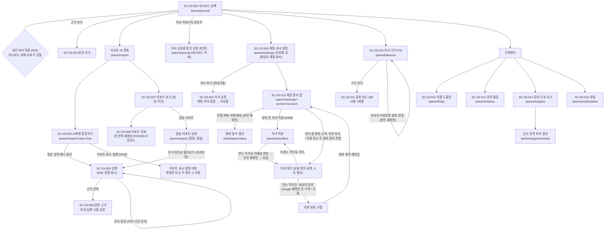

- 분석 대화·리포트 답변 화면에서 바로 오류 신고 가능 (`targetType` ANALYSIS·REPORT). 학생은 커뮤니티 공유물도 신고 (`COMMUNITY_POST`)
- 학생이 공개 설정을 끈 동안 원문·근거·원문 인용은 보이지 않고 수치만 표시 (#206)
- 자녀 이관(#289)은 탈퇴 전 보호자를 바꾸는 정식 절차다. 받는 학부모가 수락하기 전에는 연결·기록 접근이 바뀌지 않으며, 수락 후 학생 기기는 새 학부모가 다시 등록한다. 서버·웹 기능 플래그로 신규 대상 조회·요청·수락을 켠다(기본 꺼짐). `/parent/transfers`의 본인 목록·취소·거절은 기능 off·동의 누락에도 유지한다(#307). 동의 화면에서도 이관·계정 관리로 이동할 수 있으며 취소 후 탈퇴는 별도 재인증·최종 확인을 거친다
- 동석 진입으로 학생 화면을 쓰는 동안 학부모 세션은 잠긴다. 학생 로그아웃 후 로그인 화면의 "학부모 화면으로 돌아가기"(`ParentUnlock`)에서 보호자 비밀번호로 복귀한다. 보호자 비밀번호는 자녀 기기·PIN 화면에서 본인 재확인 후 설정한다
- 본인 재확인(#45·#415): Google 계정은 Google 새 탭에서 재인증하고, 아이디·비밀번호 계정은 같은 화면에서 로그인 비밀번호를 다시 입력한다(5회 실패 시 로그인과 함께 15분 잠금). 이관을 받는 학부모는 Google 이메일로 조회하므로 아이디 계정은 받는 쪽이 될 수 없다
- 무료 자녀는 분석 대화 진입 시 프리미엄 안내만 표시, 주간 리포트는 수치만 표시 (P13). 일일 리포트는 무료·프리미엄 동일, 리포트 대화는 프리미엄 전용 (P24·P25)
- 커뮤니티 보호자 선택 동의는 정보 관리(SC-03-009)에서 자녀별 저장·철회. 학부모는 자녀 공유물·받은 반응·포인트만 보고 다른 학생 풀이는 볼 수 없음

### 3.2 학생

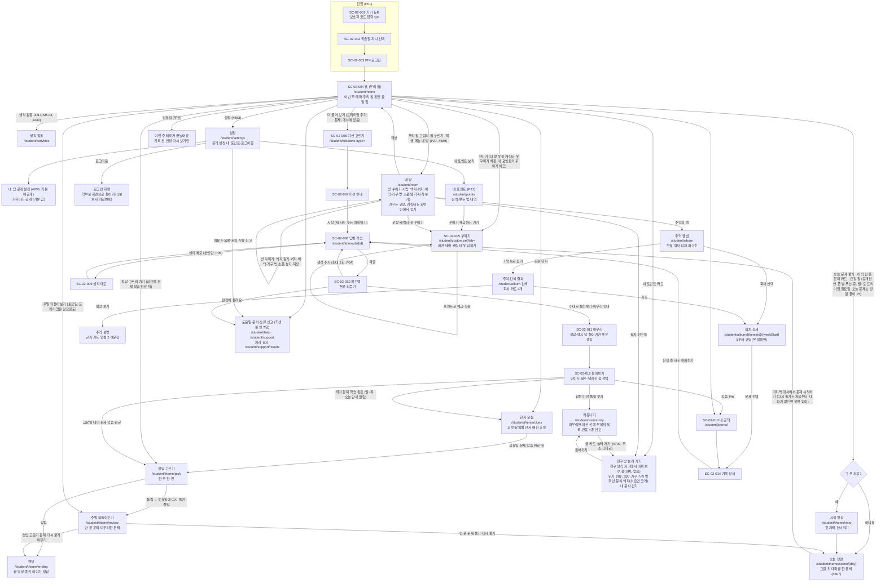

- 화면 이탈·새로고침 시 초안 자동 저장본으로 복원 (UC-12)
- 피드백 화면은 판정·판정 보류·처리 실패를 구분하고, 실패 시 저장된 답은 유지한 채 피드백만 재시도
- 마무리 후 답변 제출 불가, 내 공책에서는 조회만 가능 (P04)
- 학생은 알림 메뉴 없음 (고객센터 메뉴에 미포함)
- 학습 완료 시 포인트 적립, 커뮤니티 공개를 켠 학생은 미션을 처음 마무리한 시도의 마지막 답변이 자동 공유됨(다시 풀기는 공유 안 함) (P20~P23). 커뮤니티는 같은 미션을 마무리해야 열림(큰 질문 정답 고르기 문제는 엔딩을 본 뒤). 테마 문제는(#483) 월~금 KST 00:00에 하나씩 공개되어 쌓이고 그 주 토요일까지 언제든 시작(진행 중 시도는 자정 후에도 이어하기), 일요일은 닫힘(프리미엄은 토요일과 같이 이용). 무료는 테마 문제 주 5개(하루 상한 없음), 생각 유형별 미션 고르기는 프리미엄 추가 문제. 아이 화면에는 결제 유도 문구를 넣지 않음(구매 안내는 보호자 화면). 꾸미기는 `lake`·`mungchi` 외 포인트 해금, 캐릭터 아이템 4슬롯
- 리텐션 확장(P27, 웹 #587·#567): 테마 5문제를 모두 마무리하면 기념 액자 획득(새 액자 표시). 내 방은 가구 편집 없이 버튼(이름표·발판 말풍선)으로 이동하고 캐릭터는 화면 안에서만 걸어 다니고(자리 저장 없음), 가구 스킨은 꾸미기에서 포인트로 해금·착용(P22). 추억 앨범·검색에는 지난 주 보유 액자 회차만 나오며, 설명은 "설명 보기"를 누를 때만 생성. 검색·설명은 하루 한도(초과 시 안내)
- 학생 설정(#583·#648): 학생 메뉴에서 공개 설정·내 포인트·"학부모 로그인"을 빼고 '설정' 하나(`/student/settings`, 메뉴 맨 끝)에 공개 설정·내 포인트·로그아웃 카드 3개를 모은다. 포인트 카드의 "내 포인트 보기"가 내 포인트 화면(`/student/points`, 잔액·쌓는 법·내역)을 연다. 학생 화면에는 "학부모 로그인" 문구를 두지 않고, 학부모 복귀는 로그아웃 뒤 로그인 화면의 "학부모 화면으로 돌아가기"가 맡는다(FN-ACC-05)
- 학생 화면 시안 맞추기(#648): 꾸미기는 창이 아닌 학생 틀 안 전체 화면(`/student/customize?tab=theme|friend|wear|furniture`, 기준안)이고 내 방 옷장·꾸미기 버튼과 내 포인트의 "꾸미기 해금하러 가기"가 이곳으로 간다. 홈 "내 포인트" 카드는 뭉치 친구들(`/student/friends`)로 가고, 내 방에도 "뭉치 친구들" 버튼을 둔다. 도움말·문의·공지·알림(`/student/help`·`/student/support`·`/student/support/results`·`/student/notices`·`/student/notifications`)은 고객센터 틀이 아니라 학생 틀(메뉴 6개) 안에 그리고, 메뉴는 '설정' 아래로 표시한다. 문제 화면을 열지 못하면(없는 시도 등) "홈으로"·"내 공책으로" 버튼을 둔다
- 내 방 진입(#556·#589): 학생 상단 메뉴의 '내 방'(문 아이콘)과 홈 우리 집 그림의 집을 누르면 내 방으로 간다. 앨범은 내 방(추억의 벽·버튼)에서 열고, 새 액자 안내는 앨범에 들어올 때 보여 주며 그때 확인(`seen`)을 남긴다(#561)
- 학생 화면 디자인(#589, 웹 #648·#487·#440): 홈(SC-02-004)은 왼쪽에 이번 주 테마·큰 질문·오늘 문제 버튼·모은 단서·포인트, 오른쪽에 "우리 집" 장면(화면 테마별 배경 그림 위에 동행 캐릭터·말풍선, 집을 누르면 내 방)과 그 아래 요일 칩(✓ 그날 풀었음·✗ 안 풀었음·오늘, 칩 아래 "5일 모두 그날 풀면 +30" 한 줄)을 둔다. 학생 메뉴는 6개(홈·내 방·내 공책·생각 활동·친구 생각·설정)이고 미션 고르기는 프리미엄일 때 홈 "더 풀어 보기"로 들어간다. 시작 영상은 그 주 처음 "오늘 문제 풀기"를 누를 때, 오늘 장면은 그림 위 대화를 한 줄씩 넘기고 마지막 대사에서 대화창 오른쪽 "문제 시작하기"로 답변 작성(다시 풀기는 처음부터 단추, 살펴보기 없음, #807). 단서 모음은 단서를 얻으면 빠지는 후보를 자동으로 지운다(근거 표시·직접 지우기는 #647). 문제 화면 답 칸 아래(작은 화면은 아래쪽 줄)에 동행 캐릭터 말풍선 도우미(규칙 기반, 낱말 물어보기는 #599, 자리는 #807). 동행 캐릭터는 화면에서 12종(실서버는 지금 5종 저장이라 5개만 대응하고 나머지 잠금, core 반영은 나중). 화면 테마(호수·숲·공장·우주·바닷속)는 우리 집 배경 그림을 바꾼다. 색은 "맑은 하늘"(밝은 틀·흰 종이·남청 선), 화면은 PC 1440×900에서 스크롤 없이 핵심이 보이고 긴 목록·글은 그 칸 안에서만 스크롤, 900px 이하는 반응형. 시안: 설계 캔버스(#589)
- 학생 화면 범위(#589): 홈은 8가지 상태(오늘·안 푼 지난 문제·이어하기·정답 고르기·엔딩 뒤·토요일·일요일 무료·테마 없음)를 하나의 화면에서 바꿔 보여 주고, 토요일·일요일은 "주말 되돌아보기" 보드(안 푼 문제 풀기·다시 풀기, 일요일 무료는 기록·엔딩 다시 보기만, 프리미엄 일요일은 토요일과 같음, 규칙 #483·#484). 문제 화면 입력 틀은 글쓰기·풀이 단계·논술(주장과 이유, 초5·초6만)·고르기·순서 맞추기·분류하기 6종. 학생 화면 문구는 '까닭' 대신 '이유'(웹 화면 문구만 — learning·ai가 만드는 문장은 각 담당과 따로 정함)
- 홈 지난 요일 문제(#487): 공개된 안 푼 문제는 모두 홈에서 시작한다. 시안의 "아직 안 푼 문제 N개 · ○요일" 카드는 가장 앞 요일을 열고, 요일 칩 중 지금 새로 시작·이어서 할 수 있는 날(공개된 안 푼 날·푸는 중·오늘)은 칩을 눌러 그날 문제를 연다(마무리한 날의 다시 풀기는 주말 되돌아보기, 안 열린 날·무료 일요일 칩은 누르지 않음). 무료와 프리미엄은 평일 규칙이 같고(무료 테마 문제 주 5개, 하루 상한 없음), 안 푼 문제를 풀 수 있는 마지막 날은 평일 "토요일까지", 토요일·프리미엄 일요일 "오늘까지"로 안내한다. 무료 일요일 홈은 "이번 주 테마가 끝났어요"와 "이번 주 기록 보기"만(정답 고르기·다시 풀기 안내 없음, 결제 유도 문구 없음)
- 기념 액자 거는 때(웹 화면): 다섯 문제를 마친 주의 액자는 **다음 주 월요일부터** 앨범·추억의 벽에 들어온다(서버 보유 기준 `theme_week_start < 이번 주 월요일` 그대로, 그 주에 정답이 담긴 액자가 먼저 새지 않게). 이야기의 끝 화면은 "다음 주 월요일부터 추억의 벽에 걸 수 있어요"와 "추억 앨범 보기". 새 액자 확인(seen)은 앨범에 들어올 때와 함께, 내 방 "새 액자를 받았어요" 알림을 닫거나 "벽에 걸어 보기"를 누를 때도 남긴다(알림이 내 방에 올 때마다 다시 뜨지 않게)
- 친구 방 놀러 가기(웹 #709, 계약 core #708): 친구 생각 글 카드의 "놀러 가기"를 누르면 친구 생각 화면 자리에서 친구 방으로 바뀐다(새 주소 없음, "친구 생각으로 돌아가기"로 돌아오면 고른 미션·글 순서 그대로). 내 뭉치는 문 앞에서 시작해 걸어 다니고, 방 주인 뭉치는 방 가운데에 서 있다가 가까이 가면 인사한다. 액자는 누르면 크게 보이고 회차 상세는 열리지 않는다. 꾸미기·저장·가구 메뉴는 없다. 볼 수 없는 방은 이유 없이 "지금은 이 친구 방에 놀러 갈 수 없어요."(자세한 값은 `docs/report/frontend.md` "친구 방 놀러 가기")
- 내 방 꾸미기(웹 #705, 방 소품 칸 계약 core #723): 방에 관한 것(액자·벽지·바닥·가구·방 소품)은 모두 내 방 "방 꾸미기" 서랍에서 고르고, 안 연 것은 서랍에서 바로 열고 방 소품도 서랍에서 산다. 꾸미기 화면은 화면 테마·캐릭터·옷 입히기 세 탭. 방 소품은 바닥·벽 칸에 학생이 골라 놓고(화살표·초록 칸으로 옮김) 가구는 고정(자세한 값은 `docs/report/frontend.md` "내 방 바닥·방 소품: 화면")
- 오늘 장면·답변 작성 화면(웹 #807, 계약 변경 없음. B 계정 실테스트 11/28~29 뒤 반영 여부 결정): **오늘 장면**은 그날 미션 그림을 화면 가득(같은 그림을 흐리게 깐 바탕 위, 그림은 원래 비율) 보여 주고, 그날 대화(learning 시도 응답 `themeScene.dialogue`)를 그림 아래쪽에 겹친 상자로 한 줄씩 보여 준다. 그림이나 상자를 누르면 다음 줄, 상자 위 이름표와 말꼬리는 미션 `sceneMotion.speakers`의 그 화자 위치(없으면 이름표만. 말꼬리 밑동은 상자 안에만 두고 화자가 그 밖이면 끝만 화자 쪽으로 기울임), 세로로 긴 화면은 상자를 그림 아래에 붙인다. 처음 3초는 미션 움직임의 카메라 끝 위치(그날 중심 인물·물건 쪽 확대)에서 전체 그림으로 빠지고, 대사를 읽는 동안에는 그림이 멈춘다(2026-11-23, 요일 영상 대신 장면마다 다른 첫 화면. 카메라 값이 없으면 가운데에서 당기기). **마지막 대사에서 대화창 오른쪽에 '문제 시작하기' 단추**가 나타나 답변 작성으로 넘어간다(마지막 대사 상자를 눌러도 넘어감). 다시 풀기(`THEME_REVIEW`)는 이미 본 이야기라 처음부터 단추를 보여 대사를 건너뛸 수 있다(2026-11-22 바꿈. 11-19에는 단추 없이 마지막 대사를 누르면 넘어갔는데, 할 일이 눈에 보이도록 단추를 두되 처음 푸는 문제는 대화를 다 본 뒤에만). 살펴보기(`spots`)는 넣지 않는다(2026-11-13 결정 그대로: 새로 알려 주는 정보가 적고 기록·채점에 남는 것이 없으며, 결론을 바꿔 말하는 한마디는 코드로 못 막음). 테마 문제(`THEME_DAY`·`THEME_REVIEW`)는 미션 안내 대신 오늘 장면을 거치고(미션 안내는 더 풀어 보기만), 장면에 들어오면 시도를 시작한다(대화가 시도 시작·이어하기 응답에만 있음, 같은 미션의 진행 중 시도가 있으면 그 시도). 시도 종류는 그 요일이 마무리됐으면 `THEME_REVIEW`, 아니면 `THEME_DAY`(홈·정답 고르기·되돌아보기와 같은 규칙). 대화가 없으면(ai 대화 생성 실패 약 0.4%, 관리자가 만든 테마) 장면 없이 바로 답변 작성. 이어서 풀기는 답을 하나도 안 쓴 시도만 장면부터, 쓴 게 있으면 바로 답변 작성. **답변 작성(SC-02-008)**은 왼쪽에 장면 그림(원래 비율)과 그림 밑 '오늘의 문제' 상자(테마 문제는 그날 대화 마지막 줄을 작게, 그 아래 문제 글을 크게), 오른쪽에 답 칸과 그 아래 뭉치 말풍선 도우미. 입력 방식마다 답 칸 제목·뭉치 첫 안내·끝 버튼을 다르게(풀이 과정 '풀이 쓰기·다 썼어요', 서술·논술 '내 생각 쓰기·다 썼어요', 고르기 '답 고르기·이걸로 할래요', 순서 '순서 정하기·이 순서로 할래요', 분류 '나누기·다 나눴어요'), 고르기·순서·분류는 시작 문장 없이 보기를 바로 보여 주고 뭉치는 "골라 봐·눌러 봐"로 할 일을 말한다. 시작 이야기 끝 버튼 문구("이번 주 시작하기 · 오늘 문제로 →")는 그대로. **미션 완료 화면**(확정 시안 SC-02-012 돌아보기의 '미션 완료!', 예전 웹은 돌아보기 저장 뒤 바로 내 공책으로 가 이 화면이 빠져 있었음): 돌아보기를 저장하면 문제 화면 위에 카드(동행 캐릭터·"미션 완료!"·"미션 학습 완료"·"이번 답은 내 공책에 남았어요")를 띄운다. 테마 문제는 주간 테마를 다시 받아 엔딩이 됐으면 이야기의 끝으로, 아니면 처음 마친 요일의 단서(`days[].clue`)를 "○요일 단서가 열렸어요!"(금요일은 "마지막 단서가 열렸어요!")로 보여 주고 단서 모음(금요일은 정답 고르기)으로 잇는다. 다시 풀기·더 풀어 보기는 단서 칸 없이. 아래에 내 공책 보기·같은 미션 친구 생각 보기(`/student/community?mission=`, 엔딩 전 금요일 문제는 숨김)·홈으로. 시안의 "+10 포인트"는 넣지 않는다(미션마다 처음 한 번이라 다시 풀기는 0이고, 화면이 실제로 쌓인 값을 알 수 없음). 시안: 설계 캔버스 `TodaySceneTalk`·`MissionWriteTalk`·`Reflect` 보드

### 3.3 관리자

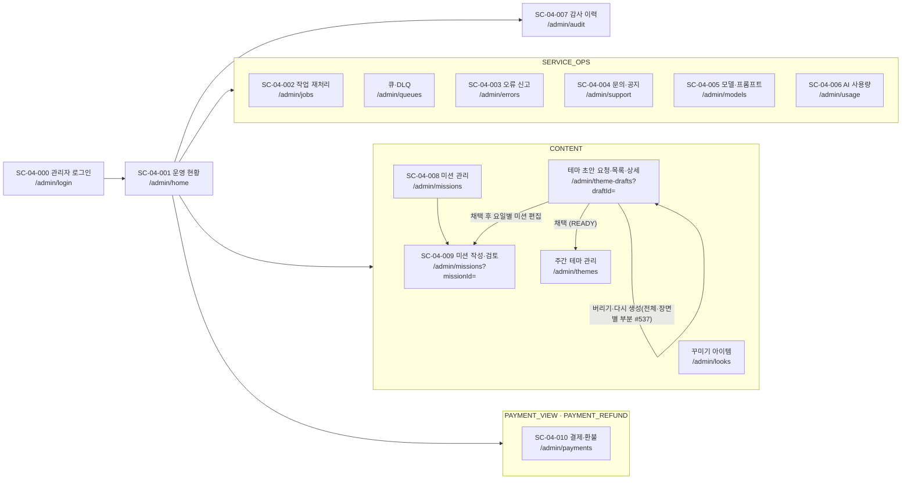

- 승인 권한이 없는 메뉴는 표시하지 않음. 공통(운영 현황·감사 이력)만 모든 관리자에게 노출
- 커뮤니티 공유물 신고는 SC-04-003 오류 신고에서 대상 `COMMUNITY_POST`로 검토(신고 시 숨김 → 다시 공개·계속 숨김). 주간 테마는 미션과 같은 작성→검토→게시
- 테마 초안(#441): CONTENT 운영자는 학년(`G3`·`G4`·`G5`·`G6`)·적용 주·선택 주제/유형별 성취기준·입력 방식으로 초안을 요청한다. 출처·상태로 목록을 고르고, 이야기·그림·요일별 문제·실패 사유를 확인한다. 채택은 게시가 아니며 미션 5개와 테마의 검토·게시를 각각 진행한다. 버리기·다시 생성은 서버가 확정한 상태와 식별자를 따른다. 503·연결 장애 후 쓰기를 자동 재요청하지 않는다.
- 학년별 테마(#438): 초안 요청·테마 저장 본문과 테마 목록 필터는 `grade` 문자 값을 사용한다. 초3·초4는 논술을 지정할 수 없다. 성취기준 표의 고시 학년군(`gradeBand`, `초3~4`·`초5~6`)은 유지하며 선택한 학년을 포함하는지 확인한다.
- 초안 목록·상세(learning #438·core #439): 목록은 학년·적용 주·출처·상태·시도 수·요청 시각을 보이고 생성 중만 주기 조회한다. 상세는 입력(주제·유형별 성취기준·입력 방식), 시작·종료 이야기와 그림·영상, 큰 질문·후보·정답, 요일별 문제(생각 유형·질문·대화·장면 그림·단서), 경고·실패 단계·사유를 보인다. 장면 그림·영상은 움직임 형식 v1을 공용 재생기로 재생하고 '움직임 끄기'(기기 동작 줄이기 설정도 따름)로 정지 그림만 본다. 채택은 `READY`만, 버리기는 `READY`·`CHECK_FAILED`·`FAILED`, 다시 생성은 생성 중·채택이 아닐 때 보이고 불가 전이는 서버 `409`를 그대로 안내한다. 채택하면 만든 테마 편집(`/admin/themes?themeId=`)으로 가고 요일별 미션 편집 링크로 미션 5개를 각각 검토·게시한다. 테마 편집에는 종료 이야기와 시작·종료 그림을 미리보기로 보인다(저장 때 보내지 않으면 서버가 이전 값을 이어받음).
- 장면별 부분 다시 생성(#537): 상세의 시작·종료 칸(영상·그림)과 요일 칸(그림·미션)에 다시 만들기 버튼을 두고 서버가 준 `regenerableTargets`에 있는 대상만 보인다. 누른 칸에서 같이 바뀌는 범위를 확인받고 그 대상만 다시 만든 새 초안을 연다(원래 초안은 그대로). 부분 결과 초안은 상세에 다시 만든 대상과 원래 초안 링크, 목록 출처에 '부분'을 보인다. 생성 중·채택 초안에는 버튼이 없다.
- #460 관리자 홈: CONTENT 권한이면 기존 관리자 미션 목록의 전체 상태별 집계(`counts`)로 작성 중·검토 필요·공개·비공개를 표시하고 각 상태의 미션 관리 필터로 이동한다. 현재 전체 미션 기준임을 안내하고 조회 중·실패·실제 0개를 구분한다. 미션 현황 조회는 운영 집계 조회와 독립하며 CONTENT 권한 없이는 호출하지 않는다. 작업 종류는 한글로 표시하고 API 필터 값은 기존 코드를 유지한다.

---

## 4. 역할 간 통합 시나리오 (한 주)

학부모 가입부터 일일·주간 리포트·분석 대화까지 한 자녀 기준 흐름.

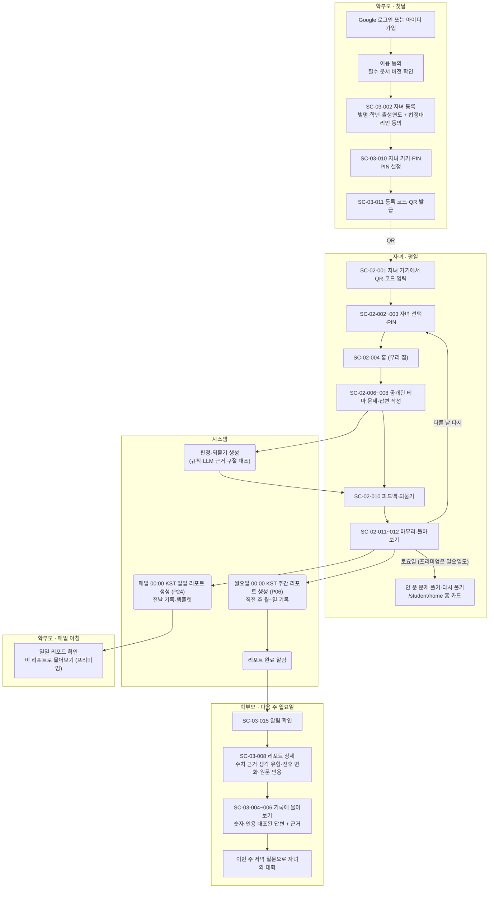

- 학부모 공간의 직접 학습 시작 버튼은 제공하지 않는다(#548, 2026-11-12). 학생은 등록 기기의 자녀 선택·PIN 로그인 흐름으로 진입한다.
- 학부모 대시보드(SC-03-001)는 주중에도 자녀 활동 수치를 바로 확인 가능, 일일 리포트는 전날 문제별 정리, 주간 리포트는 주 단위 정리본
- 그 주 처음 '오늘 문제 풀기'를 누를 때 시작 영상(이야기)으로 한 주 시작(#589), 월~금 하루 1문제씩 공개(다섯 생각 유형)되어 토요일까지 쌓임, 토요일 풀기·되돌아보기, 일요일 닫힘(프리미엄은 토요일과 같이 이용). 학부모는 매일 자정 그날 일일 리포트(푼 날 기준), 일요일 자정(월요일 00:00)에는 테마 요약(그날 풀었는지·개근·주간 완주·엔딩)이 들어간 주간 리포트도 받음

### 4.1 주간 테마 한 주 시나리오 (#483)

바뀐 규칙([기능명세 P23·P21·P13](functional-spec.md#14-확정-정책))으로 본 학생 네 유형의 한 주. 큰 질문 정답 고르기는 금요일 문제를 마무리한 뒤 한 주에 한 번이다(learning #484, 틀리면 토요일 금요일 문제 다시 풀기를 마친 뒤 엔딩). 포인트는 테마 관련만 셈(문제 완료 10·당일 풀이 5·개근 30·주간 완주 10, 되돌아보기 열람 10은 별도). 구현은 learning #484·core #485·report #486·web #487.

| 학생 | 월~금 | 토요일 | 일요일 | 엔딩 | 테마 포인트 |
|---|---|---|---|---|---|
| 매일 푸는 학생 | 그날 공개된 문제를 그날 풀고 금요일 큰 질문 정답 | 다시 풀기(선택) | 무료: 닫힘(기록·엔딩 다시 보기) | 금요일 정답 즉시 | 50+25+30+10 = 115 |
| 몰아 푸는 학생 | 월~목은 오지 않음, 금요일에 공개된 5개 중 일부 풀기 | 남은 문제 새로 풀기 | 무료: 닫힘 | 정답이면 그 순간, 틀리면 토요일 다시 풀기 마무리 뒤 | 금요일 1개 당일 풀이 포함 시 50+5+10 = 65, 금·토에 모두 나중에 풀면 50+10 = 60 |
| 큰 질문을 틀린 학생 | 매일 풀었지만 금요일 정답 고르기 오답 → "토요일에 다시 풀면 결말을 볼 수 있어요" | 금요일 문제 다시 풀기 마무리 → 맞든 틀리든 엔딩(틀리면 정답 공개) | 무료: 닫힘 | 토요일 | 115(엔딩과 무관) |
| 프리미엄 일요일 학생 | 바빠서 3개만 풀기 | 오지 않음 | 토요일과 같이 남은 2개 풀기·다시 풀기 | 일요일에 금요일 문제 정답이면 즉시, 틀리면 그 문제 다시 풀기 마무리 뒤 | 일요일 완료는 주간 완주 아님: 50+15(당일 3개) = 65 |

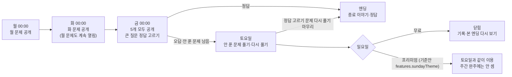

- 커뮤니티: 큰 질문 정답 고르기 문제는 엔딩을 본 학생만 열람. 틀린 학생은 토요일 다시 풀기 전에 다른 학생 풀이로 정답을 보지 않음(`COMMUNITY_LOCKED`)
- 시작 이야기(영상)는 그 주 처음 '오늘 문제 풀기'를 누를 때(화요일에 처음 와도 봄, #589), 종료 이야기는 엔딩 조건을 채웠을 때만. 무료 일요일에는 엔딩을 새로 보여 주지 않음
- 장면 움직임(#440, ai 움직임 형식 v1): 시작·종료 이야기는 영상이나 그림 + 움직임(카메라·컷 문구)이 있으면 화면 가득 먼저 재생하고, 끝나거나 '건너뛰기'를 누르면 이야기 화면(그림은 멈춤, '다시 보기'로 다시 재생). 문제 화면 장면 그림 위에는 효과(effects)만 재생하고 살펴보기 지점(spots)은 학생 화면에 넣지 않음(사용자 결정 2026-11-13, 오늘 장면에도 넣지 않음 #807). 오늘 장면 그림은 효과와 처음 3초 살짝 당겨졌다 돌아오는 연출(확정 시안 Main)만 쓰고, ai 움직임의 카메라 이동(`camera`)은 쓰지 않음(말꼬리가 가리키는 화자 위치가 어긋나지 않게, #807). 기기 '동작 줄이기'나 문제 화면 '움직임 줄이기'면 재생하지 않음(이야기는 화면 가득 재생 없이 바로 이야기 화면). 그림이 없는 테마와 그림을 못 불러온 경우는 이야기 글만, 문제 장면은 같은 자리에 '그림을 불러오지 못했어요'
- 일요일 하루 이용권 단건 결제는 #430 PG 결정 뒤 후속

---

## 5. 예외 시나리오

사용자에게 보이는 결과 중심. 상태 이름은 [기능명세서 1.2](functional-spec.md#12-상태-정의)와 동일하게 표시.

### 5.1 로그인·진입

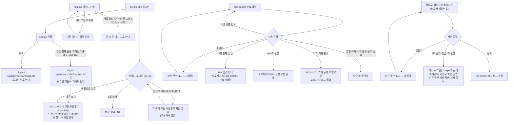

### 5.2 미션 수행

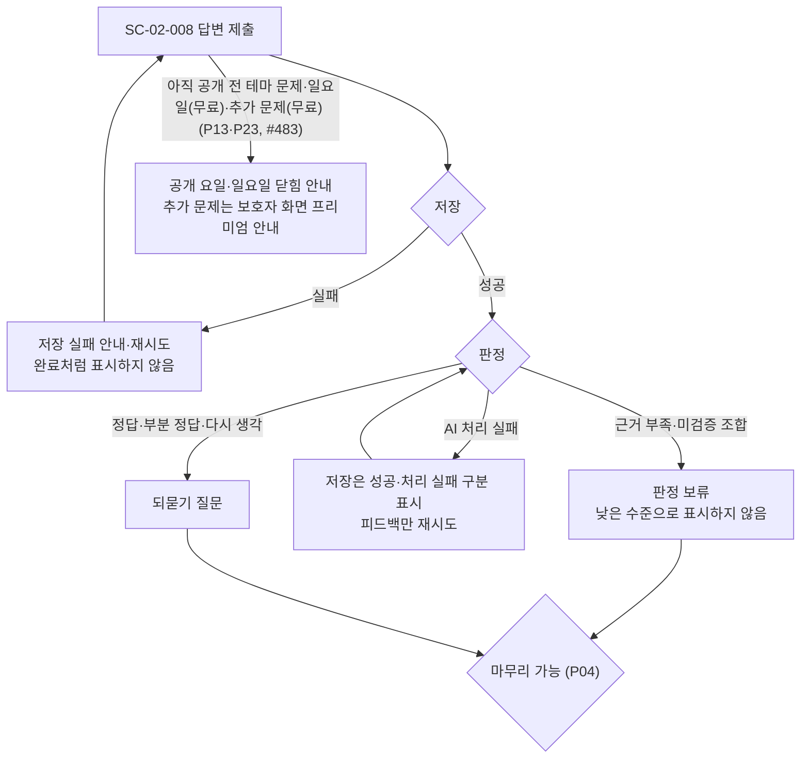

### 5.3 분석 대화·리포트 (학부모)

- #481: 완료된 주간 리포트에 대표 답변 설명을 최대 3개 표시한다. 각 카드에는 미션 제목·생각 유형·인용 구절·설명과 ‘AI 관찰’을 표시한다. 설명 생성 실패/미활성·대상 없음·이전 API의 정보 미제공을 구분하며 수치 리포트는 유지한다. 무료·원문 비공개에서는 카드 원문을 표시하지 않는다. 일일 리포트에는 설명 영역을 두지 않고 화면 ID는 화면설계서 담당 확정 전까지 새로 부여하지 않는다.

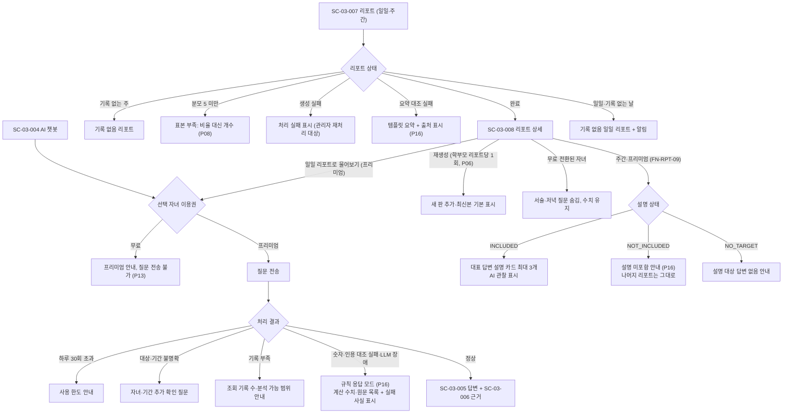

---

## 6. 관리자 운영 흐름

### 6.1 오류 신고 → 정정 → 신고자 결과 확인

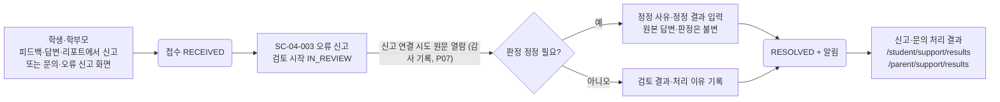

- 접수만으로 판정을 바꾸지 않고, 검토 없이 바로 처리 완료 불가 (FN-SUP-02)
- 문의는 SC-04-004에서 답변 → 문의자 알림, 공지는 같은 화면에서 등록 → SC-03-013 공지·점검에 노출

### 6.2 실패 작업 재처리

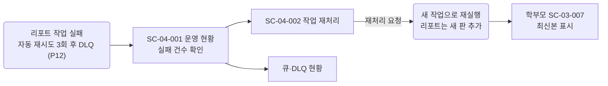

### 6.3 미션 등록·공개

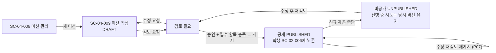

### 6.4 결제·환불

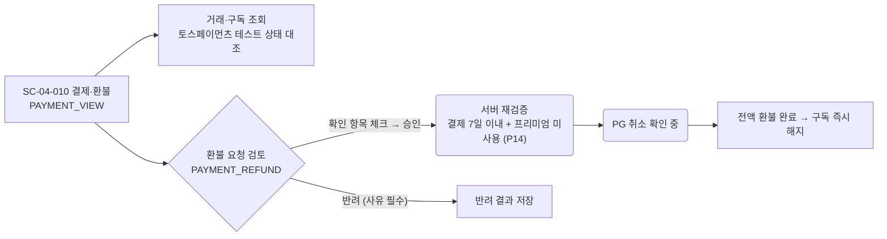

---

## 7. 확인 필요 가정

- 학부모 구독 결제·구독 관리(UC-17·UC-18, #184): `/parent/billing`(이용권·결제)에서 상품 선택 → 토스 결제위젯 결제 → `/payment/success`·`/payment/fail` 결과 확인, 같은 화면의 구독 관리에서 자동결제 수단 등록(`/payment/billing/success`·`/payment/billing/fail`)·자동 갱신 해지·철회·환불 요청. 테스트 키 환경만 사용(P14). 단계별 화면 흐름도는 미반영
- 이용 동의 화면(`/parent/onboarding`)과 관리자 메뉴 큐·DLQ(`/admin/queues`)는 화면설계서 v2.1에 별도 화면 ID 없음
- 리텐션·일일 리포트 화면(UC-29~34, #393~#395): 이번 주 테마·되돌아보기·커뮤니티·자녀 커뮤니티·일일 리포트 상세·관리자 주간 테마·꾸미기 아이템은 화면설계서 v2.1에 없어 화면 ID 없이 이름·URL로 표시. URL은 웹 구현 기준(주간 테마·되돌아보기는 별도 페이지 없이 학생 홈 카드, 자녀 공유물·포인트는 학부모 대시보드 아래), 화면 ID는 화면설계서 개정 때 부여
- 생활공간·추억 화면(UC-35·36, #587·#567): 내 방(`/student/room`)·추억 앨범(`/student/album`, 회차 상세 `/student/album/{themeId}/{weekStart}`·검색 결과·설명 포함)은 화면설계서 v2.1에 없어 이름·URL로 표시. 내 방·앨범·회차 상세 URL은 웹 구현(PR #587) 기준, 검색 결과·설명은 별도 URL 없이 앨범 화면 안 "기억으로 찾기"(#567)
- 학생 테마 화면(#589, 웹 #648·#487·#440): 시작 영상(`/student/theme/intro`)·오늘 장면(`/student/theme/scene/{day}`)·단서 모음(`/student/theme/clues`)·정답 고르기(`/student/theme/pick`)·엔딩(`/student/theme/ending`)·주말 되돌아보기(`/student/theme/review`)·뭉치 친구들(`/student/friends`)은 화면설계서 v2.1에 없어 화면 ID 없이 이름·URL로 표시(화면설계서 개정 없음). 시작 영상·단서 모음·정답 고르기·엔딩·주말 되돌아보기는 이 URL로 구현(#440·#487), 오늘 장면도 이 URL로 구현(#807, `{day}`는 `MON`~`FRI`). 기존 SC-02-001~014는 그대로 쓰고 SC-02-004 이름만 '생각 지도'에서 '홈'으로
- 웹 구현(#648): 뭉치 친구들 `/student/friends`, 꾸미기(SC-02-005) `/student/customize?tab=theme|friend|wear|furniture`(`tab`이 없거나 모르는 값이면 화면 테마), 내 포인트 `/student/points`. 도움말·문의·공지·알림 URL은 그대로이고 학생은 학생 틀 안에서 연다

- #427 기존 `/parent/account` 주소는 자녀·기간 조건을 보존해 계정 관리 탭으로 연결한다. 이용 동의 전에도 이 탭의 탈퇴 절차는 접근할 수 있다. #426~#429 웹 기준은 [학부모 화면 사용성 기준](#8-학부모-화면-사용성-기준-426429)을 따른다.

## 8. 학부모 화면 사용성 기준 (#426~#429)

- 기존 `achromatic-ledger` 방향(seed `683525200`)과 사고뭉치 로고·글꼴을 유지한다. 탐색은 중립색, 강조색은 주요 행동과 상태에 쓴다.
- 기본·보조 버튼은 테두리와 배경으로 링크와 구분하고 누르는 영역은 최소 44px로 한다. 본문·버튼 문구는 읽을 수 있는 크기를 유지한다.
- 학습 현황은 활동 수치, 리포트는 생성된 문서, AI 챗봇은 기간을 선택한 질문에 답한다. 날짜 필터는 기록·대화에만 둔다.
- `/parent/settings`의 프로필·공개/동의·계정 관리 탭을 유일한 설정 화면으로 사용한다. 예전 `/parent/account`는 기존 자녀·조회 조건을 보존해 계정 관리 탭으로 보낸다. 이용 동의 전에도 계정 관리·탈퇴 진입은 유지한다.
- 원문 비공개일 때 원문 조회·질문·다운로드를 요청하지 않고 이유와 사용할 수 있는 기능을 안내한다. 공개 권한은 자녀가 결정한다.
- 오류는 사용자 안내와 가능한 재시도를 먼저 보여 준다. 오류 코드·확인 번호·상세 응답은 접힌 자세히 영역에 둔다.
- 신규 결제는 상품·가격·1개월 기간·자녀 수·기능 확인 → 자녀 선택 → 첫 달 결제 → 별도 자동결제 등록 순서다. 자동결제가 기본 등록된 것처럼 안내하지 않는다.
- 상품이 없으면 구매 폼과 빈 주문 요약을 숨긴다. 설정 장애·비활성 버튼은 사용자에게 사유와 문의 경로를 제공하며 키 값은 표시하지 않는다.
- 상태는 한글로, 자녀는 별명으로 표시한다. 주문번호는 접힌 거래 상세에 둔다. 모바일에서 본문 가로 넘침이 없어야 한다.
- 1440·768·390px에서 기본·비공개·빈 목록·실패 상태와 설정 경로를 확인한다. 가상 결제 검사와 실제 PG 검증은 구분한다.

### 8.1 리포트·챗봇·알림·PIN 동선 통합 (#462)

#462 점검 범위는 아래 리포트·챗봇·로고·알림·자녀·PIN 동선과 기존 설정·원문 비공개·결제 사용성 기준이다. 구체적인 추가 요구사항이 올라오면 해당 내용과 대조한다.

- 학부모 리포트와 AI 챗봇은 `/parent/report` 한 메뉴 안에서 리포트 보기·질문하기로 이동한다. 선택한 리포트의 자녀·기간을 같은 챗봇에 연결하며, 일일 리포트의 고정 범위·최신판 계약과 원문 공개/이용권 권한을 유지한다. `/parent/analysis`는 기간을 보존해 질문 화면으로 연결한다.
- 사고뭉치 로고는 로그인 역할에 맞는 홈으로 연결한다. 자녀 추가 등록은 계정·자녀 설정의 프로필에서 한다.
- 알림은 상단 우측 끝의 종 버튼으로 연다. 같은 알림 창에서 목록·읽음 처리·수신 설정을 이용한다. 학생은 보호자 알림에 접근하지 않는다.
- 자녀 PIN은 선택한 자녀 한 명의 폼만 표시한다. 자녀 선택은 줄바꿈 가능한 알약 버튼과 키보드 이동을 제공한다. PIN 저장에는 추가 재인증이 없고, 서버의 활성 보호자 세션·현재 자녀 권한·PIN 규칙·잠금 해제·감사는 유지한다. 보호자 비밀번호·삭제·탈퇴의 재인증은 별개다.
- 기존 `achromatic-ledger` 배치·사고뭉치 로고·글꼴을 이어 사용한다. 이번 화면의 주 작업은 리포트에서 질문으로 이어지는 흐름이며, 임의 생성 자료나 새 시각 스타일은 추가하지 않는다.

### 8.2 답변과 리포트 근거 위치

- 리포트에서 질문할 때 같은 리포트와 답변을 함께 표시한다. 검증 완료 답변의 수치 정의·원문 식별자로 연결되는 항목만 초록색 경계선과 ‘선택한 답변의 근거’ 문구로 강조한다. 색만으로 의미를 전달하지 않는다.
- 자녀·리포트·판·기간이 일치해야 한다. 일일 리포트는 대화가 서버에서 고정한 실제 판을 사용하며, 주간은 질문을 시작한 리포트 판과 기간을 사용한다. 실패·생성 중·새 질문·다른 답변·다른 자녀/기간·공개 철회 때 이전 강조를 제거한다.
- 원문 연결은 기존 메시지 근거 API로 현재 접근 가능 여부를 확인한다. 삭제/비공개/조회 실패 또는 연결 정보가 없는 항목은 추측하지 않는다. 리포트와 learning의 알려진 집계 지표는 정의와 기간·분자·분모가 일치할 때만 연결하며, 같은 숫자나 답변 키워드만으로 강조하지 않는다.
- 데스크톱은 답변과 리포트를 나란히 놓고 리포트 안에서 근거 위치로 이동한다. 태블릿·모바일은 대화 뒤에 리포트를 놓으며, 답변의 ‘리포트 근거 위치 보기’로 해당 항목에 이동·초점을 준다. 동작 줄이기 설정을 따른다.
- 연결 항목이 없으면 이유를 안내한다. 서술 요약·테마 제목처럼 원문 식별자가 없는 영역이나 집계 기준이 다른 완료 지표는 임의로 연결하지 않는다. 새 API·모델 응답 필드는 추가하지 않는다.

### 8.3 학부모 공통 화면 개선 (#548)

- 테마색 #277044를 셸·사이드바 배경에 사용하고, 본문·상단 바는 #f3f7f4 바탕과 진한 글자로 구분한다.
- 상단 바는 y=0에 고정된 둥근 카드다. 로고·자녀 선택·알림·로그아웃을 배치하며 “학부모 공간” 문구와 직접 학습 시작 버튼은 제공하지 않는다. 상단 개발 목업 안내 줄은 표시하지 않는다(연결 모드는 유지).
- 본문 폭은 상단 바의 모서리 곡률 안쪽 평평한 구간에 맞춘다. 상단 바 바깥 여백은 투명하게 두며 배경 마스크로 본문을 가리지 않는다.
- 사이드바는 폭을 줄이고 상단 바 아래에 배치한다. 자녀 이용권 정보와 자체 스크롤은 제거한다. 낮은 창에서는 일반 페이지 흐름, 작은 화면에서는 메뉴 대화상자로 모든 메뉴에 접근한다.
- 도움말·문의·공지·처리 결과도 같은 학부모 셸에서 표시하며 선택 자녀·기간을 유지한다.
- 공개·동의 이력은 응답의 document.content(당시 버전)를 펼쳐 표시한다. 본문이 없으면 최신 문서를 대신 표시하지 않고 부재를 안내한다.
- 무료 플랜을 표시한다. 유료 구독의 무료 전환은 현재 기간을 유지하는 기존 자동 갱신 해지 확인으로 연결하며 즉시 환불·권한 회수는 하지 않는다.
- 결제수단 선택은 별도 탭에서 기존 API·멱등 키로 주문을 생성한다. 완료·취소·실패는 기존 콜백을 따르며, 원래 탭 복귀 시 구독/거래 상태를 갱신한다. 팝업 차단은 안내 후 재시도한다.
- 리포트 하단 버튼, 알림 필터·쪽수, 닫기 아이콘의 크기·중심선을 통일한다. 드롭다운 화살표는 오른쪽 여백을 두고 지원 브라우저에서는 둥근 메뉴·테마색 선택 항목을 사용한다. 미지원 브라우저와 강제 색상 모드는 시스템 메뉴를 유지한다.

### 8.4 관리자 테마 통일

- 학부모 대시보드와 같은 #277044 사이드바·주요 버튼, #f3f7f4 본문·상단 바, 흰 카드와 #192b21 본문 글자를 사용한다.
- 선택 메뉴는 흰 바탕·진한 녹색 글자로 구분하고 키보드 초점, 선택 탭·행, 차트에도 같은 팔레트를 적용한다. 관리자 로그인도 동일한 배경과 버튼색을 사용한다.
- 관리자 메뉴 구조·권한·업무 상태·반응형 배치는 유지한다.
- 관리자 드롭다운에도 학부모와 같은 화살표 오른쪽 14px 여백, 둥근 메뉴·항목, 녹색 선택 배경을 적용한다. 미지원 브라우저·강제 색상 모드는 기본 선택 메뉴를 유지한다.
- 관리자 가독성: 본문 15px, 제목 26px·구역 제목 18px, 입력·버튼 글자 14px를 사용한다. 보조 글자 대비·라벨 굵기와 입력 경계를 강화하고 주요 조작 영역은 40px 이상으로 둔다. 오류 안내는 붉은 바탕·테두리·글자로 구분한다.
- 비교 카드의 완료 상태는 테마색 #277044 배경·흰 글자로 구분한다. 운영 요약의 학습 완료와 작업 처리 완료 카드에 적용하며 집계가 0이어도 상태별 구분은 유지한다.
- 관리자 공통 작업 버튼은 테마 녹색·흰 글자로 통일한다. 종료·게시/판매 중단·삭제·버리기·반려 작업은 빨간색으로 구분하고, 비활성 버튼은 회색을 유지한다. 상태 배지는 흰 배경에 녹색 글자·외곽선, 종료·판매 중단 배지는 빨간 글자·외곽선으로 표시한다. 본문 패널·입력란·미선택 탭은 흰색이다.
- 문의·공지 패널은 나란히 같은 높이로 배치하고 하단 페이지 이동 버튼·쪽수의 중심선과 패널 하단을 맞춘다. 행의 관리 버튼 사이에도 간격을 둔다. 좁은 화면에서는 패널을 세로 배치하고 표는 내부에서 스크롤한다.

### 8.5 학생·학부모 접근성 보완 (#639·#640·#641)

- 역할 인증 틀은 일반 컨테이너로 두고 각 화면의 본문 main을 최상위 랜드마크로 유지한다. 본문 안 공개 상태 안내는 region으로 구분한다. 미션 풀이의 로딩·오류·작성 상태 모두 main 하나를 제공한다.
- 풀이 진입 시 제목으로 초점을 이동한다. 답 제출 성공 후 결과 안내에 초점을 한 번 이동하고 피드백 갱신·자동 저장으로는 이동하지 않는다. 기존 저장 상태·오류 안내의 status·alert는 유지한다.
- 학생 이름줄·미션 단계 배지의 명도 대비는 4.5:1 이상으로 맞춘다. 안내 창 닫기·도움말·공책 필터·학부모 보조 메뉴 조작 영역은 44px 이상으로 확보한다.
