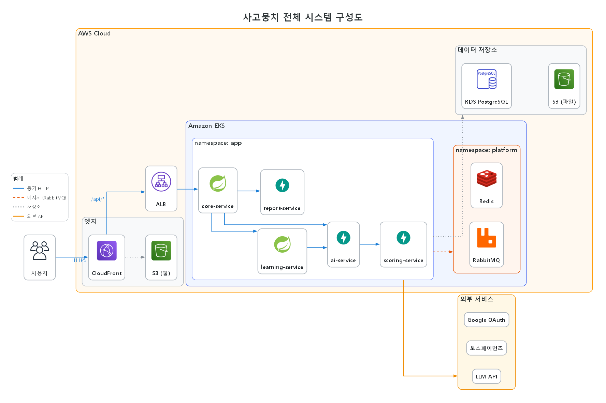
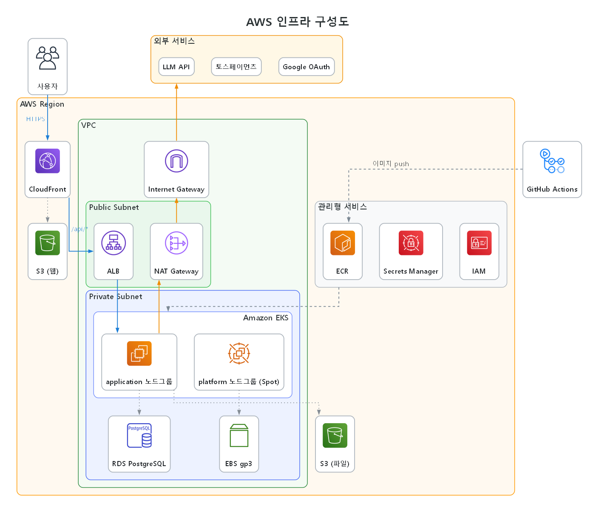
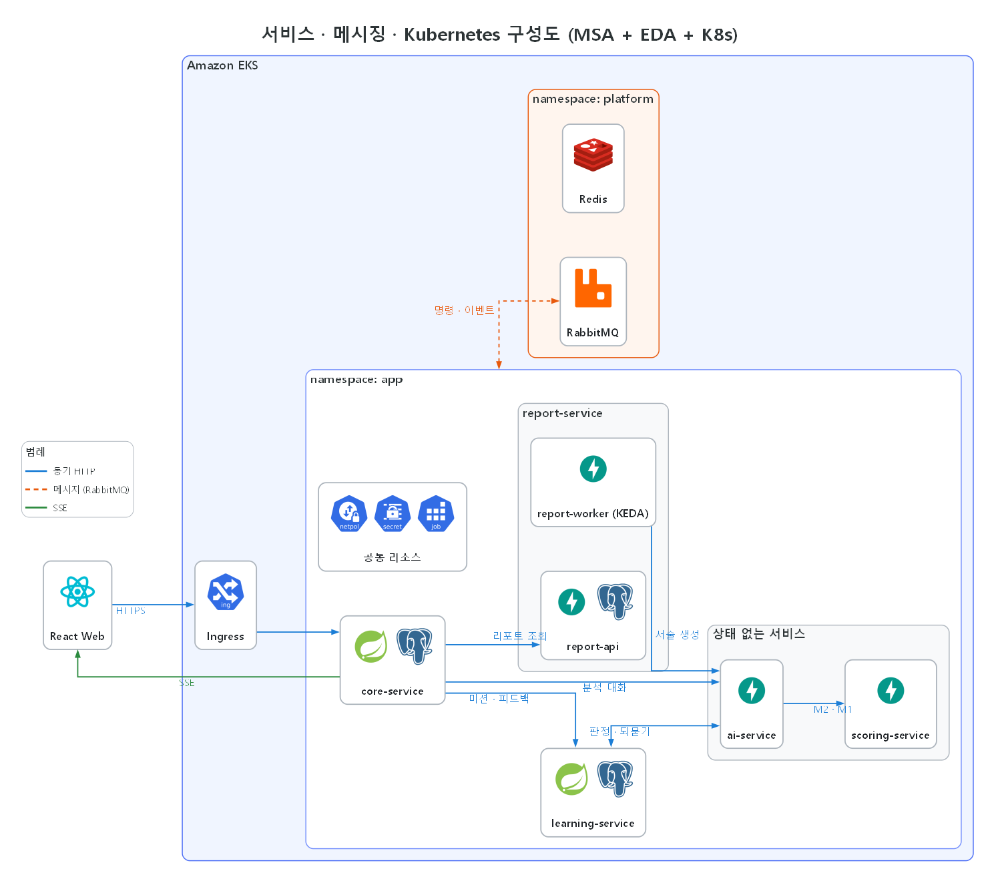
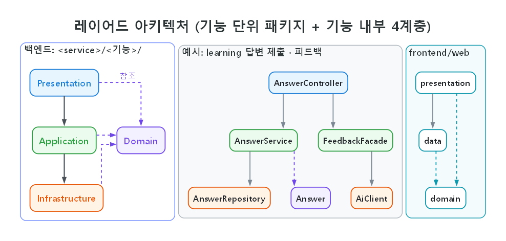
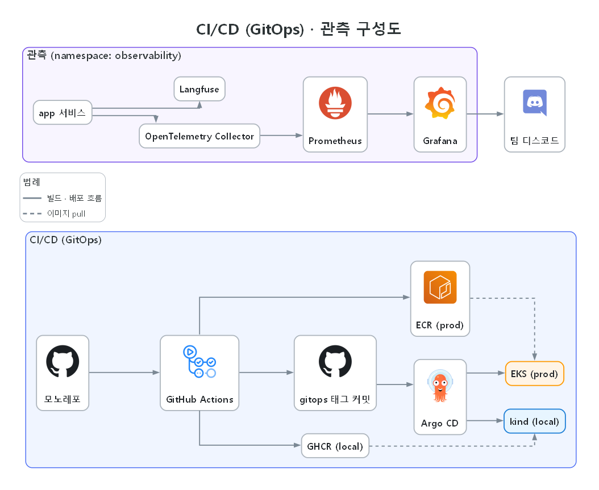

# 시스템 구성도 (2주차 중간 산출물)

현 설계대로 개발 완료 시점의 목표 구성. 기준 문서는 [아키텍처 설계](../../design/architecture.md), [API 명세서 4장 내부 API](../../design/api-spec.md#4-내부-api-internal), [RabbitMQ definitions.json](../../../infrastructure/gitops/charts/platform-data/files/rabbitmq/definitions.json). 그림에는 구성 요소의 아이콘과 이름만 표시하고 세부 내용은 이 문서에 정리.

| 이미지 | 적용 아키텍처 |
|---|---|
| [01 전체 구성도](#1-전체-구성도) | 전체 요약 (AWS + MSA + EDA) |
| [02 AWS 인프라](#2-aws-인프라) | AWS 클라우드 (EKS · VPC · 관리형 서비스) |
| [03 서비스 · 메시징 · Kubernetes](#3-서비스--메시징--kubernetes) | MSA + EDA + Kubernetes |
| [04 레이어드 아키텍처](#4-레이어드-아키텍처) | 기능 단위 패키지 + 레이어드 |
| [05 CI/CD · 관측](#5-cicd--관측) | GitOps · 관측성 |

## 1. 전체 구성도


- 진입: CloudFront 한 도메인에서 웹 정적 파일(S3)과 `/api/*`(ALB → core-service) 분기
- 서비스 5개: core(유일한 공개 API) · learning(Spring Boot), ai · scoring · report(FastAPI)
- 연동: 동기 HTTP(파랑) + RabbitMQ 명령·이벤트(주황 점선) 혼합, 학생·학부모 실시간 응답은 core의 SSE로 전달
- 저장소: RDS PostgreSQL 서비스별 DB, S3(미션 장면 · 리포트 · 모델 가중치), Redis(SSE 중계)
- 외부: LLM API(ai만 호출), 토스페이먼츠 테스트 · Google OAuth(core만 호출)

## 2. AWS 인프라


- VPC: Public Subnet(ALB, NAT Gateway 단일 AZ) / Private Subnet(EKS 노드, RDS)
- EKS(eksctl): 관리형 control plane, 노드그룹 `application`과 `platform-observability`(Spot) 분리
- 저장: RDS PostgreSQL(일 1회 백업 + PITR 7일), RabbitMQ · Redis는 StatefulSet + EBS gp3, 파일은 S3(IRSA로 접근)
- 외부 호출 경로: Pod → NAT Gateway → Internet Gateway → LLM · 토스 · Google
- 보안 · 배포: ECR 이미지, Secrets Manager → External Secrets, IAM(IRSA · GitHub Actions OIDC)
- 근거: [아키텍처 4.2 · 4.3](../../design/architecture.md#42-운영-클러스터-eks)

## 3. 서비스 · 메시징 · Kubernetes


**MSA**
- 서비스별 DB 소유(core_db · learning_db · report_db), 다른 서비스 DB 직접 접근 금지
- ai · scoring은 상태 없음, report는 같은 이미지로 report-api(조회) · report-worker(생성) 2개 Deployment
- 내부 호출: 내부 토큰 + `X-User-Id` · `X-User-Role` · `X-Student-Scope` 헤더, 타임아웃 · 서킷 브레이커, 재시도는 ai의 LLM 호출만

**EDA**
- 명령(`cmd.direct`, 소비자 1)과 이벤트(`events.topic`, fan-out 소비자 N) 구분
- core · report는 Outbox로 DB 변경과 발행 일치, 소비 측은 수동 ACK · 멱등 소비
- 실패 시 `<큐>.retry.1·2·3`(1 · 5 · 15분) 후 `dlx` → `<큐>.dlq`
- 그림은 app 영역 전체와 RabbitMQ를 한 선으로 묶음, 메시지별 생산 · 소비와 큐 이름은 아래 표
- 가독성을 위해 외부 API(01 · 02에 표기), Redis 연결선, report-worker → learning 기록 조회 선은 그림에서 생략

| 메시지 | exchange | 생산 | 큐 → 소비 |
|---|---|---|---|
| `report.generate` | cmd.direct | core | `report.report.generate` → report-worker |
| `report.started` · `completed` · `failed` | events.topic | report-worker | `core.report.events` → core |
| `llm.usage.recorded` | events.topic | ai, scoring | `core.llm.usage.recorded` → core |
| `student.deleted` | events.topic | core | `learning.student.deleted` → learning, `report.student.deleted` → report-worker |
| `model.version.activated` | events.topic | core | Pod별 exclusive 큐(기동 시 선언) → ai, scoring 전 레플리카 |

**Kubernetes**
- Namespace: `app`, `platform`, `observability`, `argocd`
- 확장: HPA(core · learning · ai min 2, scoring · report-api min 1) + PDB, report-worker는 KEDA로 큐 길이 기반 0~N
- 공통 리소스(app-service chart): NetworkPolicy 기본 거부 + 호출 관계만 허용, ExternalSecret, migration-job(Argo CD PreSync)
- 근거: [아키텍처 1.1 ~ 1.6, 4.4](../../design/architecture.md#1-시스템-아키텍처)

## 4. 레이어드 아키텍처


- 최상위는 기능 패키지(`answer/`, `judgment/` 등), 기능 내부를 Presentation → Application → Infrastructure 단방향 레이어로 분리
- Domain은 모든 레이어가 참조, Domain은 다른 레이어 참조 금지, 계층 건너뛰기 금지
- 적용 강도: core · learning · report 4계층, ai · scoring은 Domain 제외 3계층
- 프론트: presentation → data, domain 공통 참조, core-service 공개 API만 호출
- 근거: [아키텍처 2장 · 3장](../../design/architecture.md#2-백엔드-아키텍처)

## 5. CI/CD · 관측


- CI: GitHub Actions 경로 필터로 변경 서비스만 테스트 · 빌드 → GHCR(local) · ECR(prod, OIDC) push
- CD: `infrastructure/gitops/environments/<env>/` 이미지 태그 커밋 → Argo CD(ApplicationSet) 자동 동기화 → kind(local) · EKS(prod)
- 관측: OpenTelemetry → Prometheus · Grafana(경보 → 팀 디스코드), Langfuse(LLM 호출 · 토큰 · 비용)
- `traceparent`를 HTTP 헤더와 이벤트 봉투 양쪽에 전파해 동기 · 비동기 구간 단일 trace
- 근거: [아키텍처 4.5 · 4.6](../../design/architecture.md#45-cicd)

## 이미지 재생성
Graphviz 설치 필요 (`C:\Program Files\Graphviz\bin`은 스크립트가 PATH에 자동 추가).

```
uv run --no-project --with diagrams python docs/outputs/week2/generate.py
```
