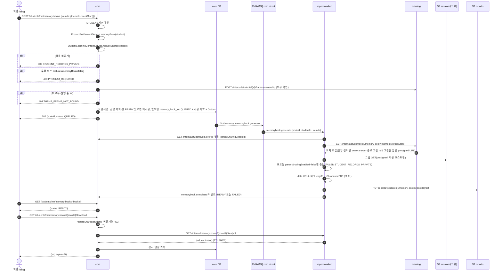

# 추억 그림책 PDF 설계 초안 (미도입 제안)

- 상태: **제안 단계**. 공식 이슈 없음. 원격 브랜치 `feature/memory-book`에서만 시험 구현하고, 끝까지 동작하는 것을 확인한 뒤 도입 여부를 정한다.
- 영향 범위: develop·main·실서버에 반영하지 않는다(11/24 develop→main 릴리스, 11/25 A 계정, 11/26~28 B 계정 일정과 분리). `docs/design/`은 고치지 않는다(도입이 정해지면 그때 api-spec 등에 옮긴다). 예외: Draft PR #966의 ci-db-schema(실제 DB와 ERD 대조)가 통과하도록 `erd.md` 3.5.3·6장에 그림책 테이블 2개와 `MEMORY_BOOK` 값만 먼저 넣었다(11/23). `contracts/openapi`·RabbitMQ 정의·저장소 계약 시험은 코드와 어긋나면 CI가 실패하므로 시험 구현 단계(14.2·14.3)에서 이 브랜치 안에서만 함께 고쳤다.
- 결정 반영(2026-11-23, 동섭): **발급은 학부모만**(D1 변경, 학생 화면에는 그림책 칸 없음, 14.7). **원문을 공개한 학생(`parentSharingEnabled = true`)에 한해서만 제공**한다(D2). 그 밖의 열린 결정은 모두 권장안대로 시험 구현하고, 결과를 보고 다시 판단한다. 그래서 그림책 판은 원문 포함 판 하나뿐이다(원문 제외 판 없음).
- 표기: **[확인]** 은 2026-11-23 `origin/develop`(df81a8c6) 코드·문서에서 직접 본 사실, **[추정]** 은 코드로 끝까지 확인하지 못했거나 설계상 가정인 것.

## 1. 목적

유료 구독 자녀에게 추억 앨범의 회차(주간 테마 한 주)를 "그림 흐름"으로 엮은 PDF 그림책을 준다. 한 회차는 시작 그림 → 요일별 장면 그림·문제·아이 답변 → 종료 그림·엔딩 이야기 순서로 읽힌다. 아이에게는 "내가 푼 이야기책", 학부모에게는 "아이가 한 주 동안 생각한 기록"을 남기는 것이 목표다.

## 2. 범위

| 구분 | 내용 |
|---|---|
| 범위 | 보유 액자 회차(진행 중인 주·`EXTRA` 제외)를 PDF 1개로 렌더링, S3 보관, 짧은 서명 URL로 내려받기. 유료 확인·원문 공개 확인·감사 기록 |
| 범위 밖 | **새 그림 생성 없음**(테마 초안 때 만든 기존 그림 S3 키만 배치). LLM 새 문구 생성 없음(1차). 영상·움직임(`*Motion`) 미사용. 인쇄·배송 주문, 공유 링크, 편집기, 학생 별명 외 개인정보 인쇄 |

## 3. 확인한 사실

### 3.1 learning: 회차와 그림

- **[확인]** `memory/service/AlbumService.round()`는 `ThemeFrameService.require(studentId, RoundKey)`로 액자를 찾고(미보유·진행 중 주 404 `THEME_FRAME_NOT_FOUND`), `WeeklyThemeService.pastRound(studentId, themeId, weekStart, themeVersionId)`로 회차를 조립한다. 응답 `AlbumRound{themeId, weekStart, title, imageUrl, awardedAt, missions[{day, missionId, title, thinkingType, attemptId}], ending{seen, outro, answer}}`.
- **[확인]** 액자는 `theme_frame`(V19)에 학생·테마·주당 1개, **획득 당시 `theme_version_id`를 고정**한다. 그래서 테마가 다시 게시돼도 그 회차의 제목·이야기·그림은 획득 당시 버전으로 읽힌다.
- **[확인]** `pastRound`의 `attemptId`는 그 회차에서 그 문제를 마지막으로 학습 완료한 시도(`EXTRA` 제외, `completedAt` 최대, 다시 풀기 포함)다. 재게시로 문제가 바뀌었으면 null.
- **[확인]** 그림 저장 위치:
  - 시작 그림·종료 그림: `weekly_theme_version.intro_image_uri`·`outro_image_uri`(V15, `ThemeStory.introImageUri`·`outroImageUri`).
  - 요일 장면 그림: 테마가 아니라 **미션 버전**에 있다. `mission_version.scene_uri`·`static_scene_uri`(V1). 테마 초안 채택 때 `ThemeDraftRules.adoptedMissions`가 그날 장면 그림 키를 두 칸에 같이 넣는다.
  - 값은 ai가 올린 S3 키 `theme-drafts/{실행 ID}/{장면}`(`missions` 버킷). 사람이 쓴 테마는 URL·경로 문자열이거나 비어 있을 수 있다. `AssetUrls`는 `theme-drafts/` 접두어만 1시간 이내 presigned GET URL로 바꾸고 나머지는 그대로 돌려준다.
- **[확인]** 시도는 `attempt.mission_version_id`(필수)와 `theme_version_id`(V27, `EXTRA`면 null)를 갖는다. 시도가 있는 요일은 `attempt.mission_version_id → mission_version.scene_uri`로 **그때 본 장면 그림**을 정확히 찾을 수 있다.
- **[추정]** 시도가 없는 요일(안 푼 문제)의 장면 그림은 `weekly_theme_day.mission_version_id`(V26에서 추가, nullable)로 찾고, 비어 있으면 그림 없는 칸으로 둔다. V26 이전 게시본은 null일 수 있어 실제 데이터에서 비율을 봐야 한다.
- **[확인]** 앨범 목록 카드는 "엔딩 전에도 보여도 되는" 시작 그림만 쓰고 종료 그림은 쓰지 않는다(`AlbumItem` 주석).

### 3.2 learning: 답변·되묻기·보완 답변

- **[확인]** `answer`(V2): 시도당 `version` 1, 2, 3…, `followup_id`(보완 답변이면 그 되묻기), `content` jsonb, `plain_text`. `followup`(V2): `judgment_id`당 1개, `question` 텍스트, `type`(`ONE_STEP_MORE`·`TELL_MORE`·`LOOK_AGAIN`). `reflection`: 시도당 1개(`difficulty`, `changed_text`).
- **[확인]** 학부모 기록 경로 `GET /records/students/{studentId}/attempts/{attemptId}`(learning `RecordController`)가 `answers[{version, text, followupId, content, feedback, thinkingSeconds, writingSeconds}]`, `reflection`, `checklist`를 이미 돌려준다. report-service의 일일 리포트도 `followups[{question, answer}]`·`finalAnswer` 모양으로 이 기록을 쓴다.
- **[확인]** 추억 검색 문서(`memory_search_doc`, V20)는 `concat_ws(제목, 장면 대화, 문제, 마지막 답변 plain_text)`이고, 검색 결과는 `MemoryCard{themeId, weekStart, title, imageUrl, missions[{missionId, title, attemptId, answerExcerpt}]}`. 결과 카드 최대 3개. 검색은 학생 전용(학부모 경로 없음).

### 3.3 엔딩 전 노출 금지 (P23)

- **[확인]** `pastRound`는 `ending(...) == ENDED`일 때만 `outro`·`answer`를 채운다. 엔딩 전에는 정답·종료 이야기를 보여 주지 않는다(functional-spec P23).
- **[확인]** 커뮤니티도 정답 고르기 문제를 엔딩 전까지 잠근다(`lockedUntilEnding`).
- **[추정]** 종료 그림(`outro_image_uri`)·금요일 정답 고르기 결과·#647 특징 표 전체도 엔딩 내용으로 본다. 앨범 카드가 종료 그림을 쓰지 않는 것과 같은 판단이다. 그림책에서도 엔딩을 안 본 회차에는 종료 그림·정답·특징 표를 넣지 않는다.
- **[확인]** 액자는 지난 주(진행 중 주 제외)만 있으므로 그림책 대상 회차는 모두 일요일이 지난 주다. 다만 엔딩을 못 본 채 주가 끝난 회차는 있을 수 있다(정답을 못 맞히고 토요일 다시 풀기를 안 한 경우).

### 3.4 report-service

- **[확인]** `app/rendering/renderer.py`: Jinja2(`StrictUndefined`, HTML 자동 이스케이프) → Playwright Chromium `page.pdf(A4, print_background, 쪽 번호 꼬리말)`. **JS 꺼짐, 모든 네트워크 요청 `route.abort()`**. 그래서 그림은 URL로 넣을 수 없고 PDF 렌더링 전에 바이트를 받아 `data:` URI로 넣어야 한다.
- **[확인]** 템플릿 `templates/weekly.html`·`daily.html`·`theme.html`. 렌더러가 HTML·PDF·MD를 함께 만든다.
- **[확인]** `scripts/install_pdf_runtime.sh`: report 이미지 빌드·GitHub Actions가 함께 쓰는 Playwright Chromium 설치기(3회 재시도). 한글 글꼴도 이 이미지에 있음(기존 리포트 PDF가 한글로 나옴).
- **[확인]** `app/clients/storage.py`: `reports/{studentId}/{reportId}/r{revision}/{full|free}/{pdf|md|html}`, `Cache-Control: private, no-store`. `presigned_url(key, ttl, filename)`은 TTL 1~3600초만 허용하고 `head_object`로 존재를 확인한 뒤 `Content-Disposition: attachment`로 서명한다. 기본 TTL `report_download_ttl_seconds=300`.
- **[확인]** 학생 삭제(`deletion/service.py`)는 `delete_prefix("reports/{studentId}/")`로 학생 아래 전부를 지운다. `delete_prefix`는 `reports/{uuid}/` 또는 `reports/{uuid}/{uuid}/r{n}/` 모양만 허용한다.
- **[확인]** 작업 큐: core가 Outbox로 `report.generate` 명령을 `cmd.direct`에 발행 → report-worker 소비. 실패하면 `x-retry-count`를 올려 `report.retry` exchange의 1·5·15분 TTL 큐로 재발행, 3회 뒤 DLQ(P12). core에는 리포트 작업 복구(`ReportRecoveryScheduler`, 4시간 후보)와 관리자 재처리(`ReportJobRetry`)가 있다.
- **[확인]** IAM `report-s3-role`은 `reports` 버킷의 `reports/*`만 읽고 쓴다. 그림이 있는 `missions` 버킷 `theme-drafts/*` 읽기 권한은 learning(`learning-asset-s3-role`)과 scoring에만 있다.

### 3.5 core

- **[확인]** `ProductEntitlementService.forStudent`: 활성 구독 상품 스냅숏, 없으면 `app.payment.free-product-id` 무료 상품. `features`·`limits`는 JSON 객체. 기존 기능 키 `features.extraMissions`·`features.sundayTheme`은 "값 없으면 구독 중 true·무료 false, boolean이 아니면 503 `PAYMENT_PRODUCT_UNAVAILABLE`" 규칙이다.
- **[확인]** `beginUsage(parent, student, kind, source)`: 부모 행 잠금 안에서 `payment_premium_usage`에 `RESERVED` 기록, 같은 `kind`·`source`면 기존 예약 재사용, 환불 처리 중 409 `REFUND_IN_PROGRESS`. `kind`는 코드 `require(kind in FEEDBACK, CONVERSATION, REPORT_VIEW)`와 DB CHECK(V34: `FEEDBACK`·`CONVERSATION`·`REPORT_VIEW`·`EXTRA_MISSION`)로 묶여 있다. 새 종류를 쓰려면 **core migration이 필요**하다.
- **[확인]** 리포트 내려받기: `GET /api/v1/reports/{reportId}/download?format=pdf|md` → `ReportQueryService.download`: 소유 확인 → `learningContext.requireShared(studentId)`(비공개면 403 `STUDENT_RECORDS_PRIVATE`) → report `/internal/reports/{id}/files/{format}` → 응답 `{url, expiresAt}` 계약 검사 → 열람 기록(`views.record`).
- **[확인]** #206: 학생 공개 설정 기본 false. 비공개면 학부모의 답변 원문·근거·기존 다운로드 URL 재발급 403, 수치는 유지(api-spec 5.15). `StudentSharingBoundaryTest`가 "비공개면 원문 시도·분석 근거가 하위 서비스로 가지 않고 요약은 남음", "옛 공개 리포트도 현재 설정으로 가리고 옛 파일·근거는 막음"을 검사한다.
- **[확인]** 추억 앨범·검색 공개 경로는 학생 전용(`/students/me/album…`, `/students/me/memories/…`). api-spec 2.12에 "학생 이외 역할 경로 없음(학부모 화면 미제공)".

### 3.6 web

- **[확인]** 학생: `presentation/student/world/StudentAlbum.tsx`(앨범 목록 `StudentAlbum`, 회차 상세 `StudentEpisode`: 엔딩 칸은 `ending.seen`일 때만 종료 이야기·정답, 문제마다 "그때 기록 보기"), `MemorySearch.tsx`(검색 카드에서 회차 열기).
- **[확인]** 학부모: `presentation/parent/ParentReports.tsx`가 `parentApi.download(id, 'pdf'|'md')` → `{url}`을 받아 `window.location.assign`. `parentSharingEnabled === false`면 버튼 비활성.

### 3.7 레이어 규칙 (architecture 2.1·2.2)

- **[확인]** 기능 패키지 안에 controller → service(facade) → repository/client 단방향, 기능 간 호출은 상대 기능 service로만, 트랜잭션 안에서 외부 HTTP·AMQP 금지, 하위 서비스 응답 해석은 기능 `client`(모양이 틀리면 502), 새 client는 업무 거절 공개 오류를 던지지 않고 application이 정한다(#948). 내부 호출은 호출자별 토큰과 경로 허용 목록(`InternalCallerPolicy`, report `security.CALLER_PATHS`).

## 4. 누가 받는가

| 선택지 | 장점 | 단점 |
|---|---|---|
| A. 학부모만 | 결제 주체가 받음. 기존 리포트 내려받기 화면·흐름(`ParentReports`)을 그대로 씀. #206 확인 지점이 이미 있음 | 학생 원문 비공개(기본값)면 그림책의 핵심인 답변이 빠짐. 앨범·검색이 학생 전용이라 학부모 화면에 회차 목록 경로를 새로 만들어야 함 |
| B. 학생만 | 자기 답변이라 #206 제약 없음. 앨범 화면에 버튼만 더하면 됨 | 초등 학생이 파일을 저장·인쇄하기 어려움. 유료 결제자(학부모)가 받지 못함. 학생 기기(공용 기기)에 파일이 남음 |
| C. 둘 다 | 학생은 원문 포함 판, 학부모는 공개 설정을 따르는 판 | 두 판(원문 포함·원문 제외)을 렌더링·보관. 화면·API 2벌 |

**#206과 맞추는 방법(결정, D2)**: 원문을 공개한 학생만 쓸 수 있다. 생성·목록·내려받기(학생·학부모 모두)마다 core가 **그 시점의** `parentSharingEnabled`를 확인하고, false면 403 `STUDENT_RECORDS_PRIVATE`(기존 리포트 비공개 응답과 같은 코드·문구)를 돌려준다. 그림책 판은 원문 포함 판 하나뿐이다. 공개 상태에서 만든 뒤 비공개로 바꾸면 이미 만든 그림책도 내려받을 수 없고(기존 리포트의 "원문 포함 기존 파일 미제공"과 같음), 다시 공개하면 보관 기간 안의 파일을 다시 받을 수 있다.

검토했던 대안(채택 안 함): 비공개 학생에게 답변을 뺀 `private` 판을 따로 만드는 방식. 판이 둘이 되어 렌더링·보관·시험이 두 배가 되므로 시험 구현에서는 빼고, 도입 판단 때 다시 본다.

**권장안(채택): C(둘 다), 1차 구현은 학생 요청 + 학부모 내려받기, 단 원문 공개 학생만.** 학생이 앨범에서 "그림책 만들기"를 누르고, 학부모는 리포트 화면의 "추억 그림책" 목록에서 내려받는다. 이유: 그림책의 핵심 내용(아이 답변)을 원문 공개 설정과 충돌 없이 담을 수 있는 쪽은 학생 본인이고, 유료 결제자는 학부모라 둘 다 받아야 가치가 맞는다. 시험 구현 순서는 학생 → 학부모로 나눠 범위를 줄인다.

## 5. 단위

| 선택지 | 장점 | 단점 |
|---|---|---|
| 회차 1개 | `AlbumService.round`를 그대로 씀. 쪽수 고정(약 8~10쪽), 렌더링 시간·크기 예측 쉬움. 캐시 키가 단순(회차+판) | 여러 주를 묶은 "책" 느낌은 약함 |
| 기간 묶음(예: 한 달, 최대 N회차) | 책다운 결과물. 학부모 월간 선물로 좋음 | 쪽수·그림 수가 커져 렌더링 시간·메모리 증가(Chromium). 일부 회차만 엔딩을 본 경우 처리 복잡 |
| 추억 검색 결과 선택 | 검색 기능과 연결되는 재미 | 검색은 결과 최대 3개·학생 전용·하루 한도(20)라 단위가 들쭉날쭉. 검색 결과는 시도 단위라 회차 흐름이 끊김. 검색이 꺼지면(임베딩 장애) 쓸 수 없음 |

**권장안: 회차 1개로 시작하고, API는 `rounds` 배열(1~4개)을 받게 열어 둔다.** 1차는 배열 길이 1만 허용. 추억 검색 결과는 별도 단위로 두지 않고 "검색 카드 → 회차 열기 → 그림책 만들기"로 회차 단위에 합친다. 이유: 이미 검증된 회차 조립 경로를 재사용해 시험 범위가 가장 작고, 묶음은 같은 템플릿을 회차 수만큼 반복하면 되므로 나중에 길이 제한만 풀면 된다.

## 6. 서비스별 책임과 레이어 배치

| 서비스 | 책임 | 레이어 배치(제안) |
|---|---|---|
| core | 인증·역할, 학생·학부모 연결 확인, 유료 확인(`features.memoryBook`), #206 판 결정, 작업 행 저장·Outbox 발행, 사용 기록, 내려받기 URL 중계·감사 | 새 기능 패키지 `memorybook/`: `controller/MemoryBookController`, `service/MemoryBookService`(주도: `ProductEntitlementService`·`StudentLearningContextService`·`StudentAccessService` 호출), `repository/MemoryBookJobRepository`, `messaging/MemoryBookGenerateWriter`, `client/MemoryBookReportClient`(report 내부 파일 URL 해석, 502·503만). 유료 판정 함수는 `payment/service/ProductEntitlementService.memoryBook(student)`에 둔다(무료·유료 정책을 이 서비스에 모은 기존 원칙) |
| learning | 회차 데이터 조립: 제목·이야기·요일 문제·장면 그림 키·시도별 답변·되묻기·보완 답변·돌아보기·엔딩(P23 적용) | `memory/service/MemoryBookService`(같은 기능의 `ThemeFrameService` + 기능 간 `WeeklyThemeService`·기록 service 호출), `memory/controller/MemoryBookController`(내부 API), 필요 시 `memory/repository`에 장면 그림 조회 쿼리. 그림은 S3 키나 그림 바이트가 아니라 짧은 presigned URL(`AssetUrls`)로 준다(→ 9장) |
| report | 명령 소비, learning 데이터 조회, 그림 내려받기 → `data:` URI, Jinja2 렌더링, S3 저장, 파일 URL 서명, 삭제 | `app/memory_book/`(새 패키지): `consumer.py`, `service.py`, `models.py`, `repository.py`. 렌더링은 `app/rendering/renderer.py`에 `render_memory_book()` 추가 + `templates/memory_book.html`. 그림 받기는 `app/clients/asset_fetcher.py`(httpx, 허용 호스트·크기·형식 검사). 저장 키 함수는 `app/clients/storage.py`에 추가 |
| web | 학생 앨범 회차 화면 버튼·진행 상태, 학부모 리포트 화면 목록·내려받기 | `data/memoryBook/api.ts`, `presentation/student/world/StudentAlbum.tsx`(StudentEpisode에 버튼), `presentation/parent/ParentReports.tsx` 또는 새 `ParentMemoryBooks.tsx` |

### 6.1 시퀀스



학부모 내려받기는 15~18 단계만 다르다: `GET /children/{childId}/memory-books/{bookId}/download` → core가 연결 확인 → 현재 `parentSharingEnabled` 확인(false면 403 `STUDENT_RECORDS_PRIVATE`) → 같은 report 내부 경로.

**[추정]** 완료 알림은 기존 리포트처럼 report가 core로 완료 이벤트를 보내는 구조를 따른다고 가정했다. 실제 리포트 완료 경로(`ReportLifecycleConsumer`)의 이벤트 이름·모양을 구현 때 다시 맞춘다.

## 7. 새 API 초안

모두 `/api/v1` 아래. 오류 응답은 기존 problem 형식.

### 7.1 공개 API (core)

| Method | Path | 역할 | 요청 | 응답 | 오류 |
|---|---|---|---|---|---|
| GET | `/children/{childId}/memory-books/rounds?page&size` | 학부모 | - | 발급 화면: 자녀의 보유 액자 회차(최근순) `{items:[{themeId, weekStart, title, imageUrl, book}], page, size, totalElements}`. `book`은 그 회차의 가장 최근 그림책(없으면 null) | 403 `FORBIDDEN`(연결 아님)·`STUDENT_RECORDS_PRIVATE` |
| POST | `/children/{childId}/memory-books` | 학부모 | `{rounds:[{themeId, weekStart}]}`(1차 길이 1) | 202 `{bookId, status, failureCode, rounds, createdAt, completedAt, expiresAt}`. 같은 회차의 만드는 중·보관 기간 안 완성본이 있으면 200으로 그것 | 400 `VALIDATION_FAILED`, 403 `FORBIDDEN`·`STUDENT_RECORDS_PRIVATE`·`PREMIUM_REQUIRED`, 404 `THEME_FRAME_NOT_FOUND`, 409 `REFUND_IN_PROGRESS`·`STUDENT_UNAVAILABLE`, 429 `USAGE_LIMIT_REACHED`, 503 `PAYMENT_PRODUCT_UNAVAILABLE` |
| GET | `/children/{childId}/memory-books?page&size` | 학부모 | - | `{items:[그림책], page, size, totalElements}`(최근순, 만료된 완성본은 `EXPIRED`) | 403 `FORBIDDEN`·`STUDENT_RECORDS_PRIVATE` |
| GET | `/children/{childId}/memory-books/{bookId}/download` | 학부모 | - | `{url, expiresAt}` (TTL 300초) | 403, 404 `MEMORY_BOOK_NOT_FOUND`, 409 `MEMORY_BOOK_NOT_READY`·`MEMORY_BOOK_FAILED`·`DELETION_IN_PROGRESS`, 410 `MEMORY_BOOK_EXPIRED`, 503 |

- 모든 응답 `Cache-Control: no-store`.
- 학생 경로는 없다(2026-11-23 결정으로 4단계의 학생 경로 4개를 지움). 학생 세션으로 위 경로를 부르면 403.

### 7.2 내부 API

| 호출 | Method | Path | 설명 |
|---|---|---|---|
| core → learning | POST | `/internal/students/{studentId}/frames/ownership` | **기존** 보유 확인 재사용 |
| report-worker → learning | GET | `/internal/students/{studentId}/memory-book/{themeId}/{weekStart}` | **새로**. 응답 초안: `{themeId, weekStart, themeVersionId, title, intro, introImage, bigQuestion, days:[{day, missionId, title, thinkingType, question, sceneImage, dialogue, attempt:{attemptId, completedAt, answers:[{version, text, followup:{type, question}|null}], reflection:{difficulty, text}|null}|null}], ending:{seen, outro, answer, outroImage}}`. 이미지 칸은 URL 문자열 또는 null(`AssetUrls`, ai S3 키면 presigned URL, 만료는 `app.assets.url-ttl` 1시간 이내). `X-Student-Scope`·SYSTEM 역할 확인, 미보유 404 (2단계 구현됨, 14.2) |
| report-worker → core | GET | `/internal/students/{studentId}/profile` | **기존**(별명, `parentSharingEnabled`) |
| core → report-api | GET | `/internal/students/{studentId}/memory-books/{bookId}/files/pdf` | **새로(3단계 구현)**. report DB에 그림책 행이 없어 학생 ID를 경로로 받는다. `{url, expiresAt}`(TTL 300초, 파일 이름 `memory-book-{bookId}.pdf`). 학생 범위 밖 403, 파일 없음 404, 삭제 중 409 `DELETION_IN_PROGRESS`, S3 오류 503 |
| 메시지 | 명령 | `memorybook.generate` (`cmd.direct` → 큐 `report.memorybook.generate`, 재시도 1·5·15분, DLQ) | 봉투 `source=core-service`, `dataschema=memorybook.generate.v1`, `subject=studentId`. data `{bookId, studentId, rounds:[{themeId, weekStart}](1차 길이 1), requestedBy?}`. 요청 시각은 봉투 `time` |
| 메시지 | 이벤트 | `memorybook.completed` (`events.topic`, report Outbox) | `source=report-service`, `dataschema=memorybook.completed.v1`. data `{bookId, studentId, status: READY\|FAILED, failureCode?, sizeBytes?, themeVersionId?}`. `failureCode`는 영구 실패만: `STUDENT_RECORDS_PRIVATE`·`THEME_FRAME_NOT_FOUND`·`STUDENT_DELETED`·`INVALID_ROUND`. 지금은 core `core.event.audit`에만 묶여 있고 core 소비자는 4단계 |

- 내부 경로 허용 목록(core·learning `InternalCallerPolicy`, report `security.CALLER_PATHS`)에 위 경로를 더해야 한다.
- **[추정]** learning 새 경로는 학부모 기록 경로(`/records/students/{id}/attempts/{attemptId}`)를 요일마다 부르는 대신 한 번에 조립한다. 쿼리 수는 회차당 시도 5개 × (답변·되묻기·돌아보기)라 조인 1~3번으로 충분하다고 본다.

## 8. 데이터와 저장

### 8.1 새 테이블 (core migration 필요)

```sql
-- 제안. 번호는 구현 때 develop 최신 다음 번호
CREATE TABLE memory_book_job (
    id uuid PRIMARY KEY,
    student_id uuid NOT NULL,
    requested_by uuid NOT NULL,            -- 학생 사용자 ID(1차), 학부모 생성 도입 시 학부모
    rounds jsonb NOT NULL,                 -- [{themeId, weekStart}]
    status varchar NOT NULL CHECK (status IN ('QUEUED','RUNNING','READY','FAILED','EXPIRED')),
    failure_code varchar,
    source_versions jsonb,                 -- [{themeId, weekStart, themeVersionId, attemptIds}] 재사용 판단용
    usage_reservation_id uuid,
    retry_count integer NOT NULL DEFAULT 0,
    created_at timestamptz NOT NULL,
    completed_at timestamptz,
    expires_at timestamptz
);
CREATE INDEX ix_memory_book_job_student_created ON memory_book_job (student_id, created_at DESC);
```

- `payment_premium_usage.kind` CHECK에 `MEMORY_BOOK` 추가(core migration). `ProductEntitlementService.reserve`의 `require(kind in ...)`에도 추가.
- report-service: 파일 메타데이터를 report DB에 둘지(alembic 새 revision `memory_book_file`) 아니면 키 규칙만으로 찾을지 → **권장: 키 규칙만**(`reports/{studentId}/memory-books/{bookId}/pdf`, `head_object`로 존재 확인). report DB migration이 필요 없다. 대신 `delete_prefix`의 허용 모양에 `reports/{uuid}/memory-books/{uuid}/`를 더해야 단건 삭제가 된다.
- learning: **새 테이블 없음**. 조회용 인덱스는 기존 `attempt`·`theme_frame` 인덱스로 충분하다고 본다 **[추정, 실행 계획 미확인]**.

### 8.2 보관 기간

- 파일: 생성 후 **30일**(권장, D6). 만료되면 core 주기 작업이 `EXPIRED`로 바꾸고 report에 삭제 명령. S3 수명 주기 규칙(`reports/*/memory-books/` 30일 만료)을 함께 두면 누락에도 지워진다 **[추정: 버킷 수명 주기 규칙은 현재 정의를 확인하지 않음]**.
- 같은 회차를 다시 요청하면, 원본(`themeVersionId`·회차 `attemptId` 목록·공개 설정과 무관)이 같고 READY면 새로 만들지 않고 재사용한다. 다시 풀기로 마지막 시도가 바뀌었으면 새로 만든다.

### 8.3 삭제 요청

- 학생 삭제·탈퇴(P09): report는 이미 `reports/{studentId}/` 전체를 지우므로 **그림책 파일도 자동으로 지워진다**(키를 그 아래에 두는 이유). core는 같은 삭제 트랜잭션에서 `memory_book_job`을 지운다. 사용 기록(`payment_premium_usage`)은 기존 정책대로 결제 기록 보관 규칙을 따른다.
- 공개 설정을 false로 바꿈: 이미 만든 그림책은 학생·학부모 모두에게 URL을 재발급하지 않는다(내려받기 때마다 현재 설정 확인, 파일은 보관 기간까지 남음). 이미 받은 파일은 회수할 수 없음(api-spec 5.15와 같은 문구로 안내).
- 액자는 지워지지 않으므로 회차 단위 삭제 경로는 두지 않는다. 학생·학부모가 개별 그림책을 지우는 버튼은 1차 범위 밖(D7).

## 9. 그림 가져오기

- 문제: renderer는 네트워크를 모두 막는다. report IAM은 `missions` 버킷을 읽을 수 없다.
- 선택지
  1. **learning이 짧은 presigned URL을 주고 report가 받아 `data:` URI로 넣는다(권장).** IAM 변경 없음. learning `AssetUrls`가 이미 이 일을 한다. report는 허용 호스트(S3 엔드포인트·로컬 MinIO 공개 주소)만 받고, 크기 상한(그림 1장 5MB, 그림책 전체 40MB)·`Content-Type` `image/png|jpeg|webp` 검사를 한다. 사람이 넣은 URL 문자열(접두어 밖 값)은 허용 호스트가 아니면 그림 없는 칸으로 둔다.
  2. report IAM에 `missions/theme-drafts/*` 읽기 추가. 호출이 단순하지만 A·B 계정 IAM과 런북(#809)을 바꿔야 한다.
  3. learning이 그림 바이트를 base64로 응답에 싣는다. 응답이 수 MB로 커지고 learning 메모리를 쓴다.
- **[추정]** 그림 한 장 크기는 측정하지 않았다(테마 초안 그림 해상도·형식 미확인). 시험 구현 첫 단계에서 kind MinIO 그림 크기를 재서 상한을 정한다. PDF가 너무 크면 report에서 Pillow로 긴 변 1600px 축소(새 의존성, D8).

## 10. 유료 확인

- 키: **`features.memoryBook`** (boolean). 기존 `extraMissions`·`sundayTheme`과 같은 규칙: 값 없으면 구독 중 true·무료 false, boolean이 아니면 503 `PAYMENT_PRODUCT_UNAVAILABLE`. 무료 상품 데이터에는 core migration으로 `false`를 명시한다(V43이 `extraMissions`를 바꾼 방식).
- 하루 생성 한도: **`limits.dailyMemoryBooks`** (권장 3). 집계는 `memory_book_job` 생성 행 수(KST 하루). 재사용 응답(200)은 세지 않는다.
- 무료 사용자 응답: 403 `PREMIUM_REQUIRED`, title "추억 그림책은 프리미엄 이용권에서 만들 수 있어요.", detail "앨범과 추억 검색은 계속 이용할 수 있어요." web은 버튼을 보이되 잠금 표시와 이 안내를 띄운다(추가 문제와 같은 방식).
- 생성 후 구독이 끝난 경우: 이미 만든 파일 내려받기를 허용할지 D5.
- 사용 기록: 생성 시작 때 `beginUsage(parent, student, "MEMORY_BOOK", bookId)` 예약, 완료 이벤트에서 `finishUsage(used = READY)`. 실패하면 사용 안 함(환불 판정 P14에 넣지 않음).
- 참고: 시험할 때 유료 계정이 필요하다. 지금은 계정별 SQL 부여(`infrastructure/aws/grant-team-premium.sql`)로 우회하고 있고, "모두 프리미엄으로 보는 스위치" 아이디어는 11/04에 보류된 상태다.

## 11. PDF 페이지 구성

> 아래 표와 11.1 목업은 **처음 초안**(A4 세로 9쪽)이다. 시험 구현을 거치며 바뀐 **지금 구성은 11.2**를 본다.

A4 세로, 그림 위주. 회차 1개 기준 약 9쪽.

| 쪽 | 내용 | 엔딩 전 회차 |
|---|---|---|
| 1. 표지 | 테마 제목, "{별명}의 추억 그림책", 주(`weekStart`~토요일), 시작 그림 큰 판 | 같음 |
| 2. 시작 이야기 | 시작 그림 + `intro` 글 + 큰 질문(`bigQuestion`) | 같음 |
| 3~7. 요일 장면(월~금) | 요일·생각 유형 이름, 장면 그림, 문제 전 대화(선택), 문제 글, 아이 답변(처음 답 → 되묻기 질문 → 보완 답변 순서), 돌아보기 한 줄. 안 푼 날은 "이 날은 쉬어 갔어요" | 금요일 정답 고르기 결과·정답 문구는 빼고 아이 답변만 |
| 8. 엔딩 | 종료 그림 + `outro` + 큰 질문의 답 | "아직 이 이야기의 끝을 보지 못했어요" 쪽(종료 그림·정답 없음) |
| 9. 저녁 질문·뒤표지 | 이번 주 가족에게 묻는 질문 한 개, 만든 날짜, 쪽 번호 | 같음 |

- 판은 하나(원문 공개 학생 전용, D2). 원문 제외 판은 만들지 않는다.
- 저녁 질문 출처 **[추정, D9]**: 그 주 주간 리포트의 `eveningQuestion`(LLM 생성, 유료·공개 설정에 따라 없을 수 있음)을 쓰거나, 테마 `bigQuestion`에서 고정 문장("이번 주 {큰 질문}, 너라면 어떻게 생각해?")을 만든다. 1차는 새 LLM 호출 없이 고정 문장을 권장.
- 별명: report가 core 내부 프로필(4.5.1)에서 받는다. 실명·학년·학교는 넣지 않는다.

### 11.1 HTML 목업 구조 (`templates/memory_book.html` 초안)

```html
<!doctype html>
<html lang="ko">
<head>
  <meta charset="utf-8">
  <style>
    @page { size: A4; margin: 12mm; }
    .page { page-break-after: always; display: flex; flex-direction: column; min-height: 270mm; }
    .scene { width: 100%; max-height: 150mm; object-fit: contain; border-radius: 6mm; }
    .scene--missing { height: 120mm; background: #f3efe6; }   /* 그림 없음: 무늬 칸 */
    .answer { border-left: 3px solid #e0a43c; padding-left: 4mm; white-space: pre-wrap; }
    .followup { color: #6b5b3e; }
    .locked { color: #8a8a8a; font-style: italic; }
  </style>
</head>
<body>
  <section class="page cover">
    <div class="scene scene--missing"></div>
    <h1>{{ book.title }}</h1>
    <p>{{ name }}의 추억 그림책 · {{ book.weekLabel }}</p>
  </section>

  <section class="page intro">
    <p>{{ book.intro }}</p>
    <h2>이번 주 큰 질문: {{ book.bigQuestion }}</h2>
  </section>

  
  <section class="page day" data-day="{{ day.day }}">
    <header><span>{{ day.dayLabel }}</span> · <span>{{ thinking_labels[day.thinkingType] }}</span></header>
    <div class="scene scene--missing"></div>
    <p class="dialogue"><b>{{ line.speaker }}</b> {{ line.text }}</p>
    <p class="question">{{ day.question }}</p>
    
      <p class="locked">이 날은 쉬어 갔어요</p>
    
      
        <p class="followup">{{ a.followup.question }}</p>
        <p class="answer">{{ a.text }}</p>
      
      <p class="reflection">{{ day.attempt.reflection.text }}</p>
    
  </section>
  

  <section class="page ending">
    
      
      <p>{{ book.ending.outro }}</p>
      <h2>큰 질문의 답: {{ book.ending.answer }}</h2>
    
      <p class="locked">아직 이 이야기의 끝을 보지 못했어요</p>
    
  </section>

  <section class="page back">
    <h2>오늘 저녁 질문</h2>
    <p>{{ book.eveningQuestion }}</p>
  </section>
</body>
</html>
```

- 아이 답변·대화는 기존 템플릿처럼 자동 이스케이프. `src`에는 report가 만든 `data:` URI만 들어간다(외부 URL이 들어가도 renderer가 요청을 막음).
- 답변이 아주 길면(논술) 한 쪽을 넘을 수 있다. 요일 쪽을 `min-height`로만 두고 넘치면 자연스럽게 다음 쪽으로 흐르게 한다.

### 11.2 지금 구성 (2026-11-23 시험 구현 최종, 14.10~14.12 반영)

A4 **가로**(297×210mm, 여백 위아래 12mm·좌우 14mm). 회차 1개 기준 **8쪽**, 엔딩 전 회차는 7쪽. 쪽 아래에 "쪽/전체" 번호.

| 쪽 | 내용 | 엔딩 전 회차 |
|---|---|---|
| 1. 표지 | 왼쪽: 시작 그림(폭 62%, 높이 170mm). 오른쪽: 테마 제목, "{별명}의 추억 그림책", 기간 → **목차**(요일·제목·쪽 번호, 이야기의 끝, 오늘 저녁 질문) → **이야기의 시작** 상자(`intro` + 이번 주 큰 질문) | 목차에서 이야기의 끝을 빼고 "이 주에는 이야기의 끝을 보지 못해서, 끝 이야기와 답은 싣지 않았어요" 안내 |
| 2~6. 요일(월~금) | 위: 요일·생각 유형·제목. 왼쪽: 장면 그림(표지 그림과 같은 크기, 가리는 것 없음). 오른쪽: 그림 높이만큼 세운 **채팅형 대화** — 왼쪽 말풍선은 등장인물 대사·"오늘의 문제"(Q.)·뭉치의 되물음, 오른쪽 말풍선은 아이 답(두 번째부터 "다시 생각한 답"), 끝에 돌아보기 한 줄. 답은 줄이지 않고 전체를 싣는다 | 같음(금요일 정답 고르기 결과·정답 문구는 원래 싣지 않음) |
| 7. 이야기의 끝 | 왼쪽: 종료 그림. 오른쪽 대화: "이야기"(`outro`) → 뭉치 "큰 질문의 답은 「…」였어!" | 이 쪽 없음. "아직 이 이야기의 끝을 보지 못했어요" 한 줄이 저녁 질문 쪽 위에 들어감 |
| 8. 오늘 저녁 질문 | 큰 질문으로 만든 고정 문장(D9), "사고뭉치 추억 그림책" | 7쪽 |

- 재게시로 문제가 바뀌어 그 날 시도 기록을 찾지 못한 요일은 대화 칸에 "이 날 문제는 나중에 바뀌어서 남은 기록이 없어요"를 싣는다(문구는 미확정, 17.3).
- 쪽 번호는 "요일·끝·저녁 질문은 각자 새 쪽에서 시작"이라는 규칙으로 계산한다(14.12). 한 날 대화가 한 쪽을 넘으면 뒤 번호가 밀리는 한계가 있다.
- 구현 위치: `backend/report-service/app/rendering/memory_book.py`(화면 값·목차), `app/rendering/templates/memory_book.html`(서식), `scripts/memory_book_sample.py`(예시 PDF 만들기), 예시 결과 `frontend/web/public/demo/memory-book-sample.pdf`.

## 12. 비용·성능·실패·보안

### 12.1 비용

- LLM 호출 없음(1차). 비용은 report-worker CPU·메모리(Chromium)와 S3 저장·전송.
- **[추정]** 그림 7장 × 1~2MB면 PDF 10~15MB, 30일 보관. 학생 100명이 주 1권씩 만들면 월 약 6GB 수준. S3 비용은 작다. 전송(내려받기)도 작다.

### 12.2 성능

- 기존 주간 리포트 렌더링은 2판(full·free) × Chromium 실행이다. 그림책은 1판이다. **[추정]** 그림 디코딩 포함 1판 3~8초, 그림 받기 1~3초. 주간 리포트 배치(일요일 자정 직후)와 겹치지 않게 report-worker 같은 큐 prefetch를 공유하되 그림책 큐를 따로 둔다(`memorybook.generate`), prefetch 1.
- 그림책은 HTML 한 번·Chromium 한 번으로 끝난다(기존 `render()`는 판마다 브라우저를 띄우고 HTML·PDF·MD를 같이 만든다. 그림책은 HTML·PDF만).

### 12.3 실패 처리

| 실패 | 처리 |
|---|---|
| learning 조회 실패·시간 초과 | 기존 report 재시도(1·5·15분, 3회) 뒤 `FAILED` `LEARNING_UNAVAILABLE` |
| 그림 하나 받기 실패·형식·크기 초과 | 그 칸만 "그림 없음" 무늬로 두고 계속(실패로 보지 않음). 로그에 장면 이름만 |
| 렌더링 실패 | 재시도 뒤 `FAILED` `RENDER_FAILED`. 올린 일부 파일은 `memory-books/{bookId}/` prefix 삭제(기존 `_render_and_store`와 같은 정리) |
| 생성 중 학생 삭제 시작 | report 삭제 잠금(`acquire_student`)을 같이 잡아 삭제가 우선. 작업은 `FAILED` `STUDENT_DELETED` |
| 완료 이벤트 유실 | core 주기 작업이 오래된 `QUEUED`·`RUNNING`(예: 30분)을 report 파일 존재로 확인해 `READY`로 맞추거나 재발행(리포트 복구 #132 방식 축소판) |
| 사용 예약 뒤 실패 | `finishUsage(used=false)` |

### 12.4 보안

- 서명 URL: 기존과 같은 `presigned_url`(TTL 300초, `attachment`, 파일 이름 `memory-book-{weekStart}.pdf`). URL은 저장하지 않고 요청마다 새로 만든다. 파일 이름에 별명을 넣지 않는다.
- 원문 노출: 원문 공개 학생만 이용(D2). core는 생성·목록·내려받기마다 현재 `parentSharingEnabled`를 확인한다(생성 시점 값을 믿지 않음). report도 생성 직전 프로필을 다시 읽어 false면 렌더링하지 않는다(요청과 생성 사이에 비공개로 바뀐 경우).
- P23: 엔딩 전 정보는 learning 조립 단계에서 null로 만든다(report·web이 가리는 것에 기대지 않음). learning 단위 시험으로 고정한다.
- 감사 기록: 생성 요청·내려받기(누가, 어느 학생, 어느 판)를 core에 남긴다. 기존 리포트 열람 기록(`ReportViewService.record`)과 같은 성격의 표를 쓸지, 새 `memory_book_download` 행을 둘지는 D10.
- 내부 호출: 새 경로를 호출자별 허용 목록에 더하고, learning 새 경로는 SYSTEM(report-worker) + `X-Student-Scope`만.
- 그림 받기: 허용 호스트 목록 밖 URL 거부(SSRF 방지), 리디렉트 따라가지 않음, 크기 상한.

## 13. 검증 계획

### 13.1 단위·통합 시험

- learning: `MemoryBookServiceTest` — 엔딩 전 회차에서 `outro`·`answer`·`outroImage`가 null, 엔딩 본 회차는 채워짐(P23). 다시 풀기 시도가 있으면 마지막 완료 시도를 씀. 장면 그림이 시도의 `mission_version_id`를 따름(재게시 뒤에도 그때 그림). 남의 학생·미보유·진행 중 주 404.
- core: `MemoryBookServiceTest` — 무료 403 `PREMIUM_REQUIRED`, `features.memoryBook` 값 없음/true/false/문자열(503), 환불 중 409, 하루 한도 429, 재사용 200, 생성·목록·내려받기(학생·학부모)에서 공개 설정 false면 403 `STUDENT_RECORDS_PRIVATE`이고 report를 부르지 않음. `StudentSharingBoundaryTest`에 "비공개 학생의 그림책 URL은 누구에게도 발급하지 않음" 사례 추가.
- report: 렌더러 시험 — 답변 속 `<script>`·``가 이스케이프됨, 외부 URL이 PDF에 요청되지 않음(기존 네트워크 차단 시험과 같은 방식), 프로필이 비공개면 렌더링하지 않음, 그림 받기 허용 호스트·크기·형식 거부. 저장 키·`delete_prefix` 허용 모양 시험.
- 계약: 새 내부 응답 모양을 core·report client 시험에서 502 경계로 확인.

### 13.2 kind 확인

1. `feature/memory-book` 이미지를 kind에 올린다(`docs/report/` kind 시험 절차와 같은 방식, 로컬 MinIO `sagomungchi-local-missions`·`-reports`).
2. 시험 데이터: 엔딩 본 회차 1개, 엔딩 못 본 회차 1개, 요일 하나를 안 푼 회차 1개, 그림 키가 없는 사람 작성 테마 회차 1개. 학생 공개 설정 true·false 각각.
3. 유료·공개 학생으로 생성 → READY → 학생·학부모 내려받기. 공개를 끄면 둘 다 403 `STUDENT_RECORDS_PRIVATE`, 다시 켜면 다시 받을 수 있음. 무료 학생 403 `PREMIUM_REQUIRED`, 비공개 학생 생성 403 확인.
4. 학생 삭제를 실행하고 MinIO에서 `reports/{studentId}/memory-books/`가 사라졌는지 확인.

### 13.3 결과를 화면으로 확인

- 내려받은 PDF를 브라우저 PDF 보기로 열어 쪽마다 눈으로 확인(표지·요일 5쪽·엔딩/잠김 쪽·저녁 질문).
- 같은 데이터로 렌더러가 만든 HTML(기존처럼 `HTML` 판을 함께 만들 수 있음)을 브라우저에서 열어 쪽 나눔을 빠르게 고친다. HTML은 보관하지 않고 시험 때만 쓴다.
- web: 학생 앨범 회차 화면에서 버튼 → 진행 상태 → 내려받기, 무료 학생 잠금 안내, 학부모 화면 목록·판 표시를 화면으로 확인.

## 14. 구현 단계와 작업량 (대략)

| 순서 | 내용 | 작업량 |
|---|---|---|
| 0 | kind에서 그림 크기·형식 측정, 저녁 질문 출처 결정 | 0.5일 |
| 1 | report: `memory_book.html` + `render_memory_book()` + 고정 JSON으로 PDF 만드는 스크립트(서비스 연결 없이 결과물부터 확인) | 1일 |
| 2 | learning: 내부 조립 API·P23 시험 | 1일 |
| 3 | report: 그림 받기(허용 호스트·상한), 명령 소비, 저장·서명·삭제 모양, 시험 | 1.5일 |
| 4 | core: `features.memoryBook`·한도, `memory_book_job`·`MEMORY_BOOK` 사용 종류 migration, 생성·조회·내려받기 API, Outbox·완료 이벤트, #206 판 결정, 시험 | 2일 |
| 5 | web: 학생 버튼·상태·내려받기, 학부모 목록·내려받기, 잠금 안내 | 1일 |
| 6 | kind 끝까지 확인(13.2·13.3), 고친 점 반영 | 1일 |
| 합계 | | **약 8일**(한 사람 기준) |

1단계만으로도 "결과물이 쓸 만한가"를 먼저 판단할 수 있다. 1단계 결과를 보고 2단계 이후 진행을 정하는 것을 권한다.

### 14.1 1단계 결과 (2026-11-23)

- 구현: `backend/report-service/app/rendering/memory_book.py`(화면 값: 요일 순서, 답변 버전 순서, 그림은 `data:image/png|jpeg|webp;base64` 만 통과, 엔딩 전이면 종료 이야기·정답·종료 그림 제거, 저녁 질문 고정 문장), `templates/memory_book.html`, `ReportRenderer.render_memory_book()`(HTML·PDF). 기존 `render()`의 PDF 인쇄 부분을 `_pdf()`로 떼어 같이 쓴다(기존 스냅숏 시험 그대로 통과).
- 표본 스크립트: `backend/report-service/scripts/memory_book_sample.py`. 지어낸 회차(엔딩 본 회차, 목요일 안 푼 날, 그림은 단색 그러데이션 PNG)로 9쪽 PDF를 만든다. `--before-ending`은 엔딩 전 회차, `--book <json>`은 7.2 모양 JSON에 로컬 그림 파일 경로를 넣어 실제 테마 그림으로 볼 때 쓴다.

```powershell
cd backend/report-service
uv run python -m scripts.memory_book_sample --out build/memory-book
```

- 시험: `tests/test_memory_book_rendering.py`(9쪽 구성, 되물음·보완 답변 순서, 엔딩 전 숨김, 입력 불변, 아이 글·별명 이스케이프, 외부 URL·SVG·HTML data URI 거부, 주 표기·저녁 질문, 빈 별명 거부). report 전체 시험 521개 통과, ruff 통과.
- 관찰: 표본 PDF 약 110KB, 렌더링 1~2초(로컬 Windows). 실제 테마 그림 크기는 아직 재지 않았다(16장 3번).
- 남은 판단: 결과물 모양을 보고 2단계(learning 조립 API) 이후를 계속할지 정한다.

### 14.2 2단계 결과 (2026-11-23)

- 구현(learning `memory/`): `controller/MemoryBookController`(`GET /internal/students/{studentId}/memory-book/{themeId}/{weekStart}`, SYSTEM 역할 + 학생 범위만, 월요일 아니면 400), `service/MemoryBookService`, `repository/MemoryBookRepository`(JdbcTemplate 읽기 전용, 대화 JSON 해석도 여기), `domain/MemoryBook.kt`. 호출자 허용 목록 `InternalCallerPolicy`의 report-worker에 `/internal/students/*/memory-book/*/*` 추가. 새 테이블·migration 없음.
- 재사용: 보유·진행 중 주 판정은 `ThemeFrameService.require`, 요일별 시도 선택·엔딩 판정(P23)은 `WeeklyThemeService.pastRound`를 그대로 쓴다. 앨범 상세와 같은 시도·같은 엔딩 결과가 나온다.
- 조립 규칙: 문제 글·장면 그림은 시도가 있으면 **그 시도의 `mission_version`**(나중에 미션이 고쳐져도 그때 그림), 없으면 회차 버전 요일의 미션 버전(`weekly_theme_day.mission_version_id` → 게시본 → 현재본, 기존 `findDays`와 같은 순서). 장면은 `static_scene_uri`를 먼저, 없으면 `scene_uri`. 답변은 `answer.plain_text`를 버전 순서로, 보완 답변에는 `followup.type`·`question`. 돌아보기는 `reflection.difficulty`·`changed_text`. 엔딩 전이면 `outro`·`answer`와 함께 `outroImage`도 null.
- 시험: `MemoryBookTest`(DB 통합 4개: 요일 다섯 개 조립·되묻기 순서·돌아보기·엔딩 전 숨김, 엔딩 뒤 종료 그림, 고친 미션에도 그때 그림, 미보유·남의 회차 404), `MemoryBookControllerTest`(4개: SYSTEM만, 학생·학부모·다른 범위 403, 월요일 검사, report-worker 경로 허용·report-api 거부).
- 새로 안 사실: 액자는 다섯 문제를 모두 학습 완료해야 생기므로, 그림책 요일의 `attempt`가 null인 경우는 **재게시로 그 요일 문제가 바뀐 회차뿐**이다(일반적으로 "쉬어 간 날"은 없음). 템플릿의 "이 날은 쉬어 갔어요" 문구는 "이 날 문제가 바뀌었어요" 쪽이 정확할 수 있다(3단계에서 정리).
- 남은 것: 3단계(report가 이 API를 불러 그림을 받아 PDF 저장), 4단계(core 유료·공개 확인·작업 행), 5단계(web).

### 14.3 3단계 결과 (2026-11-23)

- 구현(report `app/`):
  - `memory_book/consumer.py`: `memorybook.generate` v1 수신 검사(형식·학생 일치·월요일·회차 1개, 어기면 `InvalidEvent` → DLQ), SYSTEM·학생 범위로 실행.
  - `memory_book/service.py`: 학생 공유 잠금(학생 삭제와 겹치지 않음) → 삭제 상태 확인 → core 프로필로 원문 공개 확인(D2, 비공개면 learning을 부르지 않음) → 이미 저장한 파일이면 다시 만들지 않고 완료만 다시 알림(재전달 멱등) → learning 조립(2단계 API) → 그림 받기 → PDF 렌더링 → S3 저장 → Outbox `memorybook.completed`. 영구 실패는 FAILED 이벤트, 일시 장애(learning·core 5xx, S3 오류)는 예외로 올려 큐 재시도.
  - `clients/memory_book_client.py`: 조립 응답 모양 검사(틀리면 `INVALID_ROUND`), 404 → `THEME_FRAME_NOT_FOUND`, **엔딩 전인데 종료 이야기·정답·종료 그림이 오면 렌더링하지 않음**(P23 이중 확인).
  - `clients/asset_fetcher.py`: 허용 출처(`MEMORY_BOOK_ASSET_ORIGINS`)만, 리디렉트 거부, 그림 1장 5MB·그림책 전체 40MB, 파일 앞부분으로 PNG·JPEG·WEBP 판별(SVG·HTML 거부), 실패한 그림만 빈 칸. **내부 토큰·사용자 헤더가 붙지 않는 별도 httpx 클라이언트**로 받는다. 로컬 kind용 `MEMORY_BOOK_ASSET_INTERNAL_ORIGINS`(공개 출처=클러스터 안 출처)는 연결만 클러스터 안 MinIO로 하고 Host 헤더는 원래 값으로 보내 presigned 서명이 그대로 맞는다.
  - `memory_book/router.py`: core 전용 파일 주소 `GET /internal/students/{studentId}/memory-books/{bookId}/files/pdf`(`security.CALLER_PATHS` core에 추가).
  - `clients/storage.py`: `memory_book_key`·`exists()`, `delete_prefix`가 `reports/{uuid}/memory-books/{uuid}/`도 허용. 학생 삭제의 `reports/{studentId}/`가 그림책도 함께 지운다.
  - `worker.py`: 세 번째 구독으로 등록. 설정 `MEMORY_BOOK_ASSET_ORIGINS`(비면 그림 없이 만듦)·`MEMORY_BOOK_ASSET_INTERNAL_ORIGINS`·`MEMORY_BOOK_IMAGE_MAX_BYTES`·`MEMORY_BOOK_TOTAL_MAX_BYTES`·`MEMORY_BOOK_ASSET_TIMEOUT_SECONDS`.
  - 템플릿: 시도 없는 요일 문구를 "이 날 문제는 나중에 바뀌어서 남은 기록이 없어요"로 바꿈(14.2 발견).
- 함께 고친 곳(이 브랜치만): RabbitMQ `definitions.json`(큐 `report.memorybook.generate`·재시도 3개·DLQ, `cmd.direct`·`dlx`·`report.retry` 바인딩, 명령·완료 이벤트를 `core.event.audit`에 바인딩. 바인딩이 없으면 Outbox 발행이 반송돼 막힘), `import-definitions.sh` report 계정 읽기·발행 권한, 로컬 `report-worker.yaml`(그림 출처 2개, KEDA 깨우기 큐), `contracts/openapi/learning-service.yaml`·`report-service.yaml`(새 경로), 계약 시험의 고정 개수 2곳(learning 경로 93→94, 큐 35→40).
- 시험: `tests/test_memory_book_generation.py` 33개(명령 계약, 그림 받기 허용·거부·크기·내부 주소, learning 응답 검사, 생성 성공·엔딩 전 종료 그림 안 받음·비공개·미보유·계약 오류·일시 장애 재시도·재전달·삭제된 학생, 저장 키·삭제 모양, 파일 주소 범위·없음·서명, 경로 허용). report 전체 554개, 저장소 계약 시험 411개 통과, ruff 통과.
- 남은 것: core가 명령을 보내고 완료 이벤트를 받는 부분(4단계), web(5단계), kind 끝까지 확인(6단계). prod 값(`report-worker.json`의 그림 출처·KEDA 큐)은 넣지 않았다. AWS에서는 learning presigned URL이 `https://<missions 버킷>.s3.ap-northeast-2.amazonaws.com` 형식이라 그 출처를 넣어야 한다 **[추정: 실제 presigned 주소 형식 미확인]**.

### 14.4 4단계 결과 (2026-11-23)

- 구현(core `memorybook/`, 새 기능 패키지):
  - `controller/MemoryBookController`: 7.1의 공개 API 6개. `POST /students/me/memory-books`는 새로 만들면 202, 같은 회차의 만드는 중(QUEUED)·보관 기간 안 완성(READY) 작업이 있으면 그 작업을 200으로 돌려준다(처음 초안의 409 `MEMORY_BOOK_IN_PROGRESS` 대신 재사용으로 바꿈). 모든 응답 `Cache-Control: no-store`.
  - `service/MemoryBookService`: 공개 확인(D2, 생성·목록·조회·내려받기 모두) → 재사용 → learning 보유 확인(트랜잭션 밖) → 하루 한도 → 유료 판정·사용 예약 → 작업 행·명령 저장. 저장이 실패하거나 재사용으로 끝나면 예약을 미사용으로 마감.
  - `service/MemoryBookJobService`: 학생 행 잠금 안에서 재사용·한도를 다시 확인하고 작업 행과 `memorybook.generate` Outbox를 함께 저장. 완료 이벤트는 `processed_event`로 한 번만 반영하고 사용 예약을 READY면 사용, FAILED면 미사용으로 마감. 학생 삭제(`ChildManagementService.confirm`)와 같은 트랜잭션에서 작업 행을 지움(내려받기 기록은 FK CASCADE).
  - `consumer/MemoryBookEventsConsumer`: 큐 `core.memorybook.events`, 봉투·데이터 엄격 검사(모양 오류는 DLQ).
  - `client/MemoryBookLearningClient`(learning `frames/ownership` 재사용), `client/MemoryBookReportClient`(report 파일 주소, 404·409는 결과 값으로 돌려주고 공개 오류는 service가 정함, 아키텍처 2.1 client 오류 범위).
  - `payment/service/ProductEntitlementService`: `beginMemoryBook`(`features.memoryBook`, 값 없으면 구독 중만, 끄면 403 `PREMIUM_REQUIRED`, 구독 중이면 학부모 잠금 안에서 `MEMORY_BOOK` 사용 예약)·`memoryBookLimit`(`limits.dailyMemoryBooks`, 구독 스냅숏에 없으면 무료 상품 값).
  - `_common/messaging/OutboxRelay`: `memorybook.generate`를 명령(`cmd.direct`)으로 발행.
- migration `V57__memory_book_jobs.sql`: `memory_book_job`(회차는 `theme_id`·`week_start` 칸, 같은 회차 QUEUED 1개 부분 유일 색인), `memory_book_download`(감사, D10), `payment_premium_usage.kind`에 `MEMORY_BOOK`, 상품 `features.memoryBook`(무료 false·유료 true)·`limits.dailyMemoryBooks = 3`. 로컬 `core-service.yaml` migration revision `v57`.
- 함께 고친 곳(이 브랜치만): RabbitMQ 큐 `core.memorybook.events`·재시도 3개·DLQ와 바인딩, core 계정 읽기 권한, 운영 큐 관리 허용 목록(`QueueManagementClient.BASES`), 계약 시험 큐 개수(40→45).
- 시험: `MemoryBookIntegrationTest` 8개(실제 상품·구독·공개 설정·트랜잭션·Outbox, learning은 가짜 HTTP 서버, report 파일 주소는 대역): 생성 202·재사용 200·명령 내용·사용 예약, 무료 403, 비공개 403(learning 미호출), 미보유 404·검사 400·하루 한도 429, 완료 한 번만 반영·사용/미사용 마감, 내려받기(만드는 중 409·학생/학부모 주소·감사 기록·만료 410·다른 학부모 403), 완료 이벤트 계약, 역할 403. core 전체 768개(큐 허용 목록 시험 1개는 고친 뒤 다시 통과), 저장소 계약 시험 411개 통과.
- 단순화한 점(도입 때 다시 볼 것): 같은 회차 재사용은 "보관 기간 안 READY면 재사용"만 본다. 다시 풀기로 답이 바뀐 뒤 새로 만들려면 만료를 기다려야 한다(8.2의 원본 비교는 미구현). 만료된 파일을 S3에서 지우는 주기 작업·수명 주기 규칙은 없다. 오래 QUEUED인 작업을 바로잡는 복구 작업(12.3)도 없다. `Idempotency-Key`는 받지 않고 재사용으로 중복을 막는다. 생성 후 구독이 끝나도 내려받기는 허용(D5).
- 도입 시 필요한 것: `docs/design/erd.md`에 V57 표를 옮기지 않으면 `ci-db-schema`(ERD 대조)가 실패한다. core OpenAPI(`contracts/openapi/core-service.yaml`)에는 공개 API를 아직 넣지 않았다.
- 남은 것: 5단계 web, 6단계 kind 끝까지 확인.

### 14.5 5단계 결과 (2026-11-23)

- 구현(web `frontend/web/src/`):
  - `domain/memoryBook.ts`: 응답 읽기(상태 `QUEUED`·`READY`·`FAILED`·`EXPIRED`, 회차·시각 검사, 모르는 값은 계약 오류), 받기 주소 검사(http(s)·만료 전만), 회차의 최근 그림책 고르기, 만드는 중이면 3초마다 다시 보기, 공개 오류 코드를 아이·학부모 말로 바꾸기.
  - `data/memoryBook/api.ts`·`queries.ts`: 7.1 API 6개. 만들기는 재시도하지 않음(하루 한도), 목록은 만드는 중이 있을 때만 다시 조회.
  - 학생: `presentation/student/world/MemoryBookPanel.tsx`를 회차 상세(`StudentEpisode`) 아래에 붙임. 없음·실패·만료 → "그림책 만들기", 만드는 중 → 기다림 안내, 완성 → "그림책 받기". 유료·비공개·한도 거절은 아이 말로 안내("그림책을 만들려면 보호자에게 답 보여 주기를 켜야 해요" 등).
  - 학부모: `presentation/parent/ParentMemoryBooks.tsx`를 리포트 칸(`ParentReports`) 아래에 붙임. 주 이름·상태·받기 버튼. 아이가 답 보여 주기를 끄면 목록 대신 안내.
  - 목업: `mocks/handlers/memoryBook.ts`(core 규칙 흉내: 공개·유료·보유·하루 3개·재사용, 만들고 4초 뒤 완성, `sessionStorage 'sagomungchi:msw-memory-book' = 'FAIL'`이면 실패로 끝남), 받기 주소는 1단계 표본 PDF(`public/demo/memory-book-sample.pdf`).
- 시험: `tests/memoryBook.test.ts` 5개(응답 읽기·받기 주소·회차 고르기·오류 문구, 목업 계약). web 전체 434개, 타입 검사(앱·시험), oxlint, `vite build` 통과.
- 화면 확인(목업, 브라우저): 가상 학생 PIN 로그인 → 앨범 → 회차 상세에서 "그림책 만들기" → "그림책을 만들고 있어요" → 몇 초 뒤 "그림책 받기" → 표본 PDF로 이동까지 확인했다. 학부모 목록 화면은 목업 시험으로만 확인했고 브라우저로는 보지 않았다.
- 남은 것: 6단계 kind에서 core·learning·report·web을 이어 실제 테마 그림으로 끝까지 확인.

### 14.6 6단계 결과: 서비스를 이어 끝까지 확인 (2026-11-23)

- 장소: 공용 kind(`sagomungchi-local`)는 다른 세션과 함께 쓰고, V57이 남으면 develop의 다음 core migration과 번호가 충돌하므로 쓰지 않았다(동섭 결정). 대신 실서버 E2E용 compose 구성(`compose.e2e.yaml`, 가짜 Google·결제·LLM 서버, 합성 값 `infrastructure/stubs/e2e.env`)을 별도 프로젝트 이름·포트로 띄워 확인하고 볼륨까지 지웠다.
- 시험: `frontend/web/tests/e2e/memory-book.spec.ts` + `support/memoryBook.ts`(이 브랜치에 추가). 지난 회차는 그 주가 지나야 액자가 생겨 화면으로 만들 수 없으므로 learning_db에 SQL로 넣는다(3주 전부터 비어 있는 초3 주, 데모 미션 1~5, 월요일 처음 답·되묻기·보완 답·돌아보기, 정답 맞힘 = 엔딩, 기념 액자). 그림은 `public/demo`의 JPEG 7장을 MinIO `sagomungchi-local-missions/theme-drafts/<접두어>/<장면>`에 올린다. 유료 구독·원문 공개·하루 한도는 core_db에 SQL로 넣는다.
- 흐름(1건 통과, 13.7초): 학부모 Google 가입·자녀 등록 → 학생 기기 등록·PIN 로그인 → 내 방 → 추억 앨범 → 회차 상세 → "그림책 만들기" → "만들고 있어요" → "그림책 받기" → 실제 PDF 내려받기 → 학부모 리포트 화면 목록 "받을 수 있음" → 받기 → 원문 비공개로 바꾸면 학부모 화면에 "아이가 답 보여 주기를 켜야…" 안내.
- 결과 PDF: 9쪽, 그림 7장(표지·월~금·엔딩), 약 1.5MB. 장면 그림은 learning이 MinIO 공개 주소(127.0.0.1)로 서명한 URL을 report-worker가 클러스터 안 MinIO로 받되 Host는 원래 값으로 보내 서명이 맞았다(14.3의 로컬 설정이 실제로 동작). core에는 작업 READY·결제 사용 `MEMORY_BOOK` USED·내려받기 감사 기록이 남았다.
- 확인 중 고친 점: 시드 SQL에서 같은 문장으로 넣은 시도 행을 다른 CTE가 표에서 다시 읽어 0건이 되던 문제(같은 문장 안에서는 새 행이 보이지 않음) → CTE 결과로 잇게 고침. 학생 기기 등록 뒤 학부모 화면이 기기·PIN에 있어 리포트 화면으로 이동하도록 고침. 서비스 코드는 고치지 않았다.
- 16장 3번 추정 확인: 실제 크기 그림(JPEG 7장)으로 PDF 약 1.4~1.5MB, 렌더링은 학생이 누른 뒤 몇 초 안에 끝났다(로컬 Docker). 그림 축소(D8)는 지금 크기로는 필요 없어 보인다.
- 다시 돌리는 방법(저장소 루트, 덮어쓰기 파일은 아래 내용을 임시 파일로 두고 `-f`로 더한다):

```powershell
docker compose -p memorybook-e2e --env-file infrastructure/stubs/e2e.env -f compose.yaml -f compose.minio.yaml -f compose.e2e.yaml -f memorybook-e2e.override.yaml up -d --build --wait core-service learning-service report-api report-worker
```

```yaml
# 추억 그림책 6단계 전용 덮어쓰기 (공용 kind·다른 compose와 포트가 겹치지 않게). 저장소에 넣지 않음.
# docker compose -p memorybook-e2e --env-file infrastructure/stubs/e2e.env -f compose.yaml -f compose.minio.yaml -f compose.e2e.yaml -f <이 파일> ...
services:
  postgres:
    ports: !override ["127.0.0.1:25432:5432"]
  rabbitmq:
    ports: !override ["127.0.0.1:25672:5672", "127.0.0.1:25673:15672"]
  redis:
    ports: !override ["127.0.0.1:26379:6379"]
  core-service:
    ports: !override ["127.0.0.1:28080:8080"]
  learning-service:
    ports: !override ["127.0.0.1:28081:8081"]
    environment:
      ASSET_S3_BUCKET: sagomungchi-local-missions
      S3_PUBLIC_ENDPOINT_URL: http://127.0.0.1:29000
      S3_REGION: ap-northeast-2
      AWS_REGION: ap-northeast-2
      AWS_ACCESS_KEY_ID: ${MINIO_ROOT_USER}
      AWS_SECRET_ACCESS_KEY: ${MINIO_ROOT_PASSWORD}
  ai-service:
    ports: !override ["127.0.0.1:28000:8000"]
  scoring-service:
    ports: !override ["127.0.0.1:28001:8001"]
  report-api:
    ports: !override ["127.0.0.1:28002:8002"]
    environment:
      S3_PUBLIC_ENDPOINT_URL: http://127.0.0.1:29000
  report-worker:
    environment:
      S3_PUBLIC_ENDPOINT_URL: http://127.0.0.1:29000
      MEMORY_BOOK_ASSET_ORIGINS: http://127.0.0.1:29000
      MEMORY_BOOK_ASSET_INTERNAL_ORIGINS: http://127.0.0.1:29000=http://minio:9000
  minio:
    ports: !override ["127.0.0.1:29000:9000", "127.0.0.1:29001:9001"]
```

```powershell
cd frontend/web; Get-Content ../../infrastructure/stubs/e2e.env | Where-Object { $_ -match '^[A-Z]' } | ForEach-Object { $k,$v = $_ -split '=',2; Set-Item "env:$k" $v }; $env:E2E_POSTGRES_CONTAINER='memorybook-e2e-postgres-1'; $env:E2E_MINIO_URL='http://127.0.0.1:29000'; $env:CORE_HOST_PORT='28080'; npx playwright test -c playwright.e2e.config.ts tests/e2e/memory-book.spec.ts
```

- 끝나면 같은 compose 옵션으로 `down -v`.

### 14.7 발급 주체 변경: 학부모만 발급 (2026-11-23)

- 결정(동섭): 그림책은 학부모가 발급한다. 학생 회차 화면의 그림책 칸과 학생 경로는 없앤다(D1).
- core: 학생 경로 4개(`/students/me/memory-books…`)를 지우고 학부모 경로로 바꿈. 새 발급 화면 API `GET /children/{childId}/memory-books/rounds`(learning 앨범을 자녀 범위 SYSTEM으로 읽고 회차마다 가장 최근 그림책을 붙임), `POST /children/{childId}/memory-books`(연결·동의 확인 뒤 같은 순서로 재사용·보유·한도·유료·저장, `requested_by` = 학부모). learning 보유 확인·앨범 호출은 친구 방 구경과 같이 자녀 범위 SYSTEM 컨텍스트로 잠깐 바꿔 부른다(`MemoryBookLearningClient`). report·learning·migration은 바꾸지 않았다(내려받기 기록 역할 칸은 STUDENT·PARENT 그대로 두었지만 지금은 PARENT만 쌓임).
- web: 학생 `MemoryBookPanel` 삭제(앨범 화면은 develop과 같음). 학부모 `ParentMemoryBooks`가 회차 목록을 보여 주고 회차마다 "그림책 발급" → "만드는 중" → "받기", 실패·만료면 다시 발급. 목업도 학부모 경로만.
- 시험: core `MemoryBookIntegrationTest` 8개(학부모 발급 202·재사용 200·발급자 기록·회차 목록, 비공개 403, 무료 403, 미보유·검사·한도, 완료 반영, 학부모 내려받기·만료, 학생 세션 403·학생 경로 404), core 전체 768개, web 시험 435개·타입 검사·lint·빌드, 목업 브라우저로 학부모 발급 → 받기 확인, 실서버 e2e 1건(학생 화면에 칸 없음 → 학부모 발급 → 실제 PDF 받기 → 비공개 차단) 통과(15.8초).

### 14.8 웹툰식 요일 쪽 (2026-11-23)

- 동섭 요청으로 요일 쪽(3~7쪽)을 웹툰처럼 바꿈: 장면 그림을 칸 전체에 깔고 위쪽에 문제 내레이션 띠, 그 아래 등장인물 대화 말풍선(좌우 번갈아), 아래쪽에 아이의 처음 답 말풍선(왼쪽) → 되물음 생각 풍선(가운데, 점선) → 다시 생각한 답 말풍선(오른쪽). 돌아보기는 그림 아래 한 줄.
- 긴 답: 말풍선에는 70자까지만(넘으면 "…"), 그 요일에 줄인 답이 있으면 그림 아래에 답 전체를 싣는다(`memory_book_view`의 `bubble`·`truncated`).
- 말풍선 자리는 고정(위·아래). 그림마다 인물 위치에 맞추는 것은 하지 않았다(그림 속 인물 위치 데이터가 없음).
- 같은 날 다듬음(동섭 요청 "그림이 잘 보이게"): 문제는 그림 위 별도 내레이션 칸으로 빼고, 등장인물 말풍선(최대 2개)은 그림 위쪽 가장자리에, 아이 말풍선은 아래쪽 가장자리에 반쯤 걸치게 해 꼬리만 그림 안을 가리킨다. 그림 가운데는 가리지 않는다(그림 칸 높이 120mm).
- 목업 받기 PDF(`public/demo/memory-book-sample.pdf`)도 이 판으로 바꿈. 시험: 긴 답 줄임·전체 표시 1개 추가, report 그림책 시험 통과.

### 14.9 이어지는 그림책 + 그림 안 귀퉁이 말풍선 (2026-11-23)

- 동섭 의견: "말풍선이 그림 밖은 별로", "쭉 이어지는 그림책 느낌". 그래서 14.8의 가장자리 배치를 다시 바꿈.
- 흐름: 표지만 한 쪽, 그 뒤는 이야기의 시작 → 월~금 → 이야기의 끝 → 오늘 저녁 질문이 쪽 나눔 없이 이어진다. 장면 칸은 두 쪽에 걸쳐 잘리지 않게 한다(`break-inside: avoid`). 예시는 9쪽 → 5쪽.
- 말풍선: 그림 안 네 귀퉁이에만 작게(폭 최대 44%, 반투명 흰 바탕) 둔다. 등장인물 대사 1·2는 위 왼쪽·오른쪽, 아이 처음 답은 아래 왼쪽, 되물음(점선)·다시 생각한 답은 아래 오른쪽. 꼬리는 그림 가운데를 가리키고 가운데는 비운다. 문제는 그림 바로 위 내레이션 칸. 엔딩 그림에는 "큰 질문의 답" 말풍선.
- 말풍선 글 상한을 55자로 줄임(넘으면 그림 아래에 답 전체).
- 시험: 9쪽 고정 확인을 "표지 1쪽 + 이어지는 순서(시작→월~금→끝→저녁 질문)" 확인으로 바꿈. report 그림책 시험 48개 통과. 목업 받기 PDF도 이 판으로 바꿈.

### 14.10 그림 아래 채팅형 대화 (2026-11-23)

- 동섭 제안: 말풍선을 그림에 얹는 대신, 그 날 그림 아래에 질문과 답을 주고받는 과정을 채팅처럼 보여 준다. 14.8·14.9의 말풍선 배치를 이것으로 바꿈.
- 요일 칸: 요일·생각 유형·제목 → 장면 그림(가리는 것 없음, 높이 100mm) → 대화. 대화는 메신저처럼 왼쪽에 등장인물 대사·"오늘의 문제"(Q.)·뭉치의 되물음, 오른쪽에 아이 답("다시 생각한 답" 표시)을 버전 순서대로 싣고, 끝에 돌아보기 한 줄. 답은 줄이지 않고 전체를 싣는다(말풍선 줄임 `bubble`·`truncated` 제거).
- 이야기의 끝: 종료 그림 아래에 이야기(종료 이야기)와 뭉치의 "큰 질문의 답은 「…」였어!" 대화. 엔딩 전이면 그림·대화 없이 안내만(P23 그대로).
- 흐름은 14.9와 같이 표지 뒤로 이어지고, 그림과 제목은 함께, 대화 한 줄은 쪽에 걸쳐 잘리지 않게 한다. 예시는 7쪽.
- 시험: 긴 답 전체 표시·대화 순서(등장인물 → 문제 → 처음 답 → 되물음 → 다시 생각한 답 → 돌아보기) 확인으로 바꿈. report 그림책 시험 48개 통과. 목업 받기 PDF도 이 판.

### 14.11 가로 배치 (2026-11-23)

- 동섭 제안: 그림과 기록을 가로로 나란히 보이게. 쪽을 A4 가로로 바꾸고, 요일 칸과 이야기의 끝은 왼쪽 그림(폭 54%, 높이 118mm)·오른쪽 채팅형 대화(14.10과 같은 내용)로 둔다.
- 표지도 왼쪽 그림·오른쪽 제목. 이야기의 시작과 오늘 저녁 질문은 한 단으로 그대로. 예시는 7쪽.
- 14.10(세로, 그림 아래 대화)과 어느 쪽으로 갈지는 동섭이 보고 정한다. 되돌리기는 템플릿 CSS만 바꾸면 된다.
- 같은 날 동섭 요청으로 요일·끝 그림을 표지 그림 크기(폭 62%, 높이 170mm)로 키웠다. 한 쪽에 한 장면씩 들어가 예시는 9쪽(표지·시작·요일 5·끝·저녁 질문).
- 이어서 이야기의 시작(도입 글·이번 주 큰 질문)을 표지 오른쪽 제목 아래로 옮기고, 오른쪽 대화 칸을 그림 높이(170mm)만큼 길게 세워 말풍선 사이를 고르게 벌렸다(글씨도 13.5px로 키움). 대화가 길면 칸이 더 늘어난다. 예시는 8쪽(표지+시작·요일 5·끝·저녁 질문).

### 14.12 표지 목차 (2026-11-23)

- 동섭 요청: 표지에 목차를 함께 넣는다. 표지 오른쪽 칸 = 제목·별명·기간 → 목차(요일·제목·점선·쪽 번호, 이야기의 끝, 오늘 저녁 질문) → 이야기의 시작 상자.
- 쪽 번호: 요일·이야기의 끝·저녁 질문이 각자 새 쪽에서 시작하게 하고(`break-before: page`) 표지 1쪽, 요일 2~6쪽 … 으로 view에서 계산한다. PDF를 다시 읽어 번호를 채우지 않으므로 런타임 의존성(pypdf)을 늘리지 않는다.
- 엔딩 전이면 목차에서 이야기의 끝을 빼고 "이 주에는 이야기의 끝을 보지 못해서, 끝 이야기와 답은 싣지 않았어요"를 단다. 이때 안내 한 줄과 저녁 질문이 한 쪽에 들어가 7쪽.
- 한계(추정): 한 날 대화가 한 쪽(약 186mm)을 넘을 만큼 길면 그 장면이 두 쪽이 되어 뒤 번호가 하나씩 밀린다. 시험 표본·예시에서는 생기지 않았다. 필요하면 대화 글씨를 줄이거나 렌더 뒤 쪽 수를 확인하는 단계를 더한다.
- 시험: 목차 번호가 실제 PDF 쪽과 맞는지(엔딩 본 회차 8쪽·엔딩 전 7쪽) 확인. report 그림책 시험 50개 통과.

## 15. 열린 결정 (동섭이 정할 것)

11/23: D2는 위처럼 결정했고, 나머지는 권장안대로 시험 구현한 뒤 결과를 보고 다시 판단한다.

팀장·리뷰어가 볼 수 있게 정해야 하는 것만 따로 정리한 문서: [memory-book-decisions.md](memory-book-decisions.md) (서식·운영 쪽에서 새로 생긴 결정 포함).

| # | 결정 | 권장안 | 이유 |
|---|---|---|---|
| D1 | 누가 만들고 누가 받나 | **결정(11/23): 학부모만 발급하고 받음, 학생 화면에는 그림책 칸 없음** | 결제자(학부모)가 발급하는 쪽이 자연스럽다는 동섭 판단. 처음 권장안(학생 생성)은 5단계까지 구현했다가 14.7에서 바꿈. 원문 공개 자녀만이라(D2) 학부모 발급에도 답변이 담긴다 |
| D2 | 학생이 비공개일 때 | **결정(11/23): 원문 공개 학생만 제공**, 비공개면 학생·학부모 모두 403 `STUDENT_RECORDS_PRIVATE` | 판이 하나라 시험 범위가 작고 기존 리포트 규칙과 같음. 처음 권장안(원문 뺀 판 제공)은 도입 판단 때 다시 봄 |
| D3 | 단위 | 회차 1개, API는 배열로 열어 둠 | 기존 조립 경로 재사용, 렌더링 크기 예측 쉬움. 묶음은 길이 제한만 풀면 됨 |
| D4 | `features` 키·한도 | `features.memoryBook`, `limits.dailyMemoryBooks = 3` | 기존 `extraMissions`·`sundayTheme`과 같은 규칙이라 상품 데이터·시험 방식 재사용 |
| D5 | 구독이 끝난 뒤 이미 만든 파일 | 보관 기간(30일) 안이면 내려받기 허용 | 결제 기간에 만든 결과물이라 막으면 불만이 큼. 생성만 유료로 막음 |
| D6 | 파일 보관 기간 | 30일 + 같은 회차 재요청 시 재사용 | 그림 원본은 계속 있으므로 언제든 다시 만들 수 있음. 보관이 길수록 삭제·비공개 전환 때 남는 파일이 늘어남 |
| D7 | 개별 그림책 삭제 버튼 | 1차 없음 | 30일 만료와 학생 삭제로 충분, 범위 축소 |
| D8 | 그림 축소(Pillow 추가) | 측정 뒤 결정. 그림이 장당 2MB를 넘으면 추가 | 새 의존성은 필요할 때만 |
| D9 | 저녁 질문 출처 | 테마 큰 질문으로 만든 고정 문장 | 주간 리포트 `eveningQuestion`은 유료·공개 설정·생성 성공 여부에 따라 없을 수 있고 학부모용 문구라 그림책(아이용)과 어조가 다름. 새 LLM 호출은 비용·검사 부담 |
| D10 | 감사 기록 위치 | 새 `memory_book_download` 행(학생·요청자·판·시각) | 리포트 열람 기록은 리포트 ID·revision에 묶여 있어 섞으면 리포트 집계가 흐려짐 |
| D11 | 그림 가져오기 방식 | learning presigned URL → report가 받아 `data:` URI | IAM·B 계정 런북을 바꾸지 않음. 대안(report IAM에 missions 읽기 추가)은 호출이 단순하지만 계정 전환 일정과 겹침 |
| D12 | 1차 시험 범위 | 14장 1단계(템플릿 + 고정 JSON PDF)만 먼저 만들고 결과를 본 뒤 계속 여부 결정 | 12/7 시연 준비와 겹치는 시기라 끝까지 만들기 전에 결과물 품질로 먼저 판단 |
| D13 | 도입 시 시연(12/7) 포함 여부 | 포함하지 않음(시연 뒤 판단) | 11/24 릴리스·A·B 계정 일정 뒤에 core·report migration과 새 큐가 들어가면 시연 위험이 커짐 |

## 16. 추정으로 남은 부분 (구현 전 확인할 것)

1. ~~시도가 없는 요일의 장면 그림~~ → 2단계에서 정리: 시도 없는 요일은 재게시로 문제가 바뀐 경우뿐이고, 그때는 `weekly_theme_day.mission_version_id` → 게시본 → 현재본 순서로 찾는다(14.2).
2. 종료 그림·특징 표를 엔딩 내용으로 보는 판단(P23 문구는 "정답·종료 이야기"만 명시).
3. ~~테마 초안 그림의 실제 크기·형식~~ → 6단계에서 JPEG 7장으로 PDF 약 1.5MB 확인(14.6). 실제 ai 테마 초안 그림 해상도는 여전히 미확인.
4. report 완료 이벤트를 core가 받는 실제 경로(`ReportLifecycleConsumer`)에 그림책 이벤트를 얹는 방법.
5. `reports` 버킷의 수명 주기 규칙 유무.
6. learning 새 조립 쿼리의 실행 계획(인덱스 충분 여부).
7. 기존 렌더러에 한글 글꼴이 모든 문자(이모지 포함 아이 답변)를 그리는지.

## 17. 도입할 때 프로젝트에서 고쳐야 할 것 (2026-11-23 분석)

기준: `feature/memory-book`(02f9d173)과 `origin/develop`. 브랜치는 develop보다 18커밋 앞·15커밋 뒤이고, 미리 합쳐 보면(`git merge-tree`) **충돌 없이 합쳐진다** **[확인]**. core migration 번호 V57은 develop에서 아직 비어 있다(develop 최신 V56) **[확인]**. 다른 PR이 먼저 V57을 쓰면 번호를 올린다.

### 17.1 이미 브랜치에 있는 것 (합치면 됨)

| 영역 | 내용 |
|---|---|
| core | 학부모 발급·목록·받기 API(7.1), 유료 확인·하루 3권 한도(`ProductEntitlementService`), V57(`memory_book_job`·`memory_book_download`, 상품 `features.memoryBook`·`limits.dailyMemoryBooks`), Outbox 명령·완료 이벤트 소비, 자녀 삭제 때 그림책 작업 삭제 |
| learning | 회차 조립 내부 API(7.2), P23 시험 |
| report | 그림 받기(허용 주소·상한), 명령 소비, PDF 렌더링, S3 저장·서명, 완료 이벤트 |
| web | 학부모 화면 그림책 목록(발급·만드는 중·받기), 목업(`?memoryBookDemo=1`), 단위·e2e 시험 |
| 큐·환경 | RabbitMQ 큐 정의·권한, `environments/local`의 core(v57)·report-worker 설정 |
| 계약 | `contracts/openapi/learning-service.yaml`·`report-service.yaml`, 저장소 계약 시험 개수 |

### 17.2 아직 고치지 않은 것 (도입하려면 필요)

1. **설계 문서(`docs/design/`)**: `erd.md`만 CI 때문에 먼저 반영했다(3.5.3, 6장). 나머지는 손대지 않았다. `api-spec.md`(공개 4개·내부 API), `architecture.md`(새 큐, core→learning·report 호출), `sequence-diagram.md`(6.1), `functional-spec.md`·`user-flow.md`·`usecase.md`(학부모 발급 흐름). `class-diagram.md`·`state-diagram.md`는 그림책 작업 상태를 넣을지 판단.
2. **core 공개 API 계약**: `contracts/openapi/core-service.yaml`에 `/children/{childId}/memory-books…` 4개가 없다 **[확인]**.
3. **운영(prod) 환경**: `infrastructure/gitops/environments/prod/`에 그림책 설정이 없다 **[확인]**. report-worker의 그림 받기 허용 주소(`MEMORY_BOOK_ASSET_ORIGINS` 등), 새 큐 구독, core migration 판 번호. prod는 MinIO가 아니라 S3라 주소 값이 local과 다르고, 실제 AWS에서는 돌려 보지 않았다 **[추정: 값만 바꾸면 됨]**.
4. **요금제 안내**: 상품 설명·요금제 화면에 그림책을 넣을지(D4와 함께).
5. **PR 나누기**: 이 브랜치는 시험용으로 커밋이 쌓여 있다. PR 하나에 커밋 하나 규칙에 맞추려면 계약·설계 문서 → learning → report → core(migration) → web → 운영 환경 순서로 나누는 것을 권한다. 공식 이슈도 아직 없다.

### 17.3 정해야 하는 것

- 15장의 D3~D13(권장안대로 만들어 둔 상태). 바뀌면 고칠 것이 큰 것: **D13**(12/7 시연 포함 여부), **D5·D6**(보관 30일·구독 종료 뒤 받기), **D4**(상품 값·한도), **D7**(개별 삭제 버튼).
- "이 날 문제는 나중에 바뀌어서 남은 기록이 없어요" 문구(동섭 확인 대기).
- 세로판(14.10)으로 되돌릴 일은 없는지(지금은 가로판 14.11~14.12).

### 17.4 확인이 덜 된 것

16장에 더해, 가로판에서 새로 생긴 것:

1. 한 날 대화가 한 쪽(약 186mm)을 넘으면 목차 쪽 번호가 밀린다(14.12). 긴 답·여러 번 보완한 날의 실제 길이로 확인 필요.
2. 실제 ai 테마 초안 그림의 해상도·비율. 그림 칸이 가로 약 167mm×세로 170mm(거의 정사각)라 가로로 긴 그림은 좌우가 잘린다(`object-fit: cover`).
3. PDF 한 권마다 Chromium을 띄운다. 여러 명이 동시에 발급할 때 report-worker 메모리·처리 시간은 재지 않았다.
