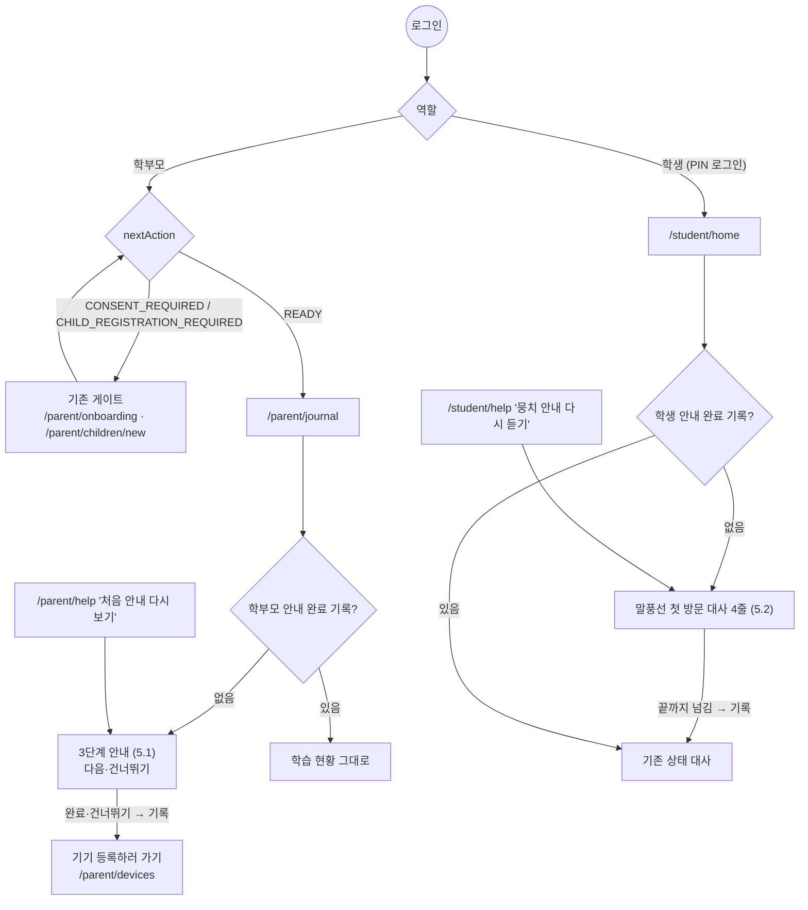

# 사용자별 첫 사용 안내(온보딩) 제안

- 상태: **제안(2026-11-25)**, 도입 미결정. 같은 날 코드 재검증 결과 반영(학생은 기존 홈 말풍선 재사용, 학부모는 기기·PIN 우선, 관리자 제외). 열린 결정은 7장, 확인 필요 가정은 8장.
- 영향 범위: web presentation 레이어만. 학생 홈 말풍선 대사(`StudentHome.tsx`의 `lines()`), 학부모 화면 틀(`ParentWorkspace`)의 단계 안내. 완료 상태를 서버에 저장하기로 하면(7.1 B안) core migration·API 추가 필요.
- 근거: [사용자 흐름도](../design/user-flow.md) 2·3·8절, [유스케이스](../design/usecase.md), 웹 라우트(`frontend/web/src/presentation/router.tsx`)와 역할별 메뉴·화면 코드.
- 대상 구분: **학생·학부모 역할별로만** 나눔. 관리자는 범위 밖(2장). 무료/프리미엄·학년·로그인 수단에 따른 차이는 8장 가정에만 기록.
- 표기: **[확인]** 은 2026-11-25 `origin/develop`(9d5ce903) 코드·문서에서 직접 본 사실, **[추정]** 은 설계상 가정.

## 1. 목적

역할별 기본 화면에 처음 들어온 사용자에게 첫 번째 할 일과 핵심 메뉴를 짧게 안내함. 지금은 학부모 동의·자녀 등록 게이트만 있고 그 뒤 안내가 없어, 첫 주에 "무엇부터 하면 되는지"를 사용자가 스스로 찾아야 하는 상태임. 12/7 배포는 데모 계정만 운영하지만 새로 가입한 Google 학부모도 데모 계정으로 저장되므로(`docs/report/infra.md` 시연 계정 행), 평가자처럼 처음 쓰는 사용자가 실제로 생김.

| 역할 | 첫 주에 해야 할 일 | 안내 목표 |
|---|---|---|
| 학부모 | 아이 기기 등록·PIN 확인 → 학습 현황·리포트 확인 | 기기 등록을 먼저 하게 하고, 리포트 위치를 앎 |
| 학생 | 오늘 문제 풀기 → 미션 완료 | 요일 칩·내 공책·내 방이 무엇인지 앎(다음 할 일은 기존 말풍선이 이미 안내) |

## 2. 범위

| 구분 | 내용 |
|---|---|
| 범위 | 학부모: 기본 화면 첫 진입 때 3단계 안내, 건너뛰기, 도움말에서 다시 보기. 학생: 기존 홈 말풍선에 첫 방문 대사 추가, 도움말에서 다시 보기 |
| 범위 밖 | **관리자 안내**(팀 내부 운영자이고, 운영 홈에 이미 "운영 대기 현황"이 있으며, 관리자 화면에는 도움말 진입 링크가 없어 다시 보기를 둘 곳이 없음). 기존 동의·자녀 등록 게이트(`/parent/onboarding`·`/parent/children/new`) 변경, 역할 안 세부 분기(무료/프리미엄·학년·로그인 수단), 화면별 상세 도움말, 새 화면설계서 ID 부여, 동영상 안내, 외부 투어 라이브러리 |

## 3. 확인한 사실

### 3.1 현재 온보딩: 학부모 동의·자녀 등록 게이트

- **[확인]** 로그인 응답 `nextAction`으로 학부모 첫 화면이 갈림. `CONSENT_REQUIRED` → `/parent/onboarding`, `CHILD_REGISTRATION_REQUIRED` → `/parent/children/new`(받은 이관이 있으면 `/parent/transfers`), `READY` → `/parent/journal` ([사용자 흐름도 2절](../design/user-flow.md#2-전체-지도), `AuthService.kt`).
- **[확인]** `RoleLayout.tsx`가 동의·자녀 등록을 마치지 않은 학부모를 `startPath`로 돌려보냄. 두 경로 모두 `AuthOnboarding.tsx` 한 화면("이용 안내·필수 동의" 또는 "자녀 등록")이 그림. 자녀 등록은 별명·학년만 받고, 등록이 끝나면 바로 `startPath`(보통 `/parent/journal`)로 감. 기기·PIN 안내는 없음.
- **[확인]** 이 동의 화면에는 화면설계서 v2.1 화면 ID가 없음([사용자 흐름도 7절](../design/user-flow.md#7-확인-필요-가정)).
- **[확인]** 튜토리얼·코치마크 관련 코드·문서 없음.

### 3.2 이미 있는 안내

- **[확인]** 학생 홈 말풍선(`StudentHome.tsx` `lines()`, 규칙 기반)이 홈 상태에 따라 다음 할 일을 이미 말함. 예: "오늘 문제를 풀면 단서가 하나 더 생겨!", "월·화 문제를 아직 안 풀었어. 아래 요일을 눌러 골라 풀 수 있어!", "쓰던 답이 저장돼 있어. 이어서 써 볼까?". 마지막 줄은 늘 장소 인사임.
- **[확인]** 말풍선은 캐릭터를 누를 때마다 다음 대사로 넘어감(`HomeScene.tsx`, `lines[talk % lines.length]`). 그래서 대사 배열 앞에 몇 줄을 더하면 같은 부품으로 첫 방문 안내를 할 수 있음.
- **[확인]** 학부모 학습 현황은 조회 기간에 기록이 없을 때(`NO_RECORD`)만 "첫 학습 준비 · {별명}의 기기·PIN 설정" 링크를 보여 줌(`ParentDashboard.tsx`). 기록이 생긴 뒤에는 기기 안내가 없음.
- **[확인]** 관리자 운영 홈(`AdminReviewHome.tsx`)은 "운영 대기 현황"과 테마 검수·게시 대기 목록을 보여 줌.

### 3.3 "처음 한 번" 보여 주는 기존 패턴

- **[확인]** 학생이 그 주 처음 "오늘 문제 풀기"를 누르면 시작 영상(`/student/theme/intro`, 건너뛰기 있음)이 나옴([사용자 흐름도 3.2](../design/user-flow.md#32-학생)).
- **[확인]** 새 기념 액자 안내는 앨범 진입·알림 닫기 때 서버에 확인(`seen`)을 남겨 다시 뜨지 않게 함.
- **[확인]** 웹은 지금 `sessionStorage`만 씀(`apiClient.ts`·`studentSession.ts`·`checkoutStorage.ts`). `localStorage` 사용처 없음.

### 3.4 기본 화면·메뉴·도움말

| 역할 | 기본 화면 | 메뉴 (코드 기준) | 도움말 진입 |
|---|---|---|---|
| 학생 | `/student/home` (SC-02-004 홈 "우리 집") | 홈·내 방·내 공책·생각 활동·친구 생각·설정 6개 (`StudentWorld.tsx`) | 메뉴의 "이용 도움말" → `/student/help` |
| 학부모 | `/parent/journal` (SC-03-001) | 학습 현황·리포트·AI 챗봇·계정·자녀 설정·기기·PIN·이용권·결제 5개 (`parentNavigation.tsx`). 자녀 전환은 상단 공통 | "이용 지원"의 "도움말" → `/parent/help` (`Workspace.tsx` `ServiceLinks`) |
| 관리자 | `/admin/home` (SC-04-001) | 운영 홈·감사 이력 + 권한별 메뉴 (`AdminWorkspace.tsx`) | **진입 링크 없음**. `/admin/help` 라우트는 있으나 주소 직접 입력으로만 열림 |

- **[확인]** 학부모 '계정·자녀 설정'의 '공개·동의' 탭은 공개 **동의**만 받음. 실제 공개는 자녀가 학생 설정에서 직접 켜야 함(`ConsentSettings.tsx`).
- **[확인]** 아이 화면에는 결제 유도 문구를 넣지 않음([사용자 흐름도 3.2](../design/user-flow.md#32-학생) 아래 규칙).

## 4. 공통 규칙

| 항목 | 학부모 | 학생 |
|---|---|---|
| 표시 시점 | `READY`가 된 뒤 `/parent/journal`에 처음 들어왔을 때 | PIN 로그인 뒤 `/student/home`에 처음 들어왔을 때. 시작 영상·오늘 장면·문제 화면에는 넣지 않음 |
| 표시 형태 | 메뉴·버튼을 강조하는 말풍선 단계 안내. 한 단계 = 강조 요소 1개 + 문구 1~2줄 + "다음"·"건너뛰기" | 기존 홈 캐릭터 말풍선. 새 부품 없이 대사 배열 앞에 첫 방문 대사를 붙임 |
| 단계 수 | 3단계 | 첫 방문 대사 4줄 + 기존 상태 대사 |
| 완료 처리 | 마지막 단계 완료 또는 "건너뛰기" | 첫 방문 대사를 끝까지 넘겨 기존 상태 대사가 나왔을 때 |
| 다시 보기 | `/parent/help` 맨 위 "처음 안내 다시 보기" | `/student/help` 맨 위 "뭉치 안내 다시 듣기" |
| 화면 크기 | 강조 요소가 접힌 메뉴 안에 있으면 "메뉴를 열면 있어요"처럼 위치를 말로 안내 | 해당 없음(말풍선 위치 그대로) |
| 접근성 | [사용자 흐름도 8.5](../design/user-flow.md#85-학생학부모-접근성-보완-639640641) 기준 준용: 단계 전환 때 안내 제목으로 초점 이동, Esc로 건너뛰기, 버튼 44px 이상, 명도 대비 4.5:1 이상 | 기존 말풍선 접근성 그대로("내 캐릭터에게 말 걸기" 버튼) |
| 문구 | 기존 학부모 화면 존댓말 | 초3 눈높이 반말, 결제·프리미엄 안내 없음 |
| 데이터 | 웹 정적 데이터. 서버 응답에 따라 문구를 바꾸지 않음 | 같음 |

## 5. 역할별 안내

문구는 초안이고, 실제 화면 문구는 구현 이슈에서 화면 담당이 다듬음.

### 5.1 학부모 (`READY` 뒤 `/parent/journal`)

| 순서 | 강조 요소 | 안내 문구 초안 | 다음 행동 |
|---|---|---|---|
| 1 | 메뉴 '기기·PIN' | "아이가 학습할 기기를 먼저 등록해 주세요. QR을 찍고 PIN을 정하면 아이가 바로 시작할 수 있습니다." | 다음 |
| 2 | 메뉴 '학습 현황'·'리포트·AI 챗봇' | "아이가 푼 문제와 답은 학습 현황에서, 일일·주간 리포트와 AI 챗봇 질문은 리포트에서 봅니다." | 다음 |
| 3 | 메뉴 '계정·자녀 설정' | "친구들과 답을 나누려면 여기서 공개에 동의해 주세요. 공개는 아이가 직접 켭니다." | **기기 등록하러 가기**(`/parent/devices`) / 나중에 |

- 기기 등록을 1단계에 두는 이유: 학부모가 기기를 등록해야 아이가 PIN으로 로그인할 수 있음([사용자 흐름도 3.2](../design/user-flow.md#32-학생) 진입). 마지막 버튼도 같은 곳으로 보내 첫 할 일을 분명히 함.
- 기존 `NO_RECORD` 빈 화면 링크는 그대로 둠(안내를 건너뛴 학부모에게 같은 길을 다시 보여 줌).
- 자녀 전환은 자녀가 둘 이상일 때만 의미가 있고 상단에 늘 보여 단계에서 뺌. '이용권·결제'는 첫 주 할 일이 아니고 무료/프리미엄 분기가 범위 밖이라 뺌.

### 5.2 학생 (첫 PIN 로그인 뒤 `/student/home`)

첫 방문이면 `lines()` 결과 앞에 아래 대사를 붙임. 캐릭터를 누를 때마다 다음 줄로 넘어감.

| 순서 | 대사 초안 | 가리키는 곳 |
|---|---|---|
| 1 | "안녕! 나는 너랑 같이 생각할 친구야. 나를 누르면 이것저것 알려 줄게." | 캐릭터 |
| 2 | "아래 요일 칩 보여? 월요일부터 금요일까지 하루에 한 문제씩 열려." | 요일 칩 |
| 3 | "네가 쓴 답은 위쪽 '내 공책'에 모두 남아." | 메뉴 '내 공책' |
| 4 | "집을 누르면 내 방에 갈 수 있어. 문제를 풀면 포인트로 방을 꾸밀 수 있어!" | 우리 집 장면 |
| 이어서 | 기존 상태 대사(예: "오늘 문제를 풀면 단서가 하나 더 생겨!") → 장소 인사 | 홈 상태별 버튼 |

- 다음 할 일(오늘 문제·안 푼 문제·이어하기·주말 되돌아보기)은 기존 상태 대사가 홈 8가지 상태에 맞춰 이미 말하므로 첫 방문 대사에 넣지 않음.
- 생각 활동·친구 생각·설정은 넣지 않음(첫 주 할 일이 아니고, 친구 생각은 미션을 마쳐야 열림).
- 캐릭터를 한 번도 누르지 않으면 1번 대사만 보이고 완료로 기록되지 않아, 다음 홈 진입 때 다시 1번부터 나옴 **[추정]**. 매번 보이는 것이 거슬리면 7.4에서 횟수 상한을 정함.

## 6. 흐름도

## 7. 열린 결정

### 7.1 완료 상태 저장 위치

| 안 | 내용 | 장점 | 단점 |
|---|---|---|---|
| **A (권장)** | 브라우저 `localStorage`, 키 `onboarding:{role}:{userId}:v1` (학생은 학생 ID) | 백엔드·API·migration 변경 없음. 학생 공용 기기에서도 형제를 학생 ID로 구분 | 기기·브라우저를 바꾸면 다시 표시. 저장소가 막힌 환경은 매번 표시(try/catch로 실패해도 화면은 정상) |
| B | core에 사용자별 완료 시각 저장(`user_account` 컬럼 또는 별도 표) + 조회·기록 API | 기기와 무관하게 1회 | core migration·공개 API·api-spec·erd 갱신 필요, 학생 세션 경로 추가 |

- 권장 근거: 12/7 시연은 데모 계정만 운영하므로 기기 간 일관성보다 변경 범위가 작은 쪽이 맞음. 키에 `v1`을 넣어 안내 내용이 크게 바뀌면 한 번 더 보여 줄 수 있음.

### 7.2 학부모 표시 형태

| 안 | 내용 |
|---|---|
| **말풍선 단계 안내 (권장)** | 실제 메뉴를 강조하고 옆에 문구. 3단계라 공통 컴포넌트 하나로 충분 |
| 첫 화면 안내 카드 | 학습 현황 위 카드 한 장에 3줄 요약 + "기기 등록하러 가기". 구현은 더 쉽지만 메뉴 위치를 직접 보여 주지 못함 |

### 7.3 시연 계정 처리

- 시연자가 데이터를 미리 넣어 둔 계정으로 처음 접속하면 시연 도중 안내가 뜰 수 있음. **시연 전에 시연용 브라우저로 각 계정에 한 번 들어가 안내를 끝내 둠**(A안이면 브라우저마다 따로 기록되므로 시연에 쓸 그 브라우저에서 해야 함).
- 안내 자체를 보여 주는 시연은 도움말의 "다시 보기"로 시작함. A안이면 브라우저 저장소 삭제로도 초기화됨. 별도 관리자 초기화 기능은 두지 않음.

### 7.4 학생 첫 방문 대사 반복 상한

- 캐릭터를 누르지 않는 학생에게 1번 대사가 홈에 들어올 때마다 나옴(5.2). 권장: 상한 없이 둠(1번 대사도 "나를 누르면 알려 줄게"라 할 일이 분명하고, 기존 상태 대사는 두 번째 줄부터 이어짐). 거슬린다는 피드백이 있으면 홈 진입 3회 뒤 완료로 기록.

## 8. 확인 필요 가정

| 가정 | 지금 판단 | 확인할 것 |
|---|---|---|
| 무료/프리미엄 차이 | 안내에 넣지 않음(학생은 결제 문구 금지 규칙과도 맞음) | 학부모 안내에 이용권 단계를 넣을지 |
| 학년 차이 | 넣지 않음 | 초5·6 논술 입력 틀 안내가 필요한지 |
| 학부모 로그인 수단(Google·아이디) | 넣지 않음 | 본인 재확인 방식 차이를 안내할지 |
| 학생 첫 방문 대사 위치 | 기존 상태 대사 앞 | 첫날 바로 오늘 문제로 가게 하려면 상태 대사를 앞에 둘지 |
| 관리자 | 범위 밖 | 외부 운영자가 생기면 관리자 화면에 도움말 링크부터 추가할지 |
| 화면설계서 | 새 화면 ID 없음(오버레이·대사 추가) | 화면설계서 v2.x에 안내 상태 캡처를 추가할지 |
| 일정 | 미정 | 12/7 시연 전 구현 여부 |

## 9. 후속 작업 후보

도입이 정해지면 아래로 나눠 이슈를 만듦. 기능 명세(FN-)·사용자 흐름도 반영은 도입 결정 뒤 `docs/design/`에 함.

| 영역 | 내용 |
|---|---|
| web 공통 | 완료 기록 저장(7.1 결정안), 도움말 "다시 보기" 버튼(학생·학부모) |
| web 학부모 | 단계 안내 컴포넌트(강조·초점 이동·Esc·건너뛰기)와 5.1 단계 데이터 |
| web 학생 | `lines()` 앞 첫 방문 대사 4줄, 상태 대사에 도달하면 완료 기록 |
| 테스트 | MSW 화면 확인, Playwright e2e(`tests/e2e/support/onboarding.ts`의 `onboardParent` 뒤 안내 표시·건너뛰기·기기 화면 이동·다시 보기, 학생 첫 홈 대사 넘기기) |
| 설계 반영 | `docs/design/user-flow.md` 3.1·3.2 흐름에 안내 분기 추가, B안이면 api-spec·erd |
