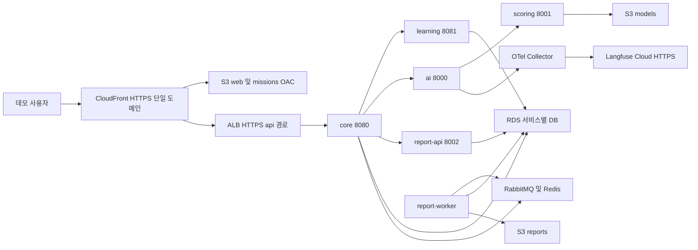

# AWS 데모 운영 구성과 실행 승인 검토안

2026-11-02 KST 기준, 이슈 #185의 독립 계획 초안이다. 기존 설계·앱·chart를 수정하지 않았으며 AWS 자원 생성, Organizations·Identity Center 활성화, 배포, 가입, Secret 등록, 시험 전송은 하지 않았다. 구성 방향의 확정과 실제 실행 승인은 별개다.

**결론:** 서울 On-Demand 노드 2대와 Single-AZ RDS를 동일하게 사용해 비교하면, 240시간 집중 가동·장기 휴지기 재구성안도 세금·도메인·종료 후 보존·예비비를 포함해 약 **41.8만원**이 필요하다. 30만원은 현재 비교 일정에서 충족하지 않는다. 인프라를 39일 유지하면 약 **64.9만원**이다. 중간발표 AWS 사용을 제외하고 한 번의 96시간 가동으로 줄일 수 있을 때만 약 **25.7만원** 후보가 나온다. 발표 일정은 미정이며 이 대안을 확정 일정으로 사용하지 않는다.

단가·SKU·조회한 공식 가격표·수량·계산식·환율 민감도는 [견적 데이터](issue-185-aws-estimate.json)에 보관한다. 금액은 청구액이 아니라 아래 조건의 계획치다. 실제 LLM API 사용료는 사용자의 2026-11-02 답변에 따라 **별도 예산**이다.

## 1 확정 결정과 조사 기준

| 항목 | 이번 계획 기준 |
|---|---|
| 사용자와 책임 | 현재 사용자는 동섭, PM은 태윤. 사용자를 태윤으로 간주한 인계는 사용하지 않음 |
| 계정 | 2026-11-02 후속 요청: 현재 지급된 AWS 계정으로 먼저 연결하고, 추가 지급 계정으로 변경 가능하도록 입력을 분리. 계정ID·소유/권한·기존 자원은 로그인 후 확인 필요 |
| 로그인 | 개별 로그인·동일 역할 구성이 목표. 지급 기관의 기존 IAM/SSO 방식을 우선 확인하고 Identity Center 활성화 권한을 추정하지 않음. root·로그인 정보 공유 없음 |
| 운영 책임 | Secret·배포 승인·DNS는 동섭 기본, 태윤 대체. #186 실무는 인영, 이미지 게시·배포·복구 책임은 태윤·동섭 |
| AWS | ap-northeast-2, EKS, application/platform-observability 관리형 노드그룹, 모두 On-Demand, RDS Single-AZ |
| 데이터 | S3 Standard, 개발·검증과 분리한 데모 데이터·토스 테스트 거래만 사용 |
| 외부 관측 | Langfuse Cloud Hobby, 태윤·동섭 2명. 유료 전환·실제 원문 저장은 별도 결정 |
| 기간·예산 | 준비 시점부터 2026-12-10 종료 목표. 총 30만원 중 6만원 예비비, 24만원 견적 검토 기준. 2027-02-10까지 보존 추천안을 사용 |
| 일정 | 11/6 AWS 사용 가능성만 있음. 11/5 배포·연결 검증 준비 목표. 사용 시간·최종 발표·리허설·상시 접속 시간은 추후 결정 |
| 권한 경계 | 이번 작업은 신규 계획 문서와 계산 자료만. 실제 자원/권한/배포/삭제/유료 활성화와 commit/push/PR은 미실행 |

조사 시작 시 #185 worktree는 `feature/infra-aws-production`, HEAD `7eb829d53016818b8b769c67bfbd55b7172d4102`였다. 후속 사용자 요청에 따라 `git fetch origin develop` 후 `git merge --ff-only origin/develop`으로 최신 `26948215fa8c5e4b5308db26e2d5fbb378db57f9`를 반영했다. 전용 브랜치 고유 커밋은 없었고 56개 develop 커밋을 충돌 없이 fast-forward했다. 미추적 초안 두 파일과 새 develop의 경로가 겹치지 않음을 먼저 확인했고, 반영 전후 두 파일 SHA-256이 동일했다. index·다른 worktree는 변경하지 않았다. origin은 `SKNETWORKS-FAMILY-AICAMP/SKN34-FINAL-3TEAM`, upstream remote·작업 브랜치 추적 설정은 없다. 해당 head의 PR 검색 결과는 0건이며 PR을 생성하지 않았다. 적용 경로에서 AGENTS.md는 발견되지 않았고 대화로 제공된 규칙과 docs/README.md를 따른다.

AWS CLI는 PATH에서 발견되지 않았다. 기본 `.aws/config`, `.aws/credentials`, AWS 환경변수 메타데이터도 발견되지 않았다. 계정ID·권한·리소스·할당량·프로필은 미확인이다. 자격 증명 파일 내용이나 Secret 값을 읽지 않았다. 공식 공개 가격표 다운로드는 인증 없이 수행했다.

| 관련 작업 | 최신 읽기 근거와 실제 경계 |
|---|---|
| #171 | 이슈 closed, PR #204 병합, 코드가 최신 develop에 존재. local Argo 하위 앱 10개 Synced/Healthy, 실제 API 5개 Ready·migration 완료 기록. 모델 버킷은 비어 있었고 실제 모델·사용자 로그인·LLM·PDF·SSE 종료·Cloud 저장은 별도 미검증 |
| #186 | 원격 `feature/cd-release-186` SHA `8d8922d685b1a6801df7a7cbd506046d41878dea`, 이슈 open. 배포·승인·digest·호환 앱 복구 코드와 로컬 회귀 결과 있음. AWS/GitHub 승인/실제 배포·복구는 미실행. 최신 develop에는 아직 이 workflow 없음 |
| #187 | 전용 worktree HEAD `24f5b97`, 조회 시 clean, 이슈 open. 관측 chart opt-in 연결과 수집 장애/전체 ready backlog 경보 검증 기록. 실제 Discord·Kubernetes 정책·업무별 지표·월 비용 공급·단일 trace는 미완료 |

근거: [최신 develop](https://github.com/SKNETWORKS-FAMILY-AICAMP/SKN34-FINAL-3TEAM/tree/26948215fa8c5e4b5308db26e2d5fbb378db57f9), [#171 보고서](https://github.com/SKNETWORKS-FAMILY-AICAMP/SKN34-FINAL-3TEAM/blob/26948215fa8c5e4b5308db26e2d5fbb378db57f9/docs/report/issue-171-app-deployment.md), [#186 보고서](https://github.com/SKNETWORKS-FAMILY-AICAMP/SKN34-FINAL-3TEAM/blob/8d8922d685b1a6801df7a7cbd506046d41878dea/docs/report/issue-186-cd-release.md), [#187 이슈](https://github.com/SKNETWORKS-FAMILY-AICAMP/SKN34-FINAL-3TEAM/issues/187). 다른 worktree·index·클러스터·채팅은 변경하지 않았다.

## 2 자원과 연결 흐름

그림은 대표 경로이며 NetworkPolicy 허용 목록은 최신 API 4장과 chart를 함께 대조한다. report-worker→core/learning/ai, AI→core 활성 버전, scoring→core 활성 모델, 삭제 완료 보고·브로드캐스트 큐도 유지한다. 공개 진입은 core `/api`뿐이며 `/internal`, RabbitMQ 관리, Grafana, Argo를 사용자용 도메인에 공개하지 않는다.

| 자원·소유 | 구성 후보 | 입력·출력과 소비자 |
|---|---|---|
| VPC #185 | 2 AZ public(ALB·NAT)/private(EKS·RDS), NAT 단일 AZ 1개, S3 Gateway Endpoint | 실제 CIDR·AZ는 계정/VPN 중복 확인 후. subnet·SG·route를 EKS/RDS/LB Controller에 제공 |
| EKS #185 | 1.35 후보, VPC CNI NetworkPolicy, CoreDNS, kube-proxy, EBS CSI, IRSA. standard support | #171과 같은 minor 후보. 실제 eksctl/add-on/AMI 버전은 설치 전 서울 지원 목록으로 고정. Auto Mode·유료 managed Argo capability는 사용하지 않음 |
| application #185 | m6i.xlarge 1대, 4 vCPU/16GiB, root gp3 50GiB, min/desired 1, max 2 후보 | x86_64 linux/amd64 #186 이미지 사용. 증설 1대는 기본 견적 외 추가비이며 활성화 전 한도/부하 판단 |
| platform-observability #185 | m6i.large 1대, 2 vCPU/8GiB, root gp3 30GiB, min/desired/max 1 후보 | RabbitMQ·Redis·Collector·Prometheus·Grafana·Argo·운영 controller. Langfuse DB/ClickHouse/worker 없음 |
| RDS #185 | PostgreSQL 17 계열 지원 minor 확인, db.t4g.medium 2 vCPU/4GiB, gp3 20GiB, Single-AZ, private, 암호화 | core_db/learning_db/report_db별 계정. migration 계정과 runtime 권한 분리, RDS master를 앱에 주입하지 않음 |
| gp3 #185/#171 접점 | 암호화, WaitForFirstConsumer, reclaimPolicy Retain, 확장 허용. Rabbit 10GiB/Redis 2GiB/Prometheus 10GiB/Grafana 2GiB | 합계 24GiB. 관측 PVC 및 배치 옵션은 기존 chart에 없으므로 승인 후 보완 필요. EBS는 AZ 종속 |
| S3 #185 | 아래 4버킷, Standard, Block Public Access, TLS, OAC 및 서비스별 IRSA | 이름의 계정ID와 사용 가능 여부는 생성 전 확인. 앱 계정·키와 로컬 MinIO 분리 |
| Secrets #185 | 승인 원본→Secrets Manager→namespace별 External Secrets, IRSA·필요 ARN 제한 | platform/platform-data-credentials, app/app-service-credentials, observability/observability-credentials 이름 재사용. key mapping은 prod 전용 |
| ECR·OIDC #185 | 앱 5종+core/learning migration 2종, immutable tag·digest, 이전 승인 이미지 보존 | #186에 prefix/role/region 전달. node role은 pull, CI role은 지정 repo push만. 생성·삭제·IAM 변경 권한 없음 |
| 웹 게시 #185/#186 접점 | 검증한 web 산출물을 승인 후 S3에 수동 게시, index와 asset hash manifest 보관, 필요한 invalidation | #186은 현재 웹 build만 수행. 별도 workflow를 중복 작성하지 않고 최초 bootstrap/웹 갱신 절차를 인계 |

EKS 1.35는 현재 공식 표에서 표준 지원 종료가 2027-03-27로 제시된다. 1.34는 2026-12-02 종료여서 이번 가동 기간 중 추가 요금 위험이 있다. 확정 설치 버전은 실행 승인 시 재조회한다. [EKS 버전 표](https://docs.aws.amazon.com/eks/latest/userguide/kubernetes-versions.html)

두 그룹 각 1대는 비용 후보이며 고가용성 보장이 아니다. core/learning/AI Pod 최소 2개를 두어도 같은 application 노드에 함께 놓이면 노드 장애를 견디지 못한다. NAT·RDS·RabbitMQ·Redis도 단일 장애 지점이다. HA가 필요하면 추가 노드·AZ·DB 비용과 기존 설계 변경을 따로 검토한다.

controller와 IRSA Pod의 DNS·regional STS 443, External Secrets의 Secrets Manager 443, LB Controller의 AWS API, node의 ECR/API·S3 이미지 pull 경로도 허용 목록에 포함한다. S3 gateway endpoint는 S3만 처리하며 STS/ECR API·LLM·토스·Langfuse를 대신하지 않는다. RDS 5432는 승인된 앱/migration 노드·Pod 경계에서만 허용하고 public endpoint를 열지 않는다. Kubernetes API는 private 접근+관리자의 제한된 public CIDR 후보로 시작하며, private-only를 택하면 운영자/runner의 별도 접근 수단 비용을 먼저 확정한다.

### 노드와 DB 크기의 근거

local #171의 약 5.5GiB 노드 사용 표본은 **빈 활성 모델·worker 0개** 상태이므로 운영 상한이 아니다. #85에는 실제 2.0 모델 2개(각 가중치 442,524,276 bytes)를 로딩한 기록이 있으며 별도 probe 최대 RSS는 1,172,360KiB, 컨테이너 단일 표본은 552.7MiB다. 측정 대상이 다르고 동시 요청·hot swap 최대값이 아니다.

최신 `ml/m2/README.md`는 서비스용 3.0·논술 3개 영역을 설명하지만 `backend/scoring-service/app/model_loader.py`는 현재 `num_labels == 9` 회귀 모델을 요구한다. 승인 artifact·출력 형식·metadata·scope를 서비스 담당이 확정해야 한다. #185에서 로더를 수정하거나 2.0을 운영 승인 모델로 임의 선택하지 않는다. [모델 근거](https://github.com/SKNETWORKS-FAMILY-AICAMP/SKN34-FINAL-3TEAM/blob/26948215fa8c5e4b5308db26e2d5fbb378db57f9/docs/report/issue-85-scoring-model-registry.md)

application의 시작 자원 후보는 core 2×768MiB, learning 2×768MiB, AI 2×384MiB, scoring 2GiB, report-api 512MiB, worker 1GiB requests(합계 약 7.25GiB)다. scoring limit 4GiB 후보에 이전·새 모델 동시 보유와 추론 여유를 둔다. worker는 0–1/prefetch 1부터 시험하고 고정 처리량으로 단정하지 않는다. migration·DaemonSet·이미지 unpack·rolling surge 여유를 더해 16GiB 후보로 잡았다. local 값을 그대로 복사하지 않는다. CPU requests/limits와 최대 replicas는 실제 부하 후 확정한다.

platform 8GiB는 RabbitMQ limit 2GiB·Redis 256MiB, Collector 256MiB, Prometheus 1GiB, Grafana 512MiB와 Argo/controller/시스템 여유를 전제로 한다. 모든 limit 합계를 사용량으로 간주하지 않으며 동시 시작/재시작 측정이 필요하다. Grafana의 기존 local 기동 CPU 보완도 유지한다.

| 후보 | 단가 | 판단 |
|---|---:|---|
| application m6i.large 8GiB | $0.118/h | xlarge 대비 240h에 $28.32 절감하나 위 requests와 시스템 여유를 수용하지 못할 수 있음. 모델·replica 축소 허락 없이 채택하지 않음 |
| application m6i.xlarge 16GiB | $0.236/h | 기본 견적 후보. 실제 모델·surge 검증 전 충분하다고 확정하지 않음 |
| RDS db.t4g.small 2GiB | $0.051/h | 240h에 $12.24 절감. 다중 서비스 pool·migration·backup 경합 검증 필요 |
| RDS db.t4g.medium 4GiB | $0.102/h | 기본 견적. 서비스별 pool·총 connection 제한과 메모리를 함께 확인 |
| RDS db.t4g.large 8GiB | $0.203/h | 240h에 $24.24 추가. 측정 결과 필요할 때만 별도 승인 |

RDS T4g는 Unlimited CPU credit 추가 요금 $0.075/vCPU-hour가 가능하다. 견적에는 10 excess vCPU-hour($0.75)를 계획 여유로 넣었으며 사용량 보장이 아니다. EC2는 burst credit 의존을 피하려고 M6i로 계산했다. [RDS 요금](https://aws.amazon.com/rds/postgresql/pricing/)

### S3와 공개 경로

- `sagomungchi-demo-<계정ID>-web`, `-missions`, `-reports`, `-models` 4개. `<계정ID>`는 미확정 입력 표기이며 배포 가능한 이름이 아니다.
- web/missions는 S3 REST origin+OAC로 연결한다. missions URL prefix와 업로드 주체는 실제 미션 데이터와 대조한다. S3 website endpoint·public ACL은 사용하지 않는다.
- `/api`와 `/api/*`는 ALB, all methods, 캐시 TTL 0, 압축 비활성, query/cookie 및 Authorization·Idempotency-Key·If-Match·X-Reauth-Token·Origin·X-Requested-With·Content-Type·Accept·traceparent 전달. Authorization은 CloudFront 정책 제약에 맞게 전달 검증하며 임의 header allowlist만으로 보장하지 않는다.
- 웹 SPA fallback은 웹 경로에만 적용한다. API 403/404를 index.html로 바꾸지 않는다. `/internal`·운영 UI는 외부에서 차단한다.
- viewer HTTPS와 origin HTTPS를 사용한다. CloudFront 인증서는 us-east-1, ALB 인증서는 서울에 필요하다. 국내 DNS의 CNAME을 쓸 수 있는 서브도메인이 단순한 후보이며 apex 사용은 업체의 ALIAS 지원을 확인한다. Route53 이전은 기본안에 포함하지 않는다. [인증서 리전](https://docs.aws.amazon.com/AmazonCloudFront/latest/DeveloperGuide/cnames-and-https-requirements.html)
- origin read timeout 60초·ALB idle 120초, 15초 heartbeat를 유지한다. 전체 response completion timeout을 60초로 설정하면 120초 분석/5분 알림 SSE가 끊길 수 있으므로 별도 설정을 검토한다. 최근 core의 토스 거래 대조 호출은 60초 응답 대기 가능성이 있어 CloudFront 60초 경계의 비SSE 요청도 시험 대상이다. 기존 timeout/API를 무단 수정하지 않는다.
- ALB SG는 CloudFront origin-facing prefix list 및 전용 origin header 조건을 검토한다. prefix list만으로 특정 배포를 식별하지 못하므로 우회 차단을 실제 시험한다. origin header 비밀 값이 Ingress annotation/Git에 들어가지 않도록 주입 방법을 먼저 정한다. #133에는 실제 X-Forwarded-For/신뢰 proxy 경로를 제공한다.
- reports는 기존 core 권한 확인→report-api의 단기 presigned URL 계약을 유지한다. reports/models를 CloudFront 공개 behavior에 추가하지 않는다. presigned 다운로드는 브라우저가 S3 public endpoint를 사용하므로 reports 버킷을 무조건 VPC endpoint 전용으로 제한하면 다운로드가 깨진다. Block Public Access와 인증된 서명 요청을 구분한다.
- scoring은 models read, report-worker는 reports 쓰기·필요 삭제, report-api는 서명·읽기 등 실제 호출별 IRSA 최소 권한. S3_ENDPOINT_URL/S3_PUBLIC_ENDPOINT_URL 로컬 override·MinIO 정적 AWS 키는 제거한다. S3 Standard는 모델 다운로드·CPU 로딩·추론 또는 사용자 다운로드 전체 성능을 보장하지 않는다.

## 3 로그인과 Secret 공급

Identity Center organization instance의 AWS account access를 사용하는 안을 제안한다. account instance는 AWS 관리 앱 접근용과 구분해야 한다. 계정이 하나여도 Organizations 상태와 account access 설정을 확인하고, 필요 활성화는 태윤·동섭의 실행 승인 목록에 넣는다. 신규 member account를 자동 추가하지 않는다. [공식 구분](https://docs.aws.amazon.com/singlesignon/latest/userguide/organization-instances-identity-center.html)

두 사람에게 동일하게 `DemoOperations`와 `DemoBootstrapAdmin` permission set을 제안한다. 일상 역할은 프로젝트 자원 조회, 승인된 EKS/nodegroup·RDS start/stop, 제한된 ECR/S3 게시, 필요한 Secret 관리, 비용 조회 및 EKS RBAC를 갖는다. 초기 역할은 VPC/EKS/IAM/OIDC/Identity Center 등 구성에 필요한 관리자 역할로 짧은 세션·MFA·변경 기록을 요구한다. billing/identity/광범위 IAM/데이터 삭제 권한은 일상 역할에 포함하지 않는다. 역할 분리는 사람별 권한 차등이 아니며 root는 초기 계정 보호·복구용으로만 둔다.

Secrets Manager에는 값이 아닌 ARN·JSON key 계약만 Git으로 관리한다. namespace별 SecretStore/ExternalSecret를 통해 필요한 키만 공급하고 앱에 Secrets Manager 전체 조회 권한을 주지 않는다. Secret 8개는 견적 수량 가정이며 실제 분류가 늘면 비용을 다시 계산한다.

| 공급 대상 | 반드시 대조할 계약 |
|---|---|
| platform | `RABBITMQ_USER`·`RABBITMQ_PASSWORD`. 앱의 `RABBITMQ_USERNAME` 키와 이름 변환 필요. prod PostgreSQL/MinIO는 비활성 |
| core·learning | 서로 다른 DB 사용자/비밀번호·runtime 권한. env의 DB_USERNAME/DB_PASSWORD는 유지하되 Secret key를 서비스별로 매핑 가능. Flyway는 승인된 별도 DDL 계정 |
| report | `REPORT_DATABASE_URL`은 URL 인코딩, `REPORT_ALEMBIC_DATABASE_URL`은 Alembic ConfigParser용 `%`→`%%` 별도 처리. 같은 원본 계정 또는 승인된 migration 계정에서 생성, 실제 Alembic 경로 검증 |
| 공통·외부 | INTERNAL_TOKEN·AUTH_JWT_SECRET·Google OAuth·토스 테스트 일반/빌링 키·MID·빌링 암호화 키·LLM 키. 역할별 pod에 필요한 값만 env 주입 |
| 관측 | Grafana 계정, Langfuse project public/secret key와 Collector Basic Authorization, #187 Discord webhook 참조. 값·인증 header 로그 금지 |
| #186 | ARGOCD_TOKEN과 CD_SMOKE_FIXTURE는 GitHub Environment Secret. 승인된 데모 fixture만 사용; AWS 장기 access key는 저장하지 않음 |

AUTH_WEB_ORIGIN은 실제 HTTPS 도메인, AUTH_COOKIE_SECURE=true로 설정하고 OAuth callback·토스 callback 도메인을 함께 등록한다. 재구성 후 URL/Secret 갱신과 계정 회전은 원자적으로 맞춘다. Secret 값 변경만으로 RabbitMQ·DB 계정이 자동 회전한다고 가정하지 않는다. Redis는 현재 chart에 인증 설정이 없으므로 네트워크 격리만으로 동작하는 현 상태를 기록하고 인증/TLS 강화가 필요하면 별도 변경 승인을 받는다.

## 4 Langfuse Cloud와 관측 인계

Hobby는 현재 **50,000 units/month, 2 users, 30일 data access**다. unit은 traces+observations+scores이며 HTTP 요청 수·LLM 호출 수와 같지 않다. 재시도별 generation, score·실험도 units를 늘린다. 1 trace+1 generation만 있는 단순 1회는 2 units지만 실제 합계는 Usage 화면으로 확인한다. [플랜](https://langfuse.com/pricing), [units 정의](https://langfuse.com/docs/administration/billable-units)

30일은 조회 창이고 자동 삭제 기간이 아니다. Hobby에는 유료 retention 설정이 없으며 조회 창이 지나도 삭제됐다고 간주하지 않는다. 필요한 시연 근거는 30일 이내 비식별 집계로 별도 보관하고 종료 때 프로젝트/trace 삭제 범위와 실제 삭제 절차를 확인한다. 유료 플랜으로 전환하거나 오래된 데이터 조회를 보장하지 않는다. [조회와 보존](https://langfuse.com/faq/all/data-access-vs-data-retention), [삭제](https://langfuse.com/docs/administration/data-deletion)

현재 코드의 경로는 `AI LlmClient generation → Langfuse 4.18.0 SDK → OTLPSpanExporter → Collector :4318/v1/traces → otlp_http/langfuse → Cloud /api/public/otel/v1/traces`다. Collector base endpoint는 선택한 Cloud 리전 host의 `/api/public/otel`이고 exporter가 `/v1/traces`를 붙이는 계약을 확인한다. Cloud 데이터 리전·host는 서울 AWS 리전과 별개이며 아직 정하지 않았다. 프로젝트 생성·실제 전송은 미실행이다.

| 실제 확인한 코드 | 현재 보장과 남은 확인 |
|---|---|
| AI `bootstrap.py` | enabled 기본 false, 필수 키/endpoint 누락 시 오류. instrumentation scope가 langfuse-sdk인 span만 export. scope 필터는 필드 allowlist가 아님 |
| AI `llm/base.py` | 수동 start_observation/update. model, callType, promptVersion, token usage, 오류 code만 명시. input/output·user ID·원문 예외 메시지를 넣지 않음. traceparent 연결 |
| AI `tests/llm/test_base.py` | 메모리 exporter에서 합성 프롬프트/답변/학생 ID/스트림 출력 비포함 검사 존재. 실제 OTLP protobuf resource/events/status·Collector egress 전체 검증은 아님 |
| Collector config | memory_limiter와 batch만 존재. raw field 차단·익명화 processor 없음. 재시도 queue는 메모리여서 중지 시 유실 가능 |
| 관측 NetworkPolicy | Langfuse 내부 Pod label·3000 포트 허용. Cloud DNS/HTTPS 443 경로는 현재 허용하지 않음 |
| 비용·trace | AI가 토큰을 보냄. Cloud 모델 단가 매핑과 core usage ledger 비용 일치 여부 미검증. Java는 metrics-only, scoring/report span 공급 공백. 전체 동기·비동기 단일 trace 완료 아님 |

Cloud 연결 승인 전에는 합성 canary 문자열을 이름·연락처·답변·system/user prompt·AI 응답·예외 message·metadata·baggage에 각각 넣어 **실제 직렬화된 OTLP 전체**를 로컬 수신 대역에서 확인한다. 일반 응답, stream, retry, timeout, provider parse 오류, exporter 실패를 포함한다. #171 담당 범위에서 SDK 최종 masking 또는 Collector attribute/resource/event allowlist를 보완하고, 실패 시 raw export를 허용하지 않는지 검증해야 한다. 현재 lock의 API 지원을 확인한 뒤 적용하며 최신 문서만 보고 SDK를 자동 업그레이드하지 않는다. 공식 문서는 legacy mask가 서드파티 OTel raw span까지 처리하지 않는다고 구분한다. [masking 범위](https://langfuse.com/docs/observability/features/masking)

#185는 Cloud endpoint·Secret 공급·NAT/DNS/443 통신 인터페이스를 제공한다. VPC CNI 표준 NetworkPolicy는 FQDN 정책이 아니므로 도메인을 ipBlock에 넣거나 일회 DNS IP를 영구 고정하지 않는다. Collector만 외부 443을 허용하는 안은 모든 외부 HTTPS 목적지를 열 수 있다는 한계가 있다. 실제 destination 통제가 필요하면 별도 비용·의존성 승인을 받고 설계한다. #187의 Grafana→Discord도 같은 검토가 필요하다. Langfuse Cloud 무료 한도 접근 시 자동 유료 전환하지 않고 동섭·태윤이 사용량/샘플링·중지를 결정한다.

## 5 서울 리전 견적

### 같은 조건의 비교

- 조회일 2026-11-02. AWS 공식 Price List의 서울 지역 CSV와 CloudFront 한국 포함 Asia Pacific 요금 구간 사용. 가격표 발행일·SKU·rateCode·적용일은 JSON에 포함한다.
- 환율은 **1 USD=1,500원 계획 가정**이며 현물환율 조회값이 아니다. 1,400/1,600원 민감도도 아래에 둔다. AWS 원화 청구/카드 환율·수수료는 실제 결제 수단에 따라 다르다.
- AWS 금액에 VAT 10% 가정. 도메인은 업체/TLD 미정이므로 **연간 등록·DNS 포함 30,000원(세금 포함) 예산 배정**이지 견적 받은 가격이 아니다. [AWS 한국 VAT 표](https://aws.amazon.com/tax-help/apac-vat-rates/)
- 크레딧·무료 기간·무료 전송/CloudFront allowance·RDS 무료 backup offset은 **차감하지 않는다**. 계정 전체 사용량 확인 후만 차감 가능. Langfuse Hobby는 확정 무료 플랜 $0로 계산한다.
- 비교 운영 창은 11/2 00:00–12/11 00:00 KST 936시간(12/10 포함). 실제 시작일은 준비 완료 후이며 기간은 견적 가정이다.
- 앱/노드 active 총 **240시간**: 중간발표용 72h + 최종 발표/정리용 144h + 구축·복구 여유 24h. 예를 들어 11/4–11/6, 12/5–12/10과 대응할 수 있으나 **발표 사용·날짜·시간 확정이 아니다**. 두 시나리오의 기능 가동량은 같다.
- A: EKS/NAT/ALB/IPv4 936h 유지, 노드 240h. RDS 240h+장기 중지 관리 중 재시작 여유 8h=248h. 7일 전에 수동 확인·필요시 start/stop하지 못하면 RDS 시간이 증가한다.
- B: EKS/NAT/ALB/IPv4·RDS 240h, 두 가동 창 사이 재구성. VPC/subnet·S3·ECR·Secret·24GiB 데이터 EBS는 보존. RDS는 검증된 final snapshot 뒤 별도 승인 삭제/복원한다. 매일 삭제하는 안이 아니며 snapshot만 남긴 기간에 연속 PITR/온라인 가용성을 제공하지 않는다.
- 저장량은 S3 합계 20GB(web 1/missions 2/reports 5/models·버전 12), ECR 10GB, RDS 20GB, data EBS 24GB, root EBS 80GB. snapshot은 각각 RDS 20GB/EBS 24GB 총 과금량 가정이며 여러 full copy의 무제한 축적을 포함하지 않는다.
- 트래픽은 기간 전체 NAT 20GB, CF 다운로드 20GB·HTTPS 10만 건·origin 전송 1GB, 직접 인터넷 6GB(리포트 5+외부 서비스 1), AZ 간 과금 20GB, S3 PUT 1만/GET 10만, Secret API 2만. LCU는 active 동안 평균 1로 계산. NAT bytes와 인터넷 egress는 다른 과금이며 동시에 발생 가능하다.
- 로그 수집 3GB, 보관 평균 1GB, query scan 5GB. CloudWatch 지표/Container Insights·WAF·유료 지원·유료 Langfuse·새 상시 runner·추가 노드/디스크·백업 복제는 기본안에 없다. 로그량이 늘면 별도 계산한다.
- 종료 후 보존은 12/11 00:00–2027/2/11 00:00 1,488h(2/10 포함). RDS/EBS는 snapshot, S3/ECR/Secret/로그는 아래 크기를 유지. storage GB-month는 계산 편의를 위해 730h로 나눴으며 실제 달력 청구와 차이가 날 수 있다.

### 항목별 계산

아래 USD는 VAT 전이며 A/B 모두 같은 노드와 사용량이다. 각 묶음의 개별 수량×단가는 JSON에서 재계산할 수 있다.

| 항목 | 공식 단가·계산 조건 | A 유지 USD | B 집중 USD |
|---|---|---:|---:|
| EKS standard | $0.10/h × 936/240h | 93.60 | 24.00 |
| On-Demand 노드 | ($0.236+$0.118) × 240h | 84.96 | 84.96 |
| RDS compute | $0.102/h × 248/240h | 25.30 | 24.48 |
| RDS gp3 | $0.131/GB-month × 20GB × 사용기간 | 3.36 | 0.86 |
| RDS 운영 backup | $0.095/GB-month × 20GB × 936/730 | 2.44 | 2.44 |
| NAT 시간·처리 | $0.059/h + $0.059/GB × 20GB | 56.40 | 15.34 |
| ALB 시간·LCU | $0.0225/h + $0.008/LCU-h × 240 | 22.98 | 7.32 |
| 공인 IPv4 | $0.005/IP-h × 3(NAT 1+ALB 2) | 14.04 | 3.60 |
| EBS·snapshot | gp3 $0.0912/GB-month, snapshot $0.05 | 6.74 | 6.74 |
| S3 운영·요청 | Standard $0.025/GB-month, PUT $0.0045/천, GET $0.00035/천 | 0.72 | 0.72 |
| CloudFront | 한국 포함 AP: $0.120/GB, HTTPS $0.012/만, origin $0.060/GB | 2.58 | 2.58 |
| 직접 전송·AZ | 인터넷 $0.126/GB, AZ 과금량 $0.01/GB | 0.96 | 0.96 |
| ECR 운영 | $0.10/GB-month × 10GB × 936/730 | 1.28 | 1.28 |
| Secret 운영·API | $0.40/secret-month × 8 + $0.05/만 API | 4.20 | 4.20 |
| 로그 | ingest $0.76/GB, 저장 $0.0314/GB-month, query $0.0076/GB | 2.36 | 2.36 |
| RDS CPU credit 여유 | 10 excess vCPU-h × $0.075 | 0.75 | 0.75 |
| **12/10까지 소계** | 반올림 전 합산 | **322.67** | **182.59** |
| **종료 후 보존** | 다음 표 | **15.96** | **15.96** |
| **AWS 합계** | VAT 전 | **338.63** | **198.56** |

ALB IPv4 2개는 기본 추정이며 LB scale에 따라 늘 수 있다. S3 Gateway Endpoint로 모델·이미지 layer 다운로드의 NAT 비용을 줄이되 NAT 20GB는 외부 registry/API·bootstrap 여유를 포함한 가정이다. CF 원본 AWS→CF 전송을 일반 인터넷 전송과 중복 합산하지 않았다. CloudFront 공식 무료 allowance가 적용되면 이 표보다 낮을 수 있지만 이를 예산 충족 근거로 선차감하지 않는다. [CF 가격 구간](https://aws.amazon.com/cloudfront/pricing/pay-as-you-go/)

| 종료 후 62일 보존 항목 | 수량 | USD |
|---|---:|---:|
| RDS final snapshot | 20GB | 3.87 |
| EBS final snapshot | 24GB | 2.45 |
| S3 Standard | 버전 포함 20GB | 1.02 |
| ECR 이전 승인 이미지 | 10GB | 2.04 |
| Secret | 8개 | 6.52 |
| 비민감 로그 | 평균 1GB | 0.06 |
| **합계** | 1,488/730개월 환산 | **15.96** |

이 보존안은 12/10 이후 컴퓨팅·NAT·LB·원본 EBS 정리가 승인되고 snapshot 복원 근거를 확보한 경우다. 삭제 승인 전에는 계속 과금된다. 데이터 원본·snapshot·Secret 암호화 키를 동시에 삭제하지 않는다. 7일 자동 backup만으로 2개월 보존을 대신할 수 없으며 final/manual snapshot을 별도로 유지해야 한다. [RDS backup 구분](https://docs.aws.amazon.com/AmazonRDS/latest/UserGuide/USER_WorkingWithAutomatedBackups.html)

| 예산 판단 | A 유지 | B 집중 재구성 | C 조건부 96h 단일 창 |
|---|---:|---:|---:|
| AWS VAT 전 | $338.63 | $198.56 | $101.49 |
| AWS×1,500×1.10+도메인 3만원 | 588,744원 | 357,616원 | 197,454원 |
| 예비비 6만원 포함 필요 총액 | **648,744원** | **417,616원** | **257,454원** |
| 30만원 대비 | +348,744원 | +117,616원 | 42,546원 여유 |
| 환율 1,400~1,600원 시 총액 | 611,495~685,994원 | 395,775~439,457원 | 246,290~268,617원 |

C는 중간발표 AWS 사용 없이 72h 연속 가동+24h 구축/복구만 가능한 경우의 후보다. 48시간 사전 안정화·시연일을 포함하되 추가 리허설·상시 접속이 요구되면 적용할 수 없다. 기존 종료 목표를 당겨 확정한 것이 아니다. 스케줄 확정 후 사용시간을 다시 계산한다.

기존 격리 Linux runner를 쓸 수 있다는 가정이다. 없다면 임시 m6i.xlarge 12h+30GB root의 최소 후보는 $2.88, VAT 포함 약 4,747원 추가이고 이미지 빌드 디스크/시간에 따라 증가한다. runner 신규 설치·접근 경로는 별도 승인 대상이며 앱 노드에 임의로 Docker runner를 함께 설치하지 않는다.

### 줄일 수 있는 비용과 영향

1. 가장 큰 절감은 장기 휴지기 EKS/NAT/ALB 제거다. EKS+NAT+ALB+기본 IPv4는 $0.1965/h, 하루 약 7,781원(VAT·1,500원 환율)이다. 7일 휴지기 약 54,470원이며 compute를 이미 0으로 줄인 뒤에도 남는 금액이다.
2. B의 활성 1일 추가는 root/RDS storage를 포함해 대략 $16.18, 약 26,694원이다. 실제 창 수·재생성 검증 시간을 줄여야 24만원 기준에 접근한다. 24h 복구 여유는 이미 포함했으며 무한 재시도 예산이 아니다.
3. application large+RDS small로 모두 축소하면 240h에 VAT 포함 약 66,924원 절감하지만 B는 예비비 포함 약 35.1만원이고 모델/replica 안전성도 미확정이다. 작게 잡았다는 이유만으로 30만원 가능이라고 제시하지 않는다.
4. 종료 후 Secret 중 폐기 가능한 외부 자격 증명을 회수하고 보존 이미지/파일을 줄이는 방법은 수천~수만원 수준이다. 복구에 필요한 암호화 키·DB 계정 자료·모델·리포트는 보존 요건 확인 전 제거하지 않는다.
5. Spot, k3s, 공개 노드로 NAT 제거, 상시 자동종료 등 확정 방향을 바꾸거나 새 운영 계층을 추가하는 절감안은 채택하지 않았다. B를 유지하려면 계획상 최소 약 42만원 승인 검토가 필요하며 상한 없는 승인으로 해석하지 않는다.

## 6 구축 순서와 11월 6일 준비

현재 서울 계정 접속·도메인·예산 증액·chart 변경 승인·배포 모델·runner가 미확정이므로 11/5 완료를 보장할 수 없다. 일정이 정해지지 않은 동안 비용이 발생하는 자원을 미리 만들지 않는다.

1. **승인 전 준비:** 본 구성/예산/보존/삭제 경계 검토. 승인할 model artifact와 source SHA·#186/#187 포함 범위 확정. 기반영 수정 대상은 9절에서 좁혀 승인한다.
2. **계정 사전 확인:** 별도 로그인 가능한 SSO 구성 상태, 실제 계정ID·서울 활성화·조직/정책·EKS/vCPU/EIP 할당량·기존 자원·CIDR·MFA 확인. 아직 조회 수단이 없으므로 완료로 표시하지 않는다.
3. **설계 승인 후 코드:** docs/design의 승인된 문구 갱신→eksctl/CloudFormation/prod values/운영 절차 작성→일괄 구문·schema·Helm·IAM·Secret 정적 검사. #185 브랜치는 후속 요청에 따라 최신 develop으로 fast-forward했고, 자체 변경은 이 독립 초안 두 파일뿐이다.
4. **실행 승인 후 기반:** Identity Center/role, VPC/subnet/NAT/S3 endpoint, 보존 자원 stack(RDS/S3/ECR/Secrets), EKS·nodegroup·IRSA·add-on·gp3. 네트워크·보존 stack과 폐기 가능한 compute stack을 나누어 eksctl delete가 RDS VPC/데이터를 함께 지우지 않도록 한다.
5. **접근·Secret·DB:** External Secrets, DB 3개/계정·권한·TLS, migration secret, DNS/ACM, LB Controller/ALB. 승인 원본에서만 값 공급. RDS 생성 자체는 여러 서비스 DB/사용자를 만들지 않으므로 일회성 DB 초기화 단계가 필요하다.
6. **bootstrap:** 공통 chart를 재사용해 platform/관측/Argo·앱 순서로 준비. #186은 최초 배포 전 읽을 데모 baseline과 이미 작동하는 URL을 요구하므로, 최초 앱/웹/모델·데모 DB bootstrap을 별도 승인 절차로 먼저 완료해야 한다. 가짜 baseline이나 성공 이력은 만들지 않는다.
7. **#186 연결:** ECR/OIDC/전용 runner·prod ApplicationSet·승인자를 연결해 승인 이미지 게시·정확한 Argo revision·앱 흐름 검증. 웹의 승인 산출물과 API revision을 함께 기록한다.
8. **최종 사전 검증:** 실제 모델 cold load/hot swap·RSS/OOM·pending, migration/DB 권한, public `/api`·internal 차단, cookie/OAuth/SSE, 로그인→학습 제출→리포트 생성/조회/서명 다운로드, 토스 테스트 상태·통계 분리, NetworkPolicy/IRSA/Secret, backup restore, #186 rollback, #187 수집 경로를 실행한다. Cloud/Discord 전송은 별도 승인 범위에서만 한다.

11/6에 사용한다면 **최소 48시간 전부터 시작해 발표가 끝날 때까지 연속 가동**하고, 11/5에는 연결 검증을 끝내는 것이 목표다. 발표 직전에는 클러스터 삭제·중지·모델 교체·migration을 피한다. 오늘(11/2) 기준 선행 입력·승인이 지연되면 로컬 시연을 일정 대안으로 남기되 AWS 완료로 대체 보고하지 않는다.

## 7 수동 중지와 재가동

절차와 후속 스크립트는 동섭·태윤이 명시 계정/리전/context/자원ID를 확인한 뒤 실행하는 방식이다. 이번 단계에서는 스크립트 실행과 자원 변경을 하지 않는다. 단순 EC2 stop은 managed nodegroup의 대체 기동을 유발할 수 있으므로 사용하지 않는다.

### 짧은 휴지기

1. 실행자·중지 시간·복구 시각·현재 image digest/DB revision/Secret version/PVC·PV·EBS ID/AZ를 기록한다. 새로운 시연 요청과 GitHub 배포를 막고 root/ApplicationSet까지 포함해 Argo self-heal·자동 sync의 재생성을 일시 중단한다.
2. HPA/KEDA·CronJob·Cluster Autoscaler의 원래 값을 보관하고 확장 제어를 정지한다. KEDA의 min만 0으로 바꾸면 backlog가 worker를 다시 만들 수 있어 pause 여부와 generated HPA까지 확인한다. 계정/결제·report schedule의 신규 생산 중지 방법도 필요하다.
3. core/learning 신규 입력·scheduler·outbox producer를 정지시키되 이미 진행 중 SSE/HTTP·report·판정·테스트 결제를 완료/기록한다. 일부 생산자를 내릴 때 worker의 내부 core/learning 호출이 필요한 점을 고려해 **무조건 core부터 scale 0하지 않는다**. chart에 maintenance 인터페이스가 없으므로 기존 프로세스의 생산 중단 가능 경로를 서비스 담당과 정하고, 안전한 quiesce가 불가능하면 중지를 보류한다.
4. RabbitMQ 모든 업무·retry·DLQ의 ready/unacked와 DB outbox를 확인한다. 큐 0만으로 delayed retry/DB 미발행이 없다고 판단하지 않는다. 미처리 작업은 drain하거나 명시 보존하고, delete/reset/purge하지 않는다. worker→API 의존성을 유지한 상태에서 drain 후 앱을 종료한다.
5. core grace 180초·preStop 15초를 포함해 종료 완료를 기다린다. PDB `minAvailable:1`과 drain 충돌은 유지보수 승인 범위에서 값 복구 계획과 함께 처리하며 `--force`로 우회하지 않는다. **EKS desiredSize 축소는 PDB를 존중하지 않으므로 PDB가 보호해 줄 것이라 믿고 먼저 축소하지 않는다.** [공식 동작](https://docs.aws.amazon.com/eks/latest/userguide/update-managed-node-group.html)
6. 앱을 모두 내린 뒤 RabbitMQ·Redis를 정상 종료해 디스크 flush를 확인한다. StatefulSet/PVC Retain, PV reclaimPolicy Retain, EBS detach를 확인한다. 기존 chart replicas:1을 무조건 Git에서 0으로 바꾸는 구현은 이번 범위가 아니다. 승인된 임시 override와 원복 명세가 필요하다.
7. Collector queue flush·Langfuse SDK shutdown을 기다리고 관측/Argo/controller를 마지막에 정지한다. 두 nodegroup min/desired를 0으로 조정하되 max는 원래 유효값을 보존한다. CA는 중지돼 있어야 한다. 노드 0이면 CA도 실행되지 않아 **수동 외부 AWS API로 먼저 다시 늘려야 한다**.
8. 모든 DB client 종료와 마지막 backup/LatestRestorableTime을 확인한 뒤 RDS stop. stop API 성공을 stopped 완료로 취급하지 않고 상태를 확인한다. EKS·NAT·ALB·IPv4·RDS storage·EBS·S3 비용은 계속 남는다.

RDS는 최대 7일 정지 후 자동 재시작한다. 시작에는 수분~수시간이 걸릴 수 있으며 stopped 동안에도 저장소와 해당 backup 비용은 발생한다. 7일 넘는 휴지기를 방치하지 말고 수동 점검 책임·시각을 기록한다. 자동 종료 scheduler를 새로 추가하지 않는다. [RDS 정지 조건](https://docs.aws.amazon.com/AmazonRDS/latest/UserGuide/USER_StopInstance.html)

### 같은 클러스터 재가동

RDS start와 available/TLS/DB 권한 확인 → platform 노드 수동 복구 → EBS 같은 AZ attach·Rabbit/Redis 복구·Secret/queue topology 확인 → application 노드 복구 → 정확한 Git revision의 앱 기동 → core snapshot/AI/scoring readiness·모델 warmup → worker/확장 제어 복구 → Argo sync·경보 복구 → 기능 smoke → 사용자 진입 순서다. CA/HPA/KEDA/Argo를 동시에 켜서 준비되지 않은 앱을 폭증시키지 않는다. 노드 갱신/소실 시 root disk와 모델 `/tmp` cache는 다시 만들어지므로 다운로드·unpack 시간을 포함한다.

수동 재개 계획 슬롯은 **2–4시간** 후보이며 측정된 RTO가 아니다. RDS가 수시간 걸리거나 모델/이미지 문제가 있으면 초과한다. 사전 리허설 결과로 실제 예약 시간을 갱신한다.

### 장기 휴지기 재구성

3–7일 이상 비사용 시 B안을 검토하되 절감액과 재검증 인건비·일정 위험을 함께 비교한다. 하루 idle 고정비 약 7,781원 절감에 비해 재구성 4–8시간 후보의 active 비용은 약 4,450–8,900원이며 작업자 시간·재실패는 별도다. 이 수치는 재구성 성공 시간을 보장하지 않는다.

RDS final snapshot·EBS snapshot을 **완료 상태로 확인하고 복원 시험에 성공한 뒤** 해당 자원별 삭제 승인을 받는다. CF 배포·도메인·S3·ECR·Secret·VPC/subnet은 유지, ALB/Ingress는 controller가 살아 있을 때 정리하고 orphan LB·EIP·NAT를 확인한다. PV/PVC 매핑을 비밀 없이 보관하고 데이터 EBS 24GiB는 가동 창 사이 유지하는 것이 기본 계산이다. 노드그룹·EKS를 제거하더라도 EBS가 자동 새 PVC에 연결되지 않는다.

재생성 시 OIDC issuer/IRSA trust·cluster access/RBAC·controller role·EBS PV volumeHandle·claimRef·node affinity/AZ를 새 환경에 맞게 재연결한다. RabbitMQ는 동일 node name/data directory·버전·cookie/Secret과 topology를 보존해야 한다. definitions.json만으로 대기 메시지를 복구할 수 없다. Redis AOF·keyspace와 실제 read/write를 대조한다. 잘못된 빈 PVC 자동 provisioning이 확인되면 앱을 열지 않는다.

RDS snapshot restore는 새 DB endpoint를 만들므로 Secret URL·SG·parameter group·TLS·백업 7일 설정을 재확인한다. 삭제 전 데이터가 정지돼 있음을 확인하지 못했거나 복원 증거가 없으면 **B의 RDS 삭제는 금지하고 A처럼 중지/보존**한다. B는 계획 휴지기 복구 절차이며 장애 시 DB 자동 rollback이 아니다. 재구성 계획 슬롯 4–8시간과 기능 검증 반나절은 추정이며 발표 최소 2일 전 안정화를 대체하지 않는다.

## 8 백업 복구와 운영 종료

P12/NFR-DAT-05의 RPO 5분·RTO 4시간은 **목표**로 유지한다. Single-AZ와 일일 snapshot만으로 충족했다고 할 수 없다. RDS 로그는 통상 5분 단위로 전송되므로 LatestRestorableTime의 지연을 실제 확인하고, restore 새 DB의 warmup·Secret 전환·앱/PG 정합성 검증까지 시간을 잰다. [PITR](https://docs.aws.amazon.com/AmazonRDS/latest/UserGuide/USER_PIT.html)

복구 시험은 별도 승인된 임시 DB에서 원본 답변·근거/리포트 연결·계정 관계·outbox/중복 처리·테스트 결제/PG 상태를 대조한다. 원본 DB를 덮어쓰거나 PG 재청구하지 않는다. 검증한 snapshot/restore 시간과 승인된 전환 시점이 있어야 복구 완료로 기록한다. RabbitMQ/Redis/EBS snapshot은 각각 quiesce와 일관성을 검증하며 RDS PITR을 큐의 동일 시점 복구로 오해하지 않는다.

#186 앱 rollback은 현재 DB/data와 호환되는 이전 승인 digest만 복구하고 migration은 실행하지 않는다. 불명/비호환은 차단, 별도 데이터 복구 승인이 필요하다. 계획된 휴지기 snapshot restore와 장애 복구는 승인·증거·목적을 따로 기록한다.

12/10 종료 시 신규 진입/작업을 멈추고 최종 시연 자료·모델·필요 리포트의 별도 보관 여부와 checksum을 확인한다. 마지막 DB/EBS snapshot, Git/배포 digest·구성 manifest·암호화 키 의존성을 기록한다. Secret 원본을 Git/로그에 export하지 않는다. 운영용 외부 API 키/OIDC/runner token은 후속 사용과 복구 필요를 검토해 회수하고 DNS/CF 진입은 정적 종료 안내 또는 비활성화 중 승인된 방법을 따른다.

S3의 업로드일+60일 expiration은 사용하지 않는다. 11월 초 모델이 운영 중 또는 보존 기한 전에 사라질 수 있기 때문이다. 2027-02-10까지 버전 포함 보존하고, **2/11 이후** 수동 최종 검토→삭제 대상 manifest→별도 보관 확인→태윤·동섭 승인 후 삭제하는 절차다. 보존 연장은 추가 storage 비용과 함께 결정한다. versioned bucket의 current expiration은 delete marker만 만들 수 있으므로 noncurrent version·marker·multipart·snapshot까지 최종 정리 대상을 확인한다. [S3 expiration](https://docs.aws.amazon.com/AmazonS3/latest/userguide/lifecycle-expire-general-considerations.html)

## 9 구현 전 변경 승인 목록과 작업 인계

아래는 수정 대상의 검토안이며 이번 문서 작성으로 수정 허락을 받은 것으로 간주하지 않는다. 기존 설계 문서부터 승인 범위를 반영한 뒤 구현하고 이 보고서에 근거를 연결한다.

| 대상 | 필요한 변경과 이유 | 영향·책임 |
|---|---|---|
| docs/design/architecture.md 4.2 | platform-observability Spot 문구→두 그룹 On-Demand, 가동/보존 경계 | 확정 방향을 문서에 반영. #185, 본문 수정 승인은 별도 |
| 같은 문서 4.3/4.6·#171 보고서 | 내부 Langfuse Pod/자체 호스팅→Cloud·Collector HTTPS, 단일 trace 미완료 명시 | #171/#187과 실제 전송·계측 경계 조율 |
| docs/design/functional-spec.md NFR-SEC-04 | 환경변수/GitHub Secrets만이라는 문구와 Secrets Manager 공급 정책 정합화 | 보관/공급 수단 설명이며 비노출 계약은 유지 |
| app-service values/schema/deployment/migration-job | opt-in nodeSelector/tolerations/필요 affinity·job 배치 | 기존 local 기본 동작 유지. #171 공통 chart를 복제하지 않음 |
| platform-data values·Rabbit/Redis·init Job | 노드 배치와 운영 maintenance 인터페이스, gp3 값 접합 | 기반영 상태 저장소 보존·동일 Pod 이름/PVC. HA 재구현은 제외 |
| observability values/schema 해당 여부·deployments/configmaps/networkpolicy | PVC·배치, Cloud egress, 최종 payload 필터·Secret 참조 | #171 공통 구성과 #187 opt-in 경보 변경 보존, SDK 업그레이드 임의 수행 금지 |
| AI bootstrap/계측 테스트 | 필요할 때 최종 SDK masking·resource/event 비전송 검증 | #171 계측 담당 범위. #185가 앱 코드를 흡수하지 않음 |
| #186 scripts/cd_release.py·보고서 | APPROVER/APPROVER_ID가 동섭 단일 고정. 태윤 대체 허용과 실제 승인자 기록 설계 필요 | 태윤 계정 ID 확인 후 #186 담당 수정·검증. 이번 작업에서 수정하지 않음 |
| 기존 backend 모델·인증·결제·proxy | 새로운 수정 없음 | 모델 3.0 compatibility는 소유 서비스, proxy는 #133에 확인 항목 전달 |

신규 설정 위치 후보는 `infrastructure/eks/`(eksctl·IRSA·gp3), `infrastructure/aws/`(CloudFormation network/data/edge/identity), `infrastructure/gitops/environments/prod/`(6 앱·platform·관측), `infrastructure/gitops/argocd/prod/` 및 `argocd/addons/prod/`다. Terraform/Pulumi/별도 scheduler/controller를 추가하지 않는다. eksctl은 기존 설계 선택이며, 그 밖 자원은 AWS native CloudFormation change set/Retain을 쓰는 최소 제안이다. 도구 선택·신규 설치·stack 생성은 아직 승인/실행하지 않았다. VPC를 CloudFormation이 소유하면 eksctl은 existing subnet을 소비하여 중복 소유를 피한다. ALB는 LB Controller가 소유하고 edge stack은 출력 DNS를 소비한다.

### 인영과 #186에 제공할 계약

- `CD_AWS_REGION=ap-northeast-2`, `CD_ECR_IMAGE_PREFIX=<account>.dkr.ecr.ap-northeast-2.amazonaws.com/sagomungchi`, 실제 `CD_AWS_ROLE_ARN`. account/ARN은 미확정이며 임의 생성값 없음.
- OIDC `aud=sts.amazonaws.com`, `sub=repo:SKNETWORKS-FAMILY-AICAMP/SKN34-FINAL-3TEAM:environment:prod`. role은 7개 지정 repository의 image push 및 필요한 auth만. ECR pull은 노드 역할. 긴 AWS key 없음.
- `prod-core-service`, `prod-learning-service`, `prod-ai-service`, `prod-scoring-service`, `prod-report-api`, `prod-report-worker`; chart와 values의 두 source develop ref·자동 sync·정확한 commit 검증. root는 별도 bootstrap.
- `CD_BASE_URL`, `ARGOCD_SERVER`는 HTTPS. Argo는 public 앱 도메인에 노출하지 않고 전용 runner 접근 경로·인증서·6 Application read-only token을 준비. 기존 신뢰 Linux runner 유무가 미확인이다.
- `CD_SMOKE_FIXTURE`는 별도 데모 계정·이미 완료된 리포트·별도 진행 학습·미정산 테스트 주문·유효한 기기 cookie/토큰을 갖춰야 한다. Secret 준비를 fixture 자동 생성 승인으로 해석하지 않는다.
- source SHA·image digest·migration revision·DB/data 호환 근거·보존된 이전 승인 이미지·실제 승인자 ID를 일치시킨다. 현재 #186 workflow의 develop 직접 GitOps push는 기존 보호 정책과 충돌할 수 있어 관리자가 확인한다. #185가 보호를 완화하거나 직접 push하지 않는다.
- 웹 artifact 게시와 최초 baseline/bootstrap은 현재 #186 workflow에 없다. 승인된 수동 절차의 배포 기록을 연결하며 가짜 성공 이력을 만들지 않는다.

### #187에 제공할 계약

Collector 4317/4318→Prometheus 8889, RabbitMQ 15692와 기존 labels/job 이름은 보존한다. prod retention/PVC·DNS·Collector→Cloud443, Grafana→Discord443, 관측 Secret key mapping을 제공한다. 기존 generated alert provisioning과 datasource UID·비활성 기본값을 보존한다. 월 LLM 예산 금액·담당/Discord 대상·업무별 metric/지연 histogram·DLQ detailed scrape·trace 저장 검증은 #187의 별도 입력/구현이다. 총 인프라 30만원을 월 LLM 80% 경보 기준으로 사용하지 않는다.

## 10 남은 입력과 실행 승인 판정

이미 확정된 리전·On-Demand·Single-AZ·개별 로그인/동일 권한·S3 Standard·Cloud Hobby·LLM 별도 예산은 다시 묻지 않는다. 일정은 추후 결정이며 지금 확정을 요구하지 않는다.

1. 계정 접속을 준비할 때: 동섭 계정의 실제 account ID/SSO 상태·사용할 profile 이름·태윤 개별 사용자 식별 정보·현재 Organizations 상태. 키/토큰은 대화로 받지 않는다.
2. 도메인 구매 후: 이름·DNS 업체·record 관리 가능 여부와 TLS 검증 권한. 계정/리전 제한 정책은 CloudFront ACM us-east-1 예외를 고려한다.
3. 예산/일정 결정 때: B 기준 약 42만원 증액 또는 AWS 사용 창 축소 중 선택. 발표 사용·정확한 시간·상시 접속 시간 확정 후 시간 재산정. 30만원 예비비를 자동 소진하지 않는다.
4. 서비스 담당 인계: 승인 모델 이름/버전/artifact·scope·checksum·최대 동시 요청, 데모 계정/동의·미션·리포트·토스 테스트 원본, 운영 Secret 공급 담당별 준비 상태.
5. 운영 연결: 격리 Linux runner 유무·Argo 접근 방식, Langfuse Cloud 리전/조직·프로젝트 준비 주체, 태윤 GitHub 계정 ID와 대체 승인 정책. #187 월 LLM 예산/경보 연락처는 별도 작업 입력이다.

실행 승인 요청에는 실제 계정/region·자원 수/사이즈·CIDR·총액 상한·시간 창·보존/삭제 대상·복원 증거·기존 파일 변경 diff·CloudFormation change set·eksctl 계획을 함께 첨부한다. Identity Center/Organizations 활성화, IAM/OIDC, 네트워크·DNS/TLS, Secret 공급, 유료 자원 생성, 서비스 배포, Cloud 전송, 중지/삭제/복원은 각 승인 범위를 구분한다. 이 초안은 태윤·동섭의 실제 생성 승인을 대신하지 않는다.

## 11 이번 단계의 검증과 결과

2026-11-02 Python 표준 라이브러리로 JSON 파싱·세 시나리오의 항목별 곱셈/합계/VAT/환율 민감도·39일/62일 날짜 계산을 독립 재계산했다. 공식 CSV에서 추출한 29개 rateCode/SKU/OnDemand/적용일/첫 구간 단가를 대조했다. RDS CPU credit은 별도 공식 요금 페이지 근거다. 세 필요 총액은 각각 648,744원·417,616원·257,454원으로 일치했다.

초기 검사기가 Git의 LF→CRLF 경고를 오류로 취급했고, 후속 no-index 검사는 Windows에서 작성한 JSON의 CRLF를 trailing whitespace로 표시했다. 저장소 설정은 유지하고 신규 JSON만 LF로 정규화했으며 파싱한 값이 동일함을 확인했다. 최종 검사는 명령에만 `-c core.autocrlf=false`를 적용한다. 상대 링크·충돌 마커·AWS key/private-key/대표 token 형태 검사와 미추적 두 파일 각각의 `git diff --no-index --check`, tracked/staged `git diff --check`를 확인한다. 이 제한된 형태 검사는 전체 저장소 전문 Secret scanner나 실제 Secret 공급 검증을 대신하지 않는다.

fast-forward는 충돌 없이 완료됐고 HEAD와 origin/develop 차이는 0/0이다. 자체 변경은 신규 보고서·견적 JSON 두 개이며 staged 변경과 자체 커밋은 없다. 앱 코드·Helm·CloudFormation 실행 파일을 만들지 않았으므로 앱 테스트·서비스 실제 연결·클라우드 dry-run은 이번 검증 범위가 아니다. 실제 연결 검증은 6절의 승인 후 계획으로 남겼다. 기존 #171/#186/#187 시험 결과를 이번 실행 결과로 계산하지 않는다.

AWS 자원 미생성·배포 미실행. Langfuse 가입/프로젝트 생성/시험 전송·권한 변경·중지/삭제·commit/push/PR 미실행.

## 12 지급 계정 연결과 계정 교체 준비

2026-11-02 후속 요청에 따라 [계정 입력 설명](../../infrastructure/aws/planning/README.md)과 공통/계정/자원 출력 JSON 초안을 추가했다. 공통 리전·nodegroup·DB·버킷 용도·OIDC subject는 재사용하고 계정ID/profile·지급 제한·DNS 입력, 생성된 ARN/endpoint/ID는 분리한다. 실제 계정별 입력은 기존 ignore 대상 `local_data/aws/<accountKey>/`를 사용하며 자격 증명을 저장하지 않는다. 새로운 배포 도구·production 의존성은 추가하지 않았다.

연결 요청은 지급 계정의 기존 인증과 읽기 전용 확인 범위다. 처음 연 콘솔은 IAM 로그인 화면이었으나 사용자가 이미 로그인한 별도 Chrome 탭을 알려 주어 그 세션을 확인했다. 2026-11-02 콘솔에서 계정 끝자리 0747·IAM 사용자 student·서울 리전을 확인했다. IAM 상세에서 AdministratorAccess 직접 연결과 권한 경계 미설정을 확인했고 서울 EKS 목록은 0개였다. IAM에는 사용자 1개·역할 21개·ID provider 0개가 표시됐다. 전체 계정에 기존 자원이 없다고 판단하지 않는다. 조직 정책/지급 제한을 포함한 실효 생성 권한과 기타 자원 목록은 미확인이다.

비용 홈 위젯은 AccessDenied였다. 2026-11-02 사용자가 비용 관련 확인은 지급 기관에서 해야 한다고 명시했다. 비용·크레딧·잔액·적용 서비스·만료·초과분 부담 조건은 지급 기관 확인 사항으로 관리하며, 비용 조회 권한을 추가하거나 거부를 우회하지 않는다. 기관 확인 전에는 크레딧 차감 전 견적을 유지한다. CLI/profile은 아직 없다. 전체 계정ID·조회한 principal ARN·로그인 URL·확인 시점 등 비밀 없는 메타데이터만 Git에서 제외되는 `local_data/aws/provided-current/account.json`에 기록했다. 브라우저 인증정보/쿠키·키·토큰은 추출하지 않았다. 공유 예제의 accountId·ARN은 null로 유지했다. Organizations/Identity Center·키·IAM 권한 생성은 실행하지 않았다.

계정 변경에는 DB/S3/이미지/큐 데이터와 Secret·KMS·IRSA·DNS 재연결이 필요하다. 특히 AWS 관리형 KMS로 암호화한 RDS snapshot은 직접 계정 간 공유할 수 없으므로 지급 계정의 export/KMS 권한과 만료 이전 이관 계획이 필요하다. 기존 견적에 계정 교체 중복 가동·KMS·복사 비용은 포함되지 않았으며 교체 시 별도 재산정한다. 계정별 변수 분리는 이관 가능성을 보장하는 기능이 아니라 재사용할 구성과 재확인할 자원을 분명하게 하는 준비다.

## 13 다른 PC 인계와 추가 사전 점검

2026-11-02 사용자는 다른 로컬 PC의 Codex에서 직접 설정을 진행하기로 했다. Codex는 항목별 목적·입력값·비용·확인 방법을 단계별로 안내하고 사용자의 결과를 확인한다. 읽기 전용 조사와 독립 준비는 먼저 진행하며 실제로 막히거나 결정이 필요한 사항만 질문한다. 기관 확인 목록의 모든 답변을 선행 조건으로 요구하지 않는다. 실제 AWS 자원 생성·배포·권한 변경 승인은 여전히 별도다.

후속 서울 콘솔 조회 결과는 다음과 같다. 각 수치는 조회 당시 화면의 값이며 전 리전·전체 서비스에 자원이 없다는 보장이 아니다.

| 대상 | 확인 결과 |
|---|---|
| EKS | cluster 0개 |
| RDS | 대시보드의 DB 관련 자원 0개 |
| EC2 | 전체/실행 중 instance·load balancer·EBS volume·snapshot·Elastic IP·Auto Scaling group 모두 0개 |
| VPC | VPC·subnet·route table·IGW·NAT gateway·endpoint 모두 0개 |
| ECR | private repository 목록에 리포지토리 없음 |
| S3 | 초기 화면 범용 버킷 (0) 표시. 마지막 로딩 완료 재확인은 하지 않아 확정 인벤토리로 사용하지 않음 |
| EC2 Standard On-Demand | 적용 한도 640 vCPU, 표시 사용률 0 |
| EC2-VPC Elastic IPs | 적용 한도 5개, 사용률 표시 불가 |
| RDS DB instances | 적용 한도 40개, 표시 사용률 0 |
| RDS subnet groups / manual instance snapshots | 적용 한도 각각 50개 / 100개 |

EKS 자체 quota·VPC/NAT/ALB quota·CloudFront·Secrets Manager·ACM·조직 정책 제한은 미확인이다. 수량 한도 조회와 실효 생성 권한은 다르며 생성/dry-run으로 권한을 시험하지 않았다. 비용 조회는 지급 기관 확인 사항으로 유지한다.

새 PC에서는 기존 checkout/브랜치·작업 트리를 먼저 확인한다. 원격 `feature/infra-aws-production`을 가져와 이 문서와 [계정 입력 안내](../../infrastructure/aws/planning/README.md)를 읽는다. 기존 동명 브랜치가 있으면 덮어쓰지 않는다. 최신 develop의 변경을 다시 대조하고, 반영이 필요하면 작업을 보존한 fast-forward 또는 이력 보존 merge를 사용하며 rebase/reset/force push는 하지 않는다.

첫 사용자 수행 단계는 **해당 PC에 AWS CLI v2 설치 후 새 터미널에서 `aws --version` 확인**이다. 아직 설치 완료 응답을 받지 않았다. 이후 지급 계정이 허용하는 인증 방법으로 named profile을 연결하고 STS Account/Arn을 확인한다. 콘솔 로그인은 CLI 인증으로 자동 이어지지 않는다. 다른 PC의 credentials·키·토큰·브라우저 세션을 복사하거나 새 access key를 임의 생성하지 않는다. 실제 계정 입력은 새 PC의 ignore 대상 local_data에 다시 준비한다.

2026-11-02 후속으로 사용자가 다른 PC에서 접근할 수 있도록 **현재 초안의 커밋·push를 명시 요청**했다. 앞 절의 미커밋/미푸시 기록은 당시 상태이며 이번 게시 요청에 한해 그 제한을 해제한다. 게시 대상은 보고서·견적·planning 파일 6개뿐이고 실제 계정 메타데이터·Secret은 제외한다. PR 생성·AWS 실행 권한으로 확대하지 않는다. 게시 전 원격 develop은 `db6395ab99157ae1af2f4e4c794f579704ed55fd`로 진전됐음을 확인했으며, 이번 초안의 코드 대조 기준은 `26948215fa8c5e4b5308db26e2d5fbb378db57f9`다. 새 develop 내용을 검증한 것으로 표현하지 않는다.
